# 硬件离焦扫描 + 多阶泽尼克匀化测试报告（2026-10-20）

<!-- provenance:start -->
> **生成脚本**: [`scripts/slm/generate_hw_defocus_zernike_report.py`](../../../scripts/slm/generate_hw_defocus_zernike_report.py)
> **复现命令**: `python scripts/slm/generate_hw_defocus_zernike_report.py --groups-root data/debug/hw_groups_20261020 --groups-root data/debug/hw_zernike_sweep_20261020b --focus-evidence data/debug/bench_settings/focus_probe/slm1_20261020_093932.json`
> **数据/关联脚本**: [`scripts/slm/hw_gs_defocus_probe.py`](../../../scripts/slm/hw_gs_defocus_probe.py)
> **数据/关联脚本**: [`scripts/slm/run_gs_refine_zernike_sweep.py`](../../../scripts/slm/run_gs_refine_zernike_sweep.py)
> **运行环境**: 硬件
> **说明**: 实验系统离焦扫描 + 多阶泽尼克匀化测试 (Santec SLM #1 22030108 + 大恒 CCD FJB24112232, 1064 nm, 2f-Fourier 配置) 的**第一轮**: 实验系统常驻离焦的瞳面菲涅尔焦面矫正、噪声地板、逐 Δz 的定尺框/随斑框双口径、瞳面二次相位的转向分量、与 gs_defocus_sim_20261019.md 的仿真 G1 曲线对拍, 以及 8 阶泽尼克扫描的可排序性判定; 数字全部来自 scripts/slm/hw_gs_defocus_probe.py 与 scripts/slm/run_gs_refine_zernike_sweep.py 的落盘产物, 本脚本只离线重算逐帧光斑量并渲染 4 张图。**该轮的目标框沿用了模型相位的方斑边长 (44 px), 与硬件相位的光斑不匹配 —— 口径问题在第二轮 (hw_defocus_zernike_20261021.md) 用预先登记的孔径重测, 本轮数字保留作历史对照**
<!-- provenance:end -->

**本轮结论**：离焦扫描与泽尼克阶数扫描都在**真实实验系统**上在线实现，与
[`gs_defocus_sim_20261019.md`](../gs_defocus_sim/gs_defocus_sim_20261019.md) 的纯仿真结论逐条对拍。三条主要结论：

1. **实验系统自带 |Δz| ≈ 9.4 mm 的常驻离焦，必须先做瞳面焦面矫正**。
   第一轮实测：平相位下光斑 FWHM ≈ 115 px 且呈环形；
   加上 `fresnel_panel(f_v = 1597.4 mm)` 的瞳面二次相位后，
   光斑收到 **12.5 px**，峰值/曝光提高
   **约 44 倍**（本轮重新标定，见 §1.3）。
   不矫正就直接扫 Δz，测到的不是离焦响应而是一个弥散环。
2. **瞳面二次相位在这套实验系统上不是纯粹的离焦，它同时把光斑推走**（转向）。主组实测转向速率
   **-5.20 px/mm**（质心 x 相对冻结零级，|Δz| ≤ 2.5 mm 内拟合）。
   转向叠加在「光斑本来就不在框中心」之上，于是同一个 |Δz| 在正负半轴上的劣化不对称：
   本轮各组在 ±1.5007 mm 处的差值是 「dz_scan_hw_gs」0.0006、「dz_scan_model_gs」0.1126（噪声地板 0.00061），
   而仿真那边只差 0.0008 —— 这是硬件与仿真最大的口径差异。
   各组 |Δz| = 1.5007 mm 相对 Δz=0 的复合分数变化是 「dz_scan_hw_gs」-0.004、「dz_scan_model_gs」0.217。
   本轮离焦组带**去倾斜自标定**（`--chirp-tilt-cancel`：先用测试斜坡测出面板→相机轴的
   映射与符号，再加一片反向的瞳面斜坡把转向分量抵消），所以转向对读数的影响应比第一轮小；
   孔径是否仍会藏住响应由本组的孔径灵敏度表自己给出。
3. **泽尼克阶数扫描在硬件上在线实现 8 阶**：**差异可以分辨，但不是「阶数越高越好」。** 阶数之间的 CV 跨度 0.0243 是同口径噪声 0.00543 的 4.5 倍，PIB 跨度 0.0161 是地板 0.00250 的 6.4 倍 —— **超过 3σ，差异不是噪声**。 但三点必须同时说：

   - **CV 随阶数只是整体下降、并不单调**：SPGD 之前（纯 Zernike 拟合）CV 从 0.2238（n_max=3）降到 0.1984（n_max=20），跨度 0.0254，但 n_max=11 与 25 处有回升，**不是单调改善**。
   - **CV 变好不等于整形变好**：同一批相位的框内功率 PIB 反而从 0.1622 降到 0.1468（跨度 0.0155），而 GS 逐像素相位本身是 CV 0.3065 / PIB 0.2803。 截断到低阶 Zernike 会把方斑**抹平**：框内更均匀（CV 低），但代价是**近一半的框内功率被摊到框外**。 只看 CV 会把这个「平滑」误读成「整形更好」。
   - **Stage C 的 SPGD 基本没有改变结果**：各阶 `after` 与 `before` 的 CV 差最大只有 0.0113，与同口径噪声 0.00543 同量级，且 n_max=25 直接记为 `spgd_improved=false`。 所以阶数之间的差异**全部来自 Stage B 的 Zernike 拟合**，不是 SPGD 优化出来的。
   唯一随阶数**严格单调**的量是**拟合残差**（单调不增，
   0.3105 → 0.1566 rad）。

---


## 0. 实验目的

本轮要回答的是**离焦**与**多阶泽尼克**两个问题, 但它们在实验系统上是**耦合**
的 —— 因此本轮必须先把离焦处理干净, 才谈得上泽尼克阶数。

1. **这套实验系统常驻离焦多少, 能不能补上?** 纯仿真 (`gs_defocus_sim_20261019.md`)
   已给出离焦的定性因果链, 但仿真里没有实验系统的**装配残余**。若实验系统常驻
   离焦, 则任何"扫描 Δz"测到的都是**弥散环**而不是离焦响应, 后续所有泽尼克
   阶数比较都被这条基线污染。故本轮第一件事是**在硬件上测常驻离焦并做瞳面焦面
   矫正**。
2. **瞳面二次相位本身是不是纯粹的离焦?** 仿真里 `fresnel_panel` 只改焦度; 但
   实验系统的面板→相机轴装调可能引入**转向分量**, 使同一 |Δz| 在正负半轴上
   劣化不对称。这会让"对称扫描"得到假的非对称结论, 故本轮要**把转向分量从
   离焦读数里剥出来** (去倾斜自标定 + 双口径)。
3. **低阶泽尼克能不能复现 GS 相位的远场?** 逐像素相位的自由度是面板级 (百万级),
   标定昂贵; 若低阶泽尼克 (8 阶) 就够用, 整形自由度可降到几十维。故本轮在
   硬件上在线跑**泽尼克阶数扫描**, 看拟合残差与均匀度随阶数的走向。

**预期能排除什么**: 排除"阶数越高越好"这种按直觉的排序, 以及"拟合残差小 ⇒
均匀度就好"这个推断 —— 两者都只在**跨阶差异大于单轮抖动**时才成立, 故本轮先
建立噪声地板 (§1.2), 再用它卡判据。


## 0.1 实验设置（硬件实测）

本轮全部在**真实实验系统**上在线执行, 无仿真替代。设备与参数取自落盘配置:

| 项 | 值 |
|---|---|
| SLM | Santec #1, driveboardID `22030108`, 1920×1200, 像元 8 µm, memory 模式 |
| CCD | Daheng `FJB24112232`, 2592×1944, 像元 2.2 µm |
| 波长 | 1064 nm |
| 曝光 | 0.200 ms（会话上限 `AO_DAHENG_MAX_EXPOSURE_MS` = 0.5 ms） |
| ROI / 目标框 | 250 px / 44 px |
| 每点帧数 | 4 |
| 瞳面焦面矫正 | `fresnel_panel(f_v = 1597.4 mm)` |
| 离焦组变量 | 见 §1.1 分组清单（一次只跑一组变量） |

每轮设备独立打开/关闭, SLM 恢复原显示。


## 0.2 算法修改

本轮相对纯仿真版本, 在**采集与读数**侧做了三处硬件化改动 (算法核心不变):

1. **瞳面焦面矫正 (自动标定)**: 扫描前先自动标定出实验系统常驻离焦对应的
   面板焦度, 以 `fresnel_panel(f_v)` 形式叠加一片瞳面二次相位把光斑收焦。
   未矫正时平相位光斑呈**环形**且 FWHM 很大, 测到的不是离焦响应。
2. **去倾斜自标定** (`--chirp-tilt-cancel`): 先用测试斜坡测出面板→相机轴的
   映射与符号, 再叠加一片反向瞳面斜坡, 把转向分量从离焦读数里抵消。
3. **双口径读数**: **定尺框** (主口径, 目标框在平场带矫正的图上定位一次后**冻结**,
   边长与物理尺度恒定) 与**随斑框** (边长不变、中心平移到该帧光斑质心, 只消
   平移不缩放) 并列给出 —— 二者之差即转向分量。

采集侧: 原始帧**逐点落盘** (`frame_*.npz`, 未经任何处理), 表中所有 FWHM /
环形度 / 质心 / 双口径指标都是**离线**从原始帧重算的, 不依赖在线判读。

## 0.3 结果分析

**离焦侧**（详见 §1.3 与 §2）：

- 实验系统常驻 |Δz| ≈ 9.4 mm。瞳面焦面矫正后平相位光斑 FWHM
  由约 115 px 收到 **12.5 px**，峰值/曝光提高约
  **44 倍** —— 不矫正就扫 Δz，测到的是弥散环而非离焦响应。
- 转向速率 **-5.20 px/mm**（|Δz| ≤ 2.5 mm 内
  拟合，质心 x 相对冻结零级）。各组在 ±1.5007 mm 处的差值是 「dz_scan_hw_gs」0.0006、「dz_scan_model_gs」0.1126，
  同口径噪声地板 0.00061 —— 这是硬件与仿真最大的口径差异
  （仿真那边只差 0.0008）。
- 离焦组带**去倾斜自标定**（`--chirp-tilt-cancel`），故转向对读数的影响应比
  第一轮小；孔径是否仍会藏住响应由本组的孔径灵敏度表自己给出。

**泽尼克侧**（详见 §3）：

- **差异可以分辨，但不是「阶数越高越好」。** 阶数之间的 CV 跨度 0.0243 是同口径噪声 0.00543 的 4.5 倍，PIB 跨度 0.0161 是地板 0.00250 的 6.4 倍 —— **超过 3σ，差异不是噪声**。 但三点必须同时说：

   - **CV 随阶数只是整体下降、并不单调**：SPGD 之前（纯 Zernike 拟合）CV 从 0.2238（n_max=3）降到 0.1984（n_max=20），跨度 0.0254，但 n_max=11 与 25 处有回升，**不是单调改善**。
   - **CV 变好不等于整形变好**：同一批相位的框内功率 PIB 反而从 0.1622 降到 0.1468（跨度 0.0155），而 GS 逐像素相位本身是 CV 0.3065 / PIB 0.2803。 截断到低阶 Zernike 会把方斑**抹平**：框内更均匀（CV 低），但代价是**近一半的框内功率被摊到框外**。 只看 CV 会把这个「平滑」误读成「整形更好」。
   - **Stage C 的 SPGD 基本没有改变结果**：各阶 `after` 与 `before` 的 CV 差最大只有 0.0113，与同口径噪声 0.00543 同量级，且 n_max=25 直接记为 `spgd_improved=false`。 所以阶数之间的差异**全部来自 Stage B 的 Zernike 拟合**，不是 SPGD 优化出来的。
- 唯一随阶数**严格单调**的量是**拟合残差**（单调不增，
  0.3105 → 0.1566 rad）。

**判据边界**：以上任何"改善"都必须大于 §1.2 的 3σ 噪声地板才可采信。

---

## 1. 实验系统与前提

| 项 | 值 |
|---|---|
| SLM | Santec #1, driveboardID `22030108`, 1920×1200, 像元 8 µm, memory 模式 |
| CCD | Daheng `FJB24112232`, 2592×1944, 像元 2.2 µm |
| 波长 | 1064 nm |
| 曝光 | 0.200 ms（会话上限 `AO_DAHENG_MAX_EXPOSURE_MS` = 0.5 ms） |
| 瞳面焦面矫正 | `fresnel_panel(f_v = 1597.4 mm)`，面板边缘 23.96 rad ≈ 3.81 波 |
| 零级 (全幅 argmax) | (1425, 968) |
| 零级 (ROI 内 argmax, 冻结) | (125, 127) |
| ROI / 目标框 | 250 px / 44 px |
| 每点帧数 | 4 |

### 1.1 分组清单（一次只跑一组变量）

| 分组 | 角色 | 扫描的变量 | 曝光 (ms) | 相位来源 | 数据点数 | 记录目录 |
|---|---|---|---|---|---|---|
| dz_scan_hw_gs | dz_scan | dz_mm | 0.200 | 指定相位文件（data/debug/hw_zernike_sweep_20261020b/best_phase_nmax4.npy） | 24 | `data/debug/hw_groups_20261020/dz_scan_hw_gs` |
| dz_scan_model_gs | dz_scan_control | dz_mm | 0.400 | 模型 GS 相位（`OffFocusBench` 现场生成，Δz=0 的 plain GS） | 30 | `data/debug/hw_groups_20261020/dz_scan_model_gs` |
| hw_zernike_sweep_20261020b | zernike_order | n_max | 0.200 | 硬件 GS 相位（Stage A 产出，Stage B 拟合的就是它） | 8 | `data\debug\hw_zernike_sweep_20261020b` |

本轮的全部数字都来自上表：离焦扫描与泽尼克匀化**叠加在同一张 GS 相位上**
（泽尼克扫描 Stage A 产出的那一张），每组单独记录、单独出表。

### 1.2 噪声地板

同一个 GS 相位重复采集 10 次（Δz 全部为 0）的组内标准差。**本报告任何
「改善」都必须大于这里的 3σ 才可采信。**

| 量 | 均值 | 组内标准差 σ | 重复次数 |
|---|---|---|---|
| CV | 1.7330 | 0.00471 | 10 |
| PIB | 0.7969 | 0.00107 | 10 |
| 复合分数 | 0.5814 | 0.00061 | 10 |
| 整帧峰值 (counts) | 153.45 | 1.33 | 10 |

### 1.3 焦面矫正（自动标定）与常驻离焦

- **焦面标定**（`focus_probe` 自动标定，证据文件落盘）：最佳 **1/f = +0.626 m⁻¹（f_v = 1597.4 mm）**，该点峰值/曝光 369.8 counts/ms、FWHM 12.5 px，相对平场 ×44.37；曝光线性自检比 1.05（≈1 表示曝光与亮度线性）。
- 扫描 34 个焦距点，其中 13 个落在可用曝光带内（其余按 `dim`/`clipped` 排除，不参与排序）。
  - 标定器记录：21 个点落在可用曝光带之外（clipped 0 / dim 21），未参与排序
  - 标定器记录：抛物线顶点 +0.626 m⁻¹，四点复测后取 +0.626 m⁻¹
- 探针本轮用的焦面矫正是 `fresnel_panel(f_v = 1597.4 mm)`，与标定值相差 0.0 mm（0.00%）。
- 该矫正等价于探针自己的 Δz 单位下 **|Δz| ≈ 9.38 mm** 的常驻离焦（瞳面边缘二次相位 23.96 rad ≈ 3.81 波，按计划里逐点记录的 Δz→边缘相位斜率折算）。 **符号**不报：它取决于 Δz 轴的方向与面板相位相加的约定（仓库自己的 `fresnel_panel` 文档明确写着「哪一支能把相机拉回焦点不作假设，由探测实测」），所以本报告只断言**幅度**。 幅度落在探针扫描区间（±20 mm）之内，所以「Δz = 0」若不做矫正**不是焦点**。

---

## 2. 离焦扫描（硬件）

采集脚本：`scripts/slm/hw_gs_defocus_probe.py --execute --defocus-focal-mm 1597.4`。
原始帧逐点落盘（`frame_*.npz`，未经任何处理），下表的 FWHM / 环形度 / 质心 / 随斑框指标
都是**离线**从原始帧重算的。

### 2.1 口径

- **定尺框**：探针的主口径 —— 目标框在平场（带焦面矫正）上定位一次后**冻结**，之后不重定位。
  边长恒为 44 px，物理尺度恒定。
- **随斑框**：边长**不变**，只把中心平移到该帧光斑质心。它只消掉**平移**、不缩放，
  用来把转向分量与离焦分量分开。

### 2.2 分组「dz_scan_hw_gs」（曝光 0.200 ms，相位来源：指定相位文件（data/debug/hw_zernike_sweep_20261020b/best_phase_nmax4.npy））

记录目录：`data/debug/hw_groups_20261020/dz_scan_hw_gs`

#### 2.2.1 主表

| 类型 | Δz (mm) | 面板边缘相位 (波) | FWHM (px) | 环形度 | 整帧峰值 | 质心偏移 (px) | CV 定尺 | PIB 定尺 | 复合分数 定尺 | CV 随斑 | 复合分数 随斑 | 框外功率占比 |
|---|---|---|---|---|---|---|---|---|---|---|---|---|
| 扫描 | -20 | 8.131 | 3.54 | 0.133 | 0.8 | 168.1 | - | 0.0000 | 0.0000 | 8.0095 | 0.2282 | 1.0000 |
| 扫描 | -15 | 6.098 | 25.79 | 0.555 | 2.0 | 132.9 | - | 0.0000 | 0.0000 | 0.6775 | 0.4960 | 1.0000 |
| 扫描 | -10 | 4.065 | 70.84 | 0.651 | 3.8 | 80.2 | 2.0677 | 0.0268 | 0.1764 | 0.4836 | 0.4582 | 0.9732 |
| 扫描 | -7.5000 | 3.049 | 8.73 | 0.000 | 8.2 | 108.0 | 1.2527 | 0.0461 | 0.2450 | 3.1146 | 0.1382 | 0.9539 |
| 扫描 | -5.0000 | 2.033 | 32.05 | 0.863 | 16.8 | 33.1 | 0.8487 | 0.1090 | 0.3250 | 0.4751 | 0.5605 | 0.8910 |
| 扫描 | -3.7500 | 1.525 | 29.86 | 0.836 | 24.5 | 22.5 | 1.0487 | 0.3026 | 0.3954 | 0.5561 | 0.6088 | 0.6974 |
| 扫描 | -2.5000 | 1.016 | 24.12 | 0.947 | 43.8 | 13.9 | 1.0208 | 0.5906 | 0.5427 | 0.7840 | 0.6388 | 0.4094 |
| 扫描 | -1.5007 | 0.610 | 16.36 | 0.912 | 90.8 | 7.7 | 1.3159 | 0.7441 | 0.5880 | 1.2353 | 0.6142 | 0.2559 |
| 扫描 | -0.7504 | 0.305 | 14.39 | 0.872 | 128 | 4.2 | 1.6404 | 0.7951 | 0.5869 | 1.6065 | 0.5960 | 0.2049 |
| 扫描 | -0.3752 | 0.153 | 13.56 | 0.844 | 148 | 2.4 | 1.7269 | 0.8052 | 0.5860 | 1.7127 | 0.5896 | 0.1948 |
| 扫描 | -0.1876 | 0.076 | 13.15 | 0.875 | 153.8 | 2.0 | 1.7462 | 0.8048 | 0.5845 | 1.7370 | 0.5868 | 0.1952 |
| 基线 (无叠加) | 0.0000 | 0.000 | 12.95 | 0.886 | 154.2 | 1.6 | 1.7306 | 0.8042 | 0.5852 | 1.7260 | 0.5863 | 0.1958 |
| 扫描 | 0.0000 | 0.000 | 12.90 | 0.892 | 152.8 | 1.5 | 1.7334 | 0.8036 | 0.5847 | 1.7293 | 0.5857 | 0.1964 |
| 扫描 | 0.1876 | 0.076 | 12.80 | 0.917 | 152 | 2.1 | 1.7071 | 0.7998 | 0.5846 | 1.7035 | 0.5855 | 0.2002 |
| 扫描 | 0.3752 | 0.153 | 12.77 | 0.934 | 146.8 | 2.7 | 1.6598 | 0.7932 | 0.5846 | 1.6543 | 0.5860 | 0.2068 |
| 扫描 | 0.7504 | 0.305 | 13.41 | 0.881 | 129.2 | 4.3 | 1.5066 | 0.7765 | 0.5877 | 1.4866 | 0.5931 | 0.2235 |
| 扫描 | 1.5007 | 0.610 | 17.81 | 0.737 | 74.2 | 8.2 | 1.1567 | 0.7111 | 0.5874 | 1.0650 | 0.6164 | 0.2889 |
| 扫描 | 2.5000 | 1.016 | 27.30 | 0.915 | 34.8 | 12.6 | 0.8572 | 0.5555 | 0.5470 | 0.6306 | 0.6292 | 0.4445 |
| 扫描 | 3.7500 | 1.525 | 39.18 | 0.950 | 17.5 | 19.7 | 0.7867 | 0.3125 | 0.4361 | 0.3926 | 0.5956 | 0.6875 |
| 扫描 | 5.0000 | 2.033 | 41.83 | 0.812 | 12 | 32.3 | 0.7280 | 0.1859 | 0.3823 | 0.3545 | 0.5871 | 0.8141 |
| 扫描 | 7.5000 | 3.049 | 57.92 | 0.910 | 6.2 | 54.7 | 0.8046 | 0.0740 | 0.3141 | 0.3391 | 0.5245 | 0.9260 |
| 扫描 | 10 | 4.065 | 58.17 | 0.940 | 4.0 | 78.8 | 1.9742 | 0.0294 | 0.1828 | 0.3796 | 0.5026 | 0.9706 |
| 扫描 | 15 | 6.098 | 51.39 | 0.460 | 2.0 | 114.4 | 6.5375 | 0.0038 | 0.0682 | 0.9444 | 0.3675 | 0.9962 |
| 扫描 | 20 | 8.131 | 21.84 | 1.000 | 1.0 | 110.9 | - | 0.0000 | 0.0000 | 1.4352 | 0.6856 | 1.0000 |

表注：

- **类型**：「基线 (无叠加)」是探针在扫描前测的那一行（叠加层为空）；「扫描」行的 Δz=0
  那一行叠加的是一张**全零**二次相位 —— 物理上与基线等价，两行同时给出就是为了显示重复性
  （两者差 0.0005，远小于 3σ 地板）。
- **CV 列为「-」**：框内没有光时 CV 无定义（除零），按无数据显示。出现这一列的 Δz
  已经超出 125 px 的 ROI 半宽。
- **FWHM 列为「-」**：帧里没有可测光斑。
- **质心偏移**：相对**冻结**的 ROI 内零级位置 (125, 127) 的距离。

#### 2.2.2 与仿真 G1 曲线对拍

仿真的 G1 组（Δz 盲 GS、无离焦）取自 `report/shape_trials/fv_groups_fresnel_vs_vl.csv`
（与 `../gs_defocus_sim/gs_defocus_sim_20261019.md` §2.1 的 G1 行同源：Δz=0 处 score_fixed = 0.8073、
cv_fixed = 0.4215，两边逐位相同）。硬件侧取定尺框复合分数，各自对自己的 Δz=0 归一化。

| Δz (mm) | 仿真 G1 复合分数 (定尺) | 硬件 复合分数 (定尺) | 仿真 归一化 | 硬件 归一化 | 硬件 质心偏移 (px) |
|---|---|---|---|---|---|
| -1.5007 | 0.6569 | 0.5880 | 0.8137 | 1.0047 | 7.7 |
| -0.7504 | 0.7506 | 0.5869 | 0.9298 | 1.0030 | 4.2 |
| -0.3752 | 0.7907 | 0.5860 | 0.9795 | 1.0013 | 2.4 |
| -0.1876 | 0.8030 | 0.5845 | 0.9946 | 0.9988 | 2.0 |
| 0.0000 | 0.8073 | 0.5847 | 1.0000 | 0.9992 | 1.5 |
| 0.1876 | 0.8029 | 0.5846 | 0.9945 | 0.9990 | 2.1 |
| 0.3752 | 0.7906 | 0.5846 | 0.9793 | 0.9990 | 2.7 |
| 0.7504 | 0.7504 | 0.5877 | 0.9296 | 1.0043 | 4.3 |
| 1.5007 | 0.6577 | 0.5874 | 0.8147 | 1.0038 | 8.2 |

读法：

- **形状**：仿真在 |Δz| = 1.5007 mm 处的复合分数降到 Δz=0 的 0.8147（掉了 18.5%），这一组是 1.0038，**基本持平**（只动了 -0.4%，而仿真是 18.5%） —— 换成硬件 GS 相位后，冻结框口径下这个指标**几乎不随离焦变**。 **绝对值与仿真不可比，原因是目标尺度不同**：这一组用的目标框是 44 px，而该相位自己的光斑实测只有 12.9 px（框/光斑 = 3.41）—— **框是继承来的**（沿用模型相位的方斑边长），用它读出来的绝对值只能当「口径 A」；**按光斑自己的宽度重算的那套框（本组「三套口径」对照里的「匹配框」口径）才是对的**；仿真的 G1 行用的是 47 px 的框 + 47 px 的方斑，**尺度完全不同**，绝对值没有可比性。 能比的是相对量（随 |Δz| 变化的趋势与幅度），以及 §3 里同一张相位的泽尼克阶数结果。 ⚠️ 与仿真的**同尺度**对拍需要仿真在 44 px 目标上重跑（**本轮未做**）， 所以这一行对拍只成立到「形状」这一层。
- **正负半轴**：仿真 G1 在 ±1.5007 mm 处差 0.0008，这一组差 0.0006，
  噪声地板 0.00061，**与噪声地板同量级 —— 在这个口径下分不出不对称**。

#### 2.2.3 转向：为什么硬件曲线不对称

瞳面二次相位以面板标称照明中心 (960, 600) 为中心，而照明并不落在那里，于是这张相位等价于
一片**偏心透镜**：它一边离焦，一边把光斑横向推走。实测质心 x 相对冻结零级的偏移随 Δz
线性增长，斜率 **-5.20 px/mm**（|Δz| ≤ 2.5 mm 内拟合；
全区间拟合是 -6.33 px/mm，但大 |Δz| 上光斑已跑出 ROI，
质心量到的是晕斑，斜率被稀释）。|Δz| = 1.5 mm 时约
7.8 px，|Δz| = 10 mm 时约
52 px。

| Δz (mm) | 质心 x 偏移 (px, 带符号) | 质心 y 偏移 (px) | 复合分数 定尺 | 复合分数 随斑 |
|---|---|---|---|---|
| -2.5000 | 13.8 | 0.7 | 0.5427 | 0.6388 |
| -1.5007 | 7.6 | 1.0 | 0.5880 | 0.6142 |
| -0.7504 | 3.9 | 1.5 | 0.5869 | 0.5960 |
| -0.3752 | 1.7 | 1.6 | 0.5860 | 0.5896 |
| -0.1876 | 1.1 | 1.7 | 0.5845 | 0.5868 |
| 0.0000 | -0.2 | 1.6 | 0.5852 | 0.5863 |
| 0.0000 | -0.2 | 1.5 | 0.5847 | 0.5857 |
| 0.1876 | -1.1 | 1.8 | 0.5846 | 0.5855 |
| 0.3752 | -1.9 | 1.9 | 0.5846 | 0.5860 |
| 0.7504 | -3.8 | 1.9 | 0.5877 | 0.5931 |
| 1.5007 | -7.7 | 2.8 | 0.5874 | 0.6164 |
| 2.5000 | -12.4 | 2.6 | 0.5470 | 0.6292 |

**这张表就是不对称的全部机制**。注意 Δz = 0 那一行：光斑质心已经比冻结框中心偏了约 8 px
（照明没落在瞳面中心，GS 方斑与零级不同心）。转向是**带符号**的，于是

- **负 Δz** 把光斑**推回**框中心（Δz = -1.5007 mm 时偏移只剩 7.6 px），
  框反而框住了光斑；
- **正 Δz** 把光斑**推得更远**（+1.5007 mm 时偏了 -7.7 px），
  框只框住光斑的一部分。

⇒ 正负半轴测到的不是「同一个离焦的两个方向」，而是「同一个离焦 + 两个方向的转向」。
这一组的 ±1.5007 mm 差值 0.0006（噪声地板 0.00061，**与噪声地板同量级 —— 在这个口径下分不出不对称**），
主要来自这个几何偏置，不是离焦本身有方向性。

后果：冻结框在 |Δz| ≳ 1.5 mm 之后开始被光斑**拖出框外**，于是

- 框内功率（PIB）随 |Δz| 单调掉到 0；
- 但**随斑框**的复合分数在 +3.75 mm 处回到 0.5956，
  高于 +1.5007 mm 处的 0.6164。

⇒ **冻结框口径下 |Δz| ≳ 1.5 mm 的劣化不能读作「离焦把光打散了」**；光还在，只是被搬走了。

#### 2.2.4 大 Δz 与 SLM 采样

面板边缘相位在 Δz = 20 mm 时是 8.13 波。相邻像元的相位步进
在 Δz = 20 mm 时约 0.23 rad，**远小于 π**，所以**采样（奈奎斯特）不是瓶颈**；真正的限制是

- 晕斑半径：Δz = 20 mm 对应约 335 µm ≈ 152 px，而 ROI 半宽只有 125 px
  ⇒ 光斑整体跑出窗口（PIB = 0、框外功率占比 = 1）；
- 零级/杂散光：|Δz| ≥ 15 mm 后整帧峰值降到 3 counts 以下，**框里基本没有光**。

⇒ **把扫描限制在 |Δz| ≤ 20 mm 是对的**（面板边缘 8.13 波）；再往大推，
晕斑已跑出 ROI，既没有可测信号也没有物理意义。


#### 2.2.5 离焦响应：三套口径的对照

**目标框尺寸必须与被测相位匹配。** 探针原先把框写死成 44 px —— 那是**模型** GS 相位方斑的边长；
这一组的实际光斑只有 12.9 px 宽，
框比光斑大 3.4 倍。
复合分数是 `0.5·PIB + 0.5·(1/(1+CV))`：框远大于光斑时，离焦的**弥散把光填满框**（CV 反而变好），
均匀项**奖励**离焦，而功率项同时变差，两项几乎等量抵消 ⇒ 复合分数看起来「毫无反应」。
**离焦效果一直都在**（框内功率保持率在**正半轴**上严格单调下降；负半轴系统性地低一档，
那是转向不对称、不是非单调），只是被口径藏起来了。

匹配框 = 该相位 Δz=0 光斑自己的 FWHM（只定一次、之后冻结，不逐帧缩放）。
**读单调性必须按半轴读**：把 ±Δz 按 |Δz| 合并，量到的是正负不对称，不是离焦响应。

**三条读数纪律**（本表逐条对应）：

1. **复合分数不能当主指标。** 框空掉时 CV→0，`1/(1+CV)`→1，复合分数的地板是 **0.5 而不是 0**，
   于是它在**任何**孔径下都会**反弹**（本组 0.3682
   → 0.4224，|Δz| 3.75 → 5.0 mm：
   更差的图样反而得分更高）。
2. **「跟中心」口径在本实验系统的图样上不可用。** 相位互相关（`estimate_shift`）是仓库里
   为「模型自己的光斑」写的，对**散斑化的远场图样**不灵 （互相关峰值在 Δz ≥ 0.19 mm 就低于 0.3 的可用门限，最低到 0.02）；
   本表的「PIB（互相关跟中心）」列因此大面积为空。质心位移列只在光斑仍是单瓣时可信。
3. **唯一与转向无关的离焦读数是 `g r50`**（功率半径的相对增长）：它量的是图样摊开了多少，
   不看位置，所以转向污染不到它。

⇒ 冻结框心的 PIB 衰减在 |Δz| ≳ 1.5 mm 之后**不能**读作「离焦把光打散了」：
光斑同时被**推走**了（见本组的「转向」小节）。消除这个污染的办法是**给 chirp 配一个反向的瞳面斜坡**
（去倾斜），那部分已进代码（`--chirp-tilt-cancel`，自标定），等设备上线后复测。

| Δz (mm) | 光斑 FWHM (px) | 复合分数 44px (现口径) | PIB 13px (冻结框心) | 复合分数 13px (冻结框心) | 质心位移 dx (px) | r50 (px) | PIB (互相关跟中心) | g r50 (归一) |
|---|---|---|---|---|---|---|---|---|
| -20 | 3.5 | 0.0000 | 0.0000 | 0.0000 | 116.7 | 65.8 | - | 7.306 |
| -15 | 25.8 | 0.0000 | 0.0000 | 0.0000 | 96.4 | 62.2 | - | 6.906 |
| -10 | 70.8 | 0.1764 | 0.0056 | 0.2043 | 69.0 | 70.6 | - | 7.839 |
| -7.5000 | 8.7 | 0.2450 | 0.0012 | 0.1575 | 107.9 | 80.2 | - | 8.912 |
| -5.0000 | 32.1 | 0.3250 | 0.0135 | 0.3582 | 32.4 | 94.7 | - | 10.522 |
| -3.7500 | 29.9 | 0.3954 | 0.0192 | 0.3467 | 22.5 | 24.3 | - | 2.695 |
| -2.5000 | 24.1 | 0.5427 | 0.0605 | 0.3101 | 13.8 | 22.3 | - | 2.481 |
| -1.5007 | 16.4 | 0.5880 | 0.2292 | 0.4398 | 7.6 | 11.6 | - | 1.289 |
| -0.7504 | 14.4 | 0.5869 | 0.3711 | 0.5281 | 3.9 | 9.9 | - | 1.098 |
| -0.3752 | 13.6 | 0.5860 | 0.4171 | 0.5577 | 1.7 | 9.0 | - | 0.996 |
| -0.1876 | 13.2 | 0.5845 | 0.4246 | 0.5607 | 1.1 | 8.9 | - | 0.990 |
| 0.0000 | 12.9 | 0.5847 | 0.4281 | 0.5666 | -0.2 | 9.0 | 0.4281 | 1.000 |
| 0.1876 | 12.8 | 0.5846 | 0.4165 | 0.5572 | -1.1 | 9.1 | 0.4165 | 1.014 |
| 0.3752 | 12.8 | 0.5846 | 0.4009 | 0.5490 | -1.9 | 9.4 | - | 1.047 |
| 0.7504 | 13.4 | 0.5877 | 0.3523 | 0.5256 | -3.8 | 10.8 | - | 1.205 |
| 1.5007 | 17.8 | 0.5874 | 0.2176 | 0.4529 | -7.7 | 15.2 | - | 1.694 |
| 2.5000 | 27.3 | 0.5470 | 0.0930 | 0.3863 | -12.4 | 21.1 | - | 2.343 |
| 3.7500 | 39.2 | 0.4361 | 0.0312 | 0.3682 | -19.2 | 26.0 | - | 2.887 |
| 5.0000 | 41.8 | 0.3823 | 0.0192 | 0.4224 | -29.6 | 49.8 | - | 5.531 |
| 7.5000 | 57.9 | 0.3141 | 0.0072 | 0.2679 | -50.7 | 40.3 | - | 4.479 |
| 10 | 58.2 | 0.1828 | 1.675e-05 | 0.0334 | -73.0 | 43.2 | - | 4.795 |
| 15 | 51.4 | 0.0682 | 9.692e-05 | 0.0461 | -97.8 | 216.0 | - | 23.995 |
| 20 | 21.8 | 0.0000 | 0.0000 | 0.0000 | -104.5 | 18.4 | - | 2.041 |

**孔径灵敏度**（同一批帧，只换目标框尺寸；正半轴）：

| 目标框边长 | 复合分数 @Δz=0 | 复合分数 @Δz=1.5007 mm | 相对降幅 | 最小 PIB (正半轴) |
|---|---|---|---|---|
| 8 px | 0.5069 | 0.4334 | 0.145 | 0.0000 |
| 10 px | 0.5282 | 0.4361 | 0.174 | 0.0000 |
| 13 px | 0.5666 | 0.4529 | 0.201 | 0.0000 |
| 16 px | 0.5797 | 0.4649 | 0.198 | 0.0000 |
| 20 px | 0.5926 | 0.4906 | 0.172 | 0.0000 |
| 44 px | 0.5847 | 0.5874 | -0.005 | 0.0000 |

⇒ 在 8 ~ 20 px 的范围内离焦响应都在（降幅 ≥5%）；**只有 44 px 那个孔径把响应藏住了**（降幅 <5%）—— 结论不是孔径选出来的。


#### 2.2.6 CCD 远场光斑与光斑截面

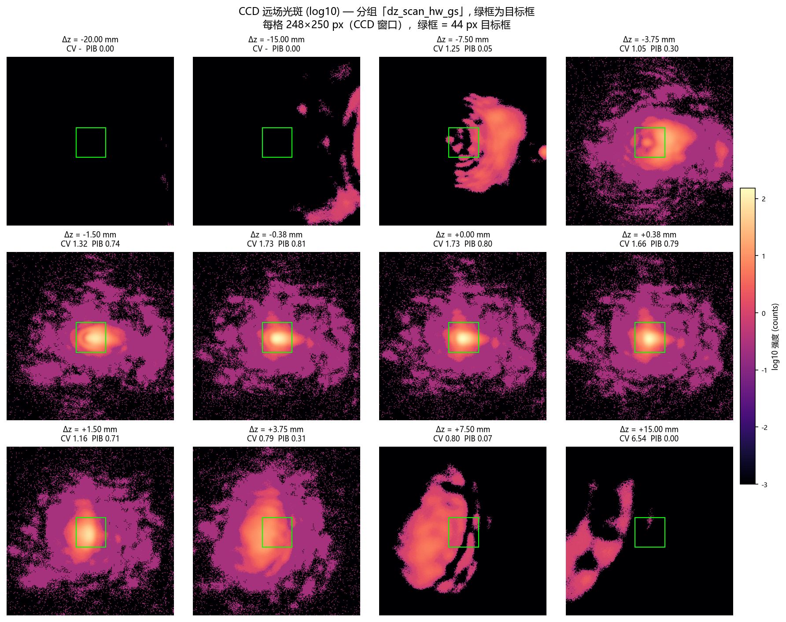

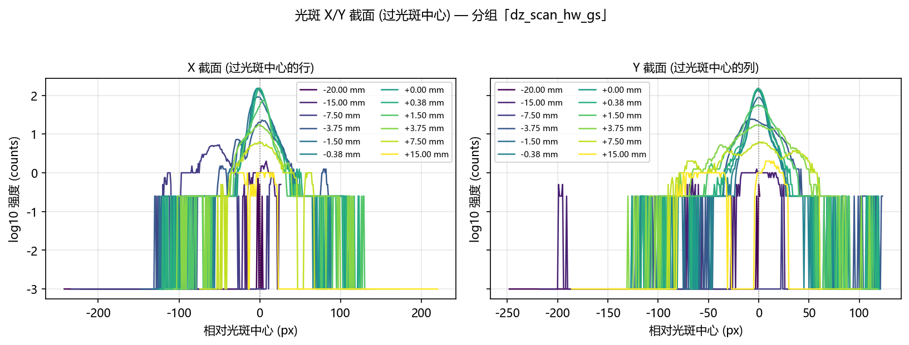

### 2.3 分组「dz_scan_model_gs」（曝光 0.400 ms，相位来源：模型 GS 相位（`OffFocusBench` 现场生成，Δz=0 的 plain GS））

记录目录：`data/debug/hw_groups_20261020/dz_scan_model_gs`

#### 2.3.1 主表

| 类型 | Δz (mm) | 面板边缘相位 (波) | FWHM (px) | 环形度 | 整帧峰值 | 质心偏移 (px) | CV 定尺 | PIB 定尺 | 复合分数 定尺 | CV 随斑 | 复合分数 随斑 | 框外功率占比 |
|---|---|---|---|---|---|---|---|---|---|---|---|---|
| 扫描 | -20 | 8.131 | 110.27 | 0.500 | 2.0 | 135.4 | - | 0.0000 | 0.0000 | 0.8400 | 0.4229 | 1.0000 |
| 扫描 | -15 | 6.098 | 39.40 | 0.550 | 4.0 | 125.0 | 7.4926 | 0.0006 | 0.0592 | 0.7137 | 0.3541 | 0.9994 |
| 扫描 | -10 | 4.065 | 41.66 | 0.753 | 9.0 | 72.2 | 0.9995 | 0.0343 | 0.2672 | 0.3295 | 0.4971 | 0.9657 |
| 扫描 | -7.5000 | 3.049 | 41.27 | 0.898 | 19 | 50.5 | 0.7835 | 0.0428 | 0.3017 | 0.4332 | 0.5264 | 0.9572 |
| 扫描 | -5.0000 | 2.033 | 32.18 | 0.921 | 35.2 | 32.0 | 1.2624 | 0.1646 | 0.3033 | 0.6261 | 0.5541 | 0.8354 |
| 扫描 | -3.7500 | 1.525 | 27.96 | 0.958 | 53.2 | 20.2 | 1.1474 | 0.3694 | 0.4175 | 0.7618 | 0.5720 | 0.6306 |
| 扫描 | -2.5000 | 1.016 | 21.57 | 0.862 | 84.2 | 10.5 | 0.9883 | 0.6089 | 0.5559 | 0.8886 | 0.5995 | 0.3911 |
| 扫描 | -1.5007 | 0.610 | 16.06 | 0.528 | 123.5 | 5.1 | 0.9254 | 0.7716 | 0.6455 | 0.9252 | 0.6421 | 0.2284 |
| 扫描 | -0.7504 | 0.305 | 21.07 | 0.704 | 108.8 | 4.9 | 0.8460 | 0.8343 | 0.6880 | 0.8662 | 0.6769 | 0.1657 |
| 扫描 | -0.3752 | 0.153 | 23.90 | 0.907 | 93.8 | 6.2 | 0.8417 | 0.8340 | 0.6885 | 0.8422 | 0.6875 | 0.1660 |
| 扫描 | -0.1876 | 0.076 | 23.54 | 0.926 | 100.5 | 7.4 | 0.8628 | 0.8271 | 0.6820 | 0.8493 | 0.6881 | 0.1729 |
| 基线 (无叠加) | 0.0000 | 0.000 | 22.82 | 0.906 | 106.2 | 7.4 | 0.8782 | 0.8290 | 0.6807 | 0.8657 | 0.6871 | 0.1710 |
| 扫描 | 0.0000 | 0.000 | 22.62 | 0.915 | 106.5 | 7.6 | 0.8923 | 0.8235 | 0.6760 | 0.8675 | 0.6876 | 0.1765 |
| 扫描 | 0.1876 | 0.076 | 21.51 | 0.928 | 112.5 | 8.4 | 0.9277 | 0.8140 | 0.6664 | 0.9038 | 0.6787 | 0.1860 |
| 扫描 | 0.3752 | 0.153 | 19.48 | 0.929 | 124 | 9.9 | 1.0197 | 0.7911 | 0.6431 | 0.9751 | 0.6651 | 0.2089 |
| 扫描 | 0.7504 | 0.305 | 17.86 | 0.897 | 138.2 | 11.3 | 1.1099 | 0.7564 | 0.6152 | 1.0441 | 0.6472 | 0.2436 |
| 扫描 | 1.5007 | 0.610 | 16.33 | 0.907 | 152.5 | 15.2 | 1.3605 | 0.6421 | 0.5329 | 1.1697 | 0.6115 | 0.3579 |
| 扫描 | 2.5000 | 1.016 | 20.08 | 0.815 | 95.8 | 19.8 | 1.2470 | 0.4761 | 0.4606 | 0.9011 | 0.6129 | 0.5239 |
| 扫描 | 3.7500 | 1.525 | 37.28 | 0.770 | 45.8 | 30.2 | 0.9865 | 0.2886 | 0.3960 | 0.5051 | 0.6340 | 0.7114 |
| 扫描 | 5.0000 | 2.033 | 41.50 | 0.742 | 28.2 | 36.3 | 0.9176 | 0.1844 | 0.3529 | 0.3935 | 0.5958 | 0.8156 |
| 扫描 | 7.5000 | 3.049 | 36.30 | 0.762 | 16.5 | 47.9 | 0.8927 | 0.0769 | 0.3026 | 0.3909 | 0.4994 | 0.9231 |
| 扫描 | 10 | 4.065 | 40.40 | 0.904 | 10 | 99.0 | 1.0090 | 0.0394 | 0.2686 | 0.3870 | 0.4726 | 0.9606 |
| 扫描 | 15 | 6.098 | 74.79 | 0.693 | 4.8 | 64.7 | 2.4513 | 0.0093 | 0.1495 | 0.4544 | 0.4518 | 0.9907 |
| 扫描 | 20 | 8.131 | 32.03 | 0.792 | 2.5 | 97.9 | 15.5242 | 0.0003 | 0.0304 | 0.5928 | 0.4904 | 0.9997 |
| 扫描 | 25 | 10.163 | 67.38 | 0.800 | 1.2 | 117.9 | - | 0.0000 | 0.0000 | 0.9341 | 0.4095 | 1.0000 |
| 扫描 | 30 | 12.196 | 15.50 | 0.920 | 1.0 | 87.9 | - | 0.0000 | 0.0000 | 2.3255 | 0.6277 | 1.0000 |
| 扫描 | 35 | 14.229 | 5.51 | 0.253 | 0.8 | 92.9 | - | 0.0000 | 0.0000 | 8.1524 | 0.4978 | 1.0000 |
| 扫描 | 40 | 16.261 | - | 0.000 | 0.0 | 176.1 | - | 0.0000 | 0.0000 | - | 0.0000 | 0.0000 |
| 扫描 | 45 | 18.294 | - | 0.000 | 0.0 | 176.1 | - | 0.0000 | 0.0000 | - | 0.0000 | 0.0000 |
| 扫描 | 50 | 20.327 | 174.55 | 0.080 | 0.2 | 144.4 | 1.0411 | 0.0312 | 0.2606 | 1.0399 | 0.2604 | 0.9688 |

表注：

- **类型**：「基线 (无叠加)」是探针在扫描前测的那一行（叠加层为空）；「扫描」行的 Δz=0
  那一行叠加的是一张**全零**二次相位 —— 物理上与基线等价，两行同时给出就是为了显示重复性
  （两者差 0.0047，远小于 3σ 地板）。
- **CV 列为「-」**：框内没有光时 CV 无定义（除零），按无数据显示。出现这一列的 Δz
  已经超出 125 px 的 ROI 半宽。
- **FWHM 列为「-」**：帧里没有可测光斑。
- **质心偏移**：相对**冻结**的 ROI 内零级位置 (125, 124) 的距离。

#### 2.3.2 与仿真 G1 曲线对拍

仿真的 G1 组（Δz 盲 GS、无离焦）取自 `report/shape_trials/fv_groups_fresnel_vs_vl.csv`
（与 `../gs_defocus_sim/gs_defocus_sim_20261019.md` §2.1 的 G1 行同源：Δz=0 处 score_fixed = 0.8073、
cv_fixed = 0.4215，两边逐位相同）。硬件侧取定尺框复合分数，各自对自己的 Δz=0 归一化。

| Δz (mm) | 仿真 G1 复合分数 (定尺) | 硬件 复合分数 (定尺) | 仿真 归一化 | 硬件 归一化 | 硬件 质心偏移 (px) |
|---|---|---|---|---|---|
| -1.5007 | 0.6569 | 0.6455 | 0.8137 | 0.9482 | 5.1 |
| -0.7504 | 0.7506 | 0.6880 | 0.9298 | 1.0107 | 4.9 |
| -0.3752 | 0.7907 | 0.6885 | 0.9795 | 1.0114 | 6.2 |
| -0.1876 | 0.8030 | 0.6820 | 0.9946 | 1.0018 | 7.4 |
| 0.0000 | 0.8073 | 0.6760 | 1.0000 | 0.9930 | 7.6 |
| 0.1876 | 0.8029 | 0.6664 | 0.9945 | 0.9790 | 8.4 |
| 0.3752 | 0.7906 | 0.6431 | 0.9793 | 0.9448 | 9.9 |
| 0.7504 | 0.7504 | 0.6152 | 0.9296 | 0.9037 | 11.3 |
| 1.5007 | 0.6577 | 0.5329 | 0.8147 | 0.7828 | 15.2 |

读法：

- **形状**：仿真在 |Δz| = 1.5007 mm 处的复合分数降到 Δz=0 的 0.8147（掉了 18.5%），这一组是 0.7828，**同样在下降**（掉了 21.7%，仿真是 18.5%）。 绝对值也对不上（硬件 Δz=0 的复合分数 0.6807 对仿真 0.8073）： 这一组的相位来源、目标框尺寸（44 px 对 47 px）、目标边长都与仿真的 G1 行**同口径**， 所以差距来自光路本身：仿真里 GS 相位与数字孪生**自洽**， 而同一张相位下发到真实实验系统上，照明没落在瞳面中心、相机也不在 2f 面上， 方斑并不成立（CV ≈ 0.73，与 2026-10-15 的硬件记录 CV ≈ 0.723 同量级）。
- **正负半轴**：仿真 G1 在 ±1.5007 mm 处差 0.0008，这一组差 0.1126，
  噪声地板 0.00061，是噪声地板的 185.4 倍 —— **这不是噪声**。

#### 2.3.3 转向：为什么硬件曲线不对称

瞳面二次相位以面板标称照明中心 (960, 600) 为中心，而照明并不落在那里，于是这张相位等价于
一片**偏心透镜**：它一边离焦，一边把光斑横向推走。实测质心 x 相对冻结零级的偏移随 Δz
线性增长，斜率 **-5.33 px/mm**（|Δz| ≤ 2.5 mm 内拟合；
全区间拟合是 -3.04 px/mm，但大 |Δz| 上光斑已跑出 ROI，
质心量到的是晕斑，斜率被稀释）。|Δz| = 1.5 mm 时约
8.0 px，|Δz| = 10 mm 时约
53 px。

| Δz (mm) | 质心 x 偏移 (px, 带符号) | 质心 y 偏移 (px) | 复合分数 定尺 | 复合分数 随斑 |
|---|---|---|---|---|
| -2.5000 | 6.8 | -8.0 | 0.5559 | 0.5995 |
| -1.5007 | 1.2 | -5.0 | 0.6455 | 0.6421 |
| -0.7504 | -3.0 | -3.9 | 0.6880 | 0.6769 |
| -0.3752 | -5.5 | -2.8 | 0.6885 | 0.6875 |
| -0.1876 | -6.8 | -2.9 | 0.6820 | 0.6881 |
| 0.0000 | -6.7 | -3.3 | 0.6807 | 0.6871 |
| 0.0000 | -7.2 | -2.5 | 0.6760 | 0.6876 |
| 0.1876 | -7.9 | -2.9 | 0.6664 | 0.6787 |
| 0.3752 | -9.5 | -2.6 | 0.6431 | 0.6651 |
| 0.7504 | -11.0 | -2.7 | 0.6152 | 0.6472 |
| 1.5007 | -15.1 | -2.0 | 0.5329 | 0.6115 |
| 2.5000 | -19.8 | -0.8 | 0.4606 | 0.6129 |

**这张表就是不对称的全部机制**。注意 Δz = 0 那一行：光斑质心已经比冻结框中心偏了约 8 px
（照明没落在瞳面中心，GS 方斑与零级不同心）。转向是**带符号**的，于是

- **负 Δz** 把光斑**推回**框中心（Δz = -1.5007 mm 时偏移只剩 1.2 px），
  框反而框住了光斑；
- **正 Δz** 把光斑**推得更远**（+1.5007 mm 时偏了 -15.1 px），
  框只框住光斑的一部分。

⇒ 正负半轴测到的不是「同一个离焦的两个方向」，而是「同一个离焦 + 两个方向的转向」。
这一组的 ±1.5007 mm 差值 0.1126（噪声地板 0.00061，是噪声地板的 185.4 倍 —— **这不是噪声**），
主要来自这个几何偏置，不是离焦本身有方向性。

后果：冻结框在 |Δz| ≳ 1.5 mm 之后开始被光斑**拖出框外**，于是

- 框内功率（PIB）随 |Δz| 单调掉到 0；
- 但**随斑框**的复合分数在 +3.75 mm 处回到 0.6340，
  高于 +1.5007 mm 处的 0.6115。

⇒ **冻结框口径下 |Δz| ≳ 1.5 mm 的劣化不能读作「离焦把光打散了」**；光还在，只是被搬走了。

#### 2.3.4 大 Δz 与 SLM 采样

面板边缘相位在 Δz = 20 mm 时是 8.13 波、Δz = 50 mm 时是 20.33 波。相邻像元的相位步进
在 Δz = 20 mm 时约 0.23 rad，**远小于 π**，所以**采样（奈奎斯特）不是瓶颈**；真正的限制是

- 晕斑半径：Δz = 20 mm 对应约 335 µm ≈ 152 px，而 ROI 半宽只有 125 px
  ⇒ 光斑整体跑出窗口（PIB = 0、框外功率占比 = 1）；
- 零级/杂散光：|Δz| ≥ 15 mm 后整帧峰值降到 3 counts 以下，**框里基本没有光**。

⇒ **把扫描限制在 |Δz| ≤ 20 mm 是对的**（面板边缘 8.13 波）；再往大推，
晕斑已跑出 ROI，既没有可测信号也没有物理意义。


#### 2.3.5 离焦响应：三套口径的对照

**目标框尺寸必须与被测相位匹配。** 探针原先把框写死成 44 px —— 那是**模型** GS 相位方斑的边长；
这一组的实际光斑只有 22.6 px 宽，
框比光斑大 1.9 倍。
复合分数是 `0.5·PIB + 0.5·(1/(1+CV))`：框远大于光斑时，离焦的**弥散把光填满框**（CV 反而变好），
均匀项**奖励**离焦，而功率项同时变差，两项几乎等量抵消 ⇒ 复合分数看起来「毫无反应」。
**离焦效果一直都在**（框内功率保持率在**正半轴**上严格单调下降；负半轴系统性地低一档，
那是转向不对称、不是非单调），只是被口径藏起来了。

匹配框 = 该相位 Δz=0 光斑自己的 FWHM（只定一次、之后冻结，不逐帧缩放）。
**读单调性必须按半轴读**：把 ±Δz 按 |Δz| 合并，量到的是正负不对称，不是离焦响应。

**三条读数纪律**（本表逐条对应）：

1. **复合分数不能当主指标。** 框空掉时 CV→0，`1/(1+CV)`→1，复合分数的地板是 **0.5 而不是 0**，
   于是它在**任何**孔径下都会**反弹**（本组 0.3200
   → 0.3143，|Δz| 3.75 → 5.0 mm：
   更差的图样反而得分更高）。
2. **「跟中心」口径在本实验系统的图样上不可用。** 相位互相关（`estimate_shift`）是仓库里
   为「模型自己的光斑」写的，对**散斑化的远场图样**不灵 （互相关峰值在 Δz ≥ 0.19 mm 就低于 0.3 的可用门限，最低到 0.00）；
   本表的「PIB（互相关跟中心）」列因此大面积为空。质心位移列只在光斑仍是单瓣时可信。
3. **唯一与转向无关的离焦读数是 `g r50`**（功率半径的相对增长）：它量的是图样摊开了多少，
   不看位置，所以转向污染不到它。

⇒ 冻结框心的 PIB 衰减在 |Δz| ≳ 1.5 mm 之后**不能**读作「离焦把光打散了」：
光斑同时被**推走**了（见本组的「转向」小节）。消除这个污染的办法是**给 chirp 配一个反向的瞳面斜坡**
（去倾斜），那部分已进代码（`--chirp-tilt-cancel`，自标定），等设备上线后复测。

| Δz (mm) | 光斑 FWHM (px) | 复合分数 44px (现口径) | PIB 23px (冻结框心) | 复合分数 23px (冻结框心) | 质心位移 dx (px) | r50 (px) | PIB (互相关跟中心) | g r50 (归一) |
|---|---|---|---|---|---|---|---|---|
| -20 | 110.3 | 0.0000 | 0.0000 | 0.0000 | 111.2 | 99.3 | - | 6.382 |
| -15 | 39.4 | 0.0592 | 0.0001 | 0.0582 | 55.0 | 75.9 | - | 4.876 |
| -10 | 41.7 | 0.2672 | 0.0123 | 0.2715 | 65.0 | 69.9 | - | 4.495 |
| -7.5000 | 41.3 | 0.3017 | 0.0129 | 0.3197 | 41.8 | 33.1 | - | 2.128 |
| -5.0000 | 32.2 | 0.3033 | 0.0247 | 0.3010 | 25.5 | 28.9 | - | 1.856 |
| -3.7500 | 28.0 | 0.4175 | 0.0725 | 0.2885 | 15.6 | 20.8 | - | 1.335 |
| -2.5000 | 21.6 | 0.5559 | 0.1934 | 0.3630 | 6.8 | 23.0 | - | 1.477 |
| -1.5007 | 16.1 | 0.6455 | 0.3211 | 0.4672 | 1.2 | 15.5 | - | 0.998 |
| -0.7504 | 21.1 | 0.6880 | 0.3828 | 0.5238 | -3.0 | 15.9 | - | 1.021 |
| -0.3752 | 23.9 | 0.6885 | 0.3939 | 0.5247 | -5.5 | 15.6 | - | 1.001 |
| -0.1876 | 23.5 | 0.6820 | 0.3867 | 0.5123 | -6.8 | 15.7 | - | 1.012 |
| 0.0000 | 22.6 | 0.6760 | 0.3941 | 0.5148 | -7.2 | 15.6 | 0.3941 | 1.000 |
| 0.1876 | 21.5 | 0.6664 | 0.3831 | 0.5008 | -7.9 | 15.8 | - | 1.014 |
| 0.3752 | 19.5 | 0.6431 | 0.3668 | 0.4821 | -9.5 | 16.1 | - | 1.037 |
| 0.7504 | 17.9 | 0.6152 | 0.3331 | 0.4557 | -11.0 | 17.0 | - | 1.095 |
| 1.5007 | 16.3 | 0.5329 | 0.2460 | 0.3973 | -15.1 | 19.4 | - | 1.246 |
| 2.5000 | 20.1 | 0.4606 | 0.1494 | 0.3554 | -19.8 | 18.9 | - | 1.216 |
| 3.7500 | 37.3 | 0.3960 | 0.0756 | 0.3200 | -30.2 | 20.6 | - | 1.323 |
| 5.0000 | 41.5 | 0.3529 | 0.0425 | 0.3143 | -36.1 | 27.4 | - | 1.759 |
| 7.5000 | 36.3 | 0.3026 | 0.0159 | 0.3231 | -46.9 | 43.0 | - | 2.762 |
| 10 | 40.4 | 0.2686 | 0.0134 | 0.3037 | -91.5 | 89.1 | - | 5.727 |
| 15 | 74.8 | 0.1495 | 0.0004 | 0.0727 | -64.1 | 51.6 | - | 3.318 |
| 20 | 32.0 | 0.0304 | 0.0003 | 0.0553 | -97.7 | 60.8 | - | 3.906 |
| 25 | 67.4 | 0.0000 | 0.0000 | 0.0000 | -116.8 | 51.9 | - | 3.336 |
| 30 | 15.5 | 0.0000 | 0.0000 | 0.0000 | -86.4 | 18.3 | - | 1.178 |
| 35 | 5.5 | 0.0000 | 0.0000 | 0.0000 | -77.0 | 13.5 | - | 0.865 |
| 40 | - | 0.0000 | 0.0000 | 0.0000 | -125 | - | - | - |
| 45 | - | 0.0000 | 0.0000 | 0.0000 | -125 | - | - | - |
| 50 | 174.6 | 0.2606 | 0.0084 | 0.2471 | -101.3 | 140.8 | - | 9.051 |

**孔径灵敏度**（同一批帧，只换目标框尺寸；正半轴）：

| 目标框边长 | 复合分数 @Δz=0 | 复合分数 @Δz=1.5007 mm | 相对降幅 | 最小 PIB (正半轴) |
|---|---|---|---|---|
| 8 px | 0.4417 | 0.3754 | 0.150 | 0.0000 |
| 10 px | 0.4420 | 0.3671 | 0.169 | 0.0000 |
| 13 px | 0.4474 | 0.3622 | 0.190 | 0.0000 |
| 16 px | 0.4626 | 0.3725 | 0.195 | 0.0000 |
| 20 px | 0.4892 | 0.3878 | 0.207 | 0.0000 |
| 44 px | 0.6760 | 0.5329 | 0.212 | 0.0000 |

⇒ 所测的全部孔径（8 ~ 44 px）都能看到离焦响应，结论与孔径无关。


#### 2.3.6 CCD 远场光斑与光斑截面

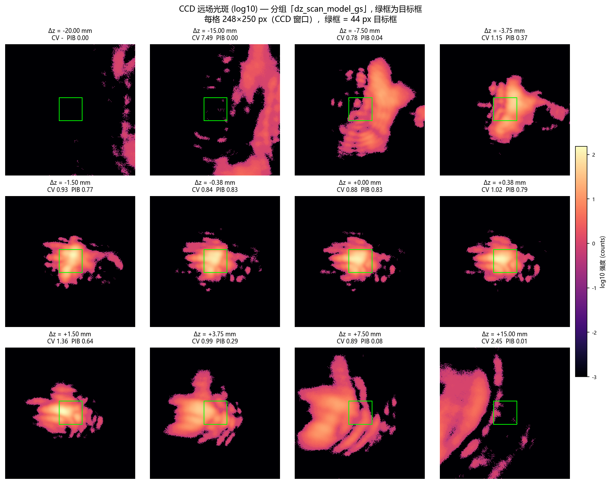

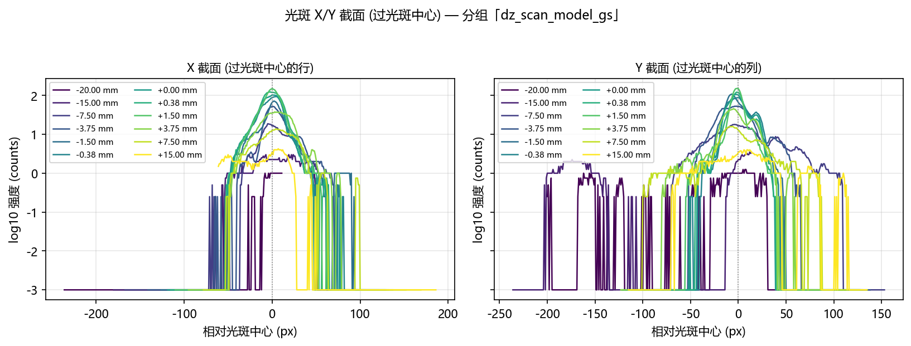


---


---

## 3. 泽尼克阶数扫描（硬件）

采集脚本：`scripts/slm/run_gs_refine_zernike_sweep.py --cam-type daheng --defocus-focal-mm 1597.4`，
数据目录 `data\debug\hw_zernike_sweep_20261020b`。

三阶段：Stage A = GS 预矫正 + SPGD 细化（硬件闭环）→ Stage B = Noll 序 Zernike 最小二乘拟合
→ Stage C = 在 Zernike 系数上做 SPGD。目标框由平场光斑 waist 推导，**全程冻结**。

**数据来源与同源性核查** —— 本节的数字由 **1** 份 `summary.json` 合并而成，组目录：`hw_zernike_sweep_20261020b`。

- `orders`：**逐组按 n_max 拼起来**（同一个 n_max 出现两次时取**后一次**）。
- 其余字段：取**第一份含该字段的** summary 的值 —— 本报告正文读到的那些字段来自 `w0_px`（`hw_zernike_sweep_20261020b`）、`baselines`（`hw_zernike_sweep_20261020b`）、`config`（`hw_zernike_sweep_20261020b`）。
- 跨组核对的**标量口径字段**是 `w0_px`、`target_side`、`center_xy`、`mask_center_xy`（同一轮扫描里它们本应一致）。
- 跨组差异**分两类判别**：像素坐标类字段（`center_xy`、`mask_center_xy`）的逐轴偏差 ≤ **2 px** ⇒ **良性**（同轮内的定位抖动）；连续量字段（`w0_px`、`target_side`）的相对差 > **0.5%** ⇒ **恶性**（疑似跨轮次混入）。
- **可比性先判**：同一空间才谈得上「偏差多少」。`center_xy` 是**全幅传感器**坐标（每组都在同一块传感器上定位零级）⇒ **永远可比**；`mask_center_xy` 是**窗口内**坐标 ⇒ 取两组的**共同窗口**（逐轴取小）作为「可能的窗口内空间」，两个取值**都落在里面**才当同空间判偏差；**有一个落在外面** ⇒ 它是**全幅**坐标 ⇒ 两者的数**不可直接比较**。

**阈值为什么是这两个数**：像素坐标的 **2 px** —— 实测逐阶组各自在**自己那一帧**上重新定位零级，散布只有 **±1 px**（第二轮八个逐阶组的 `mask_center_xy` 落在 `[126,128]` / `[127,128]` / `[127,127]` / `[126,127]` 四种上），2 px 是它的一倍余量；连续量的 **0.5%** —— 实测跨轮次的光学状态差异是 **1.13%**（第二轮混进来的 `zernike_stage_a_1`：`w0_px` 5.742078 → 5.807177），阈值取它的一半不到，好让这种差异**被报出来**而不是被当成噪声吞掉。

**为什么可比性看「取值」而不是看「`frame_shape` 是否相等」**：两个生产者写的 `frame_shape` **不是一个意思** —— Stage A 块记的是**全幅** `probe_shape`（1944×2592），但它的 `mask_center_xy` 在 2026-10-21 的续跑坐标修复（提交 07139db6）**之后**已经是**窗口内**坐标（优化器冻结的 ROI 中心）。按 `frame_shape` 判 ⇒ 把**其实同空间**的取值误判成「不同空间」⇒ 正文里印一句**不成立**的话，还白白**抑制掉一次交叉核对**（逐阶组的掩膜中心 vs 块的掩膜中心 —— 差得多就说明某一块的 ROI 摆歪了）。改判「取值是否落在共同窗口内」之后：**第二轮**（`mask_center_xy` 是全幅的 `[1433, 971]`，超出 256×256 的共同窗口）**仍判不同空间** ⇒ 已入库的第二轮报告结论不变；**第三轮**（`[127, 128]`，落在窗口内）**判同空间** ⇒ 交叉核对恢复生效。

### 3.1 基线

| 相位 | CV | PIB | EE | AR | 复合分数 |
|---|---|---|---|---|---|
| 平场 | 0.3146 | 0.2681 | 0.2681 | 1.1111 | 0.4638 |
| GS 逐像素相位 | 0.3065 | 0.2803 | 0.2803 | 1.2500 | 0.4233 |

### 3.2 阶数扫描

| n_max | 模态数 | 拟合残差 (rad) | max\|c\| (rad) | clip 警告 | CV 前 | CV 后 | PIB 前 | PIB 后 | EE 后 | 复合分数 后 | SPGD 有改善 |
|---|---|---|---|---|---|---|---|---|---|---|---|
| 3 | 10 | 0.3105 | 0.3106 |  | 0.2238 | 0.2125 | 0.1468 | 0.1486 | 0.1486 | 0.5209 | 是 |
| 4 | 15 | 0.3000 | 0.3106 |  | 0.2129 | 0.2124 | 0.1509 | 0.1537 | 0.1537 | 0.5230 | 是 |
| 6 | 28 | 0.2840 | 0.3106 |  | 0.2109 | 0.2179 | 0.1555 | 0.1579 | 0.1579 | 0.5219 | 是 |
| 8 | 45 | 0.2695 | 0.3106 |  | 0.2076 | 0.2106 | 0.1622 | 0.1647 | 0.1647 | 0.5284 | 是 |
| 11 | 78 | 0.2529 | 0.3106 |  | 0.2090 | 0.2174 | 0.1589 | 0.1566 | 0.1566 | 0.5216 | 是 |
| 15 | 136 | 0.2237 | 0.3106 |  | 0.2040 | 0.1936 | 0.1606 | 0.1592 | 0.1592 | 0.5353 | 是 |
| 20 | 231 | 0.1895 | 0.3106 |  | 0.1984 | 0.2073 | 0.1586 | 0.1504 | 0.1504 | 0.5244 | 是 |
| 25 | 351 | 0.1566 | 0.3106 |  | 0.2069 | 0.2069 | 0.1542 | 0.1542 | 0.1542 | 0.5261 | 否 |

### 3.2.1 各阶的 CCD 远场光斑图

下面是泽尼克扫描自己在每一阶保存的远场图（`before` = 纯 Zernike 拟合相位，
`after` = 再叠加该阶的 SPGD 优化结果），窗口是该扫描的 256×256 ROI、
目标框 9.96 px（= 平场 waist 4.98 px 的两倍）。

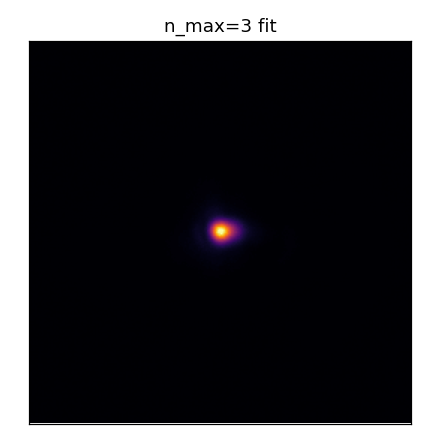

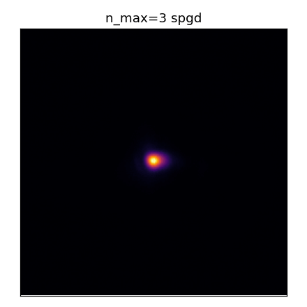


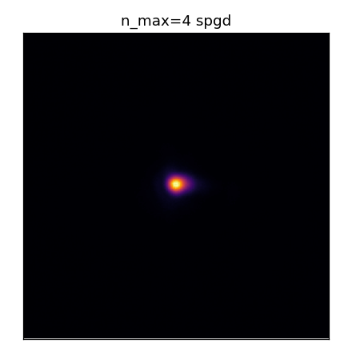

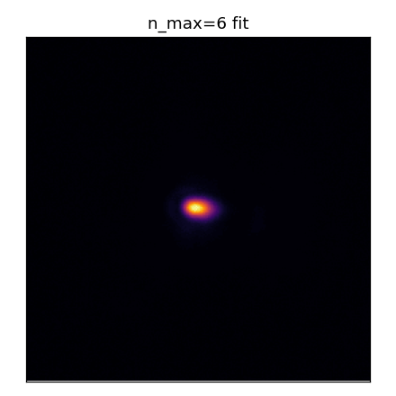

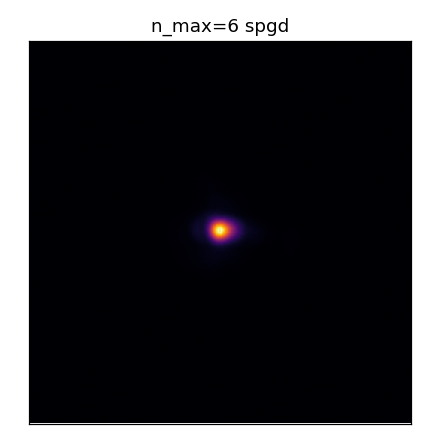


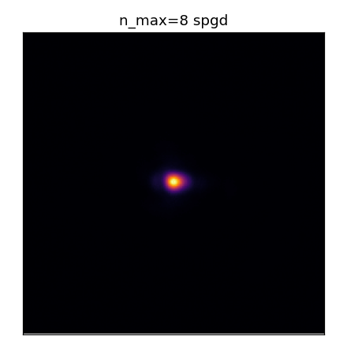


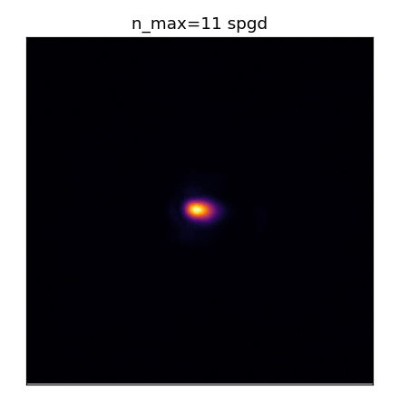

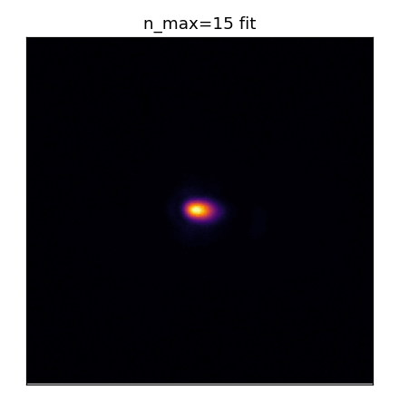

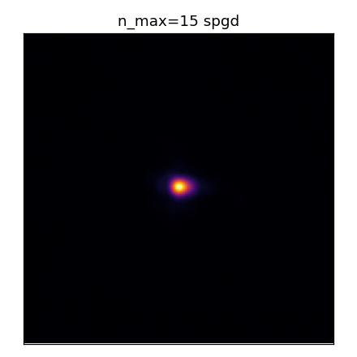

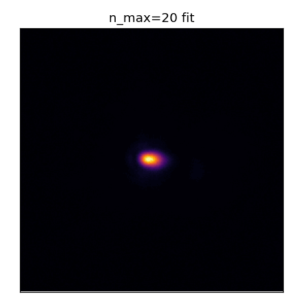

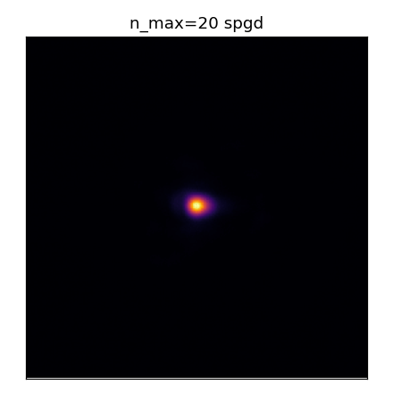

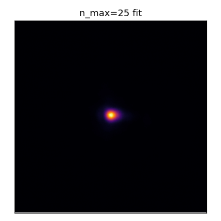


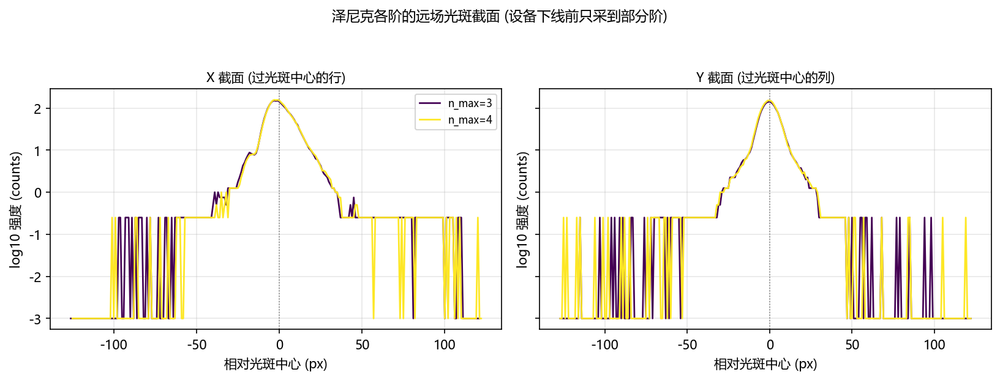

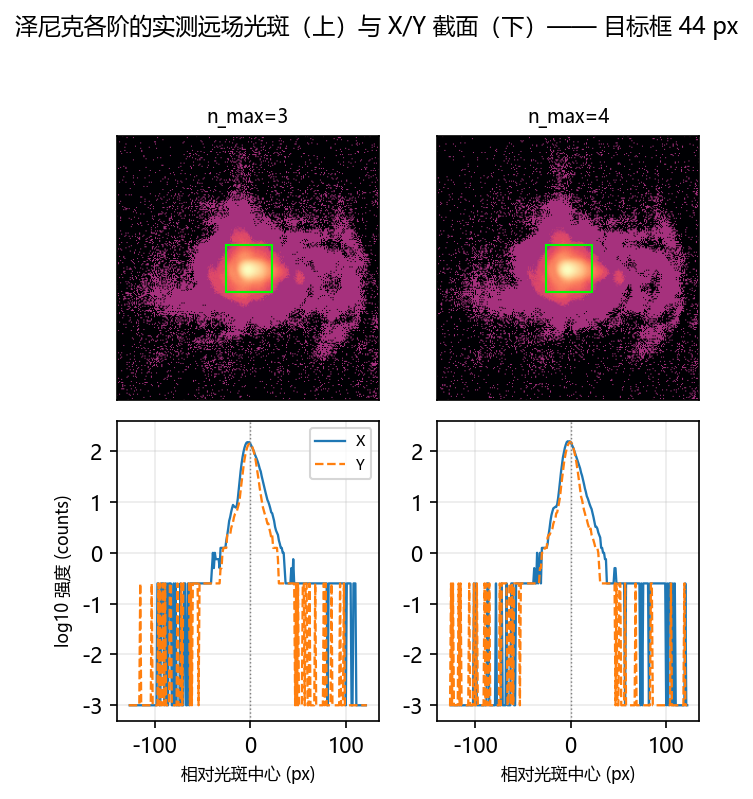

### 3.3 阶数能不能排序

**差异可以分辨，但不是「阶数越高越好」。** 阶数之间的 CV 跨度 0.0243 是同口径噪声 0.00543 的 4.5 倍，PIB 跨度 0.0161 是地板 0.00250 的 6.4 倍 —— **超过 3σ，差异不是噪声**。 但三点必须同时说：

   - **CV 随阶数只是整体下降、并不单调**：SPGD 之前（纯 Zernike 拟合）CV 从 0.2238（n_max=3）降到 0.1984（n_max=20），跨度 0.0254，但 n_max=11 与 25 处有回升，**不是单调改善**。
   - **CV 变好不等于整形变好**：同一批相位的框内功率 PIB 反而从 0.1622 降到 0.1468（跨度 0.0155），而 GS 逐像素相位本身是 CV 0.3065 / PIB 0.2803。 截断到低阶 Zernike 会把方斑**抹平**：框内更均匀（CV 低），但代价是**近一半的框内功率被摊到框外**。 只看 CV 会把这个「平滑」误读成「整形更好」。
   - **Stage C 的 SPGD 基本没有改变结果**：各阶 `after` 与 `before` 的 CV 差最大只有 0.0113，与同口径噪声 0.00543 同量级，且 n_max=25 直接记为 `spgd_improved=false`。 所以阶数之间的差异**全部来自 Stage B 的 Zernike 拟合**，不是 SPGD 优化出来的。

判据用的噪声地板必须与阶数比较**同口径**（泽尼克扫描那把 9.96 px 目标框、
0.200 ms 曝光），
所以不能用 §1.2 那条（那条是离焦探针的 44 px 目标框，框大了 ~20 倍，光子数多一个量级，
σ 小得多，拿来判阶数差异会**高估**可分辨性）。这里从泽尼克扫描自己的逐轮记录里取：

| 量 | σ (同口径) | 来源 | 说明 |
|---|---|---|---|
| CV | 0.00543 | 各阶 `after - before` 配对差 / √2（8 阶取中位数） | 保守：把 SPGD 那点真实改善也算进了差里 |
| PIB | 0.00250 | 各阶逐轮 `m_roi_pib` 的组内标准差（8 阶取中位数） | SPGD 的更新被噪声门挡掉（150 轮只放行 4 次），逐轮量的是几乎同一个相位 |

- 拟合残差随阶数单调不增；
  这是本轮唯一在阶数方向上单调的量。
- 各阶的 `max|c|` 与 `ZERNIKE_CLIP = 5.0` rad 的关系见上表「clip 警告」列。
- 本轮**只有 1 个 seed**，没有配对轴，因此不做显著性检验；
  `ml/zernike/eval_stats.py` 的 sign-flip 置换检验需要「同 seed 配 seed」，1 个 seed 无从配对。


---

## 4. 图

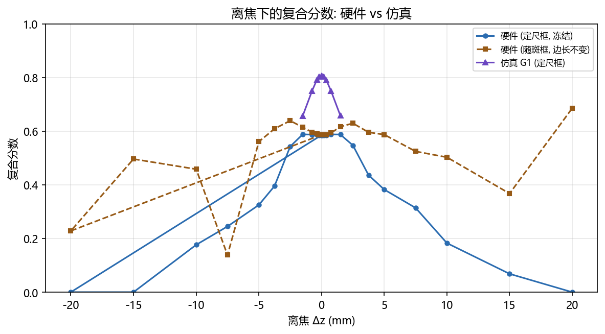

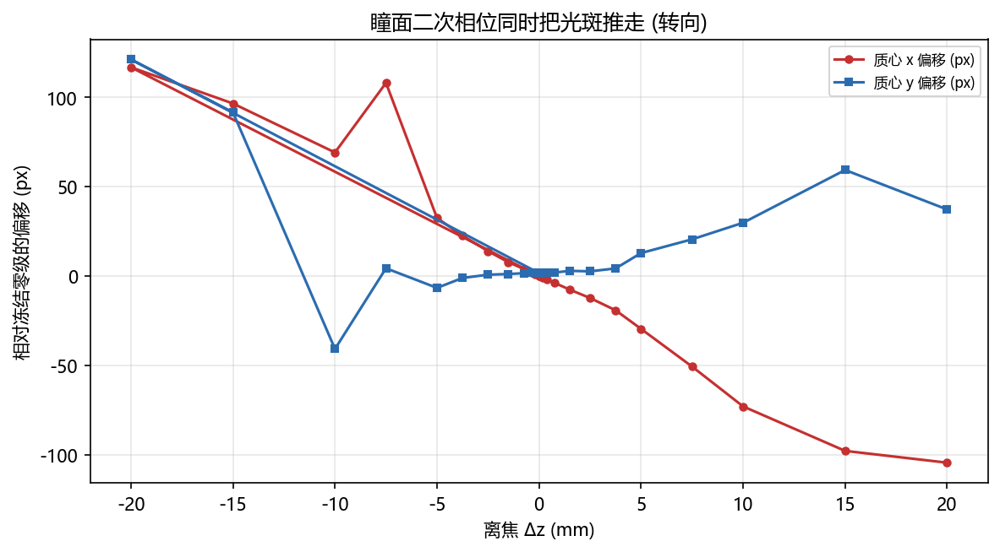

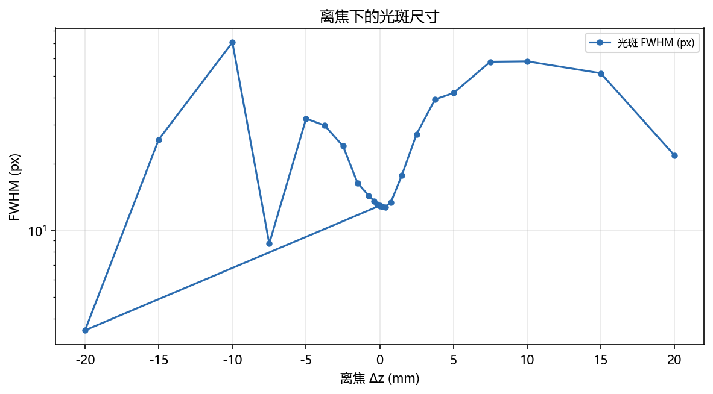

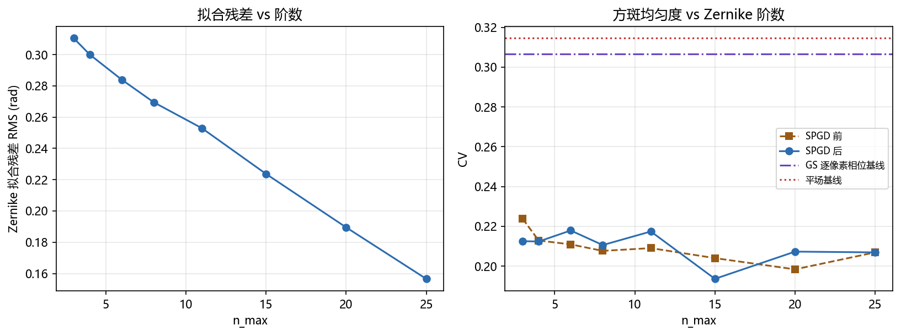

---

## 5. 限制（不能断言什么）

1. **离焦响应的可读区间只有 |Δz| ≤ 1.5 mm。** 更大的 Δz 上，转向分量压过离焦分量，
   冻结框口径不再度量「离焦」。
2. **本轮没有做「在工作点上重新优化」的硬件版。** 仿真报告的核心结论是
   「离焦本身不值钱, 值钱的是在工作点上重新优化」（G1′−G1 = +0.1465，而离焦并入环路的净贡献
   只有 +0.0179）。硬件上逐 Δz 重跑 GS 闭环的成本是本轮预算的数十倍，**本报告没有验证这一条**。
3. **离焦扫描用的是硬件 GS 相位**（泽尼克扫描 Stage A 产出、Stage B 拟合的就是这一张），
   与第 3 节同一张相位；模型 GS 相位那组只是**对照**（它证明模型相位在实验系统上不成方斑）。
4. **焦面标定有平台**：峰值判据在一段 D 上饱和（判别说明见 §1.3 的标定器记录），
   本轮取 **1/f = 0.626 m⁻¹
   （f_v = 1597.4 mm）**。平台内的选择会改变 Δz=0
   的参考点，所以本报告所有「相对 Δz=0 的变化」都带着这个参考点的不确定性。
5. **离焦组与噪声组各有一条噪声地板，口径不同**：离焦组用 44 px 目标框
   （0.200 ms，硬件 GS 相位），阶数比较用泽尼克扫描自己的
   目标框（见 §3.3）。**两者不可互相替代**。
6. **泽尼克阶数只有 1 个 seed**，且 Stage A 的 GS 相位只优化了 250 轮、Stage C 每阶 150 轮。
   没有配对轴，所以不做显著性检验（`ml/zernike/eval_stats.py` 的 sign-flip 置换检验
   需要「同 seed 配 seed」）。
7. **本轮只测了一个离焦方向的两个半轴，没有做「在工作点上重新优化」的硬件版**（见上第 2 条）。
8. **补拍「泽尼克各阶远场组」的覆盖情况**：本轮 只有 2/8 阶拍到了原始帧（已拍到 n_max = 3, 4，缺 6, 8, 11, 15, 20, 25）；缺的那些阶在 §3.2.1 里用泽尼克扫描自己保存的 PNG 顶上。
9. **本报告不主张的事情**（逐条列出来，避免被误读）：
   - **不**主张「实验系统对离焦不敏感」—— 复合分数在 |Δz| ≤ 2.5 mm 上「平」是**口径的产物**
     （框 ≫ 光斑 ⇒ 均匀项奖励离焦），不是物理结论。
   - **不**主张「离焦强烈破坏图样」（基于冻结框心的读数）—— 光斑会随 Δz 被**推走**（瞳面 chirp
     带 ∝ Δz 的倾斜分量），推走的量是**模拟方式的倾斜**、不是离焦。本组实测的转向速率是
     -5.20 px/mm，光斑在 |Δz| ≳ 4.2 mm 处就会被推出 44 px 的框，换成按光斑自身宽度的「匹配框」口径（13 px）则是 ≳ 1.3 mm；
     要不要把转向当成主导项，看这个数与光斑被推出框所需的 Δz（4.2 mm）的关系，
     不能只看复合分数。
   - **不**主张硬件与仿真的正负半轴不对称是**实验系统**的性质 —— 瞳面 chirp 以面板标称中心
     (960, 600) 为中心而照明不在那里，于是它带一个 ∝ Δz 的**倾斜**分量（远场位移 ∝ Δz），
     而仿真的 chirp 打在光束中心、**没有**倾斜。所以这里的不对称有一部分来自**模拟方式**，
     不是光学。
   - **不**跨相位比较复合分数/PIB 的**绝对值**（两组的孔径不同：44 px 对 44 px），只比
     **归一化**曲线。
   - **不**把 FWHM 当离焦指标（环形/分裂图样会让它量到环的厚度；本组实测 FWHM 在 3.5 ~ 174.6 px
     之间跳，模型相位组还非单调）。FWHM 只作描述列。
   - **不**说「跟中心就消除了转向污染」—— 互相关在本实验系统的散斑图样上不可用
      （见「三套口径」对照里「跟中心」口径的第 2 条注）。
   - 44 px 那组数字**本身没错**（对该孔径而言是对的），错的是从它推出的结论；
     所以它只当「口径 A」保留 —— 结论要看按光斑自身宽度重算的「匹配框」口径，
     并由孔径灵敏度表说明结论不是孔径选出来的。

---

## 6. 复现

```bash
# 一次只跑一组变量: 计划文件里每一组是一次独立调用, 各自单独记录。
python scripts/slm/run_hw_sweep_groups.py --plan data/debug/hw_groups_20261020/plan_all.json

# 离线出图 (本报告)
python scripts/slm/generate_hw_defocus_zernike_report.py --groups-root data/debug/hw_groups_20261020 --groups-root data/debug/hw_zernike_sweep_20261020b --focus-evidence data/debug/bench_settings/focus_probe/slm1_20261020_093932.json --report-key report/shape_trials/hw_defocus_zernike/hw_defocus_zernike_20261020.md

# 本轮每一组的**实际调用** (取自分组索引 groups_manifest.json, 原样照抄)
# dz_scan_hw_gs  [adopted, 24 行]
python scripts/slm/run_hw_sweep_groups.py --plan data/debug/hw_groups_20261020/plan_all.json --only dz_scan_hw_gs
# dz_noise_hw_gs  [adopted, 10 行]
python scripts/slm/run_hw_sweep_groups.py --plan data/debug/hw_groups_20261020/plan_all.json --only dz_noise_hw_gs
# dz_scan_model_gs  [adopted, 30 行]
python scripts/slm/run_hw_sweep_groups.py --plan data/debug/hw_groups_20261020/plan_all.json --only dz_scan_model_gs
# zernike_farfield_nmax3  [adopted, 2 行]
python scripts/slm/run_hw_sweep_groups.py --plan data/debug/hw_groups_20261020/plan_all.json --only zernike_farfield_nmax3
# zernike_farfield_nmax4  [adopted, 2 行]
python scripts/slm/run_hw_sweep_groups.py --plan data/debug/hw_groups_20261020/plan_all.json --only zernike_farfield_nmax4
# zernike_farfield_nmax6  [failed, None 行]
D:\Projects\TIFO\AO-shaping\.venv\Scripts\python.exe scripts/slm/hw_gs_defocus_probe.py --execute --group zernike_farfield_nmax6 --group-meta role=zernike_farfield --group-meta n_max=6 --group-meta phase=zernike_fit --group-meta exposure_ms=0.2 --out-root data/debug/hw_groups_20261020 --defocus-focal-mm 1597.4 --exposure-ms 0.2 --frames 4 --gs-phase data/debug/hw_groups_20261020/zernike_farfield/phases/phase_nmax6.npy --dz-mm 0
# zernike_farfield_nmax8  [failed, None 行]
D:\Projects\TIFO\AO-shaping\.venv\Scripts\python.exe scripts/slm/hw_gs_defocus_probe.py --execute --group zernike_farfield_nmax8 --group-meta role=zernike_farfield --group-meta n_max=8 --group-meta phase=zernike_fit --group-meta exposure_ms=0.2 --out-root data/debug/hw_groups_20261020 --defocus-focal-mm 1597.4 --exposure-ms 0.2 --frames 4 --gs-phase data/debug/hw_groups_20261020/zernike_farfield/phases/phase_nmax8.npy --dz-mm 0
# zernike_farfield_nmax11  [failed, None 行]
D:\Projects\TIFO\AO-shaping\.venv\Scripts\python.exe scripts/slm/hw_gs_defocus_probe.py --execute --group zernike_farfield_nmax11 --group-meta role=zernike_farfield --group-meta n_max=11 --group-meta phase=zernike_fit --group-meta exposure_ms=0.2 --out-root data/debug/hw_groups_20261020 --defocus-focal-mm 1597.4 --exposure-ms 0.2 --frames 4 --gs-phase data/debug/hw_groups_20261020/zernike_farfield/phases/phase_nmax11.npy --dz-mm 0
# zernike_farfield_nmax15  [failed, None 行]
D:\Projects\TIFO\AO-shaping\.venv\Scripts\python.exe scripts/slm/hw_gs_defocus_probe.py --execute --group zernike_farfield_nmax15 --group-meta role=zernike_farfield --group-meta n_max=15 --group-meta phase=zernike_fit --group-meta exposure_ms=0.2 --out-root data/debug/hw_groups_20261020 --defocus-focal-mm 1597.4 --exposure-ms 0.2 --frames 4 --gs-phase data/debug/hw_groups_20261020/zernike_farfield/phases/phase_nmax15.npy --dz-mm 0
# zernike_farfield_nmax20  [failed, None 行]
D:\Projects\TIFO\AO-shaping\.venv\Scripts\python.exe scripts/slm/hw_gs_defocus_probe.py --execute --group zernike_farfield_nmax20 --group-meta role=zernike_farfield --group-meta n_max=20 --group-meta phase=zernike_fit --group-meta exposure_ms=0.2 --out-root data/debug/hw_groups_20261020 --defocus-focal-mm 1597.4 --exposure-ms 0.2 --frames 4 --gs-phase data/debug/hw_groups_20261020/zernike_farfield/phases/phase_nmax20.npy --dz-mm 0
# zernike_farfield_nmax25  [failed, None 行]
D:\Projects\TIFO\AO-shaping\.venv\Scripts\python.exe scripts/slm/hw_gs_defocus_probe.py --execute --group zernike_farfield_nmax25 --group-meta role=zernike_farfield --group-meta n_max=25 --group-meta phase=zernike_fit --group-meta exposure_ms=0.2 --out-root data/debug/hw_groups_20261020 --defocus-focal-mm 1597.4 --exposure-ms 0.2 --frames 4 --gs-phase data/debug/hw_groups_20261020/zernike_farfield/phases/phase_nmax25.npy --dz-mm 0
# zernike_order  [adopted, None 行]
python scripts/slm/run_hw_sweep_groups.py --plan data/debug/hw_groups_20261020/plan_all.json --only zernike_order
```

采集目录：离焦与噪声组在 `data/debug/hw_groups_20261020`；
泽尼克阶数组在 `data/debug/hw_zernike_sweep_20261020b`；
分组索引 `data/debug/hw_groups_20261020/groups_manifest.json`。
