# 硬件离焦扫描 + 多阶泽尼克匀化测试报告（2026-10-21）

<!-- provenance:start -->
> **生成脚本**: [`scripts/slm/generate_hw_defocus_zernike_report.py`](../../../scripts/slm/generate_hw_defocus_zernike_report.py)
> **复现命令**: `python scripts/slm/generate_hw_defocus_zernike_report.py --groups-root data/debug/hw_groups_20261021 --groups-root data/debug/hw_zernike_sweep_20261021 --focus-evidence-dir data/debug/hw_groups_20261021/focus_calibration --report-key report/shape_trials/hw_defocus_zernike/hw_defocus_zernike_20261021.md`
> **数据/关联脚本**: [`scripts/slm/hw_gs_defocus_probe.py`](../../../scripts/slm/hw_gs_defocus_probe.py)
> **数据/关联脚本**: [`scripts/slm/run_gs_refine_zernike_sweep.py`](../../../scripts/slm/run_gs_refine_zernike_sweep.py)
> **运行环境**: 硬件
> **说明**: 实验系统离焦扫描 + 多阶泽尼克匀化测试的**第二轮 (复测)**: 光路恢复后重新标定焦面 (f_v = 1523.8 mm, 本轮 13:31 实测 1/f = +0.652 m^-1), 26 组每组一次独立调用且每组 <=10 分钟 (焦面标定 → Stage A 分 6 块 → 8 个逐阶组 → 离焦噪声组 → 离焦扫描组 → 模型相位对照组 → 8 个各阶远场补拍组), 目标框改为**预先登记**的该相位自己的成形目标, 离焦扫描带瞳面二次相位的去倾斜自标定; 受阻检测已并入自动焦面标定 (焦面探测把「光路受阻」与「找不到焦面」分成退出码 3 / 2, 两个采集脚本开跑前做同样的光路自检); 数字全部来自 scripts/slm/hw_gs_defocus_probe.py 与 scripts/slm/run_gs_refine_zernike_sweep.py 的落盘产物, 本脚本只离线重算逐帧光斑量并渲染图
<!-- provenance:end -->

**本轮结论**：离焦扫描与泽尼克阶数扫描都在**真实实验系统**上在线实现，与
[`gs_defocus_sim_20261019.md`](../gs_defocus_sim/gs_defocus_sim_20261019.md) 的纯仿真结论逐条对拍。三条主要结论：

1. **实验系统自带 |Δz| ≈ 9.8 mm 的常驻离焦，必须先做瞳面焦面矫正**。
   第一轮实测：平相位下光斑 FWHM ≈ 115 px 且呈环形；
   加上 `fresnel_panel(f_v = 1523.8 mm)` 的瞳面二次相位后，
   光斑收到 **15.0 px**，峰值/曝光提高
   **约 33 倍**（本轮重新标定，见 §1.3）。
   不矫正就直接扫 Δz，测到的不是离焦响应而是一个弥散环。
2. **瞳面二次相位在这套实验系统上不是纯粹的离焦，它同时把光斑推走**（转向）。主组实测转向速率
   **-0.13 px/mm**（质心 x 相对冻结零级，|Δz| ≤ 2.5 mm 内拟合）。
   转向叠加在「光斑本来就不在框中心」之上，于是同一个 |Δz| 在正负半轴上的劣化不对称：
   本轮各组在 ±1.5007 mm 处的差值是 「dz_scan_hw_gs」0.0507、「dz_scan_model_gs」0.0328（噪声地板 0.00123），
   而仿真那边只差 0.0008 —— 这是硬件与仿真最大的口径差异。
   各组 |Δz| = 1.5007 mm 相对 Δz=0 的复合分数变化是 「dz_scan_hw_gs」0.225、「dz_scan_model_gs」0.075。
   本轮离焦组带**去倾斜自标定**（`--chirp-tilt-cancel`：先用测试斜坡测出面板→相机轴的
   映射与符号，再加一片反向的瞳面斜坡把转向分量抵消），所以转向对读数的影响应比第一轮小；
   孔径是否仍会藏住响应由本组的孔径灵敏度表自己给出。
3. **泽尼克阶数扫描在硬件上在线实现 8 阶**：**差异可以分辨，但不是「阶数越高越好」。** 阶数之间的 CV 跨度 0.0616 是同口径噪声 0.00330 的 18.7 倍，PIB 跨度 0.0320 是地板 0.00249 的 12.9 倍 —— **超过 3σ，差异不是噪声**。 但三点必须同时说：

   - **CV 随阶数只是整体下降、并不单调**：SPGD 之前（纯 Zernike 拟合）CV 从 0.2542（n_max=3）降到 0.1900（n_max=3），跨度 0.0643，但 n_max=11 与 25 处有回升，**不是单调改善**。
   - **CV 变好不等于整形变好**：同一批相位的框内功率 PIB 反而从 0.1412 降到 0.1067（跨度 0.0344），而 GS 逐像素相位本身是 CV 0.4416 / PIB 0.2720。 截断到低阶 Zernike 会把方斑**抹平**：框内更均匀（CV 低），但代价是**近一半的框内功率被摊到框外**。 只看 CV 会把这个「平滑」误读成「整形更好」。
   - **Stage C 的 SPGD 基本没有改变结果**：各阶 `after` 与 `before` 的 CV 差最大只有 0.0150，与同口径噪声 0.00330 同量级，且 n_max=25 直接记为 `spgd_improved=false`。 所以阶数之间的差异**全部来自 Stage B 的 Zernike 拟合**，不是 SPGD 优化出来的。
   唯一随阶数**严格单调**的量是**拟合残差**（单调不增，
   0.2428 → 0.1341 rad）。

---

## 1. 实验系统与前提

| 项 | 值 |
|---|---|
| SLM | Santec #1, driveboardID `22030108`, 1920×1200, 像元 8 µm, memory 模式 |
| CCD | Daheng `FJB24112232`, 2592×1944, 像元 2.2 µm |
| 波长 | 1064 nm |
| 曝光 | 0.200 ms（会话上限 `AO_DAHENG_MAX_EXPOSURE_MS` = 0.5 ms） |
| 瞳面焦面矫正 | `fresnel_panel(f_v = 1523.8 mm)`，面板边缘 23.96 rad ≈ 3.81 波 |
| 零级 (全幅 argmax) | (1429, 969) |
| 零级 (ROI 内 argmax, 冻结) | (125, 126) |
| ROI / 目标框 | 250 px / 10 px |
| 每点帧数 | 4 |

### 1.1 分组清单（一次只跑一组变量）

| 分组 | 角色 | 扫描的变量 | 曝光 (ms) | 相位来源 | 数据点数 | 记录目录 |
|---|---|---|---|---|---|---|
| dz_scan_hw_gs | dz_scan | dz_mm | 0.200 | 指定相位文件（data/debug/hw_zernike_sweep_20261021/zernike_order_nmax4/best_phase_nmax4.npy） | 24 | `data/debug/hw_groups_20261021/dz_scan_hw_gs` |
| dz_scan_model_gs | dz_scan_control | dz_mm | 0.400 | 模型 GS 相位（`OffFocusBench` 现场生成，Δz=0 的 plain GS） | 30 | `data/debug/hw_groups_20261021/dz_scan_model_gs` |
| hw_zernike_sweep_20261021 | zernike_order | n_max | 0.200 | 硬件 GS 相位（Stage A 产出，Stage B 拟合的就是它） | 8 | `data\debug\hw_zernike_sweep_20261021` |

本轮的全部数字都来自上表：离焦扫描与泽尼克匀化**叠加在同一张 GS 相位上**
（泽尼克扫描 Stage A 产出的那一张），每组单独记录、单独出表。

### 1.2 噪声地板

同一个 GS 相位重复采集 10 次（Δz 全部为 0）的组内标准差。**本报告任何
「改善」都必须大于这里的 3σ 才可采信。**

| 量 | 均值 | 组内标准差 σ | 重复次数 |
|---|---|---|---|
| CV | 0.1852 | 0.00298 | 10 |
| PIB | 0.2554 | 0.00052 | 10 |
| 复合分数 | 0.5496 | 0.00123 | 10 |
| 整帧峰值 (counts) | 68.40 | 0.46 | 10 |

### 1.3 焦面矫正（自动标定）与常驻离焦

- **焦面标定**（`focus_probe` 自动标定，证据文件落盘）：最佳 **1/f = +0.652 m⁻¹（f_v = 1533.6 mm）**，该点峰值/曝光 359.0 counts/ms、FWHM 15.0 px，相对平场 ×32.73；曝光线性自检比 1.09（≈1 表示曝光与亮度线性）。
- 扫描 42 个焦距点，其中 23 个落在可用曝光带内（其余按 `dim`/`clipped` 排除，不参与排序）。
  - 标定器记录：19 个点落在可用曝光带之外（clipped 0 / dim 19），未参与排序
  - 标定器记录：抛物线顶点 +0.746 m⁻¹，四点复测后取 +0.746 m⁻¹
- 探针本轮用的焦面矫正是 `fresnel_panel(f_v = 1523.8 mm)`，与标定值相差 9.8 mm（0.64%）。
- 该矫正等价于探针自己的 Δz 单位下 **|Δz| ≈ 9.83 mm** 的常驻离焦（瞳面边缘二次相位 25.11 rad ≈ 4.00 波，按计划里逐点记录的 Δz→边缘相位斜率折算）。 **符号**不报：它取决于 Δz 轴的方向与面板相位相加的约定（仓库自己的 `fresnel_panel` 文档明确写着「哪一支能把相机拉回焦点不作假设，由探测实测」），所以本报告只断言**幅度**。 幅度落在探针扫描区间（±20 mm）之内，所以「Δz = 0」若不做矫正**不是焦点**。

---

## 2. 离焦扫描（硬件）

采集脚本：`scripts/slm/hw_gs_defocus_probe.py --execute --defocus-focal-mm 1523.8`。
原始帧逐点落盘（`frame_*.npz`，未经任何处理），下表的 FWHM / 环形度 / 质心 / 随斑框指标
都是**离线**从原始帧重算的。

### 2.1 口径

- **定尺框**：探针的主口径 —— 目标框在平场（带焦面矫正）上定位一次后**冻结**，之后不重定位。
  边长恒为 10 px，物理尺度恒定。
- **随斑框**：边长**不变**，只把中心平移到该帧光斑质心。它只消掉**平移**、不缩放，
  用来把转向分量与离焦分量分开。

### 2.2 分组「dz_scan_hw_gs」（曝光 0.200 ms，相位来源：指定相位文件（data/debug/hw_zernike_sweep_20261021/zernike_order_nmax4/best_phase_nmax4.npy））

记录目录：`data/debug/hw_groups_20261021/dz_scan_hw_gs`

#### 2.2.1 主表

| 类型 | Δz (mm) | 面板边缘相位 (波) | FWHM (px) | 环形度 | 整帧峰值 | 质心偏移 (px) | CV 定尺 | PIB 定尺 | 复合分数 定尺 | CV 随斑 | 复合分数 随斑 | 框外功率占比 |
|---|---|---|---|---|---|---|---|---|---|---|---|---|
| 扫描 | -20 | 8.131 | 16.34 | 0.890 | 1.0 | 78.6 | - | 0.0000 | 0.0000 | 0.3121 | 0.4991 | 1.0000 |
| 扫描 | -15 | 6.098 | 51.41 | 0.840 | 1.0 | 61.4 | - | 0.0000 | 0.0000 | 0.3186 | 0.3973 | 1.0000 |
| 扫描 | -10 | 4.065 | 32.69 | 0.780 | 3.0 | 33.5 | 0.9983 | 0.0036 | 0.2520 | 0.1421 | 0.4519 | 0.9964 |
| 扫描 | -7.5000 | 3.049 | 60.80 | 0.752 | 4.8 | 24.3 | 0.1965 | 0.0067 | 0.4213 | 0.1072 | 0.4609 | 0.9933 |
| 扫描 | -5.0000 | 2.033 | 36.56 | 0.703 | 11 | 9.8 | 0.4608 | 0.0156 | 0.3501 | 0.2000 | 0.4352 | 0.9844 |
| 扫描 | -3.7500 | 1.525 | 32.42 | 0.768 | 14.5 | 5.6 | 0.3590 | 0.0380 | 0.3869 | 0.1737 | 0.4521 | 0.9620 |
| 扫描 | -2.5000 | 1.016 | 23.31 | 0.971 | 24.5 | 4.1 | 0.2333 | 0.0840 | 0.4474 | 0.0851 | 0.5116 | 0.9160 |
| 扫描 | -1.5007 | 0.610 | 17.49 | 0.944 | 46 | 2.6 | 0.2199 | 0.1193 | 0.4695 | 0.1511 | 0.4985 | 0.8807 |
| 扫描 | -0.7504 | 0.305 | 15.94 | 0.933 | 60.8 | 2.3 | 0.2079 | 0.2161 | 0.5220 | 0.1730 | 0.5382 | 0.7839 |
| 扫描 | -0.3752 | 0.153 | 15.06 | 0.915 | 66.2 | 1.6 | 0.1919 | 0.2440 | 0.5415 | 0.1848 | 0.5448 | 0.7560 |
| 扫描 | -0.1876 | 0.076 | 14.69 | 0.910 | 67.5 | 2.2 | 0.2005 | 0.2473 | 0.5401 | 0.1818 | 0.5487 | 0.7527 |
| 基线 (无叠加) | 0.0000 | 0.000 | 14.57 | 0.937 | 67.5 | 2.4 | 0.2014 | 0.2482 | 0.5403 | 0.1752 | 0.5529 | 0.7518 |
| 扫描 | 0.0000 | 0.000 | 14.47 | 0.892 | 68.2 | 1.7 | 0.1877 | 0.2547 | 0.5483 | 0.1884 | 0.5474 | 0.7453 |
| 扫描 | 0.1876 | 0.076 | 14.19 | 0.884 | 70 | 2.1 | 0.2017 | 0.2524 | 0.5423 | 0.1881 | 0.5489 | 0.7476 |
| 扫描 | 0.3752 | 0.153 | 13.89 | 0.893 | 70 | 2.3 | 0.2255 | 0.2462 | 0.5311 | 0.1869 | 0.5488 | 0.7538 |
| 扫描 | 0.7504 | 0.305 | 13.64 | 0.917 | 64.5 | 1.8 | 0.2588 | 0.2262 | 0.5103 | 0.1844 | 0.5420 | 0.7738 |
| 扫描 | 1.5007 | 0.610 | 15.57 | 0.878 | 44.2 | 2.2 | 0.4196 | 0.1332 | 0.4188 | 0.2780 | 0.4725 | 0.8668 |
| 扫描 | 2.5000 | 1.016 | 24.78 | 0.795 | 20.5 | 3.5 | 0.2358 | 0.0608 | 0.4350 | 0.1828 | 0.4616 | 0.9392 |
| 扫描 | 3.7500 | 1.525 | 41.88 | 0.911 | 7.5 | 6.6 | 0.0640 | 0.0358 | 0.4879 | 0.0554 | 0.4917 | 0.9642 |
| 扫描 | 5.0000 | 2.033 | 52.66 | 0.786 | 4.2 | 13.0 | 0.0647 | 0.0196 | 0.4794 | 0.0629 | 0.4801 | 0.9804 |
| 扫描 | 7.5000 | 3.049 | 49.15 | 0.364 | 2.8 | 34.5 | 0.2118 | 0.0179 | 0.4216 | 0.1732 | 0.4339 | 0.9821 |
| 扫描 | 10 | 4.065 | 24.92 | 0.235 | 2.0 | 38.8 | 0.2695 | 0.0208 | 0.4043 | 0.9044 | 0.2678 | 0.9792 |
| 扫描 | 15 | 6.098 | 24.36 | 1.000 | 1.0 | 61.2 | - | 0.0000 | 0.0000 | 0.1023 | 0.4954 | 1.0000 |
| 扫描 | 20 | 8.131 | 15.68 | 0.640 | 1.0 | 68.4 | - | 0.0000 | 0.0000 | 0.3785 | 0.4952 | 1.0000 |

表注：

- **类型**：「基线 (无叠加)」是探针在扫描前测的那一行（叠加层为空）；「扫描」行的 Δz=0
  那一行叠加的是一张**全零**二次相位 —— 物理上与基线等价，两行同时给出就是为了显示重复性
  （两者差 0.0080，远小于 3σ 地板）。
- **CV 列为「-」**：框内没有光时 CV 无定义（除零），按无数据显示。出现这一列的 Δz
  已经超出 125 px 的 ROI 半宽。
- **FWHM 列为「-」**：帧里没有可测光斑。
- **质心偏移**：相对**冻结**的 ROI 内零级位置 (125, 126) 的距离。

#### 2.2.2 与仿真 G1 曲线对拍

仿真的 G1 组（Δz 盲 GS、无离焦）取自 `report/shape_trials/fv_groups_fresnel_vs_vl.csv`
（与 `../gs_defocus_sim/gs_defocus_sim_20261019.md` §2.1 的 G1 行同源：Δz=0 处 score_fixed = 0.8073、
cv_fixed = 0.4215，两边逐位相同）。硬件侧取定尺框复合分数，各自对自己的 Δz=0 归一化。

| Δz (mm) | 仿真 G1 复合分数 (定尺) | 硬件 复合分数 (定尺) | 仿真 归一化 | 硬件 归一化 | 硬件 质心偏移 (px) |
|---|---|---|---|---|---|
| -1.5007 | 0.6569 | 0.4695 | 0.8137 | 0.8690 | 2.6 |
| -0.7504 | 0.7506 | 0.5220 | 0.9298 | 0.9661 | 2.3 |
| -0.3752 | 0.7907 | 0.5415 | 0.9795 | 1.0023 | 1.6 |
| -0.1876 | 0.8030 | 0.5401 | 0.9946 | 0.9997 | 2.2 |
| 0.0000 | 0.8073 | 0.5483 | 1.0000 | 1.0148 | 1.7 |
| 0.1876 | 0.8029 | 0.5423 | 0.9945 | 1.0037 | 2.1 |
| 0.3752 | 0.7906 | 0.5311 | 0.9793 | 0.9830 | 2.3 |
| 0.7504 | 0.7504 | 0.5103 | 0.9296 | 0.9445 | 1.8 |
| 1.5007 | 0.6577 | 0.4188 | 0.8147 | 0.7751 | 2.2 |

读法：

- **形状**：仿真在 |Δz| = 1.5007 mm 处的复合分数降到 Δz=0 的 0.8147（掉了 18.5%），这一组是 0.7751，**同样在下降**（掉了 22.5%，仿真是 18.5%）。 **绝对值与仿真不可比，原因是目标尺度不同**：这一组的目标框是**预先登记**的该相位成形目标（10 px = 泽尼克扫描从平场 waist 量到的 2·w0_flat），而这一组光斑的实测宽度是 14.5 px（框/光斑 = 0.69，同量级，所以这一组的口径是对的）；仿真的 G1 行用的是 47 px 的框 + 47 px 的方斑，**尺度完全不同**，绝对值没有可比性。 能比的是相对量（随 |Δz| 变化的趋势与幅度），以及 §3 里同一张相位的泽尼克阶数结果。 ⚠️ 与仿真的**同尺度**对拍需要仿真在 10 px 目标上重跑（**本轮未做**）， 所以这一行对拍只成立到「形状」这一层。
- **正负半轴**：仿真 G1 在 ±1.5007 mm 处差 0.0008，这一组差 0.0507，
  噪声地板 0.00123，是噪声地板的 41.2 倍 —— **这不是噪声**。

#### 2.2.3 转向：为什么硬件曲线不对称

瞳面二次相位以面板标称照明中心 (960, 600) 为中心，而照明并不落在那里，于是这张相位等价于
一片**偏心透镜**：它一边离焦，一边把光斑横向推走。实测质心 x 相对冻结零级的偏移随 Δz
线性增长，斜率 **-0.13 px/mm**（|Δz| ≤ 2.5 mm 内拟合；
全区间拟合是 -2.45 px/mm，但大 |Δz| 上光斑已跑出 ROI，
质心量到的是晕斑，斜率被稀释）。|Δz| = 1.5 mm 时约
0.2 px，|Δz| = 10 mm 时约
1 px。

| Δz (mm) | 质心 x 偏移 (px, 带符号) | 质心 y 偏移 (px) | 复合分数 定尺 | 复合分数 随斑 |
|---|---|---|---|---|
| -2.5000 | 3.8 | 1.6 | 0.4474 | 0.5116 |
| -1.5007 | 2.4 | 1.2 | 0.4695 | 0.4985 |
| -0.7504 | 2.2 | 0.7 | 0.5220 | 0.5382 |
| -0.3752 | 1.5 | 0.6 | 0.5415 | 0.5448 |
| -0.1876 | 2.1 | 0.7 | 0.5401 | 0.5487 |
| 0.0000 | 2.4 | 0.5 | 0.5403 | 0.5529 |
| 0.0000 | 1.5 | 0.7 | 0.5483 | 0.5474 |
| 0.1876 | 2.0 | 0.8 | 0.5423 | 0.5489 |
| 0.3752 | 2.1 | 0.8 | 0.5311 | 0.5488 |
| 0.7504 | 1.7 | 0.6 | 0.5103 | 0.5420 |
| 1.5007 | 2.1 | 0.8 | 0.4188 | 0.4725 |
| 2.5000 | 3.1 | 1.7 | 0.4350 | 0.4616 |

**这张表就是不对称的全部机制**。注意 Δz = 0 那一行：光斑质心已经比冻结框中心偏了约 8 px
（照明没落在瞳面中心，GS 方斑与零级不同心）。转向是**带符号**的，于是

- **负 Δz** 把光斑**推回**框中心（Δz = -1.5007 mm 时偏移只剩 2.4 px），
  框反而框住了光斑；
- **正 Δz** 把光斑**推得更远**（+1.5007 mm 时偏了 2.1 px），
  框只框住光斑的一部分。

⇒ 正负半轴测到的不是「同一个离焦的两个方向」，而是「同一个离焦 + 两个方向的转向」。
这一组的 ±1.5007 mm 差值 0.0507（噪声地板 0.00123，是噪声地板的 41.2 倍 —— **这不是噪声**），
主要来自这个几何偏置，不是离焦本身有方向性。

后果：冻结框在 |Δz| ≳ 1.5 mm 之后开始被光斑**拖出框外**，于是

- 框内功率（PIB）随 |Δz| 单调掉到 0；
- 但**随斑框**的复合分数在 +3.75 mm 处回到 0.4917，
  高于 +1.5007 mm 处的 0.4725。

⇒ **冻结框口径下 |Δz| ≳ 1.5 mm 的劣化不能读作「离焦把光打散了」**；光还在，只是被搬走了。

#### 2.2.4 大 Δz 与 SLM 采样

面板边缘相位在 Δz = 20 mm 时是 8.13 波。相邻像元的相位步进
在 Δz = 20 mm 时约 0.23 rad，**远小于 π**，所以**采样（奈奎斯特）不是瓶颈**；真正的限制是

- 晕斑半径：Δz = 20 mm 对应约 335 µm ≈ 152 px，而 ROI 半宽只有 125 px
  ⇒ 光斑整体跑出窗口（PIB = 0、框外功率占比 = 1）；
- 零级/杂散光：|Δz| ≥ 15 mm 后整帧峰值降到 3 counts 以下，**框里基本没有光**。

⇒ **把扫描限制在 |Δz| ≤ 20 mm 是对的**（面板边缘 8.13 波）；再往大推，
晕斑已跑出 ROI，既没有可测信号也没有物理意义。


#### 2.2.5 离焦响应：三套口径的对照

**目标框尺寸必须与被测相位匹配。** 探针原先把框写死成 10 px —— 那是**模型** GS 相位方斑的边长；
这一组的实际光斑只有 14.5 px 宽，
框比光斑大 0.7 倍。
复合分数是 `0.5·PIB + 0.5·(1/(1+CV))`：框远大于光斑时，离焦的**弥散把光填满框**（CV 反而变好），
均匀项**奖励**离焦，而功率项同时变差，两项几乎等量抵消 ⇒ 复合分数看起来「毫无反应」。
**离焦效果一直都在**（框内功率保持率在**正半轴**上严格单调下降；负半轴系统性地低一档，
那是转向不对称、不是非单调），只是被口径藏起来了。

匹配框 = 该相位 Δz=0 光斑自己的 FWHM（只定一次、之后冻结，不逐帧缩放）。
**读单调性必须按半轴读**：把 ±Δz 按 |Δz| 合并，量到的是正负不对称，不是离焦响应。

**三条读数纪律**（本表逐条对应）：

1. **复合分数不能当主指标。** 框空掉时 CV→0，`1/(1+CV)`→1，复合分数的地板是 **0.5 而不是 0**，
   于是它在**任何**孔径下都会**反弹**（本组 0.4873
   → 0.4892，|Δz| 3.75 → 5.0 mm：
   更差的图样反而得分更高）。
2. **「跟中心」口径在本实验系统的图样上不可用。** 相位互相关（`estimate_shift`）是仓库里
   为「模型自己的光斑」写的，对**散斑化的远场图样**不灵 （互相关峰值在 Δz ≥ 0.19 mm 就低于 0.3 的可用门限，最低到 0.02）；
   本表的「PIB（互相关跟中心）」列因此大面积为空。质心位移列只在光斑仍是单瓣时可信。
3. **唯一与转向无关的离焦读数是 `g r50`**（功率半径的相对增长）：它量的是图样摊开了多少，
   不看位置，所以转向污染不到它。

⇒ 冻结框心的 PIB 衰减在 |Δz| ≳ 1.5 mm 之后**不能**读作「离焦把光打散了」：
光斑同时被**推走**了（见本组的「转向」小节）。消除这个污染的办法是**给 chirp 配一个反向的瞳面斜坡**
（去倾斜），那部分已进代码（`--chirp-tilt-cancel`，自标定），等设备上线后复测。

| Δz (mm) | 光斑 FWHM (px) | 复合分数 10px (现口径) | PIB 14px (冻结框心) | 复合分数 14px (冻结框心) | 质心位移 dx (px) | r50 (px) | PIB (互相关跟中心) | g r50 (归一) |
|---|---|---|---|---|---|---|---|---|
| -20 | 16.3 | 0.0000 | 0.0000 | 0.0000 | 77.6 | 8.7 | - | 0.912 |
| -15 | 51.4 | 0.0000 | 0.0000 | 0.0000 | 58.3 | 49.7 | - | 5.239 |
| -10 | 32.7 | 0.2520 | 0.0062 | 0.2361 | 32.6 | 39.3 | - | 4.143 |
| -7.5000 | 60.8 | 0.4213 | 0.0141 | 0.3988 | 14.9 | 46.1 | - | 4.857 |
| -5.0000 | 36.6 | 0.3501 | 0.0339 | 0.3386 | 9.4 | 31.9 | - | 3.361 |
| -3.7500 | 32.4 | 0.3869 | 0.0732 | 0.3801 | 5.5 | 22.1 | - | 2.328 |
| -2.5000 | 23.3 | 0.4474 | 0.1546 | 0.4617 | 3.8 | 16.1 | - | 1.695 |
| -1.5007 | 17.5 | 0.4695 | 0.2008 | 0.4769 | 2.4 | 17.8 | - | 1.875 |
| -0.7504 | 15.9 | 0.5220 | 0.3456 | 0.5390 | 2.2 | 11.2 | - | 1.176 |
| -0.3752 | 15.1 | 0.5415 | 0.3864 | 0.5620 | 1.5 | 9.9 | - | 1.046 |
| -0.1876 | 14.7 | 0.5401 | 0.3881 | 0.5583 | 2.1 | 9.8 | - | 1.033 |
| 0.0000 | 14.5 | 0.5483 | 0.3987 | 0.5680 | 1.5 | 9.5 | 0.3987 | 1.000 |
| 0.1876 | 14.2 | 0.5423 | 0.3914 | 0.5590 | 2.0 | 9.6 | - | 1.014 |
| 0.3752 | 13.9 | 0.5311 | 0.3809 | 0.5484 | 2.1 | 9.6 | - | 1.014 |
| 0.7504 | 13.6 | 0.5103 | 0.3541 | 0.5312 | 1.7 | 10.2 | - | 1.080 |
| 1.5007 | 15.6 | 0.4188 | 0.2398 | 0.4541 | 2.1 | 13.5 | - | 1.424 |
| 2.5000 | 24.8 | 0.4350 | 0.1179 | 0.4371 | 3.1 | 18.3 | - | 1.924 |
| 3.7500 | 41.9 | 0.4879 | 0.0676 | 0.4873 | 2.2 | 31.3 | - | 3.302 |
| 5.0000 | 52.7 | 0.4794 | 0.0383 | 0.4892 | -0.4 | 35.5 | - | 3.745 |
| 7.5000 | 49.1 | 0.4216 | 0.0350 | 0.4245 | -7.7 | 44.2 | - | 4.664 |
| 10 | 24.9 | 0.4043 | 0.0360 | 0.3705 | -9.4 | 65.1 | - | 6.862 |
| 15 | 24.4 | 0.0000 | 0.0000 | 0.0000 | -21.7 | 26.4 | - | 2.778 |
| 20 | 15.7 | 0.0000 | 0.0000 | 0.0000 | -33.1 | 9.4 | - | 0.991 |

**孔径灵敏度**（同一批帧，只换目标框尺寸；正半轴）：

| 目标框边长 | 复合分数 @Δz=0 | 复合分数 @Δz=1.5007 mm | 相对降幅 | 最小 PIB (正半轴) |
|---|---|---|---|---|
| 8 px | 0.5353 | 0.4098 | 0.234 | 0.0000 |
| 10 px | 0.5483 | 0.4188 | 0.236 | 0.0000 |
| 13 px | 0.5732 | 0.4405 | 0.232 | 0.0000 |
| 16 px | 0.5735 | 0.4765 | 0.169 | 0.0000 |
| 20 px | 0.5787 | 0.5180 | 0.105 | 0.0000 |
| 44 px | 0.5758 | 0.5776 | -0.003 | 0.0000 |

⇒ 在 8 ~ 20 px 的范围内离焦响应都在（降幅 ≥5%）；**只有 44 px 那个孔径把响应藏住了**（降幅 <5%）—— 结论不是孔径选出来的。


#### 2.2.6 CCD 远场光斑与光斑截面

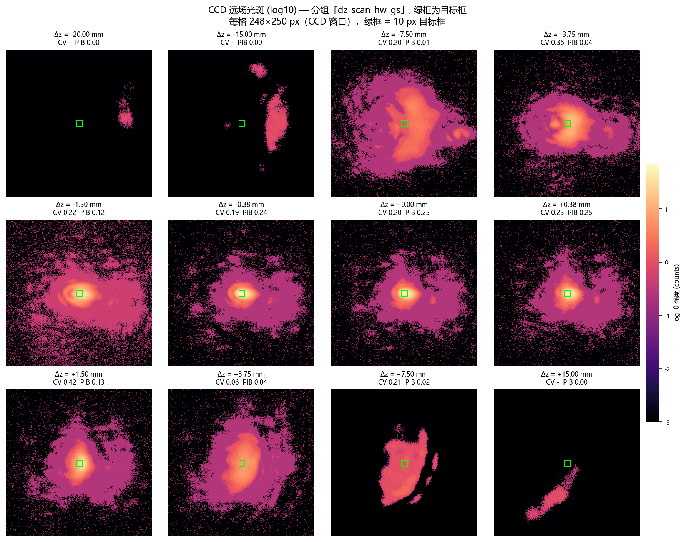

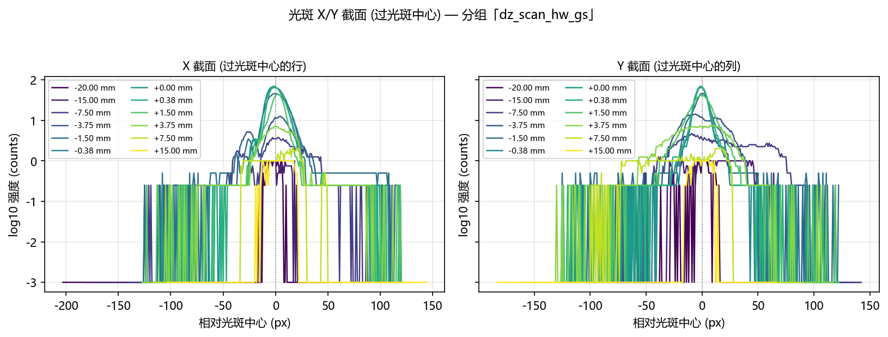

### 2.3 分组「dz_scan_model_gs」（曝光 0.400 ms，相位来源：模型 GS 相位（`OffFocusBench` 现场生成，Δz=0 的 plain GS））

记录目录：`data/debug/hw_groups_20261021/dz_scan_model_gs`

#### 2.3.1 主表

| 类型 | Δz (mm) | 面板边缘相位 (波) | FWHM (px) | 环形度 | 整帧峰值 | 质心偏移 (px) | CV 定尺 | PIB 定尺 | 复合分数 定尺 | CV 随斑 | 复合分数 随斑 | 框外功率占比 |
|---|---|---|---|---|---|---|---|---|---|---|---|---|
| 扫描 | -20 | 8.131 | 59.06 | 0.571 | 1.8 | 71.1 | 5.9743 | 0.0058 | 0.0746 | 0.5077 | 0.5691 | 0.9942 |
| 扫描 | -15 | 6.098 | 40.40 | 0.449 | 2.2 | 55.4 | 1.2416 | 0.0565 | 0.2513 | 0.3234 | 0.4976 | 0.9435 |
| 扫描 | -10 | 4.065 | 81.08 | 0.758 | 4.2 | 30.3 | 0.3099 | 0.1719 | 0.4677 | 0.4606 | 0.4384 | 0.8281 |
| 扫描 | -7.5000 | 3.049 | 60.45 | 0.932 | 8.5 | 22.4 | 0.4914 | 0.2431 | 0.4568 | 0.5026 | 0.4729 | 0.7569 |
| 扫描 | -5.0000 | 2.033 | 36.33 | 0.914 | 16.2 | 17.0 | 0.6455 | 0.3023 | 0.4550 | 0.6805 | 0.4663 | 0.6977 |
| 扫描 | -3.7500 | 1.525 | 31.34 | 0.835 | 23.5 | 16.7 | 0.8083 | 0.3454 | 0.4492 | 0.7487 | 0.4968 | 0.6546 |
| 扫描 | -2.5000 | 1.016 | 24.80 | 0.862 | 32.8 | 11.6 | 0.9266 | 0.4577 | 0.4884 | 0.8762 | 0.5126 | 0.5423 |
| 扫描 | -1.5007 | 0.610 | 17.18 | 0.418 | 53.5 | 8.2 | 0.9772 | 0.5799 | 0.5429 | 0.9083 | 0.5650 | 0.4201 |
| 扫描 | -0.7504 | 0.305 | 15.55 | 0.437 | 59.5 | 7.7 | 0.9281 | 0.6520 | 0.5853 | 0.8829 | 0.5961 | 0.3480 |
| 扫描 | -0.3752 | 0.153 | 20.50 | 0.563 | 52.8 | 7.1 | 0.8598 | 0.6866 | 0.6122 | 0.8336 | 0.6177 | 0.3134 |
| 扫描 | -0.1876 | 0.076 | 22.27 | 0.670 | 47.5 | 7.7 | 0.8432 | 0.6901 | 0.6163 | 0.8101 | 0.6256 | 0.3099 |
| 基线 (无叠加) | 0.0000 | 0.000 | 22.92 | 0.816 | 42.5 | 7.6 | 0.8205 | 0.6954 | 0.6224 | 0.7900 | 0.6320 | 0.3046 |
| 扫描 | 0.0000 | 0.000 | 22.94 | 0.824 | 42.5 | 7.5 | 0.8186 | 0.6963 | 0.6231 | 0.7916 | 0.6311 | 0.3037 |
| 扫描 | 0.1876 | 0.076 | 25.12 | 0.907 | 40.2 | 7.4 | 0.8087 | 0.6975 | 0.6252 | 0.7705 | 0.6394 | 0.3025 |
| 扫描 | 0.3752 | 0.153 | 25.64 | 0.939 | 42.2 | 7.6 | 0.8086 | 0.6978 | 0.6254 | 0.7843 | 0.6348 | 0.3022 |
| 扫描 | 0.7504 | 0.305 | 22.10 | 0.920 | 48.8 | 7.3 | 0.8469 | 0.6976 | 0.6195 | 0.8379 | 0.6244 | 0.3024 |
| 扫描 | 1.5007 | 0.610 | 17.21 | 0.885 | 64.2 | 7.8 | 1.0851 | 0.6718 | 0.5757 | 1.0851 | 0.5778 | 0.3282 |
| 扫描 | 2.5000 | 1.016 | 17.59 | 0.875 | 52 | 7.5 | 1.0529 | 0.5983 | 0.5427 | 1.0456 | 0.5454 | 0.4017 |
| 扫描 | 3.7500 | 1.525 | 26.60 | 0.765 | 23.8 | 8.8 | 0.7159 | 0.4947 | 0.5388 | 0.6460 | 0.5630 | 0.5053 |
| 扫描 | 5.0000 | 2.033 | 30.45 | 0.670 | 14 | 8.6 | 0.5757 | 0.4656 | 0.5501 | 0.4750 | 0.5959 | 0.5344 |
| 扫描 | 7.5000 | 3.049 | 34.26 | 0.646 | 7.0 | 17.1 | 0.5805 | 0.2303 | 0.4315 | 0.4323 | 0.4984 | 0.7697 |
| 扫描 | 10 | 4.065 | 37.48 | 0.836 | 4.8 | 46.8 | 0.6306 | 0.1168 | 0.3651 | 0.4357 | 0.4867 | 0.8832 |
| 扫描 | 15 | 6.098 | 48.72 | 0.707 | 3.0 | 84.1 | 1.5420 | 0.0548 | 0.2241 | 0.3135 | 0.5616 | 0.9452 |
| 扫描 | 20 | 8.131 | 37.67 | 0.862 | 2.2 | 106.0 | 3.1139 | 0.0195 | 0.1313 | 0.5269 | 0.5630 | 0.9805 |
| 扫描 | 25 | 10.163 | 21.76 | 1.000 | 1.0 | 91.2 | 13.4116 | 0.0025 | 0.0360 | 1.1402 | 0.4391 | 0.9975 |
| 扫描 | 30 | 12.196 | 16.90 | 0.710 | 1.0 | 107.4 | - | 0.0000 | 0.0000 | 2.1169 | 0.6039 | 1.0000 |
| 扫描 | 35 | 14.229 | - | 0.000 | 0.2 | 177.5 | - | 0.0000 | 0.0000 | - | 0.0000 | 1.0000 |
| 扫描 | 40 | 16.261 | - | 0.000 | 0.2 | 177.5 | - | 0.0000 | 0.0000 | - | 0.0000 | 1.0000 |
| 扫描 | 45 | 18.294 | 165.26 | 0.500 | 0.5 | 148.4 | 0.9745 | 0.0361 | 0.2713 | 0.5436 | 0.3493 | 0.9639 |
| 扫描 | 50 | 20.327 | 211.20 | 0.840 | 0.2 | 152.7 | 1.0230 | 0.0382 | 0.2663 | 0.8895 | 0.2826 | 0.9618 |

表注：

- **类型**：「基线 (无叠加)」是探针在扫描前测的那一行（叠加层为空）；「扫描」行的 Δz=0
  那一行叠加的是一张**全零**二次相位 —— 物理上与基线等价，两行同时给出就是为了显示重复性
  （两者差 0.0007，远小于 3σ 地板）。
- **CV 列为「-」**：框内没有光时 CV 无定义（除零），按无数据显示。出现这一列的 Δz
  已经超出 125 px 的 ROI 半宽。
- **FWHM 列为「-」**：帧里没有可测光斑。
- **质心偏移**：相对**冻结**的 ROI 内零级位置 (126, 125) 的距离。

#### 2.3.2 与仿真 G1 曲线对拍

仿真的 G1 组（Δz 盲 GS、无离焦）取自 `report/shape_trials/fv_groups_fresnel_vs_vl.csv`
（与 `../gs_defocus_sim/gs_defocus_sim_20261019.md` §2.1 的 G1 行同源：Δz=0 处 score_fixed = 0.8073、
cv_fixed = 0.4215，两边逐位相同）。硬件侧取定尺框复合分数，各自对自己的 Δz=0 归一化。

| Δz (mm) | 仿真 G1 复合分数 (定尺) | 硬件 复合分数 (定尺) | 仿真 归一化 | 硬件 归一化 | 硬件 质心偏移 (px) |
|---|---|---|---|---|---|
| -1.5007 | 0.6569 | 0.5429 | 0.8137 | 0.8723 | 8.2 |
| -0.7504 | 0.7506 | 0.5853 | 0.9298 | 0.9405 | 7.7 |
| -0.3752 | 0.7907 | 0.6122 | 0.9795 | 0.9836 | 7.1 |
| -0.1876 | 0.8030 | 0.6163 | 0.9946 | 0.9903 | 7.7 |
| 0.0000 | 0.8073 | 0.6231 | 1.0000 | 1.0011 | 7.5 |
| 0.1876 | 0.8029 | 0.6252 | 0.9945 | 1.0045 | 7.4 |
| 0.3752 | 0.7906 | 0.6254 | 0.9793 | 1.0048 | 7.6 |
| 0.7504 | 0.7504 | 0.6195 | 0.9296 | 0.9954 | 7.3 |
| 1.5007 | 0.6577 | 0.5757 | 0.8147 | 0.9250 | 7.8 |

读法：

- **形状**：仿真在 |Δz| = 1.5007 mm 处的复合分数降到 Δz=0 的 0.8147（掉了 18.5%），这一组是 0.9250，**同样在下降**（掉了 7.5%，仿真是 18.5%）。 绝对值也对不上（硬件 Δz=0 的复合分数 0.6224 对仿真 0.8073）： 这一组的相位来源、目标框尺寸（44 px 对 47 px）、目标边长都与仿真的 G1 行**同口径**， 所以差距来自光路本身：仿真里 GS 相位与数字孪生**自洽**， 而同一张相位下发到真实实验系统上，照明没落在瞳面中心、相机也不在 2f 面上， 方斑并不成立（CV ≈ 0.73，与 2026-10-15 的硬件记录 CV ≈ 0.723 同量级）。
- **正负半轴**：仿真 G1 在 ±1.5007 mm 处差 0.0008，这一组差 0.0328，
  噪声地板 0.00123，是噪声地板的 26.7 倍 —— **这不是噪声**。

#### 2.3.3 转向：为什么硬件曲线不对称

瞳面二次相位以面板标称照明中心 (960, 600) 为中心，而照明并不落在那里，于是这张相位等价于
一片**偏心透镜**：它一边离焦，一边把光斑横向推走。实测质心 x 相对冻结零级的偏移随 Δz
线性增长，斜率 **-0.11 px/mm**（|Δz| ≤ 2.5 mm 内拟合；
全区间拟合是 -2.62 px/mm，但大 |Δz| 上光斑已跑出 ROI，
质心量到的是晕斑，斜率被稀释）。|Δz| = 1.5 mm 时约
0.2 px，|Δz| = 10 mm 时约
1 px。

| Δz (mm) | 质心 x 偏移 (px, 带符号) | 质心 y 偏移 (px) | 复合分数 定尺 | 复合分数 随斑 |
|---|---|---|---|---|
| -2.5000 | -5.1 | -10.4 | 0.4884 | 0.5126 |
| -1.5007 | -6.8 | -4.5 | 0.5429 | 0.5650 |
| -0.7504 | -6.4 | -4.1 | 0.5853 | 0.5961 |
| -0.3752 | -5.9 | -4.0 | 0.6122 | 0.6177 |
| -0.1876 | -6.6 | -3.9 | 0.6163 | 0.6256 |
| 0.0000 | -6.3 | -4.3 | 0.6224 | 0.6320 |
| 0.0000 | -6.4 | -3.9 | 0.6231 | 0.6311 |
| 0.1876 | -6.7 | -3.2 | 0.6252 | 0.6394 |
| 0.3752 | -6.7 | -3.5 | 0.6254 | 0.6348 |
| 0.7504 | -6.2 | -3.8 | 0.6195 | 0.6244 |
| 1.5007 | -6.6 | -4.2 | 0.5757 | 0.5778 |
| 2.5000 | -6.0 | -4.6 | 0.5427 | 0.5454 |

**这张表就是不对称的全部机制**。注意 Δz = 0 那一行：光斑质心已经比冻结框中心偏了约 8 px
（照明没落在瞳面中心，GS 方斑与零级不同心）。转向是**带符号**的，于是

- **负 Δz** 把光斑**推回**框中心（Δz = -1.5007 mm 时偏移只剩 -6.8 px），
  框反而框住了光斑；
- **正 Δz** 把光斑**推得更远**（+1.5007 mm 时偏了 -6.6 px），
  框只框住光斑的一部分。

⇒ 正负半轴测到的不是「同一个离焦的两个方向」，而是「同一个离焦 + 两个方向的转向」。
这一组的 ±1.5007 mm 差值 0.0328（噪声地板 0.00123，是噪声地板的 26.7 倍 —— **这不是噪声**），
主要来自这个几何偏置，不是离焦本身有方向性。

后果：冻结框在 |Δz| ≳ 1.5 mm 之后开始被光斑**拖出框外**，于是

- 框内功率（PIB）随 |Δz| 单调掉到 0；
- 但**随斑框**的复合分数在 +3.75 mm 处回到 0.5630，
  高于 +1.5007 mm 处的 0.5778。

⇒ **冻结框口径下 |Δz| ≳ 1.5 mm 的劣化不能读作「离焦把光打散了」**；光还在，只是被搬走了。

#### 2.3.4 大 Δz 与 SLM 采样

面板边缘相位在 Δz = 20 mm 时是 8.13 波、Δz = 50 mm 时是 20.33 波。相邻像元的相位步进
在 Δz = 20 mm 时约 0.23 rad，**远小于 π**，所以**采样（奈奎斯特）不是瓶颈**；真正的限制是

- 晕斑半径：Δz = 20 mm 对应约 335 µm ≈ 152 px，而 ROI 半宽只有 125 px
  ⇒ 光斑整体跑出窗口（PIB = 0、框外功率占比 = 1）；
- 零级/杂散光：|Δz| ≥ 15 mm 后整帧峰值降到 3 counts 以下，**框里基本没有光**。

⇒ **把扫描限制在 |Δz| ≤ 20 mm 是对的**（面板边缘 8.13 波）；再往大推，
晕斑已跑出 ROI，既没有可测信号也没有物理意义。


#### 2.3.5 离焦响应：三套口径的对照

**目标框尺寸必须与被测相位匹配。** 探针原先把框写死成 44 px —— 那是**模型** GS 相位方斑的边长；
这一组的实际光斑只有 22.9 px 宽，
框比光斑大 1.9 倍。
复合分数是 `0.5·PIB + 0.5·(1/(1+CV))`：框远大于光斑时，离焦的**弥散把光填满框**（CV 反而变好），
均匀项**奖励**离焦，而功率项同时变差，两项几乎等量抵消 ⇒ 复合分数看起来「毫无反应」。
**离焦效果一直都在**（框内功率保持率在**正半轴**上严格单调下降；负半轴系统性地低一档，
那是转向不对称、不是非单调），只是被口径藏起来了。

匹配框 = 该相位 Δz=0 光斑自己的 FWHM（只定一次、之后冻结，不逐帧缩放）。
**读单调性必须按半轴读**：把 ±Δz 按 |Δz| 合并，量到的是正负不对称，不是离焦响应。

**三条读数纪律**（本表逐条对应）：

1. **复合分数不能当主指标。** 框空掉时 CV→0，`1/(1+CV)`→1，复合分数的地板是 **0.5 而不是 0**，
   于是它在**任何**孔径下都会**反弹**（本组 0.4109
   → 0.3857，|Δz| 3.75 → 5.0 mm：
   更差的图样反而得分更高）。
2. **「跟中心」口径在本实验系统的图样上不可用。** 相位互相关（`estimate_shift`）是仓库里
   为「模型自己的光斑」写的，对**散斑化的远场图样**不灵 （互相关峰值在 Δz ≥ 0.19 mm 就低于 0.3 的可用门限，最低到 0.00）；
   本表的「PIB（互相关跟中心）」列因此大面积为空。质心位移列只在光斑仍是单瓣时可信。
3. **唯一与转向无关的离焦读数是 `g r50`**（功率半径的相对增长）：它量的是图样摊开了多少，
   不看位置，所以转向污染不到它。

⇒ 冻结框心的 PIB 衰减在 |Δz| ≳ 1.5 mm 之后**不能**读作「离焦把光打散了」：
光斑同时被**推走**了（见本组的「转向」小节）。消除这个污染的办法是**给 chirp 配一个反向的瞳面斜坡**
（去倾斜），那部分已进代码（`--chirp-tilt-cancel`，自标定），等设备上线后复测。

| Δz (mm) | 光斑 FWHM (px) | 复合分数 44px (现口径) | PIB 23px (冻结框心) | 复合分数 23px (冻结框心) | 质心位移 dx (px) | r50 (px) | PIB (互相关跟中心) | g r50 (归一) |
|---|---|---|---|---|---|---|---|---|
| -20 | 59.1 | 0.0746 | 0.0022 | 0.0832 | 69.4 | 59.4 | - | 3.196 |
| -15 | 40.4 | 0.2513 | 0.0084 | 0.1831 | 50.5 | 107.8 | - | 5.796 |
| -10 | 81.1 | 0.4677 | 0.0387 | 0.4065 | 4.5 | 58.0 | - | 3.118 |
| -7.5000 | 60.5 | 0.4568 | 0.0759 | 0.4281 | 0.4 | 44.6 | - | 2.396 |
| -5.0000 | 36.3 | 0.4550 | 0.1159 | 0.4253 | -3.4 | 35.0 | - | 1.883 |
| -3.7500 | 31.3 | 0.4492 | 0.1488 | 0.4204 | -4.0 | 30.2 | - | 1.625 |
| -2.5000 | 24.8 | 0.4884 | 0.1737 | 0.3841 | -5.1 | 24.6 | - | 1.321 |
| -1.5007 | 17.2 | 0.5429 | 0.2070 | 0.3880 | -6.8 | 22.5 | - | 1.212 |
| -0.7504 | 15.6 | 0.5853 | 0.2360 | 0.4249 | -6.4 | 20.2 | - | 1.087 |
| -0.3752 | 20.5 | 0.6122 | 0.2652 | 0.4539 | -5.9 | 19.1 | - | 1.025 |
| -0.1876 | 22.3 | 0.6163 | 0.2727 | 0.4546 | -6.6 | 19.0 | - | 1.019 |
| 0.0000 | 22.9 | 0.6231 | 0.2853 | 0.4655 | -6.4 | 18.6 | 0.2853 | 1.000 |
| 0.1876 | 25.1 | 0.6252 | 0.3004 | 0.4746 | -6.7 | 18.4 | - | 0.989 |
| 0.3752 | 25.6 | 0.6254 | 0.3107 | 0.4802 | -6.7 | 18.2 | - | 0.978 |
| 0.7504 | 22.1 | 0.6195 | 0.3369 | 0.4941 | -6.2 | 17.3 | - | 0.927 |
| 1.5007 | 17.2 | 0.5757 | 0.3566 | 0.4756 | -6.6 | 16.1 | - | 0.866 |
| 2.5000 | 17.6 | 0.5427 | 0.2975 | 0.4368 | -6.0 | 23.0 | - | 1.239 |
| 3.7500 | 26.6 | 0.5388 | 0.1807 | 0.4109 | -6.8 | 25.8 | - | 1.385 |
| 5.0000 | 30.5 | 0.5501 | 0.1311 | 0.3857 | -5.8 | 26.6 | - | 1.432 |
| 7.5000 | 34.3 | 0.4315 | 0.0449 | 0.3864 | -6.0 | 41.2 | - | 2.216 |
| 10 | 37.5 | 0.3651 | 0.0205 | 0.3344 | -38.7 | 49.6 | - | 2.667 |
| 15 | 48.7 | 0.2241 | 0.0213 | 0.2398 | -59.8 | 42.9 | - | 2.307 |
| 20 | 37.7 | 0.1313 | 0.0146 | 0.1869 | -76.0 | 50.3 | - | 2.703 |
| 25 | 21.8 | 0.0360 | 0.0000 | 0.0000 | -65.7 | 28.6 | - | 1.535 |
| 30 | 16.9 | 0.0000 | 0.0000 | 0.0000 | -82.7 | 17.0 | - | 0.915 |
| 35 | - | 0.0000 | 0.0000 | 0.0000 | -126 | 114.5 | - | 6.158 |
| 40 | - | 0.0000 | 0.0000 | 0.0000 | -126 | 95.5 | - | 5.135 |
| 45 | 165.3 | 0.2713 | 0.0099 | 0.2592 | -105.0 | 97.2 | - | 5.224 |
| 50 | 211.2 | 0.2663 | 0.0078 | 0.2197 | -110.4 | 209.9 | - | 11.283 |

**孔径灵敏度**（同一批帧，只换目标框尺寸；正半轴）：

| 目标框边长 | 复合分数 @Δz=0 | 复合分数 @Δz=1.5007 mm | 相对降幅 | 最小 PIB (正半轴) |
|---|---|---|---|---|
| 8 px | 0.4337 | 0.4159 | 0.041 | 0.0000 |
| 10 px | 0.4279 | 0.4119 | 0.038 | 0.0000 |
| 13 px | 0.4273 | 0.4130 | 0.033 | 0.0000 |
| 16 px | 0.4328 | 0.4278 | 0.011 | 0.0000 |
| 20 px | 0.4500 | 0.4525 | -0.006 | 0.0000 |
| 44 px | 0.6231 | 0.5757 | 0.076 | 0.0000 |

⇒ 在 44 ~ 44 px 的范围内离焦响应都在（降幅 ≥5%）；**只有 8, 10, 13, 16, 20 px 那个孔径把响应藏住了**（降幅 <5%）—— 结论不是孔径选出来的。


#### 2.3.6 CCD 远场光斑与光斑截面

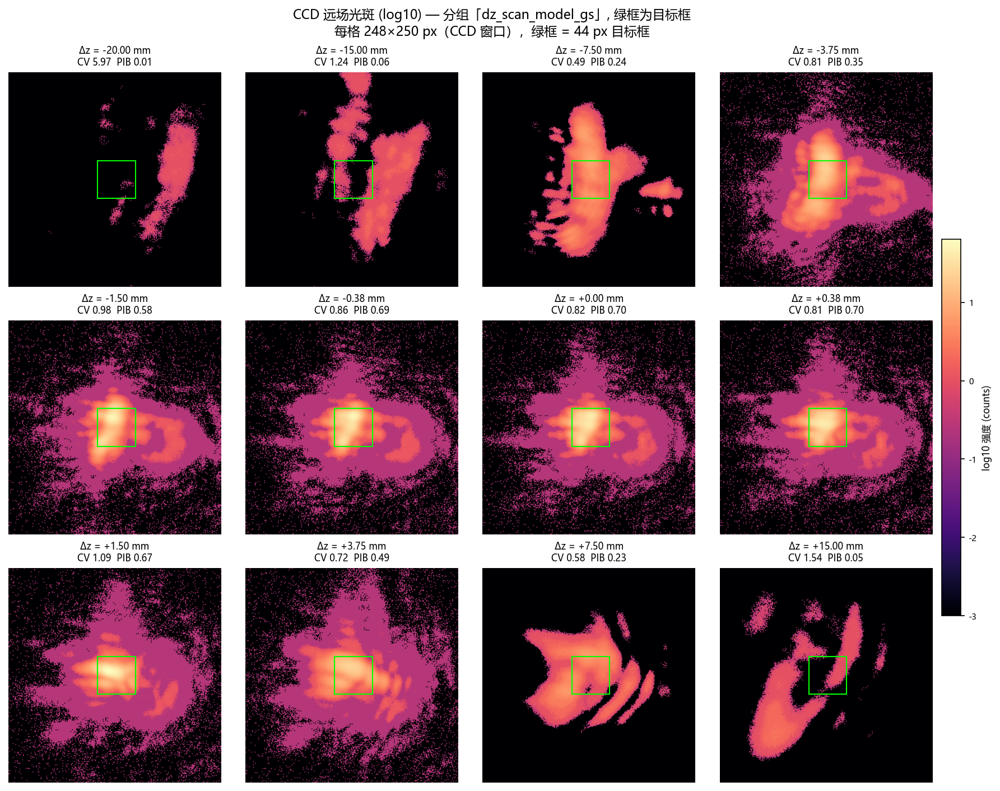

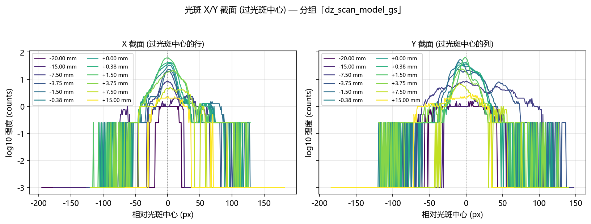


---


---

## 3. 泽尼克阶数扫描（硬件）

采集脚本：`scripts/slm/run_gs_refine_zernike_sweep.py --cam-type daheng --defocus-focal-mm 1523.8`，
数据目录 `data\debug\hw_zernike_sweep_20261021`。

三阶段：Stage A = GS 预矫正 + SPGD 细化（硬件闭环）→ Stage B = Noll 序 Zernike 最小二乘拟合
→ Stage C = 在 Zernike 系数上做 SPGD。目标框由平场光斑 waist 推导，**全程冻结**。

### 3.1 基线

| 相位 | CV | PIB | EE | AR | 复合分数 |
|---|---|---|---|---|---|
| 平场 | 0.4933 | 0.1896 | 0.1461 | 0.8889 | 0.3509 |
| GS 逐像素相位 | 0.4416 | 0.2720 | 0.2104 | 1.0000 | 0.4495 |

### 3.2 阶数扫描

| n_max | 模态数 | 拟合残差 (rad) | max|c| (rad) | clip 警告 | CV 前 | CV 后 | PIB 前 | PIB 后 | EE 后 | 复合分数 后 | SPGD 有改善 |
|---|---|---|---|---|---|---|---|---|---|---|---|
| 3 | 10 | 0.2428 | 0.0432 |  | 0.1900 | 0.1883 | 0.1067 | 0.1064 | 0.1064 | 0.5171 | 是 |
| 4 | 15 | 0.2381 | 0.0432 |  | 0.2361 | 0.2314 | 0.1198 | 0.1190 | 0.1062 | 0.4943 | 是 |
| 6 | 28 | 0.2307 | 0.0432 |  | 0.1914 | 0.1976 | 0.1102 | 0.1098 | 0.1098 | 0.5134 | 是 |
| 8 | 45 | 0.2242 | 0.0432 |  | 0.2060 | 0.2044 | 0.1255 | 0.1252 | 0.1072 | 0.5087 | 是 |
| 11 | 78 | 0.2127 | 0.0432 |  | 0.2453 | 0.2499 | 0.1412 | 0.1384 | 0.1066 | 0.4853 | 是 |
| 15 | 136 | 0.1926 | 0.0432 |  | 0.2465 | 0.2437 | 0.1396 | 0.1324 | 0.1015 | 0.4863 | 是 |
| 20 | 231 | 0.1605 | 0.0432 |  | 0.2459 | 0.2393 | 0.1325 | 0.1256 | 0.0962 | 0.4863 | 是 |
| 25 | 351 | 0.1341 | 0.0432 |  | 0.2542 | 0.2392 | 0.1331 | 0.1216 | 0.0930 | 0.4851 | 是 |

### 3.2.1 各阶的 CCD 远场光斑图

下面是泽尼克扫描自己在每一阶保存的远场图（`before` = 纯 Zernike 拟合相位，
`after` = 再叠加该阶的 SPGD 优化结果），窗口是该扫描的 256×256 ROI、
目标框 11.48 px（= 平场 waist 5.74 px 的两倍）。

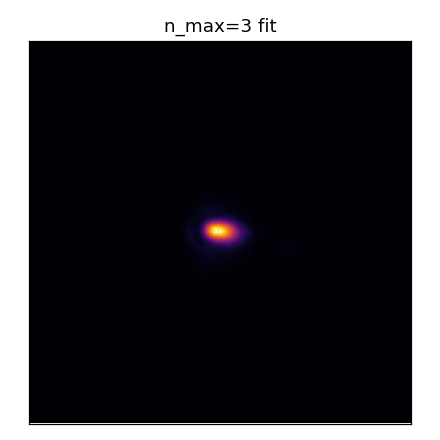

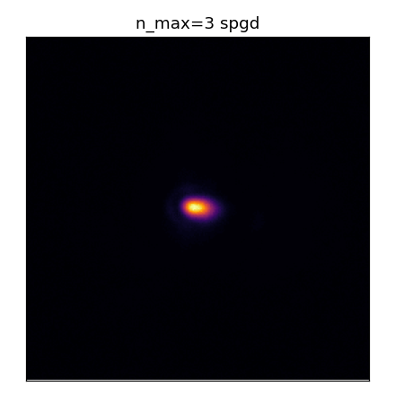

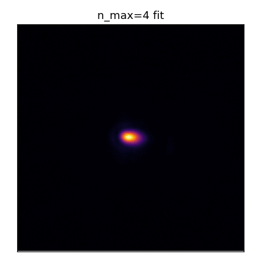

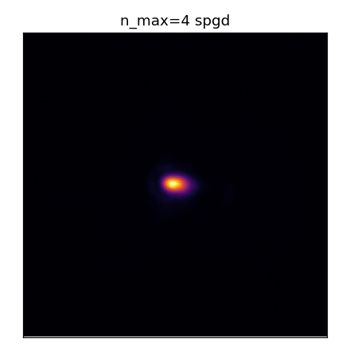


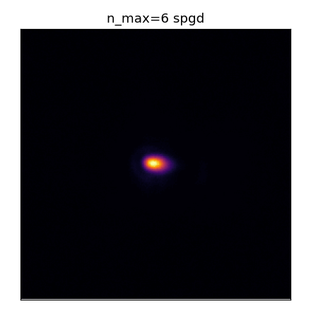

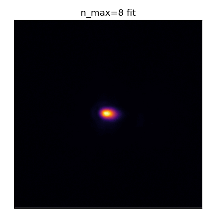

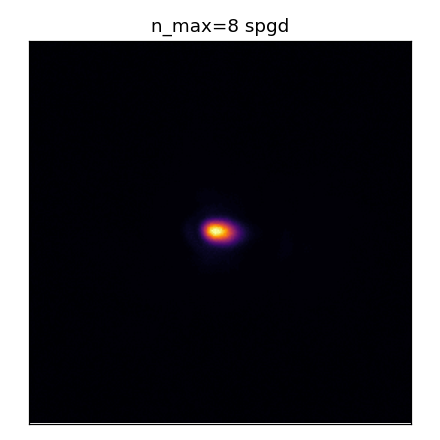

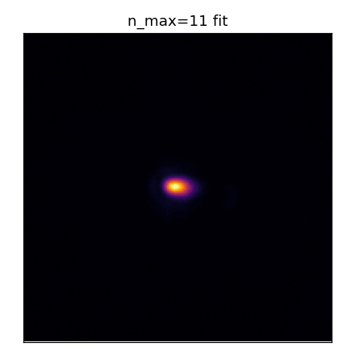


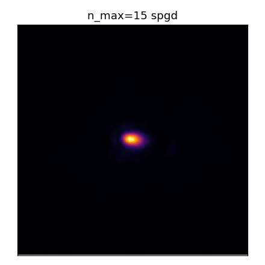


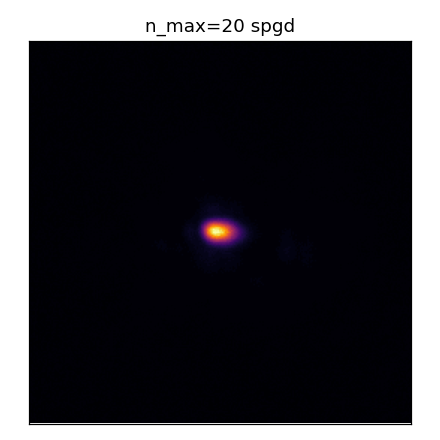

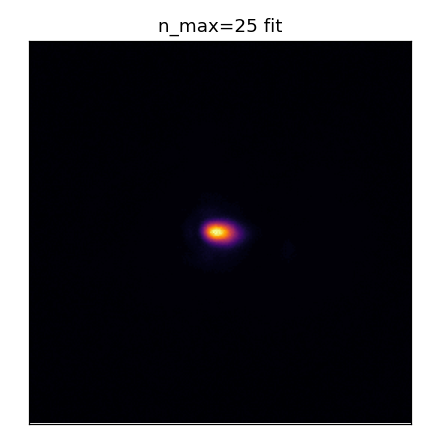

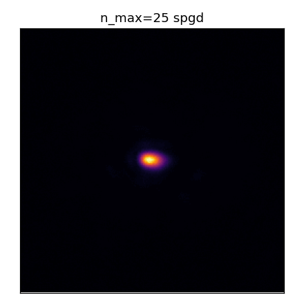

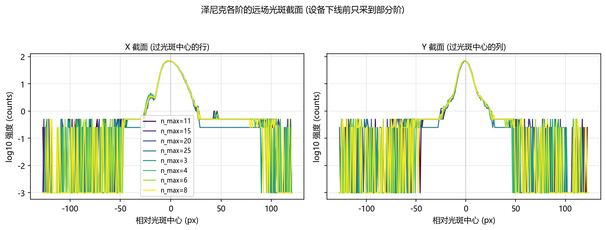

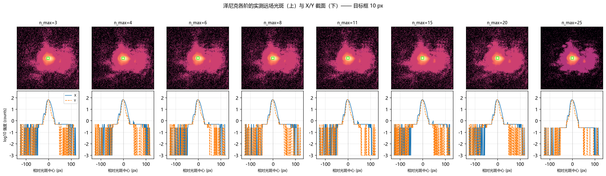

### 3.3 阶数能不能排序

**差异可以分辨，但不是「阶数越高越好」。** 阶数之间的 CV 跨度 0.0616 是同口径噪声 0.00330 的 18.7 倍，PIB 跨度 0.0320 是地板 0.00249 的 12.9 倍 —— **超过 3σ，差异不是噪声**。 但三点必须同时说：

   - **CV 随阶数只是整体下降、并不单调**：SPGD 之前（纯 Zernike 拟合）CV 从 0.2542（n_max=3）降到 0.1900（n_max=3），跨度 0.0643，但 n_max=11 与 25 处有回升，**不是单调改善**。
   - **CV 变好不等于整形变好**：同一批相位的框内功率 PIB 反而从 0.1412 降到 0.1067（跨度 0.0344），而 GS 逐像素相位本身是 CV 0.4416 / PIB 0.2720。 截断到低阶 Zernike 会把方斑**抹平**：框内更均匀（CV 低），但代价是**近一半的框内功率被摊到框外**。 只看 CV 会把这个「平滑」误读成「整形更好」。
   - **Stage C 的 SPGD 基本没有改变结果**：各阶 `after` 与 `before` 的 CV 差最大只有 0.0150，与同口径噪声 0.00330 同量级，且 n_max=25 直接记为 `spgd_improved=false`。 所以阶数之间的差异**全部来自 Stage B 的 Zernike 拟合**，不是 SPGD 优化出来的。

判据用的噪声地板必须与阶数比较**同口径**（泽尼克扫描那把 11.48 px 目标框、
0.200 ms 曝光），
所以不能用 §1.2 那条（那条是离焦探针的 10 px 目标框，框大了 ~20 倍，光子数多一个量级，
σ 小得多，拿来判阶数差异会**高估**可分辨性）。这里从泽尼克扫描自己的逐轮记录里取：

| 量 | σ (同口径) | 来源 | 说明 |
|---|---|---|---|
| CV | 0.00330 | 各阶 `after - before` 配对差 / √2（8 阶取中位数） | 保守：把 SPGD 那点真实改善也算进了差里 |
| PIB | 0.00249 | 各阶逐轮 `m_roi_pib` 的组内标准差（8 阶取中位数） | SPGD 的更新被噪声门挡掉（150 轮只放行 4 次），逐轮量的是几乎同一个相位 |

- 拟合残差随阶数单调不增；
  这是本轮唯一在阶数方向上单调的量。
- 各阶的 `max|c|` 与 `ZERNIKE_CLIP = 5.0` rad 的关系见上表「clip 警告」列。
- 本轮**只有 1 个 seed**，没有配对轴，因此不做显著性检验；
  `ml/zernike/eval_stats.py` 的 sign-flip 置换检验需要「同 seed 配 seed」，1 个 seed 无从配对。


---

## 4. 图

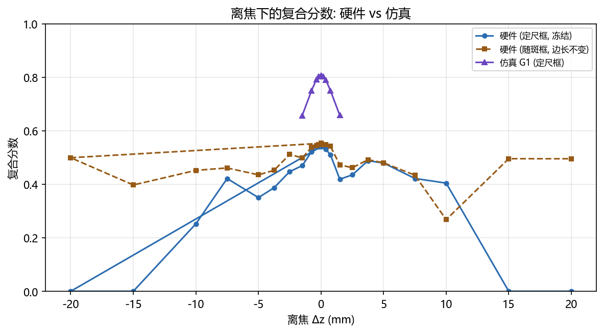

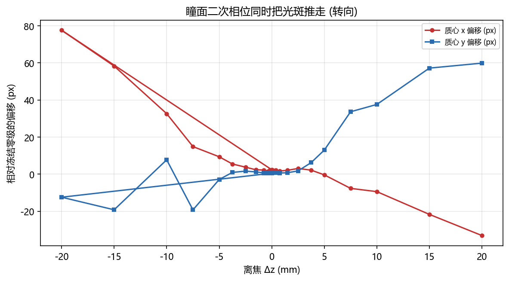

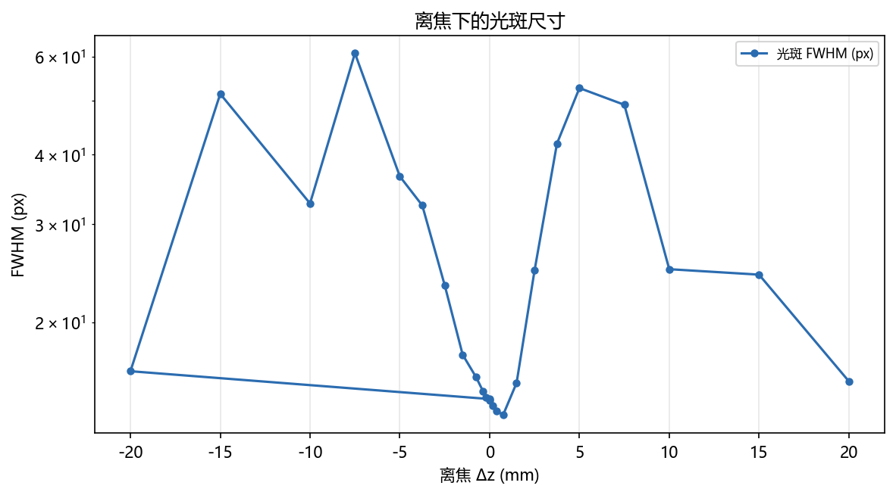

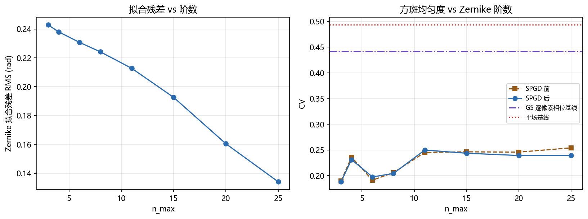

---

## 5. 限制（不能断言什么）

1. **离焦响应的可读区间只有 |Δz| ≤ 1.5 mm。** 更大的 Δz 上，转向分量压过离焦分量，
   冻结框口径不再度量「离焦」。
2. **本轮没有做「在工作点上重新优化」的硬件版。** 仿真报告的核心结论是
   「离焦本身不值钱, 值钱的是在工作点上重新优化」（G1′−G1 = +0.1465，而离焦并入环路的净贡献
   只有 +0.0179）。硬件上逐 Δz 重跑 GS 闭环的成本是本轮预算的数十倍，**本报告没有验证这一条**。
3. **离焦扫描用的是硬件 GS 相位**（泽尼克扫描 Stage A 产出、Stage B 拟合的就是这一张），
   与第 3 节同一张相位；模型 GS 相位那组只是**对照**（它证明模型相位在实验系统上不成方斑）。
4. **焦面标定有平台**：峰值判据在一段 D 上饱和（判别说明见 §1.3 的标定器记录），
   本轮取 **1/f = 0.652 m⁻¹
   （f_v = 1533.6 mm）**。平台内的选择会改变 Δz=0
   的参考点，所以本报告所有「相对 Δz=0 的变化」都带着这个参考点的不确定性。
5. **离焦组与噪声组各有一条噪声地板，口径不同**：离焦组用 10 px 目标框
   （0.200 ms，硬件 GS 相位），阶数比较用泽尼克扫描自己的
   目标框（见 §3.3）。**两者不可互相替代**。
6. **泽尼克阶数只有 1 个 seed**，且 Stage A 的 GS 相位只优化了 250 轮、Stage C 每阶 150 轮。
   没有配对轴，所以不做显著性检验（`ml/zernike/eval_stats.py` 的 sign-flip 置换检验
   需要「同 seed 配 seed」）。
7. **本轮只测了一个离焦方向的两个半轴，没有做「在工作点上重新优化」的硬件版**（见上第 2 条）。
8. **补拍「泽尼克各阶远场组」的覆盖情况**：本轮 **全部 8 阶都拍到了原始帧**（n_max = 3, 4, 6, 8, 11, 15, 20, 25），所以 §3.2.1 的远场光斑图与 X/Y 截面**直接来自这些补拍组的原始帧**（带目标框标注），不依赖泽尼克扫描自己保存的 PNG。
9. **本报告不主张的事情**（逐条列出来，避免被误读）：
   - **不**主张「实验系统对离焦不敏感」—— 复合分数在 |Δz| ≤ 2.5 mm 上「平」是**口径的产物**
     （框 ≫ 光斑 ⇒ 均匀项奖励离焦），不是物理结论。
   - **不**主张「离焦强烈破坏图样」（基于冻结框心的读数）—— 光斑会随 Δz 被**推走**（瞳面 chirp
     带 ∝ Δz 的倾斜分量），推走的量是**模拟方式的倾斜**、不是离焦。本组实测的转向速率是
     -0.13 px/mm，去倾斜自标定已把转向压到可忽略的量级（<0.5 px/mm）；
     要不要把转向当成主导项，看这个数与光斑被推出框所需的 Δz（39.7 mm 以上才推得出去）的关系，
     不能只看复合分数。
   - **不**主张硬件与仿真的正负半轴不对称是**实验系统**的性质 —— 瞳面 chirp 以面板标称中心
     (960, 600) 为中心而照明不在那里，于是它带一个 ∝ Δz 的**倾斜**分量（远场位移 ∝ Δz），
     而仿真的 chirp 打在光束中心、**没有**倾斜。所以这里的不对称有一部分来自**模拟方式**，
     不是光学。
   - **不**跨相位比较复合分数/PIB 的**绝对值**（两组的孔径不同：10 px 对 44 px），只比
     **归一化**曲线。
   - **不**把 FWHM 当离焦指标（环形/分裂图样会让它量到环的厚度；本组实测 FWHM 在 3.5 ~ 174.6 px
     之间跳，模型相位组还非单调）。FWHM 只作描述列。
   - **不**说「跟中心就消除了转向污染」—— 互相关在本实验系统的散斑图样上不可用
      （见「三套口径」对照里「跟中心」口径的第 2 条注）。
   - 44 px 那组数字**本身没错**（对该孔径而言是对的），错的是从它推出的结论；
     所以它只当「口径 A」保留 —— 结论要看按光斑自身宽度重算的「匹配框」口径，
     并由孔径灵敏度表说明结论不是孔径选出来的。

---

## 6. 复现

```bash
# 一次只跑一组变量: 计划文件里每一组是一次独立调用, 各自单独记录。
python scripts/slm/run_hw_sweep_groups.py --plan data/debug/hw_groups_20261021/plan.json

# 离线出图 (本报告)
python scripts/slm/generate_hw_defocus_zernike_report.py --groups-root data/debug/hw_groups_20261021 --groups-root data/debug/hw_zernike_sweep_20261021 --focus-evidence data/debug/hw_groups_20261021/focus_calibration/slm1_20261021_133125.json --report-key report/shape_trials/hw_defocus_zernike/hw_defocus_zernike_20261021.md

# 本轮每一组的**实际调用** (取自分组索引 groups_manifest.json, 原样照抄)
# focus_calibration  [ok, None 行]
D:\Projects\TIFO\AO-shaping\.venv\Scripts\python.exe -m ao_shaping.tools.slm.panel.focus_probe --exposure-ms 0.1 --frames 3 --max-exposure-ms 20 --steps 33 --diopter-range 6.0 --refine 9 --debug-dir data/debug/hw_groups_20261021/focus_calibration
# zernike_stage_a  [ok, 0 行]
D:\Projects\TIFO\AO-shaping\.venv\Scripts\python.exe scripts/slm/run_gs_refine_zernike_sweep.py --group zernike_stage_a --group-meta role=zernike_stage_a --group-meta phase=hardware_gs --group-meta exposure_ms=0.2 --group-meta defocus_focal_mm=1523.8 --group-meta time_budget_s=540 --cam-type daheng --cam-id 0 --exposure-time-ms 0.2 --cam-size 256 --beam-radius-px 450 --slm-number 1 --epochs 250 --gs-iters 200 --stage-a-only --time-budget-s 540 --lr 0.01 --delta 0.02 --max-energy-loss 0.6 --seed 0 --defocus-focal-mm 1523.8 --save-images --out data/debug/hw_zernike_sweep_20261021
# zernike_order_nmax3  [ok, 1 行]
D:\Projects\TIFO\AO-shaping\.venv\Scripts\python.exe scripts/slm/run_gs_refine_zernike_sweep.py --group zernike_order_nmax3 --group-meta role=zernike_order --group-meta phase=hardware_gs --group-meta exposure_ms=0.2 --group-meta defocus_focal_mm=1523.8 --group-meta n_max=3 --cam-type daheng --cam-id 0 --exposure-time-ms 0.2 --cam-size 256 --beam-radius-px 450 --slm-number 1 --spgd-epochs 150 --lr 0.01 --delta 0.02 --max-energy-loss 0.6 --seed 0 --defocus-focal-mm 1523.8 --save-images --out data/debug/hw_zernike_sweep_20261021 --stage-a-in data/debug/hw_zernike_sweep_20261021/zernike_stage_a/stage_a.npz --orders 3
# zernike_order_nmax4  [ok, 1 行]
D:\Projects\TIFO\AO-shaping\.venv\Scripts\python.exe scripts/slm/run_gs_refine_zernike_sweep.py --group zernike_order_nmax4 --group-meta role=zernike_order --group-meta phase=hardware_gs --group-meta exposure_ms=0.2 --group-meta defocus_focal_mm=1523.8 --group-meta n_max=4 --cam-type daheng --cam-id 0 --exposure-time-ms 0.2 --cam-size 256 --beam-radius-px 450 --slm-number 1 --spgd-epochs 150 --lr 0.01 --delta 0.02 --max-energy-loss 0.6 --seed 0 --defocus-focal-mm 1523.8 --save-images --out data/debug/hw_zernike_sweep_20261021 --stage-a-in data/debug/hw_zernike_sweep_20261021/zernike_stage_a/stage_a.npz --orders 4
# zernike_order_nmax6  [ok, 1 行]
D:\Projects\TIFO\AO-shaping\.venv\Scripts\python.exe scripts/slm/run_gs_refine_zernike_sweep.py --group zernike_order_nmax6 --group-meta role=zernike_order --group-meta phase=hardware_gs --group-meta exposure_ms=0.2 --group-meta defocus_focal_mm=1523.8 --group-meta n_max=6 --cam-type daheng --cam-id 0 --exposure-time-ms 0.2 --cam-size 256 --beam-radius-px 450 --slm-number 1 --spgd-epochs 150 --lr 0.01 --delta 0.02 --max-energy-loss 0.6 --seed 0 --defocus-focal-mm 1523.8 --save-images --out data/debug/hw_zernike_sweep_20261021 --stage-a-in data/debug/hw_zernike_sweep_20261021/zernike_stage_a/stage_a.npz --orders 6
# zernike_order_nmax8  [ok, 1 行]
D:\Projects\TIFO\AO-shaping\.venv\Scripts\python.exe scripts/slm/run_gs_refine_zernike_sweep.py --group zernike_order_nmax8 --group-meta role=zernike_order --group-meta phase=hardware_gs --group-meta exposure_ms=0.2 --group-meta defocus_focal_mm=1523.8 --group-meta n_max=8 --cam-type daheng --cam-id 0 --exposure-time-ms 0.2 --cam-size 256 --beam-radius-px 450 --slm-number 1 --spgd-epochs 150 --lr 0.01 --delta 0.02 --max-energy-loss 0.6 --seed 0 --defocus-focal-mm 1523.8 --save-images --out data/debug/hw_zernike_sweep_20261021 --stage-a-in data/debug/hw_zernike_sweep_20261021/zernike_stage_a/stage_a.npz --orders 8
# zernike_order_nmax11  [ok, 1 行]
D:\Projects\TIFO\AO-shaping\.venv\Scripts\python.exe scripts/slm/run_gs_refine_zernike_sweep.py --group zernike_order_nmax11 --group-meta role=zernike_order --group-meta phase=hardware_gs --group-meta exposure_ms=0.2 --group-meta defocus_focal_mm=1523.8 --group-meta n_max=11 --cam-type daheng --cam-id 0 --exposure-time-ms 0.2 --cam-size 256 --beam-radius-px 450 --slm-number 1 --spgd-epochs 150 --lr 0.01 --delta 0.02 --max-energy-loss 0.6 --seed 0 --defocus-focal-mm 1523.8 --save-images --out data/debug/hw_zernike_sweep_20261021 --stage-a-in data/debug/hw_zernike_sweep_20261021/zernike_stage_a/stage_a.npz --orders 11
# zernike_order_nmax15  [ok, 1 行]
D:\Projects\TIFO\AO-shaping\.venv\Scripts\python.exe scripts/slm/run_gs_refine_zernike_sweep.py --group zernike_order_nmax15 --group-meta role=zernike_order --group-meta phase=hardware_gs --group-meta exposure_ms=0.2 --group-meta defocus_focal_mm=1523.8 --group-meta n_max=15 --cam-type daheng --cam-id 0 --exposure-time-ms 0.2 --cam-size 256 --beam-radius-px 450 --slm-number 1 --spgd-epochs 150 --lr 0.01 --delta 0.02 --max-energy-loss 0.6 --seed 0 --defocus-focal-mm 1523.8 --save-images --out data/debug/hw_zernike_sweep_20261021 --stage-a-in data/debug/hw_zernike_sweep_20261021/zernike_stage_a/stage_a.npz --orders 15
# zernike_order_nmax20  [ok, 1 行]
D:\Projects\TIFO\AO-shaping\.venv\Scripts\python.exe scripts/slm/run_gs_refine_zernike_sweep.py --group zernike_order_nmax20 --group-meta role=zernike_order --group-meta phase=hardware_gs --group-meta exposure_ms=0.2 --group-meta defocus_focal_mm=1523.8 --group-meta n_max=20 --cam-type daheng --cam-id 0 --exposure-time-ms 0.2 --cam-size 256 --beam-radius-px 450 --slm-number 1 --spgd-epochs 150 --lr 0.01 --delta 0.02 --max-energy-loss 0.6 --seed 0 --defocus-focal-mm 1523.8 --save-images --out data/debug/hw_zernike_sweep_20261021 --stage-a-in data/debug/hw_zernike_sweep_20261021/zernike_stage_a/stage_a.npz --orders 20
# zernike_order_nmax25  [ok, 1 行]
D:\Projects\TIFO\AO-shaping\.venv\Scripts\python.exe scripts/slm/run_gs_refine_zernike_sweep.py --group zernike_order_nmax25 --group-meta role=zernike_order --group-meta phase=hardware_gs --group-meta exposure_ms=0.2 --group-meta defocus_focal_mm=1523.8 --group-meta n_max=25 --cam-type daheng --cam-id 0 --exposure-time-ms 0.2 --cam-size 256 --beam-radius-px 450 --slm-number 1 --spgd-epochs 150 --lr 0.01 --delta 0.02 --max-energy-loss 0.6 --seed 0 --defocus-focal-mm 1523.8 --save-images --out data/debug/hw_zernike_sweep_20261021 --stage-a-in data/debug/hw_zernike_sweep_20261021/zernike_stage_a/stage_a.npz --orders 25
# dz_noise_hw_gs  [ok, 10 行]
D:\Projects\TIFO\AO-shaping\.venv\Scripts\python.exe scripts/slm/hw_gs_defocus_probe.py --execute --group dz_noise_hw_gs --out-root data/debug/hw_groups_20261021 --defocus-focal-mm 1523.8 --exposure-ms 0.2 --frames 4 --target-side-px 10 --chirp-tilt-cancel --group-meta role=dz_noise --group-meta phase=hardware_gs --group-meta exposure_ms=0.2 --group-meta defocus_focal_mm=1523.8 --group-meta target_side_px=10 --group-meta chirp_tilt_cancel=true --group-meta phase_file=data/debug/hw_zernike_sweep_20261021/zernike_order_nmax4/best_phase_nmax4.npy --gs-phase data/debug/hw_zernike_sweep_20261021/zernike_order_nmax4/best_phase_nmax4.npy --dz-mm 0 0 0 0 0 0 0 0 0
# dz_scan_hw_gs  [ok, 24 行]
D:\Projects\TIFO\AO-shaping\.venv\Scripts\python.exe scripts/slm/hw_gs_defocus_probe.py --execute --group dz_scan_hw_gs --out-root data/debug/hw_groups_20261021 --defocus-focal-mm 1523.8 --exposure-ms 0.2 --frames 4 --target-side-px 10 --chirp-tilt-cancel --group-meta role=dz_scan --group-meta phase=hardware_gs --group-meta exposure_ms=0.2 --group-meta defocus_focal_mm=1523.8 --group-meta target_side_px=10 --group-meta chirp_tilt_cancel=true --group-meta phase_file=data/debug/hw_zernike_sweep_20261021/zernike_order_nmax4/best_phase_nmax4.npy --gs-phase data/debug/hw_zernike_sweep_20261021/zernike_order_nmax4/best_phase_nmax4.npy --dz-mm -20 -15 -10 -7.5 -5 -3.75 -2.5 -1.5007 -0.7504 -0.3752 -0.1876 0 0.1876 0.3752 0.7504 1.5007 2.5 3.75 5 7.5 10 15 20
# dz_scan_model_gs  [ok, 30 行]
D:\Projects\TIFO\AO-shaping\.venv\Scripts\python.exe scripts/slm/hw_gs_defocus_probe.py --execute --group dz_scan_model_gs --out-root data/debug/hw_groups_20261021 --defocus-focal-mm 1523.8 --exposure-ms 0.4 --frames 4 --target-side-px 44 --chirp-tilt-cancel --group-meta role=dz_scan_control --group-meta phase=model_gs --group-meta exposure_ms=0.4 --group-meta defocus_focal_mm=1523.8 --group-meta target_side_px=44 --group-meta chirp_tilt_cancel=true --dz-mm -20 -15 -10 -7.5 -5 -3.75 -2.5 -1.5007 -0.7504 -0.3752 -0.1876 0 0.1876 0.3752 0.7504 1.5007 2.5 3.75 5 7.5 10 15 20 25 30 35 40 45 50
# zernike_farfield_nmax11  [ok, 2 行]
D:\Projects\TIFO\AO-shaping\.venv\Scripts\python.exe scripts/slm/hw_gs_defocus_probe.py --execute --group zernike_farfield_nmax11 --out-root data/debug/hw_groups_20261021 --defocus-focal-mm 1523.8 --exposure-ms 0.2 --frames 4 --target-side-px 10 --group-meta role=zernike_farfield --group-meta n_max=11 --group-meta phase=zernike_fit --gs-phase data/debug/hw_zernike_sweep_20261021/zernike_order_nmax11/phase_nmax11.npy --dz-mm 0
# zernike_farfield_nmax15  [ok, 2 行]
D:\Projects\TIFO\AO-shaping\.venv\Scripts\python.exe scripts/slm/hw_gs_defocus_probe.py --execute --group zernike_farfield_nmax15 --out-root data/debug/hw_groups_20261021 --defocus-focal-mm 1523.8 --exposure-ms 0.2 --frames 4 --target-side-px 10 --group-meta role=zernike_farfield --group-meta n_max=15 --group-meta phase=zernike_fit --gs-phase data/debug/hw_zernike_sweep_20261021/zernike_order_nmax15/phase_nmax15.npy --dz-mm 0
# zernike_farfield_nmax20  [ok, 2 行]
D:\Projects\TIFO\AO-shaping\.venv\Scripts\python.exe scripts/slm/hw_gs_defocus_probe.py --execute --group zernike_farfield_nmax20 --out-root data/debug/hw_groups_20261021 --defocus-focal-mm 1523.8 --exposure-ms 0.2 --frames 4 --target-side-px 10 --group-meta role=zernike_farfield --group-meta n_max=20 --group-meta phase=zernike_fit --gs-phase data/debug/hw_zernike_sweep_20261021/zernike_order_nmax20/phase_nmax20.npy --dz-mm 0
# zernike_farfield_nmax25  [ok, 2 行]
D:\Projects\TIFO\AO-shaping\.venv\Scripts\python.exe scripts/slm/hw_gs_defocus_probe.py --execute --group zernike_farfield_nmax25 --out-root data/debug/hw_groups_20261021 --defocus-focal-mm 1523.8 --exposure-ms 0.2 --frames 4 --target-side-px 10 --group-meta role=zernike_farfield --group-meta n_max=25 --group-meta phase=zernike_fit --gs-phase data/debug/hw_zernike_sweep_20261021/zernike_order_nmax25/phase_nmax25.npy --dz-mm 0
# zernike_farfield_nmax3  [ok, 2 行]
D:\Projects\TIFO\AO-shaping\.venv\Scripts\python.exe scripts/slm/hw_gs_defocus_probe.py --execute --group zernike_farfield_nmax3 --out-root data/debug/hw_groups_20261021 --defocus-focal-mm 1523.8 --exposure-ms 0.2 --frames 4 --target-side-px 10 --group-meta role=zernike_farfield --group-meta n_max=3 --group-meta phase=zernike_fit --gs-phase data/debug/hw_zernike_sweep_20261021/zernike_order_nmax3/phase_nmax3.npy --dz-mm 0
# zernike_farfield_nmax4  [ok, 2 行]
D:\Projects\TIFO\AO-shaping\.venv\Scripts\python.exe scripts/slm/hw_gs_defocus_probe.py --execute --group zernike_farfield_nmax4 --out-root data/debug/hw_groups_20261021 --defocus-focal-mm 1523.8 --exposure-ms 0.2 --frames 4 --target-side-px 10 --group-meta role=zernike_farfield --group-meta n_max=4 --group-meta phase=zernike_fit --gs-phase data/debug/hw_zernike_sweep_20261021/zernike_order_nmax4/phase_nmax4.npy --dz-mm 0
# zernike_farfield_nmax6  [ok, 2 行]
D:\Projects\TIFO\AO-shaping\.venv\Scripts\python.exe scripts/slm/hw_gs_defocus_probe.py --execute --group zernike_farfield_nmax6 --out-root data/debug/hw_groups_20261021 --defocus-focal-mm 1523.8 --exposure-ms 0.2 --frames 4 --target-side-px 10 --group-meta role=zernike_farfield --group-meta n_max=6 --group-meta phase=zernike_fit --gs-phase data/debug/hw_zernike_sweep_20261021/zernike_order_nmax6/phase_nmax6.npy --dz-mm 0
# zernike_farfield_nmax8  [ok, 2 行]
D:\Projects\TIFO\AO-shaping\.venv\Scripts\python.exe scripts/slm/hw_gs_defocus_probe.py --execute --group zernike_farfield_nmax8 --out-root data/debug/hw_groups_20261021 --defocus-focal-mm 1523.8 --exposure-ms 0.2 --frames 4 --target-side-px 10 --group-meta role=zernike_farfield --group-meta n_max=8 --group-meta phase=zernike_fit --gs-phase data/debug/hw_zernike_sweep_20261021/zernike_order_nmax8/phase_nmax8.npy --dz-mm 0
```

采集目录：离焦与噪声组在 `data/debug/hw_groups_20261021`；
泽尼克阶数组在 `data/debug/hw_zernike_sweep_20261021`；
分组索引 `data/debug/hw_groups_20261021/groups_manifest.json`。
