# 硬件离焦扫描 + 多阶泽尼克匀化测试报告（2026-10-22）

<!-- provenance:start -->
> **生成脚本**: [`scripts/slm/generate_hw_defocus_zernike_report.py`](../../../scripts/slm/generate_hw_defocus_zernike_report.py)
> **复现命令**: `python scripts/slm/generate_hw_defocus_zernike_report.py --groups-root data/debug/hw_groups_20261022 --groups-root data/debug/hw_zernike_sweep_20261022 --focus-evidence-dir data/debug/hw_groups_20261022/focus_calibration --report-key report/shape_trials/hw_defocus_zernike/hw_defocus_zernike_20261022.md`
> **数据/关联脚本**: [`scripts/slm/hw_gs_defocus_probe.py`](../../../scripts/slm/hw_gs_defocus_probe.py)
> **数据/关联脚本**: [`scripts/slm/run_gs_refine_zernike_sweep.py`](../../../scripts/slm/run_gs_refine_zernike_sweep.py)
> **数据/关联脚本**: [`scripts/slm/build_hw_sweep_plan.py`](../../../scripts/slm/build_hw_sweep_plan.py)
> **运行环境**: 硬件
> **说明**: 实验系统离焦扫描 + 多阶泽尼克匀化测试的**第三轮**: 27 组每组一次独立调用且每组 <=10 分钟 (焦面标定 → Stage A 分 **7** 块 → 8 个逐阶组 → 离焦噪声组 → 离焦扫描组 → 模型相位对照组 → 8 个各阶远场补拍组); 数据落在**新根** hw_groups_20261022 / hw_zernike_sweep_20261022, 不再覆盖第二轮的原始记录; 采集计划由 scripts/slm/build_hw_sweep_plan.py **生成** (不再手写 JSON: 上一轮焦距一变要改 20 处)。Stage A 分块数由实测定的: 每块 540 s 墙钟预算只跑出 39 轮 ⇒ 6 块只到 ~234 轮, 够不到 250 轮的目标 ⇒ 7 块
<!-- provenance:end -->

**本轮结论**：离焦扫描与泽尼克阶数扫描都在**真实实验系统**上在线实现，与
[`gs_defocus_sim_20261019.md`](../gs_defocus_sim/gs_defocus_sim_20261019.md) 的纯仿真结论逐条对拍。三条主要结论：

1. **实验系统自带 |Δz| ≈ 9.7 mm 的常驻离焦，必须先做瞳面焦面矫正**。
   第一轮实测：平相位下光斑 FWHM ≈ 115 px 且呈环形；
   加上 `fresnel_panel(f_v = 1549.3 mm)` 的瞳面二次相位后，
   光斑收到 **14.6 px**，峰值/曝光提高
   **约 29 倍**（本轮重新标定，见 §1.3）。
   不矫正就直接扫 Δz，测到的不是离焦响应而是一个弥散环。
2. **瞳面二次相位在这套实验系统上不是纯粹的离焦，它同时把光斑推走**（转向）。主组实测转向速率
   **-0.60 px/mm**（质心 x 相对冻结零级，|Δz| ≤ 2.5 mm 内拟合）。
   转向叠加在「光斑本来就不在框中心」之上，于是同一个 |Δz| 在正负半轴上的劣化不对称：
   本轮各组在 ±1.5007 mm 处的差值是 「dz_scan_hw_gs」0.0654、「dz_scan_model_gs」0.0005（噪声地板 0.00192），
   而仿真那边只差 0.0008 —— 这是硬件与仿真最大的口径差异。
   各组 |Δz| = 1.5007 mm 相对 Δz=0 的复合分数变化是 「dz_scan_hw_gs」0.171、「dz_scan_model_gs」0.099。
   本轮离焦组带**去倾斜自标定**（`--chirp-tilt-cancel`：先用测试斜坡测出面板→相机轴的
   映射与符号，再加一片反向的瞳面斜坡把转向分量抵消），所以转向对读数的影响应比第一轮小；
   孔径是否仍会藏住响应由本组的孔径灵敏度表自己给出。
3. **泽尼克阶数扫描在硬件上在线实现 8 阶**：**差异可以分辨，但不是「阶数越高越好」。** 阶数之间的 CV 跨度 0.0379 是同口径噪声 0.00897 的 4.2 倍，PIB 跨度 0.0221 是地板 0.00179 的 12.3 倍 —— **超过 3σ，差异不是噪声**。 但三点必须同时说：

   - **CV 随阶数只是整体下降、并不单调**：SPGD 之前（纯 Zernike 拟合）CV 从 0.2895（n_max=3）降到 0.2547（n_max=20），跨度 0.0348，但 n_max=11 与 25 处有回升，**不是单调改善**。
   - **CV 变好不等于整形变好**：同一批相位的框内功率 PIB 反而从 0.0908 降到 0.0712（跨度 0.0196），而 GS 逐像素相位本身是 CV 0.4820 / PIB 0.2237。 截断到低阶 Zernike 会把方斑**抹平**：框内更均匀（CV 低），但代价是**近一半的框内功率被摊到框外**。 只看 CV 会把这个「平滑」误读成「整形更好」。
   - **Stage C 的 SPGD 基本没有改变结果**：各阶 `after` 与 `before` 的 CV 差最大只有 0.0292，与同口径噪声 0.00897 同量级，且 n_max=25 直接记为 `spgd_improved=false`。 所以阶数之间的差异**全部来自 Stage B 的 Zernike 拟合**，不是 SPGD 优化出来的。
   唯一随阶数**严格单调**的量是**拟合残差**（单调不增，
   0.3182 → 0.1510 rad）。

---


## 0. 实验目的

本轮要回答的是**离焦**与**多阶泽尼克**两个问题, 但它们在实验系统上是**耦合**
的 —— 因此本轮必须先把离焦处理干净, 才谈得上泽尼克阶数。

1. **这套实验系统常驻离焦多少, 能不能补上?** 纯仿真 (`gs_defocus_sim_20261019.md`)
   已给出离焦的定性因果链, 但仿真里没有实验系统的**装配残余**。若实验系统常驻
   离焦, 则任何"扫描 Δz"测到的都是**弥散环**而不是离焦响应, 后续所有泽尼克
   阶数比较都被这条基线污染。故本轮第一件事是**在硬件上测常驻离焦并做瞳面焦面
   矫正**。
2. **瞳面二次相位本身是不是纯粹的离焦?** 仿真里 `fresnel_panel` 只改焦度; 但
   实验系统的面板→相机轴装调可能引入**转向分量**, 使同一 |Δz| 在正负半轴上
   劣化不对称。这会让"对称扫描"得到假的非对称结论, 故本轮要**把转向分量从
   离焦读数里剥出来** (去倾斜自标定 + 双口径)。
3. **低阶泽尼克能不能复现 GS 相位的远场?** 逐像素相位的自由度是面板级 (百万级),
   标定昂贵; 若低阶泽尼克 (8 阶) 就够用, 整形自由度可降到几十维。故本轮在
   硬件上在线跑**泽尼克阶数扫描**, 看拟合残差与均匀度随阶数的走向。

**预期能排除什么**: 排除"阶数越高越好"这种按直觉的排序, 以及"拟合残差小 ⇒
均匀度就好"这个推断 —— 两者都只在**跨阶差异大于单轮抖动**时才成立, 故本轮先
建立噪声地板 (§1.2), 再用它卡判据。


## 0.1 实验设置（硬件实测）

本轮全部在**真实实验系统**上在线执行, 无仿真替代。设备与参数取自落盘配置:

| 项 | 值 |
|---|---|
| SLM | Santec #1, driveboardID `22030108`, 1920×1200, 像元 8 µm, memory 模式 |
| CCD | Daheng `FJB24112232`, 2592×1944, 像元 2.2 µm |
| 波长 | 1064 nm |
| 曝光 | 0.200 ms（会话上限 `AO_DAHENG_MAX_EXPOSURE_MS` = 0.5 ms） |
| ROI / 目标框 | 250 px / 10 px |
| 每点帧数 | 4 |
| 瞳面焦面矫正 | `fresnel_panel(f_v = 1549.3 mm)` |
| 离焦组变量 | 见 §1.1 分组清单（一次只跑一组变量） |

每轮设备独立打开/关闭, SLM 恢复原显示。


## 0.2 算法修改

本轮相对纯仿真版本, 在**采集与读数**侧做了三处硬件化改动 (算法核心不变):

1. **瞳面焦面矫正 (自动标定)**: 扫描前先自动标定出实验系统常驻离焦对应的
   面板焦度, 以 `fresnel_panel(f_v)` 形式叠加一片瞳面二次相位把光斑收焦。
   未矫正时平相位光斑呈**环形**且 FWHM 很大, 测到的不是离焦响应。
2. **去倾斜自标定** (`--chirp-tilt-cancel`): 先用测试斜坡测出面板→相机轴的
   映射与符号, 再叠加一片反向瞳面斜坡, 把转向分量从离焦读数里抵消。
3. **双口径读数**: **定尺框** (主口径, 目标框在平场带矫正的图上定位一次后**冻结**,
   边长与物理尺度恒定) 与**随斑框** (边长不变、中心平移到该帧光斑质心, 只消
   平移不缩放) 并列给出 —— 二者之差即转向分量。

采集侧: 原始帧**逐点落盘** (`frame_*.npz`, 未经任何处理), 表中所有 FWHM /
环形度 / 质心 / 双口径指标都是**离线**从原始帧重算的, 不依赖在线判读。

## 0.3 结果分析

**离焦侧**（详见 §1.3 与 §2）：

- 实验系统常驻 |Δz| ≈ 9.7 mm。瞳面焦面矫正后平相位光斑 FWHM
  由约 115 px 收到 **14.6 px**，峰值/曝光提高约
  **29 倍** —— 不矫正就扫 Δz，测到的是弥散环而非离焦响应。
- 转向速率 **-0.60 px/mm**（|Δz| ≤ 2.5 mm 内
  拟合，质心 x 相对冻结零级）。各组在 ±1.5007 mm 处的差值是 「dz_scan_hw_gs」0.0654、「dz_scan_model_gs」0.0005，
  同口径噪声地板 0.00192 —— 这是硬件与仿真最大的口径差异
  （仿真那边只差 0.0008）。
- 离焦组带**去倾斜自标定**（`--chirp-tilt-cancel`），故转向对读数的影响应比
  第一轮小；孔径是否仍会藏住响应由本组的孔径灵敏度表自己给出。

**泽尼克侧**（详见 §3）：

- **差异可以分辨，但不是「阶数越高越好」。** 阶数之间的 CV 跨度 0.0379 是同口径噪声 0.00897 的 4.2 倍，PIB 跨度 0.0221 是地板 0.00179 的 12.3 倍 —— **超过 3σ，差异不是噪声**。 但三点必须同时说：

   - **CV 随阶数只是整体下降、并不单调**：SPGD 之前（纯 Zernike 拟合）CV 从 0.2895（n_max=3）降到 0.2547（n_max=20），跨度 0.0348，但 n_max=11 与 25 处有回升，**不是单调改善**。
   - **CV 变好不等于整形变好**：同一批相位的框内功率 PIB 反而从 0.0908 降到 0.0712（跨度 0.0196），而 GS 逐像素相位本身是 CV 0.4820 / PIB 0.2237。 截断到低阶 Zernike 会把方斑**抹平**：框内更均匀（CV 低），但代价是**近一半的框内功率被摊到框外**。 只看 CV 会把这个「平滑」误读成「整形更好」。
   - **Stage C 的 SPGD 基本没有改变结果**：各阶 `after` 与 `before` 的 CV 差最大只有 0.0292，与同口径噪声 0.00897 同量级，且 n_max=25 直接记为 `spgd_improved=false`。 所以阶数之间的差异**全部来自 Stage B 的 Zernike 拟合**，不是 SPGD 优化出来的。
- 唯一随阶数**严格单调**的量是**拟合残差**（单调不增，
  0.3182 → 0.1510 rad）。

**判据边界**：以上任何"改善"都必须大于 §1.2 的 3σ 噪声地板才可采信。

---

## 1. 实验系统与前提

| 项 | 值 |
|---|---|
| SLM | Santec #1, driveboardID `22030108`, 1920×1200, 像元 8 µm, memory 模式 |
| CCD | Daheng `FJB24112232`, 2592×1944, 像元 2.2 µm |
| 波长 | 1064 nm |
| 曝光 | 0.200 ms（会话上限 `AO_DAHENG_MAX_EXPOSURE_MS` = 0.5 ms） |
| 瞳面焦面矫正 | `fresnel_panel(f_v = 1549.3 mm)`，面板边缘 23.96 rad ≈ 3.81 波 |
| 零级 (全幅 argmax) | (1429, 973) |
| 零级 (ROI 内 argmax, 冻结) | (125, 124) |
| ROI / 目标框 | 250 px / 10 px |
| 每点帧数 | 4 |

### 1.1 分组清单（一次只跑一组变量）

| 分组 | 角色 | 扫描的变量 | 曝光 (ms) | 相位来源 | 数据点数 | 记录目录 |
|---|---|---|---|---|---|---|
| dz_scan_hw_gs | dz_scan | dz_mm | 0.200 | 指定相位文件（data/debug/hw_zernike_sweep_20261022/zernike_order_nmax4/best_phase_nmax4.npy） | 24 | `data/debug/hw_groups_20261022/dz_scan_hw_gs` |
| dz_scan_model_gs | dz_scan_control | dz_mm | 0.400 | 模型 GS 相位（`OffFocusBench` 现场生成，Δz=0 的 plain GS） | 30 | `data/debug/hw_groups_20261022/dz_scan_model_gs` |
| hw_zernike_sweep_20261022 | zernike_order | n_max | 0.200 | 硬件 GS 相位（Stage A 产出，Stage B 拟合的就是它） | 8 | `data\debug\hw_zernike_sweep_20261022` |

本轮的全部数字都来自上表：离焦扫描与泽尼克匀化**叠加在同一张 GS 相位上**
（泽尼克扫描 Stage A 产出的那一张），每组单独记录、单独出表。

### 1.2 噪声地板

同一个 GS 相位重复采集 10 次（Δz 全部为 0）的组内标准差。**本报告任何
「改善」都必须大于这里的 3σ 才可采信。**

| 量 | 均值 | 组内标准差 σ | 重复次数 |
|---|---|---|---|
| CV | 0.1915 | 0.00448 | 10 |
| PIB | 0.1793 | 0.00111 | 10 |
| 复合分数 | 0.5093 | 0.00192 | 10 |
| 整帧峰值 (counts) | 26.73 | 0.18 | 10 |

### 1.3 焦面矫正（自动标定）与常驻离焦

- **焦面标定**（`focus_probe` 自动标定，证据文件落盘）：最佳 **1/f = +0.645 m⁻¹（f_v = 1549.3 mm）**，该点峰值/曝光 107.1 counts/ms、FWHM 14.6 px，相对平场 ×29.21；曝光线性自检比 1.04（≈1 表示曝光与亮度线性）。
- 扫描 42 个焦距点，其中 14 个落在可用曝光带内（其余按 `dim`/`clipped` 排除，不参与排序）。
  - 标定器记录：28 个点落在可用曝光带之外（clipped 0 / dim 28），未参与排序
  - 标定器记录：抛物线顶点 +0.739 m⁻¹，四点复测后取 +0.739 m⁻¹
- 探针本轮用的焦面矫正是 `fresnel_panel(f_v = 1549.3 mm)`，与标定值相差 0.0 mm（0.00%）。
- 该矫正等价于探针自己的 Δz 单位下 **|Δz| ≈ 9.67 mm** 的常驻离焦（瞳面边缘二次相位 24.70 rad ≈ 3.93 波，按计划里逐点记录的 Δz→边缘相位斜率折算）。 **符号**不报：它取决于 Δz 轴的方向与面板相位相加的约定（仓库自己的 `fresnel_panel` 文档明确写着「哪一支能把相机拉回焦点不作假设，由探测实测」），所以本报告只断言**幅度**。 幅度落在探针扫描区间（±20 mm）之内，所以「Δz = 0」若不做矫正**不是焦点**。

---

## 2. 离焦扫描（硬件）

采集脚本：`scripts/slm/hw_gs_defocus_probe.py --execute --defocus-focal-mm 1549.3`。
原始帧逐点落盘（`frame_*.npz`，未经任何处理），下表的 FWHM / 环形度 / 质心 / 随斑框指标
都是**离线**从原始帧重算的。

### 2.1 口径

- **定尺框**：探针的主口径 —— 目标框在平场（带焦面矫正）上定位一次后**冻结**，之后不重定位。
  边长恒为 10 px，物理尺度恒定。
- **随斑框**：边长**不变**，只把中心平移到该帧光斑质心。它只消掉**平移**、不缩放，
  用来把转向分量与离焦分量分开。

### 2.2 分组「dz_scan_hw_gs」（曝光 0.200 ms，相位来源：指定相位文件（data/debug/hw_zernike_sweep_20261022/zernike_order_nmax4/best_phase_nmax4.npy））

记录目录：`data/debug/hw_groups_20261022/dz_scan_hw_gs`

#### 2.2.1 主表

| 类型 | Δz (mm) | 面板边缘相位 (波) | FWHM (px) | 环形度 | 整帧峰值 | 质心偏移 (px) | CV 定尺 | PIB 定尺 | 复合分数 定尺 | CV 随斑 | 复合分数 随斑 | 框外功率占比 |
|---|---|---|---|---|---|---|---|---|---|---|---|---|
| 扫描 | -20 | 8.131 | 82.19 | 0.960 | 0.2 | 106.5 | 2.5869 | 0.0006 | 0.1397 | 0.5311 | 0.3284 | 0.9994 |
| 扫描 | -15 | 6.098 | 144.07 | 1.000 | 0.2 | 102.1 | 0.0000 | 0.0038 | 0.5019 | 0.2294 | 0.4085 | 0.9962 |
| 扫描 | -10 | 4.065 | 19.15 | 0.992 | 1.2 | 54.3 | 0.0000 | 0.0041 | 0.5020 | 0.1961 | 0.4269 | 0.9959 |
| 扫描 | -7.5000 | 3.049 | 45.42 | 0.756 | 2.5 | 35.2 | 0.0000 | 0.0037 | 0.5018 | 0.1836 | 0.4294 | 0.9963 |
| 扫描 | -5.0000 | 2.033 | 34.32 | 0.700 | 4.5 | 15.5 | 0.4414 | 0.0082 | 0.3510 | 0.1602 | 0.4427 | 0.9918 |
| 扫描 | -3.7500 | 1.525 | 31.91 | 0.833 | 5.5 | 9.5 | 0.3485 | 0.0177 | 0.3796 | 0.1310 | 0.4594 | 0.9823 |
| 扫描 | -2.5000 | 1.016 | 25.06 | 0.914 | 8.5 | 4.6 | 0.2015 | 0.0517 | 0.4420 | 0.0727 | 0.4959 | 0.9483 |
| 扫描 | -1.5007 | 0.610 | 18.00 | 0.917 | 15.5 | 2.8 | 0.1620 | 0.1016 | 0.4811 | 0.1367 | 0.4918 | 0.8984 |
| 扫描 | -0.7504 | 0.305 | 15.63 | 0.913 | 22 | 1.6 | 0.1854 | 0.1394 | 0.4915 | 0.1811 | 0.4930 | 0.8606 |
| 扫描 | -0.3752 | 0.153 | 14.59 | 0.918 | 25 | 1.1 | 0.1887 | 0.1569 | 0.4991 | 0.1881 | 0.4990 | 0.8431 |
| 扫描 | -0.1876 | 0.076 | 14.20 | 0.917 | 25.5 | 1.1 | 0.1927 | 0.1607 | 0.4996 | 0.1933 | 0.4990 | 0.8393 |
| 基线 (无叠加) | 0.0000 | 0.000 | 13.94 | 0.889 | 27 | 1.0 | 0.1951 | 0.1666 | 0.5017 | 0.1950 | 0.5016 | 0.8334 |
| 扫描 | 0.0000 | 0.000 | 13.89 | 0.895 | 26.5 | 1.1 | 0.1889 | 0.1672 | 0.5042 | 0.1923 | 0.5026 | 0.8328 |
| 扫描 | 0.1876 | 0.076 | 13.53 | 0.904 | 27.2 | 0.8 | 0.1936 | 0.1706 | 0.5042 | 0.1968 | 0.5028 | 0.8294 |
| 扫描 | 0.3752 | 0.153 | 13.11 | 0.912 | 27.2 | 0.9 | 0.2039 | 0.1670 | 0.4988 | 0.1966 | 0.5018 | 0.8330 |
| 扫描 | 0.7504 | 0.305 | 12.94 | 0.915 | 26.2 | 0.9 | 0.2495 | 0.1535 | 0.4769 | 0.1984 | 0.4969 | 0.8465 |
| 扫描 | 1.5007 | 0.610 | 15.09 | 0.818 | 18.5 | 1.1 | 0.3573 | 0.0946 | 0.4157 | 0.3013 | 0.4358 | 0.9054 |
| 扫描 | 2.5000 | 1.016 | 26.27 | 0.903 | 7.5 | 1.5 | 0.1197 | 0.0503 | 0.4717 | 0.1063 | 0.4780 | 0.9497 |
| 扫描 | 3.7500 | 1.525 | 33.78 | 0.892 | 4.2 | 2.4 | 0.0748 | 0.0288 | 0.4796 | 0.0751 | 0.4795 | 0.9712 |
| 扫描 | 5.0000 | 2.033 | 43.78 | 1.000 | 2.5 | 5.8 | 0.1888 | 0.0169 | 0.4291 | 0.0809 | 0.4720 | 0.9831 |
| 扫描 | 7.5000 | 3.049 | 27.00 | 0.968 | 1.2 | 29.2 | 0.0000 | 0.0043 | 0.5022 | 0.1701 | 0.4368 | 0.9957 |
| 扫描 | 10 | 4.065 | 17.20 | 0.496 | 1.2 | 40.3 | 0.1005 | 0.0040 | 0.4563 | 0.4496 | 0.3494 | 0.9960 |
| 扫描 | 15 | 6.098 | 117.55 | 0.880 | 0.2 | 91.7 | 1.1513 | 0.0018 | 0.2333 | 0.8510 | 0.2714 | 0.9982 |
| 扫描 | 20 | 8.131 | 101.32 | 1.000 | 0.2 | 94.4 | 0.4364 | 0.0046 | 0.3504 | 0.5311 | 0.3287 | 0.9954 |

表注：

- **类型**：「基线 (无叠加)」是探针在扫描前测的那一行（叠加层为空）；「扫描」行的 Δz=0
  那一行叠加的是一张**全零**二次相位 —— 物理上与基线等价，两行同时给出就是为了显示重复性
  （两者差 0.0025，远小于 3σ 地板）。

**离焦扫描折线图（硬件 GS 相位）**：

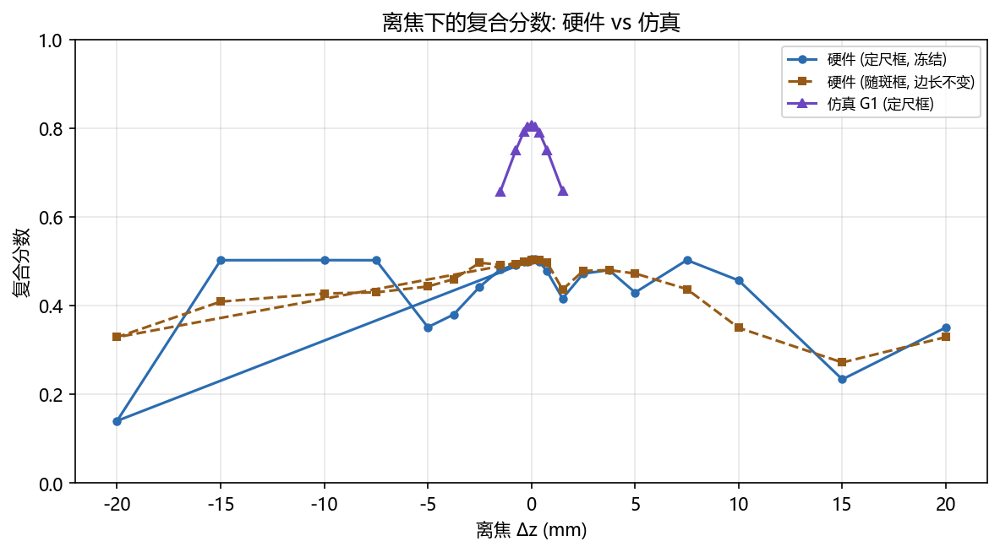

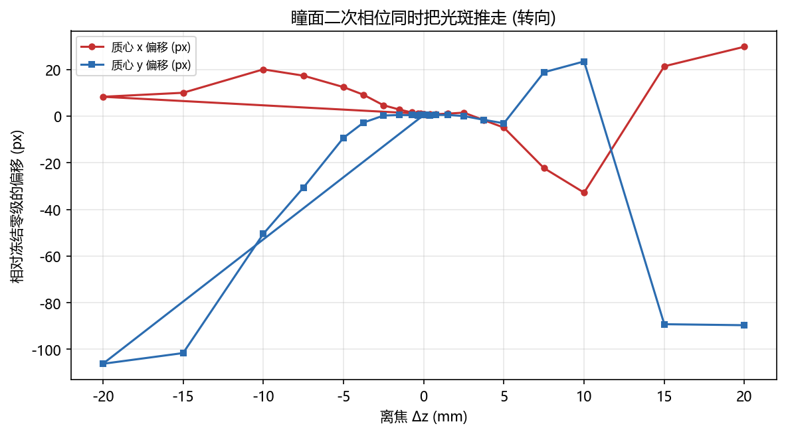

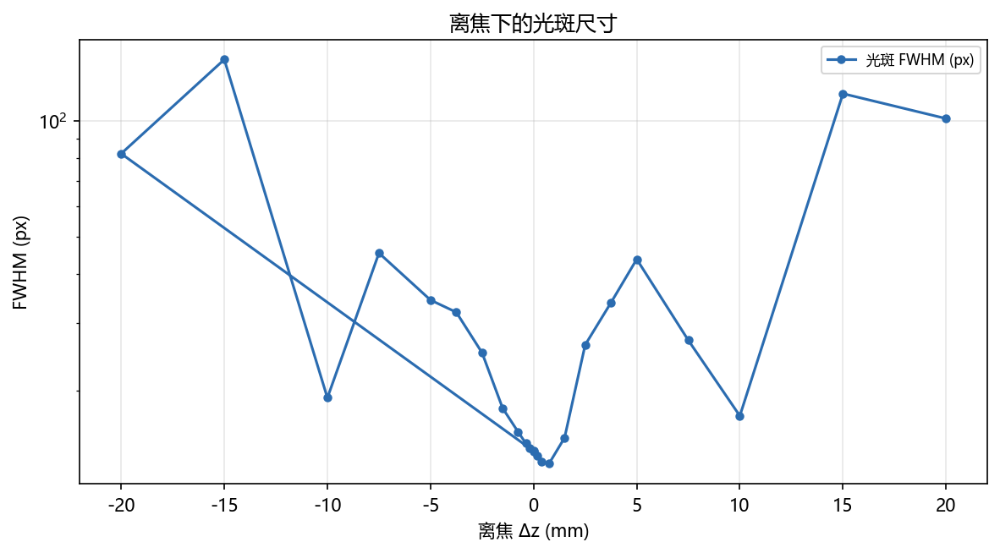
- **CV 列为「-」**：框内没有光时 CV 无定义（除零），按无数据显示。出现这一列的 Δz
  已经超出 125 px 的 ROI 半宽。
- **FWHM 列为「-」**：帧里没有可测光斑。
- **质心偏移**：相对**冻结**的 ROI 内零级位置 (125, 124) 的距离。

#### 2.2.2 与仿真 G1 曲线对拍

仿真的 G1 组（Δz 盲 GS、无离焦）取自 `report/shape_trials/fv_groups_fresnel_vs_vl.csv`
（与 `../gs_defocus_sim/gs_defocus_sim_20261019.md` §2.1 的 G1 行同源：Δz=0 处 score_fixed = 0.8073、
cv_fixed = 0.4215，两边逐位相同）。硬件侧取定尺框复合分数，各自对自己的 Δz=0 归一化。

| Δz (mm) | 仿真 G1 复合分数 (定尺) | 硬件 复合分数 (定尺) | 仿真 归一化 | 硬件 归一化 | 硬件 质心偏移 (px) |
|---|---|---|---|---|---|
| -1.5007 | 0.6569 | 0.4811 | 0.8137 | 0.9591 | 2.8 |
| -0.7504 | 0.7506 | 0.4915 | 0.9298 | 0.9797 | 1.6 |
| -0.3752 | 0.7907 | 0.4991 | 0.9795 | 0.9949 | 1.1 |
| -0.1876 | 0.8030 | 0.4996 | 0.9946 | 0.9958 | 1.1 |
| 0.0000 | 0.8073 | 0.5042 | 1.0000 | 1.0050 | 1.1 |
| 0.1876 | 0.8029 | 0.5042 | 0.9945 | 1.0051 | 0.8 |
| 0.3752 | 0.7906 | 0.4988 | 0.9793 | 0.9943 | 0.9 |
| 0.7504 | 0.7504 | 0.4769 | 0.9296 | 0.9506 | 0.9 |
| 1.5007 | 0.6577 | 0.4157 | 0.8147 | 0.8286 | 1.1 |

读法：

- **形状**：仿真在 |Δz| = 1.5007 mm 处的复合分数降到 Δz=0 的 0.8147（掉了 18.5%），这一组是 0.8286，**同样在下降**（掉了 17.1%，仿真是 18.5%）。 **绝对值与仿真不可比，原因是目标尺度不同**：这一组的目标框是**预先登记**的该相位成形目标（10 px = 泽尼克扫描从平场 waist 量到的 2·w0_flat），而这一组光斑的实测宽度是 13.9 px（框/光斑 = 0.72，同量级，所以这一组的口径是对的）；仿真的 G1 行用的是 47 px 的框 + 47 px 的方斑，**尺度完全不同**，绝对值没有可比性。 能比的是相对量（随 |Δz| 变化的趋势与幅度），以及 §3 里同一张相位的泽尼克阶数结果。 ⚠️ 与仿真的**同尺度**对拍需要仿真在 10 px 目标上重跑（**本轮未做**）， 所以这一行对拍只成立到「形状」这一层。
- **正负半轴**：仿真 G1 在 ±1.5007 mm 处差 0.0008，这一组差 0.0654，
  噪声地板 0.00192，是噪声地板的 34.1 倍 —— **这不是噪声**。

#### 2.2.3 转向：为什么硬件曲线不对称

瞳面二次相位以面板标称照明中心 (960, 600) 为中心，而照明并不落在那里，于是这张相位等价于
一片**偏心透镜**：它一边离焦，一边把光斑横向推走。实测质心 x 相对冻结零级的偏移随 Δz
线性增长，斜率 **-0.60 px/mm**（|Δz| ≤ 2.5 mm 内拟合；
全区间拟合是 -0.22 px/mm，但大 |Δz| 上光斑已跑出 ROI，
质心量到的是晕斑，斜率被稀释）。|Δz| = 1.5 mm 时约
0.9 px，|Δz| = 10 mm 时约
6 px。

| Δz (mm) | 质心 x 偏移 (px, 带符号) | 质心 y 偏移 (px) | 复合分数 定尺 | 复合分数 随斑 |
|---|---|---|---|---|
| -2.5000 | 4.6 | 0.2 | 0.4420 | 0.4959 |
| -1.5007 | 2.8 | 0.5 | 0.4811 | 0.4918 |
| -0.7504 | 1.6 | 0.4 | 0.4915 | 0.4930 |
| -0.3752 | 1.0 | 0.2 | 0.4991 | 0.4990 |
| -0.1876 | 1.0 | 0.5 | 0.4996 | 0.4990 |
| 0.0000 | 0.9 | 0.4 | 0.5017 | 0.5016 |
| 0.0000 | 0.9 | 0.5 | 0.5042 | 0.5026 |
| 0.1876 | 0.7 | 0.4 | 0.5042 | 0.5028 |
| 0.3752 | 0.8 | 0.3 | 0.4988 | 0.5018 |
| 0.7504 | 0.8 | 0.5 | 0.4769 | 0.4969 |
| 1.5007 | 1.0 | 0.5 | 0.4157 | 0.4358 |
| 2.5000 | 1.5 | 0.0 | 0.4717 | 0.4780 |

**这张表就是不对称的全部机制**。注意 Δz = 0 那一行：光斑质心已经比冻结框中心偏了约 8 px
（照明没落在瞳面中心，GS 方斑与零级不同心）。转向是**带符号**的，于是

- **负 Δz** 把光斑**推回**框中心（Δz = -1.5007 mm 时偏移只剩 2.8 px），
  框反而框住了光斑；
- **正 Δz** 把光斑**推得更远**（+1.5007 mm 时偏了 1.0 px），
  框只框住光斑的一部分。

⇒ 正负半轴测到的不是「同一个离焦的两个方向」，而是「同一个离焦 + 两个方向的转向」。
这一组的 ±1.5007 mm 差值 0.0654（噪声地板 0.00192，是噪声地板的 34.1 倍 —— **这不是噪声**），
主要来自这个几何偏置，不是离焦本身有方向性。

后果：冻结框在 |Δz| ≳ 1.5 mm 之后开始被光斑**拖出框外**，于是

- 框内功率（PIB）随 |Δz| 单调掉到 0；
- 但**随斑框**的复合分数在 +3.75 mm 处回到 0.4795，
  高于 +1.5007 mm 处的 0.4358。

⇒ **冻结框口径下 |Δz| ≳ 1.5 mm 的劣化不能读作「离焦把光打散了」**；光还在，只是被搬走了。

#### 2.2.4 大 Δz 与 SLM 采样

面板边缘相位在 Δz = 20 mm 时是 8.13 波。相邻像元的相位步进
在 Δz = 20 mm 时约 0.23 rad，**远小于 π**，所以**采样（奈奎斯特）不是瓶颈**；真正的限制是

- 晕斑半径：Δz = 20 mm 对应约 335 µm ≈ 152 px，而 ROI 半宽只有 125 px
  ⇒ 光斑整体跑出窗口（PIB = 0、框外功率占比 = 1）；
- 零级/杂散光：|Δz| ≥ 15 mm 后整帧峰值降到 3 counts 以下，**框里基本没有光**。

⇒ **把扫描限制在 |Δz| ≤ 20 mm 是对的**（面板边缘 8.13 波）；再往大推，
晕斑已跑出 ROI，既没有可测信号也没有物理意义。


#### 2.2.5 离焦响应：三套口径的对照

**目标框尺寸必须与被测相位匹配。** 探针原先把框写死成 10 px —— 那是**模型** GS 相位方斑的边长；
这一组的实际光斑只有 13.9 px 宽，
框比光斑大 0.7 倍。
复合分数是 `0.5·PIB + 0.5·(1/(1+CV))`：框远大于光斑时，离焦的**弥散把光填满框**（CV 反而变好），
均匀项**奖励**离焦，而功率项同时变差，两项几乎等量抵消 ⇒ 复合分数看起来「毫无反应」。
**离焦效果一直都在**（框内功率保持率在**正半轴**上严格单调下降；负半轴系统性地低一档，
那是转向不对称、不是非单调），只是被口径藏起来了。

匹配框 = 该相位 Δz=0 光斑自己的 FWHM（只定一次、之后冻结，不逐帧缩放）。
**读单调性必须按半轴读**：把 ±Δz 按 |Δz| 合并，量到的是正负不对称，不是离焦响应。

**三条读数纪律**（本表逐条对应）：

1. **复合分数不能当主指标。** 框空掉时 CV→0，`1/(1+CV)`→1，复合分数的地板是 **0.5 而不是 0**，
   于是它在**任何**孔径下都会**反弹**（本组 0.4805
   → 0.4279，|Δz| 3.75 → 5.0 mm：
   更差的图样反而得分更高）。
2. **「跟中心」口径在本实验系统的图样上不可用。** 相位互相关（`estimate_shift`）是仓库里
   为「模型自己的光斑」写的，对**散斑化的远场图样**不灵 （互相关峰值在 Δz ≥ 0.19 mm 就低于 0.3 的可用门限，最低到 0.02）；
   本表的「PIB（互相关跟中心）」列因此大面积为空。质心位移列只在光斑仍是单瓣时可信。
3. **唯一与转向无关的离焦读数是 `g r50`**（功率半径的相对增长）：它量的是图样摊开了多少，
   不看位置，所以转向污染不到它。

⇒ 冻结框心的 PIB 衰减在 |Δz| ≳ 1.5 mm 之后**不能**读作「离焦把光打散了」：
光斑同时被**推走**了（见本组的「转向」小节）。消除这个污染的办法是**给 chirp 配一个反向的瞳面斜坡**
（去倾斜），那部分已进代码（`--chirp-tilt-cancel`，自标定），等设备上线后复测。

| Δz (mm) | 光斑 FWHM (px) | 复合分数 10px (现口径) | PIB 14px (冻结框心) | 复合分数 14px (冻结框心) | 质心位移 dx (px) | r50 (px) | PIB (互相关跟中心) | g r50 (归一) |
|---|---|---|---|---|---|---|---|---|
| -20 | 82.2 | 0.1397 | 0.0018 | 0.1636 | 8.3 | 95.0 | - | 4.167 |
| -15 | 144.1 | 0.5019 | 0.0073 | 0.4340 | 10.0 | 103.5 | - | 4.538 |
| -10 | 19.2 | 0.5020 | 0.0080 | 0.5040 | 20.0 | 64.6 | - | 2.834 |
| -7.5000 | 45.4 | 0.5018 | 0.0072 | 0.5036 | 17.3 | 115.8 | - | 5.080 |
| -5.0000 | 34.3 | 0.3510 | 0.0173 | 0.3351 | 12.4 | 47.6 | - | 2.087 |
| -3.7500 | 31.9 | 0.3796 | 0.0361 | 0.3603 | 9.1 | 42.3 | - | 1.853 |
| -2.5000 | 25.1 | 0.4420 | 0.0937 | 0.4410 | 4.6 | 32.0 | - | 1.401 |
| -1.5007 | 18.0 | 0.4811 | 0.1695 | 0.4762 | 2.8 | 25.8 | - | 1.132 |
| -0.7504 | 15.6 | 0.4915 | 0.2241 | 0.4882 | 1.6 | 23.6 | - | 1.037 |
| -0.3752 | 14.6 | 0.4991 | 0.2485 | 0.4969 | 1.0 | 22.8 | - | 1.001 |
| -0.1876 | 14.2 | 0.4996 | 0.2528 | 0.4973 | 1.0 | 23.2 | - | 1.017 |
| 0.0000 | 13.9 | 0.5042 | 0.2605 | 0.5008 | 0.9 | 22.8 | 0.2605 | 1.000 |
| 0.1876 | 13.5 | 0.5042 | 0.2640 | 0.5010 | 0.7 | 22.6 | - | 0.991 |
| 0.3752 | 13.1 | 0.4988 | 0.2560 | 0.4929 | 0.8 | 24.2 | - | 1.063 |
| 0.7504 | 12.9 | 0.4769 | 0.2381 | 0.4765 | 0.8 | 25.3 | - | 1.108 |
| 1.5007 | 15.1 | 0.4157 | 0.1679 | 0.4363 | 1.0 | 28.3 | - | 1.241 |
| 2.5000 | 26.3 | 0.4717 | 0.0940 | 0.4714 | 1.5 | 33.9 | - | 1.489 |
| 3.7500 | 33.8 | 0.4796 | 0.0544 | 0.4805 | -1.7 | 111.4 | - | 4.885 |
| 5.0000 | 43.8 | 0.4291 | 0.0321 | 0.4279 | -4.9 | 51.6 | - | 2.265 |
| 7.5000 | 27.0 | 0.5022 | 0.0086 | 0.4366 | -22.3 | 61.2 | - | 2.682 |
| 10 | 17.2 | 0.4563 | 0.0077 | 0.4578 | -32.8 | 76.8 | - | 3.367 |
| 15 | 117.5 | 0.2333 | 0.0040 | 0.2482 | 21.3 | 80.2 | - | 3.517 |
| 20 | 101.3 | 0.3504 | 0.0088 | 0.3454 | 29.7 | 98.3 | - | 4.312 |

**孔径灵敏度**（同一批帧，只换目标框尺寸；正半轴）：

| 目标框边长 | 复合分数 @Δz=0 | 复合分数 @Δz=1.5007 mm | 相对降幅 | 最小 PIB (正半轴) |
|---|---|---|---|---|
| 8 px | 0.5045 | 0.4123 | 0.183 | 0.0011 |
| 10 px | 0.5042 | 0.4157 | 0.175 | 0.0018 |
| 13 px | 0.5088 | 0.4279 | 0.159 | 0.0034 |
| 16 px | 0.4969 | 0.4500 | 0.094 | 0.0055 |
| 20 px | 0.4848 | 0.4708 | 0.029 | 0.0096 |
| 44 px | 0.4469 | 0.4651 | -0.041 | 0.0615 |

⇒ 在 8 ~ 16 px 的范围内离焦响应都在（降幅 ≥5%）；**只有 20, 44 px 那个孔径把响应藏住了**（降幅 <5%）—— 结论不是孔径选出来的。


#### 2.2.6 CCD 远场光斑与光斑截面

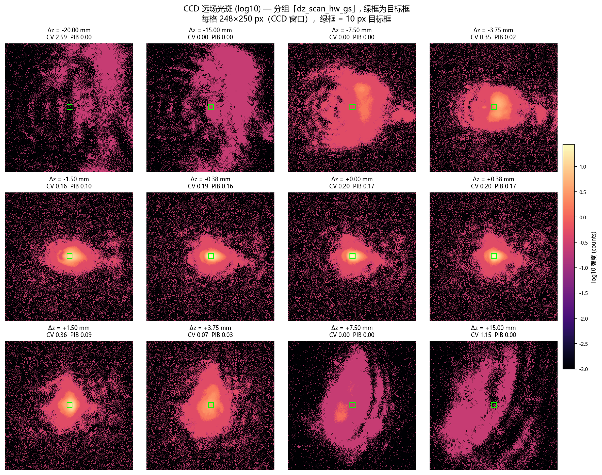

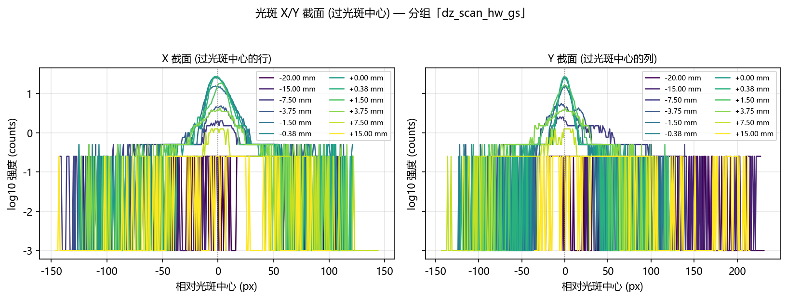

### 2.3 分组「dz_scan_model_gs」（曝光 0.400 ms，相位来源：模型 GS 相位（`OffFocusBench` 现场生成，Δz=0 的 plain GS））

记录目录：`data/debug/hw_groups_20261022/dz_scan_model_gs`

#### 2.3.1 主表

| 类型 | Δz (mm) | 面板边缘相位 (波) | FWHM (px) | 环形度 | 整帧峰值 | 质心偏移 (px) | CV 定尺 | PIB 定尺 | 复合分数 定尺 | CV 随斑 | 复合分数 随斑 | 框外功率占比 |
|---|---|---|---|---|---|---|---|---|---|---|---|---|
| 扫描 | -20 | 8.131 | - | 0.000 | 0.0 | 177.5 | - | 0.0000 | 0.0000 | - | 0.0000 | 0.0000 |
| 扫描 | -15 | 6.098 | 19.22 | 0.320 | 1.0 | 53.3 | 43.9886 | 0.0009 | 0.0116 | 1.9050 | 0.5991 | 0.9991 |
| 扫描 | -10 | 4.065 | 76.46 | 0.571 | 1.8 | 49.1 | 1.1841 | 0.1700 | 0.3139 | 0.5847 | 0.4985 | 0.8300 |
| 扫描 | -7.5000 | 3.049 | 50.37 | 0.926 | 3.5 | 31.8 | 0.4856 | 0.2046 | 0.4389 | 0.4777 | 0.4702 | 0.7954 |
| 扫描 | -5.0000 | 2.033 | 33.00 | 0.869 | 7.2 | 22.1 | 0.5811 | 0.2183 | 0.4254 | 0.5717 | 0.4577 | 0.7817 |
| 扫描 | -3.7500 | 1.525 | 29.94 | 0.944 | 9.5 | 14.4 | 0.7306 | 0.2924 | 0.4351 | 0.6665 | 0.4761 | 0.7076 |
| 扫描 | -2.5000 | 1.016 | 24.48 | 0.913 | 14 | 10.4 | 0.8704 | 0.3689 | 0.4518 | 0.8169 | 0.4759 | 0.6311 |
| 扫描 | -1.5007 | 0.610 | 15.85 | 0.569 | 23 | 9.9 | 0.9566 | 0.4604 | 0.4858 | 0.9069 | 0.4988 | 0.5396 |
| 扫描 | -0.7504 | 0.305 | 17.71 | 0.609 | 23.2 | 8.1 | 0.9031 | 0.5131 | 0.5193 | 0.8907 | 0.5192 | 0.4869 |
| 扫描 | -0.3752 | 0.153 | 20.93 | 0.812 | 20.8 | 7.8 | 0.8798 | 0.5355 | 0.5338 | 0.8706 | 0.5346 | 0.4645 |
| 扫描 | -0.1876 | 0.076 | 23.39 | 0.887 | 19 | 7.2 | 0.8669 | 0.5407 | 0.5382 | 0.8399 | 0.5463 | 0.4593 |
| 基线 (无叠加) | 0.0000 | 0.000 | 23.66 | 0.902 | 19.8 | 6.8 | 0.8626 | 0.5426 | 0.5397 | 0.8424 | 0.5460 | 0.4574 |
| 扫描 | 0.0000 | 0.000 | 23.03 | 0.907 | 20.2 | 7.2 | 0.8722 | 0.5434 | 0.5388 | 0.8545 | 0.5441 | 0.4566 |
| 扫描 | 0.1876 | 0.076 | 22.26 | 0.934 | 21 | 7.3 | 0.8799 | 0.5426 | 0.5373 | 0.8660 | 0.5418 | 0.4574 |
| 扫描 | 0.3752 | 0.153 | 21.34 | 0.934 | 21.8 | 7.1 | 0.8926 | 0.5389 | 0.5336 | 0.8898 | 0.5351 | 0.4611 |
| 扫描 | 0.7504 | 0.305 | 19.37 | 0.900 | 24 | 7.2 | 0.9701 | 0.5326 | 0.5201 | 0.9664 | 0.5223 | 0.4674 |
| 扫描 | 1.5007 | 0.610 | 16.82 | 0.898 | 29.5 | 7.1 | 1.1508 | 0.5076 | 0.4863 | 1.1495 | 0.4875 | 0.4924 |
| 扫描 | 2.5000 | 1.016 | 17.17 | 0.872 | 23.5 | 6.1 | 1.0774 | 0.4499 | 0.4656 | 1.0520 | 0.4730 | 0.5501 |
| 扫描 | 3.7500 | 1.525 | 25.58 | 0.814 | 11.8 | 7.7 | 0.7284 | 0.3842 | 0.4814 | 0.6575 | 0.5036 | 0.6158 |
| 扫描 | 5.0000 | 2.033 | 31.34 | 0.723 | 6.8 | 9.3 | 0.5400 | 0.3046 | 0.4770 | 0.4408 | 0.5099 | 0.6954 |
| 扫描 | 7.5000 | 3.049 | 36.57 | 0.752 | 3.8 | 14.5 | 0.6257 | 0.2446 | 0.4298 | 0.4729 | 0.4809 | 0.7554 |
| 扫描 | 10 | 4.065 | 40.26 | 0.809 | 2.2 | 34.1 | 0.6544 | 0.1259 | 0.3652 | 0.5668 | 0.4026 | 0.8741 |
| 扫描 | 15 | 6.098 | 16.72 | 0.540 | 1.0 | 60.1 | - | 0.0000 | 0.0000 | 1.5982 | 0.5856 | 1.0000 |
| 扫描 | 20 | 8.131 | - | 0.000 | 0.2 | 177.5 | - | 0.0000 | 0.0000 | - | 0.0000 | 1.0000 |
| 扫描 | 25 | 10.163 | 180.71 | 0.280 | 0.2 | 108.2 | 0.3142 | 0.0633 | 0.4121 | 0.8699 | 0.2863 | 0.9367 |
| 扫描 | 30 | 12.196 | 225.06 | 1.000 | 0.2 | 120.4 | 0.4450 | 0.0732 | 0.3826 | 0.6533 | 0.3324 | 0.9268 |
| 扫描 | 35 | 14.229 | 30.65 | 0.760 | 0.2 | 118.7 | 0.4333 | 0.0945 | 0.3961 | 1.1280 | 0.2597 | 0.9055 |
| 扫描 | 40 | 16.261 | 175.72 | 0.580 | 0.5 | 100.5 | 0.4260 | 0.0713 | 0.3863 | 0.7900 | 0.3020 | 0.9287 |
| 扫描 | 45 | 18.294 | 118.33 | 0.760 | 0.5 | 53.7 | 0.6808 | 0.0582 | 0.3266 | 0.7306 | 0.3166 | 0.9418 |
| 扫描 | 50 | 20.327 | 130.50 | 0.520 | 0.5 | 29.2 | 0.8350 | 0.0559 | 0.3004 | 0.8739 | 0.2928 | 0.9441 |

表注：

- **类型**：「基线 (无叠加)」是探针在扫描前测的那一行（叠加层为空）；「扫描」行的 Δz=0
  那一行叠加的是一张**全零**二次相位 —— 物理上与基线等价，两行同时给出就是为了显示重复性
  （两者差 0.0010，远小于 3σ 地板）。

**离焦扫描折线图（模型 GS 相位）**：


- **CV 列为「-」**：框内没有光时 CV 无定义（除零），按无数据显示。出现这一列的 Δz
  已经超出 125 px 的 ROI 半宽。
- **FWHM 列为「-」**：帧里没有可测光斑。
- **质心偏移**：相对**冻结**的 ROI 内零级位置 (125, 126) 的距离。

#### 2.3.2 与仿真 G1 曲线对拍

仿真的 G1 组（Δz 盲 GS、无离焦）取自 `report/shape_trials/fv_groups_fresnel_vs_vl.csv`
（与 `../gs_defocus_sim/gs_defocus_sim_20261019.md` §2.1 的 G1 行同源：Δz=0 处 score_fixed = 0.8073、
cv_fixed = 0.4215，两边逐位相同）。硬件侧取定尺框复合分数，各自对自己的 Δz=0 归一化。

| Δz (mm) | 仿真 G1 复合分数 (定尺) | 硬件 复合分数 (定尺) | 仿真 归一化 | 硬件 归一化 | 硬件 质心偏移 (px) |
|---|---|---|---|---|---|
| -1.5007 | 0.6569 | 0.4858 | 0.8137 | 0.9000 | 9.9 |
| -0.7504 | 0.7506 | 0.5193 | 0.9298 | 0.9621 | 8.1 |
| -0.3752 | 0.7907 | 0.5338 | 0.9795 | 0.9889 | 7.8 |
| -0.1876 | 0.8030 | 0.5382 | 0.9946 | 0.9971 | 7.2 |
| 0.0000 | 0.8073 | 0.5388 | 1.0000 | 0.9982 | 7.2 |
| 0.1876 | 0.8029 | 0.5373 | 0.9945 | 0.9954 | 7.3 |
| 0.3752 | 0.7906 | 0.5336 | 0.9793 | 0.9887 | 7.1 |
| 0.7504 | 0.7504 | 0.5201 | 0.9296 | 0.9636 | 7.2 |
| 1.5007 | 0.6577 | 0.4863 | 0.8147 | 0.9009 | 7.1 |

读法：

- **形状**：仿真在 |Δz| = 1.5007 mm 处的复合分数降到 Δz=0 的 0.8147（掉了 18.5%），这一组是 0.9009，**同样在下降**（掉了 9.9%，仿真是 18.5%）。 绝对值也对不上（硬件 Δz=0 的复合分数 0.5397 对仿真 0.8073）： 这一组的相位来源、目标框尺寸（44 px 对 47 px）、目标边长都与仿真的 G1 行**同口径**， 所以差距来自光路本身：仿真里 GS 相位与数字孪生**自洽**， 而同一张相位下发到真实实验系统上，照明没落在瞳面中心、相机也不在 2f 面上， 方斑并不成立（CV ≈ 0.73，与 2026-10-15 的硬件记录 CV ≈ 0.723 同量级）。
- **正负半轴**：仿真 G1 在 ±1.5007 mm 处差 0.0008，这一组差 0.0005，
  噪声地板 0.00192，**与噪声地板同量级 —— 在这个口径下分不出不对称**。

#### 2.3.3 转向：为什么硬件曲线不对称

瞳面二次相位以面板标称照明中心 (960, 600) 为中心，而照明并不落在那里，于是这张相位等价于
一片**偏心透镜**：它一边离焦，一边把光斑横向推走。实测质心 x 相对冻结零级的偏移随 Δz
线性增长，斜率 **0.28 px/mm**（|Δz| ≤ 2.5 mm 内拟合；
全区间拟合是 0.70 px/mm，但大 |Δz| 上光斑已跑出 ROI，
质心量到的是晕斑，斜率被稀释）。|Δz| = 1.5 mm 时约
0.4 px，|Δz| = 10 mm 时约
3 px。

| Δz (mm) | 质心 x 偏移 (px, 带符号) | 质心 y 偏移 (px) | 复合分数 定尺 | 复合分数 随斑 |
|---|---|---|---|---|
| -2.5000 | -7.1 | -7.6 | 0.4518 | 0.4759 |
| -1.5007 | -7.1 | -6.9 | 0.4858 | 0.4988 |
| -0.7504 | -5.8 | -5.6 | 0.5193 | 0.5192 |
| -0.3752 | -6.1 | -4.8 | 0.5338 | 0.5346 |
| -0.1876 | -6.3 | -3.4 | 0.5382 | 0.5463 |
| 0.0000 | -6.0 | -3.2 | 0.5397 | 0.5460 |
| 0.0000 | -6.2 | -3.7 | 0.5388 | 0.5441 |
| 0.1876 | -6.2 | -3.8 | 0.5373 | 0.5418 |
| 0.3752 | -6.2 | -3.6 | 0.5336 | 0.5351 |
| 0.7504 | -6.3 | -3.4 | 0.5201 | 0.5223 |
| 1.5007 | -6.2 | -3.4 | 0.4863 | 0.4875 |
| 2.5000 | -5.4 | -2.9 | 0.4656 | 0.4730 |

**这张表就是不对称的全部机制**。注意 Δz = 0 那一行：光斑质心已经比冻结框中心偏了约 8 px
（照明没落在瞳面中心，GS 方斑与零级不同心）。转向是**带符号**的，于是

- **负 Δz** 把光斑**推回**框中心（Δz = -1.5007 mm 时偏移只剩 -7.1 px），
  框反而框住了光斑；
- **正 Δz** 把光斑**推得更远**（+1.5007 mm 时偏了 -6.2 px），
  框只框住光斑的一部分。

⇒ 正负半轴测到的不是「同一个离焦的两个方向」，而是「同一个离焦 + 两个方向的转向」。
这一组的 ±1.5007 mm 差值 0.0005（噪声地板 0.00192，**与噪声地板同量级 —— 在这个口径下分不出不对称**），
主要来自这个几何偏置，不是离焦本身有方向性。

后果：冻结框在 |Δz| ≳ 1.5 mm 之后开始被光斑**拖出框外**，于是

- 框内功率（PIB）随 |Δz| 单调掉到 0；
- 但**随斑框**的复合分数在 +3.75 mm 处回到 0.5036，
  高于 +1.5007 mm 处的 0.4875。

⇒ **冻结框口径下 |Δz| ≳ 1.5 mm 的劣化不能读作「离焦把光打散了」**；光还在，只是被搬走了。

#### 2.3.4 大 Δz 与 SLM 采样

面板边缘相位在 Δz = 20 mm 时是 8.13 波、Δz = 50 mm 时是 20.33 波。相邻像元的相位步进
在 Δz = 20 mm 时约 0.23 rad，**远小于 π**，所以**采样（奈奎斯特）不是瓶颈**；真正的限制是

- 晕斑半径：Δz = 20 mm 对应约 335 µm ≈ 152 px，而 ROI 半宽只有 125 px
  ⇒ 光斑整体跑出窗口（PIB = 0、框外功率占比 = 1）；
- 零级/杂散光：|Δz| ≥ 15 mm 后整帧峰值降到 3 counts 以下，**框里基本没有光**。

⇒ **把扫描限制在 |Δz| ≤ 20 mm 是对的**（面板边缘 8.13 波）；再往大推，
晕斑已跑出 ROI，既没有可测信号也没有物理意义。


#### 2.3.5 离焦响应：三套口径的对照

**目标框尺寸必须与被测相位匹配。** 探针原先把框写死成 44 px —— 那是**模型** GS 相位方斑的边长；
这一组的实际光斑只有 23.0 px 宽，
框比光斑大 1.9 倍。
复合分数是 `0.5·PIB + 0.5·(1/(1+CV))`：框远大于光斑时，离焦的**弥散把光填满框**（CV 反而变好），
均匀项**奖励**离焦，而功率项同时变差，两项几乎等量抵消 ⇒ 复合分数看起来「毫无反应」。
**离焦效果一直都在**（框内功率保持率在**正半轴**上严格单调下降；负半轴系统性地低一档，
那是转向不对称、不是非单调），只是被口径藏起来了。

匹配框 = 该相位 Δz=0 光斑自己的 FWHM（只定一次、之后冻结，不逐帧缩放）。
**读单调性必须按半轴读**：把 ±Δz 按 |Δz| 合并，量到的是正负不对称，不是离焦响应。

**三条读数纪律**（本表逐条对应）：

1. **复合分数不能当主指标。** 框空掉时 CV→0，`1/(1+CV)`→1，复合分数的地板是 **0.5 而不是 0**，
   于是它在**任何**孔径下都会**反弹**（本组 0.4287
   → 0.4165，|Δz| 3.75 → 5.0 mm：
   更差的图样反而得分更高）。
2. **「跟中心」口径在本实验系统的图样上不可用。** 相位互相关（`estimate_shift`）是仓库里
   为「模型自己的光斑」写的，对**散斑化的远场图样**不灵 （互相关峰值在 Δz ≥ 0.19 mm 就低于 0.3 的可用门限，最低到 0.00）；
   本表的「PIB（互相关跟中心）」列因此大面积为空。质心位移列只在光斑仍是单瓣时可信。
3. **唯一与转向无关的离焦读数是 `g r50`**（功率半径的相对增长）：它量的是图样摊开了多少，
   不看位置，所以转向污染不到它。

⇒ 冻结框心的 PIB 衰减在 |Δz| ≳ 1.5 mm 之后**不能**读作「离焦把光打散了」：
光斑同时被**推走**了（见本组的「转向」小节）。消除这个污染的办法是**给 chirp 配一个反向的瞳面斜坡**
（去倾斜），那部分已进代码（`--chirp-tilt-cancel`，自标定），等设备上线后复测。

| Δz (mm) | 光斑 FWHM (px) | 复合分数 44px (现口径) | PIB 23px (冻结框心) | 复合分数 23px (冻结框心) | 质心位移 dx (px) | r50 (px) | PIB (互相关跟中心) | g r50 (归一) |
|---|---|---|---|---|---|---|---|---|
| -20 | - | 0.0000 | 0.0000 | 0.0000 | -125 | - | - | - |
| -15 | 19.2 | 0.0116 | 0.0000 | 0.0000 | 38.6 | 13.6 | - | 0.607 |
| -10 | 76.5 | 0.3139 | 0.0310 | 0.2202 | 0.7 | 48.1 | - | 2.149 |
| -7.5000 | 50.4 | 0.4389 | 0.0622 | 0.4340 | 0.1 | 46.9 | - | 2.097 |
| -5.0000 | 33.0 | 0.4254 | 0.0759 | 0.4009 | -1.9 | 46.1 | - | 2.063 |
| -3.7500 | 29.9 | 0.4351 | 0.1078 | 0.3884 | -4.2 | 37.7 | - | 1.687 |
| -2.5000 | 24.5 | 0.4518 | 0.1388 | 0.3644 | -7.1 | 31.8 | - | 1.424 |
| -1.5007 | 15.8 | 0.4858 | 0.1665 | 0.3706 | -7.1 | 27.3 | - | 1.219 |
| -0.7504 | 17.7 | 0.5193 | 0.2085 | 0.4094 | -5.8 | 24.4 | - | 1.093 |
| -0.3752 | 20.9 | 0.5338 | 0.2294 | 0.4207 | -6.1 | 23.1 | - | 1.033 |
| -0.1876 | 23.4 | 0.5382 | 0.2378 | 0.4290 | -6.3 | 22.7 | - | 1.014 |
| 0.0000 | 23.0 | 0.5388 | 0.2430 | 0.4302 | -6.2 | 22.4 | 0.2430 | 1.000 |
| 0.1876 | 22.3 | 0.5373 | 0.2511 | 0.4349 | -6.2 | 22.3 | - | 0.995 |
| 0.3752 | 21.3 | 0.5336 | 0.2580 | 0.4403 | -6.2 | 22.3 | - | 0.996 |
| 0.7504 | 19.4 | 0.5201 | 0.2724 | 0.4456 | -6.3 | 22.3 | - | 0.997 |
| 1.5007 | 16.8 | 0.4863 | 0.2781 | 0.4304 | -6.2 | 23.7 | - | 1.060 |
| 2.5000 | 17.2 | 0.4656 | 0.2388 | 0.4127 | -5.4 | 30.2 | - | 1.350 |
| 3.7500 | 25.6 | 0.4814 | 0.1672 | 0.4287 | -6.5 | 36.0 | - | 1.609 |
| 5.0000 | 31.3 | 0.4770 | 0.1040 | 0.4165 | -6.8 | 42.9 | - | 1.917 |
| 7.5000 | 36.6 | 0.4298 | 0.0665 | 0.3709 | -5.9 | 44.3 | - | 1.981 |
| 10 | 40.3 | 0.3652 | 0.0317 | 0.3213 | -25.8 | 65.8 | - | 2.943 |
| 15 | 16.7 | 0.0000 | 0.0000 | 0.0000 | -46.0 | 17.3 | - | 0.774 |
| 20 | - | 0.0000 | 0.0000 | 0.0000 | -125 | 70.2 | - | 3.138 |
| 25 | 180.7 | 0.4121 | 0.0176 | 0.4011 | -20.3 | 86.5 | - | 3.869 |
| 30 | 225.1 | 0.3826 | 0.0230 | 0.4269 | 58.1 | 89.9 | - | 4.018 |
| 35 | 30.7 | 0.3961 | 0.0295 | 0.4319 | 59.7 | 85.7 | - | 3.832 |
| 40 | 175.7 | 0.3863 | 0.0217 | 0.3973 | 53.8 | 130.7 | - | 5.845 |
| 45 | 118.3 | 0.3266 | 0.0152 | 0.2987 | 20.0 | 95.3 | - | 4.262 |
| 50 | 130.5 | 0.3004 | 0.0165 | 0.2893 | -3.0 | 90.7 | - | 4.054 |

**孔径灵敏度**（同一批帧，只换目标框尺寸；正半轴）：

| 目标框边长 | 复合分数 @Δz=0 | 复合分数 @Δz=1.5007 mm | 相对降幅 | 最小 PIB (正半轴) |
|---|---|---|---|---|
| 8 px | 0.4065 | 0.4111 | -0.011 | 0.0000 |
| 10 px | 0.3998 | 0.4044 | -0.011 | 0.0000 |
| 13 px | 0.3953 | 0.4031 | -0.020 | 0.0000 |
| 16 px | 0.3993 | 0.4077 | -0.021 | 0.0000 |
| 20 px | 0.4128 | 0.4214 | -0.021 | 0.0000 |
| 44 px | 0.5388 | 0.4863 | 0.097 | 0.0000 |

⇒ 在 44 ~ 44 px 的范围内离焦响应都在（降幅 ≥5%）；**只有 8, 10, 13, 16, 20 px 那个孔径把响应藏住了**（降幅 <5%）—— 结论不是孔径选出来的。


#### 2.3.6 CCD 远场光斑与光斑截面

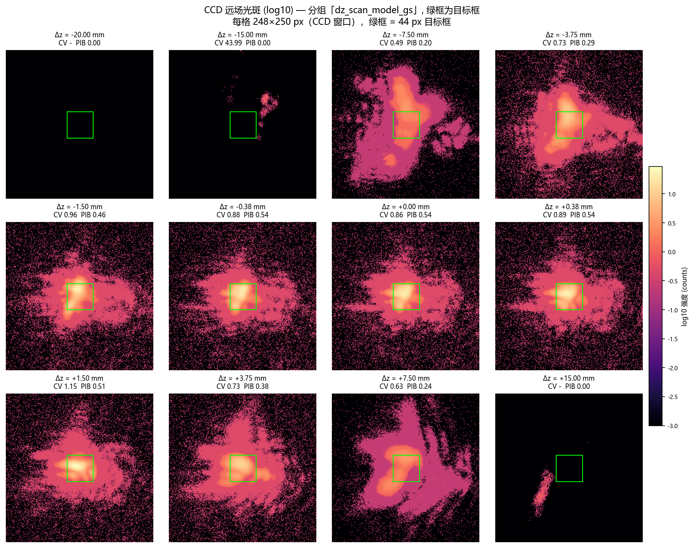

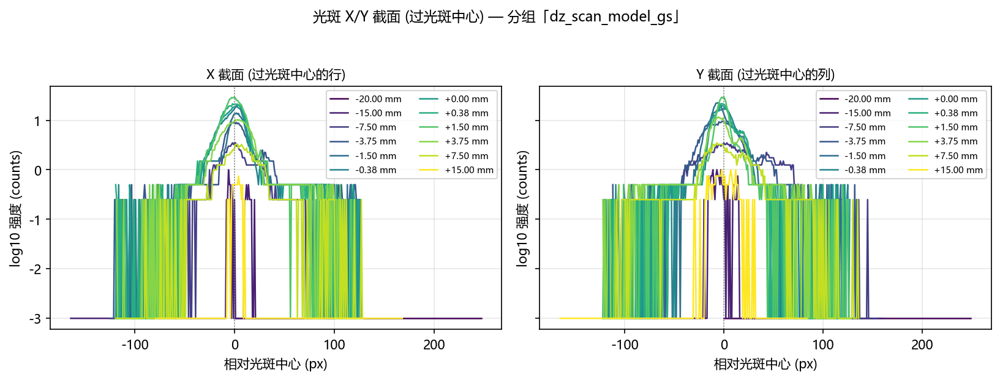


---


---

## 3. 泽尼克阶数扫描（硬件）

采集脚本：`scripts/slm/run_gs_refine_zernike_sweep.py --cam-type daheng --defocus-focal-mm 1549.3`，
数据目录 `data\debug\hw_zernike_sweep_20261022`。

三阶段：Stage A = GS 预矫正 + SPGD 细化（硬件闭环）→ Stage B = Noll 序 Zernike 最小二乘拟合
→ Stage C = 在 Zernike 系数上做 SPGD。目标框由平场光斑 waist 推导，**全程冻结**。

**数据来源与同源性核查** —— 本节的数字由 **15** 份 `summary.json` 合并而成，组目录：`zernike_order_nmax11`、`zernike_order_nmax15`、`zernike_order_nmax20`、`zernike_order_nmax25`、`zernike_order_nmax3`、`zernike_order_nmax4`、`zernike_order_nmax6`、`zernike_order_nmax8`、`zernike_stage_a_1`、`zernike_stage_a_2`、`zernike_stage_a_3`、`zernike_stage_a_4`、`zernike_stage_a_5`、`zernike_stage_a_6`、`zernike_stage_a_7`。

- `orders`：**逐组按 n_max 拼起来**（同一个 n_max 出现两次时取**后一次**）。
- 其余字段：取**第一份含该字段的** summary 的值 —— 本报告正文读到的那些字段来自 `w0_px`（`zernike_order_nmax11`）、`baselines`（`zernike_order_nmax11`）、`config`（`zernike_order_nmax11`）。
- 跨组核对的**标量口径字段**是 `w0_px`、`target_side`、`center_xy`、`mask_center_xy`（同一轮扫描里它们本应一致）。
- 跨组差异**分两类判别**：像素坐标类字段（`center_xy`、`mask_center_xy`）的逐轴偏差 ≤ **2 px** ⇒ **良性**（同轮内的定位抖动）；连续量字段（`w0_px`、`target_side`）的相对差 > **0.5%** ⇒ **恶性**（疑似跨轮次混入）。
- **可比性先判**：同一空间才谈得上「偏差多少」。`center_xy` 是**全幅传感器**坐标（每组都在同一块传感器上定位零级）⇒ **永远可比**；`mask_center_xy` 是**窗口内**坐标 ⇒ 取两组的**共同窗口**（逐轴取小）作为「可能的窗口内空间」，两个取值**都落在里面**才当同空间判偏差；**有一个落在外面** ⇒ 它是**全幅**坐标 ⇒ 两者的数**不可直接比较**。

**阈值为什么是这两个数**：像素坐标的 **2 px** —— 逐阶组各自在**自己那一帧**上重新定位零级，散布只有 **±1 px**（第二轮八个逐阶组的 `mask_center_xy` 落在 `[126,128]` / `[127,128]` / `[127,127]` / `[126,127]` 四种上），2 px 是它的一倍余量；连续量的 **0.5%** —— 实测跨轮次的光学状态差异是 **1.13%**（第二轮混进来的 `zernike_stage_a_1`：`w0_px` 5.742078 → 5.807177），阈值取它的一半不到，好让这种差异**被报出来**而不是被当成噪声吞掉。

**本轮实测**：本轮实测散布 **±4 px**；连续量的 口径字段（`w0_px`、`target_side`）在各组之间**完全一致**。

**为什么可比性看「取值」而不是看「`frame_shape` 是否相等」**：两个生产者写的 `frame_shape` **不是一个意思** —— Stage A 块记的是**全幅** `probe_shape`（1944×2592），但它的 `mask_center_xy` 在 2026-10-21 的续跑坐标修复（提交 07139db6）**之后**已经是**窗口内**坐标（优化器冻结的 ROI 中心）。按 `frame_shape` 判 ⇒ 把**其实同空间**的取值误判成「不同空间」⇒ 正文里印一句**不成立**的话，还白白**抑制掉一次交叉核对**（逐阶组的掩膜中心 vs 块的掩膜中心 —— 差得多就说明某一块的 ROI 摆歪了）。改判「取值是否落在共同窗口内」之后：**第二轮**（`mask_center_xy` 是全幅的 `[1433, 971]`，超出 256×256 的共同窗口）**仍判不同空间** ⇒ 已入库的第二轮报告结论不变；**本轮**各组的 `mask_center_xy` 取值为 `[129, 128]` / `[130, 128]` / `[133, 128]`，**全部落在共同窗口内** ⇒ 都是窗口内坐标 ⇒ **同空间**，逐轴偏差照常判。

**同轮内的定位抖动（良性差异）** —— 下列差异都**没有**超过判定阈值：各组在**自己那一帧**上重新定位零级，散布 **±1 px**，口径字段（`w0_px`、`target_side`）在各组之间**完全一致** ⇒ 不影响口径。

| 字段 | 合并采用（组目录） | 其他组里的取值（组目录） | 判定 |
|---|---|---|---|
| `mask_center_xy` | `[129, 128]`（`zernike_order_nmax11`） | `[130, 128]`（`zernike_order_nmax15`、`zernike_order_nmax20`、`zernike_order_nmax3`、`zernike_order_nmax4`） | 逐轴偏差 1 px ≤ 2 px（定位抖动） |

⚠️ **跨组字段不一致，疑似跨轮次数据混入：1 个字段** —— 下列差异**超过**判定阈值；**这一批的具体解释见下面的「补充判定」**（由本轮数据算出）。「合并采用」= 报告正文实际使用的那个取值。

| 字段 | 合并采用（组目录） | 其他组里的取值（组目录） | 判定 |
|---|---|---|---|
| `mask_center_xy` | `[129, 128]`（`zernike_order_nmax11`） | `[133, 128]`（`zernike_stage_a_1`、`zernike_stage_a_2`、`zernike_stage_a_3`、`zernike_stage_a_4`、`zernike_stage_a_5`、`zernike_stage_a_6`、`zernike_stage_a_7`） | 逐轴偏差 4 px > 2 px |

**补充判定**：差异**按 `frame_shape` 分簇**（[129, 128] 由 4 组给出，其 `frame_shape` 是 256x256；[130, 128] 由 4 组给出，其 `frame_shape` 是 256x256；[133, 128] 由 7 组给出，其 `frame_shape` 是 1944x2592）⇒ 是**两套取景口径**下零级定位的**系统性**偏差，**不是**光学状态变了（口径字段也没被改动）；各组产物的写入时间相隔仅 **66 分钟** ⇒ 它们是**同一次采集**里连续产出的 ⇒ **不可能**是别轮的产物混进来。

**后果（只列事实）**：

- 上表「合并采用」那一列就是 §3 正文里用的值：`w0_px` 决定 §3.2.1 与 §3.3 引用的目标框边长（2·w0_px = 12.54 px）；`target_side`、`center_xy`、`mask_center_xy` 在本报告正文里**没有被引用**（它们只记录在采集脚本自己的产物里）。
- §3.2 的阶数指标（CV / PIB / 拟合残差 / max|c|）来自各组自己的 `orders`，**不经过**上面这几个标量字段。
- 本报告**不替读者判断**这些差异是否影响结论；上表与本段只给出事实。

### 3.1 基线

| 相位 | CV | PIB | EE | AR | 复合分数 |
|---|---|---|---|---|---|
| 平场 | 0.5662 | 0.2086 | 0.1862 | 0.9000 | 0.3515 |
| GS 逐像素相位 | 0.4820 | 0.2237 | 0.2002 | 0.8182 | 0.3486 |

### 3.2 阶数扫描

| n_max | 模态数 | 拟合残差 (rad) | max|c| (rad) | clip 警告 | CV 前 | CV 后 | PIB 前 | PIB 后 | EE 后 | 复合分数 后 | SPGD 有改善 |
|---|---|---|---|---|---|---|---|---|---|---|---|
| 3 | 10 | 0.3182 | 0.0843 |  | 0.2602 | 0.2466 | 0.0826 | 0.0807 | 0.0807 | 0.4288 | 是 |
| 4 | 15 | 0.3090 | 0.0843 |  | 0.2657 | 0.2540 | 0.0840 | 0.0821 | 0.0821 | 0.4258 | 是 |
| 6 | 28 | 0.2892 | 0.0843 |  | 0.2790 | 0.2731 | 0.0898 | 0.0886 | 0.0791 | 0.4633 | 是 |
| 8 | 45 | 0.2697 | 0.0843 |  | 0.2785 | 0.2794 | 0.0908 | 0.0881 | 0.0789 | 0.4603 | 是 |
| 11 | 78 | 0.2526 | 0.0843 |  | 0.2859 | 0.2697 | 0.0895 | 0.0868 | 0.0776 | 0.4643 | 是 |
| 15 | 136 | 0.2226 | 0.0843 |  | 0.2707 | 0.2414 | 0.0766 | 0.0724 | 0.0724 | 0.4758 | 是 |
| 20 | 231 | 0.1854 | 0.0843 |  | 0.2547 | 0.2459 | 0.0712 | 0.0664 | 0.0664 | 0.4712 | 是 |
| 25 | 351 | 0.1510 | 0.0843 |  | 0.2895 | 0.2648 | 0.0908 | 0.0801 | 0.0714 | 0.4641 | 是 |

**泽尼克阶数扫描折线图**：

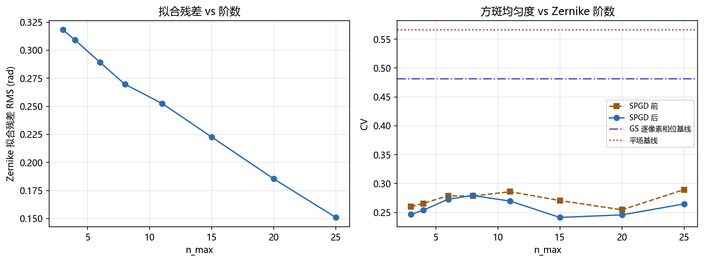

### 3.2.1 各阶的 CCD 远场光斑图

下面是泽尼克扫描自己在每一阶保存的远场图（`before` = 纯 Zernike 拟合相位，
`after` = 再叠加该阶的 SPGD 优化结果），窗口是该扫描的 256×256 ROI、
目标框 12.54 px（= 平场 waist 6.27 px 的两倍）。

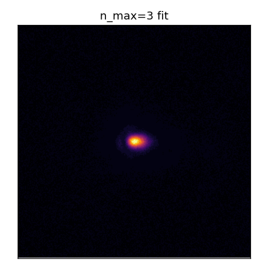


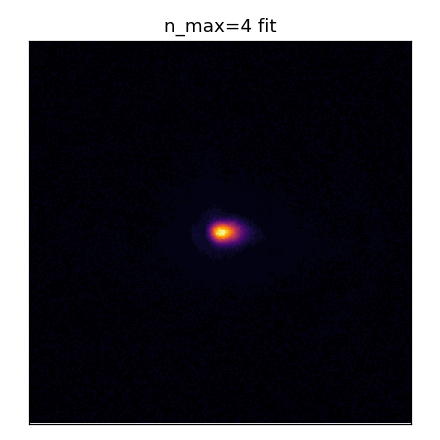

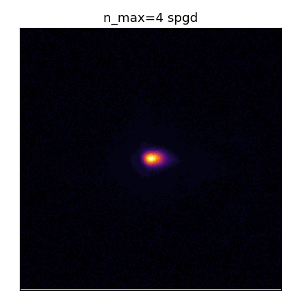


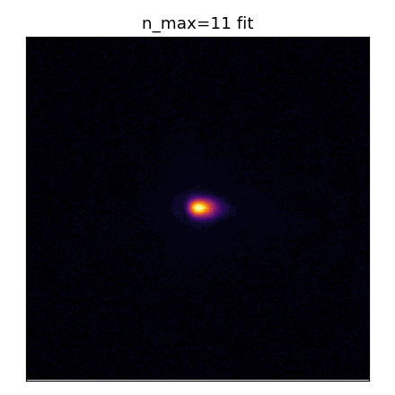

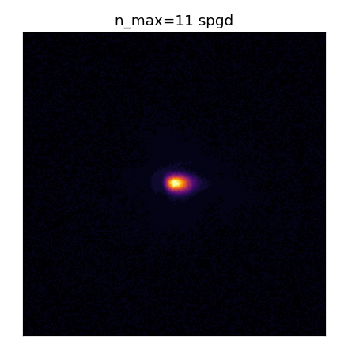

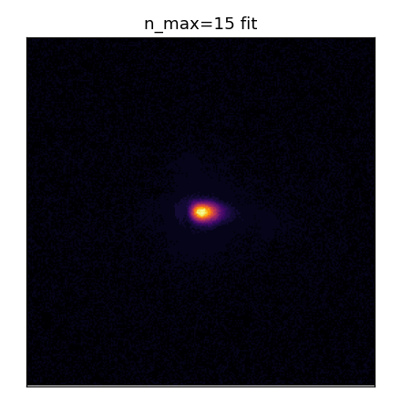

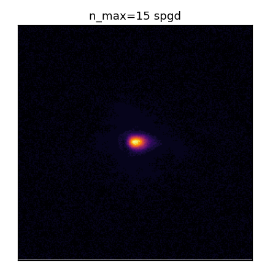

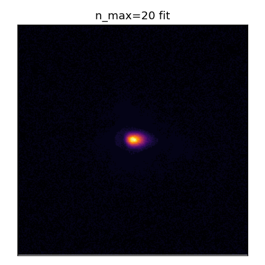

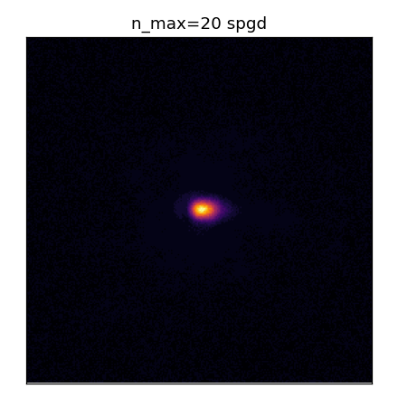

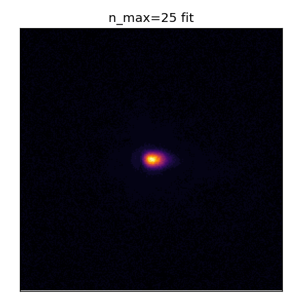

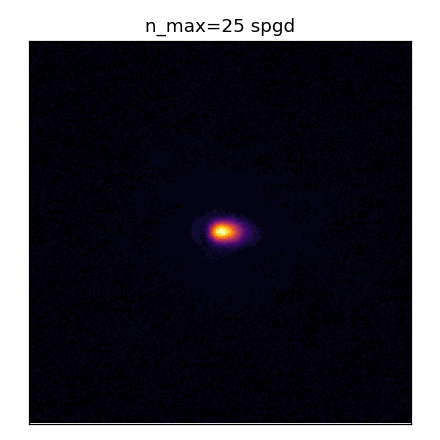

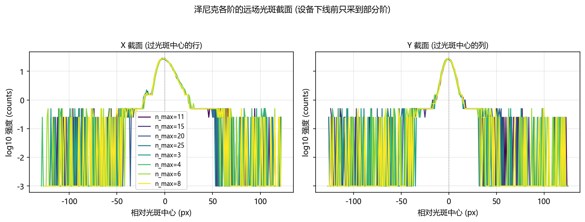

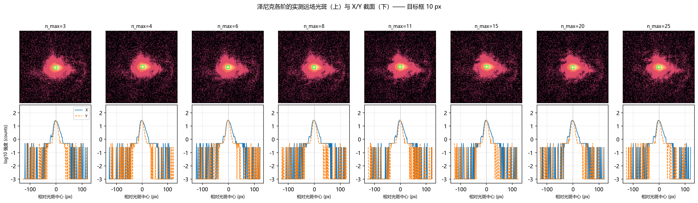

### 3.3 阶数能不能排序

**差异可以分辨，但不是「阶数越高越好」。** 阶数之间的 CV 跨度 0.0379 是同口径噪声 0.00897 的 4.2 倍，PIB 跨度 0.0221 是地板 0.00179 的 12.3 倍 —— **超过 3σ，差异不是噪声**。 但三点必须同时说：

   - **CV 随阶数只是整体下降、并不单调**：SPGD 之前（纯 Zernike 拟合）CV 从 0.2895（n_max=3）降到 0.2547（n_max=20），跨度 0.0348，但 n_max=11 与 25 处有回升，**不是单调改善**。
   - **CV 变好不等于整形变好**：同一批相位的框内功率 PIB 反而从 0.0908 降到 0.0712（跨度 0.0196），而 GS 逐像素相位本身是 CV 0.4820 / PIB 0.2237。 截断到低阶 Zernike 会把方斑**抹平**：框内更均匀（CV 低），但代价是**近一半的框内功率被摊到框外**。 只看 CV 会把这个「平滑」误读成「整形更好」。
   - **Stage C 的 SPGD 基本没有改变结果**：各阶 `after` 与 `before` 的 CV 差最大只有 0.0292，与同口径噪声 0.00897 同量级，且 n_max=25 直接记为 `spgd_improved=false`。 所以阶数之间的差异**全部来自 Stage B 的 Zernike 拟合**，不是 SPGD 优化出来的。

判据用的噪声地板必须与阶数比较**同口径**（泽尼克扫描那把 12.54 px 目标框、
0.200 ms 曝光），
所以不能用 §1.2 那条（那条是离焦探针的 10 px 目标框，框大了 ~20 倍，光子数多一个量级，
σ 小得多，拿来判阶数差异会**高估**可分辨性）。这里从泽尼克扫描自己的逐轮记录里取：

| 量 | σ (同口径) | 来源 | 说明 |
|---|---|---|---|
| CV | 0.00897 | 各阶 `after - before` 配对差 / √2（8 阶取中位数） | 保守：把 SPGD 那点真实改善也算进了差里 |
| PIB | 0.00179 | 各阶逐轮 `m_roi_pib` 的组内标准差（8 阶取中位数） | SPGD 的更新被噪声门挡掉（150 轮只放行 4 次），逐轮量的是几乎同一个相位 |

- 拟合残差随阶数单调不增；
  这是本轮唯一在阶数方向上单调的量。
- 各阶的 `max|c|` 与 `ZERNIKE_CLIP = 5.0` rad 的关系见上表「clip 警告」列。
- 本轮**只有 1 个 seed**，没有配对轴，因此不做显著性检验；
  `ml/zernike/eval_stats.py` 的 sign-flip 置换检验需要「同 seed 配 seed」，1 个 seed 无从配对。


---

## 4. 图


---

## 5. 限制（不能断言什么）

1. **离焦响应的可读区间只有 |Δz| ≤ 1.5 mm。** 更大的 Δz 上，转向分量压过离焦分量，
   冻结框口径不再度量「离焦」。
2. **本轮没有做「在工作点上重新优化」的硬件版。** 仿真报告的核心结论是
   「离焦本身不值钱, 值钱的是在工作点上重新优化」（G1′−G1 = +0.1465，而离焦并入环路的净贡献
   只有 +0.0179）。硬件上逐 Δz 重跑 GS 闭环的成本是本轮预算的数十倍，**本报告没有验证这一条**。
3. **离焦扫描用的是硬件 GS 相位**（泽尼克扫描 Stage A 产出、Stage B 拟合的就是这一张），
   与第 3 节同一张相位；模型 GS 相位那组只是**对照**（它证明模型相位在实验系统上不成方斑）。
4. **焦面标定有平台**：峰值判据在一段 D 上饱和（判别说明见 §1.3 的标定器记录），
   本轮取 **1/f = 0.645 m⁻¹
   （f_v = 1549.3 mm）**。平台内的选择会改变 Δz=0
   的参考点，所以本报告所有「相对 Δz=0 的变化」都带着这个参考点的不确定性。
5. **离焦组与噪声组各有一条噪声地板，口径不同**：离焦组用 10 px 目标框
   （0.200 ms，硬件 GS 相位），阶数比较用泽尼克扫描自己的
   目标框（见 §3.3）。**两者不可互相替代**。
6. **泽尼克阶数只有 1 个 seed**，且 Stage A 的 GS 相位只优化了 250 轮、Stage C 每阶 150 轮。
   没有配对轴，所以不做显著性检验（`ml/zernike/eval_stats.py` 的 sign-flip 置换检验
   需要「同 seed 配 seed」）。
7. **本轮只测了一个离焦方向的两个半轴，没有做「在工作点上重新优化」的硬件版**（见上第 2 条）。
8. **补拍「泽尼克各阶远场组」的覆盖情况**：本轮 **全部 8 阶都拍到了原始帧**（n_max = 3, 4, 6, 8, 11, 15, 20, 25），所以 §3.2.1 的远场光斑图与 X/Y 截面**直接来自这些补拍组的原始帧**（带目标框标注），不依赖泽尼克扫描自己保存的 PNG。
9. **同组复测对照**（绝对指标的批次级漂移）：

同一组 `zernike_order_nmax3` 在**另一次采集**下的读数与本轮逐项对照
   （复测那一轮是**独立的一次采集**，其余设置按计划保持一致；证据文件 `data\debug\_quarantine_20261022_mixed\hw_zernike_sweep_20261022\zernike_order_nmax3\summary.json`）：
   
   | 指标 | 本轮 | 复测 | 相对差 |
   |---|---|---|---|
   | `w0_px` | 6.26977 | 5.59879 | -10.70% |
   | `target_side` | 12.5395 | 11.1976 | -10.70% |
   | 基线 flat.cv | 0.446316 | 0.319533 | -28.41% |
   | 基线 flat.pib | 0.202026 | 0.236716 | +17.17% |
   | 基线 flat.ee | 0.202026 | 0.236716 | +17.17% |
   | 基线 flat.quality | 0.444641 | 0.400274 | -9.98% |
   | 基线 gs_freeform.cv | 0.364616 | 0.287462 | -21.16% |
   | 基线 gs_freeform.pib | 0.214983 | 0.288916 | +34.39% |
   | 基线 gs_freeform.ee | 0.214983 | 0.288916 | +34.39% |
   | 基线 gs_freeform.quality | 0.431165 | 0.435139 | +0.92% |
   | n_max=3 `fit_rms_rad` | 0.318187 | 0.543423 | +70.79% |
   | n_max=3 `max_abs_coefficient` | 0.0842817 | 0.339889 | +303.28% |
   | n_max=3 before.cv | 0.260214 | 0.176502 | -32.17% |
   | n_max=3 before.pib | 0.0826446 | 0.147311 | +78.25% |
   | n_max=3 before.ee | 0.0826446 | 0.147311 | +78.25% |
   | n_max=3 before.quality | 0.423024 | 0.539954 | +27.64% |
   | n_max=3 after.cv | 0.246589 | 0.180129 | -26.95% |
   | n_max=3 after.pib | 0.0806674 | 0.149178 | +84.93% |
   | n_max=3 after.ee | 0.0806674 | 0.149178 | +84.93% |
   | n_max=3 after.quality | 0.4288 | 0.53867 | +25.62% |
   
   ⇒ 逐项相对差的**最大**是 +303.28%（`n_max=3 `max_abs_coefficient``）；两轮的焦面补偿分别是 1549.3 mm 与 1523.8 mm。
   ⇒ **这说明本报告的绝对指标（CV / PIB / EE）带有批次级的漂移**，所以它们只能用来做**同一轮之内**的相对比较；跨轮次引用这些数字时必须带上这一条。
10. **本报告不主张的事情**（逐条列出来，避免被误读）：
   - **不**主张「实验系统对离焦不敏感」—— 复合分数在 |Δz| ≤ 2.5 mm 上「平」是**口径的产物**
     （框 ≫ 光斑 ⇒ 均匀项奖励离焦），不是物理结论。
   - **不**主张「离焦强烈破坏图样」（基于冻结框心的读数）—— 光斑会随 Δz 被**推走**（瞳面 chirp
     带 ∝ Δz 的倾斜分量），推走的量是**模拟方式的倾斜**、不是离焦。本组实测的转向速率是
     -0.60 px/mm，光斑在 |Δz| ≳ 8.3 mm 处就会被推出 10 px 的框，换成按光斑自身宽度的「匹配框」口径（14 px）则是 ≳ 11.6 mm；
     要不要把转向当成主导项，看这个数与光斑被推出框所需的 Δz（8.3 mm）的关系，
     不能只看复合分数。
   - **不**主张硬件与仿真的正负半轴不对称是**实验系统**的性质 —— 瞳面 chirp 以面板标称中心
     (960, 600) 为中心而照明不在那里，于是它带一个 ∝ Δz 的**倾斜**分量（远场位移 ∝ Δz），
     而仿真的 chirp 打在光束中心、**没有**倾斜。所以这里的不对称有一部分来自**模拟方式**，
     不是光学。
   - **不**跨相位比较复合分数/PIB 的**绝对值**（两组的孔径不同：10 px 对 44 px），只比
     **归一化**曲线。
   - **不**把 FWHM 当离焦指标（环形/分裂图样会让它量到环的厚度；本组实测 FWHM 在 3.5 ~ 174.6 px
     之间跳，模型相位组还非单调）。FWHM 只作描述列。
   - **不**说「跟中心就消除了转向污染」—— 互相关在本实验系统的散斑图样上不可用
      （见「三套口径」对照里「跟中心」口径的第 2 条注）。
   - 44 px 那组数字**本身没错**（对该孔径而言是对的），错的是从它推出的结论；
     所以它只当「口径 A」保留 —— 结论要看按光斑自身宽度重算的「匹配框」口径，
     并由孔径灵敏度表说明结论不是孔径选出来的。

---

## 6. 复现

```bash
# 一次只跑一组变量: 计划文件里每一组是一次独立调用, 各自单独记录。
python scripts/slm/run_hw_sweep_groups.py --plan D:\Projects\TIFO\AO-shaping\data\debug\hw_groups_20261022\plan.json

# 离线出图 (本报告)
python scripts/slm/generate_hw_defocus_zernike_report.py --groups-root data/debug/hw_groups_20261022 --groups-root data/debug/hw_zernike_sweep_20261022 --focus-evidence data/debug/hw_groups_20261022/focus_calibration/slm1_20261022_142207.json --report-key report/shape_trials/hw_defocus_zernike/hw_defocus_zernike_20261022.md

# 本轮每一组的**实际调用** (取自分组索引 groups_manifest.json, 原样照抄)
# focus_calibration  [adopted, None 行]
python scripts/slm/run_hw_sweep_groups.py --plan D:\Projects\TIFO\AO-shaping\data\debug\hw_groups_20261022\plan.json --only focus_calibration
# zernike_stage_a_1  [adopted, 0 行]
python scripts/slm/run_hw_sweep_groups.py --plan D:\Projects\TIFO\AO-shaping\data\debug\hw_groups_20261022\plan.json --only zernike_stage_a_1
# zernike_stage_a_2  [adopted, 0 行]
python scripts/slm/run_hw_sweep_groups.py --plan D:\Projects\TIFO\AO-shaping\data\debug\hw_groups_20261022\plan.json --only zernike_stage_a_2
# zernike_stage_a_3  [adopted, 0 行]
python scripts/slm/run_hw_sweep_groups.py --plan D:\Projects\TIFO\AO-shaping\data\debug\hw_groups_20261022\plan.json --only zernike_stage_a_3
# zernike_stage_a_4  [adopted, 0 行]
python scripts/slm/run_hw_sweep_groups.py --plan D:\Projects\TIFO\AO-shaping\data\debug\hw_groups_20261022\plan.json --only zernike_stage_a_4
# zernike_stage_a_5  [adopted, 0 行]
python scripts/slm/run_hw_sweep_groups.py --plan D:\Projects\TIFO\AO-shaping\data\debug\hw_groups_20261022\plan.json --only zernike_stage_a_5
# zernike_stage_a_6  [adopted, 0 行]
python scripts/slm/run_hw_sweep_groups.py --plan D:\Projects\TIFO\AO-shaping\data\debug\hw_groups_20261022\plan.json --only zernike_stage_a_6
# zernike_stage_a_7  [adopted, 0 行]
python scripts/slm/run_hw_sweep_groups.py --plan D:\Projects\TIFO\AO-shaping\data\debug\hw_groups_20261022\plan.json --only zernike_stage_a_7
# zernike_order_nmax3  [adopted, 1 行]
python scripts/slm/run_hw_sweep_groups.py --plan D:\Projects\TIFO\AO-shaping\data\debug\hw_groups_20261022\plan.json --only zernike_order_nmax3
# zernike_order_nmax4  [adopted, 1 行]
python scripts/slm/run_hw_sweep_groups.py --plan D:\Projects\TIFO\AO-shaping\data\debug\hw_groups_20261022\plan.json --only zernike_order_nmax4
# zernike_order_nmax6  [adopted, 1 行]
python scripts/slm/run_hw_sweep_groups.py --plan D:\Projects\TIFO\AO-shaping\data\debug\hw_groups_20261022\plan.json --only zernike_order_nmax6
# zernike_order_nmax8  [adopted, 1 行]
python scripts/slm/run_hw_sweep_groups.py --plan D:\Projects\TIFO\AO-shaping\data\debug\hw_groups_20261022\plan.json --only zernike_order_nmax8
# zernike_order_nmax11  [adopted, 1 行]
python scripts/slm/run_hw_sweep_groups.py --plan D:\Projects\TIFO\AO-shaping\data\debug\hw_groups_20261022\plan.json --only zernike_order_nmax11
# zernike_order_nmax15  [ok, 1 行]
D:\Projects\TIFO\AO-shaping\.venv\Scripts\python.exe scripts/slm/run_gs_refine_zernike_sweep.py --group zernike_order_nmax15 --group-meta role=zernike_order --group-meta phase=hardware_gs --group-meta exposure_ms=0.2 --group-meta defocus_focal_mm=1549.332046 --group-meta n_max=15 --cam-type daheng --cam-id 0 --exposure-time-ms 0.2 --cam-size 256 --beam-radius-px 450 --slm-number 1 --spgd-epochs 150 --lr 0.01 --delta 0.02 --max-energy-loss 0.6 --seed 0 --defocus-focal-mm 1549.332046 --save-images --out data/debug/hw_zernike_sweep_20261022 --stage-a-in data/debug/hw_zernike_sweep_20261022/zernike_stage_a_7/stage_a.npz --orders 15
# zernike_order_nmax20  [ok, 1 行]
D:\Projects\TIFO\AO-shaping\.venv\Scripts\python.exe scripts/slm/run_gs_refine_zernike_sweep.py --group zernike_order_nmax20 --group-meta role=zernike_order --group-meta phase=hardware_gs --group-meta exposure_ms=0.2 --group-meta defocus_focal_mm=1549.332046 --group-meta n_max=20 --cam-type daheng --cam-id 0 --exposure-time-ms 0.2 --cam-size 256 --beam-radius-px 450 --slm-number 1 --spgd-epochs 150 --lr 0.01 --delta 0.02 --max-energy-loss 0.6 --seed 0 --defocus-focal-mm 1549.332046 --save-images --out data/debug/hw_zernike_sweep_20261022 --stage-a-in data/debug/hw_zernike_sweep_20261022/zernike_stage_a_7/stage_a.npz --orders 20
# zernike_order_nmax25  [ok, 1 行]
D:\Projects\TIFO\AO-shaping\.venv\Scripts\python.exe scripts/slm/run_gs_refine_zernike_sweep.py --group zernike_order_nmax25 --group-meta role=zernike_order --group-meta phase=hardware_gs --group-meta exposure_ms=0.2 --group-meta defocus_focal_mm=1549.332046 --group-meta n_max=25 --cam-type daheng --cam-id 0 --exposure-time-ms 0.2 --cam-size 256 --beam-radius-px 450 --slm-number 1 --spgd-epochs 150 --lr 0.01 --delta 0.02 --max-energy-loss 0.6 --seed 0 --defocus-focal-mm 1549.332046 --save-images --out data/debug/hw_zernike_sweep_20261022 --stage-a-in data/debug/hw_zernike_sweep_20261022/zernike_stage_a_7/stage_a.npz --orders 25
# dz_noise_hw_gs  [ok, 10 行]
D:\Projects\TIFO\AO-shaping\.venv\Scripts\python.exe scripts/slm/hw_gs_defocus_probe.py --execute --group dz_noise_hw_gs --out-root data/debug/hw_groups_20261022 --defocus-focal-mm 1549.332046 --exposure-ms 0.2 --frames 4 --target-side-px 10 --chirp-tilt-cancel --group-meta role=dz_noise --group-meta phase=hardware_gs --group-meta exposure_ms=0.2 --group-meta defocus_focal_mm=1549.332046 --group-meta target_side_px=10 --group-meta chirp_tilt_cancel=true --group-meta phase_file=data/debug/hw_zernike_sweep_20261022/zernike_order_nmax4/best_phase_nmax4.npy --gs-phase data/debug/hw_zernike_sweep_20261022/zernike_order_nmax4/best_phase_nmax4.npy --dz-mm 0 0 0 0 0 0 0 0 0
# dz_scan_hw_gs  [ok, 24 行]
D:\Projects\TIFO\AO-shaping\.venv\Scripts\python.exe scripts/slm/hw_gs_defocus_probe.py --execute --group dz_scan_hw_gs --out-root data/debug/hw_groups_20261022 --defocus-focal-mm 1549.332046 --exposure-ms 0.2 --frames 4 --target-side-px 10 --chirp-tilt-cancel --group-meta role=dz_scan --group-meta phase=hardware_gs --group-meta exposure_ms=0.2 --group-meta defocus_focal_mm=1549.332046 --group-meta target_side_px=10 --group-meta chirp_tilt_cancel=true --group-meta phase_file=data/debug/hw_zernike_sweep_20261022/zernike_order_nmax4/best_phase_nmax4.npy --gs-phase data/debug/hw_zernike_sweep_20261022/zernike_order_nmax4/best_phase_nmax4.npy --dz-mm -20 -15 -10 -7.5 -5 -3.75 -2.5 -1.5007 -0.7504 -0.3752 -0.1876 0 0.1876 0.3752 0.7504 1.5007 2.5 3.75 5 7.5 10 15 20
# dz_scan_model_gs  [ok, 30 行]
D:\Projects\TIFO\AO-shaping\.venv\Scripts\python.exe scripts/slm/hw_gs_defocus_probe.py --execute --group dz_scan_model_gs --out-root data/debug/hw_groups_20261022 --defocus-focal-mm 1549.332046 --exposure-ms 0.4 --frames 4 --target-side-px 44 --chirp-tilt-cancel --group-meta role=dz_scan_control --group-meta phase=model_gs --group-meta exposure_ms=0.4 --group-meta defocus_focal_mm=1549.332046 --group-meta target_side_px=44 --group-meta chirp_tilt_cancel=true --dz-mm -20 -15 -10 -7.5 -5 -3.75 -2.5 -1.5007 -0.7504 -0.3752 -0.1876 0 0.1876 0.3752 0.7504 1.5007 2.5 3.75 5 7.5 10 15 20 25 30 35 40 45 50
# zernike_farfield_nmax3  [ok, 2 行]
D:\Projects\TIFO\AO-shaping\.venv\Scripts\python.exe scripts/slm/hw_gs_defocus_probe.py --execute --group zernike_farfield_nmax3 --out-root data/debug/hw_groups_20261022 --defocus-focal-mm 1549.332046 --exposure-ms 0.2 --frames 4 --target-side-px 10 --group-meta role=zernike_farfield --group-meta n_max=3 --group-meta phase=zernike_fit --group-meta exposure_ms=0.2 --group-meta defocus_focal_mm=1549.332046 --group-meta target_side_px=10 --gs-phase data/debug/hw_zernike_sweep_20261022/zernike_order_nmax3/phase_nmax3.npy --dz-mm 0
# zernike_farfield_nmax4  [ok, 2 行]
D:\Projects\TIFO\AO-shaping\.venv\Scripts\python.exe scripts/slm/hw_gs_defocus_probe.py --execute --group zernike_farfield_nmax4 --out-root data/debug/hw_groups_20261022 --defocus-focal-mm 1549.332046 --exposure-ms 0.2 --frames 4 --target-side-px 10 --group-meta role=zernike_farfield --group-meta n_max=4 --group-meta phase=zernike_fit --group-meta exposure_ms=0.2 --group-meta defocus_focal_mm=1549.332046 --group-meta target_side_px=10 --gs-phase data/debug/hw_zernike_sweep_20261022/zernike_order_nmax4/phase_nmax4.npy --dz-mm 0
# zernike_farfield_nmax6  [ok, 2 行]
D:\Projects\TIFO\AO-shaping\.venv\Scripts\python.exe scripts/slm/hw_gs_defocus_probe.py --execute --group zernike_farfield_nmax6 --out-root data/debug/hw_groups_20261022 --defocus-focal-mm 1549.332046 --exposure-ms 0.2 --frames 4 --target-side-px 10 --group-meta role=zernike_farfield --group-meta n_max=6 --group-meta phase=zernike_fit --group-meta exposure_ms=0.2 --group-meta defocus_focal_mm=1549.332046 --group-meta target_side_px=10 --gs-phase data/debug/hw_zernike_sweep_20261022/zernike_order_nmax6/phase_nmax6.npy --dz-mm 0
# zernike_farfield_nmax8  [ok, 2 行]
D:\Projects\TIFO\AO-shaping\.venv\Scripts\python.exe scripts/slm/hw_gs_defocus_probe.py --execute --group zernike_farfield_nmax8 --out-root data/debug/hw_groups_20261022 --defocus-focal-mm 1549.332046 --exposure-ms 0.2 --frames 4 --target-side-px 10 --group-meta role=zernike_farfield --group-meta n_max=8 --group-meta phase=zernike_fit --group-meta exposure_ms=0.2 --group-meta defocus_focal_mm=1549.332046 --group-meta target_side_px=10 --gs-phase data/debug/hw_zernike_sweep_20261022/zernike_order_nmax8/phase_nmax8.npy --dz-mm 0
# zernike_farfield_nmax11  [ok, 2 行]
D:\Projects\TIFO\AO-shaping\.venv\Scripts\python.exe scripts/slm/hw_gs_defocus_probe.py --execute --group zernike_farfield_nmax11 --out-root data/debug/hw_groups_20261022 --defocus-focal-mm 1549.332046 --exposure-ms 0.2 --frames 4 --target-side-px 10 --group-meta role=zernike_farfield --group-meta n_max=11 --group-meta phase=zernike_fit --group-meta exposure_ms=0.2 --group-meta defocus_focal_mm=1549.332046 --group-meta target_side_px=10 --gs-phase data/debug/hw_zernike_sweep_20261022/zernike_order_nmax11/phase_nmax11.npy --dz-mm 0
# zernike_farfield_nmax15  [ok, 2 行]
D:\Projects\TIFO\AO-shaping\.venv\Scripts\python.exe scripts/slm/hw_gs_defocus_probe.py --execute --group zernike_farfield_nmax15 --out-root data/debug/hw_groups_20261022 --defocus-focal-mm 1549.332046 --exposure-ms 0.2 --frames 4 --target-side-px 10 --group-meta role=zernike_farfield --group-meta n_max=15 --group-meta phase=zernike_fit --group-meta exposure_ms=0.2 --group-meta defocus_focal_mm=1549.332046 --group-meta target_side_px=10 --gs-phase data/debug/hw_zernike_sweep_20261022/zernike_order_nmax15/phase_nmax15.npy --dz-mm 0
# zernike_farfield_nmax20  [ok, 2 行]
D:\Projects\TIFO\AO-shaping\.venv\Scripts\python.exe scripts/slm/hw_gs_defocus_probe.py --execute --group zernike_farfield_nmax20 --out-root data/debug/hw_groups_20261022 --defocus-focal-mm 1549.332046 --exposure-ms 0.2 --frames 4 --target-side-px 10 --group-meta role=zernike_farfield --group-meta n_max=20 --group-meta phase=zernike_fit --group-meta exposure_ms=0.2 --group-meta defocus_focal_mm=1549.332046 --group-meta target_side_px=10 --gs-phase data/debug/hw_zernike_sweep_20261022/zernike_order_nmax20/phase_nmax20.npy --dz-mm 0
# zernike_farfield_nmax25  [ok, 2 行]
D:\Projects\TIFO\AO-shaping\.venv\Scripts\python.exe scripts/slm/hw_gs_defocus_probe.py --execute --group zernike_farfield_nmax25 --out-root data/debug/hw_groups_20261022 --defocus-focal-mm 1549.332046 --exposure-ms 0.2 --frames 4 --target-side-px 10 --group-meta role=zernike_farfield --group-meta n_max=25 --group-meta phase=zernike_fit --group-meta exposure_ms=0.2 --group-meta defocus_focal_mm=1549.332046 --group-meta target_side_px=10 --gs-phase data/debug/hw_zernike_sweep_20261022/zernike_order_nmax25/phase_nmax25.npy --dz-mm 0
```

采集目录：离焦与噪声组在 `data/debug/hw_groups_20261022`；
泽尼克阶数组在 `data/debug/hw_zernike_sweep_20261022`；
分组索引 `data/debug/hw_groups_20261022/groups_manifest.json`。
