# GS 方形光斑三段扫描：边长 / Zernike 阶数 / 闪耀光栅（2026-10-23）

<!-- provenance:start -->
> **生成脚本**: [`scripts/slm/generate_hw_gs_square_scans_report.py`](../../../scripts/slm/generate_hw_gs_square_scans_report.py)
> **复现命令**: `python scripts/slm/generate_hw_gs_square_scans_report.py --run-root data/debug/hw_gs_square_scans/20261023_gs_square --retest-root data/debug/hw_gs_square_scans/20261023_retest_frozen`
> **数据/关联脚本**: [`scripts/slm/hw_gs_square_scans.py`](../../../scripts/slm/hw_gs_square_scans.py)
> **运行环境**: 离线+硬件
> **说明**: GS 方形光斑三段扫描（边长 18 行 / Zernike 阶数 24 行 / 闪耀光栅 8 行）加激光功率变化后的复测（光栅 32/40/48、Zernike 17/18/19，同一脚本版本、每配置一个原子进程）。数字全部从落盘 measurements.csv 解析，表格渲染后回读逐单元自检；复测**推翻**了基线两处「异常」（光栅周期 40、Zernike n_max=18）——它们是整帧全黑的一次失败采集，不是物理异常；位移只有 measured_shift_y_px 可读，方向跨批可用但标度与 1/P 形状不可用（实测 α≈0.48 vs 预测 1.00），故「方框跟着预测走」需改为框固定 + 宽 ROI；复测与基线是两个功率 regime（20 ms vs 180 ms），绝对值不可横比。
<!-- provenance:end -->

一次纯 Gerchberg-Saxton（GS）的方形远场整形实验，沿三个自变量各扫一遍：**目标方框边长**（18 行）、**Zernike 截断阶数**（24 行）、**闪耀光栅周期**（8 行）。三种扫描之间只通过「选定边长 / 选定相位」单向传递，全程**没有任何闭环优化**（GS 是交替投影，不含随机数）。

全部数字来自 `data/debug/hw_gs_square_scans/20261023_gs_square/` 下落盘的 `measurements.csv` / `measurements.json` / `run_config.json` / `manifest.json`，以及那次运行的日志 `logs/gs_square_scan.log`。本报告由 `scripts/slm/generate_hw_gs_square_scans_report.py` 生成；生成器把每张数值表渲染后再从 Markdown 回读，逐单元与 CSV 原文比对，不一致即非零退出。

## 0. 结论核对（逐条用数据判定）

这一节把「本轮原本想验证的说法」逐条摊到数据上。判定只有三种：**成立**（数据支持）、**部分成立**（方向对但措辞过强）、**推翻**。

| # | 待核对的结论 | 数据 | 判定 |
|---|---|---|---|
| 1 | PIB 随边长单调上升（更大方框装更多能量） | 18 行中反向步数 = 0；PIB 0.4353 → 0.9688 | 成立 |
| 2 | CV 与 PIB 同步上升 | 整体 Spearman ρ = 0.996，但 2 处回落（200 / 1500 px） | 部分成立 |
| 3 | score 在 1500 px 最高、之后下降 | argmax = 1500 px（0.6900）；次高 1600 px 只差 2.07e-04；峰后单调下降 = True | 成立但峰不可分辨 |
| 4 | Zernike 解释方差仅 0.2%–3.3%、残差 1.53–1.55 rad、CV 与阶数无关 | 0.243%–3.251%；1.5293–1.5529 rad；干净行 CV 7.302–7.695（相对跨度 5.4%），r(n_max, CV) = -0.907 | 部分成立 |
| 5 | n_max=18 是异常点（CV 13.53） | CV 13.532，整帧峰值 13.5 counts（同段中位数 255.0）；复测 CV 2.7609（与 17/19 差 0.81%） | **已复测推翻**（§11.5 判定 2） |
| 6 | 闪耀光栅 score 随周期单调上升 | 排除 §/‡ 两行后反向步数 = 0 | 成立 |
| 7 | period=16 预测位移让方框出画 | predicted 462.5 px；box_clipped_px = 79200 px（占整框 5.50%） | 成立 |
| 8 | period=40 异常且该次采集 settle 超时 | score 0.1628，CV 23.15；日志：settle 判据超时 7.03 s / 13 次探测 / 探测峰值 2；复测 CV 1.2587 落在 32/48 之间 | **异常已复测推翻**（§11.5 判定 1）；settle 超时本身成立（另有 8 行同样超时） |
| 9 | 「近 1000 取到窗口上界」 | 窗口 800–1200 px 内 score 单调 ⇒ 选中 1200 px，正是上界 | 成立 |
| 10 | side_max_px 由 0 级位置反解 | 2·(948−10) = 1876 → 向下取 100 的整数倍 = 1800 | 成立 |
| 11 | 基线 n_max=17 的高端异常来自「高阶级重构在面板上欠采样」 | 复测 17 的 CV 2.7538 落在趋势内（且复测 17 自己也有 settle 超时） | **未确认**（降级为未证实假设，§11.5 判定 3） |

> 判定 8 的补充：本轮日志里**一共 9 行** settle 超时（sides 5 / zernike 3 / blaze 1），不是只有 period=40 一行。见 §2.3。

## 1. 实验与口径

### 1.1 光路与设备（`sides/run_config.json`）

| 项 | 值 | 来源 |
|---|---|---|
| 波长 | 1064 nm | `plan.bench` |
| 焦距 | 0.122 m | `plan.bench` |
| SLM 面板 (W×H) | [1200, 1920] (行×列) | `plan.bench` |
| 面板像元 | 8.0 µm | `plan.bench` |
| 相机像元 | 2.2 µm | `plan.bench` |
| 相机画幅 (W×H) | 2592 × 1944 | `frame_shape_hw` |
| 等效瞳面边长 | 900 panel px | `plan.bench` |
| 0 级位置（实测冻结） | (1214, 948) | `zero_order_xy_frozen` |
| 画面几何中心 | (1296, 972) | 由 `frame_shape_hw` 推导 |
| GS 网格 / 迭代 | N = 512 / 200 | `run_config` |
| 每配置帧数 | 4 | `run_config` |

`TILT_SHIFT_SCALE`（2f 焦面标度）在采集脚本里按实测常量给出，于是**一个 GS 网格像素恒等于固定的 camera 像素数**，与网格边长 N 无关；这也是为什么方斑边长可以直接按 `side_gs_px = side_cam_px · pupil_side_px / TILT_SHIFT_SCALE` 换算。本报告不重算这条标度，只引用 `run_config` 里 GS 的实际输出 `gs_grid = 512` 与 `gs_iters = 200`。

### 1.2 指标口径

- `PIB` = 目标方框内功率 / 整帧功率（`square_shaping.power_in_bucket`）；帧先过 `prepare_frame`（减中位数 + 裁负），否则读噪声会把 PIB 顶到 1 以上。
- `CV` = 方框**内部**强度的标准差 / 均值（`uniformity_cv`），越低越均匀。
- `score` = **0.5·PIB + 0.5·1/(1+CV)**（`composite_from_pib_cv`）。本报告把这两项拆开列（§3.3），因为方框变大时它们**方向相反**。
- `ee` 与 `PIB` 在数值上**完全相同**（`square_encircled_energy` 与 `power_in_bucket` 对同一方框做同一个求和），所以本报告不把 `ee` 当独立指标。
- `global_spot_fwhm_px` / `global_spot_hollowness` 量的是**整帧最亮结构**（2f 光路上通常是 0 级或其晕斑），**不是**被整形的方斑。图 2(b) 里它随边长大幅摆动是 0 级几何的变化，不能读成「方斑变差」。

### 1.3 稳定性判据

每次下发相位后丢弃 3 帧、等 0.5 s，再以相对容差 0.02 判定稳定，最长等 6.0 s，稳定后平均 4 帧。判据超时时采集脚本**仍然取帧**，但会打一条 `settle criterion not met … must be treated as provisional` —— 本报告把这些行标 `†`（共 9 行）。

## 2. 数据完整性

### 2.1 计划 vs 落盘

| 段 | 计划配置数 | CSV 行数 | 落盘时间 (UTC) | CSV 列数 |
|---|---|---|---|---|
| 边长扫描 | 19 | 18 | 2026-10-23T08:54:34+00:00 | 30 |
| Zernike 阶数扫描 | 24 | 24 | 2026-10-23T08:54:34+00:00 | 28 |
| 闪耀光栅扫描 | 8 | 8 | 2026-10-23T08:54:34+00:00 | 33 |

**计划里有、CSV 里没有的配置：1900 px。** 这不是丢数据：`side_max_px` 由 0 级位置与画面边缘**现场反解**（§8），解出 1800 px，于是 1900 从未被采集。

CSV 与 `measurements.json` 已逐值交叉校验（1476 个单元，含 NaN 语义），`manifest.json` 的 `n_rows` / `variable` 与 CSV 的实际行数、表头一致。日志里的曝光、0 级位置、最大边长、选定边长与 `run_config` **全部一致**。

### 2.2 饱和普查

| 段 | frame_peak 达满量程的行数 | 其余行数 | 本段最大峰值 | 本段最小峰值 | 达满量程的配置 |
|---|---|---|---|---|---|
| 边长扫描 | 1 | 17 | 255.0 | 97.8 | 100 |
| Zernike 阶数扫描 | 23 | 1 | 255.0 | 13.5 | 30, 29, 28, 27, 26, 25, 24, 23, 22, 21, 20, 19, 17, 16, 15, 14, 13, 12, 11, 10, 9, 8, 7 |
| 闪耀光栅扫描 | 7 | 1 | 255.0 | 1.5 | 16, 24, 32, 48, 64, 96, 128 |

满量程按 8 bit 计为 255 counts。**只有达到满量程才是饱和**：这些行的峰值只能读成「≥ 满量程」，不能当线性测量值。注意 `frame_peak` 是**整帧**最大值，它通常落在 0 级上；方框内的 `box_peak` 单独记，两列一起看才能判断「饱和的是 0 级还是方斑」。

### 2.3 settle 判据超时（日志原文）

| 段 | 配置 | 等待 (s) | 探测次数 | 探测峰值 | 最终 frame_peak | 差 | 旗标 |
|---|---|---|---|---|---|---|---|
| 边长扫描 | 100 | 8.03 | 13 | 255.00 | 255.00 | 0.00 | † |
| 边长扫描 | 300 | 7.76 | 12 | 99.00 | 99.50 | 0.50 | † |
| 边长扫描 | 400 | 8.42 | 8 | 101.00 | 101.00 | 0.00 | † |
| 边长扫描 | 600 | 8.22 | 8 | 137.00 | 140.00 | 3.00 | † |
| 边长扫描 | 800 | 8.43 | 8 | 123.00 | 124.50 | 1.50 | † |
| Zernike 阶数扫描 | 17 | 7.03 | 13 | 2.00 | 255.00 | 253.00 | † |
| Zernike 阶数扫描 | 10 | 7.03 | 12 | 255.00 | 255.00 | 0.00 | † |
| Zernike 阶数扫描 | 7 | 7.23 | 7 | 255.00 | 255.00 | 0.00 | † |
| 闪耀光栅扫描 | 40 | 7.03 | 13 | 2.00 | 1.50 | -0.50 | †‡※ |

读法：探测峰值与最终 `frame_peak` **相近**的行，说明取帧时画面已经到达它最终的电平，判据超时更可能是**判据过严**（相对容差 0.02 对这台相机的噪声偏紧），指标仍可用，只是形式上 provisional；两者**差距很大**或两者都远离满量程的行，才需要按不可信处理 —— 本轮的 `‡` 行（§9）正是后者。

### 2.4 日志 ↔ `run_config` 交叉核对

| 量 | 日志打印 | `run_config` | 一致 |
|---|---|---|---|
| 生效曝光 (ms) | 20 | 20 | 是 |
| 0 级位置 | (1214, 948) | (1214, 948) | 是 |
| 最大边长 (px) | 1800 | 1800 | 是 |
| 原始最大边长 (px) | 1876 | 1876 | 是 |
| 选定边长 (px) | 1200 | 1200 | 是 |

## 3. 边长扫描

每个边长都**从零跑一次 GS** 造方斑（不是把上一行的相位缩放），然后测量。这是本段最重要的一句口径：18 行的 GS 相位彼此独立，所以行间差异里含有**GS 本身的收敛差异**，而不只是方框大小的效应。

### 3.1 逐行数据

| 边长 (px) | CV | PIB | score | quality | frame_peak | box_peak | 方框内面积 (px) | 出画面积 (px) | 峰值状态 | 旗标 |
|---|---|---|---|---|---|---|---|---|---|---|
| 100 | 0.7186 | 0.4353 | 0.5086 | 0.3732 | 255.00 | 255.00 | 10000 | 0 | 饱和 | † |
| 200 | 0.6917 | 0.5476 | 0.5694 | 0.5193 | 138.50 | 138.50 | 40000 | 0 | 未饱和 | — |
| 300 | 0.7305 | 0.6005 | 0.5892 | 0.4759 | 99.50 | 99.50 | 90000 | 0 | 未饱和 | † |
| 400 | 0.7489 | 0.6305 | 0.6011 | 0.4315 | 101.00 | 101.00 | 160000 | 0 | 未饱和 | † |
| 500 | 0.8047 | 0.6621 | 0.6081 | 0.3879 | 97.75 | 97.75 | 250000 | 0 | 未饱和 | — |
| 600 | 0.8607 | 0.6908 | 0.6141 | 0.5066 | 140.00 | 140.00 | 360000 | 0 | 未饱和 | † |
| 700 | 0.8867 | 0.7264 | 0.6282 | 0.5584 | 128.25 | 128.25 | 490000 | 0 | 未饱和 | — |
| 800 | 0.9320 | 0.7486 | 0.6331 | 0.5615 | 124.50 | 124.50 | 640000 | 0 | 未饱和 | † |
| 900 | 0.9673 | 0.7822 | 0.6452 | 0.5365 | 120.25 | 120.25 | 810000 | 0 | 未饱和 | — |
| 1000 | 1.0119 | 0.8024 | 0.6497 | 0.5738 | 134.75 | 134.75 | 1000000 | 0 | 未饱和 | — |
| 1100 | 1.0479 | 0.8365 | 0.6624 | 0.5838 | 132.75 | 132.75 | 1210000 | 0 | 未饱和 | — |
| 1200 | 1.0613 | 0.8577 | 0.6714 | 0.5547 | 124.75 | 124.75 | 1440000 | 0 | 未饱和 | — |
| 1300 | 1.0874 | 0.8793 | 0.6792 | 0.5586 | 133.50 | 133.50 | 1690000 | 0 | 未饱和 | — |
| 1400 | 1.2255 | 0.8911 | 0.6702 | 0.5497 | 161.25 | 161.25 | 1960000 | 0 | 未饱和 | — |
| 1500 | 1.1935 | 0.9241 | 0.6900 | 0.6064 | 147.50 | 147.50 | 2250000 | 0 | 未饱和 | — |
| 1600 | 1.3091 | 0.9465 | 0.6898 | 0.5339 | 117.00 | 117.00 | 2560000 | 0 | 未饱和 | — |
| 1700 | 1.6827 | 0.9571 | 0.6649 | 0.5581 | 143.50 | 143.25 | 2890000 | 0 | 未饱和 | — |
| 1800 | 2.7860 | 0.9688 | 0.6165 | 0.5478 | 160.50 | 160.00 | 3240000 | 0 | 未饱和 | — |

`†` = 该行采集时 **settle 判据超时** (日志原文 `settle criterion not met`); `‡` = 该行整帧电平低于同段中位数的 10% (帧近乎全黑); `※` = 该行 CV 超过同段中位数的 1.5×; `§` = 该行方框有像素落在画面外 (`box_clipped_px > 0`)。

### 3.2 PIB 与 CV 同向上升

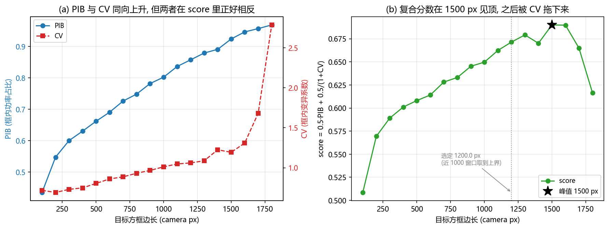

PIB 在 18 行里**严格单调上升**（反向步数 0），从 0.4353（100 px）到 0.9688（1800 px）。这符合「方框越大装得越多」的直觉，但它同时说明**PIB 单独不构成整形质量指标**：把框放大到装下整幅画面，PIB 会自然趋近 1。

CV 的整体趋势同样上升（Spearman ρ = 0.996），但**不是单调**：2 处回落（200 / 1500 px）。CV 上升的物理含义很直接 —— 方框变大后，框内除了方斑还装进了越来越多的**暗区**，标准差/均值被撑大。所以「PIB 与 CV 同向上升」这句在方向上成立，但它描述的其实是同一个几何事实（框变大），不是两个独立的物理效应。

### 3.3 score 的峰：两项互相抵消

`score` 的 argmax 在 **1500 px**（0.6900），次高是 1600 px（0.6898）。两者相差 **2.07e-04** —— 这个差值小到没有意义，所以正确的说法是「峰值落在 1500–1600 px 之间，无法分辨单点」，而不是「1500 px 最优」。

| 边长 (px) | PIB | 0.5·PIB | CV | 0.5/(1+CV) | score | 说明 |
|---|---|---|---|---|---|---|
| 100 | 0.4353 | 0.2176 | 0.7186 | 0.2909 | 0.5086 | 最小方框：饱和 |
| 1500 | 0.9241 | 0.4621 | 1.1935 | 0.2279 | 0.6900 | 峰值 |
| 1800 | 0.9688 | 0.4844 | 2.7860 | 0.1321 | 0.6165 | 最大方框 |

从 1500 px 到 1800 px，PIB 项**还在涨**（0.4621 → 0.4844，+0.0223），而均匀度项在掉（0.2279 → 0.1321，-0.0959）。后者绝对值更大，于是 score 净变化 -0.0735。**峰值之后 score 的下降完全由 CV 造成，PIB 反而更好了** —— 这就是「两项互相抵消」的量化版本，也解释了为什么单纯追 PIB 会把方框越开越大。

### 3.4 GS 模型输出 vs 实测

| 边长 (px) | model_cv | 实测 CV | model_pib | 实测 PIB | ΔPIB |
|---|---|---|---|---|---|
| 100 | 0.2306 | 0.7186 | 0.9153 | 0.4353 | 0.4800 |
| 200 | 0.2216 | 0.6917 | 0.9379 | 0.5476 | 0.3903 |
| 300 | 0.2168 | 0.7305 | 0.9373 | 0.6005 | 0.3368 |
| 400 | 0.2103 | 0.7489 | 0.9072 | 0.6305 | 0.2767 |
| 500 | 0.2120 | 0.8047 | 0.9152 | 0.6621 | 0.2530 |
| 600 | 0.2104 | 0.8607 | 0.9191 | 0.6908 | 0.2282 |
| 700 | 0.2055 | 0.8867 | 0.9230 | 0.7264 | 0.1966 |
| 800 | 0.2075 | 0.9320 | 0.9254 | 0.7486 | 0.1768 |
| 900 | 0.2065 | 0.9673 | 0.9285 | 0.7822 | 0.1463 |
| 1000 | 0.2118 | 1.0119 | 0.9439 | 0.8024 | 0.1415 |
| 1100 | 0.2105 | 1.0479 | 0.9444 | 0.8365 | 0.1079 |
| 1200 | 0.2080 | 1.0613 | 0.9445 | 0.8577 | 0.0868 |
| 1300 | 0.2111 | 1.0874 | 0.9444 | 0.8793 | 0.0651 |
| 1400 | 0.2084 | 1.2255 | 0.9455 | 0.8911 | 0.0544 |
| 1500 | 0.2122 | 1.1935 | 0.9462 | 0.9241 | 0.0221 |
| 1600 | 0.2341 | 1.3091 | 0.9470 | 0.9465 | 0.0005 |
| 1700 | 0.2316 | 1.6827 | 0.9476 | 0.9571 | -0.0096 |
| 1800 | 0.2294 | 2.7860 | 0.9483 | 0.9688 | -0.0205 |

GS 模型给出的 PIB 在 0.9072–0.9483 之间几乎不动，而实测 PIB 在 0.4353–0.9688 之间涨了 0.53。模型在最小方框上高估 +0.4800，在最大方框上差 -0.0205。**结论：GS 的模型内指标不能用来选边长** —— 它看不到「实际远场不是理想方斑」这件事（模型里方斑是精确的平顶方框，实测里还有 0 级、散射与像差）。

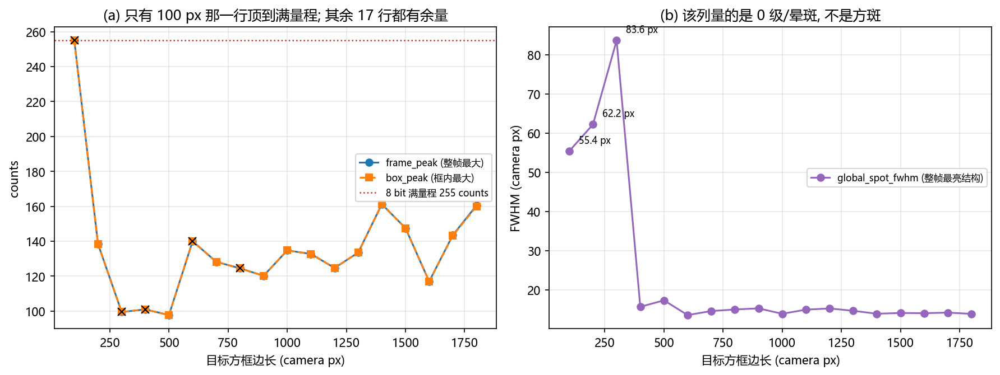

## 4. 曝光口径

### 4.1 工作点

请求 20 ms，会话上限 `AO_DAHENG_MAX_EXPOSURE_MS` = 40 ms，**生效 20 ms**（= min(请求, 上限)，与日志一致）。上限只是相机的保护阈值，不是工作点；本轮 50 行的 `exposure_ms_readback` 全部等于生效值（生成器已逐行核对）。

### 4.2 平场的 0 级峰值不能用来挑曝光

GS 把能量**摊到边长上千像素的方斑上**，而 0 级是一个衍射极限量级的小核。两者每像素电平差好几个数量级，所以「把 0 级调到不饱和」和「让方斑有足够信噪比」是两个完全不同的曝光要求。本轮的证据是自洽的：

- GS 之前的平场帧（`spot_assessment`，同一曝光 20 ms）里，整帧峰值 = **255.0 counts**，已顶到满量程 255 —— 这个读数只能读成「≥ 满量程」，**不含任何线性信息**，任何按它做的曝光决策都是在猜。
- 同一曝光下，被整形方斑的峰值（`box_peak`）在边长 ≥ 200 px 的 17 行里是 97.75–161.25 counts，全部**远离**满量程。也就是说：0 级已经饱和时，方斑还在半个满量程附近 —— 如果按 0 级反推去降低曝光，方斑会先失去信噪比。
- 信噪比余量：评估帧的噪声 σ = 0.1013 counts（同曝光、同累计帧数），方斑峰值/噪声 ≈ 965–1592，曝光足够，不需要再加。

**这里有一个口径缺口，必须写明**：把「0 级峰值 → 方斑每像素电平」写成等式需要两个本轮没有归档的量 ——（a）未饱和的 0 级峰值随曝光的关系（一条平场曝光阶梯），（b）0 级的等效面积。本轮 `spot_assessment.peak` 在 20 ms 上已经饱和，且产物里没有平场阶梯，所以本报告**不给这条换算的绝对值**，只给上面那组可复现的比较（饱和的 0 级 vs 未饱和的方斑峰值 vs 噪声）。补一条 0.05 / 0.2 / 1 / 5 / 20 ms 的平场阶梯就能把它写成等式，见 §9。

### 4.3 饱和行

边长段里饱和的行：100 px（frame_peak = box_peak = 255）。
这一行的 PIB/CV 仍然可用，但要知道它们是怎么算的：`PIB` 是**整框求和**与**整帧求和**的比值，`CV` 是框内逐像素的统计 —— 两者都不是「峰值有多亮」，所以框内少量像素被 8 bit 削平并不会把它们整体带偏；被带偏的只有峰值类读数（`frame_peak` / `box_peak`）和任何以峰值为分母的量。**读这一行时，请把「框内均值」类结论与峰值类结论分开。**

**另外两段的饱和是常态，而且原因不同。** 全部 50 行里，有 47 行的 `box_peak == frame_peak` —— 最亮的那个像素**就在方框内**，饱和的是框内的核，不是框外的杂散光。具体到各段：

- **Zernike 段 23/24 行饱和**：低阶重构把光聚成一个亮核，亮核落在 1200 px 框里，框内峰值于是顶到满量程。这正是 §5.1 那个「PIB 假高分」的同一件事 —— **饱和与「框内几乎全暗但有个亮核」是同一个形态**。
- **闪耀光栅段 7/8 行饱和**：叠加光栅后光场里始终有一个**未经相位调制的分量**停在冻结 0 级附近（`predicted_shift` 只搬动被调制的那部分），于是即便方框跟着预测位移走了，框内仍有一个高亮核。所以这一段的峰值饱和**不能**读成「方斑太亮」—— 它量的是那个未调制分量。

两段的共同结论：**在这些行上 `frame_peak` / `box_peak` 只能当「≥ 满量程」用**；`PIB`（比值）与 `CV`（框内统计）不受单像素削顶的系统性影响，仍可比。

## 5. Zernike 重构段

把选定边长（1200.0 px）那一次的 GS 相位拟合到 Zernike 基，然后用**前 N 阶**重构相位、下发、测量。N 从 30 降到 7，最高阶用 496 个模式（拟合网格 256、拟合上限 30 阶、拟合耗时 1.20 s —— 这四项都来自 `zernike/run_config.json`）。

| n_max | 模式数 | 解释方差 | 残差 RMS (rad) | CV | PIB | score | frame_peak | 质心偏移 x | 质心偏移 y | 旗标 |
|---|---|---|---|---|---|---|---|---|---|---|
| 30 | 496 | 0.032515 | 1.529272 | 7.3024 | 0.9076 | 0.5140 | 255.00 | 123.79 | 68.86 | — |
| 29 | 465 | 0.030839 | 1.530596 | 7.3364 | 0.9077 | 0.5138 | 255.00 | 123.72 | 69.25 | — |
| 28 | 435 | 0.028594 | 1.532367 | 7.3504 | 0.9079 | 0.5138 | 255.00 | 124.35 | 68.73 | — |
| 27 | 406 | 0.026236 | 1.534226 | 7.4219 | 0.9087 | 0.5137 | 255.00 | 125.56 | 69.81 | — |
| 26 | 378 | 0.024160 | 1.535861 | 7.4479 | 0.9069 | 0.5126 | 255.00 | 125.71 | 69.55 | — |
| 25 | 351 | 0.021180 | 1.538204 | 7.4756 | 0.9078 | 0.5129 | 255.00 | 125.51 | 68.75 | — |
| 24 | 325 | 0.019587 | 1.539456 | 7.4954 | 0.9074 | 0.5125 | 255.00 | 125.78 | 69.29 | — |
| 23 | 300 | 0.018178 | 1.540561 | 7.5547 | 0.9072 | 0.5120 | 255.00 | 126.81 | 70.13 | — |
| 22 | 276 | 0.016592 | 1.541804 | 7.5384 | 0.9085 | 0.5128 | 255.00 | 125.93 | 70.03 | — |
| 21 | 253 | 0.015515 | 1.542649 | 7.5551 | 0.9090 | 0.5129 | 255.00 | 125.81 | 68.97 | — |
| 20 | 231 | 0.014141 | 1.543725 | 7.5737 | 0.9090 | 0.5128 | 255.00 | 124.64 | 69.66 | — |
| 19 | 210 | 0.012202 | 1.545242 | 7.5831 | 0.9100 | 0.5132 | 255.00 | 125.49 | 69.30 | — |
| 18 | 190 | 0.011836 | 1.545529 | 13.5320 | 0.8818 | 0.4753 | 13.50 | -26.80 | 73.57 | ‡※ |
| 17 | 171 | 0.009226 | 1.547568 | 8.1884 | 0.9079 | 0.5084 | 255.00 | 120.18 | 75.72 | † |
| 16 | 153 | 0.008106 | 1.548443 | 7.6733 | 0.9108 | 0.5130 | 255.00 | 126.45 | 67.46 | — |
| 15 | 136 | 0.007313 | 1.549062 | 7.6645 | 0.9114 | 0.5134 | 255.00 | 127.51 | 65.65 | — |
| 14 | 120 | 0.006412 | 1.549764 | 7.6741 | 0.9123 | 0.5138 | 255.00 | 127.15 | 67.03 | — |
| 13 | 105 | 0.005843 | 1.550208 | 7.6628 | 0.9116 | 0.5135 | 255.00 | 127.36 | 68.19 | — |
| 12 | 91 | 0.005449 | 1.550515 | 7.6950 | 0.9122 | 0.5136 | 255.00 | 127.37 | 67.33 | — |
| 11 | 78 | 0.005031 | 1.550841 | 7.6781 | 0.9127 | 0.5140 | 255.00 | 126.97 | 66.38 | — |
| 10 | 66 | 0.004389 | 1.551341 | 7.7095 | 0.9116 | 0.5132 | 255.00 | 126.25 | 67.70 | † |
| 9 | 55 | 0.003924 | 1.551703 | 7.5822 | 0.9071 | 0.5118 | 255.00 | 127.81 | 67.21 | — |
| 8 | 45 | 0.003487 | 1.552044 | 7.6731 | 0.9104 | 0.5129 | 255.00 | 126.80 | 67.40 | — |
| 7 | 36 | 0.002432 | 1.552865 | 7.7136 | 0.9123 | 0.5135 | 255.00 | 126.83 | 67.73 | † |

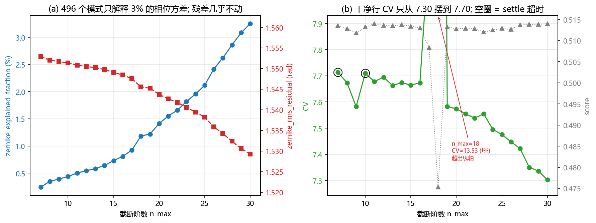

### 5.1 低阶 Zernike 表示不了方斑

解释方差从 0.243%（n_max = 7）单调升到 3.251%（n_max = 30，496 个模式），反向步数 23。**496 个模式只解释 3.25% 的相位方差** —— 剩下 96.75% 完全在低阶 Zernike 张成的空间之外。

残差 RMS 从 1.5529 rad（n_max = 7）只降到 1.5293 rad（n_max = 30），相对变化 1.5%。半个波长的残差在 1064 nm 上就是 **相位本身** 量级的东西，说明重构出的相位与目标相位几乎没有关系。

实测侧：干净行（排除 `†`/`‡`/`※`）的 CV 落在 7.302–7.695，与阶数的相关系数 r = -0.907。**趋势是有的**（阶数越高略均匀），但整段的相对跨度只有 5.4% —— 把它和同框 GS 方斑的 CV 放一起就看出量级差：同一 1200 px 方框上 GS 方斑的 CV 是 1.0613，而 Zernike 重构后是 7.3024 —— **高 6.9 倍**。换句话说：阶数带来的 5.4% 改善，与「基不适配造成的 7× 劣化」相比可以忽略 —— 所以「CV 与阶数几乎无关」在**量级**上成立，作为相关系数则不然。

这**印证**了仓库既有的反模式记录：「不要用低阶 Zernike 做方斑整形」。机制也说得通：GS 方斑的相位是高频、类 sinc 的结构（近场需要二维 sinc 的过零点），而 Zernike 是圆域上的低阶光滑正交基 —— 它不是「拟合得不够准」，而是**基不适配**，加阶数只能线性地多解释一点点方差（本段 0.24% → 3.25%，496 个模式才这个量级）。

**这里还有一个必须点出来的陷阱**：失败的 Zernike 重构 PIB = 0.9076，高于 GS 方斑的 PIB = 0.8577。原因不是它更好，而是**框太大**：低阶重构把光聚成一个亮核（整帧峰值因此顶到满量程），亮核正好落在 1200 px 方框里，框内功率占比自然高；而方框其余部分几乎全暗，CV 就爆到 7.3。**只看 PIB 会把这个失败排到成功前面。**

### 5.2 n_max = 18 这一行

`n_max = 18` 的 CV 是 **13.532**，是同段中位数 7.583 的 1.78 倍；整帧峰值只有 **13.5 counts**（相邻行都是 255.0），score 掉到 0.4753，框内质心 x 从相邻行的 +120.2 px 跳到 -26.8 px。

这一行的**整帧几乎全黑**，所以它的 CV / 质心 / score 全部由噪声主导 —— 它是**采集失败**，不是「18 阶时性能崩了」。它同时说明本段不能按「阶数越低越好」或「某阶最优」去读，只能读「整段都在不可用区间」。

另一个次异常是 `n_max = 17`：CV 8.188（比中位数高 8.0%）、score 0.5084、整帧峰值正常，但它**恰好也是一条 `†` 行**。两条高端异常都落在 `†` 上，指向同一个可疑来源：**高阶级重构在面板上的采样**。拟合在 256×256 网格上做、显示在 1920×1200 面板上（W×H），高阶模式的相位被放大后可能出现欠采样/混叠，把光衍射到远场窗口之外（全黑帧正是这个特征）。这是**假设**，验证它需要把 `zernike_fit_grid` 提到 512 并把 24–30 阶细扫一遍，见 §9。

## 6. 闪耀光栅段

在选定相位上叠加不同周期的**面板 x 向斜坡**，位移按 `predicted_shift_px` 预测（已含面板↔相机 90° 交换，所以位移落在相机 y 上），**方框跟着预测位移走**，质心在框内量。

| 周期 (SLM px) | 预测位移 (px) | 实测位移 y (px) | 位移误差 (px) | 实测/预测 | CV | PIB | score | 出画面积 (px) | frame_peak | 旗标 |
|---|---|---|---|---|---|---|---|---|---|---|
| 16 | 462.50 | 120.10 | 348.46 | 0.2597 | 5.2836 | 0.3770 | 0.2680 | 79200 | 255.00 | § |
| 24 | 308.33 | 80.30 | 232.10 | 0.2604 | 3.1102 | 0.5677 | 0.4055 | 0 | 255.00 | — |
| 32 | 231.25 | 58.21 | 175.95 | 0.2517 | 2.7303 | 0.6794 | 0.4738 | 0 | 255.00 | — |
| 40 | 185.00 | 174.39 | 13.66 | 0.9426 | 23.1524 | 0.2841 | 0.1628 | 0 | 1.50 | †‡※ |
| 48 | 154.17 | 53.55 | 105.47 | 0.3474 | 2.4115 | 0.7590 | 0.5261 | 0 | 255.00 | — |
| 64 | 115.62 | 48.05 | 73.56 | 0.4156 | 2.2878 | 0.7929 | 0.5485 | 0 | 255.00 | — |
| 96 | 77.08 | 43.46 | 41.79 | 0.5638 | 2.2063 | 0.8171 | 0.5645 | 0 | 255.00 | — |
| 128 | 57.81 | 44.23 | 26.00 | 0.7651 | 2.0261 | 0.8313 | 0.5809 | 0 | 255.00 | — |

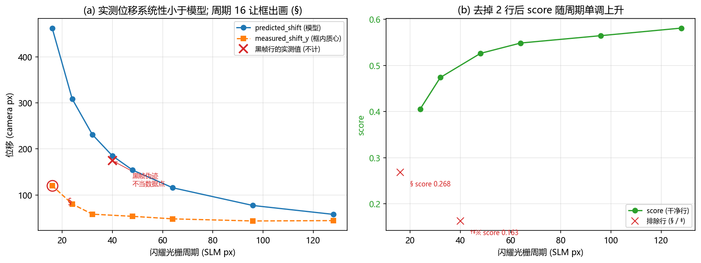

### 6.1 score 随周期单调上升

去掉 `§`（周期 16，框出画）和 `‡`（周期 40，帧近乎全黑）两行后，score 从 0.4055 单调升到 0.5809，反向步数 0。方向与直觉一致：**周期越大，同样的斜坡幅值给出的位移越小，方斑被保形得越好** —— 位移 ∝ 1/周期（`predicted_shift_px` 的表达式就是 `TILT_SHIFT_SCALE / 周期`），所以周期加倍时方斑离开冻结位置的位移减半，落在框外的部分也随之减少。

### 6.2 周期 16：框出画，PIB/EE 不可横比

预测位移 462.5 px 把方框中心推到 (1214, 1410)，框高 1200 px ⇒ 有 **79200 px**（5.50% 的框面积）落在画面外。这一行的 `PIB` = 0.3770、`EE` 同值，都因为**分母是整帧、分子被裁掉一块**而系统性偏低，所以**不能与其它行横向比较**；`CV` 是框内统计，受的影响小一些（5.28），但方框本身已经错位，也不应当作「周期 16 的均匀度」来读。

### 6.3 周期 40：provisional，不得当结论

日志原文（该配置那一条）：

> `settle criterion not met after 7.03 s (13 probes, n_stable=3): settled=False (timeout) probes=13 peak=2 fwhm=nanpx c=(0.0,0.0) -- the frame is still relaxing and must be treated as provisional`

该行最终 `frame_peak` = 1.50，`box_peak` = 1.00，`global_spot_fwhm_px` = nan（无效值），CV 23.15、score 0.1628。

**这一行是采集事故，不是物理结论。** 它落在一条单调序列中间（左邻周期 32 的 score 0.4738、右邻周期 48 的 0.5261），如果把它当真会得到「40 px 突然变差」的假结论。它同时是本轮 `†` 里**唯一一行最终画面也全黑**的（探测峰值与最终峰值都在 2 counts 量级），所以 `‡` 和 `†` 同时命中它。

### 6.4 预测位移 vs 实测位移：方向对，标度与 1/P 形状都不对

⚠️ 先把口径钉死：**位移只有 `measured_shift_y_px` 这一列**（质心相对冻结 0 级）。`box_centroid_offset_y` **不是**位移 —— 它 = 实测质心 − **预测框心**，而框是跟着预测走的，所以它天然是个大负值（§11.6 给出恒等式）。把它当位移读会得到「反号」的假结论。

- **方向可用**：实测与预测**同号**（全部为正），实测/预测 = 0.2517–0.7651（排除 `period = 40` 那一行 —— 它的实测 174.39 px 是黑帧伪迹，见 §2.3 / §6.3，**不当数据点**）。
- **标度不对，而且不是常数标度错**：若只是系数错，这个比值应当与周期无关；实际它随周期**总体上升**（0.2517 → 0.7651），6 步里 5 步上升、只有 24→32 一步回落 3.4% ⇒ 形状也不对。
- **1/P 形状被强烈压缩**：P 16 → 128（8.0×）时，预测 462.50 → 57.81 px（8.0×，构造上恰好 ∝1/P），而实测只有 120.10 → 44.23 px（2.7×）。两端点 log-log 斜率：预测 α = 1.00、实测 α = 0.48。
- **直接后果**：周期越小框偏得越远。框心相对质心偏 -342.4 / -228.0 / -173.0 px（P = 16 / 24 / 32）—— 也就是说框跟着预测走时，小周期处框会离光斑 173–342 px。

候选解释只剩两条：**斜坡幅值被削顶**（相位调制深度有限）与**框跟随导致的质心截断偏置**。二者都预测「实测 < 预测」，本数据分不开；要分开它们，需要一次**框固定**（冻结在未加光栅的 0 级上，或直接用宽 ROI）的复测：框不动时质心才反映真实位移。§11.5 判定 5 与 §11.6 给出具体做法。

## 7. 「近 1000」的选点边界效应

第 2 段的输入边长由 `--target-side-near 1000` 在窗口 [800, 1200] px 内按 score 取最大决定。把窗口内的行摊开看就能看出问题：

| 边长 (px) | score | 距 1000 的距离 (px) | 是否被选中 |
|---|---|---|---|
| 800 | 0.6331 | -200 px | — |
| 900 | 0.6452 | -100 px | — |
| 1000 | 0.6497 | 0 px | — |
| 1100 | 0.6624 | 100 px | — |
| 1200 | 0.6714 | 200 px | **是** |

窗口内 score **严格单调上升**（反向步数 0），所以 argmax 必然落在**窗口上界 1200 px** —— 这不是局部峰，是边界效应。并且整条曲线在窗口外还在涨（峰值 1500 px，0.6900），所以「选到 1200」既不是局部最优也不是全局最优，它只是「窗口上界」。

**建议**：若窗口改成 [900, 1100] px，用本轮的 CSV 就能回答会选到 **1100 px**（score 0.6624）。窗口内 score 依然单调，所以只要上界跟着动，选中值就跟着动 —— 在 score 单调上升的区间里，任何「接近某值」的选点规则实际选的都是窗口边界。**真正想选「接近 1000」应该直接取最接近 1000 的点（1000 px），或者把窗口做成对称且明确说明「取上界」。**

（补一句量级：1000 px 的 score 是 0.6497，1200 px 是 0.6714，差 0.0217；而 §3.3 里 1500 vs 1600 的差只有 2.07e-04，两者差 105 倍。所以「窗口边界把选中值从 1000 推到 1200」的代价是**真实可测**的，只是它仍落在平台区（距全局峰值 0.0186）。）

## 8. 最大边长与 0 级位置

`side_max_px` **不是常数**，是从 0 级位置与画面边缘反解出来的：

```
0 级 (实测冻结)     = (1214, 948)
画面 (W x H)        = (2592, 1944)   ⇒ 几何中心 (1296, 972)
到四条边的距离       = 左 1214 / 右 1377 / 上 948 / 下 995
约束边              = 上 (948)
side_max_raw        = 2 · (948 − 10) = 1876 px
向下取 100 的整数倍 = 1800 px
```

**0 级不在画面中心**：几何中心是 (1296, 972)，实测 0 级在 (1214, 948)，偏 -82 / -24 px。所以「最大边长」必须现场量：若按**假设的中心** (1296, 972) 代入同一条式，得到 2 · (971 − 10) = 1922 px，向下取整就是计划里的 1900 px —— 比实际能用的 1800 px 大 100 px，那个尺寸的框会直接压到帧边（框压边会被窗函数与读出噪声污染）。

这也解释了 §2.1 里「计划有 1900、CSV 没有」：`--dry-run` 的计划按**画幅中心**估出 1922 px（`plan.frame.side_max_raw`），实际按 0 级解出 1876 px，向下取整后 1800 px，于是计划里的 1900 被裁掉。这是**设计行为**，不是缺数据。

## 9. 可疑项与复测清单

按优先级排列。每条都写明「为什么可疑」和「复测要看什么」，不止清单本身。本轮共 9 行 settle 超时（见 §2.3），其中 1 行最终画面也全黑。

1. **`n_max = 18` 全黑帧**（§5.2）：整帧峰值 13.5 counts、CV 13.532。**已复测推翻**（§11.5 判定 2）：复测 18 的 CV 2.7609 与邻居同量级、`frame_peak` 回到满量程 ⇒ 基线那行是采集失败，不需要再测。
2. **`blaze period = 40` provisional**（§6.3）：settle 超时 + 最终峰值 1.50 counts。**已复测推翻**（§11.5 判定 1）：复测 40 的 CV 1.2587 落在 32/48 之间。留下的唯一待办是把 settle 的**探测时间序列**打出来（现在只打了最后一次探测）—— 两次黑帧都发生在探测阶段，这条诊断信息比再测一个点更有价值。
3. **预测位移 vs 实测位移：方向可用，标度与 1/P 形状不可用**（§6.4）：实测/预测 0.25–0.77，且实测的 1/P 指数只有 α = 0.48（预测是 1.00）。复测：**框固定 + 宽 ROI** 直接量整帧质心（§11.6 四条），同时直接量面板斜坡的相位幅值是否被削顶。
4. **settle 判据超时**（§2.3）：9/50 行，但其中只有 2 行的探测峰值低于满量程的 10%（即真黑帧）。相对容差 `tol = 0.02` 对这台相机可能过紧（读噪声 σ ≈ 0.101 counts，而容差按相对值算）。复测里又有 3 个配置超时（nmax_17, nmax_18, nmax_19），**同样没有一条是黑帧** ⇒ 判据确实偏紧，复测：把 `max_wait_s` 提到 12 s，或改用「探测值变化 < 2σ」的绝对判据。
5. **`100 px` 行饱和**（§4.3）：`frame_peak = box_peak = 255`。复测：该点单独降曝光（例如 5 ms）重测，才能给出它的真实峰值。
6. **`ee` ≡ `PIB`**：50 行里两者逐位相同，所以 `ee` / `ar` / `quality` 这一组里只有 `ar` 与 `quality` 带独立信息。报告与图里都不把 `ee` 当第二个指标 —— 否则会让人误以为两个独立指标互相印证。
7. **平场曝光阶梯缺失**（§4.2）：无法把「0 级峰值 → 方斑每像素」写成等式。补 0.05 / 0.2 / 1 / 5 / 20 ms 的平场帧 + FWHM，就能给出那条换算。
8. **每配置只测 1 次**：没有重复，因此**没有误差棒**。§3.3 里 1500 vs 1600 差 2.07e-04，这个量级低于任何可以分辨的单次噪声，所以「峰在哪个点」这件事本轮**不可判定**。复测批内各点相对邻居的偏差（≤ 6.5%）只能给出「这不是趋势上的点」这条弱判据，仍不是误差棒（§11.5 判定 6）。

## 10. 局限与不可横比项

- **CV 与 PIB 都依赖框大小**，所以它们只在**同一框**下可比。跨段的数字（例如「Zernike 重构的 PIB 0.91 高于 GS 方斑的 0.86」）只能作为「框选得太大」的证据，不能作为质量排序。
- **无重复测量**：每配置 1 次。所有「某点最优」的说法都受这一条限制，本报告因此只报峰值区间与差值，不报显著性。
- **GS 每次从零跑**：18 行的 GS 相位彼此独立，行间差异包含 GS 自身的收敛差异（`gs_seconds` 在 6.65–11.33 s 之间，不是固定迭代预算下的等价收敛）。
- **`global_spot_fwhm` 不是方斑宽度**（§1.2）：它是整帧最亮结构，2f 光路上通常是 0 级/晕斑。所有基于它的「光斑退化」判断都不成立。
- **Zernike 拟合在 256×256 网格上做**，而显示在 1920×1200 面板上（W×H）；高阶模式的采样充分性没有验证（§5.2 的假设正是从这里来的）。
- **`box_clipped_px` 的语义**：它是「框落在画面外的**面积**」，不是「被钳制的像素个数」。本轮 50 行满足恒等式 `box_side_px² − box_area_px == box_clipped_px`（生成器逐行核对，残差 0），所以可以放心按面积读。

## 11. 复测（功率已变）

本节是**第二批产物**：`data/debug/hw_gs_square_scans/20261023_retest_frozen/`。基线之后激光功率变了（见 §11.1），所以把需要复查的配置用**原子化调用**在**同一脚本版本**下重跑了一遍：每个配置一个独立进程（`mode = atomic`）、同一 180 ms 曝光、同一 `--side-px 1200`，共 6 行（光栅 32/40/48、Zernike 17/18/19）。

复测批只有两个用途：(a) 判定基线的两处异常是物理效应还是采集事故；(b) 在同一批内做**邻居比较**。它**不能**与基线做绝对值比较 —— 理由见 §11.1。

**本节与前面所有章节是两套数字，不能混读。** 复测的每一行都由生成器从复测的 `measurements.csv` 现读（并与同配置的 `metrics.json` 逐值交叉校验），所以脚本覆盖重跑这 6 个配置后，只需重跑一次生成器即可刷新本节 —— 生成器不缓存、不内联任何复测数值。

> 脚注：更早一版复测（`data/debug/hw_gs_square_scans/20261023_retest_power_changed`）跨了两个脚本版本，**已作废**，仅作证据留存；本报告不引用它的任何数字。

### 11.1 口径：为什么本节只做批内比较

| 项 | 基线 | 复测 |
|---|---|---|
| 产物根 | `data/debug/hw_gs_square_scans/20261023_gs_square` | `data/debug/hw_gs_square_scans/20261023_retest_frozen` |
| 段 | sides / zernike / blaze | 闪耀光栅 / Zernike 阶数（**无 sides**） |
| 行数 | 50 | 6 |
| 生效曝光 (ms) | 20.0 | 180.0 |
| 会话上限 (ms) | 40.0 | 200.0 |
| 调用方式 | 一次进程连续扫三段 | atomic（每配置一个进程） |
| 目标边长来源 | 第 1 段按 score 选定 1200 px | `--side-px` 显式覆盖（`selected_source = cli`） |

两批的**工作点差 9×**（20 ms → 180 ms），因为激光功率在基线之后变了。功率量级用下面这张表表达 —— **它是现场记录，不在这两批产物里**，所以单独一张表、单独一列来源：

| 现场记录（**非本批产物**） | 曝光 (ms) | 峰值 (counts) | counts/ms | 来源 |
|---|---|---|---|---|
| 基线同期 平场 0 级 | 0.50 | 163.0 | 326.0  ← 定斜率 | logs/probe_light_exposures.py 现场读数（2026-10-23，基线同一光路状态） |
| 复测前 平场 0 级 | 0.05 | 3.0 | 60.0 |  |
| 复测前 平场 0 级 | 0.20 | 8.0 | 40.0 |  |
| 复测前 平场 0 级 | 1.00 | 38.0 | 38.0 |  |
| 复测前 平场 0 级 | 5.00 | 180.0 | 36.0  ← 定斜率 | logs/probe_light_exposures.py 现场读数（2026-10-23，复测开始前） |
| **功率比** | — | — | 9.06× | 326.0 / 36.0 counts·ms⁻¹ |

读法：基线同期 0.5 ms 时 0 级峰值 163 counts （326.0 counts/ms），复测前 5 ms 时 180 counts（36.0 counts/ms）⇒ 同一曝光下复测期**弱 9.06×**。所以复测用 180 ms 补偿，折合基线的 19.9 ms —— 与基线 20 ms 几乎相同。**这条折算只说明「亮度口径大致相当」，不等于两批可比**：

- 斜率只取每段记录里**曝光最大**的那个点。低曝光读数被噪声地板抬高（0.05 ms 只有 3 counts），拿它定斜率会把功率比算歪。同一段记录里 1 ms 与 5 ms 的 counts/ms 相差 6%，所以这条线性外推的可信度就是**约一成**，不要读得更细。
- 两批的**成像状态**本身不同：`global_spot_fwhm` 基线 13.1–89.1 px、复测 145.8–218.4 px；CV 也系统性偏低（光栅 1.18–1.32 vs 基线 2.03–23.15）。**「复测 CV 更低」不能读成「复测更好」**，它只是另一个成像状态。
- 因此本节**只做批内邻居比较**：同一批内、相邻配置之间「谁高谁低」才是可判定的；跨批的绝对值一律不比。

### 11.2 复测是怎么跑的（原子化 + 显式边长）

每个配置都是独立进程（`mode = atomic`），边长由 `--side-px 1200` 显式给（`selected_source = cli`），因此**每个配置都会重新定位一次 0 级**——这一点在 §11.6 会变成关键。基线则是「定位一次、冻结 18 行」。

| 段 | 配置 | 自变量 | 0 级 x | 0 级 y | 曝光读回 (ms) | 平场评估 | 平场 FWHM (px) | settle 告警 |
|---|---|---|---|---|---|---|---|---|
| 闪耀光栅 | blaze_32 | 32 | 1252 | 902 | 180.0 | 光斑可用 | 171.7 | — |
| 闪耀光栅 | blaze_40 | 40 | 1253 | 910 | 180.0 | 光斑可用 | 131.8 | — |
| 闪耀光栅 | blaze_48 | 48 | 1245 | 908 | 180.0 | 无可用局域光斑 | 112.6 | — |
| Zernike 阶数 | nmax_17 | 17 | 1244 | 908 | 180.0 | 无可用局域光斑 | 91.7 | settle 判据超时 7.76 s / 11 次探测 / 探测峰值 255 |
| Zernike 阶数 | nmax_18 | 18 | 1206 | 908 | 180.0 | 无可用局域光斑 | 88.6 | settle 判据超时 7.95 s / 11 次探测 / 探测峰值 255 |
| Zernike 阶数 | nmax_19 | 19 | 1205 | 908 | 180.0 | 无可用局域光斑 | 85.0 | settle 判据超时 7.74 s / 11 次探测 / 探测峰值 255；settle 判据超时 8.71 s / 11 次探测 / 探测峰值 255 |

两件事先记下：(1) 全部 6 行的 `frame_peak` 都顶到满量程，平场评估的 FWHM 是 85–172 px —— 0 级是一个**饱和平台**，`argmax` 在平台上的位置本身就不稳；(2) 4 个配置（blaze_48, nmax_17, nmax_18, nmax_19）的平场评估直接报了「光路有光但没有可评分的局域光斑」，3 个配置有 settle 告警（nmax_17, nmax_18, nmax_19），但**没有一条**探测峰值是黑帧（低于满量程 10% 的配置：无）—— 与基线「超时 ≠ 帧坏」的读法一致（§2.3）。

### 11.3 光栅 32 / 40 / 48：基线与复测并排

两列数字来自两批各自的 `measurements.csv`；`—` 表示该批没有这个周期。「基线 40」那一行是 §6.3 认定的黑帧（`frame_peak = 1.5`），它的 CV / PIB / score 全部不可用。

| 周期 (px) | 批 | CV | PIB | score | frame_peak | box_peak | 出画面积 (px) | 偏移 x (px) | 偏移 y (px) | 备注 |
|---|---|---|---|---|---|---|---|---|---|---|
| 32 | 基线 | 2.7303 | 0.6794 | 0.4738 | 255.00 | 255.00 | 0 | 31.87 | -173.04 | — |
| 32 | 复测 | 1.3179 | 0.7421 | 0.5868 | 255.00 | 252.25 | 0 | 19.98 | -168.38 | 批内邻居 |
| 40 | 基线 | 23.1524 | 0.2841 | 0.1628 | 1.50 | 1.00 | 0 | 8.60 | -10.61 | **黑帧（frame_peak = 1.5）** |
| 40 | 复测 | 1.2587 | 0.7910 | 0.6169 | 255.00 | 252.25 | 0 | 22.44 | -127.97 | 批内邻居 |
| 48 | 基线 | 2.4115 | 0.7590 | 0.5261 | 255.00 | 255.00 | 0 | 31.63 | -100.62 | — |
| 48 | 复测 | 1.1774 | 0.8235 | 0.6414 | 255.00 | 252.25 | 0 | 27.30 | -93.69 | 批内邻居 |

### 11.4 Zernike 17 / 18 / 19：基线与复测并排

基线 18 是 §5.2 的黑帧（`frame_peak = 13.5`），基线 17 是 settle 超时行。**解释方差与残差 RMS 在两批里逐位相同**（n_max = 17, 18, 19 全部逐位一致）—— 同一 GS 相位 + 同一拟合配置 ⇒ 拟合量是确定性的，所以两批的差别只能来自**测量**。

| n_max | 批 | CV | PIB | score | frame_peak | 解释方差 | 残差 RMS (rad) | 偏移 x (px) | 备注 |
|---|---|---|---|---|---|---|---|---|---|
| 17 | 基线 | 8.1884 | 0.9079 | 0.5084 | 255.00 | 0.009226 | 1.547568 | 120.18 | settle 超时 |
| 17 | 复测 | 2.7538 | 0.8877 | 0.5770 | 255.00 | 0.009226 | 1.547568 | 125.93 | 批内邻居 |
| 18 | 基线 | 13.5320 | 0.8818 | 0.4753 | 13.50 | 0.011836 | 1.545529 | -26.80 | **黑帧（frame_peak = 13.5）** |
| 18 | 复测 | 2.7609 | 0.8830 | 0.5744 | 255.00 | 0.011836 | 1.545529 | 158.15 | 批内邻居 |
| 19 | 基线 | 7.5831 | 0.9100 | 0.5132 | 255.00 | 0.012202 | 1.545242 | 125.49 | — |
| 19 | 复测 | 2.7239 | 0.8862 | 0.5774 | 255.00 | 0.012202 | 1.545242 | 157.22 | 批内邻居 |

### 11.5 判定

**判定 1 — 基线 blaze 40 的异常（CV 23.15、score 0.1628）：推翻。**复测 CV 在 32/40/48 上是 1.3179 / 1.2587 / 1.1774（随周期单调下降 = True），40 相对左右邻居中位数只偏 **+0.89%**；score 是 0.5868 / 0.6169 / 0.6414（单调上升）。**40 没有异常。**基线同一位置偏 +800.6%（CV 23.15 对邻居 2.73 / 2.41），那是黑帧采集失败（`frame_peak = 1.5`、`global_spot_fwhm = nan`、settle 超时且探测峰值 2）留下的假极值 —— §6.3 的 provisional 可以按「已复测推翻」结案。

**判定 2 — 基线 Zernike 18 的异常（CV 13.53、frame_peak 13.5、质心 x 从 +120 跳到 −26.8）：推翻。**复测 CV 在 17/18/19 上是 2.7538 / 2.7609 / 2.7239，18 相对左右邻居只偏 **+0.81%**；复测 18 的 `frame_peak` 回到满量程、质心 x 偏移 +158.15 px —— 与 19 的 +157.22 px 只差 0.6%（17 是 +125.93 px），基线那个 −26.80 px 的跳变没有复现。基线同一位置偏 +71.6% —— 比复测批内任何一点偏离邻居的量（≤ 6.5%，见判定 6）大 11 倍。**18 阶本身没有问题**；基线那一行是黑帧。

**判定 3 — 我此前把基线 n_max = 17 的高端异常归因为「高阶级重构在面板上欠采样」：未确认（降级为未证实假设）。**复测 17 的 CV 2.7538 与 18/19 同量级（相对邻居偏 -0.26%），且复测 17 自己**也有** settle 告警（settle 判据超时 7.76 s / 11 次探测 / 探测峰值 255）却没有任何异常 ⇒ 「超时」本身不产生异常；基线的 17 更像一次**探测帧全黑**（settle 探测峰值 2、最终帧 255.0）的失败采集。**要证实欠采样假设，需要的不是再测一个点，而是同一配置的多次重复**：固定 `n_max = 17`、固定相位、连测 N ≥ 5 次，看 CV 的分布是否**系统性地**偏离 17/18/19 的趋势 —— 单点复测只能排除「单次采集失败」，无法确认机制。

**判定 4 — 位移：方向可用，标度与 1/P 形状都不可用。**⚠️ 先把口径钉死：**位移只有 `measured_shift_y_px` 这一列**（质心相对冻结 0 级）。`box_centroid_offset_y` **不是**位移 —— 它 = 实测质心 − **预测框心**，而框是跟着预测走的，所以它天然是个大负值（§11.6 给出恒等式，残差 8.5e-14 px）；把它当位移读会得到「反号」的假结论。

- **方向同号**：P = 32 处基线 +58.21 px、复测 +62.87 px；P = 48 处基线 +53.55 px、复测 +60.48 px —— 两批同号、同量级。
- **标度不可用**：实测/预测 = 复测 0.272–0.392、基线 0.252–0.765（基线排除黑帧行）。若只是「标度系数错」，这个比值应当**与周期无关**；实际它随周期上升（7 个点里 5 步上升）⇒ 形状也不对。
- **1/P 形状被强烈压缩**：基线 P 16 → 128（8.0×）时，预测 462.50 → 57.81 px（8.0×，构造上恰好 ∝1/P），实测只有 120.10 → 44.23 px（2.7×）。两端点 log-log 斜率：预测 α = 1.00，基线实测 α = 0.48；复测只有 32 → 48（1.50×）三点，实测 α = 0.10 —— 跨度太短，只能说明「明显不等于 1」。
- **直接后果**：周期越小，框偏得越远。复测里框心相对质心偏 -168.4 / -128.0 / -93.7 px（P=32 / P=40 / P=48）—— 与基线同量级（§6.4）。

**判定 5 — 「方框跟着 `predicted_shift_px` 走」这条做法必须改：成立。**复测 3 行上恒等式 `偏移 y ≡ measured_shift_y − predicted_shift_y` 成立到 8.5e-14 px，所以框的位置**完全由预测决定**：预测偏大 → 框偏 → 框内质心被框边拉回 → 量出来的位移更小。这是循环依赖，用这种方式永远验不了 `predicted_shift`。两个可选改法：

1. **框固定 + 宽 ROI**：框心 = 冻结 0 级（不跟随预测），或直接用 ≥ 半幅的 ROI 对**整帧质心**求位移。这是唯一能独立测位移的做法。
2. **重标定**：若一定要框跟随，先用改法 1 的实测把 `predicted_shift` 的**标度与 1/P 指数**拟合出来（本轮实测 α ≈ 0.48，而不是 1.00），再拿标定后的式子摆放方框。

**判定 6 — 这两处极值不可能是「趋势上的点」：成立（单批即可判定）。**复测批内 6 个配置相对左右邻居中位数的偏差最大 **6.5%**（这是端点的趋势斜率；两个**中间点**分别只有 +0.89% 与 +0.81%）；而基线同一统计量是 +801% 与 +72%，相差 124 倍与 11 倍。也就是说：**同一条平滑趋势上不可能长出这两个值** —— 这个判定只用复测批自己的内部一致性，不依赖任何跨批重复性，也不依赖基线的任何假设。

### 11.6 0 级每次重定位都会抖，而光斑几乎不动

复测是原子化的，所以每个配置都重新在平场帧上 `argmax` 定位 0 级。把三次独立定位与三次光斑质心摆在一起（全部是光栅段）：

| 周期 (px) | 0 级 x | 0 级 y | 质心 x | 质心 y | predicted y (px) | measured y (px) | 偏移 y (px) | 偏移 − (measured − predicted) |
|---|---|---|---|---|---|---|---|---|
| 32 | 1252 | 902 | 1271.98 | 964.87 | 231.25 | 62.87 | -168.38 | 0.000000 |
| 40 | 1253 | 910 | 1275.44 | 967.03 | 185.00 | 57.03 | -127.97 | 0.000000 |
| 48 | 1245 | 908 | 1272.30 | 968.48 | 154.17 | 60.48 | -93.69 | -0.000000 |

三次独立定位的 0 级 x 相差 **8 px**、y 相差 **8 px**；而**光斑质心**只差 3.45 px / 3.61 px。于是 `measured_shift_x` 的 7.31 px、`measured_shift_y` 的 5.84 px 波动里，**原点定位占了大头**，不是光斑在动。原因就在 §11.2 那张表：平场 0 级是**饱和平台**（FWHM 85–172 px、`hollowness` 最高到 1.00、4 个配置被平场评估直接判为「无可用局域光斑」），`argmax` 落在平台的哪一格没有物理意义。（Zernike 段更明显：三次定位是 1244 / 1206 / 1205 px（x 相差 39 px、y 相差 0 px），比光栅段还大。）

由此得到一条**判别性复测方案**（下一轮直接照做）：

1. **先在低曝光定位 0 级**（0 级不饱和的那个曝光，例如基线用的 20 ms），把位置写进 `run_config` 冻结；再切到测量曝光。**不要**在饱和帧上 `argmax`。
2. **框固定**：框心 = 上一步冻结的 0 级，不跟随 `predicted_shift`；或者干脆用宽 ROI（≥ 画幅的一半）直接对**整帧质心**求位移。
3. **同一相位重复 ≥ 3 次**，报质心的分布而不是单值 —— 现在这个量级（5.8 px）与原点抖动（8 px）同阶，单次读数分不开「光斑动了」与「原点动了」。
4. 有了上面三条，`predicted_shift_px` 的**符号与标度**才第一次可以被独立验证；在那之前，它只能当**摆放方框的初值**，不能当被验证的物理量。

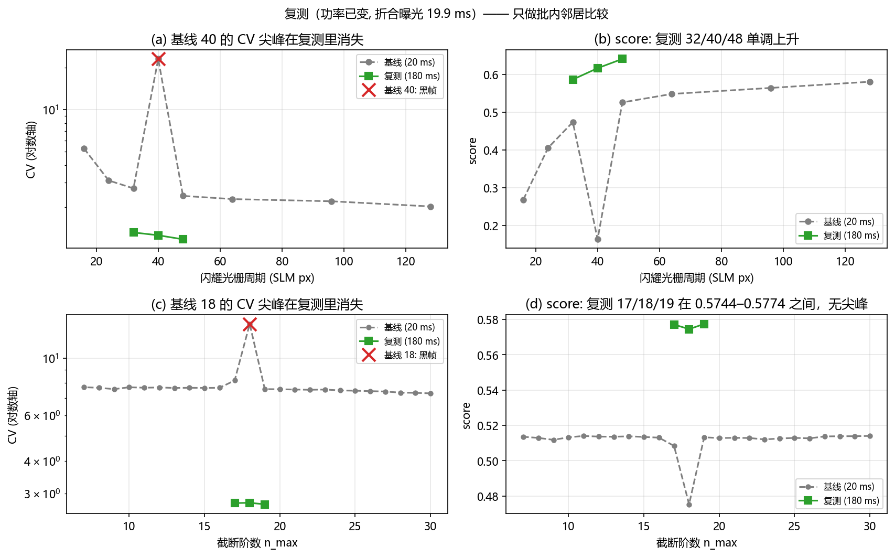

图 5 是**批内**邻居比较：灰色虚线是基线全段（含它的黑帧点），绿色实线是复测的三点。两条线的**绝对高度不要互相比较**（§11.1），只看各自段内的顺序与尖峰是否还在。

### 11.7 列口径（两批的列集合不同）

复测的 CSV 列数是 39 / 37（光栅 / Zernike），基线是 33 / 28。本节用到的列逐个核对如下 —— 复测独有的是 `config` / `stage` / `selected_source` / `base_phase_source` / `fit_source` 这类**运行元数据**，不是指标：

| 列 | 基线有 | 复测有 |
|---|---|---|
| 光栅 · `blaze_period_px` | 有 | 有 |
| 光栅 · `cv` | 有 | 有 |
| 光栅 · `pib` | 有 | 有 |
| 光栅 · `score` | 有 | 有 |
| 光栅 · `frame_peak` | 有 | 有 |
| 光栅 · `box_peak` | 有 | 有 |
| 光栅 · `box_clipped_px` | 有 | 有 |
| 光栅 · `box_centroid_offset_x` | 有 | 有 |
| 光栅 · `box_centroid_offset_y` | 有 | 有 |
| 光栅 · `measured_shift_y_px` | 有 | 有 |
| 光栅 · `predicted_shift_px` | 有 | 有 |
| 光栅 · `exposure_ms_readback` | 有 | 有 |
| Zernike · `n_max` | 有 | 有 |
| Zernike · `cv` | 有 | 有 |
| Zernike · `pib` | 有 | 有 |
| Zernike · `score` | 有 | 有 |
| Zernike · `frame_peak` | 有 | 有 |
| Zernike · `box_peak` | 有 | 有 |
| Zernike · `zernike_explained_fraction` | 有 | 有 |
| Zernike · `zernike_rms_residual_rad` | 有 | 有 |
| Zernike · `box_centroid_offset_x` | 有 | 有 |
| Zernike · `box_centroid_offset_y` | 有 | 有 |
| Zernike · `exposure_ms_readback` | 有 | 有 |

全部所需列在两批里都存在（缺列数 = 0）。生成器不假设两批表头相同：它按列名取，取不到就报错退出。

**两处容易读错的口径**：

- **段级 `run_config.json` 的 `zero_order_xy_frozen` 不是每配置的框心。** 闪耀光栅段级记 (1245, 908)，而三个配置各自是 (1252, 902) / (1253, 910) / (1245, 908)；Zernike 阶数段级记 (1205, 908)，而三个配置各自是 (1244, 908) / (1206, 908) / (1205, 908)。本节一律用**每配置 `metrics.json` 的 `preflight`** 值 —— 那才是真正摆放方框的那个数。
- **`fit_seconds` 不是整段耗时**：它是**本进程这一次**拟合的墙钟（复测里 1.10 s / 1.07 s / 0.66 s），复测是每配置一个进程，所以它既不累加也不代表阶段时长。本节不用它做任何时长判断。

## 12. CCD 远场光斑图

本节把每段**实测远场帧**直接摆出来 —— 不是指标曲线，是相机画面。帧来自各配置落盘的 `frame_*.npz`（`np.load(...)["frame"]`，`float32`、画幅与 `run_config.frame_shape_hw` 一致、0–255 counts），每格是**该配置落盘帧的算术平均**（右下角标 `×N 帧均值`）。

生成器在画图前逐格核对两件事：帧的最大值必须等于该行 CSV 的 `frame_peak`，npz 里那个 0 维 `params`（JSON）的 `cv`/`pib`/`score`/`frame_peak` 必须等于该行 CSV。两者任一不符就报错退出 —— 否则拼图会张冠李戴。

本节只摆**远场画面**。把 **Zernike 截断的相位残差**与同配置远场并排的那张图在 §13.8 —— 它需要每个配置的 `pupil_phase.npy`，而只有整轮原子重扫那一批落了相位文件（基线批没有）。

### 12.1 显示了哪些配置

| 拼图 | 段 | 配置 | 取值 | 源 | 帧数 (实际 / 计划) | 峰值 (counts) | 峰值状态 | CV | PIB | 方框中位电平 (counts) | 备注 |
|---|---|---|---|---|---|---|---|---|---|---|---|
| 1 · 边长 | 边长扫描 | index_001 | side=200 px | `data/debug/hw_gs_square_scans/20261023_gs_square/sides/frame_001.npz` | 1 / 4 | 138.50 | 未饱和 | 0.6917 | 0.5476 | 25.25 | — |
| 1 · 边长 | 边长扫描 | index_005 | side=600 px | `data/debug/hw_gs_square_scans/20261023_gs_square/sides/frame_005.npz` | 1 / 4 | 140.00 | 未饱和 | 0.8607 | 0.6908 | 3.50 | — |
| 1 · 边长 | 边长扫描 | index_009 | side=1000 px | `data/debug/hw_gs_square_scans/20261023_gs_square/sides/frame_009.npz` | 1 / 4 | 134.75 | 未饱和 | 1.0119 | 0.8024 | 1.50 | — |
| 1 · 边长 | 边长扫描 | index_014 | side=1500 px | `data/debug/hw_gs_square_scans/20261023_gs_square/sides/frame_014.npz` | 1 / 4 | 147.50 | 未饱和 | 1.1935 | 0.9241 | 1.00 | — |
| 1 · 边长 | 边长扫描 | index_017 | side=1800 px | `data/debug/hw_gs_square_scans/20261023_gs_square/sides/frame_017.npz` | 1 / 4 | 160.50 | 未饱和 | 2.7860 | 0.9688 | 1.00 | — |
| 1 · 边长 | 边长扫描 | index_008 | side=900 px | `data/debug/hw_gs_square_scans/20261023_gs_square/sides/frame_008.npz` | 1 / 4 | 120.25 | 未饱和 | 0.9673 | 0.7822 | 2.00 | score 最高行 (1500 px) 已在固定格内 ⇒ 取最接近 1000 的未入选行 900 px |
| 2 · Zernike | Zernike 阶数扫描 | index_000 | n_max=30 | `data/debug/hw_gs_square_scans/20261023_gs_square/zernike/frame_000.npz` | 1 / 4 | 255.00 | 饱和 | 7.3024 | 0.9076 | 0.00 | — |
| 2 · Zernike | Zernike 阶数扫描 | index_011 | n_max=19 | `data/debug/hw_gs_square_scans/20261023_gs_square/zernike/frame_011.npz` | 1 / 4 | 255.00 | 饱和 | 7.5831 | 0.9100 | 0.00 | — |
| 2 · Zernike | Zernike 阶数扫描 | index_018 | n_max=12 | `data/debug/hw_gs_square_scans/20261023_gs_square/zernike/frame_018.npz` | 1 / 4 | 255.00 | 饱和 | 7.6950 | 0.9122 | 0.00 | — |
| 2 · Zernike | Zernike 阶数扫描 | index_023 | n_max=7 | `data/debug/hw_gs_square_scans/20261023_gs_square/zernike/frame_023.npz` | 1 / 4 | 255.00 | 饱和 | 7.7136 | 0.9123 | 0.00 | — |
| 2 · Zernike | 边长扫描 | index_011 | side=1200 px | `data/debug/hw_gs_square_scans/20261023_gs_square/sides/frame_011.npz` | 1 / 4 | 124.75 | 未饱和 | 1.0613 | 0.8577 | 1.00 | 同 run-root 边长段的 1200 px 行（未截断） |
| 3 · 光栅 | 闪耀光栅扫描 | index_002 | P=32 px | `data/debug/hw_gs_square_scans/20261023_gs_square/blaze/frame_002.npz` | 1 / 4 | 255.00 | 饱和 | 2.7303 | 0.6794 | 1.00 | — |
| 3 · 光栅 | 闪耀光栅扫描 | index_005 | P=64 px | `data/debug/hw_gs_square_scans/20261023_gs_square/blaze/frame_005.npz` | 1 / 4 | 255.00 | 饱和 | 2.2878 | 0.7929 | 1.00 | — |
| 3 · 光栅 | 闪耀光栅扫描 | index_007 | P=128 px | `data/debug/hw_gs_square_scans/20261023_gs_square/blaze/frame_007.npz` | 1 / 4 | 255.00 | 饱和 | 2.0261 | 0.8313 | 1.00 | — |
| 3 · 光栅 | 闪耀光栅扫描 | index_000 | P=16 px | `data/debug/hw_gs_square_scans/20261023_gs_square/blaze/frame_000.npz` | 1 / 4 | 255.00 | 饱和 | 5.2836 | 0.3770 | 0.25 | 该行方框出画, PIB 不可与其它行横比 |
| 4 · 整帧 | 边长扫描 | index_009 | side=1000 px | `data/debug/hw_gs_square_scans/20261023_gs_square/sides/frame_009.npz` | 1 / 4 | 134.75 | 未饱和 | 1.0119 | 0.8024 | 1.50 | 不裁剪, 用于核对 0 级与画面中心的相对位置 |

**帧数口径**：「实际 / 计划」= 该配置**落盘的 npz 个数** / `run_config.frames_per_measurement`。本轮计划值是 4，而落盘的是**已经做过多帧平均的那一张**（每个 npz 内部已含若干次曝光），所以「实际 1 / 计划 4」不代表少了 3 帧，而是**平均后只存了一张**；生成器按实际存在的 npz 求平均，不补帧、不报错，并把两个数都写进 `frames_selection.json`。

### 12.2 四张拼图

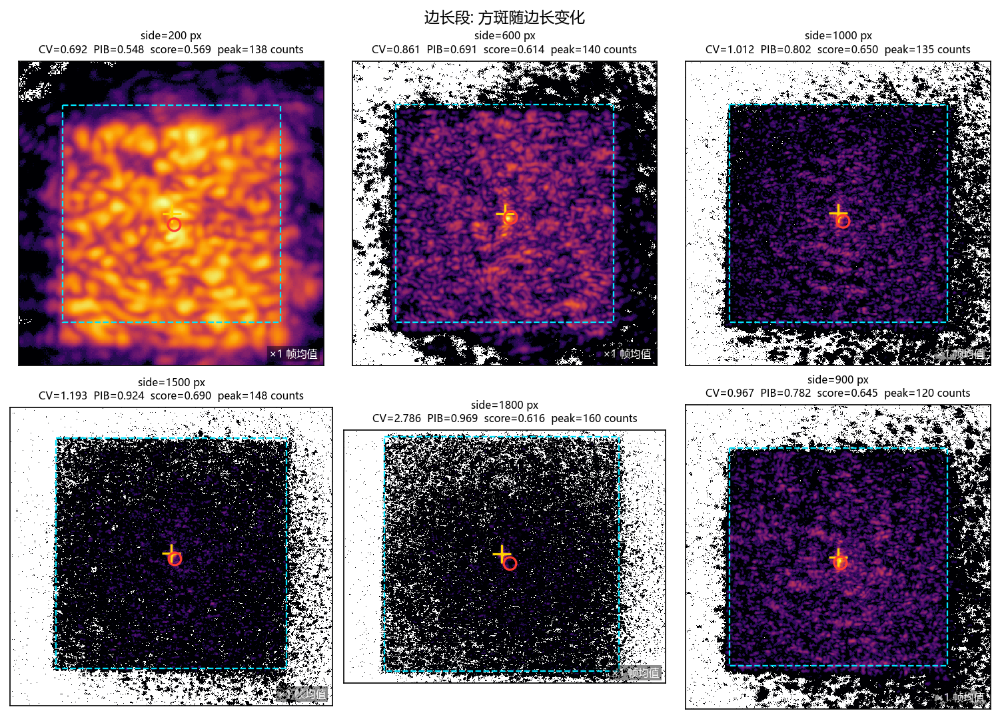

*边长段: 方斑随边长变化。* 对数显示（`LogNorm(vmin=1, vmax=该格峰值)`，**颜色不代表线性强度**）；裁剪：以 `box_center` 为中心、边长 `box_side × 1.4` （已夹到画幅内）；叠加：目标框（虚线）、预测框心（十字）、实测质心（圆点）；右下角 `×N 帧均值`。方斑随目标边长变化：小方框里方斑被压得最亮（100–200 px 甚至顶到满量程），方框放大后方斑摊开、峰值下降。第 6 格是 score 最高行或它的回退（见表）。

方框内**中位电平**：`side=200 px` 是 25.25 counts，`side=1500 px` 只有 1.00 counts（整列见 §12.1）。方框放大后方斑被摊薄到 **1–2 counts 的量化地板**，在对数显示下就是一片黑 —— 那是数据本身的动态范围，不是画错；读那些格的均匀度请回 CSV 的 CV / PIB。

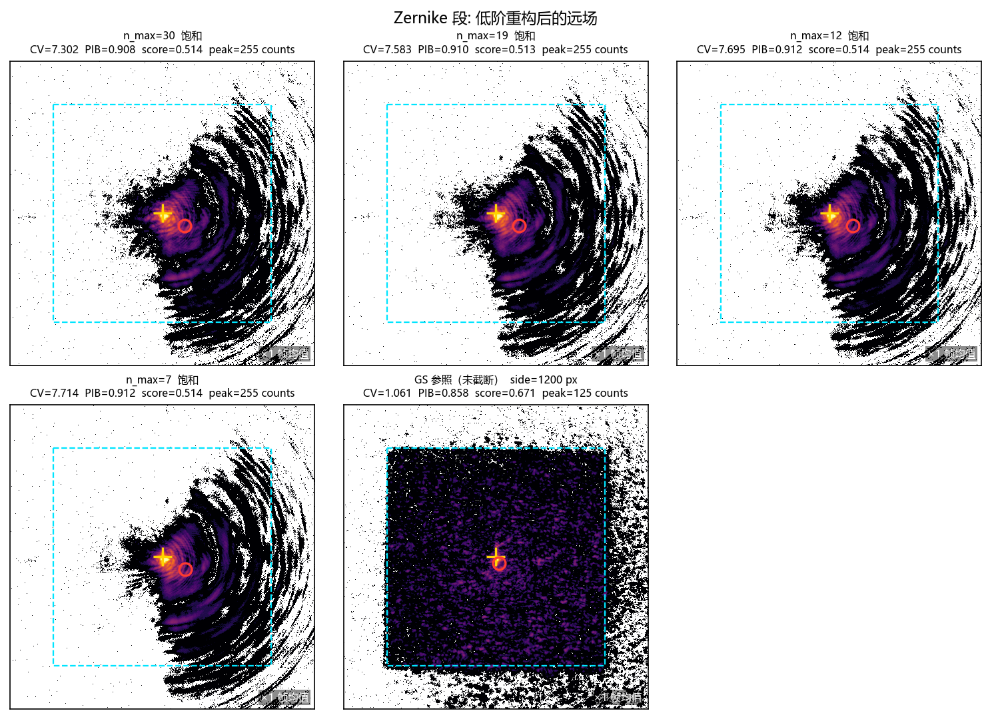

*Zernike 段: 低阶重构后的远场。* 对数显示（`LogNorm(vmin=1, vmax=该格峰值)`，**颜色不代表线性强度**）；裁剪：以 `box_center` 为中心、边长 `box_side × 1.4` （已夹到画幅内）；叠加：目标框（虚线）、预测框心（十字）、实测质心（圆点）；右下角 `×N 帧均值`。 饱和格：n_max=30, n_max=19, n_max=12, n_max=7。低阶 Zernike 重构后的远场：与同框的 GS 参照（最后一格）比，重构出来的不是方斑而是一个亮核 —— 这正是 §5.1 的结论在画面上的样子。

方框内**中位电平**：`side=1200 px` 是 1.00 counts，`n_max=30` 只有 0.00 counts（整列见 §12.1）。框内大部分像素是 0 counts、峰值却顶到满量程 ⇒ 光集中在一个亮核上，**这正是 CV 7.3 的画面形态**（§5.1 的「PIB 假高分」）。

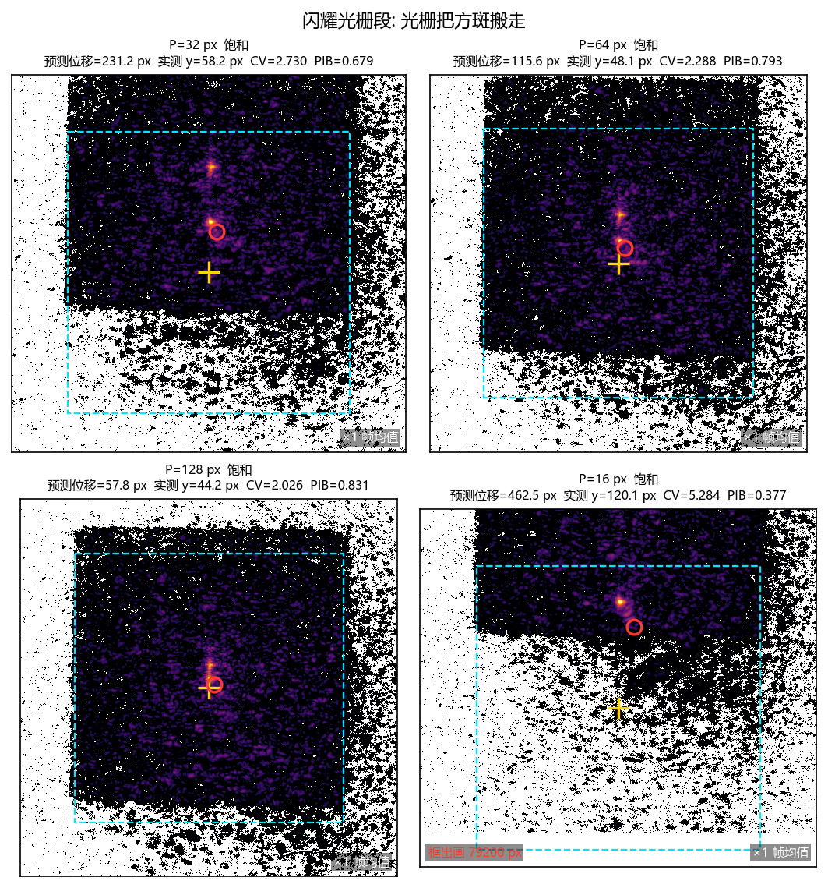

*闪耀光栅段: 光栅把方斑搬走。* 对数显示（`LogNorm(vmin=1, vmax=该格峰值)`，**颜色不代表线性强度**）；裁剪：以 `box_center` 为中心、边长 `box_side × 1.4` （已夹到画幅内）；叠加：目标框（虚线）、预测框心（十字）、实测质心（圆点）；右下角 `×N 帧均值`。 饱和格：P=32 px, P=64 px, P=128 px, P=16 px。叠加闪耀光栅后，方框跟着**预测**位移走；16 px 那一行位移最大，框已出画（格内左下角标出出画面积）。

方框内**中位电平**：`P=32 px` 是 1.00 counts，`P=16 px` 只有 0.25 counts（整列见 §12.1）。框内中位只有 1 counts 上下、峰值饱和 ⇒ 框里是一个亮核加几乎全暗的背景，方斑并没有跟着框走（§6.4）。

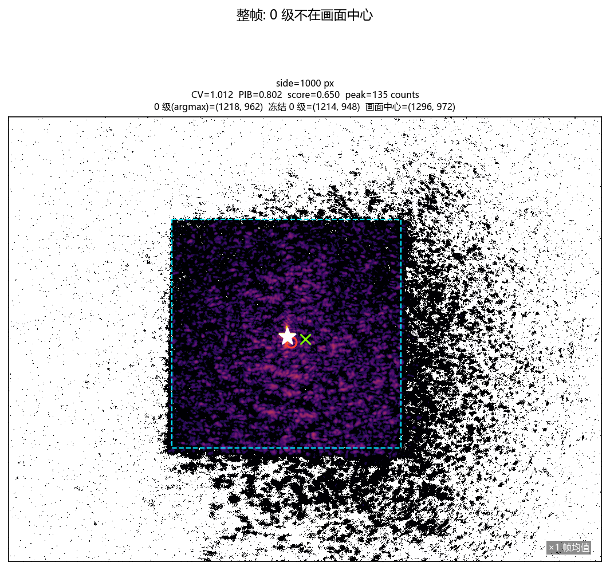

*整帧: 0 级不在画面中心。* 对数显示（`LogNorm(vmin=1, vmax=该格峰值)`，**颜色不代表线性强度**）；本图**不裁剪**（整帧）；叠加：目标框（虚线）、预测框心（十字）、实测质心（圆点）、0 级 argmax（星）与画面中心（叉）；右下角 `×N 帧均值`。整帧不裁剪：0 级（argmax）与画面几何中心并不重合，这就是 §8 里「最大边长必须现场量」的由来。

### 12.3 显示口径

1. **裁剪**：拼图 1–3 以该行 CSV 的 `box_center_x/y` 为中心、边长取 `box_side_px × 1.4`，并夹到画幅内（夹过就在 `frames_selection.json` 里记 `clipped_by_frame`）；拼图 4 **不裁剪**。
2. **对数拉伸**：`matplotlib.colors.LogNorm(vmin=1, vmax=该格峰值)`。0 级与方斑的每像素亮度差 2–3 个数量级（§4.2），线性拉伸只会看到 0 级一个点，方斑的结构全部落在最暗的几档里；对数显示能把两者放进同一张图。**代价是颜色与强度不成线性** —— 要读绝对强度请回 CSV 的 `frame_peak` / `box_peak`，不要从颜色反推。
3. **叠加与饱和**：目标框（虚线）、预测框心（十字）、实测质心（圆点）；`box_clipped_px > 0` 的格子在左下角标 `框出画 … px`。该行 `frame_peak ≥ 255` 时标题末尾加「饱和」——意味着最亮像素已被 8 bit 削平，画面里那一片的颜色不随强度变化。

## 13. 整轮原子重扫（单一版本 + 单一功率）

第三批产物：`data/debug/hw_gs_square_scans/20261023_atomic_full/`。它是**唯一「单一脚本版本 + 单一功率」的完整一轮** —— 三段（边长 / Zernike / 光栅）在同一个 `mode=atomic` 下逐配置重扫，所以三段数字之间第一次真正可比。

### 13.1 口径

| 项 | 本轮取值 | 来源 |
|---|---|---|
| 生效曝光 (ms) | 180.0 | `run_config` / 每配置 `preflight` |
| 会话上限 (ms) | 200.0 | `run_config` |
| 调用方式 | `mode = atomic`（每配置一个独立进程） | `manifest` / `run_config` |
| 0 级（段级冻结） | (1253, 904) | `run_config.zero_order_xy_frozen` |
| 可用最大边长 (px) | 1700 | `run_config.side_max_px` |
| 反解原始值 (px) | 1788 | `run_config.side_max_raw_px` |
| 边长步长 (px) | 100 | 由 CSV 的 `side_px` 相邻差 |
| 实际边长行数 | 17 | `manifest.n_rows` / CSV |
| 选定边长 (px) | 1200 | `sides/selected.json` |
| 选定时的 score | 0.7011 | `sides/selected.json` |

**1800 与 1900 被拒是保护生效，不是失败。** 按步长 100 px 往上，接下来的两档是 1800 / 1900 px，都超过本轮实测的可用最大边长 1700 px（= 2·(min(cx, W−1−cx, cy, H−1−cy) − edge_margin) 向下取整，原始 1788 px）。脚本原文的拒绝理由：

> 边长 `{value}` px 超过本次实测的画面可用最大边长 1700 px —— 方框会压在帧边上, PIB/EE 就不再是方斑质量了。改小 --side-px, 或调 --edge-margin-px / 曝光

（上面是脚本里的**消息模板**：`{value}` 处就是被拒的那一档边长 —— 本轮是 1800 与 1900。）

这条保护的判据是**方框会不会压到帧边**（压边后窗函数与读出噪声会污染方框内的统计，PIB/EE 就不再是方斑质量的度量）。所以「少了两行」恰恰是它该做的事：宁可只有 17 行可用数据，也不给两个框压边的假点。（退出码 2 —— 该脚本把这条越限检查与读帧超时共用同一个硬退出码。）

### 13.2 边长段

| 边长 (px) | CV | PIB | score | box_peak | frame_peak | 方框内面积 (px) | 出画面积 (px) | AR | 质心偏移 x | 质心偏移 y |
|---|---|---|---|---|---|---|---|---|---|---|
| 100 | 0.5440 | 0.0670 | 0.3573 | 254.00 | 255.00 | 10000 | 0 | 1.0309 | -1.00 | 12.68 |
| 200 | 0.5624 | 0.2295 | 0.4348 | 254.00 | 255.00 | 40000 | 0 | 0.9950 | -11.83 | 17.40 |
| 300 | 0.5662 | 0.4157 | 0.5271 | 254.00 | 255.00 | 90000 | 0 | 1.1772 | -17.77 | 24.50 |
| 400 | 0.5992 | 0.5352 | 0.5803 | 253.75 | 255.00 | 160000 | 0 | 1.1840 | -11.23 | 31.60 |
| 500 | 0.6848 | 0.6276 | 0.6106 | 253.25 | 255.00 | 250000 | 0 | 1.1336 | -13.77 | 41.01 |
| 600 | 0.8148 | 0.6451 | 0.5981 | 253.00 | 255.00 | 360000 | 0 | 1.0713 | -27.26 | 48.39 |
| 700 | 0.8525 | 0.6914 | 0.6156 | 253.00 | 255.00 | 490000 | 0 | 1.0604 | -12.08 | 53.62 |
| 800 | 0.8697 | 0.7188 | 0.6268 | 253.50 | 255.00 | 640000 | 0 | 1.0548 | -23.09 | 67.76 |
| 900 | 0.8803 | 0.7559 | 0.6439 | 253.00 | 255.00 | 810000 | 0 | 1.0714 | -26.64 | 62.72 |
| 1000 | 0.8485 | 0.8144 | 0.6777 | 253.00 | 255.00 | 1000000 | 0 | 1.0573 | 16.29 | 56.72 |
| 1100 | 0.8404 | 0.8431 | 0.6932 | 253.00 | 255.00 | 1210000 | 0 | 1.0351 | 10.93 | 47.80 |
| 1200 | 0.9110 | 0.8790 | 0.7011 | 253.00 | 255.00 | 1440000 | 0 | 1.2516 | 12.89 | 60.43 |
| 1300 | 0.9717 | 0.9014 | 0.7043 | 252.00 | 255.00 | 1690000 | 0 | 0.8287 | 26.30 | 72.23 |
| 1400 | 1.0376 | 0.9130 | 0.7019 | 251.75 | 255.00 | 1960000 | 0 | 0.8825 | 32.20 | 67.43 |
| 1500 | 1.1217 | 0.9354 | 0.7033 | 251.00 | 255.00 | 2250000 | 0 | 2.5299 | 23.74 | 66.83 |
| 1600 | 1.3155 | 0.9443 | 0.6881 | 250.00 | 255.00 | 2560000 | 0 | 1.1527 | 34.52 | 94.56 |
| 1700 | 1.5218 | 0.9575 | 0.6770 | 249.25 | 255.00 | 2890000 | 0 | 0.9138 | 34.77 | 91.77 |

**score 的平台在 1300–1500 px**：1300（0.7043） / 1500（0.7033），两者只差 9.5e-04。之后开始掉：1600（0.6881） / 1700（0.6770）。（argmax 在 1300 px。）也就是说这一轮的「最优边长」不是一个点，而是一段**平台**：平台宽 200 px，而平台内的高度差只有 9.5e-04 —— 在单次测量的分辨力内，峰落在平台哪一点**不可判定**（与 §3.3 基线那一轮同一性质）。

**`box_peak` 与饱和**：全部 17 行的 `frame_peak` 都是 255（0 级削顶），而 `box_peak` 只有 249.25–254.00 —— **削顶的是框外的 0 级，不是方斑本身**（`box_peak < frame_peak` 就证明最亮像素在框外）。这与 §4 的「0 级饱和」是两回事：那一条说的是平场 0 级不含线性信息，这一条说的是方斑自己贴着满量程但还没到顶 —— 方斑的读数仍然可信。

**一个没解释的离群**：`ar`（方框内长宽比）在 1500 px 处是 2.53，而同列中位数只有 1.06。这一行的 CV/PIB/score 都在趋势上，所以不是整帧坏，问题只可能出在 AR 这个量本身。**机制未定**，不要据此删行；要确认需要看该行的方框内二值轮廓（`ar` 由 `square_aspect_ratio` 从框内二值掩膜算出）。

### 13.3 Zernike 段

| n_max | 模式数 | 解释方差 | 残差 RMS (rad) | CV | PIB | score | 质心偏移 x | 质心偏移 y |
|---|---|---|---|---|---|---|---|---|
| 7 | 36 | 0.002432 | 1.552865 | 2.7301 | 0.8834 | 0.5757 | 161.73 | 114.86 |
| 8 | 45 | 0.003487 | 1.552044 | 2.7139 | 0.8841 | 0.5767 | 159.80 | 113.75 |
| 9 | 55 | 0.003924 | 1.551703 | 2.7285 | 0.8806 | 0.5744 | 159.42 | 113.61 |
| 10 | 66 | 0.004389 | 1.551341 | 2.6992 | 0.8808 | 0.5755 | 160.52 | 114.14 |
| 11 | 78 | 0.005031 | 1.550841 | 2.7320 | 0.8814 | 0.5747 | 159.78 | 113.88 |
| 12 | 91 | 0.005449 | 1.550515 | 2.7290 | 0.8798 | 0.5740 | 159.68 | 114.25 |
| 13 | 105 | 0.005843 | 1.550208 | 2.7328 | 0.8787 | 0.5733 | 160.84 | 113.45 |
| 14 | 120 | 0.006412 | 1.549764 | 2.6756 | 0.8493 | 0.5607 | 157.65 | 110.09 |
| 15 | 136 | 0.007313 | 1.549062 | 2.7402 | 0.8779 | 0.5726 | 157.46 | 110.66 |
| 16 | 153 | 0.008106 | 1.548443 | 2.7402 | 0.8775 | 0.5724 | 157.97 | 111.18 |
| 17 | 171 | 0.009226 | 1.547568 | 2.7406 | 0.8745 | 0.5709 | 158.36 | 110.83 |
| 18 | 190 | 0.011836 | 1.545529 | 2.7536 | 0.8750 | 0.5707 | 157.05 | 110.98 |
| 19 | 210 | 0.012202 | 1.545242 | 2.7668 | 0.8752 | 0.5703 | 156.88 | 111.79 |
| 20 | 231 | 0.014141 | 1.543725 | 2.7076 | 0.8721 | 0.5709 | 120.60 | 108.66 |
| 21 | 253 | 0.015515 | 1.542649 | 2.7608 | 0.8753 | 0.5706 | 155.27 | 110.07 |
| 22 | 276 | 0.016592 | 1.541804 | 2.7514 | 0.8826 | 0.5746 | 124.46 | 111.25 |
| 23 | 300 | 0.018178 | 1.540561 | 2.7449 | 0.8718 | 0.5694 | 121.96 | 110.91 |
| 24 | 325 | 0.019587 | 1.539456 | 2.7845 | 0.8838 | 0.5740 | 122.89 | 111.51 |
| 25 | 351 | 0.021180 | 1.538204 | 2.7586 | 0.8718 | 0.5689 | 120.84 | 109.19 |
| 26 | 378 | 0.024160 | 1.535861 | 2.8005 | 0.8850 | 0.5741 | 120.83 | 108.93 |
| 27 | 406 | 0.026236 | 1.534226 | 2.7976 | 0.8853 | 0.5743 | 117.48 | 109.31 |
| 28 | 435 | 0.028594 | 1.532367 | 2.7758 | 0.8863 | 0.5756 | 113.43 | 109.84 |
| 29 | 465 | 0.030839 | 1.530596 | 2.7806 | 0.8876 | 0.5761 | 113.96 | 109.58 |
| 30 | 496 | 0.032515 | 1.529272 | 2.7916 | 0.8912 | 0.5775 | 110.99 | 110.91 |

**CV 全平**：2.6756–2.8005（相对跨度 4.7%），PIB 0.8493–0.8912，score 0.5607–0.5775。解释方差从 0.243% 单调升到 3.251%（496 个模式）—— **阶数加了四倍，画面上几乎没变**，这就是 §5.1「基不适配」的量化版。

**`box_centroid_offset_x` 的两档台阶**：低档 155.27–161.73 px（n_max = 7/8/9/10/11/12/13/14/15/16/17/18/19/21），高档 110.99–124.46 px（n_max = 20/22/23/24/25/26/27/28/29/30）。**台阶的位置已经定位：它不在远场里**。把这一列拆开看 ——

- `box_centroid_x`（实测质心）在全部 24 个配置上只差 **7.9 px**；
- 两档的差别全在**参考原点**上：低档各配置的 0 级 x 是 1205–1209，高档是 1244–1251，分界落在 x ≈ 1226；
- 而 `offset_x ≡ centroid_x − 0 级 x`（定义如此），所以台阶 = **原点跳了约 35 px**，不是光斑移动。

注意 `n_max = 21` 落在**低档**（155.27 px）—— 20 与 22 都在高档。所以这个台阶**不是 `n_max` 的函数**，而是「那一次进程把 0 级定到了哪一簇」的结果。

**为什么原点会跳，仍未定。** 本轮能确定的只有「跳的是参考原点」；候选机制是每配置独立在饱和平台上 `argmax`（§11.6 已记录同一现象：同一段里 0 级定位跨进程相差 8–39 px），但本轮**无法**把它与别的可能分开。要定因需要固定 0 级后再复测一次（§11.6 的四条方案）。**在定因之前，不要把 `box_centroid_offset_x` 的任何台阶读成物理效应。**

### 13.4 闪耀光栅段

| 周期 (px) | 预测位移 (px) | 实测位移 y (px) | 实测/预测 | CV | PIB | score | 出画面积 (px) |
|---|---|---|---|---|---|---|---|
| 16 | 462.50 | 101.21 | 0.2188 | 2.1731 | 0.4070 | 0.3611 | 31200 |
| 24 | 308.33 | 49.22 | 0.1596 | 1.5654 | 0.6554 | 0.5226 | 0 |
| 32 | 231.25 | 57.49 | 0.2486 | 1.3395 | 0.7526 | 0.5900 | 0 |
| 40 | 185.00 | 55.82 | 0.3017 | 1.2467 | 0.7965 | 0.6208 | 0 |
| 48 | 154.17 | 58.62 | 0.3802 | 1.1838 | 0.8253 | 0.6416 | 0 |
| 64 | 115.62 | 62.98 | 0.5447 | 1.1195 | 0.8552 | 0.6635 | 0 |
| 96 | 77.08 | 69.38 | 0.9001 | 1.0790 | 0.8860 | 0.6835 | 0 |
| 128 | 57.81 | 69.43 | 1.2009 | 1.0558 | 0.8982 | 0.6923 | 0 |

**实测几乎不随周期变**：排除出画那一行后，实测位移 y 只有 49.22（P=24）→ 69.43 px（P=128），全程只变 **1.41×**；而预测在同一区间变了 **5.33×**（它按 `TILT_SHIFT_SCALE/周期` 构造，所以是严格的 1/P）。于是实测/预测从 0.160 一路涨到 1.201 —— **比值不是常数，说明错的不是标度系数，而是 1/P 这个形状本身**（与 §6.4 同一结论，这一轮把它在同一功率下复现了一遍）。

**出画那一行**：P = 16 的 `box_clipped_px > 0`（预测位移把框推到画面外），该行 PIB 不可与其它行横比。它的 CV/score 也一并在表里给着，但只能当「框错位后的读数」，不是周期 16 的质量。

### 13.5 与 §11 复测的同功率交叉核对

§11 的复测批与本轮**同为 180 ms**，所以这两批可以做**同功率**对照（不同于基线的 20 ms）。逐配置比两批的 CV 与 score：

| 段 | 配置 | CV (本轮) | CV (§11) | ΔCV | score (本轮) | score (§11) | Δscore |
|---|---|---|---|---|---|---|---|
| 闪耀光栅扫描 | 32 | 1.3395 | 1.3179 | 0.0162 | 0.5900 | 0.5868 | 0.0055 |
| 闪耀光栅扫描 | 40 | 1.2467 | 1.2587 | 0.0096 | 0.6208 | 0.6169 | 0.0064 |
| 闪耀光栅扫描 | 48 | 1.1838 | 1.1774 | 0.0055 | 0.6416 | 0.6414 | 0.0003 |
| Zernike 阶数扫描 | 17 | 2.7406 | 2.7538 | 0.0048 | 0.5709 | 0.5770 | 0.0107 |
| Zernike 阶数扫描 | 18 | 2.7536 | 2.7609 | 0.0026 | 0.5707 | 0.5744 | 0.0065 |
| Zernike 阶数扫描 | 19 | 2.7668 | 2.7239 | 0.0156 | 0.5703 | 0.5774 | 0.0123 |

**结论：同功率不同批次的重复性约 1%。** CV 最大差 1.6%、score 最大差 1.2%；方向**不系统**（6 个配置里本轮 score 高 3 个、低 3 个），也就是说这 1% 是噪声而不是批次偏差。这条带宽正是 §11.5 判定 1/2 需要的那个量：基线那两处异常偏 +72% / +801%，比它大两个数量级以上，所以「黑帧」判定不依赖某一批的运气。

### 13.6 与基线的对照（只能定性）

| 关键量 | 基线（20 ms） | 本轮（180 ms） | 可比性 |
|---|---|---|---|
| 边长段 score 最高 | score = 0.6900 | score = 0.7043 | 不可横比 |
| 边长段 CV 最小 | cv = 0.6917 | cv = 0.5440 | 不可横比 |
| Zernike 段 CV 最小 | cv = 7.3024 | cv = 2.6756 | 不可横比 |
| 光栅段 score 最高 | score = 0.5809 | score = 0.6923 | 不可横比 |

两批的曝光差 9×（功率也差一个量级，见 §11.1），所以**任何绝对值都不能横比**。这张表只用来回答一个问题：**趋势是否一致** —— 例如「CV 随边长上升」「score 有平台」「低阶 Zernike 的 CV 与阶数无关」，这些**形状**在两批里是一致的，而高度不是。

### 13.7 图

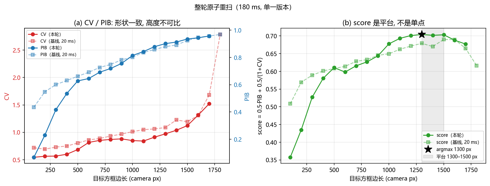

*边长 → CV / PIB / score（本轮实线，基线虚线仅作定性对照）。*

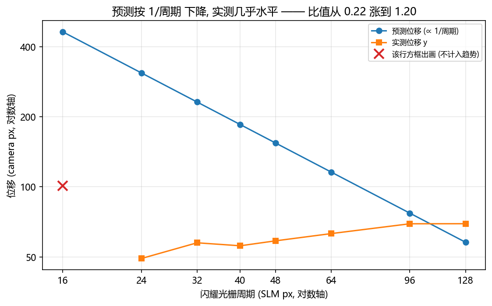

*光栅周期 → 预测位移（1/P）vs 实测位移（近水平）。*

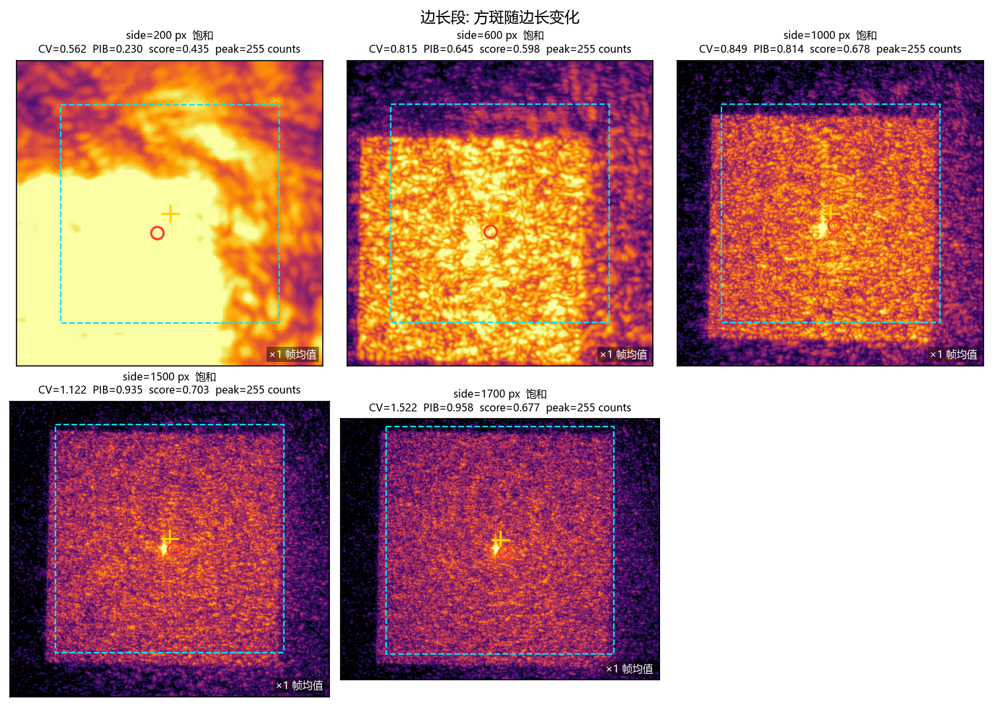

*边长段: 方斑随边长变化（本轮 180 ms）。* 口径与 §12 完全一致：对数显示（`LogNorm(vmin=1, vmax=该格峰值)`，**颜色不代表线性强度**）、裁剪 `box_side × 1.4`、目标框/预测框心/实测质心叠加、右下角 `×N 帧均值`。每格的源 npz 与 sha256 见 `artifacts/20261023_atomic_full/frames_selection.json`。

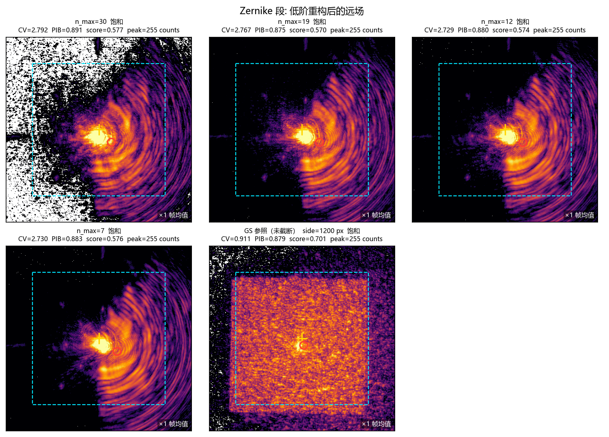

*Zernike 段: 低阶重构后的远场（本轮 180 ms）。* 口径与 §12 完全一致：对数显示（`LogNorm(vmin=1, vmax=该格峰值)`，**颜色不代表线性强度**）、裁剪 `box_side × 1.4`、目标框/预测框心/实测质心叠加、右下角 `×N 帧均值`。每格的源 npz 与 sha256 见 `artifacts/20261023_atomic_full/frames_selection.json`。

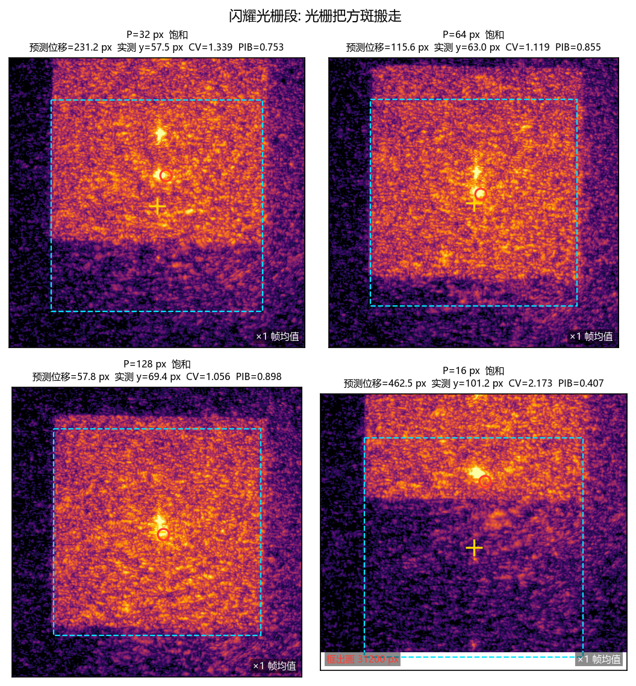

*闪耀光栅段: 光栅把方斑搬走（本轮 180 ms）。* 口径与 §12 完全一致：对数显示（`LogNorm(vmin=1, vmax=该格峰值)`，**颜色不代表线性强度**）、裁剪 `box_side × 1.4`、目标框/预测框心/实测质心叠加、右下角 `×N 帧均值`。每格的源 npz 与 sha256 见 `artifacts/20261023_atomic_full/frames_selection.json`。

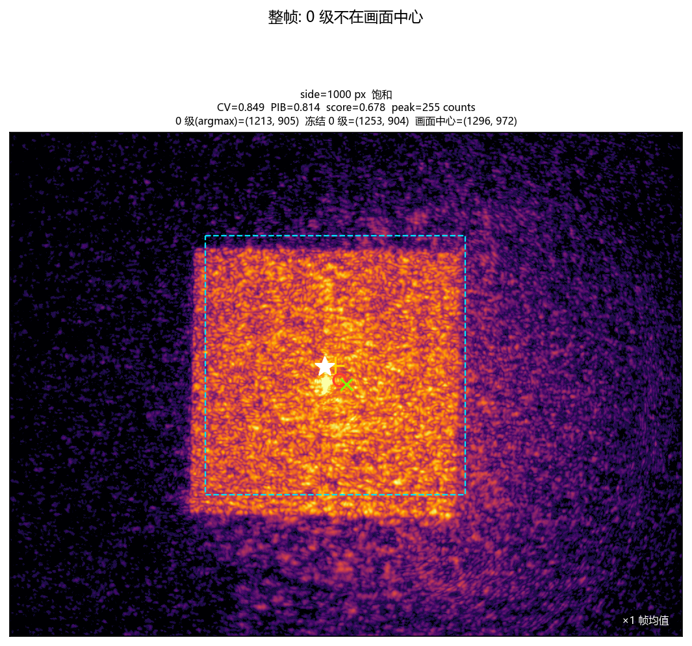

*整帧: 0 级不在画面中心（本轮 180 ms）。* 口径与 §12 完全一致：对数显示（`LogNorm(vmin=1, vmax=该格峰值)`，**颜色不代表线性强度**）、整帧不裁剪、目标框/预测框心/实测质心叠加、右下角 `×N 帧均值`。每格的源 npz 与 sha256 见 `artifacts/20261023_atomic_full/frames_selection.json`。

拼图里没有 1800/1900 两格 —— 这两行本来就没有被采集（§13.1）。边长格取 200 / 600 / 1000 / 1500 / 1700 五档（§13 不追加 score 格：本轮 score 是平台而不是单点，追加一格会误导）。

### 13.8 相位残差 × 同配置远场

本节把**被 Zernike 截断掉的那部分相位**与同配置的相机画面并排摆出来。只有这一批落了相位文件（`zernike/nmax_*/pupil_phase.npy`），基线批没有 ⇒ 这张图只能放在这里（§12 只有远场画面）。

口径（与采集脚本的生产路径逐行一致）：

- 基准相位：`data/debug/hw_gs_square_scans/20261023_atomic_full/sides/side_1200/pupil_phase.npy`（512², raw rad；边长由 `sides/selected.json` 决定）；
- `reference` = `upsample_bilinear_to_shape(base, (256, 256))`，`fit_grid` = 256；
- `recon` = `generate_noll(coeffs[:modes_for_order(n_max)])` —— 高阶系数**置零**，所以「第 N 阶重构」严格是「把高阶丢掉」，不是另一个模型的解；
- `residual` = `recon − reference`，只统计单位圆内（`ZernikeGenerator.mask`）。

⚠ 每个 `zernike/nmax_<N>/pupil_phase.npy` 是**该阶数的重构相位**，不是基准；拿它当基准残差恒为 0。基准在边长段的 `side_<S>/pupil_phase.npy`。

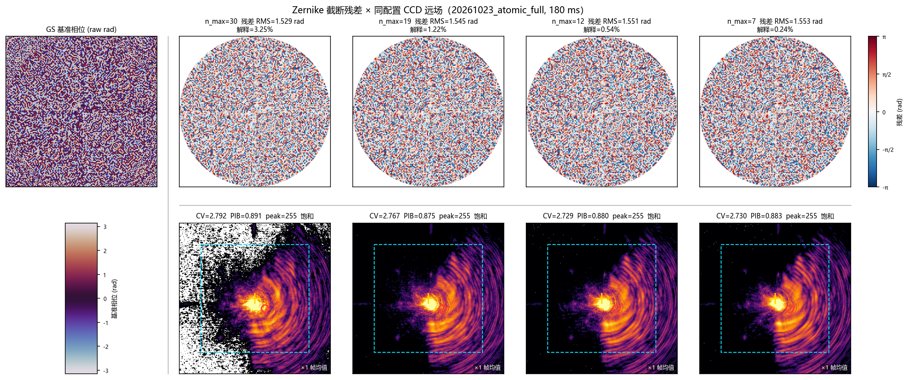

*第一行 = 残差相位（`RdBu_r`，固定 ±π，**四列共用同一色标**，单位圆外没有光所以不画）；第二行 = 同配置 CCD 远场（对数显示 `LogNorm(vmin=1, vmax=四列最大峰值)`、裁剪 `box_side × 1.4`、叠加目标框/预测框心/实测质心、右下角 `×N 帧均值`）；左上角 = GS 基准相位（`twilight`，±π）。残差在图上已卷到 ±π（面板施加的本来就是 mod 2π 的相位），而标题与表里的 RMS 取的是**未卷**差值 —— 与 `metrics.json` 同口径。*

| n_max | 模式数 | 残差 RMS (rad) | 解释比例 | CV | PIB | 残差里的可见结构（一句话） |
|---|---|---|---|---|---|---|
| 30 | 496 | 1.529272 | 3.251% | 2.7916 | 0.8912 | 细颗粒高频（平均 0.27 cyc/px，50% 能量在 >0.25 cyc/px）、径向近均匀（外缘/中心 RMS 1.05）、m=4 对称仅 0.8% |
| 19 | 210 | 1.545242 | 1.220% | 2.7668 | 0.8752 | 细颗粒高频（平均 0.26 cyc/px，49% 能量在 >0.25 cyc/px）、径向近均匀（外缘/中心 RMS 1.06）、m=4 对称仅 0.6% |
| 12 | 91 | 1.550515 | 0.545% | 2.7290 | 0.8798 | 细颗粒高频（平均 0.26 cyc/px，49% 能量在 >0.25 cyc/px）、径向近均匀（外缘/中心 RMS 1.06）、m=4 对称仅 0.7% |
| 7 | 36 | 1.552865 | 0.243% | 2.7301 | 0.8834 | 细颗粒高频（平均 0.26 cyc/px，49% 能量在 >0.25 cyc/px）、径向近均匀（外缘/中心 RMS 1.06）、m=4 对称仅 0.7% |

前三列与 §13.3 同源（同一批 CSV 列；解释比例在这里按 % 显示，CSV 里存的是分数），新增的只有最后一列 —— 它是从**残差数组**现场算出来的四个量：平均空间频率、`>0.25 cyc/px`（周期 4 个拟合格）的能量占比、外缘（`r > 0.7`）与中心（`r ≤ 0.35`）的 RMS 比，以及方位向 `m = 4` 分量的占比。

**残差不是「拟合误差」，也不是噪声 —— 它是被这个基截断掉的高频结构。** 判据是残差随阶数的走向：模式数从 36（`n_max = 7`）加到 496（`n_max = 30`），残差 RMS 只从 1.5529 降到 1.5293 rad（1.5%），解释比例从 0.24% 升到 3.25%。若残差是「没拟合好」，多给 460 个自由度应该让它大幅下降；它几乎不动，说明方斑所需的相位里有 96.7% 根本不在前 30 阶张成的空间里。

**它在图上长什么样，以及看不到什么。** 四列是同一片细颗粒：平均空间频率 0.26–0.27 cyc/px（周期约 4 个拟合格，已经是 256 网格能表示的最细尺度），49%–50% 的能量在 `>0.25 cyc/px`；径向几乎不衰减（外缘/中心 RMS 比 1.05–1.06），方位向也没有方斑该有的 4 重对称（`m = 4` 只占 0.6%–0.8%）。所以**方斑的「边缘与角」不在这张相位图上** —— 它们不是画在瞳面上的轮廓：目标是均匀方斑（远场幅度是二维 sinc 型，边与角全在高频里），要把圆盘照明变成它，瞳面相位必须携带同样高频的结构，而这些结构恰好是 Zernike 截断丢掉的那一层。这一点可以当场验证：把残差相位单独做一次傅里叶变换，得到的仍是一个**方形**的均匀区域，而不是亮核（这项检查不在图里，它的用处是把「高频结构」与「噪声」分开 —— 噪声的变换不会保持方形的边）。

**远场这一行就是「塌」的样子。** 第二行与 §12 拼图 2 是同一件事的两面：前 N 阶重构的远场是一个亮核（CV 2.729–2.792，PIB 0.875–0.891），而同框的 GS 基准远场是方斑（§12 拼图 2 最后一格）。CV 在四列之间只差 2.3% —— 阶数加了四倍画面几乎没变，这正是 §13.3「基不适配」在相位侧的对应物：改的是相位的高频内容，远场却基本不动，因为那部分内容根本没有被表示出来。

**自检（生成与 `--check` 两条路径都跑，不只是生成时）。** 重算的残差 RMS 必须与 `metrics.json` 的 `zernike_rms_residual_rad` 相对误差 < 2%，重算相位必须与存盘的 `pupil_phase.npy` 最大偏差 < 1e-9 —— 任一不满足就打印两边值并非零退出。本轮 4 个配置全部通过（最大相对误差 0.00%，最大偏差 0.0e+00）。

## 附录 A. 输入契约（`artifacts/20261023_gs_square/`）

| 文件 | 说明 |
|---|---|
| `manifest.json` | 三段汇总 (行数 / 自变量 / 创建时间) |
| `sides/measurements.csv` | 边长扫描 全部指标 — 报告里测量值的**唯一来源** |
| `sides/measurements.json` | 同上的 JSON 版 (含 NaN 语义, 用于交叉校验) |
| `sides/run_config.json` | 本次运行参数 + 冻结的 0 级 + 曝光上下限 |
| `zernike/measurements.csv` | Zernike 阶数扫描 全部指标 — 报告里测量值的**唯一来源** |
| `zernike/measurements.json` | 同上的 JSON 版 (含 NaN 语义, 用于交叉校验) |
| `zernike/run_config.json` | 本次运行参数 + 冻结的 0 级 + 曝光上下限 |
| `blaze/measurements.csv` | 闪耀光栅扫描 全部指标 — 报告里测量值的**唯一来源** |
| `blaze/measurements.json` | 同上的 JSON 版 (含 NaN 语义, 用于交叉校验) |
| `blaze/run_config.json` | 本次运行参数 + 冻结的 0 级 + 曝光上下限 |
| `run.log` | 采集日志原文 — settle 判据超时与关键量的出处 |
| `PROVENANCE.json` | 源路径 + sha256 + 生成脚本 |
| `20261023_retest_frozen/manifest.json` | 复测两段汇总 (行数 / 自变量 / 模式 / 配置名) |
| `20261023_retest_frozen/blaze/measurements.csv` | 闪耀光栅 复测指标 — §11 复测值/重复性对照的来源 |
| `20261023_retest_frozen/blaze/measurements.json` | 同上的 JSON 版 (用于交叉校验) |
| `20261023_retest_frozen/blaze/run_config.json` | 段级运行参数 (无 `plan`; 含 mode / preflight / 冻结 0 级) |
| `20261023_retest_frozen/blaze/blaze_32/metrics.json` | blaze_32 单配置指标 + `preflight`(含本进程冻结的 0 级) |
| `20261023_retest_frozen/blaze/blaze_40/metrics.json` | blaze_40 单配置指标 + `preflight`(含本进程冻结的 0 级) |
| `20261023_retest_frozen/blaze/blaze_48/metrics.json` | blaze_48 单配置指标 + `preflight`(含本进程冻结的 0 级) |
| `20261023_retest_frozen/logs/retest_blaze_32.log` | blaze_32 采集日志原文 |
| `20261023_retest_frozen/logs/retest_blaze_40.log` | blaze_40 采集日志原文 |
| `20261023_retest_frozen/logs/retest_blaze_48.log` | blaze_48 采集日志原文 |
| `20261023_retest_frozen/zernike/measurements.csv` | Zernike 阶数 复测指标 — §11 复测值/重复性对照的来源 |
| `20261023_retest_frozen/zernike/measurements.json` | 同上的 JSON 版 (用于交叉校验) |
| `20261023_retest_frozen/zernike/run_config.json` | 段级运行参数 (无 `plan`; 含 mode / preflight / 冻结 0 级) |
| `20261023_retest_frozen/zernike/nmax_17/metrics.json` | nmax_17 单配置指标 + `preflight`(含本进程冻结的 0 级) |
| `20261023_retest_frozen/zernike/nmax_18/metrics.json` | nmax_18 单配置指标 + `preflight`(含本进程冻结的 0 级) |
| `20261023_retest_frozen/zernike/nmax_19/metrics.json` | nmax_19 单配置指标 + `preflight`(含本进程冻结的 0 级) |
| `20261023_retest_frozen/logs/retest_zernike_17.log` | nmax_17 采集日志原文 |
| `20261023_retest_frozen/logs/retest_zernike_18.log` | nmax_18 采集日志原文 |
| `20261023_retest_frozen/logs/retest_zernike_19.log` | nmax_19 采集日志原文 |
| `20261023_retest_frozen/PROVENANCE.json` | 源路径 + sha256 + 生成脚本 |
| `20261023_retest_power_changed/manifest.json` | 已作废（跨脚本版本）—— **仅存档为证据，报告不引用** |
| `20261023_retest_power_changed/blaze/measurements.csv` | 同上（已作废批次） |
| `20261023_retest_power_changed/blaze/measurements.json` | 同上（已作废批次） |
| `20261023_retest_power_changed/blaze/blaze_32/metrics.json` | 同上（已作废批次） |
| `20261023_retest_power_changed/blaze/blaze_40/metrics.json` | 同上（已作废批次） |
| `20261023_retest_power_changed/blaze/blaze_48/metrics.json` | 同上（已作废批次） |
| `20261023_retest_power_changed/logs/retest_blaze_32.log` | 同上（已作废批次） |
| `20261023_retest_power_changed/logs/retest_blaze_40.log` | 同上（已作废批次） |
| `20261023_retest_power_changed/logs/retest_blaze_48.log` | 同上（已作废批次） |
| `20261023_retest_power_changed/zernike/measurements.csv` | 同上（已作废批次） |
| `20261023_retest_power_changed/zernike/measurements.json` | 同上（已作废批次） |
| `20261023_retest_power_changed/zernike/nmax_17/metrics.json` | 同上（已作废批次） |
| `20261023_retest_power_changed/zernike/nmax_18/metrics.json` | 同上（已作废批次） |
| `20261023_retest_power_changed/zernike/nmax_19/metrics.json` | 同上（已作废批次） |
| `20261023_retest_power_changed/logs/retest_zernike_17.log` | 同上（已作废批次） |
| `20261023_retest_power_changed/logs/retest_zernike_18.log` | 同上（已作废批次） |
| `20261023_retest_power_changed/logs/retest_zernike_19.log` | 同上（已作废批次） |
| `20261023_retest_power_changed/PROVENANCE.json` | 同上（已作废批次） |
| `20261023_atomic_full/manifest.json` | 三段汇总 (行数 / 自变量 / 模式 / 配置名) |
| `20261023_atomic_full/sides/measurements.csv` | 边长扫描 全部指标 — §13 的**唯一来源** |
| `20261023_atomic_full/sides/measurements.json` | 同上的 JSON 版 (用于交叉校验) |
| `20261023_atomic_full/sides/run_config.json` | 段级参数 (无 `plan`; 含 mode / preflight / side_max / 冻结 0 级) |
| `20261023_atomic_full/zernike/measurements.csv` | Zernike 阶数扫描 全部指标 — §13 的**唯一来源** |
| `20261023_atomic_full/zernike/measurements.json` | 同上的 JSON 版 (用于交叉校验) |
| `20261023_atomic_full/zernike/run_config.json` | 段级参数 (无 `plan`; 含 mode / preflight / side_max / 冻结 0 级) |
| `20261023_atomic_full/blaze/measurements.csv` | 闪耀光栅扫描 全部指标 — §13 的**唯一来源** |
| `20261023_atomic_full/blaze/measurements.json` | 同上的 JSON 版 (用于交叉校验) |
| `20261023_atomic_full/blaze/run_config.json` | 段级参数 (无 `plan`; 含 mode / preflight / side_max / 冻结 0 级) |
| `20261023_atomic_full/sides/selected.json` | 第 1 段选定边长与它的分数 |
| `20261023_atomic_full/sides/side_100/metrics.json` | side_100 单配置指标 + `preflight`(含本进程冻结的 0 级) |
| `20261023_atomic_full/sides/side_200/metrics.json` | side_200 单配置指标 + `preflight`(含本进程冻结的 0 级) |
| `20261023_atomic_full/sides/side_300/metrics.json` | side_300 单配置指标 + `preflight`(含本进程冻结的 0 级) |
| `20261023_atomic_full/sides/side_400/metrics.json` | side_400 单配置指标 + `preflight`(含本进程冻结的 0 级) |
| `20261023_atomic_full/sides/side_500/metrics.json` | side_500 单配置指标 + `preflight`(含本进程冻结的 0 级) |
| `20261023_atomic_full/sides/side_600/metrics.json` | side_600 单配置指标 + `preflight`(含本进程冻结的 0 级) |
| `20261023_atomic_full/sides/side_700/metrics.json` | side_700 单配置指标 + `preflight`(含本进程冻结的 0 级) |
| `20261023_atomic_full/sides/side_800/metrics.json` | side_800 单配置指标 + `preflight`(含本进程冻结的 0 级) |
| `20261023_atomic_full/sides/side_900/metrics.json` | side_900 单配置指标 + `preflight`(含本进程冻结的 0 级) |
| `20261023_atomic_full/sides/side_1000/metrics.json` | side_1000 单配置指标 + `preflight`(含本进程冻结的 0 级) |
| `20261023_atomic_full/sides/side_1100/metrics.json` | side_1100 单配置指标 + `preflight`(含本进程冻结的 0 级) |
| `20261023_atomic_full/sides/side_1200/metrics.json` | side_1200 单配置指标 + `preflight`(含本进程冻结的 0 级) |
| `20261023_atomic_full/sides/side_1300/metrics.json` | side_1300 单配置指标 + `preflight`(含本进程冻结的 0 级) |
| `20261023_atomic_full/sides/side_1400/metrics.json` | side_1400 单配置指标 + `preflight`(含本进程冻结的 0 级) |
| `20261023_atomic_full/sides/side_1500/metrics.json` | side_1500 单配置指标 + `preflight`(含本进程冻结的 0 级) |
| `20261023_atomic_full/sides/side_1600/metrics.json` | side_1600 单配置指标 + `preflight`(含本进程冻结的 0 级) |
| `20261023_atomic_full/sides/side_1700/metrics.json` | side_1700 单配置指标 + `preflight`(含本进程冻结的 0 级) |
| `20261023_atomic_full/zernike/nmax_7/metrics.json` | nmax_7 单配置指标 + `preflight`(含本进程冻结的 0 级) |
| `20261023_atomic_full/zernike/nmax_8/metrics.json` | nmax_8 单配置指标 + `preflight`(含本进程冻结的 0 级) |
| `20261023_atomic_full/zernike/nmax_9/metrics.json` | nmax_9 单配置指标 + `preflight`(含本进程冻结的 0 级) |
| `20261023_atomic_full/zernike/nmax_10/metrics.json` | nmax_10 单配置指标 + `preflight`(含本进程冻结的 0 级) |
| `20261023_atomic_full/zernike/nmax_11/metrics.json` | nmax_11 单配置指标 + `preflight`(含本进程冻结的 0 级) |
| `20261023_atomic_full/zernike/nmax_12/metrics.json` | nmax_12 单配置指标 + `preflight`(含本进程冻结的 0 级) |
| `20261023_atomic_full/zernike/nmax_13/metrics.json` | nmax_13 单配置指标 + `preflight`(含本进程冻结的 0 级) |
| `20261023_atomic_full/zernike/nmax_14/metrics.json` | nmax_14 单配置指标 + `preflight`(含本进程冻结的 0 级) |
| `20261023_atomic_full/zernike/nmax_15/metrics.json` | nmax_15 单配置指标 + `preflight`(含本进程冻结的 0 级) |
| `20261023_atomic_full/zernike/nmax_16/metrics.json` | nmax_16 单配置指标 + `preflight`(含本进程冻结的 0 级) |
| `20261023_atomic_full/zernike/nmax_17/metrics.json` | nmax_17 单配置指标 + `preflight`(含本进程冻结的 0 级) |
| `20261023_atomic_full/zernike/nmax_18/metrics.json` | nmax_18 单配置指标 + `preflight`(含本进程冻结的 0 级) |
| `20261023_atomic_full/zernike/nmax_19/metrics.json` | nmax_19 单配置指标 + `preflight`(含本进程冻结的 0 级) |
| `20261023_atomic_full/zernike/nmax_20/metrics.json` | nmax_20 单配置指标 + `preflight`(含本进程冻结的 0 级) |
| `20261023_atomic_full/zernike/nmax_21/metrics.json` | nmax_21 单配置指标 + `preflight`(含本进程冻结的 0 级) |
| `20261023_atomic_full/zernike/nmax_22/metrics.json` | nmax_22 单配置指标 + `preflight`(含本进程冻结的 0 级) |
| `20261023_atomic_full/zernike/nmax_23/metrics.json` | nmax_23 单配置指标 + `preflight`(含本进程冻结的 0 级) |
| `20261023_atomic_full/zernike/nmax_24/metrics.json` | nmax_24 单配置指标 + `preflight`(含本进程冻结的 0 级) |
| `20261023_atomic_full/zernike/nmax_25/metrics.json` | nmax_25 单配置指标 + `preflight`(含本进程冻结的 0 级) |
| `20261023_atomic_full/zernike/nmax_26/metrics.json` | nmax_26 单配置指标 + `preflight`(含本进程冻结的 0 级) |
| `20261023_atomic_full/zernike/nmax_27/metrics.json` | nmax_27 单配置指标 + `preflight`(含本进程冻结的 0 级) |
| `20261023_atomic_full/zernike/nmax_28/metrics.json` | nmax_28 单配置指标 + `preflight`(含本进程冻结的 0 级) |
| `20261023_atomic_full/zernike/nmax_29/metrics.json` | nmax_29 单配置指标 + `preflight`(含本进程冻结的 0 级) |
| `20261023_atomic_full/zernike/nmax_30/metrics.json` | nmax_30 单配置指标 + `preflight`(含本进程冻结的 0 级) |
| `20261023_atomic_full/blaze/blaze_16/metrics.json` | blaze_16 单配置指标 + `preflight`(含本进程冻结的 0 级) |
| `20261023_atomic_full/blaze/blaze_24/metrics.json` | blaze_24 单配置指标 + `preflight`(含本进程冻结的 0 级) |
| `20261023_atomic_full/blaze/blaze_32/metrics.json` | blaze_32 单配置指标 + `preflight`(含本进程冻结的 0 级) |
| `20261023_atomic_full/blaze/blaze_40/metrics.json` | blaze_40 单配置指标 + `preflight`(含本进程冻结的 0 级) |
| `20261023_atomic_full/blaze/blaze_48/metrics.json` | blaze_48 单配置指标 + `preflight`(含本进程冻结的 0 级) |
| `20261023_atomic_full/blaze/blaze_64/metrics.json` | blaze_64 单配置指标 + `preflight`(含本进程冻结的 0 级) |
| `20261023_atomic_full/blaze/blaze_96/metrics.json` | blaze_96 单配置指标 + `preflight`(含本进程冻结的 0 级) |
| `20261023_atomic_full/blaze/blaze_128/metrics.json` | blaze_128 单配置指标 + `preflight`(含本进程冻结的 0 级) |
| `20261023_atomic_full/frames_selection.json` | §13 四张拼图的逐格来源 + sha256 + 裁剪/拉伸参数 |
| `20261023_atomic_full/PROVENANCE.json` | 源路径 + sha256 + 生成脚本 |

复测批次的产物单独归档在 `artifacts/20261023_retest_frozen/`（20 个文件），与基线**并列**而不是覆盖 —— 两批的 `measurements.csv` 各自独立，§11 的数字从第二块读。整轮原子重扫（§13）在 `artifacts/20261023_atomic_full/`（62 个文件，含 4 张拼图与 `frames_selection.json`）。更早一版复测在 `artifacts/20261023_retest_power_changed/`（18 个文件）—— 那一批跨了两个脚本版本，**已作废**，只作为证据留存，报告不引用它的数字。

上面的文件是这次运行的**原始字节副本**（生成器用 `shutil.copy2` 复制，不重写、不格式化），所以报告里的每个测量值都能追到某个 `measurements.csv` 的某个单元。`PROVENANCE.json` 记录源路径与 sha256，`--check` 会校验副本、sha256 与源逐字节一致。

⚠️ 根 `.gitignore` 忽略 `*.csv` 与 `*.log`，所以入库时这两个扩展名要 `git add -f`（与本目录既有 `artifacts/` 的做法一致）；否则新克隆上只剩 JSON，而 JSON 与 CSV 是逐值等价的（生成器每次运行都做这条交叉校验），仍可复现。

## 附录 B. 复现

```powershell
$env:PYTHONPATH="<repo>;<repo>\src;<repo>\libs"
& .venv/Scripts/python.exe scripts/slm/generate_hw_gs_square_scans_report.py \
    --run-root data/debug/hw_gs_square_scans/20261023_gs_square
# 幂等 / 产物一致性校验 (只读, 不写任何文件)
& .venv/Scripts/python.exe scripts/slm/generate_hw_gs_square_scans_report.py \
    --run-root data/debug/hw_gs_square_scans/20261023_gs_square --check
```

全程**不 import 任何驱动、不打开任何设备**：只读 CSV / JSON / 日志 + 画图。`--check` 模式下连图都不重画 —— 它只比对报告正文、`artifacts/` 副本与图是否存在。
