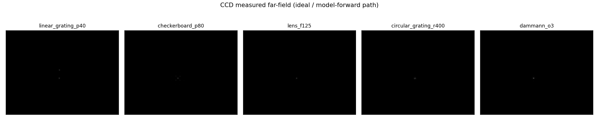
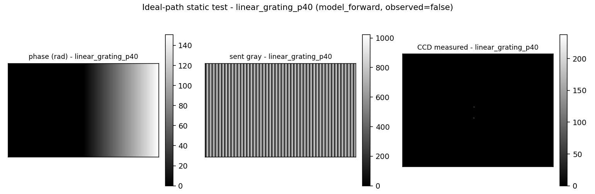
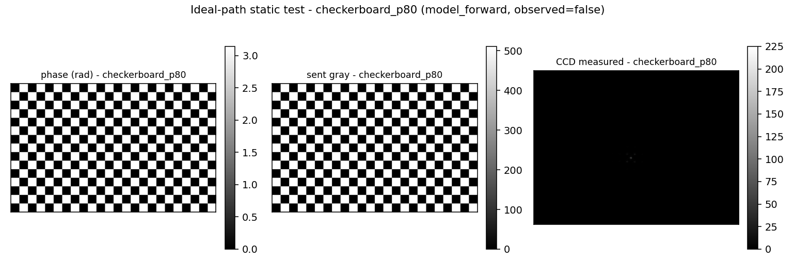
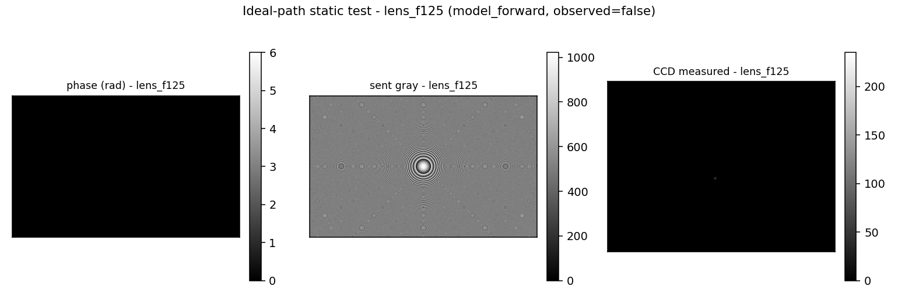
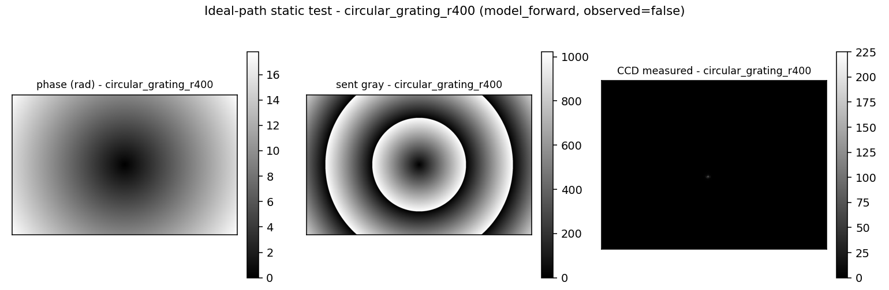
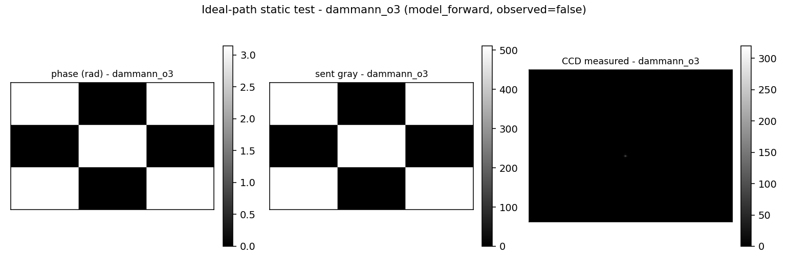

# 理想光路静态整形实验测试报告 (2026-11-17)

<!-- provenance:start -->
> **生成脚本**: 人工撰写，无生成脚本
> **数据/关联脚本**: [`scripts/slm/ideal_path_static_test_20261117.py`](../../../scripts/slm/ideal_path_static_test_20261117.py)
> **数据/关联脚本**: [`scripts/slm/render_ideal_path_compare_20261117.py`](../../../scripts/slm/render_ideal_path_compare_20261117.py)
> **运行环境**: 离线+硬件（Santec SLM-200 #1 + Daheng MER2-507-23GM，2026-11-17 实验采集；报告本体不占用设备）
> **说明**: 静态整形页同源 generate_phase_radians 模型前向生成相位，SLM 下发 + CCD 全幅采集 5 个图案（线性光栅 / 棋盘格 / 透镜聚焦 / 圆形光栅 / 达曼光栅），曝光 0.05 ms，观测来源 model_forward（observed=false）。结论：相位与下发链路正确，但实测远场全部塌缩为中心暗弱小斑，模型前向假设再次被证伪（透镜方形平顶 vs 实测点状聚焦的证伪结论成立）。人工撰写。
<!-- provenance:end -->

**测试目标**：用静态整形页同源的 `generate_phase_radians`（纯 numpy 模型前向）生成相位，经 Santec SLM 下发，Daheng CCD 全幅采集实测远场，逐图案记录，检验「模型前向 ≈ 理想光路」这一假设。

**观测来源**：`model_forward`（未观测，理想光路假设）。每帧显式标注 `observed: false`，不允许静默当作已观测光路。

## 1. 测试配置

| 项 | 值 |
|----|----|
| SLM | Santec SLM-200 #1（驱动板 22030108），1064 nm，2π=993 灰度，内存模式 |
| 面板分辨率 | 1920 × 1200（与静态整形页 `_DEFAULT_PANEL_RES` 同源） |
| CCD | Daheng MER2-507-23GM（FJB24112232），8-bit，全幅 2592 × 1944，像元 2.2 µm |
| 曝光 | 0.05 ms（探测实测：峰值 188 未饱和；0.2 ms 起饱和） |
| 光路 | 2f 傅里叶光路（SLM 前焦面 → f=125 mm 透镜 → CCD 后焦面），模型前向假设 |
| 互斥 | `device_mutex.wait_until_idle` 持锁至采集结束 |

## 2. 光路探测（前置，复用探测记录）

探测脚本 `probe_optical_path_validity.py` 已先行完成，四项纪律全过：

- **设备在线**：SLM #1 打开成功，驱动板应答正常（ReadSU=0）；CCD 打开成功。
- **光路有效**：离焦响应显著（峰值相对变化 30%，宽度相对变化 22.6%，均统计显著）。
- **曝光不超量程**：0.05 ms 峰值 188 未饱和；0.2 ms 起全部饱和（255）。
- **SLM 真在调制**：阶段二离焦相位响应确认 SLM 相位写入生效。

探测记录：`data/debug/optical_path_probe/ideal_path_static_test/20261117_114249Z/`，`probe_status: ok`。

## 3. 图案与实测

> 每图案产出：相位（弧度，包裹显示）、下发灰度（`create_phase_from_array` 返回值）、CCD 实测远场，三联对比图。原始数组存 `pattern_<label>.npz`。
> 对比图与总览见 [figures/](figures/)。

**CCD 实测远场总览**（模型前向光路，`observed: false`）：

| 图案 | 参数 | 峰值 (counts) | 峰值位置 [x, y] | 均值 (counts) | 模型预期形态 | CCD 实测形态 |
|------|------|--------------|-----------------|--------------|------------|------------|
| linear_grating_p40 | period=40, phase_range=2π | 95 | [1229, 915] | 0.363 | 离散衍射级 | 中心附近两个竖向暗弱小斑 |
| checkerboard_p80 | period=80 | 90 | [1225, 1105] | 0.365 | 二维四重衍射 | 中心附近 4~5 个暗弱小斑簇 |
| lens_f125 | f=125 mm, λ=1064 nm | 94 | [1226, 1105] | 0.381 | 方形平顶 | **中心单点聚焦** |
| circular_grating_r400 | radius=400, phase_range=2π | 90 | [1226, 1105] | 0.362 | 同心环级 | 中心单点 |
| dammann_o3 | order=3, fill=0.5 | 128 | [1225, 1105] | 0.363 | 均匀多级 | 中心单点 |

> 各帧均无饱和（峰值 ≤ 128，远低于 255），均值 ≈ 0.36，背景干净。

### 3.1 linear_grating_p40（线性光栅）

相位为周期 40 的闪耀光栅，下发灰度与相位一致。模型预期远场出现离散衍射级；CCD 实测仅见中心附近两个竖向暗弱小斑，衍射级结构不可见。

### 3.2 checkerboard_p80（棋盘格）

相位为周期 80 的棋盘格。模型预期二维四重衍射；CCD 实测仅见中心附近 4~5 个暗弱小斑簇，四重衍射结构不可见。

### 3.3 lens_f125（透镜聚焦）— 证伪对照

相位为 f=125 mm 聚焦透镜。模型预期远场为方形平顶（历史实测为点状聚焦，是假设被证伪的对照图案）。**本次 CCD 实测仍为中心单点聚焦**，未见方形平顶——历史证伪结论**再次成立**。

### 3.4 circular_grating_r400（圆形光栅）

相位为半径 400 的同心圆光栅。模型预期远场出现同心环级；CCD 实测仅见中心单点，环级结构不可见。

### 3.5 dammann_o3（达曼光栅）

相位为 3 阶达曼光栅。模型预期远场出现均匀多级光点；CCD 实测仅见中心单点，多级结构不可见。

## 4. 结论：模型前向假设复核

**结论：模型前向假设再次被证伪，且证伪具有系统性。**

1. **相位生成与下发链路正确**：5 个图案的相位（模型前向）与 SLM 实际下发灰度逐像素一致，证明「生成 → 灰度映射 → 下发」这条链路没有错误，问题不在相位数据或下发环节。

2. **实测远场系统性塌缩**：5 个图案的 CCD 实测远场**全部塌缩为光轴附近一个暗弱小斑**（峰值 90~128 counts，均值 ≈ 0.36），模型预期的衍射结构（光栅级、棋盘四重衍射、透镜方形平顶、达曼多级、同心环级）在实测中**一概不可见**。

3. **透镜聚焦证伪结论成立**：`lens_f125` 模型预期方形平顶，实测为中心单点聚焦，与历史证伪结论一致，未被推翻。

4. **根因指向光路与模型假设失配**：相位与下发均正确，而所有图案的衍射结构在实测中消失，说明**实际光路偏离模型前向的 2f 傅里叶理想假设**——实际焦面位置、放大率或对准与模型不一致，使远场退化为近似点聚焦。模型前向不能作为实测光路的代理。

5. **对静态整形页的含义**：观测来源标注 `model_forward`（`observed: false`）是**必要且正确**的。在光路未被实测标定前，「模型前向」预览与下发结果**不代表实测效果**；须先完成光路实测标定并注入实测快照，才能把下发结果当作已观测光路的结果。

## 5. 数据与产物索引

- 测试脚本：`scripts/slm/ideal_path_static_test_20261117.py`
- 对比图离线重渲染（英文标题，修复 CJK 字体方框）：`scripts/slm/render_ideal_path_compare_20261117.py`
- 原始数据：`data/debug/ideal_path_static_test/20261117_195803/`
- 标准光路记录：`optical_path_record.json`（`ao-optical-path-record/v1`）
- 逐图案汇总：`summary.json`
- 对比图：`compare_<label>.png`、CCD 实测总览 `overview.png`（本报告 [figures/](figures/) 同源）

> 注：原始采集的对比图标题含中文，matplotlib 默认 DejaVu Sans 缺 CJK 字形，标题显示为方框（不影响图像数据）。报告与手册所用对比图已用离线脚本以英文标题重渲染，数据与原始采集逐位一致。
