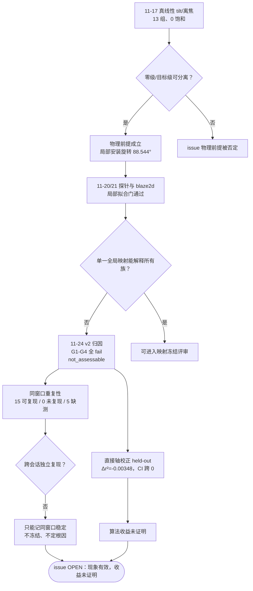

# Issue #247 全阶段证据汇总与有效性判定（2026-11-24）

<!-- provenance:start -->
> **生成脚本**: 人工撰写，无生成脚本
> **数据/关联脚本**: [`scripts/slm/issue247_zero_order_stability_20261117.py`](../../../scripts/slm/issue247_zero_order_stability_20261117.py)
> **数据/关联脚本**: [`scripts/slm/issue247_axis_map_solve_20261121.py`](../../../scripts/slm/issue247_axis_map_solve_20261121.py)
> **数据/关联脚本**: [`scripts/slm/issue247_waveform_probe_solve_20261122.py`](../../../scripts/slm/issue247_waveform_probe_solve_20261122.py)
> **数据/关联脚本**: [`scripts/slm/issue247_reproducibility_check_20261124.py`](../../../scripts/slm/issue247_reproducibility_check_20261124.py)
> **运行环境**: 离线汇总（只读历史报告、原始数据与 GitHub issue 评论；未占用 SLM/CCD/激光）
> **说明**: Issue #247 全阶段证据汇总：按原始验收项区分物理现象成立、局部标定有效与校正算法收益未证明。支持零级/目标级分离、探针标度与局部 2D/patch 映射；否定单一全局映射、单一族归因与直接轴校正收益；根因、跨会话复现、加性判定、合成模板恢复、统一观测校正、默认路径逐位不变以及 Step A/holdout/Step B 收益仍证据不足。明确披露 11-24 同窗口重复性含检查期新增的 8 px 边界排除、core_exclude_px=41.0 会吞掉距零级 37–40 px 的真实 p192 波瓣，故只记限定口径下的同窗口可重复。issue 保持 OPEN，不冻结映射、不宣称闭环收益。人工撰写。
<!-- provenance:end -->

**文档类型**：离线证据汇总，不产生新实验数据。
**证据截止时间**：2026-11-24（GitHub issue 评论截至 2026-11-23；11-24 结果来自仓库报告与原始数据）。
**对象**：[GitHub issue #247](https://github.com/ywzhang909/AO-shaping/issues/247)「[光路标定] 倾斜/离焦探测零级并接入可微前向校正」。
**当前状态**：issue **OPEN**；本汇总不关闭 issue、不冻结 `issue247_axis_map.json`、不开设备、不改 `w_zero_order`、不 push。

## 摘要

本汇总按 issue 原始验收项逐条回看 2026-11-17 至 2026-11-24 的硬件窗口、离线回测和代码单元测试。三类判断必须分开：

1. **物理现象成立**：真线性 ±tilt／±离焦探针下，零级与目标级可分离，目标级按 tilt 响应；探针级间距和 ± 符号总体可靠。
2. **局部标定有效**：面板→CCD 的安装旋转约 `88.544°`，2D blaze 与局部 patch 内容在拟合集和 A 映射口径下自洽；但这不是全局可逆映射。
3. **校正算法收益未被证明**：直接把标定轴映射替换进 baseline 的独立回测为阴性；v2 归因四门全 fail、held-out 不可外推；可微零级模板、统一观测校正与闭环收益没有端到端验收。

同窗口重复性窗口的“方向重复性 pass”只表示 15 个可评估图样在**同一 SLM 打开周期内**稳定；它不是跨会话独立复现，也不是根因定位。该窗口还包含检查期新增的 `8 px` 帧边界排除规则，`core_exclude_px=41.0` 同时会吞掉距零级约 `37–40 px` 的真实 p192 波瓣。因此，`overall_pass=True` 必须写成“限定分析口径下的同窗口可重复”。

最终判定：**issue 有效，物理前提与局部现象得到支持；全局映射、根因、统一观测校正和算法收益均不成立或证据不足；issue 应保持 OPEN。**

## 1. 判定总览

### 1.1 三类结论的边界

| 层级 | 可以表述 | 不可以表述 |
|---|---|---|
| 物理现象 | “零级在 tilt 下稳定、目标级可分离并随标定方向移动” | “相干交叉项已排除”“强度模板可直接相减已完成验收” |
| 局部标定 | “2D/局部内容类在拟合口径下符合 A 映射”“安装旋转约 88.544°” | “全局 panel→CCD 映射已冻结”“符号与尺度分支已确定” |
| 算法收益 | “存在可叠加零级模板的单元级机制测试” | “合成模板恢复成功”“校正残差优于基线”“Step A/Step B 有收益” |

## 2. 对 issue 原始验收项的逐条判定

| 原始验收项 | 现有证据 | 判定 |
|---|---|---|
| 零级位置在 tilt sweep 下稳定于拟合不确定度内 | 11-17 报告：7 帧 flat 最大漂移 `2 px`、tilt 帧零级距中心 `≤2.3 px`；issue 评论另一口径：`3 px`、`1.41/2.24 px`。两种口径需并列保留。 | **现象层面支持**；数值口径未统一 |
| 目标级按标定方向／尺度移动 | 真线性 tilt 下目标级明显偏转；安装旋转 `88.544°`、轴间尺度比 `1.0859`；但全幅 1-D `fy≡0` 类与 2D/局部类的路由不一致。 | **局部支持、全局否定** |
| 已知合成模板可恢复 | `tests/ao_shaping/ml/sim2f/test_measurement.py` 只验证给定模板能按权重叠加，且默认不启用；没有从合成观测反解模板中心／尺度／强度的端到端恢复实验。 | **证据不足** |
| 校正残差优于未校正基线 | 直接替换 baseline 矩阵的 held-out `Δr²=-0.00348`，95% CI `[−0.00824,+0.00160]`；方向门 `0/3`。历史端到端 seed→final 改善不能归因于 #247 零级校正。 | **已测变体无效；其余路径未验** |
| 失败条件有明确拒绝原因 | 饱和、漂移、相位摘要、帧数、设备释放等输入拒绝门已实现并通过；但物理校正路径尚未启用，缺零级重叠／不相加／标定失败时的实际拒绝链验收。 | **部分支持** |
| 无校准时旧路径逐位不变 | 未见针对 issue 指定 `optical_probe.py`、`zernike_coefficient_optimizer.py`、`model_in_loop_shaping.py`、`total_loss` 路径的逐位回归证据；`w_zero_order` 仍为默认 `0.0` 的中心惩罚。 | **证据不足** |
| Step A／holdout／Step B 共用约定 | 未见统一校准数据结构、固定参数与梯度隔离的端到端协议落地。 | **证据不足** |
| Step B 单／多候选梯度有限且批量与串行一致 | 未见本 issue 下的专项测试或报告。 | **证据不足** |
| 强度加性或相干复场模型前置判定 | 已明确“只有可分离且近似加性才允许强度模板扣除”；但相干交叉项未被量化排除。 | **证据不足** |
| 物理验证遵守设备单占用、曝光、冷却纪律 | 11-17、11-21、11-23、11-24 窗口均有六步预检、单次 open/close、在飞保护、曝光记录与释放证据；11-24 一次预检失败未复用，换独立 run 后通过。 | **支持** |
| 报告写 `report/shape_trials`，原始数据写 `data/debug` | 核心报告与原始数据均按约定落盘；本汇总亦写入 `report/shape_trials/`。 | **支持** |

## 3. 时间线与证据状态

| 日期 | 样本／窗口 | 关键实测 | 对结论的作用 |
|---|---|---|---|
| 11-17 | 13 组全幅 Mono12，0 饱和 | 零级稳定、目标级分离；安装旋转 `88.544°`、尺度比 `1.0859`、正交误差 `0.2435°`、最大残差 `2.345 px`。 | 建立物理前提和局部 A 映射；算法未启用 |
| 11-18 | 独立 held-out 回测 | `axis−baseline Δr²=-0.00348`，CI `[−0.00824,+0.00160]`；方向门 `0/3`。 | 否定“直接替换 baseline 矩阵”的可检出收益，不否定物理轴失配 |
| 11-19 | 历史归档重算 | 325 目录／4222 文件配对帧存在；受控重放相对 seed 有改善，但绝对 `rel_l2≈0.5–1.4`、阈值未预注册。 | 纠正“无配对帧”说法；仍不能证明 #247 校正收益 |
| 11-20b | 44 帧／11 图样，0 饱和 | 级间距 ∝ `1/period`，p128→p256 两轴为 `2.0`；tilt ± 反向、blaze 单侧性成立；但 `grating_x`/`tilt_x` 与其余族的轴向矛盾。 | 否定“axis 标签写反”；确认单一全局映射仍不可冻结 |
| 11-21b | blaze2d 四点，20 帧 | RMS `0.871 px`、相对误差 `1.576%`、夹角 `90.36°`、秩守卫 `0.9925`，四项 blaze-only 门通过；完整 10 方向自洽失败。 | 局部内容类可拟合；同日旧 `frozen=true` 作废，最终 `frozen=false` |
| 11-23 初版 | 15 图样 × 4 帧 = 60 帧 | `patch_position_specific`，但轴向与标度多项失败；后续 v2 重做归因。 | 历史诊断，不作为最终归因结论 |
| 11-24 v2 归因 | 23 图样 × 4 帧 = 92 帧，0 饱和，flat 漂移 `1.061 px` | G1–G4 全 fail；`attribution_label=not_assessable`；held-out 正确 `0/10`。 | 否定单一族归因与规则外推 |
| 11-24 重复性 | 23 图样 × 4 帧 × 3 轮 = 276 帧 | 复现 `15`／未复现 `0`／缺测 `5`；最大轮间轴角差 `1.343°`；flat 漂移 `0.469 px`；逐轮 G1–G4 全 fail。 | 只支持同窗口、限定口径下的方向稳定 |

### 3.1 口径冲突与受限口径

- **11-17 数值双口径**：仓库报告与 issue 评论给出不同的漂移、零级距中心和目标级分离范围；本汇总并列保留，不混用、不取平均。
- **`held_out_axis_accuracy=0.0`**：是全为 `None` 后的统计工件，不可写成“所有 held-out 方向均被实测预测失败”。正确表述是 held-out `0/10`，其中可评估项不正确、5 个 p192 为缺测。
- **legacy `verdict=tilt_specific`**：仅为兼容保存，不能作为 v2 或重复性窗口结论。
- **事后 8 px 边界排除**：11-24 预注册只要求缺峰保留缺测，未冻结 `EDGE_BAND_PX=8.0`。该规则在检查脚本中实现，属于检查期新增口径。G1–G4 在排除伪峰后仍全 fail，但方向重复性 pass 必须附此限制。
- **`core_exclude_px=41.0` 盲区**：真实 p192 波瓣距零级约 `37–40 px`、峰值 `188–967 counts`，会被 `41 px` 核心排除吞掉；随后抓到的 `22–25 counts` 伪峰接近背景 `15.5 counts`。因此 5 个 p192 缺测是“当前分析口径不可评估”，不是“物理波瓣消失”。
- **同窗口样本非独立**：三轮处于同一 SLM 打开周期，连续帧不能当跨会话独立样本。

## 4. 已证实有效

| 结论 | 证据与边界 |
|---|---|
| 零级与目标级可分离 | 11-17 真线性 ±tilt／±离焦，13 组、0 饱和；零级稳定、目标级按 tilt 偏转。仅证明该成像与曝光条件下的物理可分离性。 |
| 探针响应可靠 | 级间距与周期倒数一致，p128→p256 标度比 `2.0`；tilt ± 反向约 `180°`；单向 blaze 梯单侧成立。 |
| 局部 2D／patch 映射自洽 | 11-21 blaze2d 四项拟合门通过；v2 拟合集 `rotation≈88.528°`、`axes_swapped=True`，11 个 fit 波旋转后跨轴残差中位 `0.031 px`、最大 `0.395 px`。仅限拟合口径与对应内容类。 |
| 安装旋转量级可重复 | `88.544°`（11-17）与 `≈88.528°`（v2 拟合）接近；180° 对称分支仍未解决。 |
| 15 个图样方向同窗口稳定 | 276 帧、三轮、最大轮间轴角差 `1.343°`、flat 漂移 `0.469 px`；限定于新增 8 px 排除口径与同一硬件会话。 |
| 光路与设备控制门有效 | 0 饱和、漂移门 pass、相位摘要一致、设备正常释放；失败预检被拒绝且未复用。 |
| 零级模板叠加机制可单测 | `MeasurementTransfer` 在给定模板时按权重叠加、默认关闭；这是机制测试，不是标定恢复或端到端验收。 |

## 5. 已证实无效

| 被否定命题 | 证据 |
|---|---|
| 单一可逆全局映射可解释全部图样 | 11-20/21 全幅 1-D 与 blaze2d 族矛盾；完整 10 方向自洽失败；v2 G3 轴路由失败（grating `0.35°`、tilt `0.74°`）。 |
| 存在单一异常波形族可归因 | G2 `anomalous=none`，三轮一致；`attribution_label=not_assessable`。 |
| 轴／符号一致规则可外推到 held-out | G4 `blaze_patch/y=164.01°`，偏离 `180°` 约 `15.99°`；held-out 正确 `0/10`；不得写规则可外推。 |
| 直接替换 baseline 的轴校正有收益 | 独立 held-out CI 跨 0、方向门 `0/3`。 |
| “axis 标签写反”是根因 | 11-20 A0 生产相位与 FFT 核验否定；错的是全幅 1-D 类的轴向路由，不是标签反转。 |
| 11-21 `frozen=true` 与 legacy `tilt_specific` 可作结论 | 前者同日 10:07 被正式作废；后者仅为兼容字段。 |
| Transfer 几何残差适配应启用（相邻证据） | validation 相对改善 `0.6200% < 5%`；独立 192 px 的 y 轴误差增加 `18.962% > 10%`，保持 `learn_geometry=False`。它不是 #247 零级校正，但也不支持“统一几何修正已解决映射问题”。 |

## 6. 证据不足

| 未决事项 | 为什么不能下结论 |
|---|---|
| 零级与调制场是否近似加性 | 未量化相干交叉项；issue 明确要求先判定强度模型或复场模型。 |
| `SLM_Disp_Data`／面板 10-bit 内部路径根因 | 只在仓库软件链排除后缩小到候选，缺外部设备侧证据与定级实验。 |
| 跨会话独立复现 | 11-24 三轮为同一次 open/close；无跨日、跨会话独立样本。 |
| 符号分支与 180° 歧义 | `88.544°` 的对称分支为 `−91.457°`，符号靠 convention 钉住，未由独立观测定向。 |
| 5 个 p192 缺测的物理含义 | 受 8 px 新增规则与 41 px 核心盲区共同影响，当前口径不可评估。 |
| 未见方向验证 | 11-24 预注册明确未解决匹配支持域与未见方向；S1 内容轴实测未见回写。 |
| 合成模板恢复 | 仅有单元级“给定模板可叠加”测试，没有反演恢复与校正残差对比。 |
| 统一观测校正与梯度隔离 | 未见 `Step A`／`holdout`／`Step B` 共用校准数据结构、固定参数、梯度仅流向 phase 的端到端验证。 |
| 旧路径逐位不变 | 未见针对 issue 指定代码锚点的 bit-identical 回归。 |
| Step B 梯度有限性与批量一致性 | 未见专项测试或报告。 |
| 硬件零级校正收益 | 未启用硬件校正；无校正残差优于未校正基线的硬件验收。 |
| Transfer 静态 PSF 适配与 #247 的关系 | PSF 两门 pass（validation `28.5928%`、独立 192 px `21.2960%`），但它是离线、opt-in 的 transfer 正向预测改进，不是 #247 闭环或零级校正收益。 |

## 7. 关键指标与门限

| 指标 | 门限／约定 | 实测 | 来源口径 |
|---|---:|---:|---|
| 饱和门 | `0.9 × 4095 = 3685.5 counts` | 核心窗口均 `0` 饱和帧 | v2 与重复性报告 |
| 11-17 曝光 | 冻结成像设置 | `0.05 ms`（历史评论／报告口径） | 11-17 报告 |
| v2／重复性曝光 | 采前冻结 | `0.04 ms` | v2 与重复性预注册 |
| flat 漂移 | `≤2.0 px` | v2 `1.061 px`；重复性 `0.469 px` | 对应报告 |
| 方向重复性 | 任两轮轴角差 `≤2.0°`，至少两轮可评估 | 最大 `1.343°`；`15/0/5` | 重复性报告（含 8 px 新增规则） |
| G1 波形依赖 | 两轴均极差 `>5°` | x `89.84°` pass，y `1.18°` fail | v2 报告 |
| G2 单族异常 | 单一族两轴偏离 `>5°` 且另两族 `≤2°` | `anomalous=none` | v2 报告 |
| G3 轴分离 | 期望 `88.544° ± 2°`（tilt `>80°`） | grating `0.35°`、tilt `0.74°`、blaze_patch `90.00°` | v2 报告 |
| G4 符号一致 | `180° ± 2°`（patch/blaze `≤5°`） | blaze_patch/y `164.01°` | v2 报告 |
| held-out 方向 | 预注册正确率门 `≥0.9` | 正确 `0/10`，不可外推 | v2 报告 |
| 轴校正独立回测 | 改善且 CI 不跨 0 | `Δr²=-0.00348`，CI `[−0.00824,+0.00160]`；方向 `0/3` | 11-18/19 文档 |
| blaze2d 局部拟合 | RMS `≤1.0 px`、相对 `≤2%`、夹角 `88.544°±2°`、秩 `≥0.10` | `0.871 px`、`1.576%`、`90.36°`、`0.9925` | 11-21b 文档 |
| Transfer PSF（相邻） | validation `≥15%`、独立 `≥10%`、`corr_delta ≥−0.01` | `28.5928%`、`21.2960%`、corr_delta `+0.085852` | transfer PSF 报告 |
| Transfer 几何（相邻） | validation `≥5%`、单轴恶化 `≤10%` | `0.6200%`、y 轴恶化 `18.962%` | transfer 几何报告 |

## 8. 任务项与放行顺序

| 优先级 | 任务 | 完成标准 | 当前状态 |
|---|---|---|---|
| P0 | 统一 11-17 两套指标口径，并复核 `core_exclude_px=41.0` 对 p192 波瓣的吞没 | 输出单一权威口径或明确并列定义；给出真实 `37–40 px` 波瓣的逐帧峰值和被排除记录 | 未开始 |
| P0 | 处理 8 px 事后规则 | 要么重跑冻结分析、要么把规则作为新增口径做敏感性窗口；不得将事后规则写成预注册判据 | 未开始 |
| P0 | 明确 5 个 p192 缺测 | 在修正核心盲区后重判；缺测只能写“不可评估”，不能写“无峰” | 未开始 |
| P1 | 跨会话独立复现 | 新 open/close、跨日、同冻结图样；预注册重复性门通过 | 未开始 |
| P1 | 根因隔离 | 设备侧 `SLM_Disp_Data`／10-bit 内部存储路径与仓库链分段证据；定级后再谈修复 | 未开始 |
| P1 | 全局映射与内容类路由 | 新 held-out 同时覆盖全幅 1-D、2D、局部 patch；不得用拟合集指标代替 | 未开始 |
| P2 | 加性／相干模型判定 | 用受控强度或复场实验量化交叉项，再决定强度模板或复场模型 | 未开始 |
| P2 | 可微观测校正闭环 | 合成模板恢复、默认路径 bit-identical、Step A/holdout/Step B 共用约定、Step B 梯度与批量一致性逐项验收 | 未开始 |
| P2 | 硬件零级校正收益 | 校正残差相对未校正基线的独立 held-out 改善与 CI；失败原因可拒绝 | 未开始 |
| P3 | 相邻 transfer 结果分区 | PSF 的 opt-in 收益和几何适配失败分别归档，不并入 #247 收益 | 已在本报告划界 |

## 9. 证据索引

- [Issue #247 原文与评论](https://github.com/ywzhang909/AO-shaping/issues/247)
- [11-17 零级／目标级分离报告](../issue247_zero_order_20261117/issue247_zero_order_20261117.md)
- [11-18/19 有效性判定](../../../docs/dev/issue_validity_verdict_20261119.md)
- [11-19 历史实测指标重算](../../../docs/dev/historical_measured_shape_metrics_reanalysis_20261119.md)
- [11-21b 2D blaze 预注册](../../../docs/dev/hw_window_20261121b_issue247_prereg.md)
- [11-21 当日记录](../../../docs/dev/agent_notes_20261121.md)
- [11-23 波形归因 v2 预注册](../../../docs/dev/hw_window_20261123_issue247_waveform_attribution_prereg.md)
- [v2 波形族归因报告](../issue247_waveform_attribution_20261123/issue247_waveform_attribution_20261123.md)
- [11-24 同窗口重复性预注册](../../../docs/dev/hw_window_20261124_issue247_reproducibility_prereg.md)
- [同窗口重复性报告](../issue247_reproducibility_20261124/issue247_reproducibility_20261124.md)
- [重复性检查脚本](../../../scripts/slm/issue247_reproducibility_check_20261124.py)
- [波形归因解算脚本](../../../scripts/slm/issue247_waveform_probe_solve_20261122.py)
- [Transfer 静态 PSF 报告](../transfer_psf_adaptation_20261124.md)
- [Transfer 几何残差报告](../transfer_geometry_adaptation_20261124.md)
- [零级模板叠加单元级测试](../../../tests/ao_shaping/ml/sim2f/test_measurement.py)
- [Step B 现有 `w_zero_order` 定义](../../../src/ao_shaping/optimizer/wfless/model_in_loop_shaping.py)

## 10. 最终结论

Issue #247 的**物理问题有效**：零级与目标级可分离，零级在 tilt 下稳定，目标级响应可测；探针和局部 2D/patch 映射在限定口径下自洽。

Issue #247 的**全局映射与根因尚未确立**：单一可逆映射、单一异常族归因、轴／符号一致路由和跨会话复现均未通过；8 px 事后排除与 41 px 核心盲区使 5 个 p192 图样在当前口径下不可评估。

Issue #247 的**校正算法收益未证明**：已测的直接轴校正变体为阴性，v2 归因不可外推，可微零级模板与统一观测校正没有端到端验收，Step B 梯度与批量一致性无证据。

因此：**不冻结映射、不声明根因、不宣称闭环收益、不关闭 issue。** 下一步应先修正分析口径与核心盲区，再做跨会话独立复现；只有前置物理与映射问题收敛后，才进入可微校正与硬件闭环收益验收。
