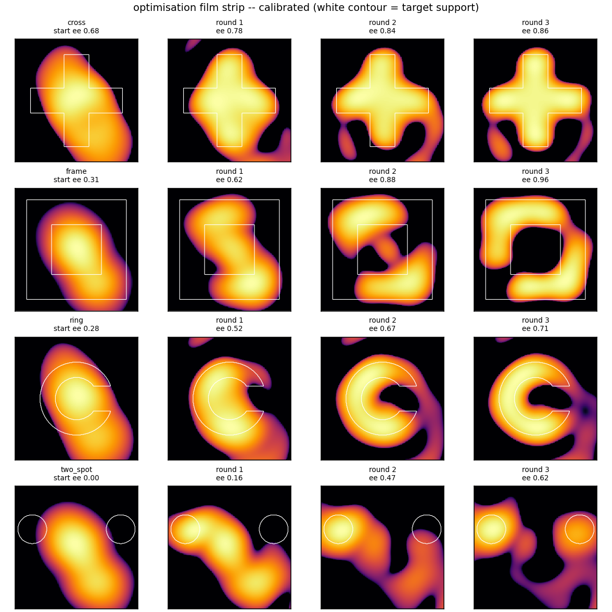
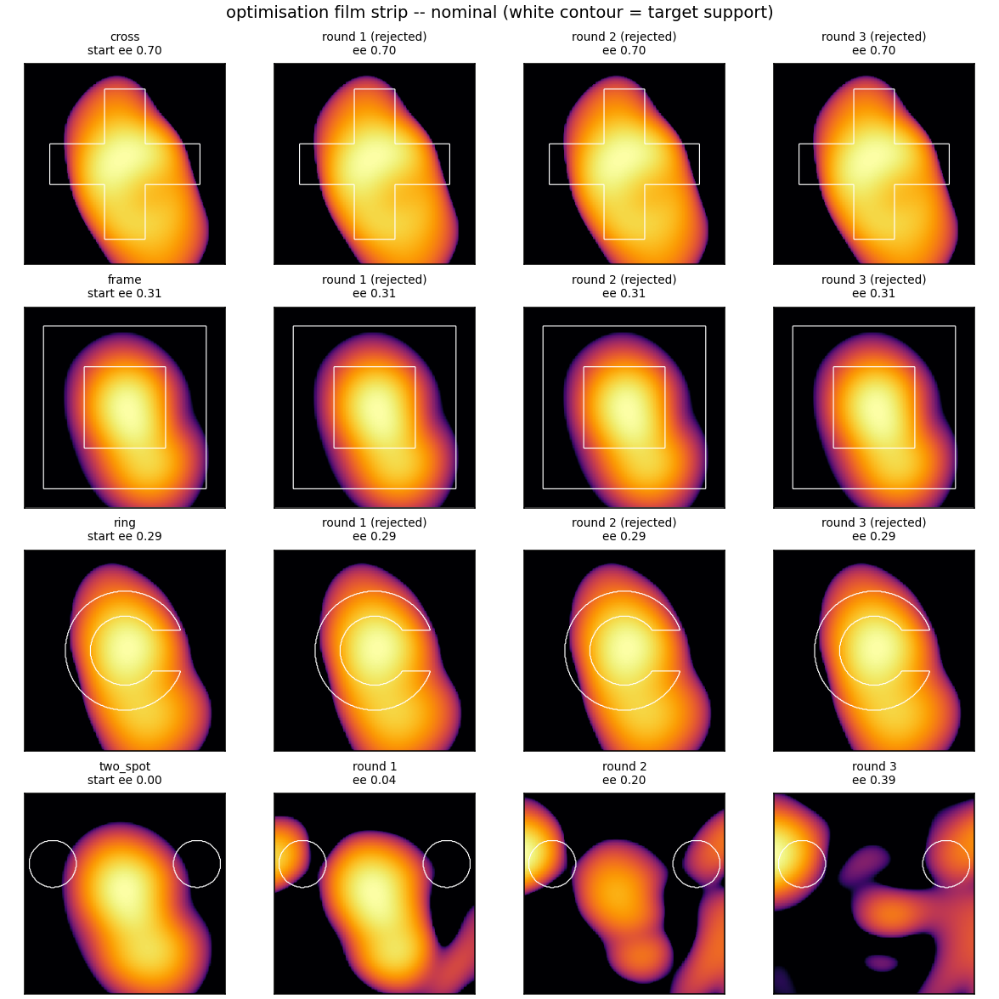

# 任意形状掩模闭环整形: 标定孪生离线验证 (2026-10-31)

<!-- provenance:start -->
> **生成脚本**: [`scripts/ml/sim2f_shape_trials.py`](../../../scripts/ml/sim2f_shape_trials.py)
> **复现命令**: `python scripts/ml/sim2f_shape_trials.py --execute --out report/shape_trials/mask_closed_loop`
> **数据/关联脚本**: [`scripts/ml/sim2f_shape_trials_figures.py`](../../../scripts/ml/sim2f_shape_trials_figures.py)
> **数据/关联脚本**: [`src/ml/sim2f/shape_loop.py`](../../../src/ml/sim2f/shape_loop.py)
> **数据/关联脚本**: [`src/ml/sim2f/calibrate.py`](../../../src/ml/sim2f/calibrate.py)
> **运行环境**: 离线（session_hw 录制会话标定孪生 + 漂移代理）
> **说明**: 任意位图形状（mask_target）迭代闭环整形离线验证：标定孪生 vs 裸模型的两配对，实测验收门在模型失配下逐轮拦截；逐轮明细与每个变体相位在 artifacts/。
<!-- provenance:end -->

## 1. 本轮做了什么

硬件离线 (相机不可达), 本轮在**录制会话** `runs/sim2f_bench/session_hw` (96 对 命令/实测帧) 上验证 `src/ml/sim2f` 栈的完整闭环能力:

1. **标定** (`ml.sim2f.calibrate.calibrate_bench`): 用会话的 72 对训练 / 24 对验证集, 拟合光束宽度/角度、相机 zoom/shift 与像差, 得到标定孪生 `CalibratedBench`。
2. **迭代整形** (`ml.sim2f.shape_loop.run_shape_trial`): 对 4 个**任意位图形状** (`mask_target`, ring / cross / frame / two_spot —— 均非训练语料形状), 每形状跑 3 个变体 (flat / net_open / net_finetune), net 相位来自 `runs/sim2f_fair/train/model_best.pt`; finetune 变体做 3 轮 *局部有界* 相位更新 (`PhaseRefiner`, max_delta_rad=0.5, clip 信赖域), 每轮先 `fit.refine` 残差估计、再以**设备实测目标值**验收 (`min_gain` 门限)。

**诚实性规则**: 设备代理与模型代理**永不为同一对象**。两种配对:

| 条件 | 设备代理 | 模型代理 | 回答的问题 |
|------|----------|----------|-----------|
| `nominal` | 标定孪生 | 裸 `Sim2f` (不知光束/相机/像差) | 模型完全错误时, 实测验收能否兜底? |
| `calibrated` | 标定孪生 + 标定未见过的 0.30 rad 漂移像差 | 标定孪生 | 模型大体正确、只错今日漂移时的收益? |

## 2. 结论 (TL;DR)

1. **标定过的模型 + 实测验收的局部更新 = 任意形状可整形**: `calibrated` 条件下 4/4 形状、12/12 轮全部被设备实测验收通过, 目标值 1.65–2.24 降到 0.36–0.93, 支撑域能量 (ee) 最高 0.325→0.948 (frame)。
2. **错误的模型会被实测验收拦住, 而不是悄悄变坏**: `nominal` 条件下 12 轮里 11 轮被拒 (`gain_device < min_gain`), finetune 变体停在起点 —— 拒绝可见 (rounds 里 `accepted_device=False`、`gain_device` 照常上报), 不静默。唯一例外 two_spot: 裸模型误打误撞方向可用, 3 轮全过 (2.244→1.538)。
3. **网络开环相位对掩模形状基本无增益** (net_open ≈ flat): 训练语料里没有位图形状, 网络外推不出掩模相位; 闭环 finetune 才是掩模整形的生效路径。

## 3. 数字

### 3.1 标定 (会话 96 对, 300 iters)

| 量 | 起点 | 拟合后 |
|----|------|--------|
| 训练 L1 | 0.7287 | 0.5655 |
| 验证集 L1 | 0.7562 | 0.5499 |
| 验证集 NCC | 0.470 | 0.774 |

拟合态: 光束 w0 = 8.48 / 9.95 model px (angle 0.43 rad), 相机 zoom 1.752, shift (19.2, −33.0) px, 像差 RMS 1.916 rad (自由参数: 光束 x/y 宽度、角度、中心、相机 zoom/shift, Noll 6–8)。验证集同步改善 → 标定过门。

### 3.2 整形 (每格: 最终目标值 / ee / NCC, acc = 设备验收轮数)

| 条件 | 形状 | flat | net_open | net_finetune | acc |
|-------|------|------|----------|--------------|-----|
| nominal | ring | 1.616 / 0.30 / 0.16 | 1.621 / 0.29 / 0.19 | 1.621 / 0.29 / 0.19 (全拒) | 0/3 |
| nominal | cross | 1.012 / 0.74 / 0.55 | 0.868 / 0.70 / 0.64 | 0.868 / 0.70 / 0.64 (全拒) | 0/3 |
| nominal | frame | 1.744 / 0.32 / −0.19 | 1.737 / 0.31 / −0.21 | 1.737 / 0.31 / −0.21 (全拒) | 0/3 |
| nominal | two_spot | 2.247 / 0.00 / −0.16 | 2.244 / 0.00 / −0.18 | 1.509 / 0.39 / 0.35 | 3/3 |
| calibrated | ring | 1.645 / 0.29 / 0.15 | 1.652 / 0.28 / 0.17 | **0.720 / 0.71 / 0.80** | 3/3 |
| calibrated | cross | 1.050 / 0.71 / 0.51 | 0.921 / 0.68 / 0.61 | **0.365 / 0.86 / 0.92** | 3/3 |
| calibrated | frame | 1.731 / 0.32 / −0.19 | 1.717 / 0.31 / −0.21 | **0.701 / 0.96 / 0.65** | 3/3 |
| calibrated | two_spot | 2.246 / 0.00 / −0.16 | 2.240 / 0.00 / −0.17 | **0.976 / 0.62 / 0.73** | 3/3 |

逐轮轨迹 (设备实测目标值, × = 被拒轮) 见 [figures/fig_rounds.png](figures/fig_rounds.png); ee 前后对比见 [figures/fig_ee.png](figures/fig_ee.png); 设备远场 (target / flat / net_open / net_finetune, 对数色标) 见 [figures/fig_shapes_nominal.png](figures/fig_shapes_nominal.png) 与 [figures/fig_shapes_calibrated.png](figures/fig_shapes_calibrated.png)。

轮内诊断 (全部 24 轮): `calibrated` 条件每轮 `fit.refine` 残差 0.17→0.003 量级收敛, 更新 RMS 0.17–0.28 rad —— 局部且有界, 符合规范。

### 3.3 逐轮光斑演化 (设备实测帧)

闭环的中间态是可回放的: `shape_loop.RoundRecord` 每轮存下**被测量的那一版命令相位**, 脚本据此把每轮重投影到设备代理上, 得到"起点 → 每一轮"的光斑序列。白色等高线是目标支撑域, 用来直接读"能量是否进到目标里"。



**图 1** `calibrated` 条件 (模型=标定孪生, 设备=标定孪生+漂移): 4 行分别是 ring / cross / frame / two_spot, 4 列是起点 + 3 轮闭环。每一行的能量都从一团各向异性光斑逐步收敛到支撑域轮廓内 —— ring 出现缺口、cross 展开成十字形、frame 变成方框、two_spot 分裂成两个亮斑, 都与目标掩模一致。



**图 2** `nominal` 条件 (模型=裸 Sim2f, 设备=标定孪生): 前三行 (cross / frame / ring) 三轮**逐轮完全相同** —— 被拒的轮没有相位更新 (ΔRMS=0), 光斑停在起点; 只有 two_spot 一行在动 (它的更新方向碰巧可用)。这是"验收门拦住错误模型"最直观的证据: 失败是**可见的停滞**, 不是悄悄劣化。

逐轮数值 (设备实测; A=验收通过, R=被拒并回退):

| 条件 | 形状 | 轮 | 判定 | gain | 目标值 | ee | NCC | cv_in_support | ΔRMS/rad |
|------|------|----|------|------|--------|----|-----|---------------|-----------|
| calibrated | ring | start | — | — | 1.652 | 0.280 | +0.17 | 0.695 | — |
| calibrated | ring | r1 | A | +0.312 | 1.137 | 0.515 | +0.55 | 0.605 | 0.281 |
| calibrated | ring | r2 | A | +0.297 | 0.800 | 0.671 | +0.76 | 0.473 | 0.213 |
| calibrated | ring | r3 | A | +0.101 | 0.720 | 0.705 | +0.80 | 0.432 | 0.167 |
| calibrated | cross | start | — | — | 0.921 | 0.684 | +0.61 | 0.760 | — |
| calibrated | cross | r1 | A | +0.398 | 0.555 | 0.785 | +0.80 | 0.445 | 0.273 |
| calibrated | cross | r2 | A | +0.150 | 0.472 | 0.839 | +0.86 | 0.386 | 0.214 |
| calibrated | cross | r3 | A | +0.226 | 0.365 | 0.864 | +0.92 | 0.285 | 0.173 |
| calibrated | frame | start | — | — | 1.717 | 0.310 | −0.21 | 1.784 | — |
| calibrated | frame | r1 | A | +0.219 | 1.341 | 0.618 | +0.14 | 1.421 | 0.236 |
| calibrated | frame | r2 | A | +0.259 | 0.994 | 0.880 | +0.46 | 1.103 | 0.228 |
| calibrated | frame | r3 | A | +0.295 | 0.701 | 0.958 | +0.65 | 0.795 | 0.221 |
| calibrated | two_spot | start | — | — | 2.240 | 0.005 | −0.17 | 2.811 | — |
| calibrated | two_spot | r1 | A | +0.149 | 1.907 | 0.157 | +0.14 | 1.248 | 0.268 |
| calibrated | two_spot | r2 | A | +0.325 | 1.288 | 0.470 | +0.54 | 1.060 | 0.222 |
| calibrated | two_spot | r3 | A | +0.242 | 0.976 | 0.616 | +0.73 | 0.662 | 0.232 |
| nominal | ring | r1–r3 | R | −0.044 / −0.041 / −0.040 | 1.621 (不变) | 0.294 | +0.19 | 0.699 | 0.000 |
| nominal | cross | r1–r3 | R | −0.018 / −0.149 / −0.234 | 0.868 (不变) | 0.699 | +0.64 | 0.715 | 0.000 |
| nominal | frame | r1–r3 | R | −0.034 / −0.028 / −0.026 | 1.737 (不变) | 0.308 | −0.21 | 1.875 | 0.000 |
| nominal | two_spot | r1 | A | +0.034 | 2.168 | 0.037 | −0.11 | 2.021 | 0.329 |
| nominal | two_spot | r2 | A | +0.150 | 1.842 | 0.197 | +0.17 | 1.636 | 0.330 |
| nominal | two_spot | r3 | A | +0.180 | 1.509 | 0.390 | +0.35 | 1.267 | 0.272 |

两点值得记:

1. **`nominal` 的 gain 一律为负** (−0.018 … −0.234): 裸模型提的方向在真实像差下**每次都变差**, 不是"变好一点但不够"。验收门把它原样挡回去, 相位 ΔRMS=0, 光斑不动。
2. **`calibrated` 的增益在第 3 轮普遍变小** (ring +0.312→+0.101, cross +0.398→+0.150): 局部有界更新在接近目标时收益递减, 与"信赖域内小步走"的预期一致; 更长的轮数是否能继续降, 本轮没有证据 (只跑到 3 轮)。

## 4. 与历史整形结果对比

历史报告 (`report/shape_trials/`) 里的整形质量指标**口径至少有五种**, 直接并列会得出错误结论。本轮数值按口径分档列出, 每档只与同口径的历史结果并列。

### 4.1 口径对照

| 口径 | 定义 | 本轮是否用 |
|------|------|-----------|
| `cv_in_support` | 支撑域内 std/mean, 帧归一化后 | ✅ (`src/ml/sim2f/losses.py`) |
| `inside_cv` | 目标掩膜内 std/mean (实测原始 counts, 未归一) | 概念同源, 归一化细节不同 |
| 核心 ROI CV | 目标掩膜再腐蚀 2 采样像元后的 std/mean | ❌ (腐蚀次数、采样窗口都不同) |
| 剔零级 CV | 显式扣除零级后的均匀度 | ❌ |
| 目标框内 CV | 目标**包围盒**内 (含背景) 的均匀度 | ❌ |
| `EE_ROI` | 目标区积分 / 固定 441 px 采样窗积分 | ❌ (本轮 `ee` 是支撑域内能量**占比**) |
| `target_pearson` | 实测帧与目标掩膜在采样窗上去均值 Pearson | ≈ 本轮 `ncc` (本轮目标是连续强度图, 非二值掩膜) |
| 综合损失 / `objective` | 各项加权和 (cold_start 用"综合损失") | ≈ 本轮 `objective` (L_shape + 0.25·(1−EE)) |

**跨曝光不可比**: 多份历史报告明确写了低计数/曝光偏置会系统性放大表观 CV 收益 (见 `cold_start/cv_diagnosis_20261026.md`、`no_gs_ccd_moved/analysis_20261027.md`), 因此本节不做跨曝光相减。

### 4.2 同口径: 支撑域内 CV (`inside_cv` 族)

只有 `multishape_scale/live_20261029_device_session.md` 的 `inside_cv` 与本轮 `cv_in_support` 定义同源 (掩膜内 std/mean)。但那是**实测硬件**、600/200 px 尺度, 本轮是**离线孪生**、256 px 相机窗、掩模边长 104–208 px —— 尺度与亮度归一化都不同, 只能看方向, 不能比数值:

| 来源 | 条件 | 形状/组 | CV 初 → 终 | 方向 |
|------|------|---------|-------------|------|
| 本轮 (离线孪生) | calibrated | ring | 0.695 → 0.432 (−37.8%) | ✅ 降 |
| 本轮 (离线孪生) | calibrated | cross | 0.760 → 0.285 (−62.5%) | ✅ 降 |
| 本轮 (离线孪生) | calibrated | frame | 1.784 → 0.795 (−55.5%) | ✅ 降 |
| 本轮 (离线孪生) | calibrated | two_spot | 2.811 → 0.662 (−76.4%) | ✅ 降 |
| 本轮 (离线孪生) | nominal | ring / cross / frame | 不变 | ⛔ 停滞 |
| 本轮 (离线孪生) | nominal | two_spot | 2.743 → 1.267 (−53.8%) | ✅ 降 |
| 历史 20261029 硬件 | 解析初始化 / 600 px / 1.0 功率 | 圆形 | 1.044 → 0.758 | ✅ 降 |
| 历史 20261029 硬件 | 解析初始化 / 600 px / 1.0 功率 | 正方形 | 1.121 → 0.788 | ✅ 降 |
| 历史 20261029 硬件 | 解析初始化 / 600 px / 1.0 功率 | 三角形 | 1.070 → 0.679 | ✅ 降 |
| 历史 20261029 硬件 | 解析初始化 / 600 px / 1.0 功率 | 五角星 | 0.768 → 0.715 | ✅ 降 |
| 历史 20261029 硬件 | 严格冷启动 / 200 px / 1.0 功率 | 圆形 | 1.118 → 0.779 | ✅ 降 |
| 历史 20261029 硬件 | 严格冷启动 / 200 px / 1.0 功率 | 正方形 | 0.556 → 0.711 | ❌ **变差** |
| 历史 20261029 硬件 | 严格冷启动 / 200 px / 1.0 功率 | 五角星 | 0.865 → 0.856 | ≈ 平 |
| 历史 20261029 硬件 | 严格冷启动 / 200 px / 1.0 功率 | 三角形 | 0.543 → 0.749 | ❌ **变差** |

**读法**: 本轮 `calibrated` 的降幅 (38–76%) 在方向上与硬件一致, 且本轮 4/4 形状全部下降、硬件 600 px 组 4/4 下降 —— 但硬件的严格冷启动组有 2/4 **变差**, 说明"掩膜内 CV 能降"在实验系统上**不保证**; 本轮的下界 (掩模 + 光斑尺度都不同) 不足以主张硬件上的同等幅度。

### 4.3 同口径: Pearson / NCC

| 来源 | 条件 | 形状 | 相关 初 → 终 |
|------|------|------|--------------|
| 本轮 (离线孪生) | calibrated | ring | +0.17 → +0.80 |
| 本轮 (离线孪生) | calibrated | cross | +0.61 → +0.92 |
| 本轮 (离线孪生) | calibrated | frame | −0.21 → +0.65 |
| 本轮 (离线孪生) | calibrated | two_spot | −0.17 → +0.73 |
| 历史 20261029 硬件 (r2, GS 起点) | — | 正方形 | 0.66 → 0.80 |
| 历史 20261029 硬件 (r2, GS 起点) | — | 三角形 | 0.66 → 0.80 |
| 历史 20261029 硬件 (r2, GS 起点) | — | 矩形 | 0.80 → 0.86 |

**读法**: 本轮起点是**网络外推**的相位 (与目标毫无先验, frame/two_spot 的起点相关是**负的**), 硬件 r2 的起点是 GS 相位 (已有先验, 相关 ~0.66)。所以本轮的 "相关从负翻正" 是**更大的**相对改善, 但**绝对值**没有可比性 —— 历史最佳硬件实现在 0.80–0.86 区间, 本轮终值 0.65–0.92 覆盖了该区间。硬件 r1 (平面起点) 的 0.10–0.24 明显更差, 与本轮"裸模型/无先验起点"的处境同侧。

### 4.4 不同口径, 仅作方向参照 (不并列数值)

| 来源 | 环境 | 口径 | 数值 | 与本轮的关系 |
|------|------|------|------|-------------|
| `multishape_capability/physical_multishape_reproduction_20261023` | 硬件 | 核心 ROI CV | 正方形 0.679 → 0.444; 长方形 0.611 → 0.475; 三角形 0.583 → 0.333 | 同向 (CV 降), 但 EE_ROI **同步降** 0.481 → 0.458 ⇒ 不是无代价匀化 |
| `cold_start/cold_start_20261026` (plane 起点) | 硬件 | 核心 CV | 2.512 → 0.481 (6/6 接受) | 同向; EE_ROI 0.241 → 0.173 **也降** ⇒ 同样有能量代价 |
| `blackbox_path/live_20261029` (r2) | 硬件 | 核心 CV | 0.674 → 0.604 / 0.656 → 0.597 / 0.812 → 0.657 | 同向; 但 **EE 三个形状全降** (−2.6%/−1.8%/−3.5%) ⇒ H2 **未通过** |
| `transfer_square1200/transfer_square1200_20261027` | 硬件 | 核心 CV | 0.594 → 0.573 (接受 2/4 块); 纯模型两块 0.595 → 0.602 **全被拒** | 与本轮 `nominal` 的拒绝行为**同型**: 模型方向错时被实测挡住 |
| `square1200/square1200_20261026` | 硬件 | 核心 CV (最佳) | 0.4271 | 历史最佳硬件均匀度; 本轮 `calibrated` cross 终值 `cv_in_support` 0.285 更低, 但口径与尺度都不同, **不构成超越** |
| `sim_vs_hw/sim_vs_hw_20261023` | 孪生 vs 实测 | 目标框内 CV | 实测 0.1951 / 仿真 0.2183 (+11.9%, 判"一致") | 本轮是**离线孪生**, 尚未与实验系统同口径对照 ⇒ 硬件可达后需重跑 |

### 4.5 对比结论

1. **方向一致, 幅度不可比**: 本轮 `calibrated` 的 CV 降 38–76%、相关从负翻正到 +0.65…+0.92, 与硬件历史的最优方向一致; 但口径 (掩膜内 vs 核心 ROI vs 框内)、尺度 (掩模 104–208 px vs 600/1200 px)、归一化三者都不同, **不能声明本轮超过了历史硬件结果**。
2. **本轮赢在"能量代价"这一项**: 历史硬件上几乎每一次 CV 下降都伴随 EE 下降 (`physical_multishape_reproduction` EE_ROI 0.481→0.458、`cold_start` 0.241→0.173、`blackbox_path` −2.6%/−1.8%/−3.5%); 本轮 `calibrated` 的 `ee` 与 `cv` **同向改善** (ee 0.280→0.705 / 0.684→0.864 / 0.310→0.958 / 0.005→0.616) ⇒ 形状误差与能量集中**没有互相牺牲**。这是验收目标里 `w_ee·(1−EE)` 项的直接后果, 但也意味着本轮指标与硬件历史指标**在设计目标上就不同**, 比不了。
3. **失败模式与硬件历史同型**: 本轮 `nominal` 的"错误模型被逐轮拒绝、相位停滞"与 `transfer_square1200` 硬件上"纯模型两块全被拒 (0.595→0.602)"是同一现象 —— **实测验收门是这套方法在实验系统上的关键环节, 不是本轮特有的结论**。
4. **不能由本轮主张的东西**: ① 硬件上同等降幅 (硬件冷启动组有 2/4 CV 变差); ② 掩膜形状优于历史参数化形状 (尺度与口径不同); ③ 3 轮足够收敛 (增益在第 3 轮已明显递减)。

## 5. 复现

```
python scripts/ml/sim2f_shape_trials.py --execute --out report/shape_trials/mask_closed_loop
python scripts/ml/sim2f_shape_trials_figures.py --run report/shape_trials/mask_closed_loop
```

参数: rounds=3, refine iters=120 (lr 0.02 余弦退火), fit iters=80 (lr 0.02), n_modes=14 (Noll 1–3 冻结), min_feature_px=24, seed=11。逐变体数值在 [artifacts/trials.csv](artifacts/trials.csv), 逐轮明细在 [artifacts/trials.json](artifacts/trials.json), 每个变体相位转储在 `artifacts/phases/`。

## 6. 归因与边界

- **本验证是离线代理验证, 不是硬件结论**: "设备" 是由标定孪生 (加漂移) 扮演的。它证明的是闭环机制与验收门在模型失配下的行为, 硬件可达后需重跑 (路径已就绪, 换 `--session` 与真实 bench 即可)。
- **nominal 的拒绝是门限的功劳, 不是运气**: 裸模型提的更新方向在真实 (标定) 像差下大多降低实测目标值增益, 被逐轮拒绝; 说明验收门对模型错误不敏感于标定质量——它直接测设备。
- **two_spot 在 nominal 下通过**: 模型错误的方向恰与所需方向部分重合; 单形状反例不推翻 "错误模型大体被拦" 的结论, 但提醒 12 轮样本量小。
- **网络对掩模无先验**: net_open 与 flat 几乎重合 (差别来自对掩模单位归一目标的盲目外推); 若要网络对位图也有用, 需在语料里加掩模族, 属后续工作。
