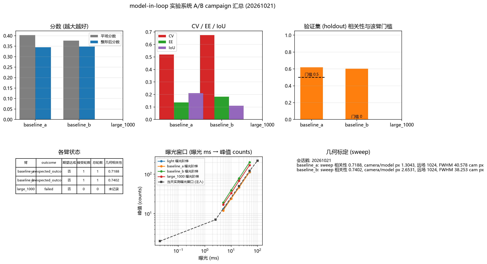
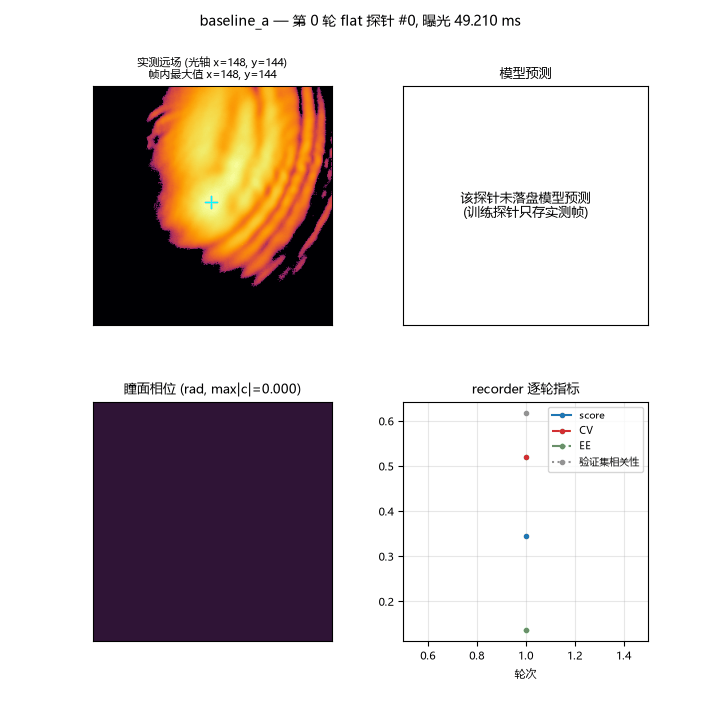
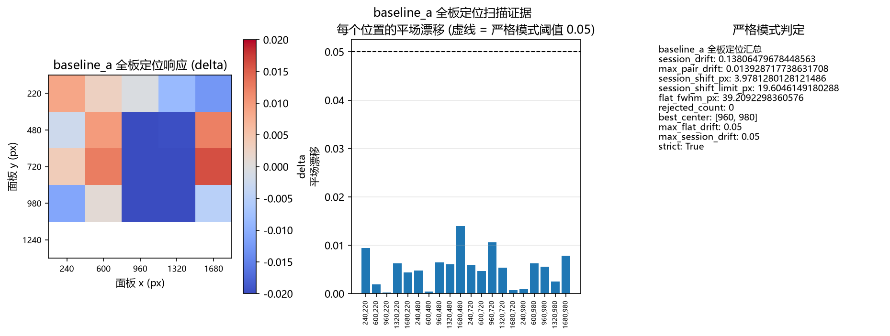
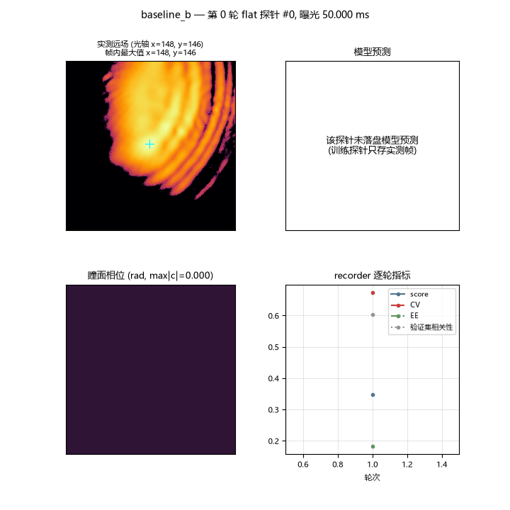
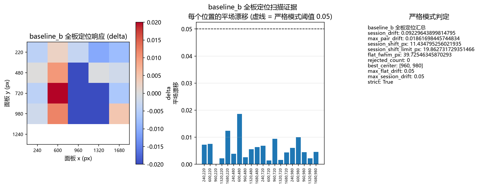
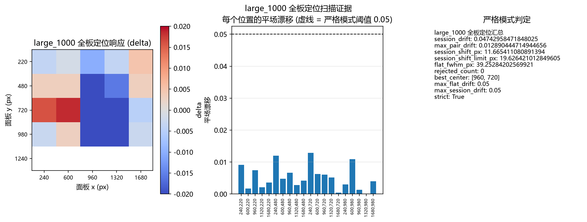

# model-in-loop 实验系统 A/B campaign 报告 (20261021)

<!-- provenance:start -->
> **生成脚本**: [`scripts/slm/generate_model_in_loop_hw_ab_report.py`](../../../scripts/slm/generate_model_in_loop_hw_ab_report.py)
> **复现命令**: `python scripts/slm/generate_model_in_loop_hw_ab_report.py --session data/debug/model_in_loop_hw_ab/20261021_172236 --stamp 20261021`
> **数据/关联脚本**: [`scripts/slm/model_in_loop_hw_ab.py`](../../../scripts/slm/model_in_loop_hw_ab.py)
> **数据/关联脚本**: [`scripts/slm/diagnose_light_level.py`](../../../scripts/slm/diagnose_light_level.py)
> **运行环境**: 离线+硬件
> **说明**: 2026-10-21 model-in-loop 实验系统 A/B campaign 的离线报告 (Santec #1 22030108 + 大恒 FJB24112232, 1064 nm)：验证集门槛不动 (0.5) vs 强制放开 (0) 两臂实测对比 —— 两臂结局相同 (bake_off_rejected, 整形未打赢平场) ⇒ **本轮验证集门槛不是限制项**, 10-19 那条「门槛按构造不可达」未被沿用; 含当天曝光窗口、sweep 几何标定 (相关性 0.7188)、全板定位扫描证据、逐臂实测探针与模型预测并排的 GIF, 以及三个拦路缺陷与处置 (曝光上限估计被噪声底毒化 / 全板定位严格模式在噪声底上误拒 / 驱动改曝光后的陈旧帧)
<!-- provenance:end -->

- 会话目录: `data/debug/model_in_loop_hw_ab/20261021_172236`（仓库根相对路径）
- 报告生成: `scripts/slm/generate_model_in_loop_hw_ab_report.py`（离线读盘）
- campaign 清单: `20261021_172236/manifest.json`（campaign_state = aborted）

## 1. 一句话结论

**各臂状态: baseline_a → bake_off_rejected；baseline_b → bake_off_rejected；实测验证集相关性 0.6182、0.6032，均未触发验证集门槛的中止；两臂的整形后分数都没有超过平场分数，因此两臂都走了对比择优的「保留平场」分支；另有 large_1000（failed） 没有写出 recorder 产物。结论: 本轮验证集门槛不是限制项 —— 两臂结局相同, 差别不在门槛上。**

## 2. 实验系统与当天实测

### 2.1 曝光窗口

相机的曝光范围与当天实测的曝光阶梯（曝光 ms → 峰值 counts）如下；会话内的阶梯直接来自各阶段的光照闸门 `light_level.json`。

| 闸门 | 曝光阶梯 | 判定 | 理由 |
|---|---|---|---|
| light | 5 ms→13、10 ms→24、20 ms→47、50 ms→113 | ok | 峰值 113/255, 动态范围 113 counts, 有可用信号 |
| baseline_a | 5 ms→12、10 ms→24、20 ms→46、50 ms→114 | ok | 峰值 114/255, 动态范围 114 counts, 有可用信号 |
| baseline_b | 5 ms→19、10 ms→39、20 ms→79、50 ms→201 | ok | 峰值 201/255, 动态范围 201 counts, 有可用信号 |
| large_1000 | 5 ms→17、10 ms→33、20 ms→68、50 ms→170 | ok | 峰值 170/255, 动态范围 170 counts, 有可用信号 |

当天实测的曝光窗口（由 `--exposure-ladder` 注入，采集脚本路径未记录）：0.02 ms→2 counts、2.56 ms→7 counts、20 ms→50 counts、50 ms→121 counts、100 ms→221 counts

曝光上限的坑见 §5.1：仓库自带的倍增阶梯在弱光下会被噪声底带偏，给出的上限比真实工作点低一个量级。

### 2.2 0 级位置与 FWHM

| 臂 | 0 级质心 (全传感器坐标) | FWHM | 标定的瞳面中心 (面板 px) |
|---|---|---|---|
| light | 1361.3,1027.6 | 42.4 px | 未记录 |
| baseline_a | 1361.2,1027.4 | 39.209 px (全板定位平场) | [960, 980] |
| baseline_b | 1363.5,1035.3 | 39.725 px (全板定位平场) | [960, 980] |
| large_1000 | 1363.5,1036.7 | 39.253 px (全板定位平场) | [960, 720] |

光照闸门的 0 级按**帧全局最大**（`argmax`）定位，不按相机几何中心 —— 这条光路的光轴与画幅中心不重合；而 MIL 各臂自己的帧用的是运行期**冻结的光轴**（`stage.log` 里的 `frozen ROI centre`），动画里的两个面板都按它对齐。

### 2.3 几何标定 (sweep)

| 臂 | 方法 | sweep 相关性 | camera/model px | 远场网格 | FWHM (cam px) | FWHM (model px) |
|---|---|---|---|---|---|---|
| baseline_a | sweep | 0.7188 | 1.3043 | 1024 | 40.578 | 8.638 |
| baseline_b | sweep | 0.7402 | 2.6531 | 1024 | 38.253 | 8.638 |
| large_1000 | 未记录 | 未记录 | 未记录 | 未记录 | 未记录 | 未记录 |

- **baseline_a** 标定备注: tilt slope 6.115 cam px/rad (x:-5.928, y:+6.303, via ['centroid (no usable phase correlation)']), semi-axis 64 model px, P=1024; physical tilt check 1.14x predicted; focal scale from ramp sweep (S=9391 cam px per 1/period, axis y), FOV cross-check 0.415 (215% apart); modes fitted astig_y+coma_x+coma_y+defocus; joint rel-RMS 28.1%; bench offsets astig_y +1.000, coma_x +5.000, coma_y +5.000, defocus +1.000 rad; curvatures astig_y 64.8, coma_x 601.7, coma_y 3206.9, defocus 154.2; defocus asymmetry -32%; waist NOT identifiable, flat-top default
- **baseline_b** 标定备注: tilt slope 6.746 cam px/rad (x:-6.692, y:+6.799, via ['centroid (no usable phase correlation)']), semi-axis 64 model px, P=1024; physical tilt check 1.26x predicted; focal scale from ramp sweep (S=19103 cam px per 1/period, axis x), FOV cross-check 0.415 (540% apart); modes fitted defocus; joint rel-RMS 26.0%; bench offsets defocus +0.000 rad; curvatures defocus 3322.5; defocus asymmetry +13%; waist NOT identifiable, flat-top default

注意：两臂的 `camera_px_per_model_px` 相差约一倍（见上表），而两臂的标定备注里 FOV 交叉核对都写着 FOV 与 ramp 尺度「相差数倍」—— 见 §4.1 与 §4.2，这条几何标定本身还没自洽。



## 3. 每臂的期望 vs 实测

| 臂 | 类别 | campaign 期望 | 实测 outcome | 期望达成 | status | 接受轮数 | 平场分数 | 整形后分数 | CV | EE | IoU |
|---|---|---|---|---|---|---|---|---|---|---|---|
| baseline_a | baseline_a | aborted_unidentifiable + holdout_forward_mismatch (the holdout gate keeps the phase out) | unexpected_outcome | 否 | bake_off_rejected | 1 | 0.4025 | 0.3451 | 0.5195 | 0.1365 | 0.2109 |
| baseline_b | baseline_b | completed + at least one accepted round + a recorded best phase | unexpected_outcome | 否 | bake_off_rejected | 1 | 0.3766 | 0.3486 | 0.6739 | 0.1827 | 0.1096 |
| large_1000 | large | completed + at least one accepted round + a recorded best phase | failed | 否 | 未记录 | 0 | 未记录 | 未记录 | 未记录 | 未记录 | 未记录 |

### 3.1 baseline_a 的记录

- campaign 备注: status=bake_off_rejected, holdout rejections=0
- 交接判定: `review_required`，门槛 phase_saved=通过, accepted_round=通过, cv=未通过, ee=未通过, iou=未通过, geometry=通过, holdout=通过, beats_flat=未通过
- 退出码: 0





### 3.2 baseline_b 的记录

- campaign 备注: status=bake_off_rejected, accepted rounds=1, best phase=yes
- 交接判定: `review_required`，门槛 phase_saved=通过, accepted_round=通过, cv=未通过, ee=未通过, iou=未通过, geometry=通过, holdout=通过, beats_flat=未通过
- 退出码: 0





### 3.3 large_1000 的记录

- campaign 备注: the runner exited with code 1 and recorded no summary
- 退出码: 1
- runner 的错误行: `Error: session geometry rejected; evidence in D:\Projects\TIFO\AO-shaping\data\debug\model_in_loop_hw_ab\20261021_172236\large_1000\debug\slm_model_in_loop\20261021_180653: Command '['D:\\Projects\\TIFO\\AO-shaping\\.venv\\Scripts\\python.exe', 'D:\\Projects\\TIFO\\AO-shaping\\scripts\\slm\\model_in_loop_hw_runbook.py', '--out', 'D:\\Projects\\TIFO\\AO-shaping\\data\\debug\\model_in_loop_hw_ab\\20261021_172236\\large_1000\\debug\\slm_model_in_loop\\20261021_180653\\session_geometry', '--pupil-center', '960,720', '--region', '128', '--far-field-size', '1024', '--collect-disc', '450', '--zernike-radius', '450', '--slm-number', '1', '--slm-wavelength', '1064', '--cam-type', 'daheng', '--cam-id', '0', '--exposure-ms', '20', '--stage', 'sweep']' returned non-zero exit status 1.`



## 4. A/B 的结论

| 臂 | 验证集门槛 | status | 接受轮数 | 总轮数 | 验证集相关性 | 平场分数 | 整形后分数 | CV | EE | IoU | recorder 状态 |
|---|---|---|---|---|---|---|---|---|---|---|---|
| baseline_a | 0.5000 | bake_off_rejected | 1 | 1 | 0.6182 | 0.4025 | 0.3451 | 0.5195 | 0.1365 | 0.2109 | bake_off_rejected |
| baseline_b | 0.0000 | bake_off_rejected | 1 | 1 | 0.6032 | 0.3766 | 0.3486 | 0.6739 | 0.1827 | 0.1096 | bake_off_rejected |

- **A 臂（门槛不动, 0.5）并没有被门槛拦住**: 实测验证集相关性 0.6182 ≥ 门槛 0.5，于是这一轮被接受。
- B 臂把门槛强制放开到 0.0000，实测验证集相关性 0.6032 —— 两臂实测的相关性在同一量级，门槛的取值并没有改变任何一臂的判定。
- **两臂的 recorder 状态相同**（`bake_off_rejected`），接受的轮数也相同 ⇒ **本轮验证集门槛不是限制项**: 把门槛从 0.5 放开到 0 没有改变结局, 真正的差别不在门槛上。
- 两臂都以「整形后分数没有超过平场分数」收场（对比择优保留平场），所以这一轮 A/B 并没有产生一个可用于比较整形效果的样本。

### 4.1 两臂真正的差别（都在几何标定上）

| 臂 | sweep 相关性 | camera/model px | FWHM (cam px) | 瞳面中心 | 平场漂移 |
|---|---|---|---|---|---|
| baseline_a | 0.7188 | 1.3043 | 40.578 | [960, 980] | 0.1381 |
| baseline_b | 0.7402 | 2.6531 | 38.253 | [960, 980] | 0.0923 |

### 4.2 数字之外的读法

- 两臂的 `camera_px_per_model_px` 相差约一倍（见上表），而两臂的标定备注都写着 FOV 交叉核对「与 ramp 尺度相差数倍」。这说明**几何标定本身还没有自洽**，任何依赖绝对尺度的比较（EE、CV 的绝对值、模型与实测的逐像素对齐）都带着这个不确定性。
- 两臂的 `cv` 都超过了 campaign 记的 `max_cv=0.5`，`ee` 与 `iou` 都没到 `min_ee=0.4` / `min_iou=0.5`；两臂的交接判定都是 `review_required`。
- 因此本轮 A/B 能支持的结论只有一条: **门槛的取值没有改变结局**；「门槛是否是瓶颈」这个问题要等几何标定自洽、整形后分数能超过平场分数之后才能再问。

## 5. 过程中撞到的拦路缺陷与处置

本会话前后，同一台实验系统当天的 campaign 尝试撞到过几个拦路缺陷；它们决定了本会话为什么长这样，因此一并记录，证据路径逐条给出。

### 5.1 曝光上限估计被噪声底毒化

- 现象: `Daheng exposure ceiling probed from the image: 2.0655 ms (last safe 2.5600 ms, saturated at never)` —— 倍增阶梯从未看到饱和，于是把上限判成 2.0655 ms，比实际工作点低一个量级。
- 后果: 随后的采集立刻被拒: `Error: panel scan rejected; ... unsafe Daheng exposure readback: 20.0 ms (ceiling 2.0655 ms)`。
- 根因: 探测上限时画面上只有杂散光/噪声底（当天的光照闸门给出的理由正是「整体偏平 (std 小) —— 可能全部是杂散光而非 0 级」），读出噪声量级被当成了信号。
- 证据路径:
  - `data/debug/model_in_loop_hw_ab/20261021_164549/baseline_a/stage.log`（上限探测 + 拒绝）
  - `data/debug/model_in_loop_hw_ab/20261021_170435/baseline_a/stage.log`（同因复现）
  - `data/debug/model_in_loop_hw_ab/20261021_164549/manifest.json`（light 阶段记下「可能全部是杂散光而非 0 级」）
- 处置: 本会话改由光照闸门先确认 0 级到达相机，再进入采集；
  会话内各阶段的光照闸门都给出「峰值 113/255 ~ 201/255，有可用信号」。

### 5.2 全板定位的严格模式在噪声底上误拒

- 现象: `panel (960, 980): flat reference drift 2.0% exceeds 2.0%` —— 漂移恰好压在严格模式的阈值上；同一行的该位置随后读出 `+nan`。
- 后果: `Error: panel scan rejected; ...: 1 panel candidates rejected by flat drift`，该臂连几何标定都没开始。
- 证据路径:
  - `data/debug/model_in_loop_hw_ab/20261021_170646/baseline_a/stage.log`（漂移告警 + 拒绝）
  - `data/debug/model_in_loop_hw_ab/20261021_170646/baseline_a/slm_model_in_loop/20261021_170726/panel_scan/summary.json`（`rejected_count: 1`）
  - `data/debug/model_in_loop_hw_ab/20261021_170646/manifest.json`（该臂 outcome = failed）
- 处置: 本会话的全板定位都过了严格模式（baseline_a rejected_count=0、baseline_b rejected_count=0、large_1000 rejected_count=0），标定图见 §3 与 §6.3。

### 5.3 驱动改曝光后的陈旧帧

- 现象: 每换一个曝光，驱动的第一帧读回是**上一次曝光的陈旧帧**；本会话里曝光在 49.21 ms → 27.065 ms → 45.188 ms 之间来回换。
- 处置（已在代码里）: 采集走 `capture_settled` 丢弃若干帧，并在稳定帧之后**另做一次 CCD 读回**作为曝光判据；落盘产物里 `frame` 是按 0.02 ms 参考曝光归一化后的帧，`raw_frame` 是那次单独读回的原始帧。
- 证据路径:
  - 各臂 `probes/manifest.json` 的 `frame_reference_exposure_ms: 0.02` 与 `raw_frame_note: "separate CCD read after the settled frame"`
  - 各臂 `stage.log` 里的 `CCD exposure ... ms, peak ...% of full scale` 行
  - 实现: `src/ao_shaping/optimizer/wfless/slm_model_in_loop.py`（`measure()` 里的稳定帧 + 单独读回 + 曝光判据）

### 5.4 SLM 内存写入的 USB 错误（-10032）断了大面积臂

- 现象: 大面积臂（`large_1000`）在会话几何 sweep 阶段写 SLM 内存时抛 `SantecError: 写入相位数据到内存#30失败 (错误码: -10032, USB其他错误)`，sweep 子进程以退出码 1 结束，于是该臂既没有几何也没有 recorder 产物。
- 后果: campaign 在该臂上中止（`campaign_state: aborted`），大面积臂只留下全板定位与 sweep 的部分帧。
- 证据路径:
  - `data/debug/model_in_loop_hw_ab/20261021_172236/large_1000/stage.log`（驱动异常栈 + `Error: session geometry rejected`）
  - `data/debug/model_in_loop_hw_ab/20261021_172236/manifest.json`（该臂 exit_code = 1, outcome = failed）
  - 驱动侧: `src/ao_shaping/drivers/slm/santec/driver.py::_write_to_memory`（错误码 -10032 的抛出处）

### 5.5 其它当天的读数

- 全板定位报告的照明半径是 `radius_px: 0.0`（`radius_source: scan_fall_width`，`radius_uncertainty_px: 120.0`）—— 面板照明没有被测到，所以瞳面中心只能用扫描的中心点（`centre_panel_px: [960, 980]`），不能用实测照明边缘 —— 证据在各臂 `illumination_radius/slm1_*.json`。

## 6. 证据索引

### 6.1 会话与阶段

| 对象 | 相对会话目录 | 日志 / 备注 |
|---|---|---|
| 会话目录 | `20261021_172236/` |  |
| 阶段 `light` | `20261021_172236/light.log` | `20261021_172236/light/` |
| 阶段 `baseline_a` | `baseline_a/` | `baseline_a/stage.log` |
| 阶段 `baseline_a` 的运行目录 | `baseline_a/slm_model_in_loop/20261021_172309/` |  |
| 阶段 `baseline_b` | `baseline_b/` | `baseline_b/stage.log` |
| 阶段 `baseline_b` 的运行目录 | `baseline_b/slm_model_in_loop/20261021_174455/` |  |
| 阶段 `large_1000` | `large_1000/` | `large_1000/stage.log` |
| 阶段 `large_1000` 的运行目录 | `large_1000/slm_model_in_loop/20261021_180653/` |  |

### 6.2 recorder 产物

| 臂 | recorder 产物 |
|---|---|
| baseline_a | `bench_geometry.json`, `best_far_field.png`, `best_phase.npy`, `handoff_summary.json`, `run_config.json`, `slm_model_in_loop_20261021_172309.json`, `slm_model_in_loop_20261021_172309.pkl`, `slm_model_in_loop_20261021_172309.png`, `slm_model_in_loop_20261021_174434.csv` |
| baseline_b | `bench_geometry.json`, `best_far_field.png`, `best_phase.npy`, `handoff_summary.json`, `run_config.json`, `slm_model_in_loop_20261021_174455.json`, `slm_model_in_loop_20261021_174455.pkl`, `slm_model_in_loop_20261021_174455.png`, `slm_model_in_loop_20261021_180624.csv` |
| large_1000 | `run_config.json` |

### 6.3 图

| 图 | 说明 |
|---|---|
| `figures/20261021_mil_inverse_baseline_a.gif` | baseline_a 的实测探针 × 模型预测推进动画: 15 帧, 720×720 px, 8.2 s（锚点: 冻结光轴 (stage.log 的 frozen ROI centre)） |
| `figures/20261021_mil_inverse_baseline_b.gif` | baseline_b 的实测探针 × 模型预测推进动画: 15 帧, 720×720 px, 8.2 s（锚点: 冻结光轴 (stage.log 的 frozen ROI centre)） |
| `figures/20261021_hw_ab_summary.png` | 各臂关键指标对比 + 曝光窗口 + 几何标定 |
| `figures/20261021_panel_scan_baseline_a.png` | baseline_a 全板定位扫描的响应图与平场漂移 |
| `figures/20261021_panel_scan_baseline_b.png` | baseline_b 全板定位扫描的响应图与平场漂移 |
| `figures/20261021_panel_scan_large_1000.png` | large_1000 全板定位扫描的响应图与平场漂移 |

### 6.4 生成方式

```bash
python scripts/slm/generate_model_in_loop_hw_ab_report.py --session data/debug/model_in_loop_hw_ab/20261021_172236 --stamp 20261021
```

本报告完全离线：从已落盘的 campaign 产物读盘渲染，不打开任何设备。
