# Model-in-loop 匀化权重与重拟合实验对照（2026-10-16）

<!-- provenance:start -->
> **生成脚本**: 人工撰写，无生成脚本
> **数据/关联脚本**: [`scripts/slm/check_flat_stability.py`](../../../scripts/slm/check_flat_stability.py)
> **数据/关联脚本**: [`scripts/slm/replay_model_in_loop_config.py`](../../../scripts/slm/replay_model_in_loop_config.py)
> **数据/关联脚本**: [`scripts/slm/generate_shape_trial_profiles.py`](../../../scripts/slm/generate_shape_trial_profiles.py)
> **数据/关联脚本**: [`src/ao_shaping/tools/slm/model_in_loop_replay.py`](../../../src/ao_shaping/tools/slm/model_in_loop_replay.py)
> **运行环境**: 离线+硬件
> **说明**: 2026-10-16 物理预测模型闭环 Step B 匀化权重与 Step A 重拟合消融 (SLM 22030108 + 大恒 FJB24112232, 1064 nm，另有 CPU 仿真)；提高 Step B 均匀度权重未改善方斑 (固定 0.200 ms 交错重放平均 CV 0.8027 升至 0.8989、EE 0.6919 降至 0.5177)，Step A=0 只有有代价的小幅 CV 趋势 (CV 0.8028 降至 0.7887，同时 EE 0.7071 降至 0.5888)，两者均被复合质量分拒绝；结论为保留默认 Step A=80 与 0.4/0.6 权重
<!-- provenance:end -->

## 实验目的

前两轮把"形状没做成"的原因归到**光路/几何**上（入射位置、传播几何、漂移）。
本轮换一个方向：**假设光路已足够好，瓶颈在算法的两个超参上**，于是做两项
单因子消融：

1. **Step B 的匀化/能量权重**：默认 `CV/EE = 0.4/0.6`（偏重能量）。若框内
   不均匀的主因是目标函数**不追求均匀**，把权重翻到 `0.8/0.2` 应显著降 CV。
   反之若 CV 上升，说明**均匀度与能量存在真实权衡**，而非目标函数没调对。
2. **Step A 的重拟合步数**：默认 Step A = 80 步（更新 Zernike 系数）。若像差
   校准这一步在**帮倒忙**（把真实像差也学成了"要补偿的对象"），则
   `Step A = 0` 步（只拟合增益 + 加性背景，不更新系数）应给出更干净的
   Step B 起点。

两项都是**只改一个旋钮**的对照，且都要求**同曝光交错重放**才能把"参数效应"
与"会话漂移"分开——上一轮已证明单会话最好值不可信（选择偏差大于效应）。

本轮同时是**负结果的价值锚**：若两项消融都不能改善，瓶颈就回到光路/几何/
物理缺失（散斑、相位分辨率），而不是继续调参。

## 结论

本次提高 Step B 均匀度权重 **没有改善**实验方斑：权重从 `CV/EE=0.4/0.6`
改为 `0.8/0.2` 后，固定 0.200 ms 交错重放的平均 CV 从 **0.8027 升到
0.8989**，EE 从 **0.6919 降到 0.5177**。因此保留原默认权重。

`Step A=0`（仍采训练探针，仍拟合模型增益与加性背景（杂散光）项，但不更新 Zernike
系数）在两次顺序互换的交错重放中，相对 `Step A=80` 的平均 CV 从约
**0.8028 降到 0.7887**；平均 EE 同时从约 **0.7071 降到 0.5888**。
这是有代价的小幅 CV 趋势，不能称为更好的整体方形整形；零步候选在原运行的
复合分 对比择优 中被正确拒绝。两组相位并非仅一个标量参数变化：各自的 Step B
在不同模型系数/增益上重新优化，所以也不能把全部 CV 差归因于 Step A 本身。

## 会话检查与方法

先在固定 0.020 ms 做三次平相采集，固定 ROI 能量依次为
10,208、10,181、10,147.5，极差约为均值的 0.60%，零级约在全帧
`(1330, 962)`。数据：`data/debug/slm_flat_stability/20261016_model_in_loop_preflight/`。
会话平场探测上限最初为 **0.243 ms**，后续各次为 0.2174–0.243 ms；
没有沿用前一天配置中的 0.4 ms。上限只属于本次光路和功率状态。

三次 model-in-loop 运行均为方形 60 CCD px、64 模型网格、600 次 Step B、
8 个同种子训练探针、2 个验证集探针、4 帧评估、同一历史几何文件与面板中心
`(960,600)`。历史几何文件记录相关性 0.8376；**本次没有重新独立测量
几何相关性**。运行期间平场自动选择约 0.155 ms，探针和成形相位被限制在
当次探测上限；不能把不同曝光下的原始亮度直接比较。

| 运行 | Step A | CV/EE 权重 | 运行中 CCD CV | 运行中 EE | 验证集相关性 | 成形预测相关性 |
| --- | ---: | ---: | ---: | ---: | ---: | ---: |
| `20261016_1041_uniformity_baseline` | 80 | 0.4/0.6 | 0.7630 | 0.6733 | 0.7689 | 0.7545 |
| `20261016_1042_uniformity_weighted` | 80 | 0.8/0.2 | 0.9570 | 0.5855 | 0.7617 | 0.7164 |
| `20261016_1048_zero_refit` | 0 | 0.4/0.6 | 0.7705 | 0.5523 | 0.7308 | 0.7809 |

运行目录均在 `data/debug/slm_model_in_loop/` 下，包含配置、原始/归一化
探针帧、相位、UTC 微秒时间戳、曝光回读、CSV/PKL。零步运行的
`best_phase.npy` 因 对比择优 拒绝而是**平相位**；重放的真实零步成形候选
从该运行的 `probes/round_01_shaped_00.npz` 提取，保存于
`20261016_1048_zero_refit/rejected_shaped_candidate/`，没有拿平相位冒充候选。

## 同曝光交错重放

三次重放都使用 `flat,A,B,flat,B,A,flat`，成形相位回读均为固定
**0.200 ms**，平相位为固定 0.100 ms。CV/EE 仅在**同曝光的成形相位之间**
比较；平相位只用于检查漂移。各运行独立重新探测曝光上限，重放时为
0.2174–0.2295 ms。目标框、冻结光轴、相机 ROI、SLM 面板和扰动配置一致。

| 对照 | A 的 CV（两次） | B 的 CV（两次） | A 的 EE（两次） | B 的 EE（两次） | 数据目录 |
| --- | --- | --- | --- | --- | --- |
| 默认权重 A / 高 CV 权重 B | 0.8018, 0.8036 | 0.8942, 0.9037 | 0.6899, 0.6940 | 0.5184, 0.5171 | `slm_model_in_loop_replay/20261016_1044_uniformity_weights/` |
| 80 步 A / 零步 B | 0.8021, 0.8029 | 0.7770, 0.7955 | 0.7065, 0.7174 | 0.5919, 0.5867 | `slm_model_in_loop_replay/20261016_1051_refit_steps/` |
| 零步 A / 80 步 B（逆序） | 0.7893, 0.7932 | 0.8033, 0.8030 | 0.5945, 0.5821 | 0.7005, 0.7038 | `slm_model_in_loop_replay/20261016_1053_refit_steps_reverse/` |

## 相位与远场图像

以下为三次交错重放中 A/B 两种成形相位的 SLM 相位图（包装到 [0, 2π)，`twilight` 色图）与对应 CCD 远场图像（`inferno` 色图，青色虚线框为 target 区域，边长 60 像素，中心 `(127, 126)`）。相位来自各自源运行的 `best_phase.npy`；远场为重放时采集的原始 CCD 帧，已归一化到 [0, 1]。

### `20261016_1044_uniformity_weights`（默认权重 A / 高 CV 权重 B）

| | A 相位 | A 远场 | B 相位 | B 远场 | X/Y 光强截面 |
|---|---|---|---|---|---|
| 第一次 | {width=150} | {width=150} | 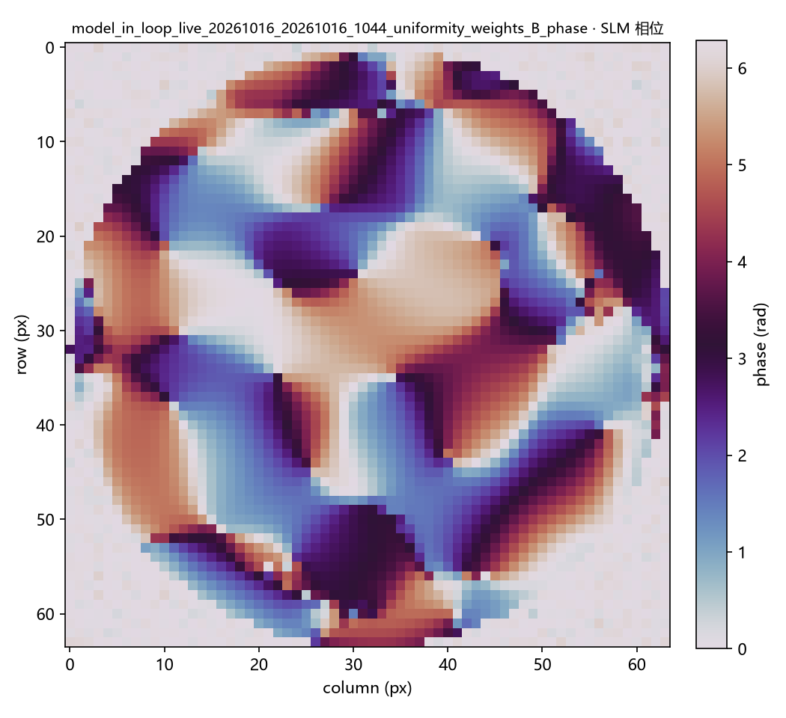{width=150} | 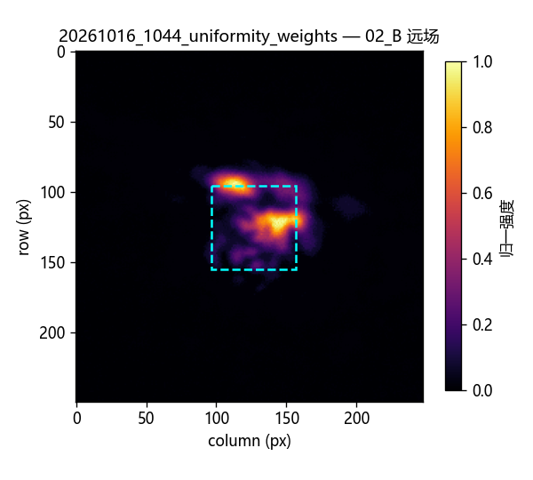{width=150} | A: 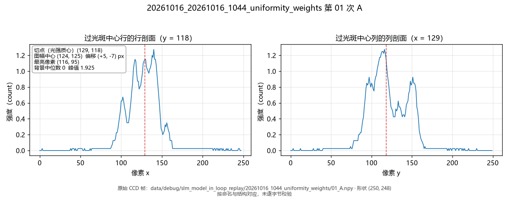{width=320} B: 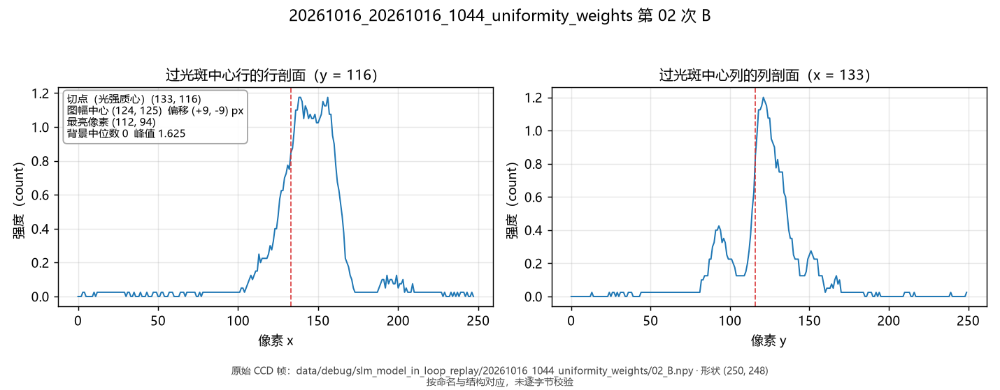{width=320} |
| 第二次 | {width=150} | {width=150} | {width=150} | 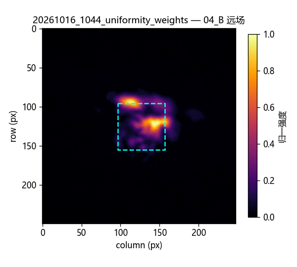{width=150} | A: 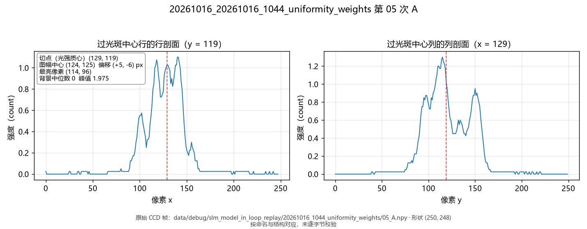{width=320} B: 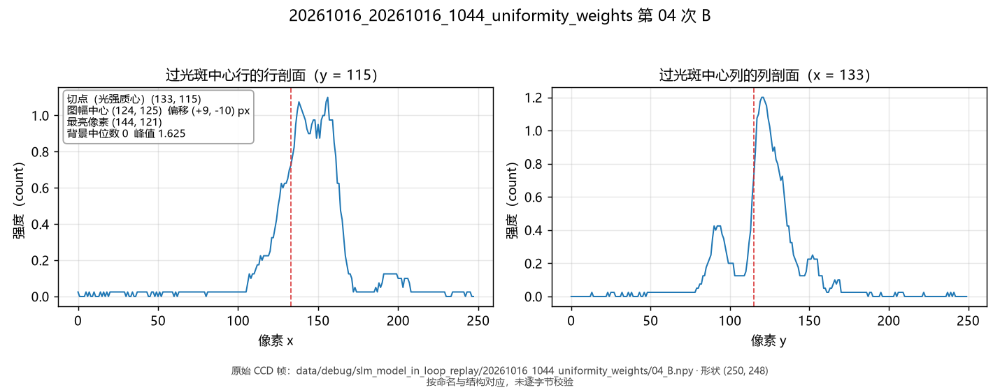{width=320} |

| 状态 | target 内能量占比 (EE_in_target) | target 均匀度 RMS | 报告 CV | 报告 EE |
|---|---|---|---|---|
| A 第一次 (01_A) | 0.6899 | 0.8018 | 0.8018 | 0.6899 |
| B 第一次 (02_B) | 0.5184 | 0.8942 | 0.8942 | 0.5184 |
| A 第二次 (05_A) | 0.6940 | 0.8036 | 0.8036 | 0.6940 |
| B 第二次 (04_B) | 0.5171 | 0.9037 | 0.9037 | 0.5171 |

### `20261016_1051_refit_steps`（80 步 A / 零步 B）

| | A 相位 | A 远场 | B 相位 | B 远场 | X/Y 光强截面 |
|---|---|---|---|---|---|
| 第一次 | 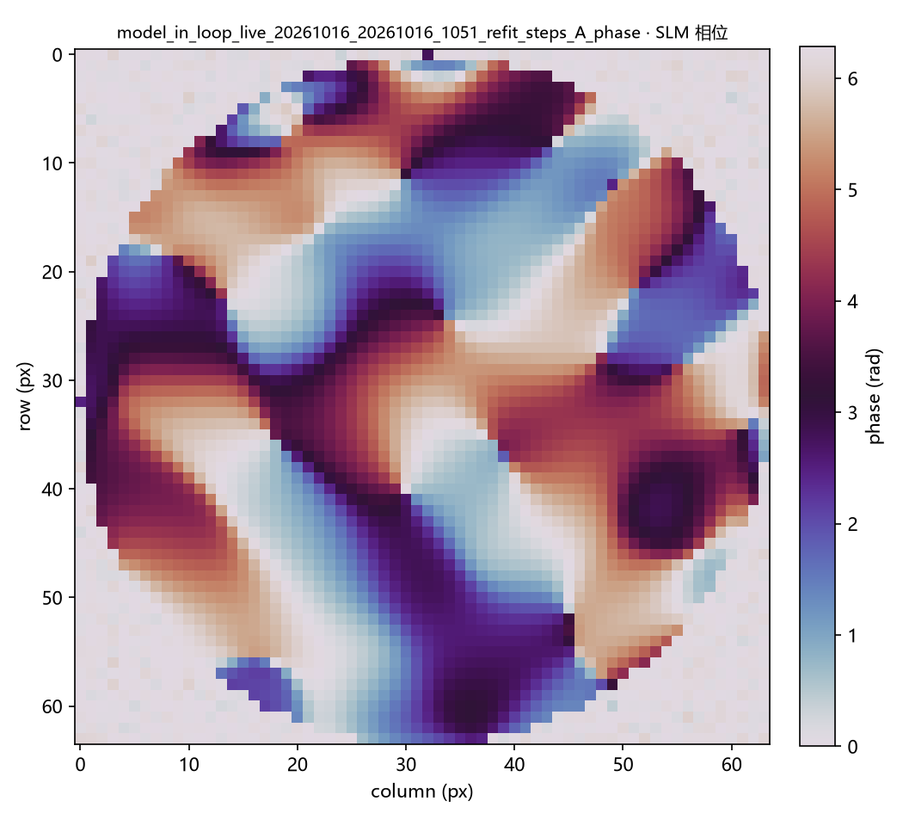{width=150} | {width=150} | {width=150} | 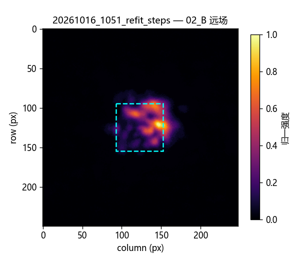{width=150} | A: 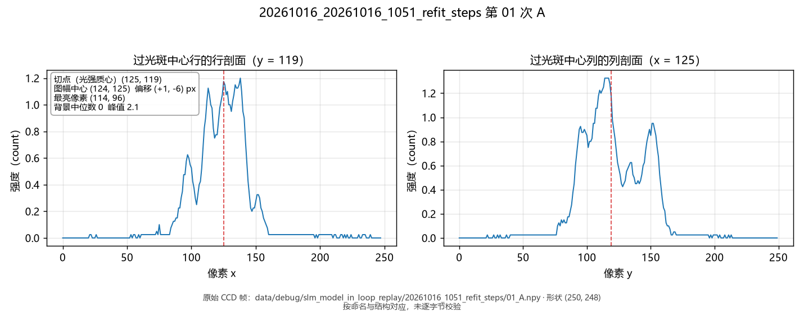{width=320} B: 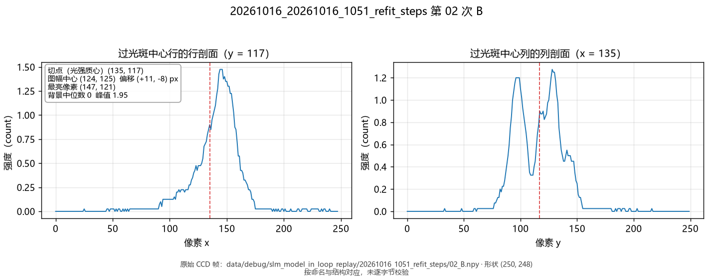{width=320} |
| 第二次 | {width=150} | 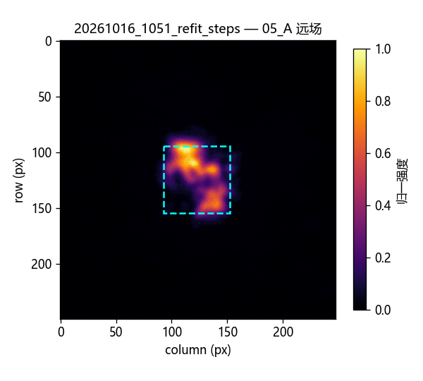{width=150} | {width=150} | 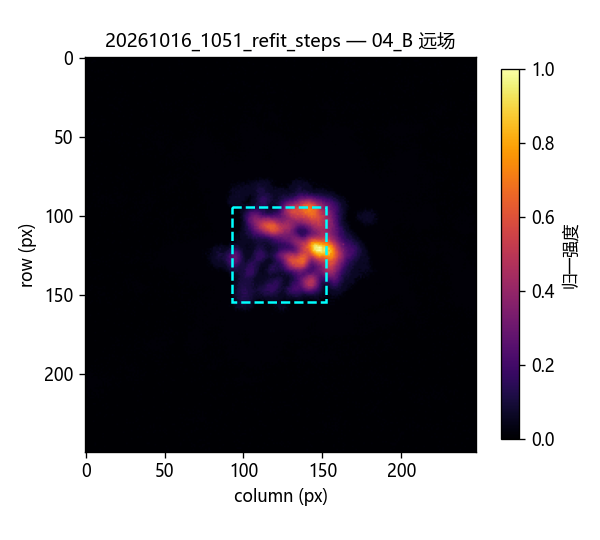{width=150} | A: 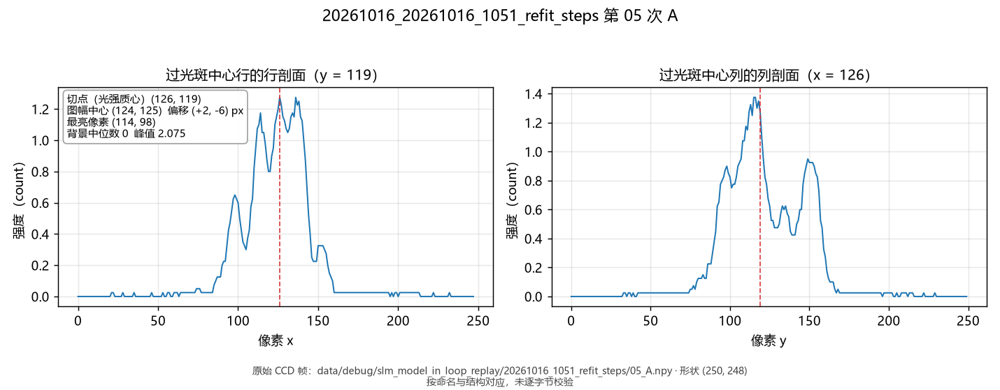{width=320} B: 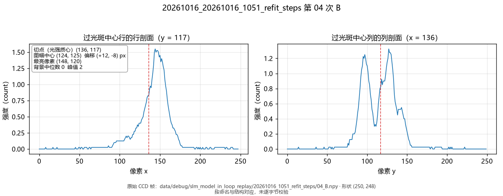{width=320} |

| 状态 | target 内能量占比 (EE_in_target) | target 均匀度 RMS | 报告 CV | 报告 EE |
|---|---|---|---|---|
| A 第一次 (01_A) | 0.7065 | 0.8021 | 0.8021 | 0.7065 |
| B 第一次 (02_B) | 0.5919 | 0.7770 | 0.7770 | 0.5919 |
| A 第二次 (05_A) | 0.7174 | 0.8029 | 0.8029 | 0.7174 |
| B 第二次 (04_B) | 0.5867 | 0.7955 | 0.7955 | 0.5867 |

### `20261016_1053_refit_steps_reverse`（零步 A / 80 步 B，逆序）

| | A 相位 | A 远场 | B 相位 | B 远场 | X/Y 光强截面 |
|---|---|---|---|---|---|
| 第一次 | 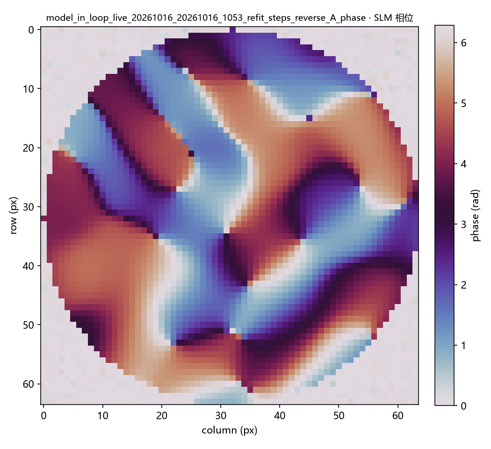{width=150} | 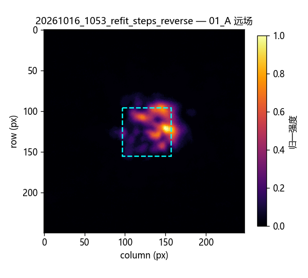{width=150} | {width=150} | {width=150} | A: 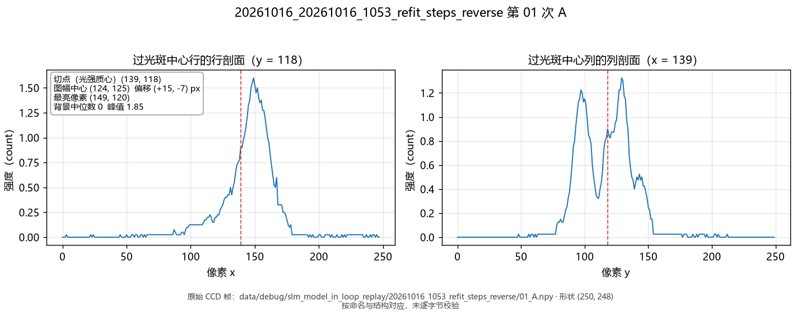{width=320} B: 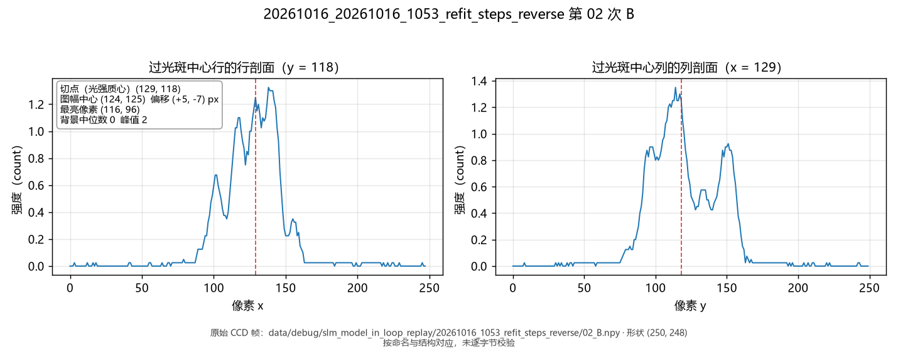{width=320} |
| 第二次 | {width=150} | {width=150} | {width=150} | 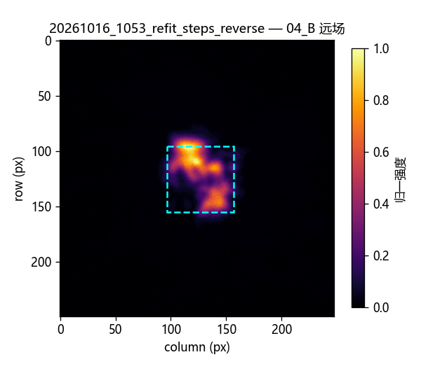{width=150} | A: 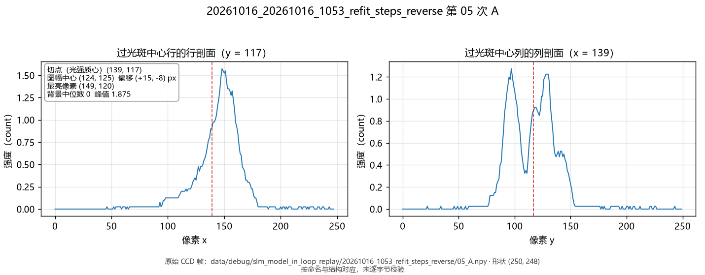{width=320} B: 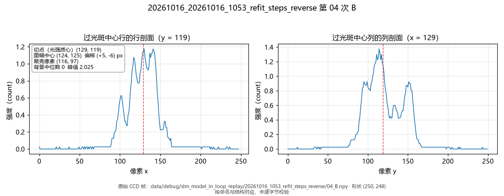{width=320} |

| 状态 | target 内能量占比 (EE_in_target) | target 均匀度 RMS | 报告 CV | 报告 EE |
|---|---|---|---|---|
| A 第一次 (01_A) | 0.5945 | 0.7893 | 0.7893 | 0.5945 |
| B 第一次 (02_B) | 0.7005 | 0.8033 | 0.8033 | 0.7005 |
| A 第二次 (05_A) | 0.5821 | 0.7932 | 0.7932 | 0.5821 |
| B 第二次 (04_B) | 0.7038 | 0.8030 | 0.8030 | 0.7038 |

三张表的 `X/Y 光强截面` 列取自上述交错重放采集到的原始 CCD 帧，而非渲染后的远场图。口径：X 剖面为过光斑中心行的行剖面（光强对像素 x），Y 剖面为过光斑中心列的列剖面（光强对像素 y）；切点取光强质心（`prepare_frame` 扣除背景中位数后的质心），不是假定的图幅中心。每格按该行实际采集的那一帧给出 A、B 两条剖面，`01_A` 与 `05_A`、`02_B` 与 `04_B` 是两次不同采集，不可互换。

所有成形帧原始峰值仅约 **17–22/255**，未饱和但低计数噪声和未完成的
短曝光辐射线性化会影响 CV 的绝对值。两次零步对照的平场总强度分别漂移
约 4.04% 和 2.95%（极差/均值），小于约 11.8 个百分点的 EE 差，
但与 0.014 的 CV 差相比不可忽略。上述数字是本会话的描述性结果，
不应跨曝光、跨日直接合并。

## 曝光策略与 PR #148

已合并的 PR #148 (`feat/136-daheng-ceiling-dedup`) 把各调用点的“显式上限 →
`AO_DAHENG_MAX_EXPOSURE_MS` → 画面探测”收敛为一个解析器，这比八处分散
探测更容易保持一致；它仍然只针对 Daheng，也没有改变优化循环逐相位
调整曝光的行为。按 2026-10-16 用户确认，估计值**可以高于最后实测档**，
以适应不同光路；有设备硬件上限时最终使用值仍须受该上限约束。

推荐的相机无关运行策略是：通过公共相机接口读写曝光并读取实际回读、
从原始像素 dtype/有效位深计算饱和率；在每个光路会话开始时探测安全档，
在参与同一模型拟合、梯度差分或相位排名的帧之间冻结曝光。如果出现
饱和、欠曝或光功率阶跃，暂停当前比较、重新探测并建立新基线。
`曝光归一化 = 原始计数 × 参考曝光/实测曝光` 只有在该相机和该曝光段
经独立单调/线性验证后才能替代同曝光采集。用户给出的环境变量上限是
会话配置；当前统一解析器按显式值优先于环境变量的约定工作。相机的
硬件最大曝光范围不是光路安全上限。

## 下一步

1. 由硬件 CLI 的自动会话流程重测面板入射位置、曝光和传播几何，并以独立
   全频随机相位验证物理预测模型，避免用历史相关性作为本日标定结论。当前
   60 CCD 像素目标只对应约 7 个模型像素，后续同时检查目标采样是否
   限制了匀化自由度。
2. 在模型候选相位上接入小预算 CCD 反馈微调，以**目标框 CV 为主目标、
   EE 下限为约束**；先离线仿真，再在固定曝光下做相位交错验收。此前
   GS 的纯 CV 闭环有实验小幅改善，但不能直接移植其数值超参数。
3. 继续保存未归一化原始帧与实际曝光；在不饱和且信号更强的光路状态
   复测短曝光响应，再决定是否允许不同曝光档的数据共同拟合模型。

本轮未更改生产优化器的默认权重或 Step A 默认更新数，也未声称已形成
均匀实心方斑。

## 本次交接收尾

按设备另作他用的要求，本次交接停止实验操作；未打开相机、未向 SLM 下发
新相位，也未新增 CCD 帧。因此上文的方形对照仍是本报告最后一组实验
结果，不能据此推断长方形、三角形或五角星的当前光路表现。多形状实验与
独立全频随机相位验证保留为后续任务，恢复时应由自动会话流程重新测量当次
入射位置、曝光与几何，并逐形状记录原始帧、相位、曝光回读和轮廓指标。

本次仅暂存此交接记录；工作区已有的 GUI、runner、驱动和测试改动属于
并行工作，未纳入本次暂存。
