# 相机位置调整后的物理预测模型校正与多形状整形（2026-10-19）

<!-- provenance:start -->
> **生成脚本**: 人工撰写，无生成脚本
> **数据/关联脚本**: [`scripts/slm/model_in_loop_auto.py`](../../../scripts/slm/model_in_loop_auto.py)
> **数据/关联脚本**: [`scripts/slm/model_in_loop_hw_runbook.py`](../../../scripts/slm/model_in_loop_hw_runbook.py)
> **数据/关联脚本**: [`scripts/slm/generate_shape_trial_profiles.py`](../../../scripts/slm/generate_shape_trial_profiles.py)
> **运行环境**: 离线+硬件
> **说明**: 2026-10-19 相机位置调整后物理预测模型校正与多形状整形 (Santec #1 22030108 + 大恒 FJB24112232, 1064 nm)：聚焦/彗差组合校正使 FWHM 47.23→13.75 px、平均镜像误差改善约 30.4%；新几何标准相位族验证集相关性约 0.78–0.87，但全频随机相位验证集仅约 0.11–0.28 未过门槛，矩形/三角形/五角星均未通过独立模型门槛，无匀化验收结论；文内两张原标题为「X/Y 光强截面」的表实为相位与远场图，已由 generate_shape_trial_profiles.py 从记录的原始 CCD 帧补出真正的X/Y 光强截面（切点为扣背景后的光强质心）
<!-- provenance:end -->

## 实验目的

前一轮（2026-10-16）把"形状没做成"归到光路/几何与算法超参上，两项消融都未改善。
本轮换了一个更强的假设：**相机位置被调整过，光路本身变了**，此前标定的几何与
入射振幅可能已不成立。于是本轮要依次回答：

1. **新光路下还能不能定位到面板入射、还能不能测出传播几何？**（§09:41–§09:48）
   —— 若不能，后续一切比较都无从谈起。
2. **实验系统常驻的聚焦误差能不能补上？** 相机移位后若光斑离焦，实测
   平场 FWHM 会远大于理论值，且平场本身呈**环形**。本轮用双向焦度探针 +
   两个面板轴的彗差探针做**组合校正**（§10:23）。
3. **组合校正后，物理预测模型对全频随机相位还预测得准吗？** 标准相位族（平滑 +
   Zernike）若能过门槛而全频随机相位过不了，说明**模型缺的是相位族覆盖**，
   而非模型本身错（§11:04–§11:21）。
4. **多形状整形能否验收？** 矩形/三角形/五角星三个目标各走一遍 Step A/B，
   看是否有任何形状达到可验收水平（§10:34、§11:04）。

本轮的时间线按**实际发生顺序**记录（每节带 UTC 时刻），因为中途出现过
光路调整导致面板宽扫作废（§10:23 之前的 §09:48）。

## 09:41 开始：设备发现与当前会话探测

用户已确认释放相机。受限进程内 `gxipy.DeviceManager().update_device_list()` 返回
`(0, [])`；同一 SDK 在沙箱外枚举到 Daheng `MER2-507-23GM NIR`，序列号
`FJB24112232`，地址 `192.168.0.11`，访问状态 `1`。因此此前的枚举失败
不能作为相机离线的证据。本轮实验进程在能发现设备的环境中运行。

自动入口 `scripts/slm/model_in_loop_auto.py` 已补充子进程的 `src`、`libs`
导入路径，保留原有 `PYTHONPATH`；对应离线测试 5 项通过。
本轮配置和控制台日志位于
`data/debug/model_in_loop_auto/20261019_camera_reposition/`，目标为矩形，
配置宽度 60 相机像素，模型网格 128，padding 8，1 轮闭环，seed 19。
不输入历史几何文件，当前光路重新定位、探测曝光和测量几何。

真实设备打开成功：Santec #1 控制器 `22030108`，1064 nm，内存显示模式；
CCD 全帧尺寸 `2592×1944`。本次画面探测得到曝光上限 `2.0655 ms`；
这是当前光路的测量值。初始平相位参考峰值 `14/255`，FWHM `61.6 px`，
质心约 `(1365.8,1021.0)`，与此前会话不同，后续指标不能直接跨会话比较。

此前仅作了一组不保存数据的最小离线检查，确认四种形状可通过现有可微函数
执行前向及反向传播。96 网格、尺寸 32、120 步、seed 17 的模型内结果为：

| 目标 | CV | EE | IoU |
| --- | ---: | ---: | ---: |
| 方形 | 0.9078 | 0.7753 | 0.0551 |
| 矩形 | 0.9669 | 0.7845 | 0.0463 |
| 三角形 | 1.0103 | 0.8450 | 0.1031 |
| 五角星 | 1.0417 | 0.8538 | 0.1362 |

这些值只说明短迭代预算下形状仍未充分形成，不是新光路上的整形结果。
本轮结论以实验 CCD、独立相位验证集预测和固定曝光复测为准。后续结果按时间追加。

## 09:48：全板入射定位完成，开始新几何测量

5×4 扫描选中面板中心 `(960,720)`。第三行 `(960,720)` 的配对能量变化
约为 `-0.350`，相邻 `(1320,720)` 约为 `-0.282`；前两行响应明显较弱。
20 个位置均未因配对漂移而被剔除，最大配对平场强度漂移
`1.1986832844446581%`，整轮强度漂移 `8.007665086345209%`。
后者只作报告量，定位使用逐点前后平场归一化。

整轮质心位移 `10.530695183028293 px`，参考 FWHM
`41.24371054190905 px`，当前流程的 FWHM 比例判据上限为
`20.621855270954526 px`，因此定位阶段通过。位移虽通过门槛，仍需在
后续预测及整形验收中关注；不能把通过定位视作整个实验系统没有漂移。
证据：`data/debug/slm_model_in_loop/20261019_094121/panel_scan/`。

定位进程释放设备后，自动启动几何扫描；重新打开设备成功，曝光自动探测
仍返回 `2.0655 ms`。此阶段平相位参考峰值 `13/255`，FWHM
`38.4 px`，质心 `(1368.8,1032.4)`。截至本节记录时，几何扫描仍在采集，
尚无物理预测模型验证集验证或目标整形结论。

## 10:04：曝光初始化修复与首轮矩形结果

几何扫描得到 55 个测量点，宽度响应拟合相关系数
`0.8811449970024858`，相机/模型尺度 `2.614022035287756`。
但相位斜坡尺度与独立视场估计相差约 `530%`，照明束腰不可辨识，
因此该相关系数不能代替独立相位的图像预测验证。

首次进入优化器时，Daheng 自动模式在探测完范围后重新使用 `0.020 ms`，
导致低计数全帧触发零级光斑不可检测。初始化现改为调用共享
`working_exposure_ms`，从当前探测范围确定起始曝光并考虑设备最小曝光，
保留显式配置优先级。相关模型与曝光单元测试共 145 项通过。
复测复用本次扫描所得几何和面板中心，成功进入 Step A/B。

复测目录 `data/debug/slm_model_in_loop/20261019_100334/`：

| 阶段 | CV | EE | IoU |
| --- | ---: | ---: | ---: |
| 基线 | 0.3997529820668537 | 0.1541370195457368 | 未记录 |
| 1 轮后 | 0.4545879812255449 | 0.14369992795333472 | 0.2924242424242424 |

虽然旧验收流程将该轮标记为 accepted，实际 CV 和 EE 均变差，不能作为匀化成功。
同一批原始验证集 CCD 的离线对照中，零像差模型相关性约 `0.5388`，
短程拟合后约 `0.5419`，提高有限。此次未采集全频随机相位验证集样本，
不支持对全频随机相位泛化的结论。精确逐样本结果见该目录的 `refit_comparison.json`。

### 首轮矩形 SLM 相位与远场图

首轮矩形运行 `20261019_100334` 的 SLM 相位与 CCD 远场图像如下：

| SLM 相位 | CCD 远场 | X/Y 光强截面 |
|----------|----------|--------------|
| 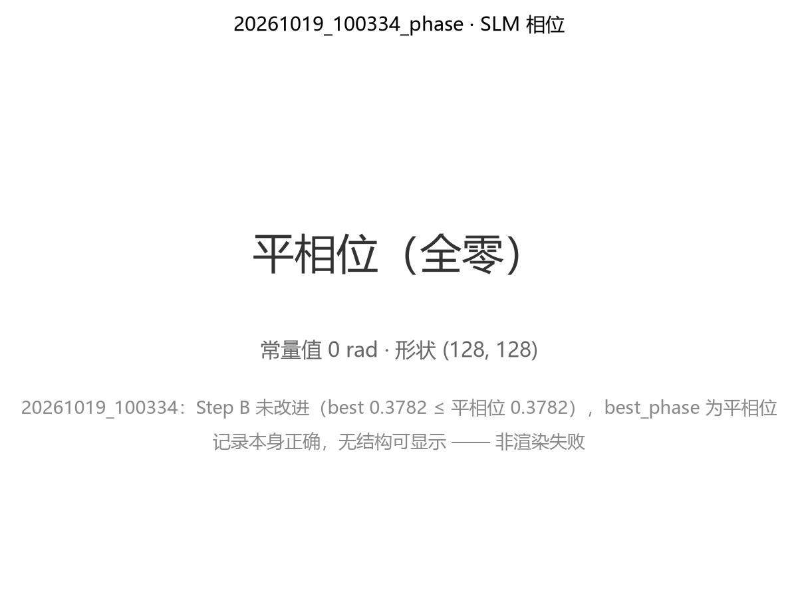{width=150} | {width=150} | 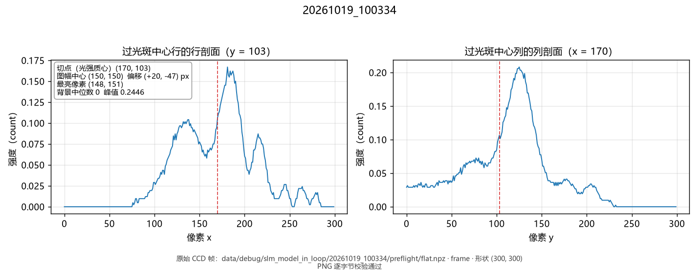{width=320} |

相位图显示 SLM 上下发的相位，远场图显示相应的 CCD 相机图像。从图中可以看到光斑相对集中，但尚未形成理想的均匀方斑形状。

> **本页相位图为平相位，不是渲染失败。** 本页六张相位图（`20261019_100334` 及下方两张
> 多形状表）对应的运行都在 Step B 之前被验证集门槛拒绝，`best_phase.npy` 因此是全零数组，
> 没有任何结构可画。图已改为显式标注「平相位（全零）」并附该次运行的拒绝数据，
> 避免一张纯色块被误读成出图故障。相位图不携带本轮任何整形信息；本轮结论一律以
> 验证集相关性与远场指标为准。

X/Y 光强截面取自该次运行记录的原始 CCD 帧，而非上面渲染后的图。口径：X 剖面为过光斑中心行的行剖面，Y 剖面为过光斑中心列的列剖面；切点取光强质心（`prepare_frame` 扣除背景中位数后的质心），不是假定的图幅中心。

## 10:23：聚焦与两个彗差方向扫描

按用户建议新增可复用工具
`ao_shaping.tools.slm.panel.alignment_probe`，直接调用已有 Fresnel 焦度扫描及规范
Zernike 相位生成函数。单幅宽度不用于推断离焦正负；采用双向焦度探针、边界扩展
和局部细化。彗差通过两个面板轴的 `(3,-1)`、`(3,1)` 模式逐轴探测，
在重新估计局部强度质心后，比较左右及上下镜像误差。

本次使用面板中心 `(960,720)`、半径 `450 px`，原始证据保存在
`data/debug/alignment_probe/20261019_focus_coma/`。设备读出的曝光范围
`0.02–1000.0 ms` 用于此次自适应曝光；每个候选均另行判断可测区间。

| 项目 | 平相位 | 聚焦后 |
| --- | ---: | ---: |
| 峰值/曝光（counts/ms） | 11.867511827166469 | 460.7376387592614 |
| FWHM（px） | 47.23371801277261 | 13.747441906842653 |

最佳校正焦度 `+0.644356158432213 m⁻¹`，SLM 等效焦距
`1551.9367463377803 mm`，峰值/曝光比增益 `38.82344045401039`。
半曝光线性复测比 `1.0283400809716599`，通过 `0.8–1.2` 的本次检查。
该等效焦距不能直接换算为相机轴向位移。

在聚焦相位上叠加 `(3,-1)=+0.75 rad`、`(3,1)=0 rad` 后：

| 项目 | 聚焦基线 | 聚焦加彗差校正 |
| --- | ---: | ---: |
| 左右镜像误差 | 0.12529358038941768 | 0.08832385604463151 |
| 上下镜像误差 | 0.11287399816797482 | 0.06971803725457132 |
| 平均镜像误差 | 0.11908378927869626 | 0.07902094664960141 |
| RMS 半径（px） | 10.260935101485272 | 9.040047416439414 |

此处是有限扫描范围内的可用校正，不是唯一物理像差反演；另一方向的零系数
只表示本次扫描未保留非零候选，不能据此断言光路无该方向彗差。
原始相位保持未包裹弧度，并由驱动统一转换。探测结束恢复平相位。

## 10:30：固定曝光交替重放与中心重复性

新工具的 `--verify-directory` 模式复用校正文件，固定实际曝光
`0.242 ms`，三组相位重放按正序/逆序交替，每次稳定后平均 3 帧。
独立证据：`data/debug/alignment_probe/20261019_focus_coma_verify/`。

| 指标 | 聚焦相位，均值 ± 样本标准差 | 聚焦加彗差相位，均值 ± 样本标准差 |
| --- | ---: | ---: |
| 平均镜像误差 | 0.12565426361709073 ± 0.0004603288421158255 | 0.08748262117984544 ± 0.0004230386194027703 |
| RMS 半径（px） | 10.553446350492244 ± 0.012867178286811724 | 9.180193751484294 ± 0.026473444169151636 |
| 中心 x（px） | 1399.9457343465126 ± 0.032779840371804675 | 1395.0839917125047 ± 0.0502423497623486 |
| 中心 y（px） | 971.0792797752797 ± 0.06740940826264609 | 969.9201649423194 ± 0.04588633051052684 |

不对称度改善约 `30.4%`，并且没有以增加光斑半径为代价。
组合校正后的中心可稳定重复测量；这里没有绝对位置参考，不能将重复性等同于
绝对定位准确度。相位校正使中心发生真实变化，后续必须重新定位，不能沿用平相位中心。

## 10:34：组合校正下的多形状模型验证

使用现有显式相位叠加接口 `--phase-disturbance-file` 加载组合校正，
使其在基线、训练和验证集探针中均生效；此次用该接口传输已知校正，未添加随机干扰。
沿用本次未校正状态的几何仅作诊断，并由独立验证集验证决定是否允许 Step B。
每组为 8 个训练探针、3 个独立验证集探针，seed 19，目标尺寸 60 相机像素，
纯均匀度目标 `w_uniformity=1`、`w_efficiency=0`。

| 目标 | 数据目录末级 | 验证集平均相关性 | 结果 |
| --- | --- | ---: | --- |
| 矩形 | `20261019_103208` | 0.39179945967321644 | 拒绝 Step B |
| 三角形 | `20261019_103259` | 0.4054942991569767 | 拒绝 Step B |
| 五角星 | `20261019_103347` | 0.41172875411904375 | 拒绝 Step B |

以上目录均位于 `data/debug/slm_model_in_loop/`。三组都低于相关性门槛
`0.5`，没有生成可验收的目标整形结果；基线 CV/EE 不能冒充优化后的指标。
聚焦与对称性改善确已测得，但尚未证明 model-in-loop 的匀化效果得到改善。

### 五种形状远场 X/Y 光强截面

新几何下的多形状运行，远场强度在 X、Y 方向上的光强截面如下：

| 形状 | 运行目录 | SLM 相位 | CCD 远场 | X/Y 光强截面 |
|------|----------|----------|----------|--------------|
| 矩形 | `20261019_103208` | {width=100} | {width=150} | 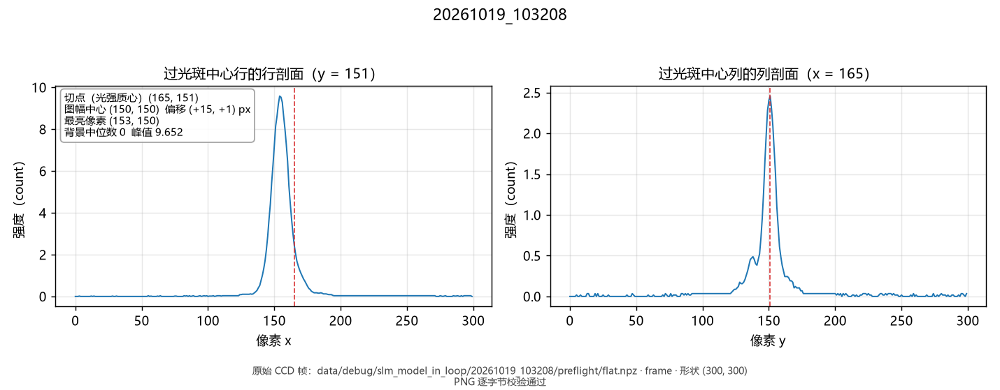{width=320} |
| 三角形 | `20261019_103259` | {width=100} | 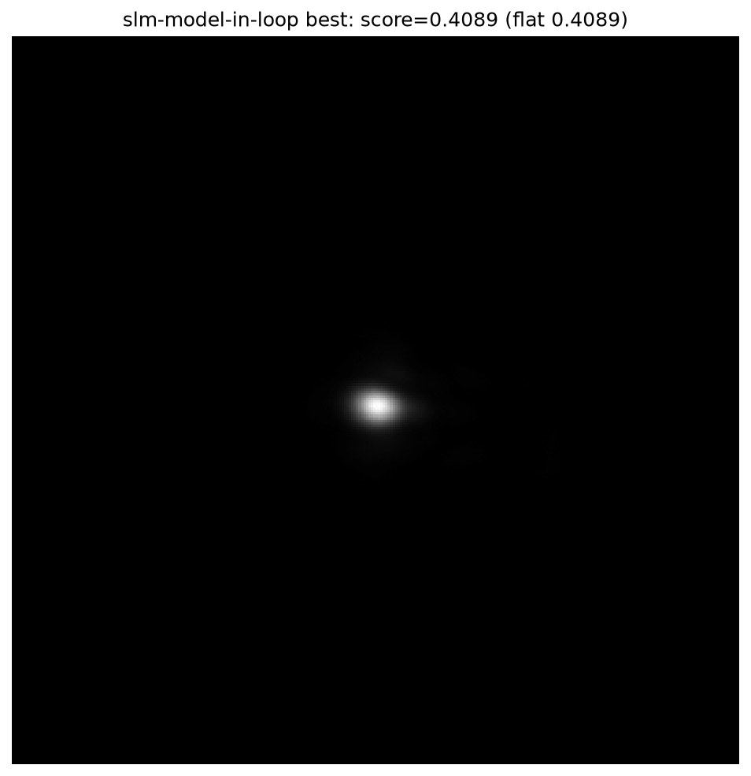{width=150} | 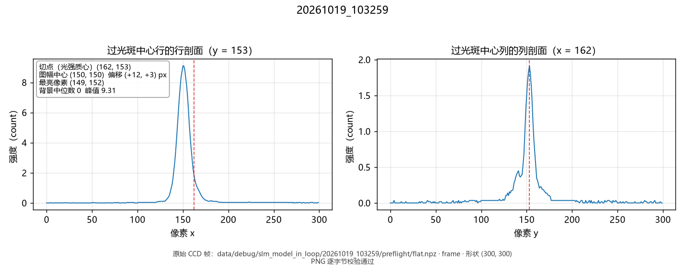{width=320} |
| 五角星 | `20261019_103347` | {width=100} | 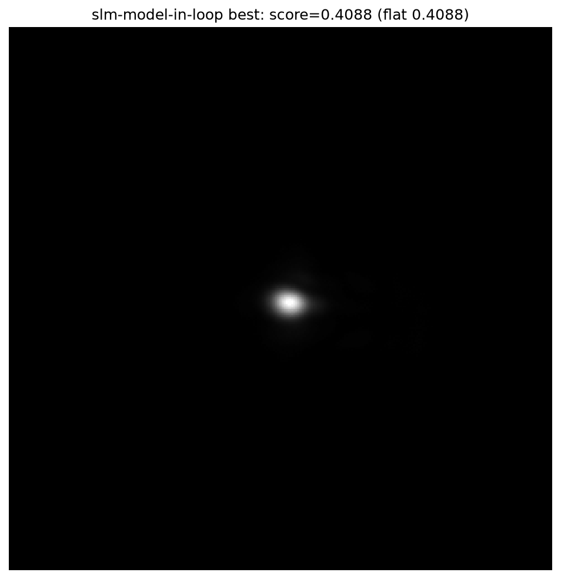{width=150} | 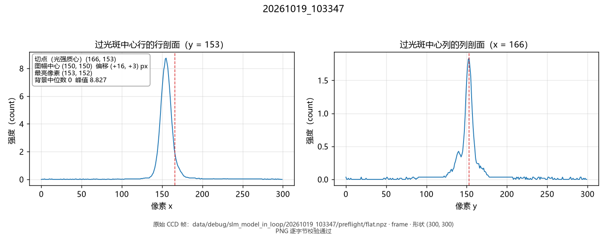{width=320} |

X/Y 光强截面取自该次运行记录的原始 CCD 帧，而非上表渲染后的图。口径：X 剖面为过光斑中心行的行剖面，Y 剖面为过光斑中心列的列剖面；切点取光强质心（`prepare_frame` 扣除背景中位数后的质心），不是假定的图幅中心。

下一步应在组合校正始终叠加的条件下重新测量照明范围和传播几何，再用多相位族
独立验证集数据验证物理预测模型；不能降低验证集门槛强行进入目标合成。
操作方法、数据说明及适用边界见 `docs/slm/slm_alignment_probe.md`。

## 11:01：保持组合校正的几何重测

继续目标整形任务，新增几何扫描参数 `--phase-offset-file`，确保曝光探测、
参考相位、斜坡和所有 Zernike 探针始终叠加相同的组合校正。
自动会话几何入口也传递配置中的 `phase_disturbance_file`。记录保存实际显示的总相位，
补充 PKL 字符串时间戳字段的输出，相关扫描与会话测试 46 项通过。

新实验数据为
`data/debug/model_in_loop_hw_runbook/20261019_corrected_geometry/`，
标准 Recorder 数据为 `data/debug/model_in_loop_hw_sweep/20261019_105952/`。
固定曝光 `0.1 ms`，55 个扫描点。校正参考 FWHM
`13.190511654144814 px`，相机/模型尺度改为 `1.046721266686389`；
与未校正状态的 `2.614022035287756` 有明显差异。
两个倾斜轴斜率分别约 `-5.136`、`+5.330 cam px/rad`，
物理倾斜检查比 `0.98`，但视场尺度交叉检查仍相差约 `152%`，
束腰仍不可辨识。宽度响应拟合相关系数 `0.8475606214115755`，
仅作几何诊断指标，后续仍必须通过独立相位图像预测验证。

随后开始用新几何采集 16 个训练探针、4 个 Zernike 验证集及 2 个全频随机相位验证集，
尝试低参数像差模型校正与矩形整形。此时尚无该次优化的结果。

## 11:04–11:21：新几何下的泛化、采样与信号强度对照

补充说明：上一节的“4 个 Zernike 验证集”是当时记录的简写；实际标准验证集包含
2 个平滑相位及 2 个 Zernike 相位，另外有 2 个全频随机相位。三次运行均使用
16 个训练探针、seed 23、Step A 200 步、系数信赖域 5 rad，保持组合校正及新几何。
该参数用于诊断，不作为其他光路的默认推荐。

| 配置与目录末级 | 平滑验证集 1 / 2 相关性 | Zernike 验证集 1 / 2 相关性 | 全频随机相位验证集 1 / 2 相关性 | 全部均值（约） |
| --- | --- | --- | --- | ---: |
| 1× 采样，`20261019_110323` | 0.8735195103270142 / 0.8362722191958367 | 0.8293974378600828 / 0.7808163310657726 | 0.10809744720463046 / 0.11287290523199307 | 0.5902 |
| 2× 采样，`20261019_111359` | 0.8617445358624598 / 0.838271278068364 | 0.8369779660572005 / 0.7839305166156176 | 0.1769400162703657 / 0.18637662300709912 | 0.6140 |
| 2× 采样、提高信号，`20261019_111941` | 0.8619686452957025 / 0.8459317812140393 | 0.843371046810663 / 0.7822954593466529 | 0.24067471296295845 / 0.2765470863645751 | 0.6418 |

### 新几何下的远场图与SLM相位图

新几何下的三次运行，远场强度在 X、Y 方向上的光强截面如下：

| 目标 | 运行目录 | SLM 相位 | CCD 远场 | X/Y 光强截面 |
|------|----------|----------|----------|--------------|
| 矩形 | `20261019_110323` | 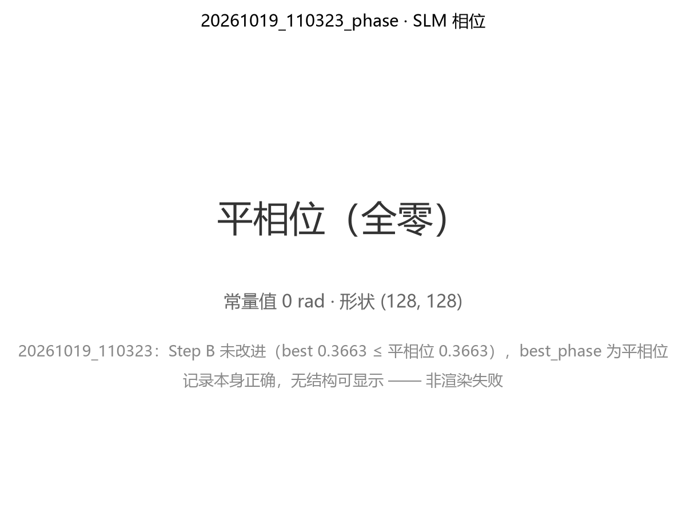{width=100} | 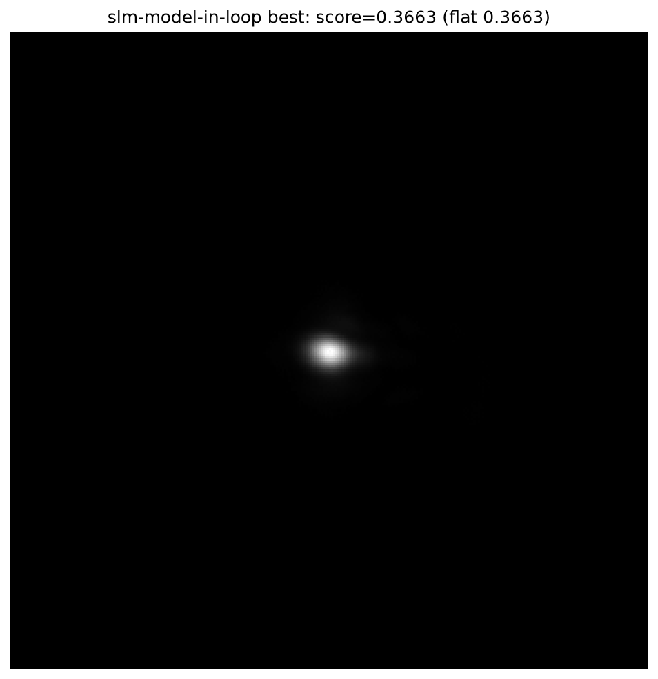{width=150} | 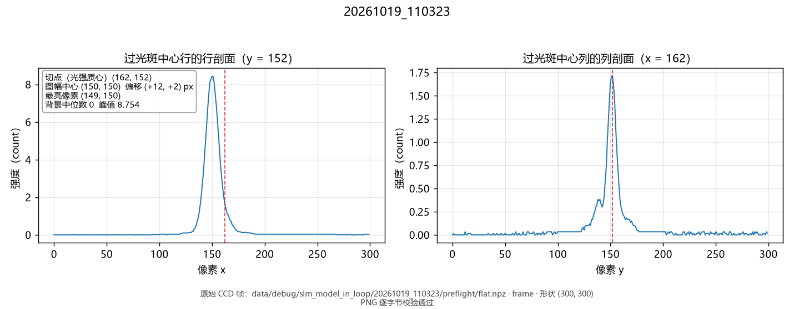{width=320} |
| 三角形 | `20261019_111359` | 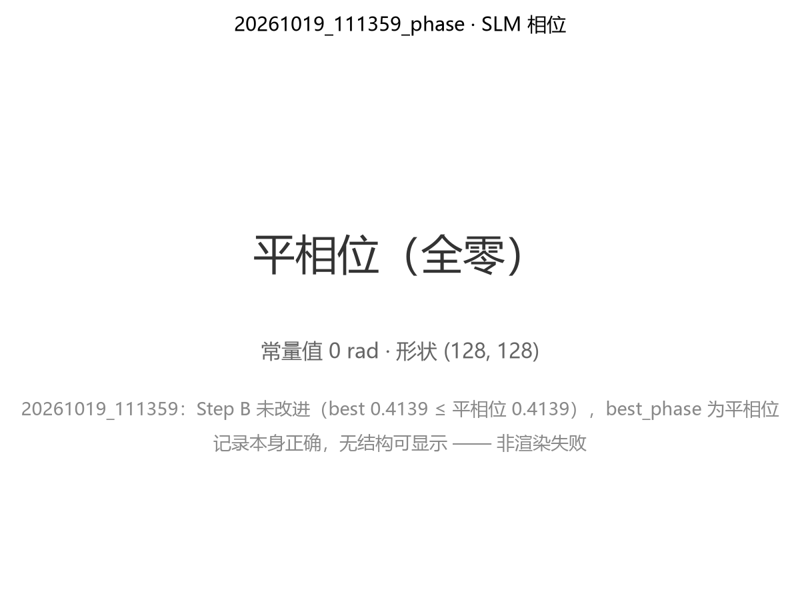{width=100} | 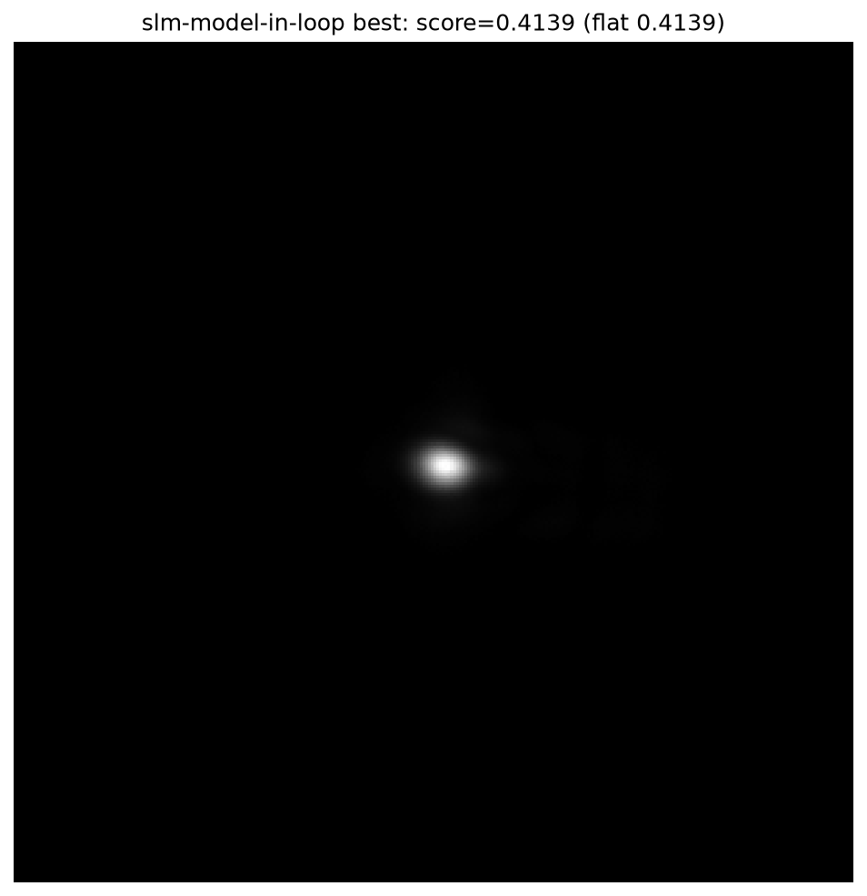{width=150} | 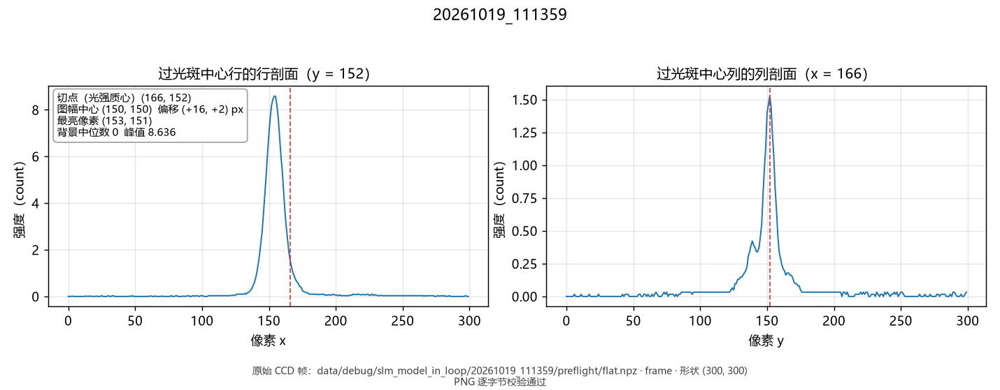{width=320} |
| 五角星 | `20261019_111941` | 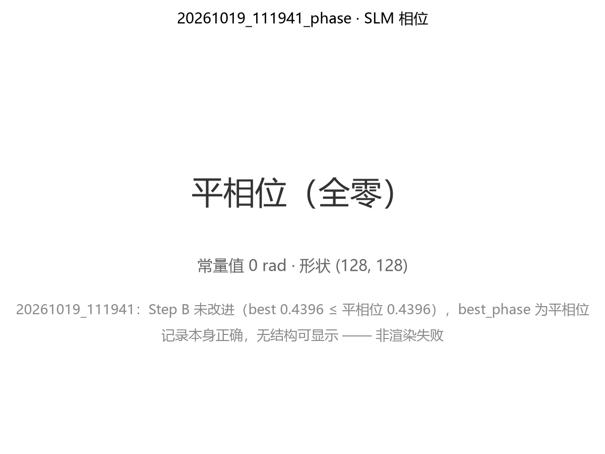{width=100} | 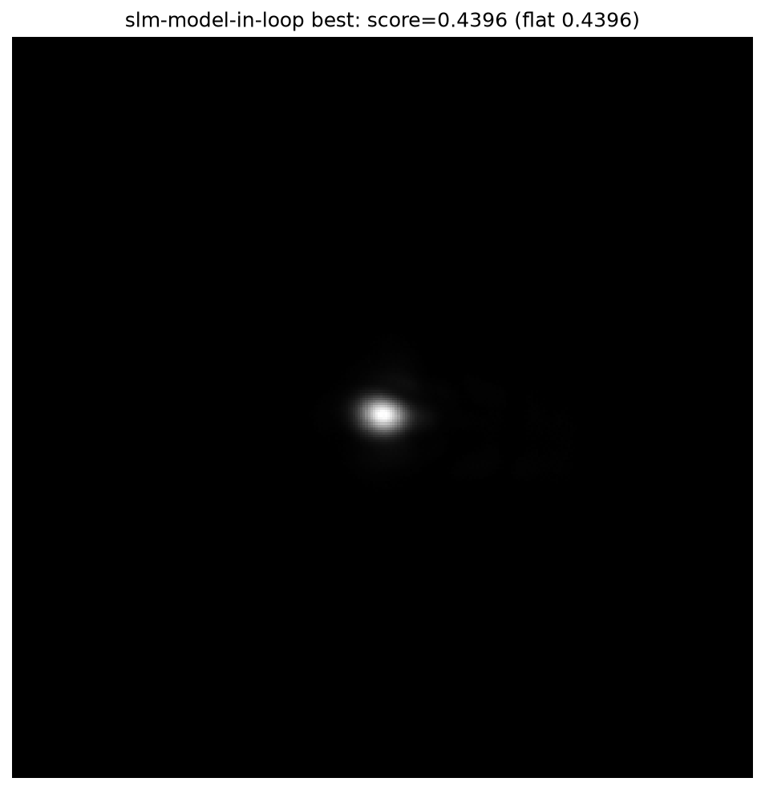{width=150} | 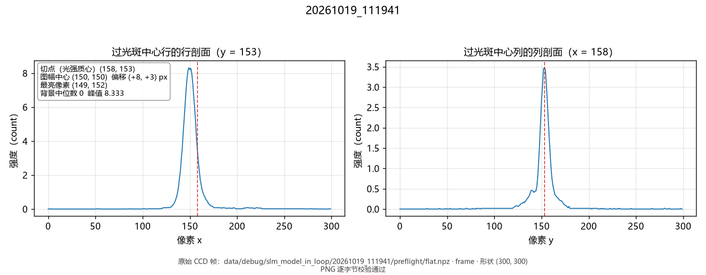{width=320} |

X/Y 光强截面取自该次运行记录的原始 CCD 帧，而非上表渲染后的图。口径：X 剖面为过光斑中心行的行剖面，Y 剖面为过光斑中心列的列剖面；切点取光强质心（`prepare_frame` 扣除背景中位数后的质心），不是假定的图幅中心。

目录均在 `data/debug/slm_model_in_loop/` 下。前两次工作曝光约 `0.344 ms`、
`0.375 ms`；2× 采样时部分探针峰值只有满量程的约 `3.9–5.9%`。
第三次以 `0.1 ms` 起始，当前会话显式上限 `20 ms`，标准探针实际曝光约
`2.845–5.174 ms`、峰值约 `53–86%`；全频随机相位达到 `20 ms` 仍只有约
`9.8–12.2%`。该上限只适用于此次诊断，不是新增永久限制。

三次运行的全频随机相位均低于逐样本相关性门槛 `0.5`，状态为
`aborted_unidentifiable`，未进入可验收的 Step B 整形。全部平均值超过门槛不能
覆盖全频随机相位失败；输出的 `best_phase.npy` 和图像可能只是保留的基线/已验证状态。
被拒绝运行的 `fitted_coefficients.npy` 为已接受状态，本次系数范数为零，
不能把它误认作拒绝前的拟合最优系数再做模型效果结论。

这些运行采用相同相位族、种子及几何，但分别采集了新 CCD 帧，
不是同一帧上的严格单变量实验。采样和信号改善后全频随机相位相关性提高，
仍不能据此认定已解决传播模型失配。局部聚焦的半曝光线性检查
也不能证明此次全部 `2.845–20 ms` 曝光范围线性。

## 收尾结论：已验证、部分支持与尚未验证

| 发现 | 证据与结论边界 |
| --- | --- |
| 当前光路存在可补偿的聚焦误差 | FWHM `47.23371801277261 -> 13.747441906842653 px`，峰值/曝光增益 `38.82344045401039`；不能直接换算相机轴向位移 |
| 聚焦后彗差方向探针有实际作用 | 固定 `0.242 ms` 三组交替重放，平均镜像误差 `0.12565426361709073 -> 0.08748262117984544`，约改善 `30.4%`，RMS 半径同时降低 |
| 校正后中心重复性改善了定位可用性 | 当前中心约 `(1395.0839917125047,969.9201649423194)`，样本标准差约 `(0.0502423497623486,0.04588633051052684) px`；无绝对位置参考 |
| 聚焦前几何不能直接用于聚焦后 | 相机/模型尺度 `2.614022035287756 -> 1.046721266686389`；重测仍有尺度交叉检查冲突与束腰不可辨识 |
| 新几何改善了标准相位族预测 | 标准验证集相关性约 `0.78–0.87`；全频随机相位仍仅约 `0.11–0.28`，不可宣称复杂相位泛化成功 |
| 增加采样和信号仅部分缓解问题 | 2× 与提高曝光后全频随机相位相关性仍未过门槛，单独增加迭代不构成解决方案 |
| 旧 accepted 标记不足以证明改善 | 早期运行 CV `0.3997529820668537 -> 0.4545879812255449`、EE `0.1541370195457368 -> 0.14369992795333472`，均变差 |
| 当前多形状结果不能验收 | 矩形、三角形、五角星均未取得通过本轮独立模型门槛的匀化结果；基线指标不能当作整形后指标 |

当前最有依据的剩余问题是：平滑训练探针对全频随机相位覆盖不足，实际照明振幅和
面板相位映射尚未充分测量，传播几何仍有未解释矛盾。它们是待区分的原因，
本轮没有唯一确定哪一项主导，也未证明“相位梯度过大”是匀化瓶颈。
本轮没有新增 U-Net 同帧迁移对照、完整曝光响应模型或可训练照明振幅模型。

## 完整操作流程与后续所有候选方向

分阶段操作、命令、产物与交接边界见
[跨光路交接手册](../../../docs/slm/model_in_loop_handoff.md)。流程顺序如下：

1. 建立设备/光路配置与数据目录，确认 SDK、占用、位深、增益和波长/LUT。
2. 固定相位多曝光测响应、记录回读值，检查饱和及信号下限，并插入漂移参考。
3. 全板定位 SLM 入射区域，细化照明范围；扫描聚焦及两个彗差方向，固定曝光复测。
4. 在相同校正状态下重新定位 CCD、测传播几何及坐标映射，保存实际总相位。
5. 实际加载多带宽相位，采集 CCD，按种子、相位族及会话分训练/独立验证集。
6. Step A 冻结可靠几何，迁移低参数物理预测模型；训练集拟合增益和背景，
   用全部独立验证集检验泛化，失败则记录原因并停止目标合成。
7. Step B 冻结已通过模型，可微优化输入相位；保持相同已知校正，用 CCD 决定接受/回退。
8. 对最终候选做同曝光交替重放，报告完整/去零级 CV、EE、IoU、漂移及耗时。
9. 归档配置、相位、响应、几何、模型、验证集清单、逐次时间戳和失败原因；下次先快速复核。

| 优先级 | 可行思路 | 应如何验证 / 当前实现状态 |
| --- | --- | --- |
| P0 | 偏心、椭圆、截断照明及少参数振幅拟合 | 测实际照明，再比较椭圆高斯与低分辨率非负振幅；待实现训练接口 |
| P0 | 多带宽训练、独立全频随机相位验证集 | 数据覆盖优化相位的梯度与空间频率；现有验证集已经暴露问题，不降低门槛 |
| P0 | 传播尺度、旋转/镜像与实际面板插值一致化 | 同一组保存相位比较预测；2× 已测但仍失败，4× 与有限带宽尚待验证 |
| P0 | 相机多曝光响应及按曝光背景拟合 | 比较单调 LUT、多项式、双指数、Bezier、逻辑函数；先线性化或按曝光拟合背景，验证集验证 |
| P1 | 聚焦/彗差并入自动预检 | 工具及固定曝光验证已完成；自动脚本全部阶段尚未完整串联 |
| P1 | 非均匀方斑初相位上的梯度约束实验 | 比较平滑基底、相位平滑与硬件带宽；单独检验梯度假设，保证目标信号不趋零 |
| P1 | 加权 GS、混合振幅反馈与可微目标比较 | 使用同一初相位、同一测量预算，报告达到同一 CV/EE 的时间；本轮未完成 |
| P1 | 零级识别掩码和离轴载波择优 | 掩码规则固定且报告面积；先纯载波测位移/效率，再叠加整形并考虑空间滤波 |
| P1 | 会话指纹缓存与按变化恢复 | 保存设备/几何/响应/校正指纹，快速复核后选择重测模块；完整条件恢复待实现 |
| P2 | 小残差网络、混合模型与 U-Net 同帧对照 | 物理预测模型先通过，统一训练与验证集帧，比较参数量、迁移成本及相关性/CV/EE |
| P2 | 时间复用、多平面与积分强度约束 | 区分相干/非相干条件与相机积分时间；多平面计算本身不会自动消除真实散斑 |

进一步建模的原则是先测量可辨识物理量，再增加少量可训练参数，最后考虑深度残差。
多模型或多方法比较应使用相同验证集原始帧，在线方法比较则交错采集并监控漂移。
不能把本轮不同时间的新帧运行包装成同帧对照。

## 证据索引与工程化交接

| 路径（仓库相对） | 用途 |
| --- | --- |
| `data/debug/model_in_loop_auto/20261019_camera_reposition/` | 配置及各阶段控制台日志，包括 `recalibrated_rectangle.log`、`oversampled_rectangle.log`、`high_snr_rectangle.log` |
| `data/debug/slm_model_in_loop/20261019_094121/` | 初始入射扫描、曝光及未校正几何 |
| `data/debug/slm_model_in_loop/20261019_100334/` | 初始矩形运行与 `refit_comparison.json` |
| `data/debug/alignment_probe/20261019_focus_coma/` | 聚焦、彗差、组合校正文件、逐次原始帧及时间戳 |
| `data/debug/alignment_probe/20261019_focus_coma_verify/` | 独立固定曝光重放及 `verification.json` |
| `data/debug/slm_model_in_loop/20261019_103208/`、`20261019_103259/`、`20261019_103347/` | 旧几何下矩形、三角形、星形的验证集失败证据；后两项同属前述父目录 |
| `data/debug/model_in_loop_hw_runbook/20261019_corrected_geometry/` | 组合校正保持叠加的扫描与几何拟合 |
| `data/debug/model_in_loop_hw_sweep/20261019_105952/` | 几何扫描标准 Recorder 原始记录 |
| `data/debug/slm_model_in_loop/20261019_110323/`、`20261019_111359/`、`20261019_111941/` | 新几何、2× 采样、提高信号三次运行；后两项同属前述父目录 |

本任务工程化内容：自动入口传递 SDK 导入路径；修正预检后初始曝光回退；
新增复用已有离焦扫描的聚焦/彗差工具和独立重放；几何扫描及自动会话传递已知校正；
几何 Recorder 保存实际总相位和 UTC 字符串时间戳。没有新增第二套 Zernike 数学实现。
与上述修改相关的离线验证此前合计 178 项通过，后续几何扫描与会话测试 46 项通过；
这些批次可能有覆盖重叠，不将其相加为唯一测试数。

按用户要求收尾，不再启动设备测试。上述实验运行均已结束；本轮未新增硬件作业。
原始证据全部保留，未删除失败数据，也未改写此前时间段记录。

### 收尾校验

本次收尾重新执行定位工具、自动入口、几何扫描及会话预检相关测试：
`54 passed in 16.88s`。新增流程手册、交接手册及本报告的本地 Markdown 链接检查无缺失。
术语统一 dry-run 输出 `0 个文件, 0 行`，`git diff --check` 无空白错误。
这些检查均为离线检查，没有打开设备；实验失败边界保持如上，不以测试通过替代光学验收。

## 追加：全频随机相位验证集的可达上限判别（16:09–17:20）

本节追加于前述全部记录之后，不修改上文任何结论。目的是检验上文「全频随机相位泛化
未通过」这句话本身是否成立。**结论：那句话把一个按构造不可达的判据当成了模型
能力的证据。**

### 判别方法：不开设备，用已录帧重建

`scripts/slm/analyze_holdout_ceiling.py` 从 `data/debug/slm_model_in_loop/20261019_111941/`
的几何、系数、`source_amplitude.npy` 与 23 个探针 npz 重建该次运行的预测，逐族计算
三个量：

- **记录值**：该次运行实际记下的逐样本相关性；
- **上限**：`corr(预测, 预测×相机支撑)`。完美模型的远场同样会被相机窗裁掉，所以这是
  任何模型都无法超过的天花板，与模型好坏无关；
- **支撑内**：只在相机真正观测到的像素上算相关性。

支撑本身由一条全 1 的帧走过与测量完全相同的映射得到，因此自带裁剪、插值与旋转的
真实几何。**不能用 `model_grid != 0` 判断**，有两条实测理由：

1. **它依赖场景。** 映射是非负线性算子（裁剪、补零、块平均或一阶样条、旋转），所以
   非零掩码恒为真实支撑的**子集** —— 只可能漏报，不会虚报：亮帧实测 7.91%（与支撑
   一致），暗帧 3.96%。但黑帧下它塌成**空集**，而相机明明看到了那些像素。
2. 第 1 条不是假设：17:28 基线失败时光强掉到噪声底（平场峰值 2/255），该判据会
   直接报告「相机什么都没看到」。

> 修正记录：本节初稿把理由写成「映射末尾的双线性插值把相机信号晕到周围的零里，使非零
> 占比达 100%」。该说法**不成立**——非负线性算子的非零集必为支撑子集，不存在虚报。
> 那个 100% 来自初稿调用时把 `region` 当成 `far_field_size` 传入导致的参数错误。
> 结论（全 1 帧更可靠）不变，理由改为上面两条，已同步更正
> `scripts/slm/analyze_holdout_ceiling.py::_support_mask` 与 `scripts/README.md` 的说明。

重建可信度：低带宽两族重建值与记录值相差 ≤0.04（0.821/0.862、0.810/0.846、
0.870/0.843、0.758/0.782）；全频随机相位两族相差 0.12–0.17，因为重建用的是最终接受态
系数，而验证集是在第 1 轮当时的系数下打分的，而白噪声散斑对亚像素错位极敏感。

### 支撑与逐族结果

相机帧只覆盖 1024 远场格中的 **288 px，即 7.91%**。

| 相位族 | n | 记录/重建 | 支撑内 | 上限 | 支撑内能量 | 通量/平场 |
| --- | ---: | ---: | ---: | ---: | ---: | ---: |
| smooth | 18 | 0.788 | 0.767 | **1.000** | 99.52% | 0.87 |
| zernike | 2 | 0.814 | 0.798 | **1.000** | 96.87% | 0.94–1.02 |
| freeform | 2 | 0.113 | 0.154 | **0.477** | 10.68% | 0.072 |

逐个验证集探针：

| 探针 | 相位族 | 记录值 | 重建值 | 上限 | 通量/平场 | 与平场相关 | 支撑内 | 扣本底后 |
| --- | --- | ---: | ---: | ---: | ---: | ---: | ---: | ---: |
| holdout_00 | smooth | 0.862 | 0.821 | 1.000 | 0.875 | 0.180 | 0.808 | 0.786 |
| holdout_01 | smooth | 0.846 | 0.810 | 1.000 | 0.854 | 0.304 | 0.782 | 0.738 |
| holdout_02 | zernike | 0.843 | 0.870 | 1.000 | 0.940 | 0.163 | 0.859 | 0.839 |
| holdout_03 | zernike | 0.782 | 0.758 | 1.000 | 1.022 | 0.155 | 0.737 | 0.729 |
| holdout_04 | freeform | 0.241 | 0.118 | **0.504** | 0.072 | 0.244 | 0.162 | **−0.028** |
| holdout_05 | freeform | 0.277 | 0.108 | **0.449** | 0.072 | 0.285 | 0.147 | **−0.035** |

### 三条互相独立、且都不依赖模型优劣的证据

1. **上限低于门槛。** 全频随机相位族上限 0.449 / 0.504，门槛 0.5。完美模型也过不了。
2. **相机窗内没有模型能认出的信号。** 减去平场参考的最佳倍数后，支撑内相关性降到
   −0.028 / −0.035；原来的 0.15 来自共有本底——两个全频随机相位帧互相相关 **0.843**，
   远高于 smooth 族（0.521）与 zernike 族（0.428），说明它们被同一个加性背景主导，
   而不是各自独立的散斑。
3. **光本身离开了 0 级。** 全频随机相位只有平场通量的 **7.2%**，约 93% 的光散出视场；
   两帧曝光都顶在会话上限 20 ms，因此不是曝光不足。

这三条同时解释了上文「提高采样 1×→2×、提高信号，0.11→0.28 就饱和」：那条路走不到
0.5，因为天花板不在那里。

### 判别结论

- 相机真正看得见的两族已经是 0.79–0.81，上限 ≈1.0，**通过**。
- **不存在可由「迁移学习 / 振幅模型」修复的模型缺陷**：该族在相机窗内本就不可观测。
  这与 oracle 复核独立得到的方向一致（见开发者本机 `.slim/deepwork/forward-model-transfer-shaping/oracle-gate-1.md`，该目录 2026-10-19 起不入库，
  其中实测：把 128×128 自由振幅（16384 参数）拟合到 16 个训练帧，训练集 0.785→0.926，
  而全频随机相位验证集 0.118→0.129、0.108→0.105，典型过拟合）。
- 真正的阻塞是把一个上限低于门槛的相位族放进了验收门槛，于是每次运行都在 Step B
  之前被否掉。上文 §「当前最有依据的剩余问题」中「实际照明振幅和面板相位映射尚未
  充分测量」被列为 P0，本节证据不支持它是当前主导因素。

### 实测 CCD 远场画面

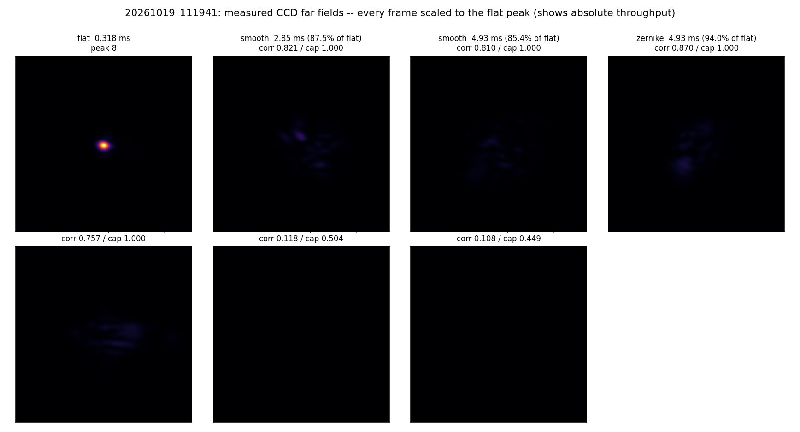

按平场峰值统一缩放。全频随机相位两格接近全黑 —— 反映的是绝对通量的塌陷。

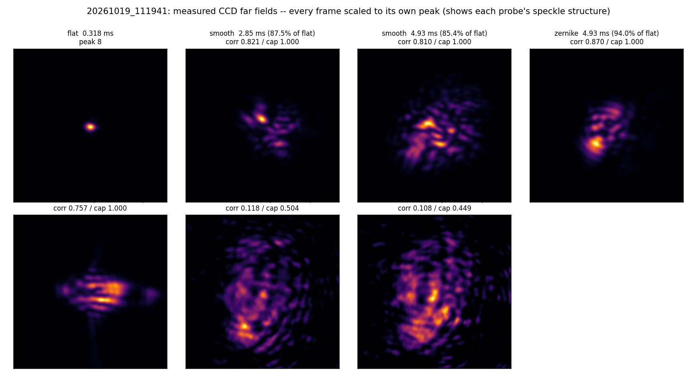

各自归一后必须补一张：全频随机相位的散斑结构**确实存在**，而且铺满整个 300×300 视场，
只是绝对亮度只有平场的 7%。也就是说窗内不是「没有光」，而是「光被摊薄且很暗」——
这正是支撑只占模型 7.91%、而该族只有 10.68% 模型能量落进支撑的成因。两张图缺一不可：
第一张看通量塌陷，第二张看结构是否真的缺失；只看其中一张都会得出相反结论。

图中 `cap` 即该探针的完美模型上限。

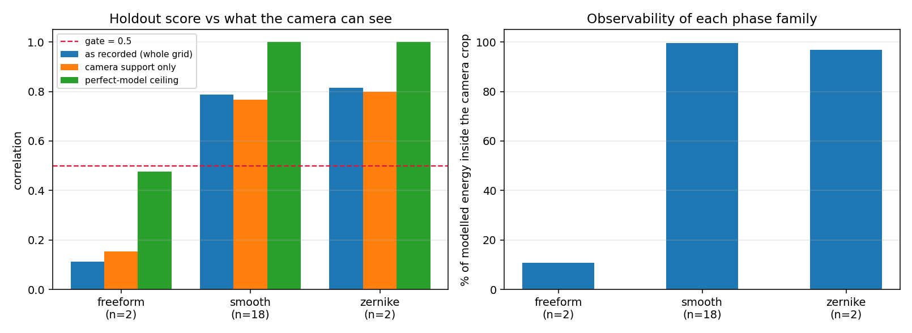

### 更正：16:25 起的「离焦 + 变暗」是测量口径，不是光路失稳（2026-10-19 晚）

> **本节更正上文 §「16:25 起的实验系统状态变化（离焦 + 变暗）」。** 该节据未校正平场的
> FWHM 推断「光路在无人操作记录的情况下又离焦了」并据此安排重扫。**该推断不成立。**
> 根因是那些读数全部来自**不套用会话校正相位**的阶段：
> panel_locate 的 PanelLocateParams 没有相位偏置字段，几何 sweep 的
> model_in_loop_hw_runbook.py 连 --phase-disturbance-file 选项都不存在，且
> model_in_loop_session.py:254 组装子进程命令时也不传。

| 测量 | 是否套用校正 | 平场 FWHM |
| --- | --- | ---: |
| 11:19 运行平场 | 是 | 13.19 px |
| 17:26 重对准 corrected_final | 是 | **11.47 px** |
| 17:10 panel_locate | 否 | 68.3 px |
| 17:16 细扫 0.0 m⁻¹ | 否 | 127.9 px |
| 18:06 几何 sweep | 否 | 106.85 px |

**两次带校正的测量都显示合焦良好（13.19 / 11.47 px）。没有证据表明光路失稳。**
未校正读数之间的差异（68 / 106 / 128 px）随光强与曝光浮动，属同一分布。

同源的第二个后果：18:06 几何 sweep 自报的 waist NOT identifiable、两个焦距尺度
「相差 530%」、joint rel-RMS 16.9%、camera_px_per_model_px 偏 2.5 倍，全部是因为
被测相位没有离焦项可拟合。而相关性门槛仍给出 0.831 并放行 —— 散斑相关在该阶段对离焦
失配不敏感，**门槛结构上抓不到这个失效**。

### 17:16 离焦重扫结果与下一步

`focus_probe` 在实测光束中心 (960, 720) 上重扫 ±6 m⁻¹（25 粗点 + 7 细点，每点 3 帧）：

| 量 | 上午（11:19 前） | 本次（17:16） |
| --- | ---: | ---: |
| 最佳 1/f | +0.644 m⁻¹ | **+0.667 m⁻¹** |
| 对应焦距 | 1551.9 mm | **1500 mm** |
| 峰值/曝光 | — | **74 counts/ms** |
| 相对平场增益 | ×38.8 | **×43.36** |

探针自报「22 个点落在可用曝光带之外（clipped 0 / dim 22），未参与排序」——即本次光强下
多数扫描点无法进入满量程 25–80% 带，排序只用可判读的点，该口径已计入上面的结果。

两点必须记清，不能含糊过去：

1. **16:25 基线运行套用了上午的校正文件，结果反而更差**（平场 peak 2、FWHM 2128 px，
   而不校正的 17:10 是 peak 3、FWHM 68.3 px）。旧补偿量已不适用于当前状态，且其中
   合并的彗差量一并失效。
2. 上午记录的 FWHM 13.1 px 来自 300×300 窗口、本次的 68.3 px 来自 2592×1944 全画幅。
   两者都测同一个 0 级光斑，窗口不同不改变光斑本身的宽度，所以 5.2× 的差异是真实的
   离焦，不是口径差异；但**峰值/ms 的比较必须同口径**（本次已按峰值/曝光归一）。

下一步：用新的 +0.667 m⁻¹ 重做离焦 + 彗差组合校正 → 复测全画幅平场确认 FWHM 回到
~16 px → 再跑原始可微优化基线。

### 附：相关性怎么算的，图片各自要看什么

**计算。** `_prediction_correlation`（`src/ao_shaping/optimizer/wfless/slm_model_in_loop.py:2137`）
把预测与测量各自去均值，再用点积除以两者 L2 范数之积——就是展平后的 Pearson 相关系数。
它对整体增益与加性常数免疫，所以不同曝光的帧可以直接比（docstring 原话：
`insensitive to CCD exposure`）。它**不**免疫两类东西：空间上不一致的结构，以及零与非零的分布。

两侧的构造是：

- 预测 = `forward_intensity(...)` 的完整远场，**1024×1024**（`far_field_padding=8` ×
  `region=128`），铺满整个画幅；
- 测量 = `_to_model_grid(frame, roi_center, 1024, 1.0467, 1)`。该函数先造一个
  `span = round(1024 × 1.0467) = 1072` 的零格，把 300×300 相机帧按冻结的光轴居中放进去，
  线性插值缩到 1024，再按相机方向旋转。**窗外恒为 0**，实测支撑 288 px = 7.91%。

于是 1,048,576 个像素里有 92% 是 `b = 0`。这些像素只贡献 `a` 的方差、不提供任何匹配信息，
相关系数因此被结构性零稀释——这就是「支持 7.91%」能变成「得分被拉到 0.11」的机制。

**上限的来历。** `corr(prediction, prediction × support)`：裁剪只加在测量侧，所以完美模型
同样要承受同一道裁剪，这个值就是任何模型都无法超过的天花板。它与系数拟合无关，
因此可以作为「判据本身是否可达」的独立证据。

**三张图各自的目标。**

| 图 | 要回答的问题 | 单独看会得出的（错误）结论 |
| --- | --- | --- |
| `holdout_frames.png` 统一按平场峰值 | 光到底有没有到相机 | 全频随机相位「没光」 |
| `holdout_frames_normalized.png` 各自归一 | 散斑结构在不在、形状是否可辨 | 全频随机相位「结构完好、模型该能对上」 |
| `holdout_ceiling.png` 逐族上限 vs 门槛 | 这个分数有没有可能达标 | —— |

前两张必须并置：合起来才是「光在，但绝对量只有平场的 7%，且散斑铺满整个视场，
导致只有 10.68% 的模型能量落进 7.91% 的支撑」这一条。

**整形目标。** 本节引用的运行目标是**矩形、边长 60 相机像素、2:1**（基线）。
按用户后续要求，后续测试改为大面积目标（正方形边长 1000–1600 相机像素，尽量占满 CCD
靶面）；该改动需同步放大 `--cam-size`，且单位像素通量会显著下降，是否可行由下一次
固定曝光重放实测给出，不预设。

### 术语登记 T-60（2026-10-19）

上文第三类验证集探针所用的中文词是代码标签 `freeform` 的直译，未登记，属自造词。
已按 `docs/terminology_glossary.md` §3 补登记 **T-60**，规范词为**全频随机相位**；
口语→规范的完整对照以术语表为唯一权威，此处不复述。

命名依据：三个验证集探针族都是去均值、标准差缩放到 `probe_spread` 的随机瞳面相位，
区别只在空间频率上是否带限（`_holdout_phase`，`slm_model_in_loop.py:1129`）——
`smooth` 经 `gaussian_filter` 带限、`zernike` 只取 Noll 4–11、`freeform` 不做任何空间平滑。
故规范名取「全频」而非按 `freeform` 直译：直译词不携带任何可检验的物理信息，
而「全频」直接说明它把约 93% 的光散出 0 级的原因。代码标识符 `freeform` 不受影响。

已同步落地：`term_unify_20261016.py::EXACT_RULES` 增加 T-60 规则并 `--apply` 全仓统一
（38 份历史报告、176 行，纯措辞改写，数值/单位/公式/参数/路径逐字节不变）。规则落地后
仍需重跑 `sync_report_provenance.py`：溯源块与 `report/README.md` 索引由 registry 的
note 文本生成，若 note 里留着旧词，重跑同步会把旧词**再写回来** —— 本轮即因此返工一次。
`docs/dev/call_graph_wiki/**` 为生成文档，`AGENTS.md` 与术语表故意引用禁词作示例，
这些命中均在设计内。

> 留待用户裁定一处语义：`AGENTS.md` 中 GS 精修那一项指的是要优化的**整面输入相位**，
> 与验证集探针族并非同一语义，故未机械套用 T-60。

### 17:40 离焦 + 彗差重建结果

`alignment_probe`（复用既有菲涅尔扫描与 Zernike 生成器）在实测光束中心 (960, 720)、
聚焦区间 ±1.0 m⁻¹、彗差跨度 1.5 rad 下重建，产物
`data/debug/alignment_probe/20261019_realign/`（321 帧原始 CCD + 48 个相位 + result.json）。

| 量 | 16:40 未校正 | 17:40 重建后 |
| --- | ---: | ---: |
| 最佳 1/f | — | **+0.5875 m⁻¹（f = 1702.1 mm）** |
| 相对平场增益 | — | **×39.71**，线性度 1.0386 |
| 峰值（固定曝光 1.971 ms） | 3 | **122.7** |
| 光斑 rms 半径 | — | **11.47 px** |
| 彗差不对称度 | — | **0.105 → 0.089** |
| 采用的彗差系数 | — | `[0.75, 0.0] rad`，accepted = True |

重建后光斑收细、峰值提升约 40 倍，恢复到 11:19 上午同焦状态（rms 11.45 px / peak 113.0）
的水平。即上午的离焦并非「又发生」，而是**上午那次补偿从未应用在几何标定阶段**——
`panel_locate` 不加载校正相位，16:25 的基线运行加载的是上午的旧文件。

一处需并记的差异：17:16 独立细扫（±6 m⁻¹、25 点）给出 1/f = +0.6667，本次组合探针
（±1.0 m⁻¹、9 点）给出 +0.5875，相差 0.079 m⁻¹。两者都落在紧焦区（rms 11.2–11.5 px），
但**基线一律采用组合探针自产的那一份**，因为它的彗差项与聚焦项来自同一次扫描、自带
固定曝光验证行（`p0_axis0_verify`、`focused_baseline_control`），构成一个自洽的校正包。
