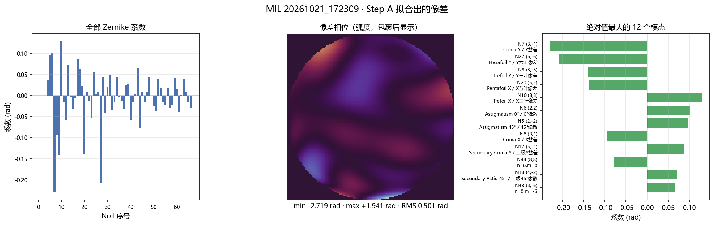
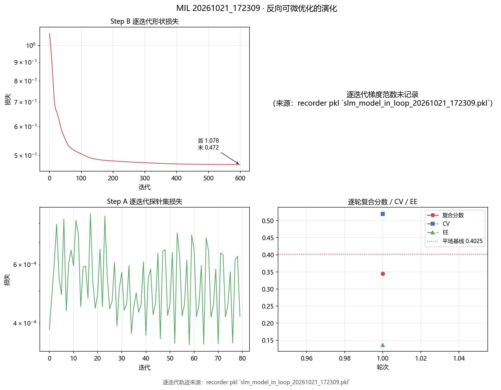
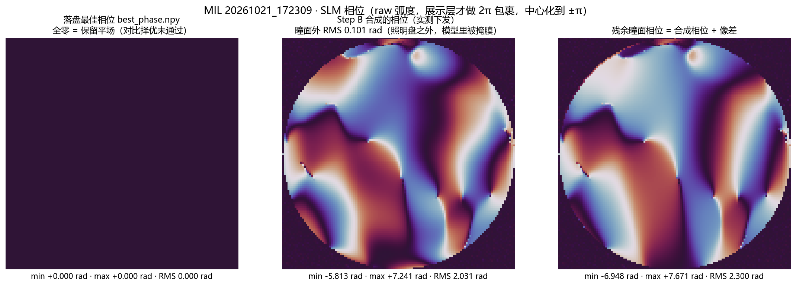
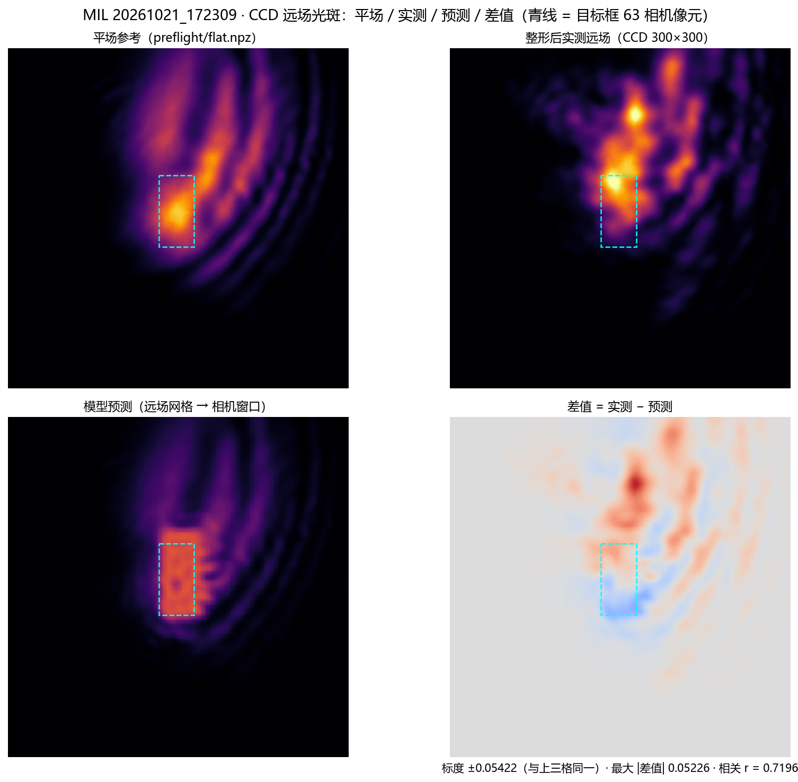
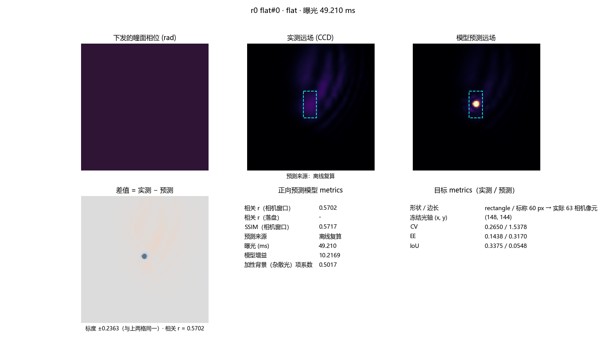

# MIL (model-in-loop) 单次运行记录报告 — 20261021_172309

<!-- provenance:start -->
> **生成脚本**: [`scripts/slm/generate_model_in_loop_record_report.py`](../../../scripts/slm/generate_model_in_loop_record_report.py)
> **复现命令**: `python scripts/slm/generate_model_in_loop_record_report.py --run-dir data/debug/model_in_loop_hw_ab/20261021_172236/baseline_a/slm_model_in_loop/20261021_172309 --stamp 20261021_172309`
> **数据/关联脚本**: [`scripts/slm/model_in_loop_hw_ab.py`](../../../scripts/slm/model_in_loop_hw_ab.py)
> **数据/关联脚本**: [`scripts/slm/generate_shape_trial_profiles.py`](../../../scripts/slm/generate_shape_trial_profiles.py)
> **运行环境**: 离线
> **说明**: 2026-10-21 baseline_a 变体的 MIL 单次运行记录 (离线读盘, 不碰设备)：Step A 像差系数 + 信赖域截断、Step B 600 步轨迹、逐探针实测/预测远场与相关/SSIM、逐轮 CV/EE/IoU、bake_off_rejected 结论 (整形 0.3451 未打赢平场 0.4025, 落盘相位为零相位平场)；过程动画每帧给相位/实测/预测远场(叠目标掩模轮廓) + 差值 + 正向预测模型 metrics + 目标 metrics
<!-- provenance:end -->

- 运行目录: `data/debug/model_in_loop_hw_ab/20261021_172236/baseline_a/slm_model_in_loop/20261021_172309`（仓库根相对路径）
- 生成脚本: `scripts/slm/generate_model_in_loop_record_report.py`（离线读盘）
- 实验系统变体: `baseline_a`
- 运行状态: `bake_off_rejected`

## 1. 结论

**整形后复合分数是否严格大于平场分：否。** 整形后 **0.345118**，平场 **0.402527**，差值 **-0.057409**。

**没有提交相位的原因**：最终对比择优判定整形相位没有打赢平场（0.3451 ≤ 0.4025），于是保留平场，运行状态置为 `bake_off_rejected`。因此落盘的 `best_phase.npy` 是**全零的平场相位**，它不是「整形失败后随便存的一个相位」，而是「择优之后仍然选中的那一个」。

验收结论（`handoff_summary.json`）：

| 项 | 取值 |
|---|---|
| 判定 | review_required |
| 轮数 / 接受轮数 / 最佳记录轮 | 1 / 1 / 1 |
| 最佳记录轮的指标 | cv = 0.5195, ee = 0.1365, iou = 0.2109, holdout_correlation = 0.6182, geometry_correlation = 0.7188 |
| 逐项检查 | phase_saved = True, accepted_round = True, cv = False, ee = False, iou = False, geometry = True, holdout = True, beats_flat = False |
| 说明 | Recorded round metrics only; replay saved phase at fixed exposure for final optical acceptance. |

## 2. 参数设置

| 项 | 取值 | 来源 |
|---|---|---|
| 实验系统变体 | baseline_a | 运行目录的上一级目录名 |
| 相机类型 / 序号 | daheng / 0 | `cam_type` / `cam_id` |
| 相机窗口 | 300 × 300 px | `cam_size` |
| 曝光（设定 / 实测） | 20 ms / 27.065 ms | `exposure_time_ms` / 探针清单 |
| SLM 序号 / 波长 | 1 / 1064 nm | `slm_number` / `wavelength_nm` |
| SLM 像元 / 面板跨度 | 8.0 µm / 900.0 px | `slm_pixel_um` / `panel_span_px` |
| 相机像元 | 2.2 µm | `camera_pixel_um` |
| 瞳面网格 / 远场零填充 | 128 × 128 / ×8 | `region` / `far_field_padding` |
| 焦距（标称） | 0.122406 m | `focal_length_m` |
| 瞳面中心（面板坐标） | [960, 980] | `pupil_center` |
| 目标形状 / 边长 | rectangle / 60 px | `target_shape` / `target_side` |
| 复合分数权重（EE / CV） | 0.6 / 0.4 | `w_efficiency` / `w_uniformity` |
| 轮数 / 随机种子 | 1 / 19 | `n_rounds` / `seed` |
| 探针数 / 展布 | 6 / 4.0 | `probe_count` / `probe_spread` |
| 验证集探针数 | 2 | `holdout_probe_count` |
| Step A 迭代 / 学习率 | 80 / 0.05 | `step_a_iterations` / `step_a_lr` |
| Step B 迭代 / 学习率 | 600 / 0.05 | `step_b_iterations` / `step_b_lr` |
| Zernike 阶数 / 系数数 / 冻结模态 | 10 / 66 / [1, 2, 3] | `n_orders` / `frozen_modes` |
| 信赖域 L2 / 自适应 | 0.5 / False | `trust_region_c_l2` / `adaptive_trust_region` |
| 几何标定文件 | D:\Projects\TIFO\AO-shaping\data\debug\model_in_loop_hw_ab\20261021_172236\baseline_a\debug\slm_model_in_loop\20261021_172309\session_geometry\bench_geometry.json | `geometry_file` |
| 实测几何：相机像元/远场采样点 | 1.304255 | `camera_px_per_model_px` |
| 实测几何：远场网格 / 方法 | 1024 / sweep | `far_field_size` / `method` |
| 实测几何：FWHM（相机 / 远场） | 40.578 px / 8.638 px | `spot_fwhm_camera_px` / `spot_fwhm_model_px` |
| 实测几何：光斑相关 / 瞳面盘半径 / 束腰 | 0.7188 / 450 px / 450 px | `correlation` / `panel_disc_radius` / `beam_waist_panel_px` |
| 冻结光轴（相机像元） | (148, 144) | 平场帧全局 argmax |
| 旋转象限（由落盘 model_grid 反推） | 1（最大偏差 6.358e-09） | 不写死，逐像素核对 |
| 注入的误差参数 | 本次运行未注入误差参数（理想系统） | `model_error_terms.json` |

几何标定备注（`bench_geometry.json` 的 `calibration_notes`）：

> tilt slope 6.115 cam px/rad (x:-5.928, y:+6.303, via ['centroid (no usable phase correlation)']), semi-axis 64 model px, P=1024; physical tilt check 1.14x predicted; focal scale from ramp sweep (S=9391 cam px per 1/period, axis y), FOV cross-check 0.415 (215% apart); modes fitted astig_y+coma_x+coma_y+defocus; joint rel-RMS 28.1%; bench offsets astig_y +1.000, coma_x +5.000, coma_y +5.000, defocus +1.000 rad; curvatures astig_y 64.8, coma_x 601.7, coma_y 3206.9, defocus 154.2; defocus asymmetry -32%; waist NOT identifiable, flat-top default

## 3. Step A：正向调优模型（拟合实验系统的像差）

| Noll | (n, m) | 名称 | 系数 (rad) | 绝对值 (rad) |
|---|---|---|---|---|
| 4 | (2, 0) | Defocus / 离焦 | +0.037230 | 0.037230 |
| 5 | (2, -2) | Astigmatism 45° / 45°像散 | +0.097258 | 0.097258 |
| 6 | (2, 2) | Astigmatism 0° / 0°像散 | +0.100660 | 0.100660 |
| 7 | (3, -1) | Coma Y / Y彗差 | -0.229299 | 0.229299 |
| 8 | (3, 1) | Coma X / X彗差 | -0.094644 | 0.094644 |
| 9 | (3, -3) | Trefoil Y / Y三叶像差 | -0.139452 | 0.139452 |
| 10 | (3, 3) | Trefoil X / X三叶像差 | +0.129170 | 0.129170 |
| 11 | (4, 0) | Spherical / 球差 | -0.014438 | 0.014438 |
| 12 | (4, 2) | Secondary Astig 0° / 二级0°像散 | -0.059177 | 0.059177 |
| 13 | (4, -2) | Secondary Astig 45° / 二级45°像散 | +0.071552 | 0.071552 |
| 14 | (4, 4) | Tetrafoil X / X四叶像差 | -0.003843 | 0.003843 |
| 15 | (4, -4) | Tetrafoil Y / Y四叶像差 | -0.031379 | 0.031379 |
| 16 | (5, 1) | Secondary Coma X / 二级X彗差 | -0.006456 | 0.006456 |
| 17 | (5, -1) | Secondary Coma Y / 二级Y彗差 | +0.086847 | 0.086847 |
| 18 | (5, 3) | Secondary Trefoil X / 二级X三叶像差 | +0.064076 | 0.064076 |
| 19 | (5, -3) | Secondary Trefoil Y / 二级Y三叶像差 | +0.021654 | 0.021654 |
| 20 | (5, 5) | Pentafoil X / X五叶像差 | -0.137695 | 0.137695 |
| 21 | (5, -5) | Pentafoil Y / Y五叶像差 | +0.009320 | 0.009320 |
| 22 | (6, 0) | Secondary Spherical / 二级球差 | -0.013120 | 0.013120 |
| 23 | (6, -2) | Tertiary Astig 45° / 三级45°像散 | -0.052534 | 0.052534 |
| 24 | (6, 2) | Tertiary Astig 0° / 三级0°像散 | +0.056162 | 0.056162 |
| 25 | (6, -4) | Secondary Tetrafoil Y / 二级Y四叶像差 | +0.004667 | 0.004667 |
| 26 | (6, 4) | Secondary Tetrafoil X / 二级X四叶像差 | +0.007469 | 0.007469 |
| 27 | (6, -6) | Hexafoil Y / Y六叶像差 | -0.207429 | 0.207429 |
| 28 | (6, 6) | Hexafoil X / X六叶像差 | +0.044576 | 0.044576 |
| 29 | (7, -1) | Tertiary Coma Y / 三级Y彗差 | -0.042434 | 0.042434 |
| 30 | (7, 1) | Tertiary Coma X / 三级X彗差 | +0.019839 | 0.019839 |
| 31 | (7, -3) | Tertiary Trefoil Y / 三级Y三叶像差 | +0.049033 | 0.049033 |
| 32 | (7, 3) | Tertiary Trefoil X / 三级X三叶像差 | -0.034534 | 0.034534 |
| 33 | (7, -5) | Secondary Pentafoil Y / 二级Y五叶像差 | -0.014320 | 0.014320 |
| 34 | (7, 5) | Secondary Pentafoil X / 二级X五叶像差 | +0.043913 | 0.043913 |
| 35 | (7, -7) | Heptafoil Y / Y七叶像差 | -0.003868 | 0.003868 |
| 36 | (7, 7) | Heptafoil X / X七叶像差 | -0.011891 | 0.011891 |
| 37 | (8, 0) | n=8,m=0 | -0.031803 | 0.031803 |
| 38 | (8, 2) | n=8,m=2 | +0.024353 | 0.024353 |
| 39 | (8, -2) | n=8,m=-2 | +0.026536 | 0.026536 |
| 40 | (8, 4) | n=8,m=4 | -0.057880 | 0.057880 |
| 41 | (8, -4) | n=8,m=-4 | -0.015256 | 0.015256 |
| 42 | (8, 6) | n=8,m=6 | +0.004733 | 0.004733 |
| 43 | (8, -6) | n=8,m=-6 | +0.066820 | 0.066820 |
| 44 | (8, 8) | n=8,m=8 | -0.077501 | 0.077501 |
| 45 | (8, -8) | n=8,m=-8 | +0.007462 | 0.007462 |
| 46 | (9, 1) | n=9,m=1 | -0.016171 | 0.016171 |
| 47 | (9, -1) | n=9,m=-1 | +0.008522 | 0.008522 |
| 48 | (9, 3) | n=9,m=3 | +0.044319 | 0.044319 |
| 49 | (9, -3) | n=9,m=-3 | +0.000117 | 0.000117 |
| 50 | (9, 5) | n=9,m=5 | -0.023426 | 0.023426 |
| 51 | (9, -5) | n=9,m=-5 | -0.035835 | 0.035835 |
| 52 | (9, 7) | n=9,m=7 | +0.039696 | 0.039696 |
| 53 | (9, -7) | n=9,m=-7 | +0.018976 | 0.018976 |
| 54 | (9, 9) | n=9,m=9 | -0.014997 | 0.014997 |
| 55 | (9, -9) | n=9,m=-9 | -0.022393 | 0.022393 |
| 56 | (10, 0) | n=10,m=0 | +0.017821 | 0.017821 |
| 57 | (10, -2) | n=10,m=-2 | -0.028482 | 0.028482 |
| 58 | (10, 2) | n=10,m=2 | -0.021872 | 0.021872 |
| 59 | (10, -4) | n=10,m=-4 | +0.042225 | 0.042225 |
| 60 | (10, 4) | n=10,m=4 | +0.015310 | 0.015310 |
| 61 | (10, -6) | n=10,m=-6 | -0.038581 | 0.038581 |
| 62 | (10, 6) | n=10,m=6 | +0.002029 | 0.002029 |
| 63 | (10, -8) | n=10,m=-8 | +0.039902 | 0.039902 |
| 64 | (10, 8) | n=10,m=8 | +0.008465 | 0.008465 |
| 65 | (10, -10) | n=10,m=-10 | -0.015350 | 0.015350 |
| 66 | (10, 10) | n=10,m=10 | -0.028473 | 0.028473 |

- 系数总数 66（Noll 序，索引 0 = Noll 1 活塞）；非零模态 63 个；系数 L2 范数 0.500000 rad。 冻结的模态（拟合全程保持 0）：[1, 2, 3]。

| 项 | 取值 |
|---|---|
| 探针数（训练） | 6 |
| Step A 迭代数 | 80 |
| 损失（拟合前） | 0.00054071 |
| 损失（拟合后） | 0.00053697 |
| 验证集相关（`holdout_correlation`） | 0.6182 |
| 模型增益 / 加性背景（杂散光）项系数 | 10.2169 / 0.5017 |
| 信赖域是否截断 / 系数步长 L2 | True / 1.8191 |

**信赖域把这一步限住了**：落盘系数的 L2 范数是 0.500000 rad，恰好等于信赖域半径 0.500000 rad（`clamp_applied = True`）。也就是说 —— **未截断的拟合想走得更远，但被信赖域按在半径上**；报告里的像差系数是**截断之后**的那一组。

Step A 的逐迭代损失轨迹已落盘（来源：recorder pkl `slm_model_in_loop_20261021_172309.pkl`，共 80 次迭代）。

## 4. Step B：反向可微优化 SLM 相位

| 项 | 取值 |
|---|---|
| Step B 迭代数 | 600 |
| 形状损失（首 / 末） | 1.078142 / 0.471966 |
| 复合分数（前 / 后） | - / 0.345118 |
| CV / EE / IoU（整形后） | 0.5195 / 0.1365 / 0.2109 |
| 接受 / 理由 | True / accepted |

> 第 1 轮的「复合分数（前）」为空是 MIL 的设计：平场基线不是同口径的参照，所以首轮没有「前」可填；与平场的比较统一在 §1 与 §7 给出。

**逐迭代损失轨迹已落盘**（来源：recorder pkl `slm_model_in_loop_20261021_172309.pkl`，共 600 次迭代，从 1.07814 降到 0.471966）。

**逐迭代梯度范数：未记录**（本次运行的轨迹里没有梯度范数字段）。

## 5. SLM 相位与一致性检查

落盘的最佳相位 `best_phase.npy`（raw 未包裹弧度，128×128）：min +0.000000 rad、max +0.000000 rad、RMS 0.000000 rad。**全零** —— 对比择优保留了平场（见 §1）。

### 5.1 与 Step A 拟合像差的关系（一致性检查）

物理预测模型的瞳面相位是「**命令相位 + 像差**」，所以抵消像差的命令相位是 `-像差`。于是「最佳相位 **减去**（-像差）」= 「最佳相位 + 像差」就是**残余瞳面相位**；若 Step B 只做像差抵消（不做整形），它应当接近平坦（残余 RMS ≈ 0）。

| 项 | 取值 |
|---|---|
| 像差相位的 RMS（瞳面内） | 0.501154 |
| Step B 合成相位的 RMS（瞳面内） | 2.031412 |
| 残余 = 合成相位 + 像差（瞳面内 RMS） | 2.300302 |
| 残余 = 落盘最佳相位 + 像差（瞳面内 RMS） | 0.501154 |
| 合成相位与（-像差）的相关系数 | -0.4491 |
| 参与统计的瞳面像元数 | 12892 |

**读法**：本次运行 Step B 的目标是**矩形**而不是平坦，所以残余瞳面相位**不会**为 0；上面三个数给出的是「相位里有多少是像差抵消、多少是整形结构」的实际比例。落盘最佳相位是全零的平场，所以它的「残余」就是像差本身。

## 6. CCD 远场光斑：平场 / 整形后 / 模型预测 / 差值

**帧网格口径**。实测帧是 300×300 **相机像元**窗口，物理预测模型输出的是 1024² **远场采样点**网格。实测帧落到远场网格用 MIL 自己那套已验证的实现（`slm_model_in_loop._to_model_grid`），**旋转象限不写死** —— 拿探针里落盘的 `model_grid` 逐像素反推（4 个象限里挑最吻合的），本次反推结果是象限 1，与落盘 `model_grid` 的最大绝对偏差 6.358e-09。

模型预测 → 相机窗口走本脚本自己的逆映射；把落盘的 `model_grid` 映回相机窗口后与原始相机帧逐像素比对，是这条映射的自检。

逆映射自检：最大绝对偏差 **0.006057**（相对帧峰 6.23%）。这是 300 像元 → 1024 远场采样点 → 300 像元的**重采样损失**，不是口径错误；远场网格与相机窗口之间的换算由 `camera_px_per_model_px` 与上一步反推出的旋转象限共同固定。

各探针类别的实测曝光：flat 49.210 ms; train 27.065 ms; holdout 27.065 ms; shaped 45.188 ms。**跨曝光的绝对强度不可直接比** —— 相关与 SSIM 都是峰值归一化后的量，不受曝光影响；四联图里三格共用同一个标度，所以亮度的差异里也含曝光差。

### 6.1 逐探针的相关与 SSIM

| 探针 | 类别 | 曝光 (ms) | 落盘相关 r | 相关 r（远场网格） | SSIM（相机窗口） | 预测来源 |
|---|---|---|---|---|---|---|
| r0 flat#0 | flat | 49.210 | - | 0.5934 | 0.5717 | 离线复算 |
| r1 train#0 | train | 27.065 | - | 0.4658 | 0.5064 | 离线复算 |
| r1 train#1 | train | 27.065 | - | 0.7336 | 0.7191 | 离线复算 |
| r1 train#2 | train | 27.065 | - | 0.5977 | 0.6194 | 离线复算 |
| r1 train#3 | train | 27.065 | - | 0.6167 | 0.5446 | 离线复算 |
| r1 train#4 | train | 27.065 | - | 0.3910 | 0.5639 | 离线复算 |
| r1 train#5 | train | 27.065 | - | 0.4375 | 0.4414 | 离线复算 |
| r1 holdout#0 | holdout | 27.065 | 0.6346 | 0.6346 | 0.5754 | 落盘预测 |
| r1 holdout#1 | holdout | 27.065 | 0.6017 | 0.6017 | 0.6580 | 落盘预测 |
| r1 shaped#0 | shaped | 45.188 | 0.7722 | 0.7722 | 0.6327 | 落盘预测 |

预测来源说明：已用本次运行的物理预测模型离线复算（与落盘预测的最大绝对偏差 2.44e-09，3 条探针）。

### 6.2 模型自认为的整形效果 vs 实测

| 对象 | 复合分数 | CV | EE | IoU |
|---|---|---|---|---|
| 平场（实测） | 0.4025 | 0.2650 | 0.1438 | 0.3375 |
| 模型预测的整形结果 | 0.4837 | 0.1099 | 0.2055 | 0.4937 |
| 整形后（实测） | 0.3451 | 0.5195 | 0.1365 | 0.2109 |

**读法**：三行分别是「平场（实测）」「模型预测的整形结果」「整形后实测」。**模型预测那行高于平场、实测那行低于平场** —— 也就是说，物理预测模型以为它把光斑整成了矩形（§6 的第三格确实是个矩形），而实验系统给回的是一团更散的光。这就是 §1 判定「没有打赢平场」的物理原因：**不是优化器没找到更好的相位，而是它找到的相位只对模型成立。**

## 7. 逐轮指标

| 阶段 | 轮次 | 接受 | 理由 | 分（前） | 分（后） | CV | EE | IoU | 损失（前） | 损失（后） | Step A 迭代 | Step B 迭代 | 验证集相关 | 模型增益 | 加性背景（杂散光）项系数 |
|---|---|---|---|---|---|---|---|---|---|---|---|---|---|---|---|
| calibration | 0 | True | baseline | 0.4025 | 0.4025 | 0.2650 | 0.1438 | - | - | - | 未记录 | 未记录 | - | - | - |
| round | 1 | True | accepted | - | 0.3451 | 0.5195 | 0.1365 | 0.2109 | 0.000541 | 0.000537 | 80 | 600 | 0.6182 | 10.2169 | 0.5017 |

## 8. 过程动画

动画逐探针给出「下发的瞳面相位 / 实测远场 / 模型预测远场」，并在实测远场与模型预测远场上叠加**目标掩模轮廓**（青色虚线）。下排另给三格：**实测 − 预测差值**（与上排同一标度，标注相关 r）、**正向预测模型的 metrics**（相机窗口相关 r / 落盘相关 r / SSIM / 预测来源 / 曝光 / 模型增益 / 加性背景（杂散光）项系数）、**目标的 metrics**（形状与边长、冻结光轴、CV / EE / IoU，各给「实测 / 预测」两列）。**每迭代的模型远场未落盘**，所以过程动画降级为逐探针的实测 / 预测 —— 这是本次运行**实际记录到**的粒度。⚠️ 面板里的 CV / EE / IoU 是**该探针帧**上算的（实测与预测同帧、同一目标掩模），与 §7 的 per-round 验收值口径可能不同 —— §7 来自 runner 自己的验收帧，不是这一张探针帧。

## 9. 证据索引与生成方式

| 产物 | 相对路径 | 本次运行落盘 |
|---|---|---|
| 运行目录 | `data/debug/model_in_loop_hw_ab/20261021_172236/baseline_a/slm_model_in_loop/20261021_172309` | - |
| 运行参数 | `data/debug/model_in_loop_hw_ab/20261021_172236/baseline_a/slm_model_in_loop/20261021_172309/run_config.json` | 有 |
| 实测几何 | `data/debug/model_in_loop_hw_ab/20261021_172236/baseline_a/slm_model_in_loop/20261021_172309/bench_geometry.json` | 有 |
| 像差系数 | `data/debug/model_in_loop_hw_ab/20261021_172236/baseline_a/slm_model_in_loop/20261021_172309/fitted_coefficients.npy` | 有 |
| 落盘最佳相位 | `data/debug/model_in_loop_hw_ab/20261021_172236/baseline_a/slm_model_in_loop/20261021_172309/best_phase.npy` | 有 |
| 瞳面照明幅度 | `data/debug/model_in_loop_hw_ab/20261021_172236/baseline_a/slm_model_in_loop/20261021_172309/source_amplitude.npy` | 有 |
| 注入的误差参数 | `data/debug/model_in_loop_hw_ab/20261021_172236/baseline_a/slm_model_in_loop/20261021_172309/model_error_terms.json` | 无 |
| 平场参考 | `data/debug/model_in_loop_hw_ab/20261021_172236/baseline_a/slm_model_in_loop/20261021_172309/preflight/flat.npz` | 有 |
| 逐探针清单 | `data/debug/model_in_loop_hw_ab/20261021_172236/baseline_a/slm_model_in_loop/20261021_172309/probes/manifest.json` | 有 |
| 逐轮记录（CSV） | `data/debug/model_in_loop_hw_ab/20261021_172236/baseline_a/slm_model_in_loop/20261021_172309/` 下的 `slm_model_in_loop_*.csv` | 有 |
| recorder 全过程（pkl） | `data/debug/model_in_loop_hw_ab/20261021_172236/baseline_a/slm_model_in_loop/20261021_172309/` 下的 `slm_model_in_loop_*.pkl` | 有 |
| 验收结论 | `data/debug/model_in_loop_hw_ab/20261021_172236/baseline_a/slm_model_in_loop/20261021_172309/handoff_summary.json` | 有 |
| 失败记录 | `data/debug/model_in_loop_hw_ab/20261021_172236/baseline_a/slm_model_in_loop/20261021_172309/failure.json` | 无 |

- 复现命令: `python scripts/slm/generate_model_in_loop_record_report.py --run-dir data/debug/model_in_loop_hw_ab/20261021_172236/baseline_a/slm_model_in_loop/20261021_172309 --stamp 20261021_172309`
- 溯源: 离线读盘，不碰设备；本报告的溯源块由 `scripts/sync_report_provenance.py` 在 `scripts/_common/provenance.py::REPORTS` 登记本报告后写入。
