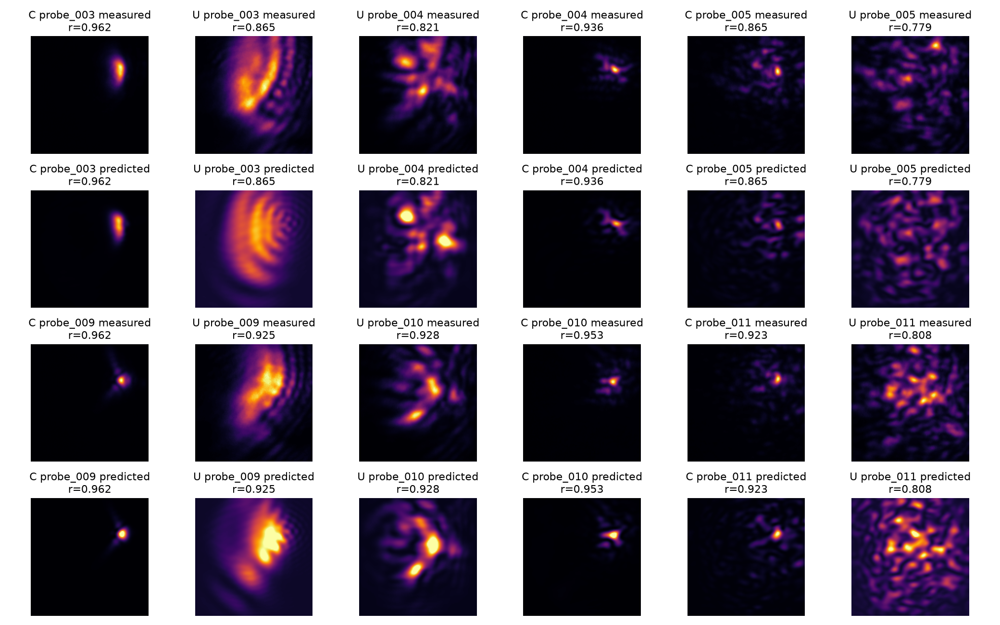
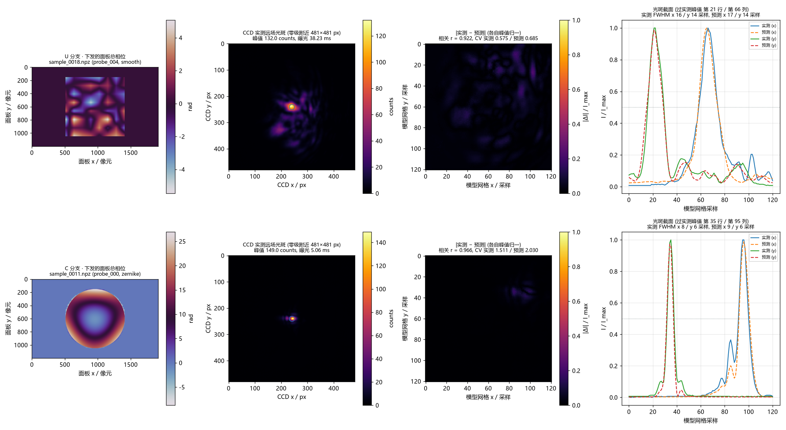

# 当前功率与主动离焦条件下的物理正向模型实验（2026-10-22）

<!-- provenance:start -->
> **生成脚本**: 人工撰写，无生成脚本
> **数据/关联脚本**: [`scripts/slm/capture_defocus_forward_dataset.py`](../../../scripts/slm/capture_defocus_forward_dataset.py)
> **数据/关联脚本**: [`scripts/slm/fit_defocus_forward_dataset.py`](../../../scripts/slm/fit_defocus_forward_dataset.py)
> **数据/关联脚本**: [`scripts/slm/evaluate_defocus_forward_dataset.py`](../../../scripts/slm/evaluate_defocus_forward_dataset.py)
> **数据/关联脚本**: [`scripts/slm/validate_defocus_exposure.py`](../../../scripts/slm/validate_defocus_exposure.py)
> **数据/关联脚本**: [`scripts/slm/summarize_defocus_forward_experiment.py`](../../../scripts/slm/summarize_defocus_forward_experiment.py)
> **数据/关联脚本**: [`src/ao_shaping/tools/slm/panel/alignment_probe.py`](../../../src/ao_shaping/tools/slm/panel/alignment_probe.py)
> **运行环境**: 离线+硬件
> **说明**: 2026-10-22 当前功率与主动离焦下的聚焦、斜坡及未补偿/补偿配对相位采集和低参数物理模型验证；保留失败边界。
<!-- provenance:end -->

本轮在**设备已接通、激光功率已调整**的条件下执行。
方案见 [实验设计](../physical_forward_defocus_plan_20261022.md)。
原始目录为 `data/debug/physical_forward_defocus/`；下列采集均使用真实 Santec #1
控制器 `22030108`、Daheng `FJB24112232`、1064 nm、全帧 `2592×1944`。
没有调整相机的物理位置，也未改变激光功率。

## 0. 实验目的、条件与环境

### 0.1 实验目的

本轮要回答三个问题，按优先级排列：

1. **主动离焦能不能被补偿？** 用户已把 SLM 面板调整到一个离焦的工作点，本轮的
   **U 分支**就是该状态下的原始观测。验证手段：在 SLM 上叠加一张菲涅尔二次相位
   把光路推回焦面（**C 分支**），与 U 配对采集，看光斑宽度、峰值与定位条件是否
   被显著改善。
2. **低参数物理模型能不能预测远场？** 若第 1 问成立，就需要有一个能替我们
   "试相位"的正向模型。本轮用 9–16 个**共享**物理参数（有效离焦 / 照明振幅 /
   低阶残余像差）预测 CCD 远场，并用**全新种子**的独立采集做冻结参数检验。
3. **预测准不准，够不够格驱动逆向优化？** 判据不只看结构相关性，还看均匀度
   （CV）与能量效率（EE_ROI）的预测误差——只有三项都过门槛，才允许进入下一步
   的反向优化。

### 0.2 实验条件

| 项 | 值 |
|---|---|
| SLM | Santec #1，控制器 `22030108` |
| 相机 | Daheng `FJB24112232`，全帧 `2592×1944` |
| 波长 | 1064 nm |
| 激光功率 | 由用户在采集前调整；本轮全程不再改动（曝光读回范围 `0.02–1000.0 ms`） |
| 相机物理位置 | **未调整**，全程固定 |
| SLM 面板状态 | 用户主动调整到离焦工作点（即 U 分支）；C 分支在此基础上叠加聚焦补偿 |
| 面板参数 | `1920×1200`；面板探测覆盖 `(960,600)`、半径 `450 px`（初始探测设置，**非**本次照明中心与范围的独立测量） |
| 参考曝光 | U `75.109 ms`、C `3.079 ms`（首组稳定参考） |
| 采集时段 | 2026-10-22 18:10 – 18:36 |
| 原始数据 | `data/debug/physical_forward_defocus/` |
| 采集规模 | 开发集 38 组 + 冻结检验 24 组 = 62 组（相位探针 / 几何斜坡 / 参考），186 张独立原始帧；响应补测另存 40 张 |

### 0.3 实验环境

* **实验系统**：2f 傅里叶实验系统（SLM 前焦 → 傅里叶透镜 → CCD 后焦），真实设备；
  采集期间不移动任何光学元件。
* **软件**：规范 Zernike 与 `focal_intensity` 入口（`utils/wavefront/`、
  `drivers/sim/`），拟合器是本轮新增的可复现实验脚本
  （`scripts/slm/fit_defocus_forward_dataset.py`），**不**复用生产
  `slm-model-in-loop` 的自动标定与 Step A/Step B。
* **计算口径**：面板相位采样到 `128×128` 物理网格（跨度 `1920 panel px`），传播零
  填充到 `512×512`；图像采样窗固定为初始 U 中心附近 `241×241 CCD px`（间隔 `2 px`，
  实际数组 `121×121`）；CV 在各分支初始参考中心的固定约 `60×60 px` 方框内计算；
  EE 的分母为上述采样窗，记为 **EE_ROI**，**不是**全传感器衍射效率。
* **数据留痕**：每条记录保存完整面板总相位、曝光读回、稳定判据、UTC 微秒时间戳与
  单调时钟起止；拟合每个迭代也落盘时间戳（格式精度 ≠ 硬件同步精度）。

## 1. 18:10 当前功率下的信号检查

先只读检查其他 Python 进程，发现的均为 MCP 服务，没有实验采集任务。
设备均成功打开。曝光读回范围为 `0.02–1000.0 ms`，本进程没有设置历史曝光上限。

两组初步光照数据：

| 数据目录末级（父目录 `light/`） | 曝光（ms） | 峰值（counts/255） |
| --- | --- | --- |
| `20261022_181008` | 0.02 / 0.1 / 0.5 / 1 | 2 / 2 / 2 / 2 |
| `20261022_181036` | 5 / 20 / 50 | 3 / 9 / 23 |

初步诊断使用现有 `diagnose_light_level.py`；它没有完整的曝光后稳定判据，
以上不能作为最终光斑定位或全区间响应标定。其较亮局部结构约在 `(1930,1345)`，
后续带稳定等待的主光斑测量位置不同，因此没有采用该初步局部结构作为主光轴。

## 2. 18:11–18:17 聚焦与两个彗差方向探测

数据：`alignment_20261022_1812/`。
复用 `ao_shaping.tools.slm.panel.alignment_probe` 与已有焦度扫描。
面板 `(960,600)`、半径 `450 px` 是初始探测覆盖设置，尚不是本次照明中心和范围的独立测量。

| 项目 | 结果 |
| --- | --- |
| 候选最佳补偿焦度 | `+0.5606821133007323 m⁻¹` |
| SLM 等效补偿焦距 | `1783.5418257111967 mm` |
| 平相位 FWHM | 约 `88.81 px` |
| 候选聚焦 FWHM | 约 `14.06 px` |
| 峰值/曝光增益 | `31.359632520449363` |
| 局部半曝光复测比 | `1.066079295154185` |

扫描期间部分相位切换触发稳定等待超时，故只作为焦度候选，后续采用独立重复参考。
输出同时含 `+0.686 m⁻¹` 的抛物线拟合备注与 `+0.561 m⁻¹` 的最终离散最佳点；
以实际点数据及后续重放为准，不能仅按备注使用焦度。
彗差扫描保留候选 `(3,-1)=+0.375 rad`、另一方向为零；最终扫描不对称度约
`0.15608 -> 0.12781`，尚未以独立固定曝光重放证明该彗差候选的改善。
后续 U/C 对照只使用聚焦相位，不将彗差候选混入离焦效应比较。

## 3. 18:17 开始 U/C 配对相位数据采集

工具：`scripts/slm/capture_defocus_forward_dataset.py`，采集前离线探针生成测试通过。
数据：`paired_20261022_1817/`。U 为未补偿，C 为叠加本次聚焦补偿。
两分支显示相同种子的探针，顺序交替；保存完整面板总相位、实际曝光、
三张独立原始帧、平均帧、稳定判据、UTC 微秒格式和单调时钟起止。
不同模型将使用同一批原始帧比较，U/C 本身属于不同相位的配对采集。

先采全板 x/y 斜坡，每个方向周期 `480/960 px`、正负号各一次。
采集 12 个多样性探针，包含 Zernike、平滑相位和指定带宽相位网格三类。
每类不同种子分训练与测试，各分支每类训练 2 个、测试 2 个。
这是先导规模，少于正式方案，不支持跨光路泛化结论。

首组稳定参考：U 曝光 `75.109 ms`、峰值约 `115.67`、FWHM 约 `73.64 px`；
C 曝光 `3.079 ms`、峰值约 `142.33`、FWHM 约 `14.12 px`。
这些测量支持聚焦显著改善，但跨曝光比较仍受相机响应未全区间标定的限制。
初始中心 U 约 `(1360.72,1021.92)`、C 约 `(1423.76,971.99)`，
聚焦伴随明显转向，不能采用固定旧 ROI 或逐帧追踪来掩盖。

首批配对采集于 18:24 完成，共 38 组，全部通过 `stable_tol=0.05` 的稳定判据，
无饱和或曝光失败，实际曝光范围 `2.397–88.652 ms`。其中 24 组为相位探针、
8 组为几何斜坡、6 组为参考。原始帧与总相位保存在各 `sample_*.npz`。
`capture_records.pkl` 为带时间戳的元数据及 NPZ 文件引用，不复制大数组。
该首批 PKL 从已保存的 manifest 补写，时间戳保留采集时原值，不使用补写时间冒充采集时间。

## 4. 固定 CCD 网格的物理预测结果

复用规范 Zernike 与 `focal_intensity`，没有另写 FFT 或模式枚举。
将实际下发的完整面板相位采样到 `128×128` 物理网格，跨度 `1920 panel px`，
面板外振幅为零，传播零填充到 `512×512`。这是先导计算网格，
尚未做网格加密收敛验证；后续高带宽相位不能直接套用当前精度结论。

两个方向的斜坡测得映射（行对应 CCD x/y，列对应面板 x/y；单位为 CCD px/(cycles/panel px)）：

```text
[[  465.14603819, 7174.69078143],
 [-7533.17649076,  -30.27800300]]
```

主要轴发生交换并带符号，不能假设相机 x 对应面板 x。各模型共用该映射。
训练时只拟合一个共享光轴截距，不逐帧配准，不给 U/C 分别拟合缩放。
图像采样窗口固定为初始 U 中心附近 `241×241 CCD px`，间隔 `2 px`，实际数组 `121×121`。
CV 在各分支初始参考中心的固定约 `60×60 px` 方框计算；EE 的分母为上述采样窗口，
记为 **EE_ROI**，不能当作全传感器衍射效率。这里的 CV 描述预测一致性，
这些探针不是方形整形结果，也不能把其 CV 下降视为匀化成功。

实际版本命名与方案的阶段编号不同，以下以工具输出键为准：

| 版本 | 可调参数 | U 验证集平均相关性 | C 验证集平均相关性 |
| --- | --- | ---: | ---: |
| M0 | 理想传播；仅训练集共享强度增益与背景，几何/照明初值固定 | 0.2021 | 0.3633 |
| M1_defocus | 单一有效离焦、共享光轴截距、增益和背景，5 参数 | 0.6100 | 0.8387 |
| M3_illumination | M1 加高斯入射振幅中心与两个宽度，共 9 参数 | 0.8069 | 0.8973 |
| M4_residual | M3 加 Noll 5–11 的 7 个残余像差，共 16 参数 | 0.8541 | 0.9333 |

M0 使用的照明中心由聚焦前后偏移近似推算，并非独立实测，因此属于工作基线，
不能声称完全理想的真值。M3 不含额外像差，M4 不含 SLM LUT 拟合。
增益/常数背景均只用训练数据 NNLS 拟合，验证时冻结。
所有模型使用同一批原始 CCD 帧、相位和曝光元数据。

首轮保留种子用于发现误差；观察这些结果后增加 M4，因此本节统一称**开发验证集**，
不将其作为最终锁定测试。原采集 manifest 的 `split=test` 保留原样，
最终冻结参数验证另采新种子，见后续章节。

| 模型/分支 | 相关性中位数 | 最低相关性 | CV 平均绝对误差 | EE_ROI 平均绝对误差 |
| --- | ---: | ---: | ---: | ---: |
| M3 / U | 0.7973 | 0.7185 | 0.0955 | 0.0322 |
| M3 / C | 0.9065 | 0.8135 | 0.2479 | 0.0634 |
| M4 / U | 0.8425 | 0.7788 | 0.0736 | 0.0383 |
| M4 / C | 0.9442 | 0.8647 | 0.2316 | 0.0551 |

**主要发现：相关性明显改善，但均匀度预测误差尚未通过方案的 `0.05` 门槛。**
C 的图像结构匹配较好，CV 偏差仍大，不能以相关性替代均匀度预测能力。
U 的大范围离焦结构更难预测；9–16 个共享物理参数已经解释主要变化，
本轮没有重新训练 U-Net，也没有获得新的 U-Net 同帧对照证据。

M3 有效离焦为 `-0.6644027233123779 m⁻¹`；M4 为 `-0.6444422006607056 m⁻¹`。
负号指被辨识的系统有效像差，与正补偿方向相反。
它们与局部正补偿 `+0.5606821133007323 m⁻¹` 接近但不相等，
不能把差值直接换算为 CCD 真实轴向位移。
M3 振幅中心约 `(1072.05,811.16)`、两个宽度约 `(391.38,226.43) panel px`；
M4 中心约 `(1012.20,809.48)`，宽度约 `(341.07,236.93) panel px`。
此处宽度是振幅表达式 `exp(-((x-cx)/wx)^2-((y-cy)/wy)^2)` 的参数。
这类联合辨识存在相关性，不能当成已完成独立照明覆盖标定。



## 5. 固定曝光的彗差候选独立重放

数据：`alignment_verify_20261022_1825/`，18:25 完成。
按聚焦/聚焦加彗差交替顺序，固定 `3.033 ms`，每种 3 次。

| 量 | 仅聚焦，均值 ± 标准差 | 聚焦加彗差，均值 ± 标准差 |
| --- | ---: | ---: |
| 不对称度 | 0.15271 ± 0.00189 | 0.13482 ± 0.00360 |
| RMS 半径 / px | 12.9900 ± 0.0308 | 11.3665 ± 0.0102 |
| 中心 x / px | 1424.3348 ± 0.1233 | 1426.8294 ± 0.2282 |
| 中心 y / px | 972.5002 ± 0.2913 | 972.3929 ± 0.2319 |

不对称度下降约 `11.7%`，RMS 半径下降约 `12.5%`，伴随约 `2.49 px` 水平位移。
这支持对称度探测的工程价值，不表示零转向补偿。
现有重放工具有部分稳定等待告警，且未把逐条稳定判决写入 `verification.json`；
因此这些重放提供重复性证据，可信等级低于本轮带显式稳定标记的数据集。

## 6. 固定相位多曝光响应补测

数据：`response_20261022_1840/`，目录名为预设标签，**实际采集时间为 18:29–18:30**，
以 manifest UTC 时间戳为准。相机位置与相位保持不变，两分支各做
`0.5 -> 1.0 -> 0.25 -> 0.5` 倍参考曝光，每组保留 5 张原始帧。
全部 8 组通过稳定判据，没有饱和。

| 分支 | 读回曝光顺序 / ms | 单组原始帧最大值顺序 / counts |
| --- | --- | --- |
| C | 1.539 / 3.079 / 0.769 / 1.539 | 58 / 115 / 30 / 59 |
| U | 37.554 / 75.109 / 18.777 / 37.554 | 46 / 95 / 24 / 47 |

这些局部数据支持峰值响应近似线性，不能据此宣称整个 `0.02–1000 ms` 范围已校准。
积分窗口固定为各参考中心半径 `100 px` 圆盘；外围环带中位数只作带光背景诊断，
不是遮光暗场，不应强制解释为纯电子偏置。
响应分析同时保留原始积分、环带统计和仿射拟合，避免把宽光斑尾部误扣成背景。
原始 counts 直接除以曝光会把不随曝光成比例的偏置变成曝光相关误差，
故本轮跨曝光绝对强度与 EE/CV 预测仍有此限制。

固定圆盘原始积分拟合 `sum_counts = slope * exposure_ms + offset`：
U 的 slope 为 `9319.3363`、offset 为 `18214.8709`，最大相对拟合残差约 `0.947%`；
C 分别为 `14943.9371`、`14374.1229`，最大相对残差约 `1.683%`。
重复半曝光原始积分差约为 U `0.882%`、C `0.905%`。
这些值来自每分支仅三档曝光加一档重复，属于局部仿射响应证据，
不支持辨识双指数、Bezier 或高阶多项式，更不能据此断言已标定逐像素暗响应。
约 `1.4–1.8 万 counts` 的窗口积分截距说明即使单像素背景很低，
在大面积 EE 计算中仍不能直接忽略。

## 6.1 全新种子的冻结参数检验

数据：`locked_20261022_1834/`；实际采集为 18:31–18:36。
种子 `20221022`，与开发数据种子 `1022` 分离；三类各两个新探针，
两分支共 12 组相位探针，另有 8 组斜坡及 4 组参考，共 **24 组**。
全部通过稳定判据，无饱和，曝光范围 `3.113–98.357 ms`。
开发与独立配对数据合计 62 组，保存 186 张独立原始帧；响应补测另存 40 张原始帧。
还保留稳定等待过程的平均帧和对准扫描数据，不计入上述 226 张原始帧总数。

评估结果位于 `locked_evaluation_20261022_1836/`。
所有模型参数冻结，包括几何、光轴截距、入射振幅、像差、增益及背景。
新采斜坡只用于检查，不用于重调预测映射。
新采集 manifest 中仍沿用工具生成的 `train/test` 字段，
但**本轮全部 12 个新相位探针均作为最终测试，未用于任何参数拟合**。

新几何为：

```text
[[  364.72196261, 7130.76853524],
 [-7423.51245286,  -22.50230080]]
```

两次矩阵的 Frobenius 相对差为 `1.4908%`；
480/960 周期给出的映射向量差，首批 x/y 为 `2.20%/4.21%`，
复测 x/y 为 `1.03%/3.01%`。这支持当前几何测量一致性，
仍不能替代对真实照明覆盖范围的独立标定。

| 模型/分支 | 平均相关性 | 中位相关性 | 最低相关性 | CV 绝对误差均值 | EE_ROI 绝对误差均值 |
| --- | ---: | ---: | ---: | ---: | ---: |
| M0 / U | 0.2122 | 0.1735 | 0.0886 | 0.2597 | 0.0715 |
| M0 / C | 0.3473 | 0.3689 | 0.2073 | 0.9914 | 0.4049 |
| M1 / U | 0.5844 | 0.5789 | 0.4862 | 0.0634 | 0.0335 |
| M1 / C | 0.8254 | 0.8287 | 0.6883 | 0.2524 | 0.1024 |
| M3 / U | 0.8381 | 0.8526 | 0.7551 | 0.0829 | 0.0215 |
| M3 / C | 0.9160 | 0.9232 | 0.8589 | 0.2318 | 0.0623 |
| M4 / U | **0.8856** | **0.9005** | **0.7951** | 0.0732 | 0.0334 |
| M4 / C | **0.9474** | **0.9544** | **0.9185** | 0.2437 | 0.0590 |

M4 三类相关性中位数：U 的 Zernike/平滑/指定带宽为 `0.9008/0.9129/0.8432`；
C 为 `0.9657/0.9223/0.9544`。两分支通过拟定相关性门槛；
CV 未通过，C 的 EE_ROI 也未通过。
M4 在 U 的实测/预测 CV 均值为 `0.6030/0.5745`，
C 为 `1.1947/1.4384`。预测 C 系统性偏尖锐，是后续模型诊断方向。
尚未完整评估中心/环围宽度误差及采样收敛，因此不能声称其余门槛已满足。

**决策：本轮没有进入可微相位整形，也没有产生新的方形匀化成功结果。**
不是继续放宽相关性阈值，而是先解决对 CV 的预测偏差。
独立测试已用于本轮最终评估；后续若根据这些误差修改模型，它也应转为开发证据，
下一次最终验收重新采集新种子。

## 6.2 测试数据的可视化：下发的相位、CCD 远场光斑、光斑截面

上面的表格只给出数字，读者看不到**送出去的相位**与**回来的光斑**长什么样。
下图每个分支取一条**相关性最高的探针**（U 与 C 各一条，均来自
`locked_20261022_1834/` 这批全新种子数据），四列分别是：



1. **实际下发给 SLM 的面板总相位**（弧度，raw 未包裹）——U 分支只有探针相位，
   C 分支在此基础上叠加了聚焦补偿的菲涅尔相位；
2. **CCD 实测远场光斑**（零级附近裁剪，单位 counts）——U 的光斑周围有明显的散斑
   结构，C 的光斑更紧凑（与 §3 参考帧的 FWHM `73.64 px` → `14.12 px` 同向）；
3. **模型网格上的 |实测 − 预测|**（各自峰值归一后作差）——差图集中在光斑的
   边缘与旁瓣，而不是整幅偏移；
4. **光斑截面**（x / y 两个方向，实测 vs 预测，峰值归一）——实测与预测的**主峰宽度
   基本重合**，差异主要在**旁瓣与本底**，这与 §7.1 的结论一致：结构层面已经对上，
   剩下的是强度标定（CV）与峰宽（§7.5 第 3、5 条）。

> ⚠️ 口径提醒：第 4 列的 FWHM 单位是**模型采样**（每采样约 `2 CCD px`），
> 不是 CCD 像元；CCD 域的绝对宽度见 §3 的 `73.64 px / 14.12 px`。

## 7. 现象分析

本节把 §4（开发验证集）与 §6.1（冻结参数检验）的数字放在一起读，回答
"**预测得好在哪、差在哪、为什么**"。冻结参数检验是本轮的最终口径，下面的
条形图一律用它。

### 7.1 现象一：结构相关性的提升几乎全部来自第一个物理参数（有效离焦）

```mermaid
xychart-beta
    title "冻结参数检验 · 平均强度相关性（第一根柱 = 未补偿 U，第二根柱 = 聚焦补偿 C）"
    x-axis ["M0 理想传播", "M1 加离焦", "M3 加照明", "M4 加残余像差"]
    y-axis "平均相关性" 0 --> 1
    bar [0.212, 0.584, 0.838, 0.886]
    bar [0.347, 0.825, 0.916, 0.947]
```



* **读数**：M0 → M1 是最大的一跳（U `0.212 → 0.584`，C `0.347 → 0.825`）；
  之后 M1 → M3 → M4 的边际收益依次递减（U `0.584 → 0.838 → 0.886`）。
* **解释**：本轮的主要误差来源就是**离焦**——用一个共享的有效离焦参数就解释了
  大部分结构失配；照明偏心与低阶残余像差是二阶项。
* **为什么这不是"拟合自由度"**：16 个参数里没有一个是逐帧拟合的：增益与背景只用
  训练集拟合、验证时冻结，不逐帧配准，U/C 不分别拟合缩放。提升来自**共享的物理
  结构**，不是自由参数。

### 7.2 现象二：相关性与均匀度预测误差不同向——相关性最高的 M4 不是 CV 误差最小的模型

```mermaid
xychart-beta
    title "冻结参数检验 · CV 绝对误差均值（越低越好；第一根柱 = U，第二根柱 = C）"
    x-axis ["M0 理想传播", "M1 加离焦", "M3 加照明", "M4 加残余像差"]
    y-axis "CV 绝对误差均值" 0 --> 1
    bar [0.260, 0.063, 0.083, 0.073]
    bar [0.991, 0.252, 0.232, 0.244]
```



* **读数**：两个分支的 **CV 误差最小值都出现在 M1**（U `0.0634`、C `0.2524`），
  而不是相关性最高的 M4（U `0.0732`、C `0.2437`）。
* **解释**：相关性约束的是**逐点形状**，CV 是**目标框内的方差/均值比**。M3/M4 加入
  照明与残余像差后，模型在低阶强度尺度上拟合得更细，但目标框的位置是**固定的**
  （各分支初始参考中心处的 `60×60 px` 方框），框内二次统计对**峰值位置的小偏差**
  极其敏感 ⇒ 结构更准并不保证 CV 更准。
* **对方案的含义**：CV 门槛必须**独立**评估，不能用相关性代替；§6.1"两分支通过
  相关性门槛、CV 未通过"的判定正是这一点的直接后果。

### 7.3 现象三：聚焦补偿同时改善结构匹配、加剧 CV 预测难度

```mermaid
xychart-beta
    title "冻结参数检验 · EE_ROI 绝对误差均值（越低越好；第一根柱 = U，第二根柱 = C）"
    x-axis ["M0 理想传播", "M1 加离焦", "M3 加照明", "M4 加残余像差"]
    y-axis "EE_ROI 绝对误差均值" 0 --> 1
    bar [0.072, 0.034, 0.022, 0.033]
    bar [0.405, 0.102, 0.062, 0.059]
```



* **读数**：C 分支的结构相关性高于 U（M4 `0.947` vs `0.886`），但 C 的 CV 误差
  （M4 `0.2437`）明显大于 U（`0.0732`）。
* **解释**：聚焦把光斑收得更尖，实测 CV 从 U 的 `0.6030` 升到 C 的 `1.1947`
  （越大越尖锐）。固定的目标框在尖锐光斑上只罩住很小一块，框内统计对**位置误差**
  更敏感；而聚焦本身伴随明显转向（U 中心 `(1360.72,1021.92)` vs C 中心
  `(1423.76,971.99)`，水平差约 `63 px`）⇒ C 分支更难预测 CV。
* **推论**：**聚焦让"定位与结构预测"变容易，让"均匀度预测"变难**——两件事必须
  分开验收，不能只看其中一个。

### 7.4 现象四：三类探针里"指定带宽"最难，说明误差随空间频率增长

M4 的分类中位相关性：

| 探针族 | U | C |
|---|---:|---:|
| Zernike | 0.9008 | 0.9657 |
| 平滑相位 | 0.9129 | 0.9223 |
| 指定带宽 | 0.8432 | 0.9544 |

* **读数**：指定带宽探针在 U 分支最低（`0.8432`），在 C 分支反而最高（`0.9544`）。
* **解释**：离焦是**低阶**误差，未补偿的 U 里它主导了全部失配，把带宽探针的细节
  一起抹掉；补偿之后结构底子干净了，带宽探针的高频细节反而被模型预测得更好。
* **对方案的意义**：§9 的第 1 条（把 `128/512` 网格加密到 `256/1024`）之所以排在
  第一位，就是因为带宽探针是当前最灵敏的探针——网格未收敛时，它会**先**把误差
  吃进来。

### 7.5 剩余误差的来源排序（供下一轮取舍）

1. **采样未收敛**（`128/512` 计算网格 + 点采样，未做收敛验证）——排第一，因为它会
   同时污染 CV 与 EE_ROI，且**不需要硬件**就能修。
2. **跨曝光绝对强度**：固定圆盘积分的仿射截距约 `1.4–1.8 万 counts`
   （U `18214.9`、C `14374.1`），说明大面积能量积分里背景项不可忽略；而跨曝光的
   绝对强度本轮只在局部（三档 + 一档重复）标定过。
3. **目标框位置固定**：CV 的目标框取在各分支初始参考中心，不随帧更新，于是峰值
   的小幅移动直接进 CV 误差。
4. **照明覆盖未独立标定**：高斯振幅中心与两个宽度是**联合辨识**出来的
   （M4 中心 `(1012.20,809.48)`、宽度 `(341.07,236.93) panel px`），参数之间存在
   相关性，不能当成已完成的独立测量。
5. **峰宽/位置误差尚未评估**：中心、环围宽度误差与采样收敛都没有完整评估，因此
   "其余门槛已满足"这句话本轮还不能说。

## 8. 可复用工具与复现方式

- `capture_defocus_forward_dataset.py`：默认只生成计划；`--execute` 才打开设备。
  总相位、原始帧、曝光读回、稳定判据、UTC 微秒格式及单调时钟全部保存。
- `fit_defocus_forward_dataset.py`：拟合低参数物理模型，训练外样本不调增益、平移或模糊。
  `--residual-from` 读取已拟合 M3，要求新 `--output` 目录，保护先前证据。
- `evaluate_defocus_forward_dataset.py`：冻结所有参数预测新采集数据；不调用优化步骤，
  几何、光轴截距、强度增益与背景都来自先前训练结果。
- `validate_defocus_exposure.py`：固定已记录总相位的多曝光重复采集。
  曝光边界读取设备范围及当前环境设置，不继承历史永久上限。
- `summarize_defocus_forward_experiment.py`：从 JSON/NPZ 生成逐记录 CSV、汇总 JSON 和预测拼图。

```powershell
# 所有路径相对仓库根；硬件前需设置包含 src 与 libs 的 PYTHONPATH。
python scripts/slm/capture_defocus_forward_dataset.py --focus-directory <alignment-dir> --output <new-data-dir> --count 12 --seed 1022 --execute
python scripts/slm/fit_defocus_forward_dataset.py <new-data-dir> --iterations 150
python scripts/slm/fit_defocus_forward_dataset.py <new-data-dir> --residual-from <new-data-dir>/forward_fit.json --output <new-fit-dir> --iterations 150
python scripts/slm/validate_defocus_exposure.py <new-data-dir> --output <new-response-dir> --execute
python scripts/slm/evaluate_defocus_forward_dataset.py <independent-data-dir> --fits <new-data-dir>/forward_fit.json <new-fit-dir>/forward_fit.json --reference-directory <new-data-dir> --output <new-evaluation-dir>
```

离焦及相位探针采用现有规范数学入口。当前拟合器是可复现的实验脚本，
尚未替代生产 `slm-model-in-loop` 的自动标定与 Step A/Step B；
将其辨识结果接入生产流程前还需统一采样和响应模型。

汇总数据：[逐模型统计 JSON](artifacts/physical_forward_summary_20261022.json)、
[逐相位指标 CSV](artifacts/physical_forward_rows_20261022.csv)。
拟合每个迭代在 `fit_iterations_*.pkl` 保存 UTC 微秒格式时间戳及单调时钟起止；
其格式精度不等于硬件同步精度，当前没有相机硬件时间戳证据。

## 9. 结论、后续实验与停止条件

### 9.1 结论

**本轮支持（能说的）**：

1. **主动离焦可以被补偿。** 在 SLM 上叠加菲涅尔二次相位后，光斑 FWHM 从
   `73.64 px`（U）降到 `14.12 px`（C），实测中心由 `(1360.72,1021.92)` 移到
   `(1423.76,971.99)`；固定曝光重放下不对称度从 `0.15271 ± 0.00189` 降到
   `0.13482 ± 0.00360`（−11.7 %），RMS 半径从 `12.9900 ± 0.0308 px` 降到
   `11.3665 ± 0.0102 px`（−12.5 %）。⇒ **离焦补偿对光斑质量与定位条件都是实的**。
2. **16 参数共享物理模型能解释新相位上的主要 CCD 结构。** 冻结参数、全新种子的
   独立检验里，M4 的平均强度相关性达 U `0.8856` / C `0.9474`（最低相关性
   `0.7951` / `0.9185`），且提升主要来自第一个物理参数（有效离焦，§7.1）。
3. **聚焦后两个彗差方向的对称度探测具有可测改善。** 上面第 1 条里的固定曝光
   交错重放给出了重复性证据（每种 3 次）。

**本轮不支持（不能说的）**：

1. **不支持"相关性足够高就能可靠匀化"。** M4 的 CV 绝对误差 U `0.0732` /
   C `0.2437`，均未过方案的 `0.05` 门槛；C 分支的 EE_ROI 误差 `0.0590` 同样未过。
   现象分析（§7.2–§7.3）说明 CV 误差与相关性**不同向**，不能用相关性代替。
2. **不支持"高衰减滤光片让大面积背景积分可忽略"。** 固定圆盘积分的仿射截距约
   `1.4–1.8 万 counts`，远大于单像素背景。
3. **不支持"本轮模型已可驱动逆向优化"。** 采样收敛、中心/环围宽度误差、峰宽偏差
   都尚未完整评估（§7.5 的排序），因此模型还没有达到 §9.3 的停止条件。

**适用范围**：以上结论只对**本轮这条光路、这个面板状态、这批探针**成立；
采集量是先导规模（62 组），不支持跨光路泛化结论。

### 9.2 后续实验

下一轮按以下顺序推进，优先使用现有数据进行可辨识性诊断，再安排短组实验：

1. **固定物理尺度做采样收敛**：将 `128/512` 网格加密到 `256/1024`，
   检查 CV、EE_ROI、峰宽是否收敛；同时纳入 CCD 像素积分，避免插值采样产生过尖预测。
   改计算网格时同步改变面板像素节距与坐标映射，不能只增加 FFT 点数。
2. **分开电子偏置、光学背景和主信号**：使用本次响应原始帧拟合逐像素局部仿射项，
   用重复档检验；真实暗场仍需要遮光。仅把相关性较高的像素用于响应估计，
   宽光斑尾部不能无条件扣除为背景。不用三档数据拟合高自由度非线性。
3. **识别剩余峰宽偏差**：依次比较像素积分、有限带宽/串扰、残余像差及独立器件响应，
   每次增加一类参数；只有独立验证 CV 同时改善才保留。不要将任意模糊核解释为已测 CCD PSF。
4. **独立覆盖探测**：当前高斯中心来自联合拟合，追加有限区域相位调制扫描，
   检验实际照明中心与边缘；扫描几何与照明半径结果分开保存。
5. **达到模型门槛后再优化**：冻结通过验证的模型，在当前 CCD 固定方形目标上做
   受带宽约束的短块可微优化，逐块显示并记录真实 CCD；保留基线，
   候选失败恢复已验证相位。最终用固定曝光 A-B-B-A 重放检验 CV 改善。

### 9.3 停止条件与常见问题

**进入逆向优化的停止条件**（三条同时满足才允许开跑）：

| # | 条件 | 本轮状态 |
|---|---|---|
| 1 | 冻结参数、独立种子的平均相关性 ≥ 门槛 | ✅ 已过（U `0.8856` / C `0.9474`） |
| 2 | 冻结参数、独立种子的 CV 绝对误差 < `0.05` | ❌ 未过（U `0.0732` / C `0.2437`） |
| 3 | 采样收敛 + 中心/环围宽度误差已评估 | ❌ 未做（§7.5） |

⇒ **本轮停在第 2 条**，不进入可微相位整形。

常见问题：

- **为什么自动曝光后仍需处理曝光？** 自动曝光控制计数范围；
  它不消除数字偏置、光学背景或相机非线性。模型输入和数据必须保留曝光读回。
- **能否沿用今天的焦度？** 可以作为初值；下次由参考帧、斜坡和短焦度探针验证，
  不能视为任意相机位置的常量，也不能直接当作 CCD 位移真值。
- **为什么补偿后 CV 更高？** 当前比较的是随机探针输出；聚焦把能量集中为更尖锐光斑，
  没有以方形均匀度优化。它提升定位和预测条件，不会自动生成均匀方斑。
- **为什么保留 U？** U 对应用户主动改变后的原观测面，是检验模型适应性的主要分支。
  C 是诊断对照，不能只展示 C 而宣称整个离焦问题已解决。
- **为什么还没用更大网络？** 已有少参数模型达到较高结构相关性，
  当前主要差异是峰宽、强度响应和 CV；先把这些误差辨明比增加参数更容易验证。
- **为什么相关性过了却还是不能优化？** 见 §7.2–§7.3：相关性约束逐点形状，
  CV 约束框内二次统计，两者不同向；必须先把 CV 误差压到门槛内。

### 9.4 收尾状态

本轮最后一次采集于 18:36 结束，SLM 恢复平相位并释放设备连接。
未关闭激光，未改变相机物理位置。代码开发验证为探针生成 2 项、
物理拟合/梯度 3 项，共 5 项通过；这些离线测试不替代上述实验验收。

仓库级 Ruff、`git diff --check`、术语 dry-run（`0 个文件`）及溯源同步检查通过。
报告溯源测试最终复核为 `515 passed, 1 failed`；唯一失败是工作区已有的
`report/miicam_simulation/miicam_report.md` 未登记（该文件被 `.gitignore` 忽略，
是测试框架写到 `report/` 根的产物），不涉及本轮新增报告。
没有为通过检查而移动或删除该并行工作文件。
