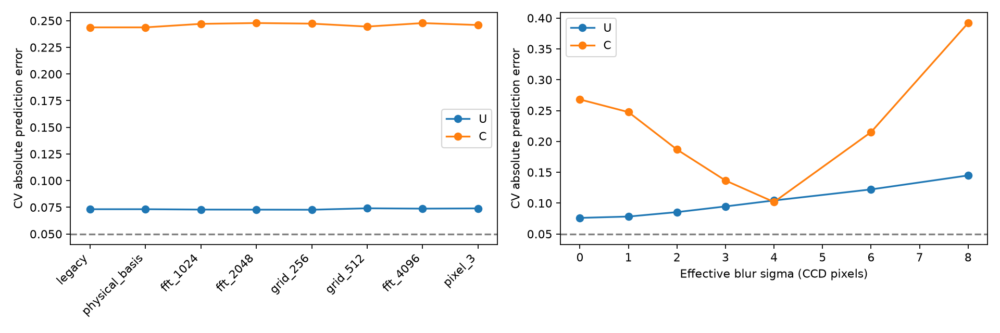

# 物理预测的采样、像素积分、曝光偏置与峰宽诊断（2026-10-22，第二阶段）

<!-- provenance:start -->
> **生成脚本**: 人工撰写，无生成脚本
> **数据/关联脚本**: [`scripts/slm/diagnose_defocus_sampling.py`](../../../scripts/slm/diagnose_defocus_sampling.py)
> **数据/关联脚本**: [`scripts/slm/diagnose_defocus_radiometry.py`](../../../scripts/slm/diagnose_defocus_radiometry.py)
> **数据/关联脚本**: [`scripts/slm/refit_defocus_uniformity_model.py`](../../../scripts/slm/refit_defocus_uniformity_model.py)
> **数据/关联脚本**: [`scripts/slm/summarize_defocus_sampling.py`](../../../scripts/slm/summarize_defocus_sampling.py)
> **数据/关联脚本**: [`scripts/slm/validate_defocus_exposure.py`](../../../scripts/slm/validate_defocus_exposure.py)
> **运行环境**: 离线+硬件
> **说明**: 固定物理参数的采样收敛、像素积分与曝光偏置补测；训练集选择有效展宽及联合 CV 微调，逐步保留原始与派生数据。
<!-- provenance:end -->

本轮延续 [当前功率下的离焦物理模型实验](physical_forward_defocus_live_20261022.md)，按用户要求先检查传播采样、CCD 像素积分、曝光偏置与剩余峰宽（FWHM）误差。相机保持主动离焦位置，SLM #1 为 `22030108`，Daheng 为 `FJB24112232`，波长 `1064 nm`。本轮没有将相关性通过等同于匀化预测通过。

## 0. 实验目的、条件与环境

### 0.1 实验目的

上一轮冻结参数检验已通过相关性门槛但未通过 CV 门槛（§6.1 与 §9.3）。本轮是紧随其后的诊断阶段，回答四个按优先级排列的问题：

1. **传播采样是否已收敛？** 输入网格（`128/256/512`）、FFT 点数（`512/1024/2048/4096`）与 CCD 像素面积积分的组合，是否会显著改变固定 CCD 网格上的预测强度，从而成为 CV 预测误差的主要来源。
2. **曝光偏置有多大影响？** 在未遮光条件下，逐像素仿射截距（电子暗本底与杂散光的混合）对跨曝光绝对强度和 CV/EE_ROI 口径的污染程度。
3. **剩余峰宽偏差能否解释？** 等效高斯强度展宽与"相位无关本底光非相干混合"两种假设，能在多大程度上吸收实测与预测光斑的宽度差。
4. **联合目标能否同时收敛？** 以强度归一化 MSE 与固定 ROI CV 误差的联合目标重拟合共享物理参数后，CV 与几何（质心）误差能否进入原定门槛。

### 0.2 实验条件与环境

与上一轮完全相同的光路与设备，未移动任何光学元件：

| 项 | 值 |
|---|---|
| 系统 | 2f 傅里叶系统（SLM 前焦面 → 傅里叶透镜 → CCD 后焦面） |
| SLM | Santec #1，控制器 `22030108`，面板 `1920×1200` |
| 相机 | Daheng `FJB24112232`，全帧 `2592×1944` |
| 波长 | `1064 nm` |
| 相机位置 | 保持主动离焦工作点，全程固定 |
| 模型起点 | 冻结上一轮 M4 拟合（几何、光轴截距、入射振幅、Noll 5–11 残余像差、增益、背景） |
| 稳定判据 | `stable_tol=0.05`，超时组保留失败原值并从响应拟合中排除 |
| 采集时段 | 2026-10-22 18:50 – 19:08 |
| 采集规模 | 新增设备数据 19 组、95 张原始帧（另含分析用输入数组与派生校正图像） |

### 0.3 实验现象概要

四项诊断的关键现象先在此速览，详细数字见 §2–§5：① 采样与像素积分加密后预测的相对 L2 差中位不超过 `0.7%`，远小于 CV 偏差；② 逐像素仿射截距分位达 `0.470 counts`（50%），校正不能单独解决 CV；③ 最优单分量展宽约 `sigma=2 px`，加入非相干模板几乎没有额外改善；④ 联合重拟合使训练 CV 平方误差从 `0.02558` 降到 `0.00738`，但验证质心误差仍高于 `1 px` 门槛；固定相位重复测量（CV 约 `±0.01`）远优于模型 CV 误差（约 `0.09`），说明剩余误差不是随机测量噪声。

## 1. 数据保存与实验边界

所有新增输出位于 `data/debug/physical_forward_defocus/` 的新目录，既有原始数据不覆盖：

| 目录 | 内容 |
| --- | --- |
| `sampling_audit_20261022_r1/` | 八组采样/积分对照、三种物理网格输入数组、曝光偏置试验、8 档有效展宽；每组保留预测与测量数组 |
| `response_bias_20261022_r2/` | 18:52–18:54 新采 U/C 各四档曝光加重复档，10 组，每组 5 张原始帧与完整总相位 |
| `radiometry_audit_20261022_r2/` | 新响应数据的逐像素仿射偏置、有效展宽与相位无关光混合比较，14 组模型结果 |
| `response_repeat_20261022_r3/` | 18:56–18:57 未补偿分支固定 `37.554 ms` 的 3 次独立重复，每次 5 张原始帧 |
| `fixed_phase_repeat_20261022_r4/` | 19:07–19:08 U/C 固定相位固定曝光，各 3 次，每次 5 张原始帧 |
| `uniformity_refit_20261022_r1/` | 联合强度/CV 目标的物理模型微调，每次迭代保存预测数组及全部参数 |

这次新增设备数据共 19 组、95 张原始帧；其中一组稳定超时，保留失败原值。所有硬件记录保留实际曝光、总相位、稳定判决、UTC 微秒格式时间和单调时钟起止。分析目录保存输入数组、源文件哈希及当次脚本副本；输入原始 NPZ 另以 SHA-256 引用。本轮证据清单为 `sampling_followup_evidence_20261022.json`，含 268 个文件的相对路径、字节数及 SHA-256，总计 `582011381 bytes`。原始帧不经背景扣除覆写。派生的校正图像单独保存，允许负值，不以截断掩盖偏置误差。精确格式时间戳不代表已获得相机硬件同步精度。

初始 12 个验证探针与后采 12 个新探针已经被上一阶段观察，本轮把它们作为诊断数据，不能再声称是未见的最终测试。拟合及模型选择仅用原训练相位；后续若满足门槛，另采新相位作最终模型验收。

## 2. 传播采样：变化很小，不能解释主要 CV 误差

保持已拟合 M4 的像差、几何、光轴、振幅、增益和背景全部冻结。计算区域始终是 `1920×1920 panel px`，面板高度 `1200 px` 外振幅为零。加密输入网格时节距为 `1920/N`，FFT 到 CCD 的映射同步改变。采用规范 `focal_intensity`，并按输入节距与正交 FFT 归一化保持物理强度尺度。不以重新拟合增益抵消采样引起的数值变化。

发现并显式保护了一个坐标约定：原 128 网格 Zernike 中心位于 `63.5×15=952.5 panel px`，不是 `960 panel px`。加密时从规范全分辨率模式按该物理中心重采样，避免无意改变倾斜和模式尺度。原网格与物理基函数重采样的结果逐位一致。这是旧拟合的物理约定保持，不代表已独立确认真实光轴位于该中心。

| 输入网格 / FFT / 积分 | U 的 CV 误差均值 | C 的 CV 误差均值 |
| --- | ---: | ---: |
| 128 / 512 / 点采样 | 0.07322 | 0.24373 |
| 128 / 1024 / 点采样 | 0.07289 | 0.24701 |
| 128 / 2048 / 点采样 | 0.07282 | 0.24779 |
| 256 / 2048 / 点采样 | 0.07273 | 0.24722 |
| 512 / 2048 / 点采样 | 0.07408 | 0.24448 |
| 512 / 4096 / 点采样 | 0.07377 | 0.24774 |
| 512 / 4096 / 每像素 3×3 面积积分 | 0.07399 | 0.24593 |

逐记录预测图的相对 L2 差（包括参考记录）：

- 固定输入网格，FFT 512 → 2048：中位 `0.236%`，最大 `0.441%`。
- 固定 FFT 2048，输入网格 256 → 512：中位 `0.672%`，最大 `1.289%`。
- 固定输入网格 512，FFT 2048 → 4096：中位 `0.196%`，最大 `0.376%`。
- 固定 512/4096，点采样 → 3×3 像素积分：中位 `0.113%`，最大 `0.186%`。

结论限于这批已保存的带宽及光路：加密后的变化远小于 C 的 CV 偏差。不能把当前主要误差归因于 FFT 采样不足或单个 CCD 像素面积积分缺失。尚未覆盖任意高空间频率相位，也没有声称无限网格严格收敛。`2 px` 间隔的诊断 ROI 与每个真实像素 `1×1 px` 的面积积分是两个概念，积分没有把 `2×2 px` 当成物理 CCD 像元。

## 3. 曝光偏置：有实际影响，但单独校正不能解决 CV

补充曝光：C 为 `0.307/0.769/1.539/3.079/1.539 ms`，U 为 `7.510/18.777/37.554/75.109/37.554 ms`。无饱和；前 9 组稳定，第 10 组 U 重复档超时，不作为有效响应验证样本。随后延长最大等待至 `30 s`，保留 `stable_tol=0.05`，固定 U `37.554 ms` 重复 3 次，均稳定。3 次原始圆盘积分为 `428383.8/430390.0/431368.8 counts`；与较早同曝光读数存在漂移，因此不能拿后来的重复强行替代前面失败记录。

逐像素模型为两种固定相位的独立曝光斜率与共享非负截距：

```text
counts_p(t, branch) = slope_p,branch * t + offset_p
```

每个相位首次出现的曝光档用于拟合，重复档仅用于验证；稳定失败全部排除。无真实遮光暗场，`offset_p` 只能称未遮光（含杂散光）条件下的仿射截距估计，可能受低光非线性、光路漂移和空间结构变化影响，不能认定为纯电子暗偏置。无约束截距约 `9.86%` 像素为负；约束后截距的 `5/50/95%` 分位为 `0.000/0.470/1.580 counts`。唯一有效 C 重复档的预测 RMSE 为 `0.275 counts`；U 在该组没有有效重复验证，三次后续固定曝光只能补充重复性证据。校正后的全部诊断像素约 `10.85%` 为负，已完整保存，未截断。

因此本轮不把大面积截距忽略，也不将这种校正直接升级成相机通用响应标定。当前档位足以检查局部仿射偏置，仍不足以稳定辨识双指数/Bezier 等高自由度模型。

## 4. 剩余峰宽（FWHM）：有效展宽仅部分解释，未调制光不是充分解释

对固定物理预测施加已知单位的等效高斯强度展宽（effective blur），sigma 以 CCD px 表示，检查 `0/1/2/3/4/6/8 px`。该项是**有效模型偏差**，不是独立测得的 CCD PSF。比较时使用校正后的观测、固定 ROI，且仅在原训练相位上拟合共享非负增益与常数背景。

训练归一化图像 MSE 最小的单分量展宽约 `sigma=2 px`；对应后采诊断相位 CV 误差约 U `0.0854`、C `0.1869`。sigma 继续到 `4 px`，C 的 CV 误差可降到约 `0.1018`，但 U 增至约 `0.1043`；训练图像误差也变差。因此不能根据测试 C 的 CV 单独选择 `4 px`，也不能说共同展宽解释了两分支。

另用冻结物理模型的零指令强度作为相位无关本底光模板，与主信号做非相干非负混合。训练择优约为 `sigma=2 px`，系数约主信号 `26.20994`、模板 `0.32766`、常数 `0.02109`。其后采 CV 误差为 U `0.0841`、C `0.1859`，相对单分量几乎没有改善。模板混合系数不是经独立标定的器件零级比例；该结果仅表明这一非相干背景假设不足以解释当前误差，没有排除相干零级、振幅耦合或更复杂的相位响应。



## 5. 训练目标修正与后续门槛

原拟合以相关性为主，可能在结构较像时容许明显 CV 偏差。新增强度归一化 MSE 与固定 ROI CV 误差的联合目标，只用原训练相位更新共享像差、振幅、光轴、增益、背景和一个有效展宽参数。CV 权重在运行前设为 `1.0`，未按测试相位误差调整。每轮保存训练预测 NPZ、全部参数、损失、UTC 与单调时钟到 `iterations.pkl`；最终按训练目标选择检查点，不用后采数据选迭代。

联合拟合完成 `150` 次更新，含初值共保留 `151` 个迭代快照。训练联合目标从 `0.13538` 降到 `0.11050`，训练 CV 平方误差均值从 `0.02558` 降到 `0.00738`；最佳训练目标对应最终迭代。有效展宽 sigma 由 `2.0` 调为 `3.51592 CCD px`。

| 数据 / 分支 | 相关性均值 | CV 绝对误差均值 | EE_ROI 绝对误差均值 | 强度矩质心误差均值 / px | RMS 半径相对误差均值 |
| --- | ---: | ---: | ---: | ---: | ---: |
| 原训练 U | 0.8973 | 0.0883 | 0.0304 | 6.61 | 2.62% |
| 原训练 C | 0.9531 | 0.0675 | 0.0281 | 6.10 | 7.61% |
| 原开发验证 U | 0.8599 | 0.0716 | 0.0288 | 7.28 | 2.06% |
| 原开发验证 C | 0.9483 | 0.0910 | 0.0418 | 4.38 | 5.96% |
| 后采诊断 U | 0.8889 | 0.0975 | 0.0289 | 7.68 | 2.37% |
| 后采诊断 C | **0.9611** | **0.0888** | 0.0364 | 4.64 | 6.66% |

这里“强度矩质心”和 RMS 是在同一固定采样窗口对非负强度权重计算的描述量，不是热点定位；弱背景和尾部会明显影响它。校正图像本身保留负值，CV/EE_ROI 没有采用非负截断，只有强度矩权重作非负处理并在代码中显式定义。本轮没有把中心误差隐去：即使宽度均值改善，质心误差仍高于预定 `1 px`。EE_ROI 分母保持原 `241×241 px` 采样窗口，不能当作全传感器效率。

原始计数率的 CV 与偏置校正后的 CV 对应不同测量定义，不能将两者误差差值全部归于展宽改善；精确展宽消融应比较第 4 节相同校正目标下的结果。对照显示：C 的 CV 对峰宽/目标函数敏感，但 U 的误差没有同步下降，**当前模型仍不能共同通过均匀度及几何验收**。原训练相位的 CV 误差本身仍超门槛，说明问题不只是验证集种子变化。因此继续保持可微整形关闭；没有采集新的优化相位或宣称方形匀化成功。设备最后在 19:08 恢复平相位并释放连接；没有改变相机位置或关闭激光。

## 5.1 已排除项、剩余假设及下一次实验

本次证据支持：当前采样与像素面积积分变化足够小，不是主要 CV 误差来源；背景偏置、峰宽与训练目标有实际影响，但这三项还不足以解决问题。没有把有效高斯展宽当成测得的器件非理想机制，也没有把训练择优的小幅背景模板系数当成真实零级比例。

补充采集了**同一相位、同一曝光的重复参考**，C 固定 `3.079 ms`，U 固定 `75.109 ms`，各 3 次、每次 5 张原始帧，全部稳定。同样固定 ROI 上，每组五帧平均后的 CV 为：

| 分支 / 定义 | 3 次 CV | 均值 ± 样本标准差 |
| --- | --- | --- |
| U / 原计数 | 0.34451 / 0.35787 / 0.36600 | 0.35612 ± 0.01085 |
| U / 仿射截距扣除 | 0.34958 / 0.36297 / 0.37112 | 0.36123 ± 0.01088 |
| C / 原计数 | 1.75053 / 1.74499 / 1.74954 | 1.74835 ± 0.00295 |
| C / 仿射截距扣除 | 1.85096 / 1.84502 / 1.84975 | 1.84858 ± 0.00314 |

这表明固定相位下的短时测量重复性明显好于当前约 `0.09` 的模型 CV 误差；两者来自不同相位，不能当成正式配对显著性检验，但不支持“全部只是随机测量噪声”。同时 C 的原计数与校正 CV 相差约 `0.10`，再次说明偏置口径必须明确。逐张原始帧、每组平均帧的指标均已保存到单独 JSON；原始帧本身仍在数据目录。

本轮曝光扫描中固定 U 的 FWHM 随曝光仍有明显变化，其可能来自低信号/阈值测量依赖或光斑结构漂移，不能只凭稳定峰值归因。同时用固定总相位在可用计数范围拍多曝光，检查逐像素响应斜率是否保持空间一致；当前稳定判据不等同于逐像素光强完全稳定。

下一步可检验独立的相位响应/振幅耦合以及相干零级，但需要新的探针设计，不能把这些物理项都随意拟合成模糊。相位响应须复用既有离散器件模型并独立测量；相干零级须用载波方向/频率和参考相位变化来辨识干涉，不能仅在强度模型中加入一张固定模板后宣称已排除。后续各项均保持输入/输出独立保存，并在新模型确定后采新种子验收。

## 6. 可复现入口

```powershell
python scripts/slm/diagnose_defocus_sampling.py --directory <paired-dir> --evaluation-directory <later-paired-dir> --fit <M4-forward_fit.json> --response <response-dir> --output <new-audit-dir>
python scripts/slm/validate_defocus_exposure.py <paired-dir> --output <new-response-dir> --fractions 0.1 0.25 0.5 1 0.5 --execute
python scripts/slm/diagnose_defocus_radiometry.py --sampling-source <audit-dir> --response <new-response-dir> --output <new-radiometry-dir>
python scripts/slm/refit_defocus_uniformity_model.py --sampling-source <audit-dir> --response <new-response-dir> --output <new-refit-dir> --iterations 150 --cv-weight 1
python scripts/slm/summarize_defocus_sampling.py --sampling <audit-dir> --radiometry <radiometry-dir> --refit <refit-dir> --output report/shape_trials/model_in_loop
```

采集默认不打开设备，必须显式 `--execute`；各分析目录默认拒绝已存在目录。曝光边界读取设备及当前环境配置，不固化旧光路的曝光上限。

汇总：[逐组统计 JSON](artifacts/sampling_radiometry_summary_20261022_r2.json)、[固定相位逐帧重复指标](artifacts/fixed_phase_repeat_metrics_20261022_r2.json)；指标 CSV 为本地工件（`artifacts/sampling_radiometry_metrics_20261022_r2.csv`，仓库全局忽略 `*.csv`，未提交，故不写成链接）。图表从保存数组重新生成，不依赖设备在线。

## 7. 检查结果

按单文件分片执行的相关测试共 `9 passed`：采样/像素积分/响应及联合损失 4 项、既有物理拟合 3 项、探针生成 2 项。报告溯源测试为 `491 passed, 1 failed`，唯一失败仍为工作区另一份 `report/miicam_simulation/miicam_report.md` 未登记，本报告链接与溯源通过。术语 dry-run 为 `0 个文件`，溯源同步检查无漂移。本任务脚本 Ruff 通过；全仓库 Ruff 发现并行工作产生的 `.probe_twin.py` 有 3 项 `E702`，未修改或删除该文件以掩盖检查结果。

## 8. 本轮结束状态与交接

本轮实验已结束，最后设备操作结束于 `2026-10-22 19:08:16`：SLM 恢复平相位，SLM 与相机连接已释放。此次收尾仅进行文件核验与文档补充，没有重新连接设备、加载相位或采集；未操作激光开关和相机位置。

后续入口是本报告第 5.1 节的剩余假设，以及第 6 节的可复现脚本。当前模型的可微整形准入结论仍为**不通过**：后采 U/C 的 CV 绝对误差均值为 `0.0975 / 0.0888`，质心误差均值为 `7.68 / 4.64 px`，分别超过原定 `0.05 / 1 px` 门槛。已有后采相位已参与诊断，后续不能继续称其为独立验收集。不得仅凭相关性提高、训练损失下降或修改验收阈值启动整形验收。

数据保存在 `data/debug/physical_forward_defocus/`，按以下顺序接续，无需重新搜索本轮参数或重复已有采样扫描：

| 目录 | 保留内容与后续用途 |
| --- | --- |
| `sampling_audit_20261022_r1/` | 传播采样、像素积分及展宽诊断；固定物理坐标与强度尺度的参考 |
| `response_bias_20261022_r2/` | 多曝光逐帧数据，含超时组；响应拟合须继续排除不稳定组与验证用重复曝光 |
| `radiometry_audit_20261022_r2/` | 逐像素仿射截距与展宽/模板对照；保留未截断的校正强度 |
| `response_repeat_20261022_r3/` | U 固定曝光重复采集，补充短时响应稳定性证据 |
| `uniformity_refit_20261022_r1/` | 联合拟合的 151 个迭代快照、参数、预测、损失及精确时间记录 |
| `fixed_phase_repeat_20261022_r4/` | U/C 同相位同曝光重复参考，区分测量重复性与模型误差 |

上述六个目录的 PKL 已离线解析：`capture_records.pkl` 指向的 NPZ 含面板总相位与 CCD 原始帧，`diagnostic_iterations.pkl` / `iterations.pkl` 含逐步迭代指标；对应的 SLM 相位、相位包裹图、CCD 远场光斑图像与迭代指标折线图见可视化画廊 `report/shape_trials/pkl_visualizations/index.html`（离线从落盘数据生成，不依赖设备在线）。

完整性清单为 `data/debug/physical_forward_defocus/sampling_followup_evidence_20261022.json`。收尾时逐文件核验其中 **268 个文件、582011381 字节**的文件大小及 SHA256，全部一致，缺失和不匹配均为 `0`。清单覆盖本轮补充诊断的上述六个目录，不代表此前全部实验数据的总量；未删除失败采集、原始帧或中间结果。

下次实验先读取冻结结果，再按新假设设计独立的相位响应/振幅耦合、相干零级及逐像素响应稳定性探针；曝光继续按当次画面、设备范围和环境配置选择。新物理项须有独立证据，并在新的相位种子上同时通过 CV、几何和配对 CCD 验收，之后才进入短块可微优化。第 6 节中的 `--execute` 是实际采集入口，离线复核与报告生成不需要设备在线。

## 9. 结论与启发

### 9.1 结论

本轮四项诊断的最终口径：

1. **传播采样与 CCD 像素面积积分不是当前 CV 误差的主要来源。** 输入网格、FFT 点数与 3×3 面积积分的全部组合下，预测图相对 L2 差中位不超过 `0.7%`，CV 误差均值变化小于 `0.004`，远小于 C 分支约 `0.24` 的 CV 偏差（§2）。
2. **曝光偏置有实际影响，但单独校正不能解决 CV。** 逐像素仿射截距在未遮光条件下不可当作纯电子暗本底；约束后截距 50% 分位 `0.470 counts`，大面积能量积分中不可忽略（§3）。
3. **剩余峰宽只能被部分解释。** 最优单分量等效高斯展宽约 `sigma=2 px`，但 C 的 CV 随 sigma 下降时 U 反而变差；非相干本底模板混合相对单分量几乎没有改善，说明剩余误差不是简单的强度模糊或非相干背景（§4）。
4. **联合目标改善了训练与验证 CV，但未达门槛。** 训练 CV 平方误差 `0.02558 → 0.00738`，后采诊断 C 相关性升到 `0.9611`；但 U/C 的 CV 绝对误差 `0.0975 / 0.0888`、质心误差 `7.68 / 4.64 px` 仍超过 `0.05 / 1 px` 门槛，可微整形准入维持**不通过**（§5、§8）。
5. **测量重复性显著优于模型误差。** 固定相位固定曝光的短时重复 CV 约 `0.356 ± 0.011`（U）/ `1.748 ± 0.003`（C），样本标准差比模型 CV 误差小一个量级，不支持"剩余误差主要是随机测量噪声"的假设（§5.1）。

### 9.2 启发

1. **先立测量噪声地板，再归因模型误差。** 固定相位重复参考（`response_repeat_r3` / `fixed_phase_repeat_r4`）以约 `0.01` 量级的重复性，把"模型还有多少真实误差"与"测量本身有多抖"分开——没有这一层证据，任何模型改进都无法被可信地归因。
2. **验收指标之间存在不同向风险。** 相关性最高的模型不是 CV 误差最小的模型（上一轮 §7.2）；本轮进一步表明，对峰宽敏感的 C 分支与对结构敏感的 U 分支不能用同一个展宽参数同时满足。验收必须逐指标独立判定。
3. **诊断数据要保留未截断的中间量。** 允许负值的仿射截距与校正强度（约 `10.85%` 像素为负）被完整落盘而不是截断归零，否则偏置误差会被掩盖成"改善"，后续任何再分析都失去依据。
4. **证据链是接续实验的前提。** SHA-256 清单、脚本副本、精确时间戳与"失败组原值保留"使本轮无需重复任何采样即可续作；这比节省的采集时间本身更有价值。
5. **剩余假设需要专门设计的探针，而不是更多自由参数。** 相干零级要用载波方向/频率与参考相位变化来辨识干涉；相位响应/振幅耦合要复用离散器件模型独立测量。把物理项都拟合成模糊核，只会把可辨识的问题变成不可辨识的拟合。
