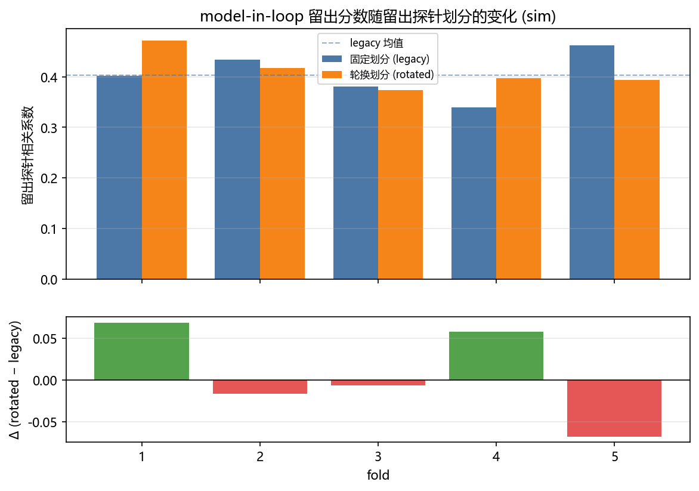

# model-in-loop 留出探针的 K 折交叉验证

<!-- provenance:start -->
> **生成脚本**: [`scripts/generate_model_in_loop_cv_report.py`](../../scripts/generate_model_in_loop_cv_report.py)
> **复现命令**: `python scripts/generate_model_in_loop_cv_report.py`
> **运行环境**: 离线
> **说明**: model-in-loop 留出探针的 K 折交叉验证 (sim 后端, 无设备): 固定种子偏移 vs 轮换划分的配对对比; 经 probe_split_hook / holdout_on_sim 两个默认关闭的 开关驱动真实 optimize_slm_model_in_loop, 不复刻 Step A; 统计量全部取自 ml.zernike.cv_harness 与 ml.zernike.eval_stats
<!-- provenance:end -->

**问题**：`slm-model-in-loop` 的探针划分是一个**固定种子偏移**（留出 = `seed + 1_000_000 + index*1000 + k`），不是交叉验证。本报告量化的是：**换一个留出探针集合，留出分数会动多少**。

**设置**：5 折，折内两臂共享 base seed `0 + k`（故各有独立初始化）与**完全相同的训练探针**，唯一差别是留出集合；折划分种子 20261014，探针池 16 个，后端 `sim`（无设备）。



## 1. 逐折结果

| fold | base seed | 留出探针 legacy (第 2 轮) | 留出探针 rotated (固定) | legacy 分数 | rotated 分数 | Δ |
|---|---|---|---|---|---|---|
| 1 | 20261014 | 21,262,014–21,262,015 | 5,000,003, 5,000,010 | 0.4021 | 0.4712 | 0.0691 |
| 2 | 20261015 | 21,262,015–21,262,016 | 5,000,004, 5,000,011 | 0.4334 | 0.4172 | -0.0162 |
| 3 | 20261016 | 21,262,016–21,262,017 | 5,000,002, 5,000,007 | 0.3807 | 0.3741 | -0.0066 |
| 4 | 20261017 | 21,262,017–21,262,018 | 5,000,000, 5,000,005 | 0.3389 | 0.3970 | 0.0581 |
| 5 | 20261018 | 21,262,018–21,262,019 | 5,000,001, 5,000,008 | 0.4613 | 0.3937 | -0.0676 |

分数取**最后一轮**的留出相关性。两臂的留出集合并非同一形状：legacy 的留出探针随轮次前移（`base + index*1000 + 1_000_000 + k`），所以上表给出的是被评分的那一轮（第 2 轮）的集合；rotated 的留出集合在整轮内固定，否则一次独立测量会变成若干次，留出就不再独立。

两臂运行状态：fold 1 legacy=`completed` / rotated=`completed`；fold 2 legacy=`completed` / rotated=`completed`；fold 3 legacy=`bake_off_rejected` / rotated=`bake_off_rejected`；fold 4 legacy=`completed` / rotated=`completed`；fold 5 legacy=`completed` / rotated=`completed`。（`holdout_on_sim` 只**测量**不**判定**：仿真不会因留出相关性偏低而中止，所以每折都有分数而不是通过/失败。）

## 2. 配对统计

| 指标 | 值 |
|---|---|
| 固定划分 均值 ± sd | 0.4033 ± 0.0473 |
| 轮换划分 均值 ± sd | 0.4106 ± 0.0371 |
| Δ 均值 (rotated − legacy) | 0.0074 |
| Δ 范围 | -0.0676 … 0.0691 |
| Cohen's d_z | 0.1308 |
| sign-flip p | 0.9375 |
| 最小可达 p = 2/2^K | 0.0625 |
| p 是否已触底 | 否 |

Δ 的折间 sd 是 **0.0565**，Δ 的均值是 0.0074，均值/sd = **0.1308**。
均值小于折间抖动：换留出集合带来的扰动与两臂之间的系统差**不可区分**。固定划分给出的那一个数不能当作模型属性引用 —— 它只是这一个留出集合的抽样结果，同协议下换一个留出集合可以看到 ±0.0565 量级的移动。

## 3. 怎么读这张表（本报告不宣称什么）

1. **本折数在结构上无法给出 p < 0.05 的结论。** sign-flip 精确置换检验的最小可达 p 是 `2/2^K` = 0.0625（5 折）。触底时只报效应量，不报显著性。
2. **配对轴是被变动的那个轴。** 折 k 的 base seed 是 `seed + k`，所以配对是沿 seed/划分轴做的；没有把 K 折当成 K 次独立初始化采样。
3. **两臂共享训练探针**，这是刻意的：只旋转留出集合才能把「留出集合不同」与「训练集合不同」分开。
4. **这不是硬件结论。** 全部数字来自 `sim` 后端；硬件的读出噪声、漂移与 LCOS settling 都不在模型内。硬件的折间 spread 只可能更大。
5. **GS 是对照而非基线。** `report/shape_trials/README.md` 记录了 GS 在实机上输给平场相位；本报告不把任何一臂称作基线。

## 4. 复现

```bash
python scripts/generate_model_in_loop_cv_report.py
```

本报告由 `--folds 5 --pool-size 16 --fold-seed 20261014` 生成；统计量全部来自 `ml/zernike/cv_harness.py` 与 `ml/zernike/eval_stats.py`，脚本内不复算。
