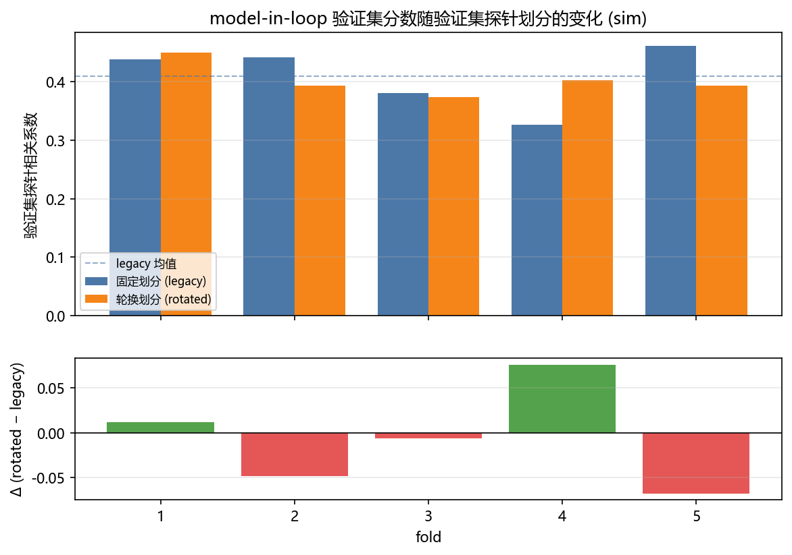

# model-in-loop 验证集探针的 K 折交叉验证

<!-- provenance:start -->
> **生成脚本**: [`scripts/slm/generate_model_in_loop_cv_report.py`](../../../scripts/slm/generate_model_in_loop_cv_report.py)
> **复现命令**: `python scripts/slm/generate_model_in_loop_cv_report.py`
> **运行环境**: 离线
> **说明**: model-in-loop 验证集探针的 K 折交叉验证 (sim 后端, 无设备): 固定种子偏移 vs 轮换划分的配对对比; 经 probe_split_hook / holdout_on_sim 两个默认关闭的 开关驱动真实 optimize_slm_model_in_loop, 不复刻 Step A; 统计量全部取自 ml.zernike.cv_harness 与 ml.zernike.eval_stats
<!-- provenance:end -->

## 0. 实验目的

**要回答的问题**：`slm-model-in-loop` 的探针划分是一个**固定种子偏移**（验证集 = `seed + 1_000_000 + index*1000 + k`），那只是**一个**划分，不是交叉验证。本报告要回答的是：**换一个验证集探针集合，验证集分数会动多少**。

**为什么值得做**：本仓库每一次模型/算法改动，都是拿「恰好落进那个固定验证集」的探针比一次。若分数会随验证集集合移动，那么那个数从来就不是模型的属性，而是**某一个验证集集合的抽样结果** —— 拿它当「改动有效 / 无效」的判据，就是在读噪声。

**预期能排除什么**：排除「固定划分给出的那一个数可以当作模型属性引用」这一说法，并给出**换验证集集合带来的扰动量级**，供后续任何单点对比先对照这个量级。

> ⚠️ 本报告**不**回答「哪个模型更好」：两个变体跑的是**同一个**优化器，只有验证集集合不同。它是一次**测量口径**的体检，不是模型对比，也不是实验结论（全部数字来自 `sim` 后端）。

## 0.1 实验设置（纯仿真，无设备）

后端 `cam_type=sim`：**数字孪生，不打开任何设备**（无相机、无 SLM）。远场由 canonical 解析模型 `forward_intensity` 给出，再做零级邻域裁剪（模拟相机 ROI）、加性读出噪声与 16 bit 量化 —— 量化本底与弱探针的信号同量级，这正是 Step A 需要强探针的原因（`_SimBench`）。

**本次运行显式给定的参数**：

| 项 | 值 |
|---|---|
| 后端 | `sim`（数字孪生，**不打开任何设备**：无相机、无 SLM） |
| 前向模型瞳面网格 `region` | 32 |
| 相机窗口 `cam_size` | 128 |
| 远场补零 `far_field_padding` | 4 |
| 目标边长 `target_side` | 64 px（相机像素） |
| 拟合模态数 `n_orders` | 4 |
| 轮数 `n_rounds` | 2 |
| 训练探针数 `probe_count` | 4 |
| 验证集探针数 `holdout_probe_count` | 2 |
| Step A / Step B 迭代 | 20 / 20 |
| 工作精度 / 设备 | `float32` / `cpu` |
| 折数 K | 5 |
| 验证集探针池 | 16 个（种子基址 5,000,000） |
| base seed | 0（折 k 用 `seed + k`） |
| 折划分种子 | 20261014 |

**取 `SlmModelInLoopConfig` 默认、本次未改写的关键项**：

| 项 | 值 |
|---|---|
| 目标形状 `target_shape` | `square` |
| 冻结模态 `frozen_modes` | (1, 2, 3) |
| 探针幅度 `probe_spread` | 4.0 rad |
| 验证集相关性门槛 `min_holdout_correlation` | 0.5 |
| trust region 半径 `trust_region_c_l2` | 0.5 rad |
| 目标函数权重 `w_uniformity` / `w_efficiency` | 0.4 / 0.6 |
| 自适应 trust region `adaptive_trust_region` | False |

> 验证集相关性门槛 0.5 在 `sim` 上**只测量不判定**：失配中止只在 `cam_type != "sim"` 时生效，否则一个中止会把一折变成缺分数。

**协议**：折 k 的 base seed = `seed + k`（故两个变体各有独立初始化），两个变体**共享同一套训练探针**（`legacy` 规则委托，验收守卫拒轮时追加的探针也同步增长），唯一差别是验证集集合。折划分由 `build_folds(pool_size, folds, seed=fold_seed)` 给出，验证集种子取自 `POOL_BASE = 5,000,000` 起的探针池 —— 离 `seed + index*1000` 与 `seed + 1_000_000 + index*1000` 两条既有调度足够远，不可能与训练探针撞号。

## 0.2 算法修改

被测的优化器**本身没有改**：跑的是生产用的 `optimize_slm_model_in_loop`，Step A 不在本报告里重跑、也不重拟合。改的是让它**可测**的两处：

1. **两个默认关闭的开关**（`SlmModelInLoopConfig`，`src/ao_shaping/optimizer/wfless/slm_model_in_loop.py`）：
   - `holdout_on_sim`（默认 `False`）—— 在 `cam_type="sim"` 上也**测量**验证集探针。默认关闭时仿真路径根本不测验证集，`holdout_correlation` 恒为 NaN，正向模型失配守卫也就永远不触发；打开后每轮多 `holdout_probe_count` 次探针往返。
   - `probe_split_hook`（默认 `None`）—— 用外部给定的 `(train, holdout)` 种子对替换固定偏移算术。`None` 时保持历史行为**逐位不变**；hook 必须给出恰好请求的条数，且训练/验证两侧不得有交集（否则验证集相关性会退化成样本内相关性）。

   两个开关都**只改「测什么 / 从哪取种子」**，不改 Step A / Step B 的优化逻辑。
2. **新增交叉验证装置** `src/ml/zernike/cv_harness.py`：`build_folds`（确定性 K 折划分）、`paired_fold_report`（沿**被变动的那条轴**配对）、`min_attainable_pvalue_folds`（`2/2^K` 结构性下限）。统计量本身不在脚本里复算 —— 全部取自 `src/ml/zernike/eval_stats.py`（纯 NumPy，报告引用的唯一统计来源）。
3. **本报告脚本的编排**：训练探针**委托**给 `legacy` 规则而不是钉死 —— 验收守卫拒轮时会追加探针，钉死的列表会在下一轮抛错。委托之后，「两个变体只差验证集」这条不变量在整轮运行里始终成立。

## 0.3 结果分析

（数字全部取自 §2 的配对统计；此处只给判读。）

- **固定划分**（生产用的固定种子偏移）验证集相关性均值 **0.4099 ± 0.0554**；**轮换划分**（每折换一个验证集集合）为 **0.4029 ± 0.0285**。
- 配对差 Δ（rotated − legacy）均值 **-0.0070**，逐折范围 **-0.0676 … 0.0758**，折间 sd **0.0561**，均值/sd = **0.1250**。
- Cohen's d_z = **-0.1250**；sign-flip 精确置换检验 p = **0.9375**；5 折的最小可达 p = `2/2^K` = **0.0625**（未触底）。
- **判读**：换验证集带来的扰动与两个变体之间的系统差**不可区分** ⇒ **固定划分给出的那一个数不能当作模型属性引用** —— 它只是某一个验证集集合的抽样结果。
- **不宣称什么**：① 5 折在结构上到不了 p < 0.05，触底时只报效应量；② 两个变体是同一个优化器的两个验证集，不是两个模型；③ 全部数字来自 `sim` 后端，实验的读出噪声、漂移与面板稳定时间都不在模型内。



## 1. 逐折结果

| fold | base seed | 验证集探针 legacy (第 2 轮) | 验证集探针 rotated (固定) | legacy 分数 | rotated 分数 | Δ |
|---|---|---|---|---|---|---|
| 1 | 20261014 | 21,262,014–21,262,015 | 5,000,003, 5,000,010 | 0.4387 | 0.4504 | 0.0117 |
| 2 | 20261015 | 21,262,015–21,262,016 | 5,000,004, 5,000,011 | 0.4421 | 0.3937 | -0.0484 |
| 3 | 20261016 | 21,262,016–21,262,017 | 5,000,002, 5,000,007 | 0.3807 | 0.3741 | -0.0066 |
| 4 | 20261017 | 21,262,017–21,262,018 | 5,000,000, 5,000,005 | 0.3268 | 0.4026 | 0.0758 |
| 5 | 20261018 | 21,262,018–21,262,019 | 5,000,001, 5,000,008 | 0.4613 | 0.3937 | -0.0676 |

分数取**最后一轮**的验证集相关性。两个变体的验证集并非同一形状：legacy 的验证集探针随轮次前移（`base + index*1000 + 1_000_000 + k`），所以上表给出的是被评分的那一轮（第 2 轮）的集合；rotated 的验证集在整轮内固定，否则一次独立测量会变成若干次，验证集就不再独立。

两个变体运行状态：fold 1 legacy=`completed` / rotated=`completed`；fold 2 legacy=`completed` / rotated=`completed`；fold 3 legacy=`completed` / rotated=`completed`；fold 4 legacy=`completed` / rotated=`completed`；fold 5 legacy=`completed` / rotated=`completed`。（`holdout_on_sim` 只**测量**不**判定**：仿真不会因验证集相关性偏低而中止，所以每折都有分数而不是通过/失败。）

## 2. 配对统计

| 指标 | 值 |
|---|---|
| 固定划分 均值 ± sd | 0.4099 ± 0.0554 |
| 轮换划分 均值 ± sd | 0.4029 ± 0.0285 |
| Δ 均值 (rotated − legacy) | -0.0070 |
| Δ 范围 | -0.0676 … 0.0758 |
| Cohen's d_z | -0.1250 |
| sign-flip p | 0.9375 |
| 最小可达 p = 2/2^K | 0.0625 |
| p 是否已触底 | 否 |

Δ 的折间 sd 是 **0.0561**，Δ 的均值是 -0.0070，均值/sd = **0.1250**。
均值小于折间抖动：换验证集带来的扰动与两个变体之间的系统差**不可区分**。固定划分给出的那一个数不能当作模型属性引用 —— 它只是这一个验证集的抽样结果，同协议下换一个验证集可以看到 ±0.0561 量级的移动。

## 3. 怎么读这张表（本报告不宣称什么）

1. **本折数在结构上无法给出 p < 0.05 的结论。** sign-flip 精确置换检验的最小可达 p 是 `2/2^K` = 0.0625（5 折）。触底时只报效应量，不报显著性。
2. **配对轴是被变动的那个轴。** 折 k 的 base seed 是 `seed + k`，所以配对是沿 seed/划分轴做的；没有把 K 折当成 K 次独立初始化采样。
3. **两个变体共享训练探针**，这是刻意的：只旋转验证集才能把「验证集不同」与「训练集合不同」分开。
4. **这不是硬件结论。** 全部数字来自 `sim` 后端；硬件的读出噪声、漂移与 LCOS settling 都不在模型内。硬件的折间 spread 只可能更大。
5. **GS 是对照而非基线。** `report/shape_trials/README.md` 记录了 GS 在实验系统中输给平场相位；本报告不把任何一个变体称作基线。

## 4. 复现

```bash
python scripts/slm/generate_model_in_loop_cv_report.py
```

本报告由 `--folds 5 --pool-size 16 --fold-seed 20261014` 生成；统计量全部来自 `ml/zernike/cv_harness.py` 与 `ml/zernike/eval_stats.py`，脚本内不复算。
