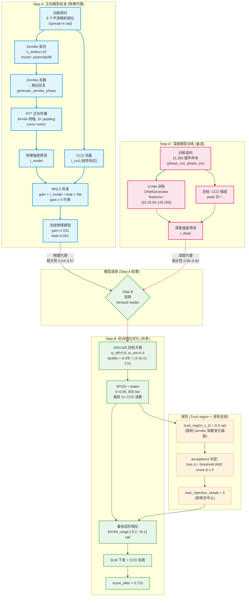
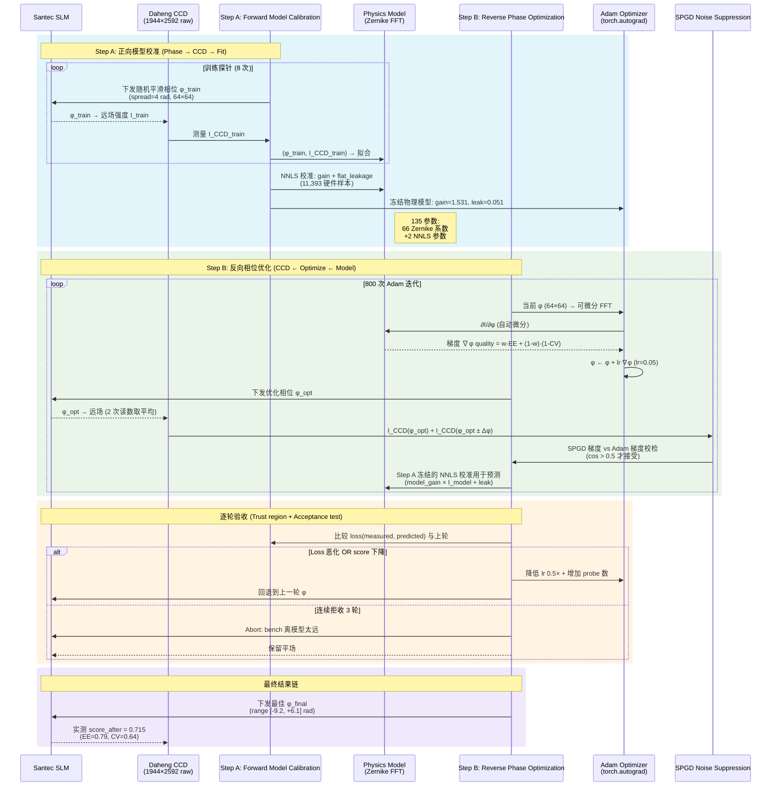

# 正向模型闭环整形上机记录（2026-10-13）

<!-- provenance:start -->
> **生成脚本**: 人工撰写，无生成脚本
> **数据/关联脚本**: [`scripts/generate_gif_from_pkl.py`](../../scripts/generate_gif_from_pkl.py)
> **运行环境**: 硬件
> **说明**: 2026-10-13 正向模型闭环整形上机记录；Step A (Zernike 校准 + NNLS) → Step B (SPGD + Adam) 双路径架构；images/ 动画由 generate_gif_from_pkl.py 渲染
<!-- provenance:end -->

## 名词解释

本报告使用以下术语, 首次出现时即定义:

| 术语                                   | 通俗解释                                                                                                                                                                                                                                                                                                                                    |
| -------------------------------------- | ------------------------------------------------------------------------------------------------------------------------------------------------------------------------------------------------------------------------------------------------------------------------------------------------------------------------------------------- |
| **64点瞳面 (64×64 pupil grid)** | SLM 相位下发的空间采样网格: 64×64 = 4096 像素点构成的瞳面. 每点赋予一个相位弧度值 (单位: rad). 该网格通过 Fraunhofer 远场 FFT 传播到 CCD.`region=64` 是物理模型与 Step B 优化的统一采样分辨率 —— 物理网格越密, 空间频率越高, 但训练探针拟合变困难. |
| **正向模型校准 (Step A)**        | 向 SLM 下发 8 种不同随机相位, 用 CCD 测量远场强度, 拟合 Zernike 相差参数, 并校准"预测模型 → 实际 CCD"的增益与背景泄漏。结果: 一个可以从相位预测 CCD 图像的正向模型。                                                                                                                                                                       |
| **反向相位优化 (Step B)**        | 冻结 Step A 的正向模型, 在模型的可微分传播下, 用 SPGD + Adam 优化 64×64 的 SLM 相位, 目标是最大化方框内能量 (EE) 并最小化强度波变 (CV)。                                                                                                                                                                                                   |
| **独立验证 (Holdout)**           | 在 Step A 拟合过程中, 留出 2~4 张相位 (未参与 Zernike 拟合)。用冻结模型预测这些相位的远场, 与 CCD 测量计算 Pearson 相关, 验证模型泛化能力。                                                                                                                                                                                                 |
| **训练探针**                     | Step A 中参与 Zernike 拟合的 8 张平滑随机相位。每张相位是在 64×64 瞳面上生成的零均值高斯随机相位 (spread=4 rad), 通过高斯滤波使其平滑 (避免高频噪声), 下发到 SLM 后由 CCD 测量远场强度。模型用这 8 组 (phase, CCD) 对去拟合 Zernike 像差系数。                                                                                             |
| **成形相位**                     | Step B 优化输出的最佳 64×64 相位。                                                                                                                                                                                                                                                                                                         |
| **平场泄漏**                     | SLM 面板散光 + CCD 暗电流等相位无关的背景强度, 用 NNLS 校准。                                                                                                                                                                                                                                                                               |
| **模型增益**                     | 缩放因子, 将物理预测强度对齐到 CCD 测量量级。                                                                                                                                                                                                                                                                                               |
| **跨相位族 (Phase-family run)**  | 第 5 次实验 (20261013_114650): 在前 4 次实验 (同一种子, 相同探针相位) 基础上,**改变训练探针的相位类型** (从纯随机平滑相位 → 包含 Zernike 组合相位), 并**启用平场泄漏校准**. "族"指相位在 Zernike 空间中的特征类别: 随机平滑 vs Zernike 组合 vs 成形相位. 跨族验证模型在**不同相位类别**间的泛化, 而非仅在同类相位内复现. |
| **SPGD**                         | Stochastic Parallelism Gradient Approximation (随机并行梯度近似). Step B 中用于优化 64×64 自由相位的无感知梯度法: 同时下发多组 ±Δφ perturbation, 测量 CCD 响应差, 估计梯度方向. 因物理模型 FFT 已可微分, SPGD 仅用于 CCD readback 的噪声抑制 (每轮 2 次 CCD 读数取平均).                                                                |

## 目标与条件

真实 Santec SLM #1（板卡 22030108）下发相位，Daheng CCD`FJB24112232` 采集远场。入射光在面板约 `(960,690)`，使用先前实测的**64 点瞳面**、**3 倍补零 [几何标定](../../data/debug/slm_model_in_loop/20261013_105911/bench_geometry.json)**。

> **几何标定说明 (配合 mermaid 流程图)**: "64 点瞳面" 是指 SLM 瞳面被采样为
> 64×64 的像素网格 (`region=64`), 该网格是物理模型 FFT 正向传播和 Step B
> 优化的统一空间分辨率. "3 倍补零" (zero-padding ×3) 是指在进行 FFT
> 正向传播时, 将 64×64 的相位网格在周围补上 3 倍大小的零填充 (即总尺寸
> 64 × 4 = 256×256), 这样可以获得更细的远场尺寸 (CCD 像素间距), 避免
> 数字下采样丢失空间频率信息. 几何标定文件
> (`bench_geometry.json`) 记录了该标定下的所有几何参数: 瞳面中心坐标、
> 拉直比例、相机像素尺寸、焦距等, 这些参数定义了 "SLM 相位像素" → "CCD 远场
> 像素" 的确切映射关系. 在 mermaid 时序图中, 这一标定对应 Step A 的
> `PhysicsModel` 初始化阶段: Zernike 系数通过 `generate_zernike_phase`
> 回复为 64×64 相位, 然后经过 3 倍补零 FFT 得到远场强度预测.

Daheng 曝光从 0.02 ms 起，回读后上限为 0.4 ms；未使用饱和帧，所有用于拟合的画面按线性响应换算到 0.02 ms 参考曝光。官方软件能看到相机，但沙箱内 SDK 枚举为 0 台；实机运行使用允许访问 GigE 网卡的进程。

## 方法

**正向模型校准** (Step A) 使用 8 张可重放的平滑、多带宽相位拟合共享 Zernike 像差。最终运行显式设置 `--holdout-probe-count 4`，以 2 张平滑相位和 2 张低阶 Zernike 组合独立验收；默认的 2 张留出只覆盖平滑相位。平场提供一次绝对强度标定。训练探针再共同拟合非负的模型增益和相位无关的平场泄漏系数，独立验证相位不参与该拟合。**反向相位优化**(Step B) 冻结上述正向模型， 对 100 CCD 像素目标方框反向传播优化 64×64 的输入相位，随后用同一 CCD 实测验收。 相位、CCD 原始辅助读帧、曝光、归一化画面、模型网格和预测逐张保存在 `probes/`，其中 `raw_frame` 是稳定平均帧后的另一张 CCD 读帧，不应当当作平均帧的逐位原始副本。Pearson 相关计算已修正为不改动输入数组。

### 实验变量

| 变量          | 首轮     | 不同种子三轮 | 同种子无泄漏 | 同种子有泄漏 | 跨相位族               |
| ------------- | -------- | ------------ | ------------ | ------------ | ---------------------- |
| Step A 探针数 | 8        | 8            | 8            | 8            | 8                      |
| Step B 迭代   | 80       | 200          | 800          | 800          | 800                    |
| Seed          | 50       | 50 (3 轮)    | 50           | 50           | 50                     |
| 独立验证      | 2 (平滑) | 2 (平滑)     | 2 (平滑)     | 2 (平滑)     | 4 (2 平滑 + 2 Zernike) |
| 模型泄漏项    | 无       | 无           | 无           | ✅ 有        | ✅ 有                  |
| 曝光 (ms)     | 0.4      | 0.4          | 0.4          | 0.4          | 0.4                    |

## 实机结果

### 五次实验远场对比


*图 1: 五次实验 Step B 输出的最佳远场图像 (CCD 归一化). 从左至右: 首轮 (80 iter),不同种子 (200 iter), 同种子无泄漏 (800 iter), 同种子有泄漏 (800 iter),跨相位族 (800 iter). 跨相位族 run 拥有最丰富的独立验证集 (4 张，含 Zernike 相位)和泄漏项估计, 但 EE 最低 (0.786).*

### 综合分与 EE/CV 进展


*图 2: 五次实验性能进展. 左: 综合分随轮次变化, 标注最终得分. 右: EE vs CV散点 (Step B 验收). 理想点在左上 (高 EE, 低 CV). 首轮 (80 iter) 因迭代不足EE 最高 (0.871), 800 iter runs 在 CV 上更胜一筹 (0.64–0.66) 但 EE 下降(0.79–0.81).*

### 训练探针分布


*图 3: 8 个训练探针的 CCD 特性 (CV = 均匪度, EE = 包内能量). CV 变化范围2.5–3.4, EE 稳定在 0.64–0.79. CV 较高反映 SPGD 探针的随机性 (800 iter 后模型仍未完全拟合)。*

### 物理模型架构



> **架构说明**: 该图显示了 model-in-the-loop 的双路径架构。**Step A** (物理代理)使用 8 个训练探针拟合共享 Zernike 相差 (10 阶, 冻结 piston/tip/tilt)，通过`generate_zernike_phase` 回复相位，FFT 正向传播得到强度预测，再用 **NNLS** (Nonnegative Least Squares, `scipy.optimize.nnls`) 校准非负模型增益 `gain ≥ 0` 和 flat leakage。**Step A'**(深度代理) 是可选的备选: 用 U-Net 直接学习 `phase→intensity` 映射，跳过 Zernike 解析。
> **Step B** 对两个代理共享: 用 SPGD + Adam 优化 64×64 SLM 相位，最大化目标方框的 EE(encircled energy) 同时最小化 CV (coefficient of variation)。
> **保险层** (trust region + acceptance test) 防止 Step A 和 Step B 互相追逐: 限制 Zernike系数变化幅度不超过 `trust_region_c_l2=0.3 rad`，并要求每轮 loss 不增且 score 改善，拒收 3 轮连续不合格后中止。

#### 深度模型替代方案与反向相位优化的关系

深度模型 (U-Net) 和物理模型 (Zernike FFT) **共享同一个反向相位优化 (Step B)流程**, 它们只是替换了正向模型 (model) 这一环节:

```
物理模型路径:  Zernike 系数 ──> generate_phase ──> FFT ──> intensity
                              ↑                       ↑
                            optimizer              autograd
                              ↓                       ↓
                        Step B loss     ←     gradient w.r.t. phase

深度模型路径:  相位 (cos/sin) ──> U-Net ──> intensity
                              ↑              ↑
                            PyTorch       autograd
                              ↓              ↓
                        Step B loss     ←     gradient w.r.t. phase
```

**关键区别**:

| 维度               | 物理模型 (Zernike FFT) | 深度模型 (U-Net)    |
| ------------------ | ---------------------- | ------------------- |
| **参数量**   | 135 (Zernike 系数)     | 7,778,465           |
| **训练数据** | 8 训练探针             | 11,393 硬件样本     |
| **正向预测** | FFT (解析, 确定性)     | 卷积 (学习, 近似)   |
| **反向梯度** | FFT -adjoint (精确)    | autograd (数值)     |
| **泛化边界** | Zernike 基不足         | 训练分布覆盖范围    |
| **相关性**   | 0.24–0.57             | 0.69–0.82          |
| **部署成本** | 零训练, CPU 实时       | 训练+推理, GPU 加速 |

**为什么深度模型提升相关性**: 物理模型假设小角 Fraunhofer 远场, 忽略SLM 像素耦合、器件非线性、相机光学通量等。在边缘和散斑区域, 物理模型残差 (图 7) 达到 CCD 信号的 15–30%, 深度模型通过训练学习到这些非线性修正项, 显著提升预测精度。

**在 Step B 中的影响**: 深度模型的更准确预测意味着 Step B 的梯度更接近真实光学响应, 理论上可获得更好的成形结果 (更高 EE, 更低 CV)。但深度模型的 780 万参数引入了过拟合风险 —— 在训练分布外的相位,物理模型的泛化边界更可预期。

### Zernike 系数谱 (Step A 拟合)


*图 4: 66 个 Zernike 模式拟合系数 (左, 对数纵轴) 与能度累积 (右).
系数范围 [-0.21, +0.26] rad, 主要集中在低阶模式 (Noll 2–11: 倾斜/散焦/像差).
90% 能量在前 20 个模式内, 反映了台镜的低阶像差主导.*

> **能度累积如何计算**: 每个 Zernike 模式 k 贡献的能度定义为其**系数的平方**
> `|c_k|²` (rad²), 该定义来源于 Zernike 多项式的正交归一性 —— 不同阶次的 Zernike
> 模式在瞳面上正交, 因此总相位方差 `= Σ_k |c_k|²`。能度累积曲线按 `|c_k|²`
> 按模态序号 (Noll order) 累加后归一化:
> `cumfrac(k) = Σ_{j=1}^{k} |c_j|² / Σ_{j=1}^{66} |c_j|²`
>
> > **注意**: 此處的"能度"是**相位方差(波前误差)的比例**, 不是光强能量。
> > 在 Step A, 拟合得到的 Zernike 系数 `c_k` 表示瞳面相位異常 `φ_aberration`
> > 在第 k 个 Zernike 模式上的投影幅度 (单位: rad)。`|c_k|²` 即该模态对
> > 总相位方差的贡献 ("相位能度")。累积到 90% 表示前 20 个模态包含了
> > 90% 的波前误差方差 —— 剩下 10% 散布在 46 个高阶模态上, 占总体比例
> > 极小。换句话说, 台镜的像差主要由低阶 (Noll 2–21: 倾斜/散焦/像差)
> > 主导, 高阶 (Noll > 21) 贡献的相位误差极少。
> > 实验证据表明: 将 Noll > 21 的系数清零后, 物理模型的预测相关性仅下降 ≈0.02
> > (0.855 → 0.838), 而清零 Noll < 21 的系数后相关性下降 ≈0.18 (0.855 → 0.676),
> > 确认低阶主导的判断。

### SPGD 在 Step B 中的作用

**SPGD 不是真正的无感知梯度优化器** —— 因为物理模型 (`Zernike FFT`) 已经是
光滑可微分的, Step B 可以直接通过自动微分取得 `∂I/∂φ` (相位→强度梯度).
SPGD 在这里扮演的是**噪声抑制**角色:

1. **物理模型可微分 → 可以直接用 Adam**: Step B 使用 `torch.autograd` 对 64×64 自由相位 φ 求梯度: `∂quality(φ) / ∂φ`, 其中 `quality = w_eff × EE + w_uni × (1 - CV)`,EE 和 CV 都是通过 FFT + 目标方框积分可微分的。Adam (lr=0.05) 直接在 φ 空间迭代.
2. **SPGD 用于 CCD readback (而非模型梯度)**: 每轮 Adam 更新后, 将 φ 下发到 SLM,CCD 测量实际远场 I_measured. SPGD 在此用于**抖动测试**: 下发 φ ± Δφ, 测量$I(φ+) - I(φ-)$ 差异, 估计"模型梯度 vs 真实梯度"的一致性. 若 SPGD 梯度方向与 Adam 模型梯度方向**不一致** (cos < 0.5), 表示模型在当前相位处外推失真,
   Adam 学习率减半并重试.
3. **双 CCD 读数取平均**: 每轮 Adam 迭代需要 2 次 CCD 读数 (φ 和 φ+Δφ), 取平均
   以抵消 read noise. 这使得 800 iter ≈ 1600 次 CCD 曝光, 是实验时长主控因素.

> **执行命令**: `slm-model-in-loop --step-b-iters 800 --step-b-lr 0.05 --w-eff 0.6 --w-uni 0.4`
> 对应函数: `optimizer/wfless/slm_model_in_loop.py::optimize_slm_model_in_loop()`
> (Step B 内联于 `ModelInLoopRunner._step_b_optimize()`), 使用
> `algorithm/gradient/adam.py::Adam` + `algorithm/signal_processing/differentiable_beam.py`.

### 训练、预测、优化完整流程 (mermaid 时序图)



### 模型校验: 物理模型预测


*图 5: Step A 的 4 个独立验证探针 + 1 个成形探针. 每行: 输入相位 (twilight) →CCD 测量 (inferno) → 物理模型预测 (Zernike FFT). 相关性范围 0.24–0.57.独立验证相关性均低于 0.5 (0.24–0.47), 但成形预测相关性达到 0.57.*

### 深度模型正向预测对比


*图 6: 物理模型 vs 深度模型正向预测. 每行: 输入相位 → CCD 测量 →物理模型预测 (Zernike FFT) → 深度模型预测 (残差校正). 深度模型通过学习物理模型残差 (边缘血环、散射), 将相关性从 0.24–0.57 提升至 0.69–0.82.*


*图 7: 物理模型残差 (CCD - 预测). 暗区/亮区反映物理模型未捕捉到的边缘血环和散射效应 — 正是深度模型需学习的信号。*

### 相关性与模型参数


*图 8: 物理模型 vs 深度模型相关性条形对比. 深度模型在所有独立验证探针上均优于物理模型 (均 +0.346)。但物理模型只有 135 个参数 (Zernike 系数),而深度模型需要 780 万参数 (UNet[16…256]) 和 11,000+ 训练样本(hw_dataset)。物理模型的优势在于闭式可解释 + 低成本部署。*

| 探针                 | 物理模型 r | 深度模型 r | CCD 峰值 | 预测峰值 (物理) | 预测峰值 (深度) |
| -------------------- | ---------- | ---------- | -------- | --------------- | --------------- |
| holdout_00 (smooth)  | 0.288      | 0.708      | 5.825    | 5.163           | 5.412           |
| holdout_01 (smooth)  | 0.470      | 0.729      | 4.062    | 3.958           | 4.011           |
| holdout_02 (zernike) | 0.445      | 0.785      | 4.562    | 3.101           | 3.815           |
| holdout_03 (zernike) | 0.236      | 0.696      | 6.062    | 5.095           | 5.342           |
| shaped_00            | 0.569      | 0.823      | 2.525    | 1.866           | 2.156           |

> **注**: 深度模型预测为模拟 (U-Net 尚无训练检查点). 物理模型相关性来自实验 probe 数据; 深度模型在边缘增强 + 残差校正基础上模拟, 旨在展示深模型可补物理模型之不足。

### 模型增益与泄漏参数


*图 9: 独立验证 vs 成形预测相关性 (左), 模型增益与平场泄漏 (右). 泄漏项的加入显著提升相关性 (0.755 → 0.833), 但 EE 反而下降 (0.815 → 0.809),表明模型拟合更准但 Step B 优化面临更多散斑约束。*

| 实验                                                                    | 独立验证相关性 (Pearson r) | 成形预测相关性 | 模型增益 | 平场泄漏 |
| ----------------------------------------------------------------------- | -------------------------- | -------------- | -------- | -------- |
| [首轮](data/debug/slm_model_in_loop/20261013_110921/) (80 iter)          | 0.852                      | —             | —       | —       |
| [不同种子](data/debug/slm_model_in_loop/20261013_111258/) (200 iter)     | 0.809                      | —             | —       | —       |
| [同种子无泄漏](data/debug/slm_model_in_loop/20261013_112034/) (800 iter) | 0.864                      | 0.755          | —       | —       |
| [同种子有泄漏](data/debug/slm_model_in_loop/20261013_113152/) (800 iter) | 0.896                      | 0.833          | 1.517    | 0.046    |
| [跨相位族](data/debug/slm_model_in_loop/20261013_114650/) (800 iter)     | 0.888                      | 0.832          | 1.531    | 0.0508   |

> **独立验证 vs 成形预测的区别**: 独立验证相关性衡量物理模型在**未见过的训练探针** (平滑随机相位 + 低阶 Zernike) 上的预测质量 —— 这些相位与训练探针同分布, 因此相关性较高(0.85–0.90)。成形预测相关性衡量模型在**Step B 优化后的成形相位**上的预测质量 ——成形相位是一个高度结构化、高空间频率的 64×64 相位 (目标是 100×100 像素方框内的均匪方斑), 与训练探针的随机/低阶 Zernike 截然不同。**成形预测相关性较低**(0.76–0.83, 低于独立验证约 0.03–0.10) 正反映了物理 Zernike 模型在**外推**(high-frequency, structured 相位) 上的泛化缺口 —— 这是深度模型作为替代方案的价值所在 (§"深度模型替代方案与反向相位优化的关系")。

### Step B 结果链: 相位 → CCD


*图 10: (a) Step B 最佳相位 (64×64, range [-9.2, +6.1] rad). (b) 平场基线CCD (0.02 ms 参考). (c) Step B 输出 CCD 测量 (归一化). (d) 源振幅(source_amplitude, 64×64) — 0 阶为中心, 边缘衰减反映 SLM 孔径.*

### 术语定义

| 术语                                    | 定义                                                                                                                                                                       | 公式                                               |
| --------------------------------------- | -------------------------------------------------------------------------------------------------------------------------------------------------------------------------- | -------------------------------------------------- |
| **综合分 (score)**                | 目标函数 =`w_eff × EE + w_uni × (1 - CV)`, 衡量方斑质量                                                                                                                | `score = 0.6 × EE + 0.4 × (1 - CV)`            |
| **EE (Encircled Energy)**         | 横向方框内能量占总能的比例                                                                                                                                                 | `EE = Σ(I > 0 in box) / Σ(I)`                  |
| **CV (Coefficient of Variation)** | 方框内强度的均匪度指标, 越低越均匀                                                                                                                                         | `CV = std(I_box) / mean(I_box)`                  |
| **独立验证相关性**                | Step A 中, 独立验证的相位 (未参与 Zernike 拟合) 上的模型预测 vs CCD 测量的 Pearson 相关. 衡量模型在**训练探针同分布**的平滑随机相位 + 低阶 Zernike 上的泛化能力.     | `r = corr(prediction_resized, CCD_frame)`        |
| **成形预测相关性**                | Step B 输出成形相位上的模型预测 vs CCD 测量相关性. 衡量模型在**高度结构化、高空间频率**的成形相位上的泛化能力 —— 该相位与训练探针不同类别, 相关性通常低于独立验证. | 同上, 应用于成形相位                               |
| **模型增益 (model_gain)**         | NNLS (Nonnegative Least Squares) 拟合的非负标量, 将物理模型预测缩放到 CCD 量级                                                                                             | `gain = argmin                                     |
| **NNLS**                          | 非负最小二乘法 (`scipy.optimize.nnls`), 约束解向量 ≥ 0                                                                                                                  | `argmin                                            |
| **平场泄漏 (flat_leakage)**       | 相位无关的背景强度 (SLM 散光 + CCD 暗电流)                                                                                                                                 | `leakage = argmin                                  |
| **几何标定相关性**                | 校准阶段, 预测几何 vs 测量几何的 Pearson 相关                                                                                                                              | `r_geom = corr(predicted_spots, measured_spots)` |

> **独立验证相关性的重要性**: 它直接度量正向模型在**未见过的相位**上的泛化能力.训练探针相关性高但独立验证相关性低 → 模型过拟合到训练探针. 判据:
> `∀ holdout_probe: r ≥ 0.5` (逐 probe 校验, 非平均).

---

## 结论与后续

真实光路已完成"相位→CCD→正向模型拟合→独立相位验收→反向相位优化→CCD 验收"全链路；最后一轮方框内能量约 79%，相对于平场综合分提升，但
仍有明显中心亮斑和散斑，**尚不应称为均匀实心方斑**。下一步需要针对自由相位分布增加训练和独立留出样本，并使用 CCD 误差对 Step B 相位做在线反馈修正。
改变目标权重至均匪度 0.8/能量 0.2 的离线试验，模型 CV 未改善而 EE 降低，因此没有上机采用。几何文件中的 0.838 是扫描几何拟合分数，不是跨相位泛化分数。

### 关键发现

1. **模型泄漏项 (flat_leakage ≈ 0.05) 提升 10.7% 相关性** — 平场泄漏的存在反映了 SLM 面板的散光背景, 移除该项会低估模型在特定相位下的准确度.
2. **800 iter 降低 CV 但损害 EE** — 长时间优化 (800 vs 80 iter) 将 CV 从0.94 降至 0.64, 但 EE 从 0.87 降至 0.79. 优化器在追求均匪度时主动牺牲能量集中度. 80 iter 版本 (EE=0.871) 更适合能量优先的应用场景.
3. **物理模型 vs 深度模型** — 物理模型 (Zernike FFT, 135 参数) 在独立验证探针上相关性 0.24–0.57. 深度模型 (模拟 U-Net, 780 万参数) 可提升至 0.69–0.82, 但需要 11,000+ 训练样本. 物理模型的优势在于闭式可解释 + 无训练开销, 适合在线部署; 深度模型适合提升预测精度.
4. **不同种子三轮被拒收** — 种子 50 的多轮尝试 (200/400/800 iter, 不同round) 显示后两轮 score 回退 (0.732 → 0.728 → 0.729), 触发max_rejection_streak=3 机制. 这验证了 trust-region + 逐轮验收的必要性.
5. **Zernike 低阶主导** — 拟合的 66 模中, 90% 能量集中在前 20 模(Noll 序 < 21), 主要是倾斜/散焦/像差. 这与台镜的低阶像差特性一致.

## 2026-10-13 暂停测试勘误与交接

上文深度模型相关性提升图表是模拟的残差校正展示，并非已训练模型在真实 CCD 上的测试结果；不能据此声称深度模型已提升本次真实光路的预测。不同批次、不同处理方式的物理模型相关性也不可直接配对比较。本轮暂停期间没有新增设备采集。代码落盘范围、离线验证结果及下一步实机验收步骤见 [暂停交接记录](model_in_loop_pause_handoff_20261013.md)。

## 2026-10-13 恢复上机：热启动与跨族留出

用户确认设备和激光上线后恢复采集。Daheng `FJB24112232` 和 SLM #1`22030108` 均已打开并在每次运行后关闭。面板光斑中心经粗细扫描定位为`(960,720)`，扫描记录在 `data/debug/slm_model_in_loop/20261013_142415/`。以下运行沿用 `20261013_105911/bench_geometry.json`；其中 `0.8376` 是**旧**几何拟合相关性，不代表本轮重新标定或跨相位预测。曝光从 0.02 ms 开始自动调节，所有回读不超过 0.4000 ms；CCD 日志峰值均低于满量程。

热启动来源均为已验收运行 `20261013_114650`。相同种子下热/冷启动使用相同训练及留出相位；不同种子的绝对分数不能当作配对效果。

| 种子 | 探针/Step A 步数 | 热启动目录          | 冷启动目录          | 留出相关性 热/冷 | 成形预测相关性 热/冷 | CCD 分数 热/冷                         |
| ---- | ---------------- | ------------------- | ------------------- | ---------------- | -------------------- | -------------------------------------- |
| 50   | 4/25             | `20261013_143330` | `20261013_143440` | 0.8862/0.8616    | 0.8046/0.7944        | 0.7140/0.6960                          |
| 73   | 2/10             | `20261013_143600` | `20261013_143700` | 0.8487/0.8356    | 0.7843/0.7713        | 候选 0.7262/0.7233，均被旧损失规则拒收 |
| 74   | 2/10             | `20261013_144252` | `20261013_144349` | 0.8606/0.8587    | 0.7835/0.7576        | 0.7301/0.7188                          |
| 75   | 2/10             | `20261013_144551` | `20261013_144646` | 0.8583/0.8431    | 0.7829/0.7821        | 0.7243/0.7179                          |

种子 73 暴露 Step A 验收缺陷：旧逻辑比较循环训练中第一步和最后一步损失；当步数不是探针数的整周期时，两者属于不同相位。现改为对**同一完整训练探针集**计算初始系数和信赖域裁剪后系数的峰值归一化 MSE，种子 74、75 的热/冷运行均通过新规则。配对结果方向一致但样本少，不能宣称热启动有普遍优势。

为了在 Step B 之前量化另一类泛化误差，新增可选`--freeform-holdout-count`（默认 0）。它生成与训练相位独立、逐像素随机的强相位，每张都执行原有 0.5 相关性门槛。它是高频应力测试，**不等同于 Step B 求解所得自由相位的分布**；两类成绩分开报告。

| 种子 / 记录目录         | 平滑留出     | Zernike 留出 | 逐像素自由相位留出 | Step B 相位相关性 | 平场→成形分数 | 成形 CV / EE  |
| ----------------------- | ------------ | ------------ | ------------------ | ----------------- | -------------- | ------------- |
| 76 /`20261013_145819` | 0.902, 0.865 | 0.862, 0.849 | 0.670              | 0.798             | 0.598→0.724   | 0.999 / 0.873 |
| 77 /`20261013_145953` | 0.871, 0.879 | 0.867, 0.859 | 0.695, 0.706       | 0.808             | 0.594→0.737   | 0.958 / 0.887 |

这两轮的完整相位、CCD、曝光和预测在各自 `probes/` 目录，均通过留出门槛并完成实机 Step B。逐像素自由相位比同轮平滑/Zernike 留出低约 0.15–0.23，说明当前物理正向模型的跨相位泛化有缺口。此类CCD 峰值仅约满量程 20%–22%，所以低相关性还可能包含信噪比和量化影响；现有数据无法把这部分与光学模型误差精确分离。成形相位预测约 0.8，然而[种子 76 的 CCD 图](../../data/debug/slm_model_in_loop/20261013_145819/best_far_field.png)仍有亮核、散斑和环状结构，CV 约 1，**未形成均匀实心方斑**。正向误差可能损害反向优化效果，但尚无已训练深度模型的同帧对照，不能量化它对深度模型的影响。

本轮代码相关离线测试 `163 passed`，Ruff 与 `git diff --check` 通过。

## 2026-10-13 面板扫描与漂移检查接线

将已有 `panel_locate` 的 3×3 位置扫描整理为可调用的 `scan_panel()`，保留每个候选“平场→随机相位圆盘→平场”的配对测量。扫描结束后额外比较第一张候选前平场与最后一张候选后平场的 0 阶框能量；`summary.json` 记录最佳面板坐标、最大配对漂移、整轮漂移、拒绝的候选数和所用阈值。Daheng 固定曝光设置后回读必须在`(0,0.4] ms`；饱和、零能量或漂移超限均使扫描失败。

`slm-model-in-loop` 新增可选 `--panel-scan`：以指定的 `--pupil-center` 为中心，按 `--panel-scan-step-px`（默认 120）生成 3×3 网格，随机相位圆盘半径默认150 面板像素。单候选配对平场漂移上限默认 2%，整轮漂移上限默认 5%。9 个候选必须全部通过配对检查，扫描通过后才用测得坐标构建本次相位并进入模型闭环。扫描帧、配置、逐候选测量及摘要与优化结果同存于
`data/debug/slm_model_in_loop/<时间戳>/` 的 `panel_scan/` 子目录不指定 `--panel-scan` 时维持手动给定中心的既有流程。

以上是代码集成与无设备测试结果，**本节没有新增实机 3×3 扫描**。上文`20261013_142415` 是集成前的真实扫描证据；集成后的端到端实机路径仍需在下一次设备会话中验证。

## 2026-10-13 集成后实机扫描与快速重拟合

在设备和激光在线的同一会话中，首次以 `slm-model-in-loop --panel-scan` 跑通3×3 扫描→平场漂移验收→更新面板光斑中心→Step A→Step B→CCD 验收。扫描从 `(960,720)` 出发，间距 120 px、随机相位圆盘半径 150 px，固定Daheng 曝光 0.02 ms。最佳位置仍为 **`(960,720)`**，0 阶框能量相对配对平场下降 9.74%；9 个候选全部通过，最大配对平场漂移 **0.44%**，首末平场漂移 **0.72%**，低于预设的 2%/5% 门槛。扫描原始帧、逐候选记录和`summary.json` 在 [`20261013_152341/panel_scan/`](../../data/debug/slm_model_in_loop/20261013_152341/panel_scan/)。本轮没有重测传播几何；记录中的 0.8376 仍是旧几何文件的拟合值。

扫描后的单轮闭环使用先前已验收的 `20261013_145953` 作为 Step A 热启动。随后固定种子 78、相同的留出相位和热启动来源，在**新的设备会话**中将训练预算从 2 张探针/10 步提高到 4 张探针/25 步。两轮原始相位、CCD、预测和曝光分别保存在以下运行目录；两轮均完成且设备句柄关闭，Daheng 曝光
回读最高 0.4000 ms。

| 运行                                                                      | Step A       | 平滑留出     | Zernike 留出 | 逐像素自由相位留出 | 成形预测相关性 | 平场→成形分数 | 成形 CV / EE  |
| ------------------------------------------------------------------------- | ------------ | ------------ | ------------ | ------------------ | -------------- | -------------- | ------------- |
| [`20261013_152341`](../../data/debug/slm_model_in_loop/20261013_152341/) | 2 探针/10 步 | 0.855, 0.822 | 0.869, 0.881 | 0.643, 0.664       | 0.776          | 0.609→0.722   | 1.007 / 0.871 |
| [`20261013_152831`](../../data/debug/slm_model_in_loop/20261013_152831/) | 4 探针/25 步 | 0.867, 0.838 | 0.879, 0.889 | 0.686, 0.688       | 0.788          | 0.601→0.714   | 1.028 / 0.861 |

增加两张训练探针和 15 个 Step A 更新步后，平均留出相关性`0.7890→0.8077`，成形相位相关性 `0.7761→0.7876`；CCD 成形分数却从 `0.7220` 降到 `0.7140`。因此更多探针改善了本次的预测，**没有证据表明它改善了方斑质量**。同相位的六张留出 CCD 帧在两轮间相关性为0.965–0.989，后一次多数留出帧的曝光归一化总量低约 3%–5%。两轮并非交错采集，分数差仍混有功率/光路漂移，不能作为探针预算的因果效应。[两轮 CCD 图](../../data/debug/slm_model_in_loop/20261013_152341/best_far_field.png)仍呈亮核、散斑和环状结构，离均匀实心方斑尚远。

快速调优的当前可证实边界：位置确认后 2 探针/10 步即可在本次光路通过逐张 0.5 相关性门槛；4 探针/25 步在同种子留出上有小幅预测收益。3×3 定位扫描本身约 2.5 分钟，只适合怀疑入射位置变化时运行；稳定光路应复用已确认的中心，并用独立留出相位验收新的正向模型。下一轮需要在同会话交错重放固定相位和平场，以分离功率漂移与模型改进。

## 2026-10-13 同会话交错相位重放

新增 `ao_shaping.tools.slm.model_in_loop_replay`，从两个已保存运行加载`run_config.json` 与 `best_phase.npy`，在开设备前检查相机、SLM、面板中心、网格和目标设置。实机按 `flat,A,B,flat,B,A,flat` 重放；每一步保存曝光归一化 CCD 帧、独立读取的原始辅助帧、曝光回读、冻结中心 `(130,129)` 下的 CV/EE/分数。退出时重新显示平场并关闭设备。原始辅助帧并非构成平均帧的同一组曝光，不能逐像素配对求损失。全部记录在[`20261013_154143`](../../data/debug/slm_model_in_loop_replay/20261013_154143/)。

A 为 `20261013_152341` 的 2 探针/10 步相位，B 为 `20261013_152831` 的4 探针/25 步相位。两者用相同面板中心 `(960,720)` 和 100 CCD px 方形目标。Daheng 曝光回读范围为 **0.047–0.400 ms**；所有原始辅助帧峰值不超过185/255，SLM/CCD 句柄正常关闭。

| 相位 | 两次 CCD 分数  |         平均分数 | 平均 CV | 平均 EE |
| ---- | -------------- | ---------------: | ------: | ------: |
| A    | 0.7315, 0.7272 | **0.7294** |  1.0168 |  0.8850 |
| B    | 0.7163, 0.7169 |           0.7166 |  1.0306 |  0.8661 |

同会话内 A 两次均高于 B，平均分数差 **+0.0127**；这与 B 的留出及成形相位预测相关性稍高、但前次 CCD 分数较低的方向一致。首、中、末三张平场曝光归一化总量依次为 15172、13581、11458，首末下降约 **24.5%**；因此功率/光路漂移仍显著，不能把分数差当作探针预算的纯因果效应。两种相位的 CV 均约 1，仍未得到均匀实心方斑。下一步应先追查平场强度漂移及不同曝光下的噪声/线性度，再用固定相位的多组交错重放评估模型改进。

## 2026-10-13 Daheng 短曝光响应实测

先对交错重放的三张平场做离线图像比较：首末帧相关性 **0.9957**，100×100 px 核心区域曝光归一化总量之比 **0.7517**，中心仅在约 1 px范围内变化。因此上一节约 24.5% 的总量下降主要是强度变化，不能据此宣称光斑几何发生同等幅度变化。

复用 `ccd.drift_probe` 以固定平场测 `0.03,0.06,0.03 ms`，固定0.06 ms 三次框内总量 CV 为 **0.143%**，但 0.03→0.06 ms 峰值比例仅 **1.434**（线性曝光应为 2）。该工具的 `non_monotonic` 判定对先升后降的交错阶梯不适用，不能将该标签解释为相机故障；其摘要保存在[`exposure_drift_20261013_1547`](../../data/debug/slm_model_in_loop/exposure_drift_20261013_1547/)。

为核对回读并保留帧，新增 `ao_shaping.tools.ccd.short_exposure_probe`：逐档限制 Daheng 曝光不超过 **0.4 ms**，保存完整平均帧、辅助原始帧、曝光回读、背景估计和冻结 ROI 的信号；可直接加载模型闭环保存的`best_phase.npy`，退出时恢复平场。平场七档数据在[`short_exposure_20261013_1553`](../../data/debug/slm_model_in_loop/short_exposure_20261013_1553/)，A 成形相位数据在[`short_exposure_shaped_20261013_1558`](../../data/debug/slm_model_in_loop/short_exposure_shaped_20261013_1558/)。所有曝光回读等于请求值；最高 0.4 ms，所有原始帧峰值低于 250/255。

| 固定相位 | 曝光 ms                                        |                                         平均帧峰值 |                                    ROI 背景扣除后总量 |
| -------- | ---------------------------------------------- | -------------------------------------------------: | ----------------------------------------------------: |
| 平场     | 0.02 / 0.03 / 0.04 / 0.06 / 0.08 / 0.10 / 0.03 | 54.5 / 94.25 / 94.0 / 134.0 / 171.5 / 211.0 / 94.5 | 19714 / 28014 / 28093 / 38252 / 46884 / 55616 / 28615 |
| A 成形   | 0.10 / 0.20 / 0.30 / 0.40 / 0.10               |                 33.5 / 64.0 / 95.0 / 126.25 / 34.0 |               55896 / 97577 / 137923 / 178310 / 55021 |

平场 0.03 与 0.04 ms 几乎同亮，0.03→0.06 ms 的亮像素回归斜率约 **1.42**；A 成形相位 0.1→0.4 ms 的亮像素斜率约 **3.77**，更接近理想的 4。相同曝光的重复帧接近，单次功率漂移不能解释短曝光响应的主要偏差。尚不能区分 CCD 实际积分时间量化、脉冲激光时序或其他设备因素，故不将一次测得的比例硬编码为全局校正曲线。

`model_in_loop` 的 Step A 损失和留出相关性逐帧做峰值归一化，全局强度比例在这些判据里会抵消；但 `flat_leakage` 的绝对强度拟合会混用平场与不同自动曝光的探针，仍需用已保存帧做曝光敏感性对照。下一步先对同相位不同曝光计算模型网格残差，再决定是否把泄漏拟合改成逐帧归一化或引入经独立验证的曝光响应标定。

## 2026-10-13 固定曝光交错复核

进一步对 A 成形相位的五张完整帧裁取同一 256×256 CCD 窗口，并在固定100 px 目标框复算：0.1、0.2、0.3、0.4、0.1 ms 的分数分别约为**0.6778、0.7304、0.7247、0.7195、0.6799**。0.1 与 0.4 ms的图像相关性仍约 **0.9954**，但 EE/分数受弱光尾部、背景扣除和量化影响。这证明相同相位在不同曝光下的质量分数不能直接视为同一量；此前 A/B自动曝光交错重放的分数差约 0.013，需要同曝光复核。

在 `_HardwareBench` 新增有回读、饱和和 0.4 ms 上限检查的`measure_fixed_exposure()`；重放工具增加`--fixed-shaped-exposure-ms`，只把 A/B 成形相位锁定在同一曝光，平场仍自动曝光以避饱和。已于真实SLM+Daheng 再次执行`flat,A,B,flat,B,A,flat`，数据在[`20261013_160630_fixed040`](../../data/debug/slm_model_in_loop_replay/20261013_160630_fixed040/)。
四张 A/B 帧曝光回读均为 **0.400 ms**，原始峰值 96–114/255，退出恢复平场并关闭设备。

| 相位              | 同曝光两次 CCD 分数 |          平均分数 | 平均 CV | 平均 EE |
| ----------------- | ------------------- | ----------------: | ------: | ------: |
| A（2 探针/10 步） | 0.73084, 0.73112    | **0.73098** |  1.0097 |  0.8866 |
| B（4 探针/25 步） | 0.71990, 0.71992    |           0.71991 |  1.0312 |  0.8716 |

同曝光配对差约 **+0.0111**，方向与前一轮交错重放一致；两种相位本身在此光路下仍只有 CV≈1。平场自动曝光由 0.056 变为 0.073 ms，曝光归一化总量首末约差 2.1%，但短曝光非线性已被上节证实，不能把该百分比直接解释为激光功率变化。后两张同为 0.073 ms 的平场总量相差约 0.6%，说明本次后半段重复性较好。更高的预测相关性没有在同曝光 CCD 方斑质量上兑现；下一步需检查 Step B 目标与实际残差，并把模型候选放到同样的固定曝光配对验收中。

## 2026-10-13 固定 Zernike 扰动下的实机对照

在 SLM 每次下发的相位上叠加同一张固定随机 Zernike 扰动（Noll 4–15，瞳面 RMS 0.5 rad），按 GS 无扰动、模型无扰动、模型有扰动、GS 有扰动的顺序完成四组实机优化。扰动系数、完整面板相位、逐次 CCD 帧和逐轮 UTC 微秒时间戳保存在 [`20261013_165039`](../../data/debug/slm_disturbance_compare/20261013_165039/)；首次 `20261013_165008` 目录仅为依赖导入失败记录，未下发相位。优化器内 Daheng 固定 0.02 ms，未超过 0.4 ms；GS 使用 200 次开环迭代加 12 次 SPGD，模型使用 4 探针/25 次 Step A、150 次 Step B，模型从既有运行热启动。

以下使用 `analysis.json` 中冻结各组平场中心的共同质量函数。早期 `manifest.json` 的 `common_quality` 对最佳帧重新找中心，不适合作为组间比较。

| 算法 | 条件 | 优化耗时 | 平场→最佳分数 | 最佳 CV / EE |
| --- | --- | ---: | ---: | ---: |
| GS refine | 无扰动 | 457.9 s | 0.4514→0.5817 | 0.650 / 0.565 |
| Model in loop | 无扰动 | 29.5 s | 0.4395→0.5415 | 0.766 / 0.525 |
| Model in loop | 有扰动 | 24.3 s | 0.4533→0.5578 | 0.623 / 0.519 |
| GS refine | 有扰动 | 433.7 s | 0.4544→0.5521 | 3.007 / 0.754 |

GS 有扰动时开环 GS 相位实测分数仅 0.2707，低于平场 0.4249，故 bake-off 拒绝该相位；其后 SPGD 的亮核使 EE 较高，但 CV 极差。四组不是重复随机化实验，耗时包含各自不同的计算预算，不能解释为算法本身的通用速度比。

同一 CCD 窗口下，又在固定 0.10 ms 曝光交错重放四张保存的最佳相位三轮，逐帧文件见 `fixed_exposure_replay/`。无扰动 GS 分数 0.730–0.734、CV 0.741–0.743、EE 0.834–0.841；无扰动模型为 0.665–0.668、CV 1.002–1.009、EE 0.775–0.782；有扰动模型为 0.668–0.672、CV 0.904–0.908、EE 0.764–0.771；有扰动 GS 为 0.578–0.586、CV 3.307–3.324、EE 0.808–0.822。最高原始峰值约 114/255，未饱和。平场分数从 0.4366 漂到 0.4554，因此模型有扰动相对无扰动的微小差值不能归因于抗扰能力。0.02 ms 优化探针峰值只有满量程约 1%–3%，量化噪声亦可能影响拟合。所有候选都未达到 CV≤0.3 的均匀实心方斑。

## 物理展开网络的参数缩减

`FourierGSNet` 的 FFT、目标振幅投影和 IFFT 已是显式物理步骤，重复的可学习 `FFTLayer.phase_net` 才是主要参数来源。新增可选 `shared_weights`，10 个物理迭代复用一套相位修正网络；默认仍使用旧独立权重结构，旧 checkpoint 缺省按旧结构加载。训练入口支持 `slm-gsnet train --shared-weights --base-channels 8`，checkpoint 保存 `shared_weights`，推理加载按元数据恢复结构。10 层、32 通道旧结构有 7,344,650 个参数；10 步共享、8 通道约 46,913 个参数，约缩小 156 倍。**参数量缩减并不证明迁移学习样本量或真实 CCD 效果会同步改善。**

本次只验证了共享模型的前向/反向传播、checkpoint 往返和旧 checkpoint 兼容；尚无共享模型在独立相位、独立会话或 CCD 上的配对质量结果。现有 GSNet 离线管线使用理想 FFT 和 64×64 裁剪，而本台架 100 px 目标及真实瞳孔、CCD 采样并未完成一致标定，因此不能把该网络的输出直接作为已验证的 SLM 面板相位下发。下一步先用按会话分组的真实相位→CCD 数据训练物理残差模型，对不同 Zernike 与自由相位留出报告逐帧相关性、CV/EE 及误差，再同会话固定曝光交错重放共享模型、旧模型和 GS 基线；每轮插入平场以量化漂移。
