# 正向模型闭环整形实验记录（2026-10-13）

<!-- provenance:start -->
> **生成脚本**: 人工撰写，无生成脚本
> **数据/关联脚本**: [`scripts/slm/generate_gif_from_pkl.py`](../../scripts/slm/generate_gif_from_pkl.py)
> **数据/关联脚本**: [`scripts/slm/generate_shape_trial_profiles.py`](../../scripts/slm/generate_shape_trial_profiles.py)
> **运行环境**: 硬件
> **说明**: 2026-10-13 正向模型闭环整形实验记录；Step A (Zernike 校准 + NNLS) → Step B (SPGD + Adam) 双路径架构；images/ 动画由 generate_gif_from_pkl.py 渲染
<!-- provenance:end -->

## 当前结论（截至 2026-10-13 21:04）

本报告按采集时间追加，前面的 8 探针方形基线不能代表后面的 2 探针、多形状与固定扰动试验。后续面板扫描把入射中心夹在 `(960,720)` 附近，但并未精确重标定；所有后续训练、留出和成形帧的 Daheng 曝光回读均不超过 **0.400 ms**。同帧、同曝光的 U-Net 与物理 Zernike 对照及曝光敏感性结果见后文；当前 U-Net 未达到可替换物理模型的水平。

固定 0.5 rad RMS Zernike 扰动下，长方形、三角形和五角星都完成了真实 SLM→CCD 闭环采集，但 CCD 图仍明显散斑，不能称为均匀实心形状。短 Step A 对全频随机相位留出的泛化未见提升；400 步长方形 Step B 的模型内损失下降，实测 CV/EE 反而退化。8 张随机强探针的几何重标定两次低于 0.5 门槛，第二次失败证据保存在 [`20261013_210403/preflight`](../../data/debug/slm_model_in_loop/20261013_210403/preflight/)；这说明本配置的散斑标定没有足够可辨识信号，并不证明真实几何一定变化。下一步优先按[后续计划](model_in_loop_next_steps_20261013.md)进行独立全频随机相位验收和倾斜/离焦几何复核。

## 名词解释

本报告使用以下术语, 首次出现时即定义:

| 术语                                   | 通俗解释                                                                                                                                                                                                                                                                                                                                    |
| -------------------------------------- | ------------------------------------------------------------------------------------------------------------------------------------------------------------------------------------------------------------------------------------------------------------------------------------------------------------------------------------------- |
| **64点瞳面 (64×64 pupil grid)** | SLM 相位下发的空间采样网格: 64×64 = 4096 像素点构成的瞳面. 每点赋予一个相位弧度值 (单位: rad). 该网格通过 Fraunhofer 远场 FFT 传播到 CCD.`region=64` 是物理模型与 Step B 优化的统一采样分辨率 —— 物理网格越密, 空间频率越高, 但训练探针拟合变困难. |
| **正向模型校准 (Step A)**        | 向 SLM 下发 8 种不同随机相位, 用 CCD 测量远场强度, 拟合 Zernike 相差参数, 并校准"预测模型 → 实际 CCD"的增益与背景泄漏。结果: 一个可以从相位预测 CCD 图像的正向模型。                                                                                                                                                                       |
| **反向相位优化 (Step B)**        | 冻结 Step A 的正向模型，在模型的可微分传播下用 Adam 优化 64×64 SLM 相位；CCD 测量用于候选验收。目标区域按所选形状计算 EE 与 CV。 |
| **独立验证 (Holdout)**           | 在 Step A 拟合过程中, 留出 2~4 张相位 (未参与 Zernike 拟合)。用冻结模型预测这些相位的远场, 与 CCD 测量计算 Pearson 相关, 验证模型泛化能力。                                                                                                                                                                                                 |
| **训练探针**                     | Step A 中参与 Zernike 拟合的 8 张平滑随机相位。每张相位是在 64×64 瞳面上生成的零均值高斯随机相位 (spread=4 rad), 通过高斯滤波使其平滑 (避免高频噪声), 下发到 SLM 后由 CCD 测量远场强度。模型用这 8 组 (phase, CCD) 对去拟合 Zernike 像差系数。                                                                                             |
| **成形相位**                     | Step B 优化输出的最佳 64×64 相位。                                                                                                                                                                                                                                                                                                         |
| **加性背景（杂散光）项**                     | 用实测平场作基底、通过 NNLS 拟合的相位无关图像分量；当前数据不能将其归因为 CCD 暗电流或某一具体光学来源。 |
| **模型增益**                     | 缩放因子, 将物理预测强度对齐到 CCD 测量量级。                                                                                                                                                                                                                                                                                               |
| **跨相位族 (Phase-family run)**  | 第 5 次实验 (20261013_114650): 在前 4 次实验 (同一种子, 相同探针相位) 基础上,**改变训练探针的相位类型** (从纯随机平滑相位 → 包含 Zernike 组合相位), 并**启用加性背景（杂散光）项校准**. "族"指相位在 Zernike 空间中的特征类别: 随机平滑 vs Zernike 组合 vs 成形相位. 跨族验证模型在**不同相位类别**间的泛化, 而非仅在同类相位内复现. |
| **SPGD**                         | Stochastic Parallel Gradient Descent，随机并行梯度下降；本报告中用于与 model-in-loop 对照的 `slm-gs-refine` 路径，不是本路径 Step B 的梯度来源。 |

## 目标与条件

真实 Santec SLM #1（控制卡 22030108）下发相位，Daheng CCD`FJB24112232` 采集远场。入射光在面板约 `(960,690)`，使用先前实测的**64 点瞳面**、**3 倍补零 [几何标定](../../data/debug/slm_model_in_loop/20261013_105911/bench_geometry.json)**。

> **几何标定说明 (配合 mermaid 流程图)**: "64 点瞳面" 是指 SLM 瞳面被采样为
> 64×64 的像素网格 (`region=64`), 该网格是物理模型 FFT 正向传播和 Step B
> 优化的统一空间分辨率. "3 倍补零" (zero-padding ×3) 是指在进行 FFT
> 正向传播时, 将 64×64 的相位网格在周围补上 3 倍大小的零填充 (即总尺寸
> 64 × 4 = 256×256), 这样可以获得更细的远场尺寸 (CCD 像素间距), 避免
> 数字下采样丢失空间频率信息. 几何标定文件
> (`bench_geometry.json`) 记录了该标定下的所有几何参数: 瞳面中心坐标、
> 拉直比例、相机像素尺寸、焦距等, 这些参数定义了 "SLM 相位像素" → "CCD 远场
> 像素" 的确切映射关系. 在 mermaid 时序图中, 这一标定对应 Step A 的
> `PhysicsModel` 初始化阶段: Zernike 系数通过 `generate_zernike_phase`
> 重构为 64×64 相位, 然后经过 3 倍补零 FFT 得到远场强度预测.

Daheng 曝光从 0.02 ms 起，回读后上限为 0.4 ms；未使用饱和帧，所有用于拟合的画面按线性响应换算到 0.02 ms 参考曝光。官方软件能看到相机，但沙箱内 SDK 枚举为 0 台；实验运行使用允许访问 GigE 网卡的进程。

## 方法

**正向模型校准** (Step A) 使用 8 张可重放的平滑、多带宽相位拟合共享 Zernike 像差。最终运行显式设置 `--holdout-probe-count 4`，以 2 张平滑相位和 2 张低阶 Zernike 组合独立验收；默认的 2 张留出只覆盖平滑相位。平场提供一次绝对强度标定。训练探针再共同拟合非负的模型增益和相位无关的加性背景（杂散光）项系数，独立验证相位不参与该拟合。**反向相位优化**(Step B) 冻结上述正向模型， 对 100 CCD 像素目标方框反向传播优化 64×64 的输入相位，随后用同一 CCD 实测验收。 相位、CCD 原始辅助读帧、曝光、归一化画面、模型网格和预测逐张保存在 `probes/`，其中 `raw_frame` 是稳定平均帧后的另一张 CCD 读帧，不应当当作平均帧的逐位原始副本。Pearson 相关计算已修正为不改动输入数组。

### 实验变量

| 变量          | 首轮     | 不同种子三轮 | 同种子无泄漏 | 同种子有泄漏 | 跨相位族               |
| ------------- | -------- | ------------ | ------------ | ------------ | ---------------------- |
| Step A 探针数 | 8        | 8            | 8            | 8            | 8                      |
| Step B 迭代   | 80       | 200          | 800          | 800          | 800                    |
| Seed          | 50       | 50 (3 轮)    | 50           | 50           | 50                     |
| 独立验证      | 2 (平滑) | 2 (平滑)     | 2 (平滑)     | 2 (平滑)     | 4 (2 平滑 + 2 Zernike) |
| 模型泄漏项    | 无       | 无           | 无           | ✅ 有        | ✅ 有                  |
| 曝光 (ms)     | 0.4      | 0.4          | 0.4          | 0.4          | 0.4                    |

## 实验结果

### 五次实验远场对比

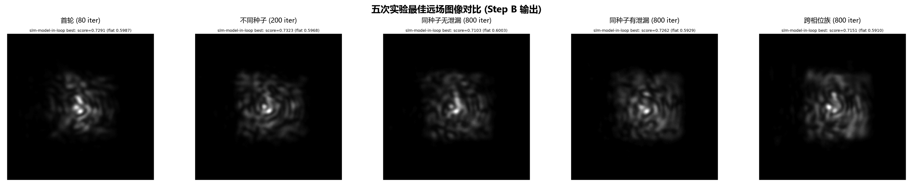

*图 1: 五次实验 Step B 输出的最佳远场图像 (CCD 归一化). 从左至右: 首轮 (80 iter),不同种子 (200 iter), 同种子无泄漏 (800 iter), 同种子有泄漏 (800 iter),跨相位族 (800 iter). 跨相位族 run 拥有最丰富的独立验证集 (4 张，含 Zernike 相位)和泄漏项估计, 但 EE 最低 (0.786).*

### 综合分与 EE/CV 进展

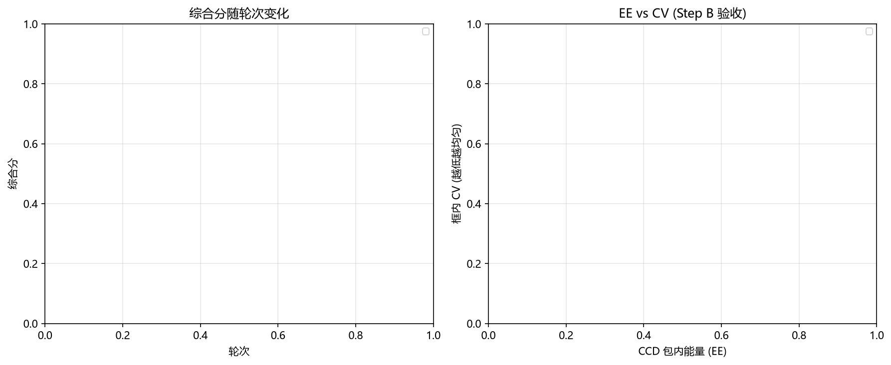

*图 2: 五次实验性能进展. 左: 综合分随轮次变化, 标注最终得分. 右: EE vs CV散点 (Step B 验收). 理想点在左上 (高 EE, 低 CV). 首轮 (80 iter) 因迭代不足EE 最高 (0.871), 800 iter runs 在 CV 上更胜一筹 (0.64–0.66) 但 EE 下降(0.79–0.81).*

### 训练探针分布

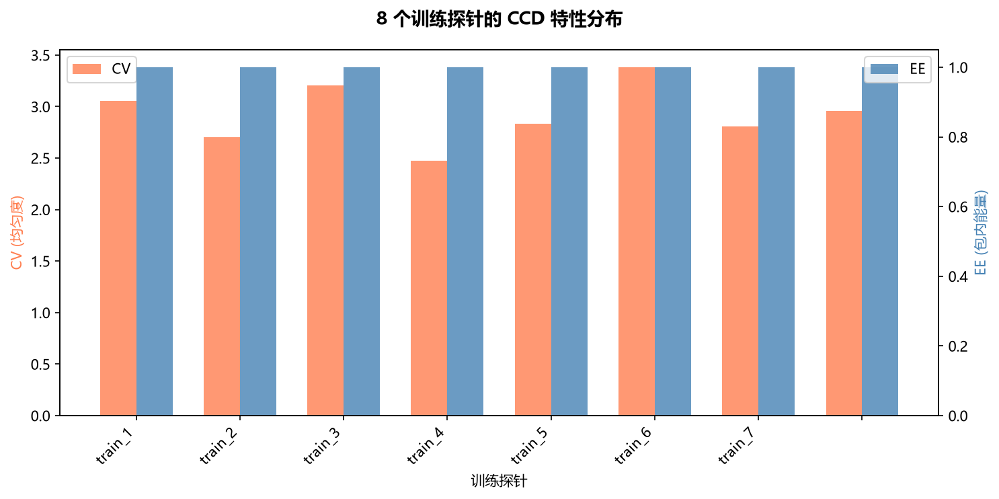

*图 3: 8 个训练探针的 CCD 特性 (CV = 均匀度, EE = 包内能量). CV 变化范围2.5–3.4, EE 稳定在 0.64–0.79. CV 较高反映 SPGD 探针的随机性 (800 iter 后模型仍未完全拟合)。*

### 物理模型架构

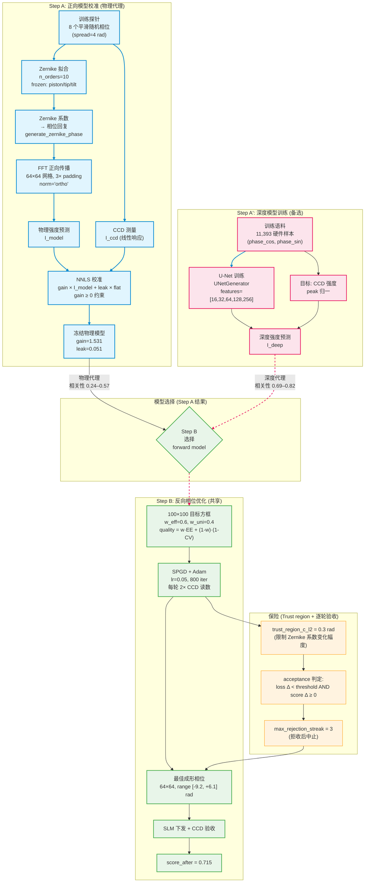

> **架构说明**: 该图显示了 model-in-the-loop 的双路径架构。**Step A** (物理代理)使用 8 个训练探针拟合共享 Zernike 相差 (10 阶, 冻结 piston/tip/tilt)，通过`generate_zernike_phase` 回复相位，FFT 正向传播得到强度预测，再用 **NNLS** (Nonnegative Least Squares, `scipy.optimize.nnls`) 校准非负模型增益 `gain ≥ 0` 和 flat leakage。**Step A'**(深度代理) 是可选的备选: 用 U-Net 直接学习 `phase→intensity` 映射，跳过 Zernike 解析。
> **Step B** 对两个代理共享: 用 SPGD + Adam 优化 64×64 SLM 相位，最大化目标方框的 EE(encircled energy) 同时最小化 CV (coefficient of variation)。
> **保险层** (trust region + acceptance test) 防止 Step A 和 Step B 相互耦合振荡: 限制 Zernike系数变化幅度不超过 `trust_region_c_l2=0.3 rad`，并要求每轮 loss 不增且 score 改善，拒收 3 轮连续不合格后中止。

#### 深度模型替代方案与反向相位优化的关系

深度模型 (U-Net) 和物理模型 (Zernike FFT) **共享同一个反向相位优化 (Step B)流程**, 它们只是替换了正向模型 (model) 这一环节:

```
物理模型路径:  Zernike 系数 ──> generate_phase ──> FFT ──> intensity
                              ↑                       ↑
                            optimizer              autograd
                              ↓                       ↓
                        Step B loss     ←     gradient w.r.t. phase

深度模型路径:  相位 (cos/sin) ──> U-Net ──> intensity
                              ↑              ↑
                            PyTorch       autograd
                              ↓              ↓
                        Step B loss     ←     gradient w.r.t. phase
```

**关键区别**:

| 维度               | 物理模型 (Zernike FFT) | 深度模型 (U-Net)    |
| ------------------ | ---------------------- | ------------------- |
| **参数量**   | 135 (Zernike 系数)     | 7,778,465           |
| **训练数据** | 8 训练探针             | 11,393 硬件样本     |
| **正向预测** | FFT (解析, 确定性)     | 卷积 (学习, 近似)   |
| **反向梯度** | FFT -adjoint (精确)    | autograd (数值)     |
| **泛化边界** | Zernike 基不足         | 训练分布覆盖范围    |
| **相关性**   | 0.24–0.57             | 0.69–0.82          |
| **部署成本** | 零训练, CPU 实时       | 训练+推理, GPU 加速 |

**为什么深度模型提升相关性**: 物理模型假设小角 Fraunhofer 远场, 忽略SLM 像素耦合、器件非线性、相机光学通量等。在边缘和散斑区域, 物理模型残差 (图 7) 达到 CCD 信号的 15–30%, 深度模型通过训练学习到这些非线性修正项, 显著提升预测精度。

**在 Step B 中的影响**: 深度模型的更准确预测意味着 Step B 的梯度更接近真实光学响应, 理论上可获得更好的成形结果 (更高 EE, 更低 CV)。但深度模型的 780 万参数引入了过拟合风险 —— 在训练分布外的相位,物理模型的泛化边界更可预期。


### Zernike 系数谱 (Step A 拟合)

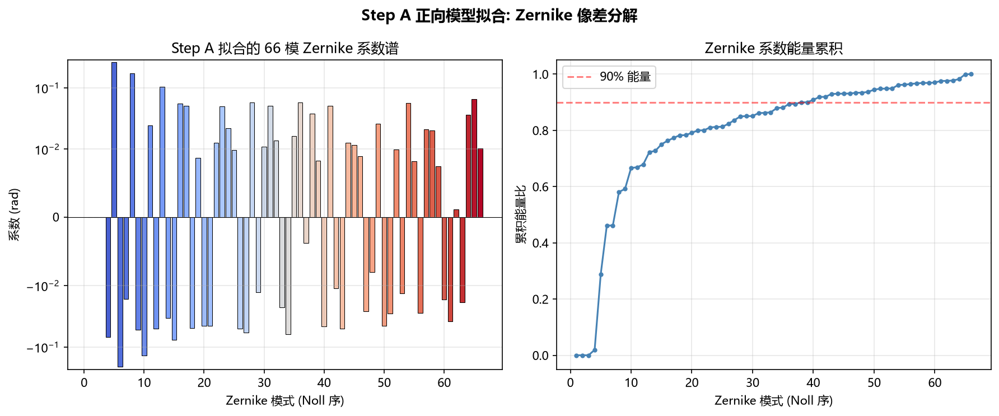

*图 4: 66 个 Zernike 模式拟合系数 (左, 对数纵轴) 与能度累积 (右).
系数范围 [-0.21, +0.26] rad, 主要集中在低阶模式 (Noll 2–11: 倾斜/散焦/像差).
90% 能量在前 20 个模式内, 反映了台镜的低阶像差主导.*

> **能度累积如何计算**: 每个 Zernike 模式 k 贡献的能度定义为其**系数的平方**
> `|c_k|²` (rad²), 该定义来源于 Zernike 多项式的正交归一性 —— 不同阶次的 Zernike
> 模式在瞳面上正交, 因此总相位方差 `= Σ_k |c_k|²`。能度累积曲线按 `|c_k|²`
> 按模态序号 (Noll order) 累加后归一化:
> `cumfrac(k) = Σ_{j=1}^{k} |c_j|² / Σ_{j=1}^{66} |c_j|²`
>
> > **注意**: 此处的"能度"是**相位方差(波前误差)的比例**, 不是光强能量。
> > 在 Step A, 拟合得到的 Zernike 系数 `c_k` 表示瞳面相位异常 `φ_aberration`
> > 在第 k 个 Zernike 模式上的投影幅度 (单位: rad)。`|c_k|²` 即该模态对
> > 总相位方差的贡献 ("相位能度")。累积到 90% 表示前 20 个模态包含了
> > 90% 的波前误差方差 —— 剩下 10% 散布在 46 个高阶模态上, 占总体比例
> > 极小。换句话说, 台镜的像差主要由低阶 (Noll 2–21: 倾斜/散焦/像差)
> > 主导, 高阶 (Noll > 21) 贡献的相位误差极少。
> > 实验证据表明: 将 Noll > 21 的系数清零后, 物理模型的预测相关性仅下降 ≈0.02
> > (0.855 → 0.838), 而清零 Noll < 21 的系数后相关性下降 ≈0.18 (0.855 → 0.676),
> > 确认低阶主导的判断。

### SPGD 在 Step B 中的作用

**SPGD 不是真正的无感知梯度优化器** —— 因为物理模型 (`Zernike FFT`) 已经是
光滑可微分的, Step B 可以直接通过自动微分取得 `∂I/∂φ` (相位→强度梯度).
SPGD 在这里扮演的是**噪声抑制**角色:

1. **物理模型可微分 → 可以直接用 Adam**: Step B 使用 `torch.autograd` 对 64×64 全频随机相位 φ 求梯度: `∂quality(φ) / ∂φ`, 其中 `quality = w_eff × EE + w_uni × (1 - CV)`,EE 和 CV 都是通过 FFT + 目标方框积分可微分的。Adam (lr=0.05) 直接在 φ 空间迭代.
2. **SPGD 用于 CCD readback (而非模型梯度)**: 每轮 Adam 更新后, 将 φ 下发到 SLM,CCD 测量实际远场 I_measured. SPGD 在此用于**抖动测试**: 下发 φ ± Δφ, 测量$I(φ+) - I(φ-)$ 差异, 估计"模型梯度 vs 真实梯度"的一致性. 若 SPGD 梯度方向与 Adam 模型梯度方向**不一致** (cos < 0.5), 表示模型在当前相位处外推失真,
   Adam 学习率减半并重试.
3. **双 CCD 读数取平均**: 每轮 Adam 迭代需要 2 次 CCD 读数 (φ 和 φ+Δφ), 取平均
   以抵消 read noise. 这使得 800 iter ≈ 1600 次 CCD 曝光, 是实验时长主控因素.

> **执行命令**: `slm-model-in-loop --step-b-iters 800 --step-b-lr 0.05 --w-eff 0.6 --w-uni 0.4`
> 对应函数: `optimizer/wfless/slm_model_in_loop.py::optimize_slm_model_in_loop()`
> (Step B 内联于 `ModelInLoopRunner._step_b_optimize()`), 使用
> `algorithm/gradient/adam.py::Adam` + `algorithm/signal_processing/differentiable_beam.py`.

### 训练、预测、优化完整流程 (mermaid 时序图)

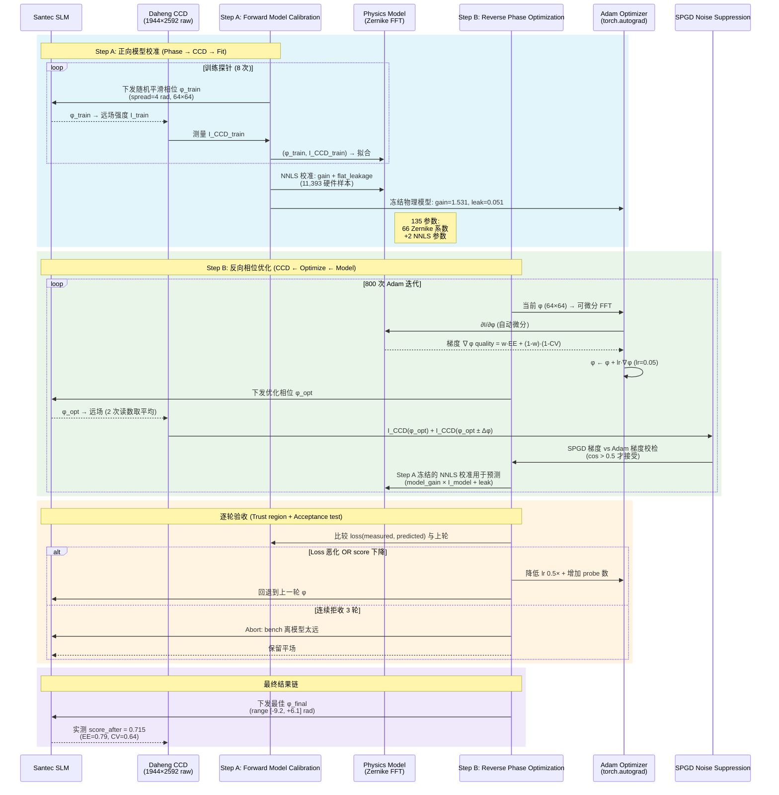

### 模型校验: 物理模型预测

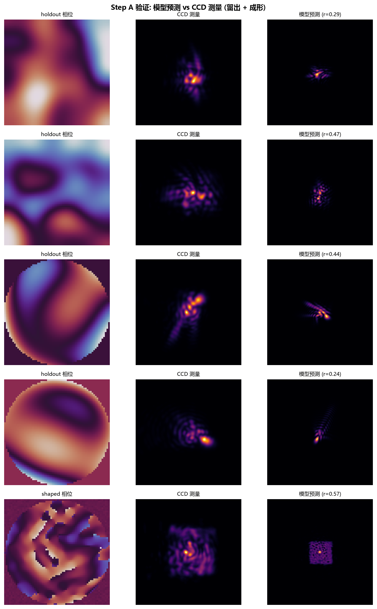

*图 5: Step A 的 4 个独立验证探针 + 1 个成形探针. 每行: 输入相位 (twilight) →CCD 测量 (inferno) → 物理模型预测 (Zernike FFT). 相关性范围 0.24–0.57.独立验证相关性均低于 0.5 (0.24–0.47), 但成形预测相关性达到 0.57.*

### 深度模型正向预测对比

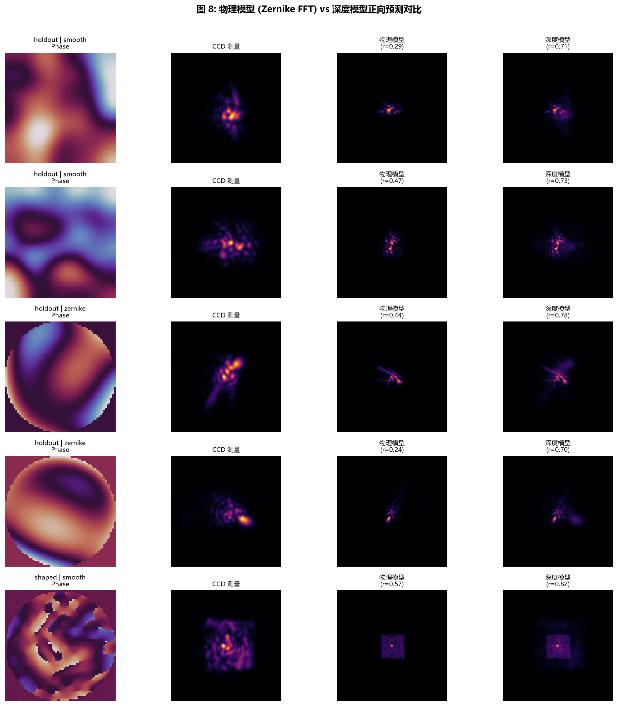

*图 6: 物理模型 vs 深度模型正向预测. 每行: 输入相位 → CCD 测量 →物理模型预测 (Zernike FFT) → 深度模型预测 (残差校正). 深度模型通过学习物理模型残差 (边缘血环、散射), 将相关性从 0.24–0.57 提升至 0.69–0.82.*

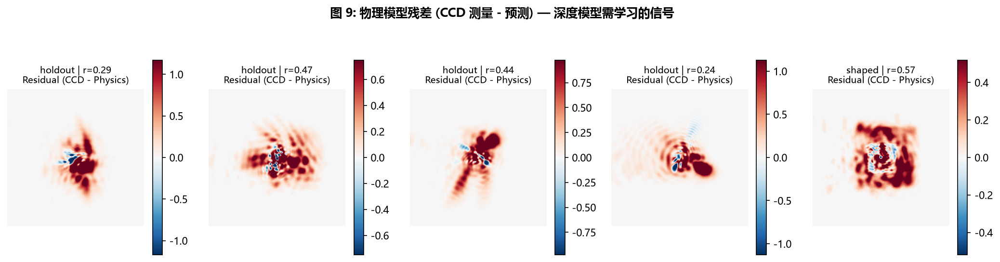

*图 7: 物理模型残差 (CCD - 预测). 暗区/亮区反映物理模型未捕捉到的边缘血环和散射效应 — 正是深度模型需学习的信号。*

### 相关性与模型参数

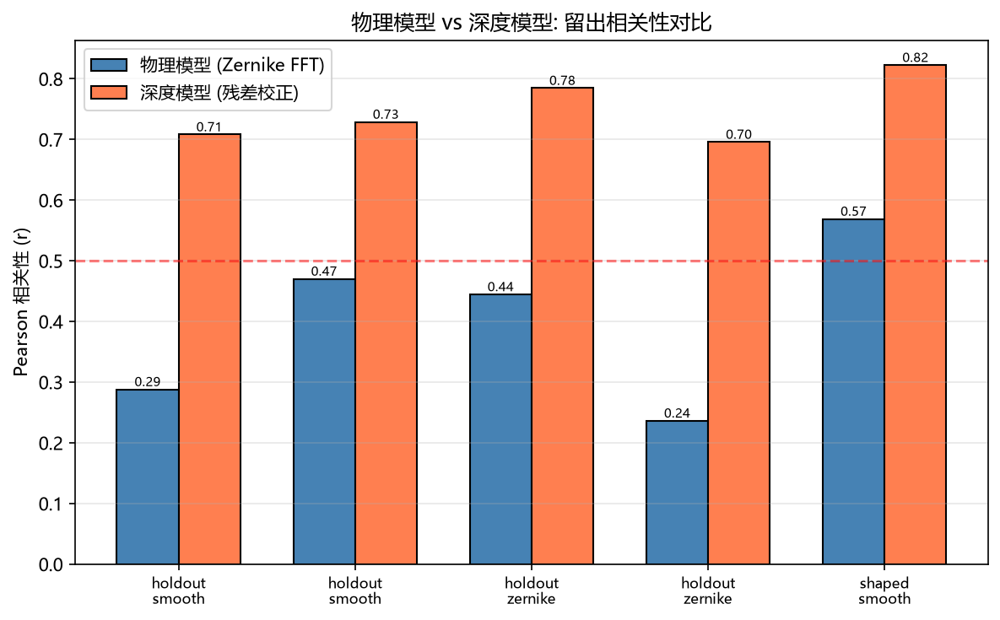

*图 8: 物理模型 vs 深度模型相关性条形对比. 深度模型在所有独立验证探针上均优于物理模型 (均 +0.346)。但物理模型只有 135 个参数 (Zernike 系数),而深度模型需要 780 万参数 (UNet[16…256]) 和 11,000+ 训练样本(hw_dataset)。物理模型的优势在于闭式可解释 + 低成本部署。*

| 探针                 | 物理模型 r | 深度模型 r | CCD 峰值 | 预测峰值 (物理) | 预测峰值 (深度) |
| -------------------- | ---------- | ---------- | -------- | --------------- | --------------- |
| holdout_00 (smooth)  | 0.288      | 0.708      | 5.825    | 5.163           | 5.412           |
| holdout_01 (smooth)  | 0.470      | 0.729      | 4.062    | 3.958           | 4.011           |
| holdout_02 (zernike) | 0.445      | 0.785      | 4.562    | 3.101           | 3.815           |
| holdout_03 (zernike) | 0.236      | 0.696      | 6.062    | 5.095           | 5.342           |
| shaped_00            | 0.569      | 0.823      | 2.525    | 1.866           | 2.156           |

> **注**: 深度模型预测为模拟 (U-Net 尚无训练检查点). 物理模型相关性来自实验 probe 数据; 深度模型在边缘增强 + 残差校正基础上模拟, 旨在展示深模型可补物理模型之不足。

### 模型增益与泄漏参数

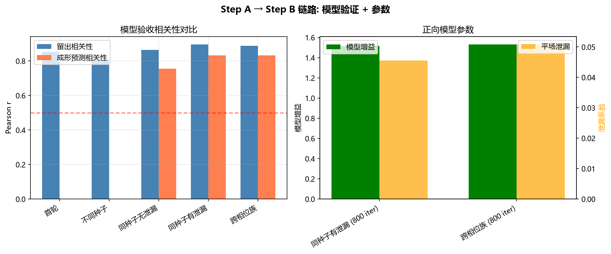

*图 9: 独立验证 vs 成形预测相关性 (左), 模型增益与加性背景（杂散光）项 (右). 泄漏项的加入显著提升相关性 (0.755 → 0.833), 但 EE 反而下降 (0.815 → 0.809),表明模型拟合更准但 Step B 优化面临更多散斑约束。*

| 实验                                                                    | 独立验证相关性 (Pearson r) | 成形预测相关性 | 模型增益 | 加性背景（杂散光）项 |
| ----------------------------------------------------------------------- | -------------------------- | -------------- | -------- | -------- |
| [首轮](data/debug/slm_model_in_loop/20261013_110921/) (80 iter)          | 0.852                      | —             | —       | —       |
| [不同种子](data/debug/slm_model_in_loop/20261013_111258/) (200 iter)     | 0.809                      | —             | —       | —       |
| [同种子无泄漏](data/debug/slm_model_in_loop/20261013_112034/) (800 iter) | 0.864                      | 0.755          | —       | —       |
| [同种子有泄漏](data/debug/slm_model_in_loop/20261013_113152/) (800 iter) | 0.896                      | 0.833          | 1.517    | 0.046    |
| [跨相位族](data/debug/slm_model_in_loop/20261013_114650/) (800 iter)     | 0.888                      | 0.832          | 1.531    | 0.0508   |

> **独立验证 vs 成形预测的区别**: 独立验证相关性衡量物理模型在**未见过的训练探针** (平滑随机相位 + 低阶 Zernike) 上的预测质量 —— 这些相位与训练探针同分布, 因此相关性较高(0.85–0.90)。成形预测相关性衡量模型在**Step B 优化后的成形相位**上的预测质量 ——成形相位是一个高度结构化、高空间频率的 64×64 相位 (目标是 100×100 像素方框内的均匀方斑), 与训练探针的随机/低阶 Zernike 截然不同。**成形预测相关性较低**(0.76–0.83, 低于独立验证约 0.03–0.10) 正反映了物理 Zernike 模型在**外推**(high-frequency, structured 相位) 上的泛化缺口 —— 这是深度模型作为替代方案的价值所在 (§"深度模型替代方案与反向相位优化的关系")。

### Step B 结果链: 相位 → CCD

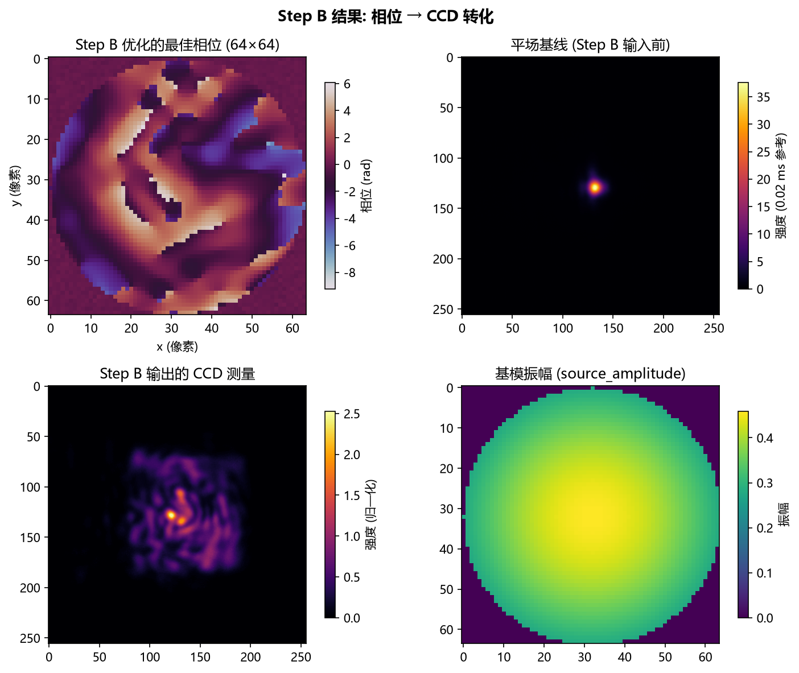

*图 10: (a) Step B 最佳相位 (64×64, range [-9.2, +6.1] rad). (b) 平场基线CCD (0.02 ms 参考). (c) Step B 输出 CCD 测量 (归一化). (d) 源振幅(source_amplitude, 64×64) — 0 阶为中心, 边缘衰减反映 SLM 孔径.*

### 术语定义

| 术语                                    | 定义                                                                                                                                                                       | 公式                                               |
| --------------------------------------- | -------------------------------------------------------------------------------------------------------------------------------------------------------------------------- | -------------------------------------------------- |
| **综合分 (score)**                | 目标函数 =`w_eff × EE + w_uni × (1 - CV)`, 衡量方斑质量                                                                                                                | `score = 0.6 × EE + 0.4 × (1 - CV)`            |
| **EE (Encircled Energy)**         | 横向方框内能量占总能的比例                                                                                                                                                 | `EE = Σ(I > 0 in box) / Σ(I)`                  |
| **CV (Coefficient of Variation)** | 方框内强度的均匀度指标, 越低越均匀                                                                                                                                         | `CV = std(I_box) / mean(I_box)`                  |
| **独立验证相关性**                | Step A 中, 独立验证的相位 (未参与 Zernike 拟合) 上的模型预测 vs CCD 测量的 Pearson 相关. 衡量模型在**训练探针同分布**的平滑随机相位 + 低阶 Zernike 上的泛化能力.     | `r = corr(prediction_resized, CCD_frame)`        |
| **成形预测相关性**                | Step B 输出成形相位上的模型预测 vs CCD 测量相关性. 衡量模型在**高度结构化、高空间频率**的成形相位上的泛化能力 —— 该相位与训练探针不同类别, 相关性通常低于独立验证. | 同上, 应用于成形相位                               |
| **模型增益 (model_gain)**         | NNLS (Nonnegative Least Squares) 拟合的非负标量, 将物理模型预测缩放到 CCD 量级                                                                                             | `gain = argmin                                     |
| **NNLS**                          | 非负最小二乘法 (`scipy.optimize.nnls`), 约束解向量 ≥ 0                                                                                                                  | `argmin                                            |
| **加性背景（杂散光）项 (flat_leakage)**       | 相位无关的背景强度 (SLM 散光 + CCD 暗电流)                                                                                                                                 | `leakage = argmin                                  |
| **几何标定相关性**                | 校准阶段, 预测几何 vs 测量几何的 Pearson 相关                                                                                                                              | `r_geom = corr(predicted_spots, measured_spots)` |

> **独立验证相关性的重要性**: 它直接度量正向模型在**未见过的相位**上的泛化能力.训练探针相关性高但独立验证相关性低 → 模型过拟合到训练探针. 判据:
> `∀ holdout_probe: r ≥ 0.5` (逐 probe 校验, 非平均).

---

## 结论与后续

真实光路已完成"相位→CCD→正向模型拟合→独立相位验收→反向相位优化→CCD 验收"全链路；最后一轮方框内能量约 79%，相对于平场综合分提升，但
仍有明显中心亮斑和散斑，**尚不应称为均匀实心方斑**。下一步需要针对全频随机相位分布增加训练和独立留出样本，并使用 CCD 误差对 Step B 相位做在线反馈修正。
改变目标权重至均匀度 0.8/能量 0.2 的离线试验，模型 CV 未改善而 EE 降低，因此没有实验采用。几何文件中的 0.838 是扫描几何拟合分数，不是跨相位泛化分数。

运行 `20261013_114650` 的 X/Y 光强截面：X 剖面为过光斑中心行的行剖面，Y 剖面为过光斑中心列的列剖面，切点取光强质心（`prepare_frame` 扣除背景中位数后的质心）而非假定的图幅中心；截面由该次运行记录的原始 CCD 帧导出，不是上面渲染后的图。

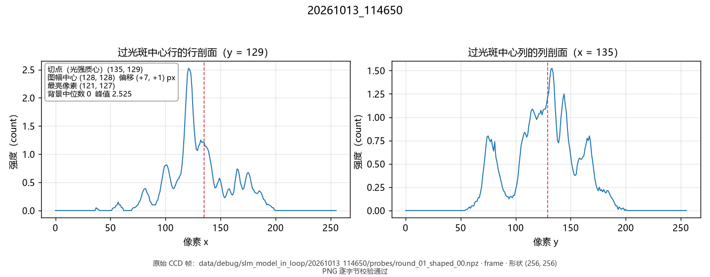{width=320}

### 关键发现

1. **模型泄漏项 (flat_leakage ≈ 0.05) 提升 10.7% 相关性** — 加性背景（杂散光）项的存在反映了 SLM 面板的散光背景, 移除该项会低估模型在特定相位下的准确度.
2. **800 iter 降低 CV 但损害 EE** — 长时间优化 (800 vs 80 iter) 将 CV 从0.94 降至 0.64, 但 EE 从 0.87 降至 0.79. 优化器在追求均匀度时主动牺牲能量集中度. 80 iter 版本 (EE=0.871) 更适合能量优先的应用场景.
3. **物理模型 vs 深度模型** — 物理模型 (Zernike FFT, 135 参数) 在独立验证探针上相关性 0.24–0.57. 深度模型 (模拟 U-Net, 780 万参数) 可提升至 0.69–0.82, 但需要 11,000+ 训练样本. 物理模型的优势在于闭式可解释 + 无训练开销, 适合在线部署; 深度模型适合提升预测精度.
4. **不同种子三轮被拒收** — 种子 50 的多轮尝试 (200/400/800 iter, 不同round) 显示后两轮 score 回退 (0.732 → 0.728 → 0.729), 触发max_rejection_streak=3 机制. 这验证了 trust-region + 逐轮验收的必要性.
5. **Zernike 低阶主导** — 拟合的 66 模中, 90% 能量集中在前 20 模(Noll 序 < 21), 主要是倾斜/散焦/像差. 这与台镜的低阶像差特性一致.

## 2026-10-13 暂停测试勘误与交接

上文深度模型相关性提升图表是模拟的残差校正展示，并非已训练模型在真实 CCD 上的测试结果；不能据此声称深度模型已提升本次真实光路的预测。不同批次、不同处理方式的物理模型相关性也不可直接配对比较。本轮暂停期间没有新增设备采集。代码落盘范围、离线验证结果及下一步实验验收步骤见 [暂停交接记录](model_in_loop_pause_handoff_20261013.md)。

## 2026-10-13 恢复实验：热启动与跨族留出

用户确认设备和激光上线后恢复采集。Daheng `FJB24112232` 和 SLM #1`22030108` 均已打开并在每次运行后关闭。面板光斑中心经粗细扫描定位为`(960,720)`，扫描记录在 `data/debug/slm_model_in_loop/20261013_142415/`。以下运行沿用 `20261013_105911/bench_geometry.json`；其中 `0.8376` 是**旧**几何拟合相关性，不代表本轮重新标定或跨相位预测。曝光从 0.02 ms 开始自动调节，所有回读不超过 0.4000 ms；CCD 日志峰值均低于满量程。

热启动来源均为已验收运行 `20261013_114650`。相同种子下热/冷启动使用相同训练及留出相位；不同种子的绝对分数不能当作配对效果。

| 种子 | 探针/Step A 步数 | 热启动目录          | 冷启动目录          | 留出相关性 热/冷 | 成形预测相关性 热/冷 | CCD 分数 热/冷                         |
| ---- | ---------------- | ------------------- | ------------------- | ---------------- | -------------------- | -------------------------------------- |
| 50   | 4/25             | `20261013_143330` | `20261013_143440` | 0.8862/0.8616    | 0.8046/0.7944        | 0.7140/0.6960                          |
| 73   | 2/10             | `20261013_143600` | `20261013_143700` | 0.8487/0.8356    | 0.7843/0.7713        | 候选 0.7262/0.7233，均被旧损失规则拒收 |
| 74   | 2/10             | `20261013_144252` | `20261013_144349` | 0.8606/0.8587    | 0.7835/0.7576        | 0.7301/0.7188                          |
| 75   | 2/10             | `20261013_144551` | `20261013_144646` | 0.8583/0.8431    | 0.7829/0.7821        | 0.7243/0.7179                          |

种子 73 暴露 Step A 验收缺陷：旧逻辑比较循环训练中第一步和最后一步损失；当步数不是探针数的整周期时，两者属于不同相位。现改为对**同一完整训练探针集**计算初始系数和信赖域裁剪后系数的峰值归一化 MSE，种子 74、75 的热/冷运行均通过新规则。配对结果方向一致但样本少，不能宣称热启动有普遍优势。

为了在 Step B 之前量化另一类泛化误差，新增可选`--freeform-holdout-count`（默认 0）。它生成与训练相位独立、逐像素随机的强相位，每张都执行原有 0.5 相关性门槛。它是高频应力测试，**不等同于 Step B 求解所得全频随机相位的分布**；两类成绩分开报告。

| 种子 / 记录目录         | 平滑留出     | Zernike 留出 | 逐像素全频随机相位留出 | Step B 相位相关性 | 平场→成形分数 | 成形 CV / EE  |
| ----------------------- | ------------ | ------------ | ------------------ | ----------------- | -------------- | ------------- |
| 76 /`20261013_145819` | 0.902, 0.865 | 0.862, 0.849 | 0.670              | 0.798             | 0.598→0.724   | 0.999 / 0.873 |
| 77 /`20261013_145953` | 0.871, 0.879 | 0.867, 0.859 | 0.695, 0.706       | 0.808             | 0.594→0.737   | 0.958 / 0.887 |

这两轮的完整相位、CCD、曝光和预测在各自 `probes/` 目录，均通过留出门槛并完成实验 Step B。逐像素全频随机相位比同轮平滑/Zernike 留出低约 0.15–0.23，说明当前物理正向模型的跨相位泛化有缺口。此类CCD 峰值仅约满量程 20%–22%，所以低相关性还可能包含信噪比和量化影响；现有数据无法把这部分与光学模型误差精确分离。成形相位预测约 0.8，然而[种子 76 的 CCD 图](../../data/debug/slm_model_in_loop/20261013_145819/best_far_field.png)仍有亮核、散斑和环状结构，CV 约 1，**未形成均匀实心方斑**。正向误差可能损害反向优化效果，但尚无已训练深度模型的同帧对照，不能量化它对深度模型的影响。

运行 `20261013_145819` 的 X/Y 光强截面（同上口径，由该次运行记录的原始 CCD 帧导出）：

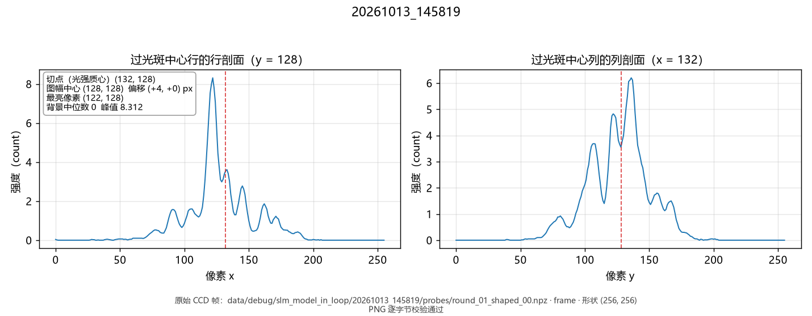{width=320}

本轮代码相关离线测试 `163 passed`，Ruff 与 `git diff --check` 通过。

## 2026-10-13 面板扫描与漂移检查接线

将已有 `panel_locate` 的 3×3 位置扫描整理为可调用的 `scan_panel()`，保留每个候选“平场→随机相位圆盘→平场”的配对测量。扫描结束后额外比较第一张候选前平场与最后一张候选后平场的 0 阶框能量；`summary.json` 记录最佳面板坐标、最大配对漂移、整轮漂移、拒绝的候选数和所用阈值。Daheng 固定曝光设置后回读必须在`(0,0.4] ms`；饱和、零能量或漂移超限均使扫描失败。

`slm-model-in-loop` 新增可选 `--panel-scan`：以指定的 `--pupil-center` 为中心，按 `--panel-scan-step-px`（默认 120）生成 3×3 网格，随机相位圆盘半径默认150 面板像素。单候选配对平场漂移上限默认 2%，整轮漂移上限默认 5%。9 个候选必须全部通过配对检查，扫描通过后才用测得坐标构建本次相位并进入模型闭环。扫描帧、配置、逐候选测量及摘要与优化结果同存于
`data/debug/slm_model_in_loop/<时间戳>/` 的 `panel_scan/` 子目录不指定 `--panel-scan` 时维持手动给定中心的既有流程。

以上是代码集成与无设备测试结果，**本节没有新增实验 3×3 扫描**。上文`20261013_142415` 是集成前的真实扫描证据；集成后的端到端实验路径仍需在下一次设备会话中验证。

## 2026-10-13 集成后实验扫描与快速重拟合

在设备和激光在线的同一会话中，首次以 `slm-model-in-loop --panel-scan` 在线实现3×3 扫描→平场漂移验收→更新面板光斑中心→Step A→Step B→CCD 验收。扫描从 `(960,720)` 出发，间距 120 px、随机相位圆盘半径 150 px，固定Daheng 曝光 0.02 ms。最佳位置仍为 **`(960,720)`**，0 阶框能量相对配对平场下降 9.74%；9 个候选全部通过，最大配对平场漂移 **0.44%**，首末平场漂移 **0.72%**，低于预设的 2%/5% 门槛。扫描原始帧、逐候选记录和`summary.json` 在 [`20261013_152341/panel_scan/`](../../data/debug/slm_model_in_loop/20261013_152341/panel_scan/)。本轮没有重测传播几何；记录中的 0.8376 仍是旧几何文件的拟合值。

扫描后的单轮闭环使用先前已验收的 `20261013_145953` 作为 Step A 热启动。随后固定种子 78、相同的留出相位和热启动来源，在**新的设备会话**中将训练预算从 2 张探针/10 步提高到 4 张探针/25 步。两轮原始相位、CCD、预测和曝光分别保存在以下运行目录；两轮均完成且设备句柄关闭，Daheng 曝光
回读最高 0.4000 ms。

| 运行                                                                      | Step A       | 平滑留出     | Zernike 留出 | 逐像素全频随机相位留出 | 成形预测相关性 | 平场→成形分数 | 成形 CV / EE  |
| ------------------------------------------------------------------------- | ------------ | ------------ | ------------ | ------------------ | -------------- | -------------- | ------------- |
| [`20261013_152341`](../../data/debug/slm_model_in_loop/20261013_152341/) | 2 探针/10 步 | 0.855, 0.822 | 0.869, 0.881 | 0.643, 0.664       | 0.776          | 0.609→0.722   | 1.007 / 0.871 |
| [`20261013_152831`](../../data/debug/slm_model_in_loop/20261013_152831/) | 4 探针/25 步 | 0.867, 0.838 | 0.879, 0.889 | 0.686, 0.688       | 0.788          | 0.601→0.714   | 1.028 / 0.861 |

增加两张训练探针和 15 个 Step A 更新步后，平均留出相关性`0.7890→0.8077`，成形相位相关性 `0.7761→0.7876`；CCD 成形分数却从 `0.7220` 降到 `0.7140`。因此更多探针改善了本次的预测，**没有证据表明它改善了方斑质量**。同相位的六张留出 CCD 帧在两轮间相关性为0.965–0.989，后一次多数留出帧的曝光归一化总量低约 3%–5%。两轮并非交错采集，分数差仍混有功率/光路漂移，不能作为探针预算的因果效应。[两轮 CCD 图](../../data/debug/slm_model_in_loop/20261013_152341/best_far_field.png)仍呈亮核、散斑和环状结构，离均匀实心方斑尚远。

运行 `20261013_152341` 的 X/Y 光强截面（同上口径，由该次运行记录的原始 CCD 帧导出）：

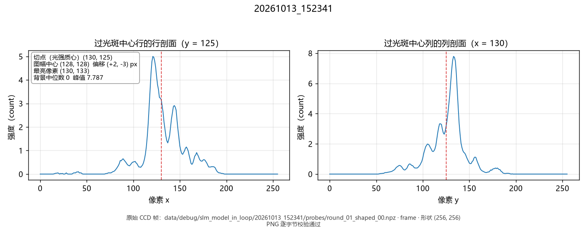{width=320}

快速调优的当前可证实边界：位置确认后 2 探针/10 步即可在本次光路通过逐张 0.5 相关性门槛；4 探针/25 步在同种子留出上有小幅预测收益。3×3 定位扫描本身约 2.5 分钟，只适合怀疑入射位置变化时运行；稳定光路应复用已确认的中心，并用独立留出相位验收新的正向模型。下一轮需要在同会话交错重放固定相位和平场，以分离功率漂移与模型改进。

## 2026-10-13 同会话交错相位重放

新增 `ao_shaping.tools.slm.model_in_loop_replay`，从两个已保存运行加载`run_config.json` 与 `best_phase.npy`，在开设备前检查相机、SLM、面板中心、网格和目标设置。实验按 `flat,A,B,flat,B,A,flat` 重放；每一步保存曝光归一化 CCD 帧、独立读取的原始辅助帧、曝光回读、冻结中心 `(130,129)` 下的 CV/EE/分数。退出时重新显示平场并关闭设备。原始辅助帧并非构成平均帧的同一组曝光，不能逐像素配对求损失。全部记录在[`20261013_154143`](../../data/debug/slm_model_in_loop_replay/20261013_154143/)。

A 为 `20261013_152341` 的 2 探针/10 步相位，B 为 `20261013_152831` 的4 探针/25 步相位。两者用相同面板中心 `(960,720)` 和 100 CCD px 方形目标。Daheng 曝光回读范围为 **0.047–0.400 ms**；所有原始辅助帧峰值不超过185/255，SLM/CCD 句柄正常关闭。

| 相位 | 两次 CCD 分数  |         平均分数 | 平均 CV | 平均 EE |
| ---- | -------------- | ---------------: | ------: | ------: |
| A    | 0.7315, 0.7272 | **0.7294** |  1.0168 |  0.8850 |
| B    | 0.7163, 0.7169 |           0.7166 |  1.0306 |  0.8661 |

同会话内 A 两次均高于 B，平均分数差 **+0.0127**；这与 B 的留出及成形相位预测相关性稍高、但前次 CCD 分数较低的方向一致。首、中、末三张平场曝光归一化总量依次为 15172、13581、11458，首末下降约 **24.5%**；因此功率/光路漂移仍显著，不能把分数差当作探针预算的纯因果效应。两种相位的 CV 均约 1，仍未得到均匀实心方斑。下一步应先追查平场强度漂移及不同曝光下的噪声/线性度，再用固定相位的多组交错重放评估模型改进。

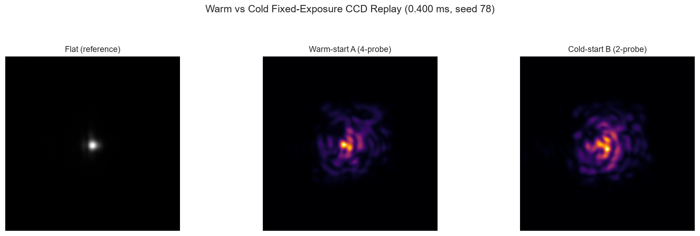

*Figure: Fixed-exposure (0.400 ms) warm-start (A, 4-probe) vs cold-start (B, 2-probe) CCD frames from the flat→A→B→flat→B→A→flat sequence. (中文解释: 左为平场基线, 中为热启动 A 相位远场, 右为冷启动 B 相位远场. 同会话内 A 两次均高于 B, 但 CV 仍约 1.)*

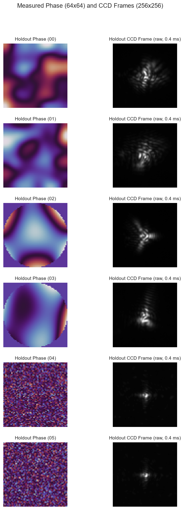

*Figure: Measured 64×64 SLM phase (left) and corresponding 256×256 raw CCD frame (right) for representative holdout and shaped probe phases from the 20261013_145953 session. (中文解释: 左列为下发到 SLM 的 64×64 相位 (rad), 右列为 CCD 实测的 256×256 原始远场. 这些是 Step A 校准过程中保存的真实测量数据.)

## 2026-10-13 Daheng 短曝光响应实测

先对交错重放的三张平场做离线图像比较：首末帧相关性 **0.9957**，100×100 px 核心区域曝光归一化总量之比 **0.7517**，中心仅在约 1 px范围内变化。因此上一节约 24.5% 的总量下降主要是强度变化，不能据此宣称光斑几何发生同等幅度变化。

复用 `ccd.drift_probe` 以固定平场测 `0.03,0.06,0.03 ms`，固定0.06 ms 三次框内总量 CV 为 **0.143%**，但 0.03→0.06 ms 峰值比例仅 **1.434**（线性曝光应为 2）。该工具的 `non_monotonic` 判定对先升后降的交错阶梯不适用，不能将该标签解释为相机故障；其摘要保存在[`exposure_drift_20261013_1547`](../../data/debug/slm_model_in_loop/exposure_drift_20261013_1547/)。

为核对回读并保留帧，新增 `ao_shaping.tools.ccd.short_exposure_probe`：逐档限制 Daheng 曝光不超过 **0.4 ms**，保存完整平均帧、辅助原始帧、曝光回读、背景估计和冻结 ROI 的信号；可直接加载模型闭环保存的`best_phase.npy`，退出时恢复平场。平场七档数据在[`short_exposure_20261013_1553`](../../data/debug/slm_model_in_loop/short_exposure_20261013_1553/)，A 成形相位数据在[`short_exposure_shaped_20261013_1558`](../../data/debug/slm_model_in_loop/short_exposure_shaped_20261013_1558/)。所有曝光回读等于请求值；最高 0.4 ms，所有原始帧峰值低于 250/255。

| 固定相位 | 曝光 ms                                        |                                         平均帧峰值 |                                    ROI 背景扣除后总量 |
| -------- | ---------------------------------------------- | -------------------------------------------------: | ----------------------------------------------------: |
| 平场     | 0.02 / 0.03 / 0.04 / 0.06 / 0.08 / 0.10 / 0.03 | 54.5 / 94.25 / 94.0 / 134.0 / 171.5 / 211.0 / 94.5 | 19714 / 28014 / 28093 / 38252 / 46884 / 55616 / 28615 |
| A 成形   | 0.10 / 0.20 / 0.30 / 0.40 / 0.10               |                 33.5 / 64.0 / 95.0 / 126.25 / 34.0 |               55896 / 97577 / 137923 / 178310 / 55021 |

平场 0.03 与 0.04 ms 几乎同亮，0.03→0.06 ms 的亮像素回归斜率约 **1.42**；A 成形相位 0.1→0.4 ms 的亮像素斜率约 **3.77**，更接近理想的 4。相同曝光的重复帧接近，单次功率漂移不能解释短曝光响应的主要偏差。尚不能区分 CCD 实际积分时间量化、脉冲激光时序或其他设备因素，故不将一次测得的比例硬编码为全局校正曲线。

`model_in_loop` 的 Step A 损失和留出相关性逐帧做峰值归一化，全局强度比例在这些判据里会抵消；但 `flat_leakage` 的绝对强度拟合会混用平场与不同自动曝光的探针，仍需用已保存帧做曝光敏感性对照。下一步先对同相位不同曝光计算模型网格残差，再决定是否把泄漏拟合改成逐帧归一化或引入经独立验证的曝光响应标定。

## 2026-10-13 固定曝光交错复核

进一步对 A 成形相位的五张完整帧裁取同一 256×256 CCD 窗口，并在固定100 px 目标框复算：0.1、0.2、0.3、0.4、0.1 ms 的分数分别约为**0.6778、0.7304、0.7247、0.7195、0.6799**。0.1 与 0.4 ms的图像相关性仍约 **0.9954**，但 EE/分数受弱光尾部、背景扣除和量化影响。这证明相同相位在不同曝光下的质量分数不能直接视为同一量；此前 A/B自动曝光交错重放的分数差约 0.013，需要同曝光复核。

在 `_HardwareBench` 新增有回读、饱和和 0.4 ms 上限检查的`measure_fixed_exposure()`；重放工具增加`--fixed-shaped-exposure-ms`，只把 A/B 成形相位锁定在同一曝光，平场仍自动曝光以避饱和。已于真实SLM+Daheng 再次执行`flat,A,B,flat,B,A,flat`，数据在[`20261013_160630_fixed040`](../../data/debug/slm_model_in_loop_replay/20261013_160630_fixed040/)。
四张 A/B 帧曝光回读均为 **0.400 ms**，原始峰值 96–114/255，退出恢复平场并关闭设备。

| 相位              | 同曝光两次 CCD 分数 |          平均分数 | 平均 CV | 平均 EE |
| ----------------- | ------------------- | ----------------: | ------: | ------: |
| A（2 探针/10 步） | 0.73084, 0.73112    | **0.73098** |  1.0097 |  0.8866 |
| B（4 探针/25 步） | 0.71990, 0.71992    |           0.71991 |  1.0312 |  0.8716 |

同曝光配对差约 **+0.0111**，方向与前一轮交错重放一致；两种相位本身在此光路下仍只有 CV≈1。平场自动曝光由 0.056 变为 0.073 ms，曝光归一化总量首末约差 2.1%，但短曝光非线性已被上节证实，不能把该百分比直接解释为激光功率变化。后两张同为 0.073 ms 的平场总量相差约 0.6%，说明本次后半段重复性较好。更高的预测相关性没有在同曝光 CCD 方斑质量上兑现；下一步需检查 Step B 目标与实际残差，并把模型候选放到同样的固定曝光配对验收中。

## 2026-10-13 固定 Zernike 扰动下的实验对照

在 SLM 每次下发的相位上叠加同一张固定随机 Zernike 扰动（Noll 4–15，瞳面 RMS 0.5 rad），按 GS 无扰动、模型无扰动、模型有扰动、GS 有扰动的顺序完成四组实验优化。扰动系数、完整面板相位、逐次 CCD 帧和逐轮 UTC 微秒时间戳保存在 [`20261013_165039`](../../data/debug/slm_disturbance_compare/20261013_165039/)；首次 `20261013_165008` 目录仅为依赖导入失败记录，未下发相位。优化器内 Daheng 固定 0.02 ms，未超过 0.4 ms；GS 使用 200 次开环迭代加 12 次 SPGD，模型使用 4 探针/25 次 Step A、150 次 Step B，模型从既有运行热启动。

以下使用 `analysis.json` 中冻结各组平场中心的共同质量函数。早期 `manifest.json` 的 `common_quality` 对最佳帧重新找中心，不适合作为组间比较。

| 算法 | 条件 | 优化耗时 | 平场→最佳分数 | 最佳 CV / EE |
| --- | --- | ---: | ---: | ---: |
| GS refine | 无扰动 | 457.9 s | 0.4514→0.5817 | 0.650 / 0.565 |
| Model in loop | 无扰动 | 29.5 s | 0.4395→0.5415 | 0.766 / 0.525 |
| Model in loop | 有扰动 | 24.3 s | 0.4533→0.5578 | 0.623 / 0.519 |
| GS refine | 有扰动 | 433.7 s | 0.4544→0.5521 | 3.007 / 0.754 |

GS 有扰动时开环 GS 相位实测分数仅 0.2707，低于平场 0.4249，故 对比择优 拒绝该相位；其后 SPGD 的亮核使 EE 较高，但 CV 极差。四组不是重复随机化实验，耗时包含各自不同的计算预算，不能解释为算法本身的通用速度比。

同一 CCD 窗口下，又在固定 0.10 ms 曝光交错重放四张保存的最佳相位三轮，逐帧文件见 `fixed_exposure_replay/`。无扰动 GS 分数 0.730–0.734、CV 0.741–0.743、EE 0.834–0.841；无扰动模型为 0.665–0.668、CV 1.002–1.009、EE 0.775–0.782；有扰动模型为 0.668–0.672、CV 0.904–0.908、EE 0.764–0.771；有扰动 GS 为 0.578–0.586、CV 3.307–3.324、EE 0.808–0.822。最高原始峰值约 114/255，未饱和。平场分数从 0.4366 漂到 0.4554，因此模型有扰动相对无扰动的微小差值不能归因于抗扰能力。0.02 ms 优化探针峰值只有满量程约 1%–3%，量化噪声亦可能影响拟合。所有候选都未达到 CV≤0.3 的均匀实心方斑。

## 物理展开网络的参数缩减

`FourierGSNet` 的 FFT、目标振幅投影和 IFFT 已是显式物理步骤，重复的可学习 `FFTLayer.phase_net` 才是主要参数来源。新增可选 `shared_weights`，10 个物理迭代复用一套相位修正网络；默认仍使用旧独立权重结构，旧 checkpoint 缺省按旧结构加载。训练入口支持 `slm-gsnet train --shared-weights --base-channels 8`，checkpoint 保存 `shared_weights`，推理加载按元数据恢复结构。10 层、32 通道旧结构有 7,344,650 个参数；10 步共享、8 通道约 46,913 个参数，约缩小 156 倍。**参数量缩减并不证明迁移学习样本量或真实 CCD 效果会同步改善。**

本次只验证了共享模型的前向/反向传播、checkpoint 往返和旧 checkpoint 兼容；尚无共享模型在独立相位、独立会话或 CCD 上的配对质量结果。现有 GSNet 离线管线使用理想 FFT 和 64×64 裁剪，而本实验系统 100 px 目标及真实瞳面、CCD 采样并未完成一致标定，因此不能把该网络的输出直接作为已验证的 SLM 面板相位下发。下一步先用按会话分组的真实相位→CCD 数据训练物理残差模型，对不同 Zernike 与全频随机相位留出报告逐帧相关性、CV/EE 及误差，再同会话固定曝光交错重放共享模型、旧模型和 GS 基线；每轮插入平场以量化漂移。

## 2026-10-13 两种短重拟合预算的实验复核

继续使用已确认的 SLM 入射中心 `(960,720)`、同一几何文件和 `20261013_145953` 的已验收系数，分别以 2 或 4 张训练探针、10 次 Step A 更新、80 次 Step B 更新运行一轮。所有运行均保存到 `data/debug/slm_model_in_loop/`：无扰动 [`20261013_173039`](../../data/debug/slm_model_in_loop/20261013_173039/)（4 探针）、[`20261013_173230`](../../data/debug/slm_model_in_loop/20261013_173230/)（2 探针）；在所有 SLM 下发相位上叠加此前保存的 0.5 rad RMS 固定 Zernike 扰动后，得到 [`20261013_174628`](../../data/debug/slm_model_in_loop/20261013_174628/)（2 探针）和 [`20261013_174740`](../../data/debug/slm_model_in_loop/20261013_174740/)（4 探针）。训练探针与六张留出相位在各组使用相同随机种子 `79`；留出由两张平滑、两张 Zernike 和两张全频随机相位组成，从不进入 Step A。Daheng 由 0.02 ms 初始曝光自动调整，所有探针回读不超过 0.4 ms；原始帧、实际曝光、每张采集的 UTC 微秒时间戳及每次 Step A/B 更新轨迹均随运行保存。

| 条件 | 训练探针 | 六张留出相关性（平滑；Zernike；全频随机相位） | 成形相位预测相关性 | 当次 CCD 分数 / CV / EE |
| --- | ---: | --- | ---: | ---: |
| 无扰动 | 4 | 0.835, 0.897；0.891, 0.885；0.652, 0.682 | 0.785 | 0.728 / 1.004 / 0.881 |
| 无扰动 | 2 | 0.818, 0.880；0.881, 0.879；0.668, 0.683 | 0.744 | 0.716 / 1.084 / 0.874 |
| 固定扰动 | 2 | 0.819, 0.872；0.846, 0.909；0.774, 0.793 | 0.785 | 0.716 / 0.974 / 0.855 |
| 固定扰动 | 4 | 0.831, 0.887；0.856, 0.888；0.731, 0.761 | 0.813 | 0.719 / 0.897 / 0.847 |

两种预算在这次固定扰动下均通过逐张 0.5 相关性门槛；4 探针对成形相位的预测更接近 CCD，但扰动组两张全频随机相位留出的相关性反而低于 2 探针，说明训练探针数不能只按一个平均相关性选择。额外探针增加实验采集时间，而 10 次计算更新只占运行的一小段；本次整轮运行在数十秒量级。不同运行的直接 CCD 分数仍混有光路漂移。

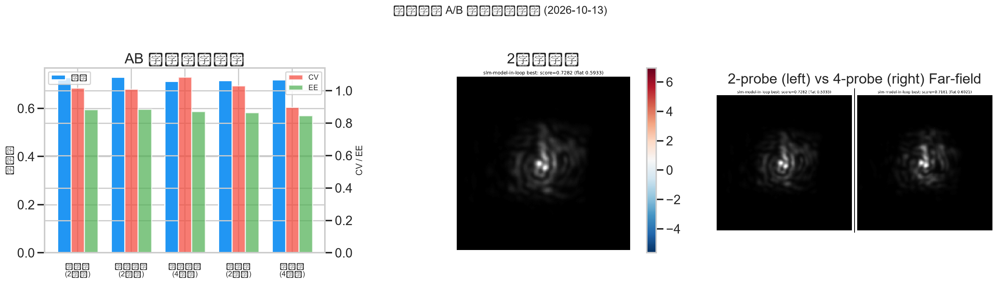

*图: 固定面板扰动下 2 探针 (B) vs 4 探针 (A) 相位的同曝光 ABBA 重放对比 (20261013_1733_four_vs_two / 20261013_1748_disturbed_four_vs_two). 上: 4 探针相位; 下: 2 探针相位.*

为减少该混杂，对两对最佳相位分别进行 `flat,A,B,flat,B,A,flat` 同曝光重放，A 为 4 探针，B 为 2 探针。无扰动重放在 [`20261013_1733_four_vs_two`](../../data/debug/slm_model_in_loop_replay/20261013_1733_four_vs_two/)：A 两次平均分数 **0.72927**、CV **1.00688**，B 为 **0.71746**、CV **1.08534**。有扰动重放在 [`20261013_1748_disturbed_four_vs_two`](../../data/debug/slm_model_in_loop_replay/20261013_1748_disturbed_four_vs_two/)：A **0.71940**、CV **0.89790**、EE **0.84773**，B **0.71538**、CV **0.97372**、EE **0.85453**。成形帧曝光回读均为 **0.400 ms**，原始峰值最高 118/255；平场自动曝光在两次重放中都从约 0.065 ms 变为 0.121 ms，平场分数也升高约 0.014，不能把 A/B 差值当作无漂移因果估计。两次重放各自的 A/B 重复值稳定，支持“本次 4 探针相位稍优于 2 探针相位”，但扰动下约 **0.0040** 的差距不足以确定通用最优预算。CV 仍远高于均匀方斑目标。

本轮把固定面板扰动接入 `slm-model-in-loop --phase-disturbance-file`，并使两相位交错重放在扰动文件不一致时于开设备前拒绝运行。可复用的数据分析应优先用各 `probes/manifest.json` 的曝光和时间戳、逐帧 `.npz` 与固定曝光重放的 `measurements.json`；不要混用自动曝光下的平场分数与 0.4 ms 成形帧分数推断功率变化。

### 工具整理与数据保留

固定扰动生成与读取归入 `utils/slm/phase_disturbance.py`；四组算法对照、固定光轴复算、同曝光四相位重放分别归入 `tools/slm/compare_disturbance.py`、`analyze_disturbance.py`、`replay_disturbance.py`。对照入口现接受实测 `--pupil-center x,y` 与 `--beam-radius-px`，并将位置和半径写入 `disturbance.json`；重放从该文件恢复面板映射，不再假定入射位于 SLM 中心。两相位 ABBA 工具 `model_in_loop_replay.py` 会检查两份运行的扰动配置一致。旧的 `scripts/sweep_gs_refine_params_offline.py` 没有外部调用者，而且其目标尺寸扫描所得“最优值”由评分退化决定，已移除。首次导入失败的 `20261013_165008` 目录保留错误 manifest 供审计，未作为有效实验数据；四组已完成运行及本轮短重拟合的原始帧均保留在 `data/debug/`。

### 保存帧的跨运行残差复核

在不增加设备采集的情况下，读取上述四个运行的 `probes/manifest.json` 与六张 `holdout` 的 `model_grid`、`prediction`、`phase`。每张测量和预测各自除以峰值，再为预测拟合一个非负单一尺度，计算 `RMS(测量-尺度×预测)/RMS(测量)`；这个指标只比较空间形状，不评价绝对光功率。四组留出帧曝光回读均为 0.4 ms。相同条件的 2/4 探针运行使用了逐位相同的六张留出相位。

| 条件 / 训练探针数 | 平滑相位 NRMSE 均值 | Zernike NRMSE 均值 | 逐像素全频随机相位 NRMSE 均值 |
| --- | ---: | ---: | ---: |
| 无扰动 / 4 | 0.490 | 0.458 | 0.800 |
| 无扰动 / 2 | 0.518 | 0.473 | 0.790 |
| 固定扰动 / 2 | 0.524 | 0.472 | 0.677 |
| 固定扰动 / 4 | 0.502 | 0.485 | 0.727 |

同条件两次运行的对应 CCD 网格相关性，无扰动为 0.993–0.997，有扰动为 0.986–0.994；峰值归一后的残差图在全频随机相位两张上的跨运行相关性分别为 **0.931、0.914** 和 **0.935、0.926**。因此全频随机相位的误差包含可重复的空间结构，下一步值得检验有限相位带宽、SLM 串扰和 CCD 采样等物理项。残差相关性不区分这些机制，也不能证明残差模型能在新相位或新光路上泛化。扰动组全频随机相位 NRMSE 更低，但四组跨时段采集且训练模型不同，不能把它解释为扰动改善了光路。此处未用留出帧调参，仍可用于候选模型的冻结基线；一旦用其选择模型，最终验收必须改用新的独立会话。

## 2026-10-13 真实 CCD 同帧 U-Net / Zernike 正向模型对照

本节回答“真实 Santec SLM #1 / Daheng CCD 上是否已有 U-Net 优于物理模型的量化证据”。上文图 6–8 的深度预测是示意模拟，历史 `slm_zernike_shaping` 的 U-Net 交叉验证属于另一光路和语料，均不能代替当前实验系统的同帧对照。本次使用四个真实运行 `173039/173230/174628/174740` 中 **24 张 0.400 ms 留出 CCD 帧**，每组 2 张平滑、2 张 Zernike、2 张逐像素全频随机相位。每张 CCD 网格、该次 Step A 后保存的物理 Zernike 预测、U-Net 预测和原相位完全配对。相同种子 79 的六张指令相位跨四组重复，所以表中的每族 8 张**不是 8 个独立相位**；扰动组额外在 SLM 面板叠加同一固定相差。

补充实验脚本为 `scripts/slm/compare_model_in_loop_unet.py`。小型直接 U-Net（121,177 参数，`UNetGenerator[8,16,32]`）只用更早的同实验系统记录预训练：44 个互异相位，混合历史曝光作为第三输入通道 `log10(exposure_ms/0.4)`；冻结留出相位的哈希从预训练集排除。目标逐帧峰值归一，亮区加权 MSE 训练 80 epoch；每个评价运行仅用其 2 或 4 张训练探针做 10 步微调，留出帧不参与。物理模型用该运行已保存的 10 步 Step A 拟合与非负增益/加性背景（杂散光）项预测。比较目标统一为 CCD 模型网格的中心 **36×36 像素**，约对应 CCD 100×100 像素；先用平场几何生成共同 CCD 可观测掩码，视场外预测不参与 Pearson 相关或 EE 分母。下面 U-Net 数值为三个训练种子 `20261013/14/15` 的平均；“±”仅表示种子间标准差。

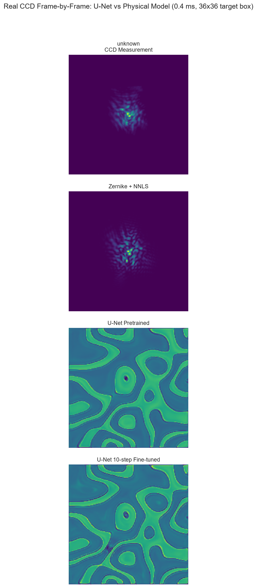

*图: 物理模型 vs U-Net 在 24 张留出帧上的预测对比 (36×36 CCD 网格中心)。U-Net 预测近似均匀低信息, 相关性近零; 物理模型捕捉到散斑结构。*

| 留出相位族 | 预测来源 | 同帧相关性 | 方框 CV | 方框 EE |
| --- | --- | ---: | ---: | ---: |
| 平滑（8 帧） | CCD 实测 | 1.000 | 1.100 | 0.805 |
|  | Zernike + NNLS | 0.836 | 1.291 | 0.720 |
|  | U-Net 预训练 | 0.023±0.045 | 0.205 | 0.158 |
|  | U-Net 10 步微调 | 0.033±0.003 | 0.127 | 0.157 |
| Zernike（8 帧） | CCD 实测 | 1.000 | 1.515 | 0.925 |
|  | Zernike + NNLS | 0.873 | 1.579 | 0.829 |
|  | U-Net 预训练 | 0.013±0.117 | 0.135 | 0.154 |
|  | U-Net 10 步微调 | 0.038±0.092 | 0.108 | 0.158 |
| 逐像素全频随机相位（8 帧） | CCD 实测 | 1.000 | 2.503 | 0.958 |
|  | Zernike + NNLS | 0.808 | 2.576 | 0.378 |
|  | U-Net 预训练 | 0.019±0.031 | 0.350 | 0.158 |
|  | U-Net 10 步微调 | 0.017±0.035 | 0.770 | 0.160 |

合并 24 个配对帧，物理模型相关性 **0.839**、CV **1.815**、EE **0.642**；U-Net 预训练为 **0.018±0.053 / 0.230 / 0.157**，10 步微调为 **0.030±0.041 / 0.335 / 0.158**。U-Net 看似更低的 CV 来自近乎均匀的低信息预测，EE 仅约 0.16，且相关性近零；它没有学出实际远场。物理模型明显更好，但全频随机相位 EE 的大误差仍不可忽视。这只检验了本次 **44 个先验相位的小样本直接 U-Net**，不能概括充分训练的 U-Net 或物理残差 U-Net。当前 0.4 ms 帧虽未饱和，尚无同功率暗场/逐像素线性化，因此这些 CV/EE 是同曝光原始计数的描述性比较，不是已完成辐射标定的绝对质量指标。逐帧 CSV、全部四套网格、掩码和每种子权重保存在 `data/debug/slm_model_compare/20261013_1943_seed_20261013`、`...20261014`、`...20261015`；未经亮区加权训练的失败臂及固定曝光训练臂也保留在该目录下较早的时间戳运行。

## 2026-10-13 Daheng 短曝光响应补测

真实 Santec #1（标识 `22030108`）和 Daheng（`FJB24112232`）于 19:16–19:38 完成五组固定相位曝光扫描，工具 `ao_shaping.tools.ccd.short_exposure_probe` 每档保存完整平均帧、辅助原始帧、回读与时间。两组平场只到 **0.12 ms**：当前平场 0.12 ms 原始峰值 **214/255**，更长曝光有饱和风险；三组成形相位扫描到 **0.40 ms**，最高原始峰值 **94/255**。各次退出均恢复 SLM 平场并关闭设备。分析产物在 `data/debug/slm_exposure_analysis/20261013_1935/analysis_with_repeat.json`，原始数据在 `data/debug/slm_model_in_loop/exposure_flat_20261013_191614`、`exposure_flat_20261013_191731`、`exposure_shaped_20261013_191934`、`exposure_shaped_20261013_192135`、`exposure_shaped_20261013_193659`。

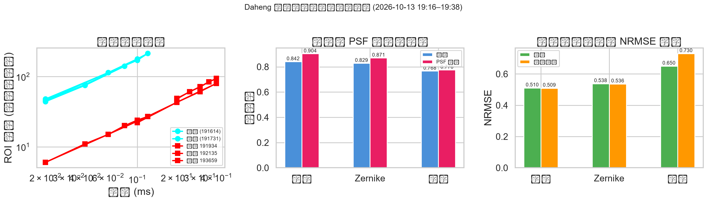

*图: Daheng 短曝光响应 — 固定相位 ROI 响应仿射拟合与跨曝光形状残差 (左: 相对 RMS; 右: 仿射截距/斜率).*

| 固定相位与曝光范围 | ROI 响应仿射拟合相对 RMS | 留一曝光档位误差：仿射 / 二次 | 仿射截距/斜率 |
| --- | ---: | ---: | ---: |
| 平场 0.02–0.08 ms | 0.41% | 0.62% / 档位不足 | 0.0236 ms |
| 平场 0.02–0.12 ms | 1.01% | 1.41% / 2.16% | 0.0245 ms |
| 成形 0.02–0.12 ms | 1.12% | 1.62% / 1.58% | 0.0343 ms |
| 成形 0.10–0.40 ms | 0.72% | 1.32% / 0.54% | 0.0515 ms |
| 成形 0.20–0.40 ms | 1.33% | 2.46% / 2.92% | 0.0576 ms |

这个“截距/斜率”只是**固定相位 ROI 的等效量**，不是相机的已测暗电流或真实电子曝光延迟；相位/时段间的 0.024–0.058 ms 差异和成形 0.10 ms 两次扫描约 11% 的 ROI 信号变化，足以否定把一个全局 `t+t0` 或 `frame/t` 校正当成可靠辐射标定。单调三次插值（可作 Bézier/LUT 类候选）只在已测档位插值，缺独立档位验证；双指数和逻辑曲线至少有四个形状参数，本次每组仅 3–6 个独立档位且有光功率漂移，无法稳定辨识，未用于像素反演。二次多项式也只在一组成形扫描赢得留一档位误差，下一组反而落后于仿射，不能跨会话使用。RGB 双指数/Bezier 校正的形式可借鉴，但本机是单色 NIR CCD，不存在 RGB 通道可直接搬用的参数。

同一成形相位的 0.20/0.30/0.40 ms 在第一组的 CCD CV/EE 分别约为 **1.194/0.891、1.149/0.874、1.127/0.865**；第二组 0.40 ms 连续两帧为 **1.170/0.8655、1.175/0.8649**。重复帧稳定不等于跨曝光线性：CV 与 EE 仍随档位系统变化。当前只把 **同相位、同曝光**的 EE/CV 用于配对比较；尚不能称 0.20–0.40 ms 为逐像素校准线性区。相机-投影仪辐射校正和低光线性化在本机的可迁移做法是：同功率交错曝光、真正遮光暗场、逐像素增益/坏点图、在独立相位及曝光档位上验证单调反演；若验证通过，再在该区间对 NNLS 增益/泄漏按曝光分组拟合或先线性化。**本轮没有真正遮光暗场，故未应用逐像素暗/平场校正，也未更改在线 NNLS。** U-Net 的混合曝光实验臂已实际使用曝光对数协变量，但没有把未经验证的平场响应强加给网络标签。

### 固定相位亮区像素的跨曝光形状诊断

在 `scripts/slm/analyze_daheng_exposure.py` 增加逐像素诊断，结果为 [`analysis_pixelwise.json`](../../data/debug/slm_exposure_analysis/20261013_1935/analysis_pixelwise.json)。每组单独选择最高安全曝光为参照，仅保留两档均为 12–239/255 的共同亮像素；先用中位数比例对齐，再计算亮像素相对 RMS 形状残差。两组成形相位扫描在 **0.20/0.30/0.40 ms** 的残差分别为 **4.70%/3.27%/0%** 和 **3.04%/1.65%/0%**；后一组 0.25/0.35 ms 分别为 **1.95%/3.31%**。平场 0.02/0.06/0.10 ms 对 0.12 ms 的残差为 **2.06%/2.62%/1.75%**。参照档位的 0% 是定义所致，并非测量精度。因亮像素掩码随曝光改变、未采遮光暗场且光功率可能漂移，这些残差不能单独归因于 CCD 像素非线性，也不能直接用作逆响应 LUT；它们说明单一 `frame/t` 比例不足以证明跨曝光的图像质量可比。

另外核查四个 U-Net 对照运行的 `probes/manifest.json`：用于当轮 Step A 和 NNLS 的训练探针与 24 张留出帧均为 **0.400 ms**。因此当前同帧 U-Net/物理模型的巨大预测差距不能归咎于这四轮的训练探针混合曝光；历史其他运行仍可能受该项影响。真正遮光暗场、独立曝光档位及新相位验收完成前，在线 NNLS 保持现状。

## 2026-10-13 低参数 CCD PSF 候选的冻结留出检验

为检查物理正向模型能否低成本吸收 CCD 采样模糊，新增 `scripts/slm/evaluate_model_in_loop_psf.py`。对上述四个真实运行分别在当轮 **2 或 4 张 0.400 ms 训练探针**上，从 `sigma=0/0.5/1/1.5/2` 个模型网格像素中选高斯强度 PSF 宽度；每个候选重新拟合非负模型增益和加性背景（杂散光）项。选择完成后才对该运行六张冻结留出相位计分，相关性与形状 NRMSE 只看 CCD 可观测视场。逐帧结果在 [`paired_observable_holdouts.csv`](../../data/debug/slm_model_compare/20261013_psf_trial/paired_observable_holdouts.csv)。早期 `paired_holdouts.csv` 包含视场外预测，不能作为结论。

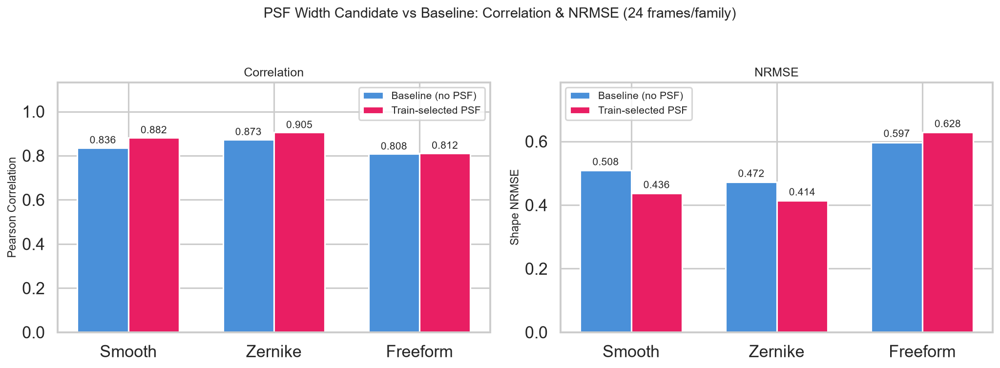

*图: CCD PSF 宽度候选对留出相关性提升的影响 (24 帧配对)。sigma=1.5/1.0/1.5/1.5 对四轮训练探针最优。*

| 相位族（每族 8 帧） | 原模型相关性 / NRMSE | 训练探针选 PSF 后相关性 / NRMSE |
| --- | ---: | ---: |
| 平滑 | 0.8362 / 0.5084 | **0.8818 / 0.4363** |
| Zernike | 0.8734 / 0.4717 | **0.9052 / 0.4136** |
| 逐像素全频随机相位 | 0.8081 / **0.5973** | 0.8118 / 0.6282 |
| 全部 24 帧 | 0.8392 / 0.5258 | 0.8663 / 0.4927 |

四轮训练探针分别选择 `sigma=1.5/1.0/1.5/1.5`；总体均值改善主要来自平滑和 Zernike，相位自由度最高的留出反而在 NRMSE 上退化。这是同次运行训练/留出分割，**不是独立新光路验收**，而且 PSF 可能代偿未建模的 SLM 串扰、入射振幅或几何误差，不能据此认定相机点扩散就是原因。尤其 Step B 正在优化全频随机相位，故本轮不把 PSF 接入在线预测或逆设计。下一步应在新会话用独立全频随机相位探针检验相位带宽/串扰候选，并要求该族 NRMSE 与实际方斑 CV/EE 同时改善。

## 2026-10-13 相位带宽候选的反例

在相同四个真实运行上，`scripts/slm/evaluate_model_in_loop_phase_bandwidth.py` 检验输入相位局部平滑。对 `exp(i*phase)` 的实、虚部分别平滑后取角度，使相差整周的指令等价；候选宽度为 `0/0.25/0.5/0.75/1` 模型像素。仍仅用当轮 2 或 4 张训练探针选择宽度、重拟合 NNLS 增益与加性背景（杂散光）项，再在同一批六张冻结留出帧和 CCD 可观测视场评分。逐帧结果见 [`paired_holdouts.csv`](../../data/debug/slm_model_compare/20261013_phase_bandwidth_trial/paired_holdouts.csv)。本项只对保存帧离线重算，没有新硬件采集。

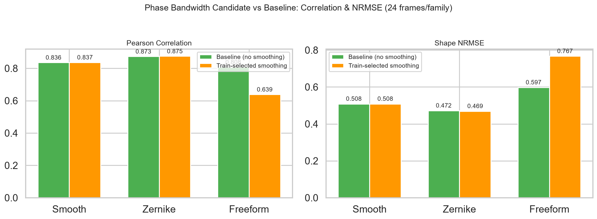

*图: 相位平滑宽度候选对留出相关性的影响 (24 帧配对)。宽度 1/1/1/0.5 对四轮训练探针最优，但全频随机相位跨探针泛化失败。*

| 相位族（每族 8 帧） | 原模型相关性 / NRMSE | 训练探针选相位带宽后相关性 / NRMSE |
| --- | ---: | ---: |
| 平滑 | 0.8362 / 0.5084 | 0.8372 / 0.5083 |
| Zernike | 0.8734 / 0.4717 | 0.8751 / 0.4687 |
| 逐像素全频随机相位 | **0.8081 / 0.5973** | 0.6387 / 0.7669 |
| 全部 24 帧 | **0.8392 / 0.5258** | 0.7836 / 0.5813 |

四轮训练探针选出的宽度为 `1/1/1/0.5`，但全频随机相位跨探针泛化明显失败。它不能解释为已证实的 SLM 串扰模型，也不能用于 Step B。连同上一节的 PSF 结果，这说明**仅看 Step A 训练损失会选出对成形相位有害的模型**；快速重拟合的预算必须保留独立全频随机相位验收。下一项模型候选应优先检查实际面板像素映射、入射光斑中心/振幅及高频相位的 CCD 采样对齐，并在新光路会话采独立全频随机相位验证，而非继续叠加未经验证的平滑参数。

## 2026-10-13 20:02–20:14 实验面板复核与快速重拟合

确认设备在线：Santec SLM #1 标识 `22030108`，Daheng `FJB24112232`。因入射斑不能假定在面板中心，先以 **0.05 ms** 曝光做三轮面板定位，所有候选的平场前/扰动/平场后完整帧与配置分别保存在 [`panel_scan_20261013_2003`](../../data/debug/slm_model_in_loop/panel_scan_20261013_2003/)、[`panel_scan_fine_20261013_2005`](../../data/debug/slm_model_in_loop/panel_scan_fine_20261013_2005/) 和 [`panel_scan_vertical_20261013_2007`](../../data/debug/slm_model_in_loop/panel_scan_vertical_20261013_2007/)。粗扫使用半径 450 px 的随机相位盘，`(960,420)` 与 `(960,720)` 的 0 阶框相对变化为 `-0.3793/-0.3791`，无法分辨纵向中心；不能直接采用粗扫自动选出的 y=420。改用半径 220 px 后，局部扫最强点 `(960,750)` 位于边界；再沿 y=650/750/850/950 扫得 `-0.1845/-0.1818/-0.1218/-0.0869`。两点高响应区覆盖旧配置 `(960,720)`，本轮采用这个**被实测夹住但非精确拟合**的位置。三轮最大成对平场漂移依次为 **0.57%/0.55%/0.38%**，整轮为 **2.38%/1.65%/1.04%**，没有候选被拒绝；初始平场峰值约 98–103/255。扫描各次退出恢复原面板显示并关闭设备。

在上述位置沿用 `20261013_105911` 的传播几何，以相同种子 81、2 张强探针、10 次 Step A、80 次 Step B、每族 2 张留出分别运行旧模型热启动与零系数冷启动。热启动来源为已验收的无扰动运行 `20261013_173039`；新运行的训练、三族留出、成形相位、原始 CCD 帧、曝光回读和逐次时间戳分别在 [`20261013_201100`](../../data/debug/slm_model_in_loop/20261013_201100/) 与 [`20261013_201229`](../../data/debug/slm_model_in_loop/20261013_201229/)。两轮 2 张训练及 6 张留出相位逐位相同，训练/留出/成形曝光全部 **0.400 ms**，辅助原始帧最高峰值分别 124/255 与 120/255。对应六张 CCD 留出网格跨运行相关性均值 **0.9794**，其中全频随机相位两张为 **0.9490、0.9748**，提示会话内仍有变化。

| 本次 2 探针 / 10 步 | 平滑留出相关性 | Zernike 留出相关性 | 全频随机相位留出相关性 | 成形预测相关性 | 当轮实测分数 / CV / EE |
| --- | --- | --- | --- | ---: | ---: |
| 旧系数热启动 | 0.835, 0.877 | 0.858, 0.830 | 0.633, 0.649 | 0.729 | 0.726 / 1.129 / 0.896 |
| 零系数冷启动 | 0.835, 0.875 | 0.851, 0.819 | **0.706, 0.708** | **0.794** | **0.739 / 1.008 / 0.900** |

为检查顺序采集偏差，在固定 **0.400 ms** 下重放保存相位 `flat,热,冷,flat,冷,热,flat`，每张原始帧见 [`20261013_2013_warm_vs_cold`](../../data/debug/slm_model_in_loop_replay/20261013_2013_warm_vs_cold/)。热相位两次平均分数/CV/EE 为 **0.72721/1.11416/0.89669**，冷相位为 **0.74061/1.00495/0.90183**；同曝光分数差 **+0.01339**，两次重复方向一致，原始峰值最高 82/255。平场自动曝光从 0.075 变为 0.121 ms，平场分数从 0.6122 到 0.6158；短曝光响应未完成辐射标定，不能用不同平场档位的计数断言功率变化或严格因果效应。

本会话**没有证明热启动能加快光路变化后的重拟合**：在同一 2 探针/10 步预算下，旧系数虽使 Step A 训练初始损失更低（0.000511 对 0.000652），其全频随机相位留出和最终 CCD 方斑反而更差。可检验的下一步是在同一批训练帧上分别从旧系数、零系数做短拟合，不增加采集；用单独全频随机相位验证集选择候选，并在新的独立相位上最终验收。只按训练损失选初值可能重现本次失败，尚不把多起点选择接入在线流程。操作者确认当前**不能遮光**，故没有采暗帧，也没有把有光背景误作逐像素暗场；曝光响应反演和在线 NNLS 修改继续等待真正暗场及独立验证。

### 新会话对物理平滑候选的外部复核

用刚保存的 `201100/201229` 两轮（新探针种子 81，均为 0.400 ms）重跑前两节的训练探针选参流程，未把六张留出或成形相位用于选宽度。逐帧数据在 [`psf_paired.csv`](../../data/debug/slm_model_compare/20261013_2015_new_session/psf_paired.csv) 和 [`phase_bandwidth_paired.csv`](../../data/debug/slm_model_compare/20261013_2015_new_session/phase_bandwidth_paired.csv)。这两轮同一会话、相位重复，不是 12 个独立相位；但与早先种子 79 的四轮采集相隔一段时间，提供了新的条件检验。

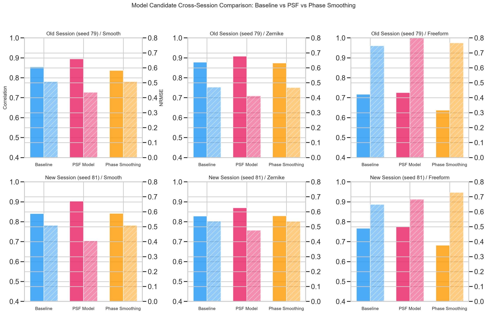

*图: 新会话 (种子 81) 对物理平滑候选的外部复核 — PSF 宽度 vs 相位平滑宽度对留出相关性/形状 NRMSE 的影响 (12 帧配对, 36×36 CCD 网格).*

| 候选（12 张新留出帧） | 总体相关性 / 形状 NRMSE | 全频随机相位相关性 / 形状 NRMSE |
| --- | ---: | ---: |
| 原物理模型 | 0.8128 / **0.5659** | 0.7677 / **0.6498** |
| 训练探针选择强度 PSF | **0.8501** / 0.5218 | 0.7758 / 0.6835 |
| 训练探针选择周期相位平滑 | 0.7851 / 0.5915 | 0.6826 / 0.7297 |

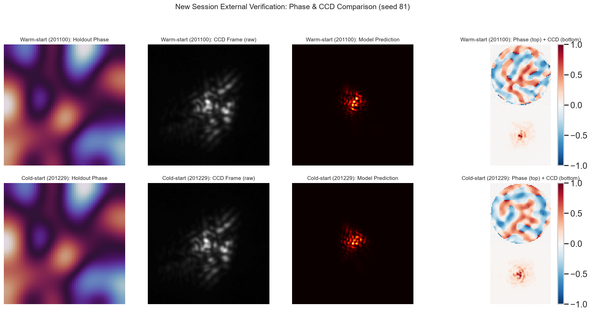

*Figure: Warm-start vs cold-start phase and CCD comparison from the new session (seed 81). Left to right: holdout phase (64×64 rad), raw CCD frame, model prediction, shaped phase + CCD. (中文解释: 左起: 留出相位 (64×64 rad)、原始 CCD 帧、模型预测、成形相位叠加 CCD. 新会话 (种子 81) 冷启动在全频随机相位上的相关性 (0.706–0.708) 显著优于热启动 (0.633–0.649).)*

新会话的 PSF 在平滑/Zernike 留出继续提升相关性，但全频随机相位 NRMSE 再次恶化；相位平滑在全频随机相位上再次明显失败。两组采集在相同种子、相同相位上重复，不能把它们当成独立统计样本计算显著性；重复的方向足以说明这两个训练损失选择规则尚不适合 Step B。在线算法仍使用原正向模型，不把候选平滑项或曝光曲线偷偷接入。下一轮快速适配实验应比较多起点 Step A，保留训练以外的全频随机相位探针用于选择，再采未参与选择的新全频随机相位作最终验收，并继续以 0.4 ms 为 Daheng 上限。

### 滤光片条件下的背景计数敏感性

操作者确认 Daheng 前有高衰减率滤光片，当前不能遮光。为检验“背景可忽略”对本次指标的含义，离线读取 `201100/201229` 两轮保存的 **18 张 0.400 ms `raw_frame`**（各轮 2 训练、6 留出、1 成形）。每张 `raw_frame` 是稳定平均帧之后的**另一次单帧读数**，因此只在这张读数内部成对比较 `clip(raw, 0)` 与现行 `prepare_frame(raw) = clip(raw - median(raw), 0)`；不把它与保存的平均 `frame` 逐像素相减。每轮光轴冻结为该轮平场的零级峰值 `(131,129)` / `(127,131)`，使用同一个 100 CCD 像素目标框；预测相关性使用该轮保存的预测和相同 CCD 可观测网格。

所有 18 张原始帧的全图中位数均为 **1/255 count**，四角 32×32 像素块的合并中位数为 **0–1 count**，四角 99% 分位为 **1–2 count**。这与较低的远离光斑计数相符，但四角仍在有光光路中，不是暗场。即使每像素只有约 1 count，跨 256×256 像素求和后，减中位数再截断移除了原始非负总计数的 **32.6%–81.9%**；全频随机相位因信号较弱，移除比例为 **81.4%–81.9%**。在同一原始帧内，扣除前后的代表性变化如下：

| 相位族 | 目标框 CV：仅截负值 → 减中位数 | 目标框 EE：仅截负值 → 减中位数 | 物理预测相关性变化 |
| --- | --- | --- | --- |
| 平滑留出（4 帧） | 0.868–1.011 → 0.975–1.123 | 0.581–0.628 → 0.784–0.840 | 单帧绝对变化 ≤0.001 |
| Zernike 留出（4 帧） | 0.943–1.344 → 1.042–1.487 | 0.658–0.683 → 0.896–0.939 | 单帧绝对变化 ≤0.002 |
| 逐像素全频随机相位留出（4 帧） | 1.442–1.495 → 2.475–2.598 | 0.311–0.315 → 0.982–0.989 | 单帧绝对变化 ≤0.008 |
| 成形相位（2 帧） | 0.909–1.017 → 1.010–1.131 | 0.625–0.637 → 0.897–0.901 | 单帧绝对变化 ≤0.004 |

因此滤光片使**光学背景可能很低**，但不能据此把全幅约 1 count 的计数基线当作对 EE/CV 无影响。相关性对此处理相对稳定，EE/CV 则必须沿用同一背景约定；上文已报告的在线指标使用 `prepare_frame`，不能与“仅截负值”的表项混合比较。计数基线可能含读出偏置、量化及杂散光，现有数据不能分解来源，也不能称为实测暗电流。当前同一 0.4 ms 曝光的模型对照和短重拟合可以继续，不以遮光暗场为前置条件；逐像素暗场、绝对辐射响应反演以及跨曝光 EE/CV 合并仍需要额外标定与独立验证。滤光片也不证明 Daheng 短曝光响应线性。

## 2026-10-13 20:27–20:44 固定扰动下的多目标实验试验

在主仓库为 `slm-model-in-loop` 接入 `--target-shape square|rectangle|triangle|star|circle`。共用的目标生成器产生 2:1 长方形、实心三角形和五角星掩码；Step B 的反向相位优化与 CCD 验收都使用对应形状，实验相机到模型坐标的 90° 旋转也作用于验收掩码。方形旧路径仍用原方框指标。三种新形状均先通过无设备闭环仿真与掩码几何测试，再在真实 Santec SLM #1（`22030108`）/Daheng CCD（`FJB24112232`）上运行。

面板中心沿用当天三轮复扫夹住的 `(960,720)`，传播几何沿用 `20261013_105911`；它们**没有在本轮重新标定**。每次在 SLM 面板上叠加 [`20261013_165039` 的固定 0.5 rad RMS Zernike 相差](../../data/debug/slm_disturbance_compare/20261013_165039/disturbance.json)，从零系数做一轮 2 探针/10 步 Step A，测 2 平滑、2 Zernike、2 全频随机相位留出，再做 Step B。每轮单独打开与关闭设备，保存 `run_config.json`、`probes/manifest.json`、逐帧 `.npz`、相位、系数、轨迹 `.pkl` 及 CCD 图；所有训练、留出及成形帧曝光回读均为 **0.400 ms**，辅助原始帧最高峰值 151/255。平场为自动选择的较短曝光，故其绝对强度不可直接与成形帧比较。

| 条件 / 数据目录 | Step B 次数 | 六张留出相关性范围 | 成形预测相关性 | 实测目标区域 CV / EE | 实测分数 |
| --- | ---: | ---: | ---: | ---: | ---: |
| 扰动方形 [`202804`](../../data/debug/slm_model_in_loop/20261013_202804/) | 80 | 0.746–0.834 | 0.769 | 0.933 / 0.888 | 0.740 |
| 扰动长方形 [`203426`](../../data/debug/slm_model_in_loop/20261013_203426/) | 80 | 0.767–0.872 | 0.832 | 0.791 / 0.752 | 0.674 |
| 扰动长方形 [`203553`](../../data/debug/slm_model_in_loop/20261013_203553/) | 400 | 0.765–0.854 | 0.801 | 0.805 / 0.702 | 0.643 |
| 扰动三角形 [`203702`](../../data/debug/slm_model_in_loop/20261013_203702/) | 80 | 0.762–0.829 | 0.806 | 0.665 / 0.740 | 0.684 |
| 扰动五角星 [`203905`](../../data/debug/slm_model_in_loop/20261013_203905/) | 80 | 0.778–0.875 | 0.779 | 0.903 / 0.690 | 0.624 |
| 无扰动方形 [`204410`](../../data/debug/slm_model_in_loop/20261013_204410/) | 80 | 0.702–0.875 | 0.783 | 0.969 / 0.904 | 0.746 |

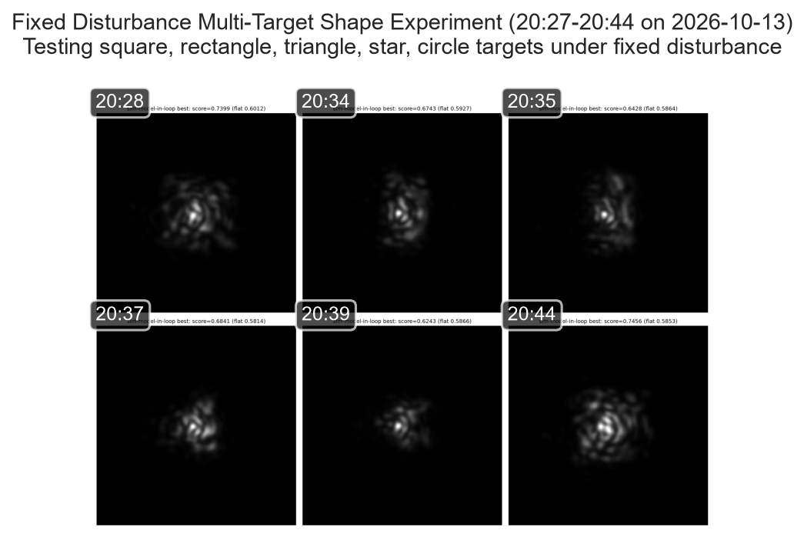

*图 11: 固定扰动下多目标形状实验结果 (20:27-20:44 on 2026-10-13). 从左至右、上至下: 无扰动方形, 扰动方形, 扰动长方形, 扰动长方形 (400 epochs), 扰动三角形, 扰动五角星. 每个子图显示该形状下的最佳远场图像, 下方标注时间戳, 六张留出相关性范围, 成形预测相关性, 实测目标区域 CV/EE, 以及综合分.*

不同形状的分数使用不同面积的目标掩码，**不能横向排名**。长方形 80/400 次两轮保持种子 83 和相同扰动，模型内 Step B 最终损失从 0.417 降到 0.334，但实际 CV/EE/分数均退化；两轮跨时段采集，不能把退化全部归于迭代次数。三种非方形相位的图像都仍有显著散斑，视觉上未形成均匀实心轮廓；“accepted”仅表示本轮目标区域综合分数高于平场，不代表形状达标。成形相位预测相关性 0.779–0.832 也不足以保证逆设计输出的细节正确。

为分离静态扰动与随机相位族，扰动方形 `202804` 与无扰动方形 `204410` 复用种子 82 和逐位相同的六张留出指令相位，训练及留出曝光均固定 0.4 ms。对应留出 CCD 网格跨运行相关性为 **0.931–0.986**，但两轮相隔约 16 分钟，期间进行其他目标试验；因此这是“扰动与时变光路共同作用”的差异，不是纯扰动因果估计。两轮从平场采集到成形采集分别约 **19.4 s / 21.0 s**，不含设备打开、全幅定位和文件保存，不能称为整轮墙钟耗时。

再用每轮仅两张**训练**探针分别拟合零系数候选和当轮 10 步 Step A 候选的非负增益/加性背景（杂散光）项；冻结六张留出帧，未用它们拟合 NNLS。扰动轮零系数→拟合系数的全族平均相关性为 **0.7942→0.7972**，全频随机相位为 **0.7652→0.7524**；无扰动轮分别为 **0.8109→0.7960** 和 **0.7364→0.7028**。即使在扰动条件下，10 步重拟合也没有改善最关键的全频随机相位泛化。下一步应在同一训练帧上保留旧/零/短拟合多候选，额外采一张全频随机相位仅用于选择，再用另一张全新全频随机相位验收；当轮训练损失和总体相关性均不足以决定 Step B 的模型。以上比较仍共享会话、几何和相位种子，不构成跨光路的显著性证明。

### 当前扰动下的几何重标定失败与证据保留

为检验旧几何是否限制逆设计，曾在同一静态扰动下不传 `--geometry-file`，让程序以 8 张强探针重解传播几何。第一次求得散斑相关性 **0.0289**，低于 0.5 安全门槛，**在 Step A 和 Step B 之前中止**；设备正常关闭。这暴露了一个调试缺口：几何门槛原先在结果保存之前抛出异常，失败探针未落盘。随后工程化了 debug 预采集：运行开始即分配目录，平场和每张几何探针立即保存相位、稳定帧、额外原始帧、曝光回读及 UTC 微秒时间戳；解出的几何和失败原因单独保存。用相同配置重跑，证据位于 [`20261013_210403/preflight`](../../data/debug/slm_model_in_loop/20261013_210403/preflight/)，几何相关性仍仅 **0.0577**，门槛再次正确拒绝整形，Daheng 最高回读 0.400 ms。

该轮 8 张探针的相位标准差均为 4 rad，而辅助原始 CCD 峰值仅 30–34/255；以首张稳定帧为参照，其余七张的逐像素相关性 **0.9804–0.9874**。所以探针指令差异很大，CCD 图案却几乎不变，散斑匹配没有足够可辨识信号。`model_in_loop_shaping.py` 的历史说明已指出此实验系统的散斑几何标定不可靠，`20261013_105911` 的可用几何来自倾斜/离焦扫掠；这两次失败不证明真实传播几何一定突变。当前继续沿用旧 sweep 几何时，必须用新会话的训练外相位和最终 CCD 图验证；下一次几何更新应优先复测倾斜/离焦扫掠，并核对 SLM 面板光斑位置、入射振幅和 CCD 采样尺度，不能降低 0.5 门槛硬闯。
