# Model-in-loop 实验复核（2026-10-14）

<!-- provenance:start -->
> **生成脚本**: 人工撰写，无生成脚本
> **运行环境**: 硬件
> **说明**: 2026-10-14 正向模型闭环实验复核（exp/model-in-loop-20261014 worktree）；随机相位面板扫描定光斑位置 (960,670)，传播几何沿用 20261013 的 bench_geometry.json，本日未重新独立标定其尺度/入射振幅/面板配准
<!-- provenance:end -->

本报告为 `banckend` 本地分支派生的 `exp/model-in-loop-20261014` worktree 新增记录，不改写 2026-10-13 报告。代码工作目录为 `data/debug/worktrees/model-in-loop-20261014/`，所有采集数据保存在主仓库 `data/debug/slm_model_in_loop/`。设备为 Santec SLM #1（`22030108`）和 Daheng CCD（`FJB24112232`），波长 1064 nm；每轮设备独立打开、关闭并恢复 SLM 原显示。

## 光路和预检

先以 0.020 ms 曝光、半径 220 面板像素的随机相位盘扫描。3×3 扫描 `20261014_104559_panel_scan` 的最强响应在 `(960,640)`，处于 y 边界，最大成对平场漂移 0.47%，整轮漂移 0.11%。纵向补扫 `20261014_104838_panel_vertical` 的响应从 y=400 的 -0.077 增至 y=700 的 -0.139，最大成对漂移 0.29%，整轮 0.58%。结合第一轮 y=640 的 -0.146，本轮暂用 `(960,670)`；这只是高响应区内的工作位置，非精确光束中心。两轮扫描的逐候选原始帧、前后平场和配置均在上述目录。

传播几何沿用 `20261013_105911/bench_geometry.json`（倾斜/离焦 sweep，历史相关性 0.8376）；**本日没有重新独立验证其尺度、入射振幅或面板配准**。强随机探针的几何标定在前一日两次失败，因此没有重复该配置，也没有降低 0.5 几何门槛。所有闭环以 0.020 ms 启动自动曝光，Daheng 配置与回读上限均为 **0.400 ms**，比用户允许的 0.6 ms 更严格。

## 实测闭环

各轮均为 1 轮、2 张训练探针、6 张留出（平滑/Zernike/逐像素自由相位各 2 张）、80 步 Step B。除最后两轮的新种子 86 对照外，种子均为 85；扰动文件是前一日保存的固定 0.5 rad RMS Zernike 面板相差 `data/debug/slm_disturbance_compare/20261013_165039/disturbance_panel_rad.npy`。Step A 为 10 步，除标注零步者。所有预测相关性在同轮保存的 CCD 模型网格上计算；目标区域 CV/EE 使用冻结光轴和对应形状掩码，尚未做绝对辐射标定。

| 运行目录            | 条件                                | 6 留出相关性均值 | 自由相位相关性均值 | 成形预测相关性 |    实测 CV / EE |   分数 |
| ------------------- | ----------------------------------- | ---------------: | -----------------: | -------------: | --------------: | -----: |
| `20261014_105041` | 无扰动，方形                        |           0.8153 |             0.7473 |         0.8129 | 0.9019 / 0.9209 | 0.7629 |
| `20261014_105205` | 扰动，方形                          |           0.8084 |             0.7601 |         0.8096 | 0.8650 / 0.8741 | 0.7390 |
| `20261014_105339` | 扰动，长方形                        |           0.8112 |             0.7664 |         0.8219 | 0.7142 / 0.7622 | 0.6907 |
| `20261014_105438` | 扰动，三角形                        |           0.8173 |             0.7846 |         0.8226 | 0.6624 / 0.7173 | 0.6710 |
| `20261014_105535` | 扰动，五角星                        |           0.8112 |             0.7722 |         0.8430 | 0.6529 / 0.6134 | 0.6101 |
| `20261014_110203` | 扰动，长方形，Step A 零步，种子 86  |           0.8316 |             0.8213 |         0.8016 | 0.6851 / 0.6944 | 0.6540 |
| `20261014_110305` | 扰动，长方形，Step A 10 步，种子 86 |           0.8417 |             0.7767 |         0.8037 | 0.8088 / 0.7471 | 0.6694 |

## 相位与远场图像

以下为七轮运行的 SLM 最佳相位图（包装到 [0, 2π)，`twilight` 色图）与对应 CCD 远场图像（`inferno` 色图，青色虚线框为 target 区域，边长 100 像素，中心为图像几何中心 `(477, 492)`）。相位来自各轮 `best_phase.npy`；远场为保存的 `best_far_field.png`（inferno 渲染图）。

> ⚠️ **注意**：`best_far_field.png` 是 colormap 渲染图，不是原始强度数组。下方 `EE_in_target` 与 `RMS_uniformity` 基于渲染图亮度通道近似计算，**不等于**表格中 runner 在原始 CCD 数据上计算的 `CV/EE`，两者不可直接比较，仅供可视化参考。

| 运行 | SLM 相位 | CCD 远场 (target 框) |
|------|----------|---------------------|
| `20261014_105041` (无扰动，方形) | 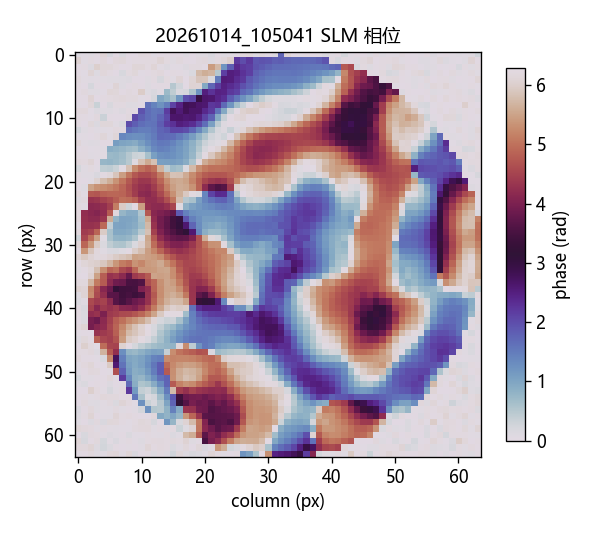{width=150} | 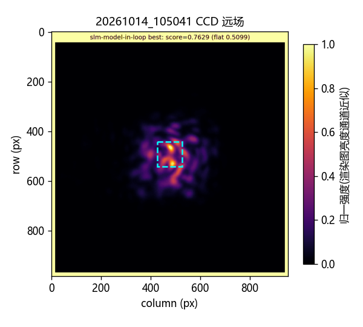{width=150} |
| `20261014_105205` (扰动，方形) | 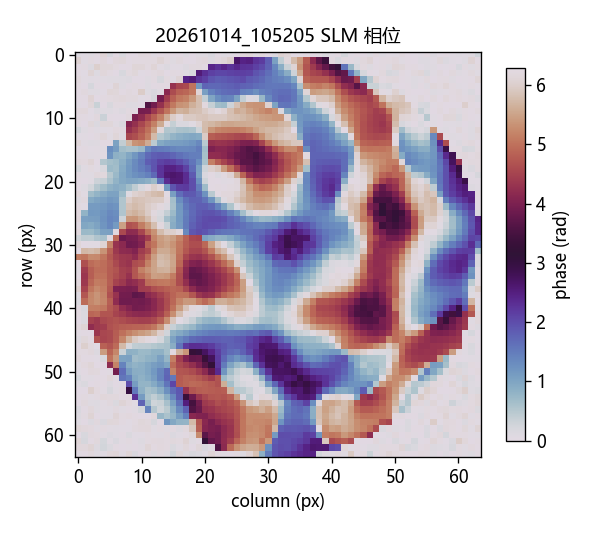{width=150} | 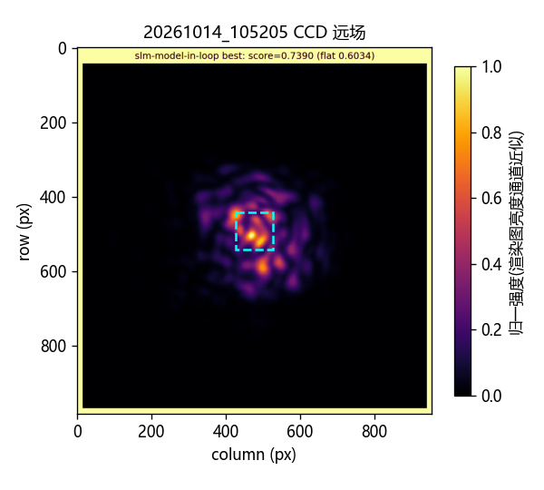{width=150} |
| `20261014_105339` (扰动，长方形) | 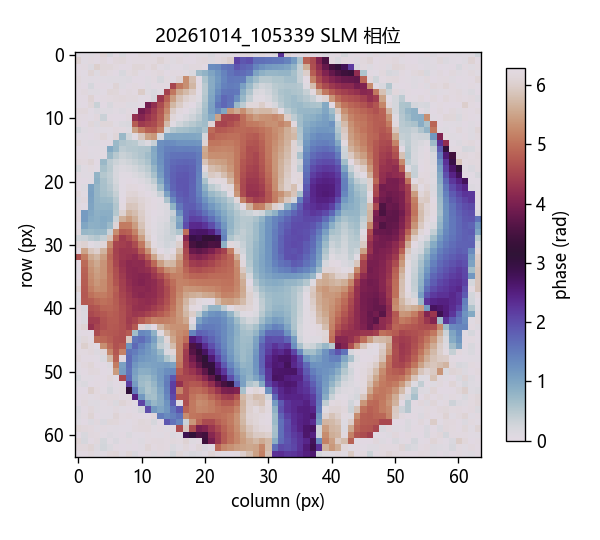{width=150} | 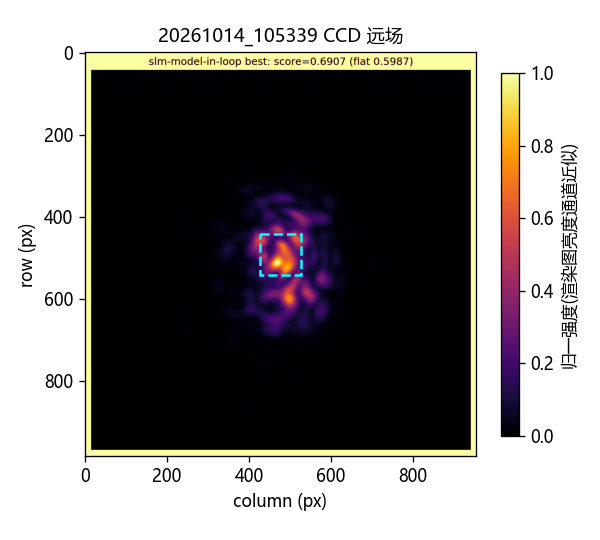{width=150} |
| `20261014_105438` (扰动，三角形) | 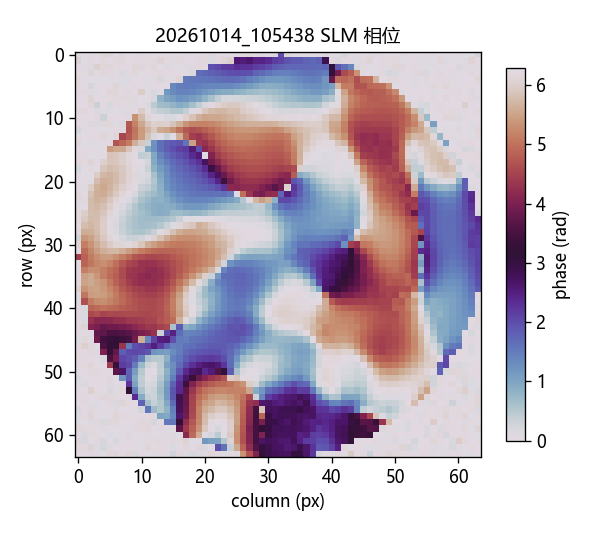{width=150} | 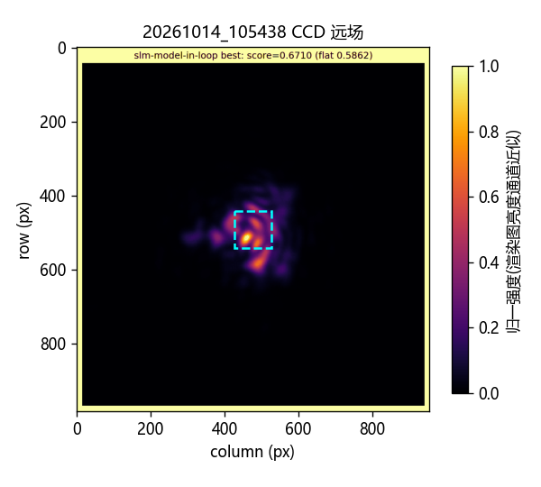{width=150} |
| `20261014_105535` (扰动，五角星) | 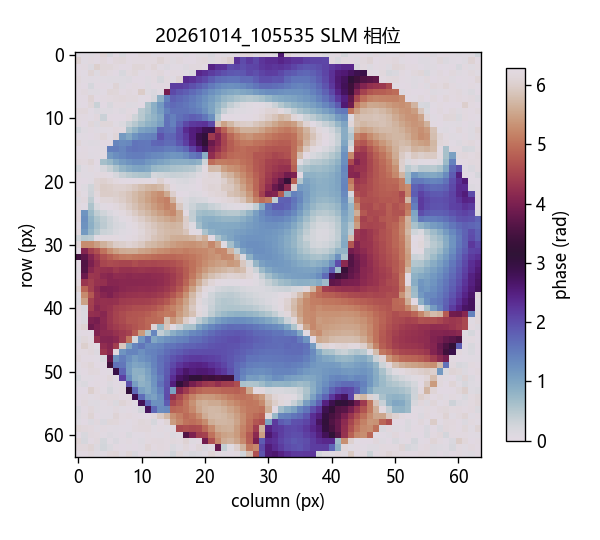{width=150} | {width=150} |
| `20261014_110203` (扰动，长方形，Step A 零步) | 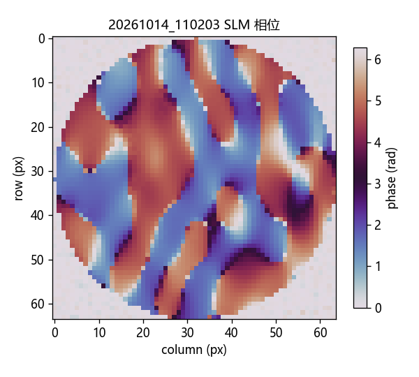{width=150} | {width=150} |
| `20261014_110305` (扰动，长方形，Step A 10 步) | 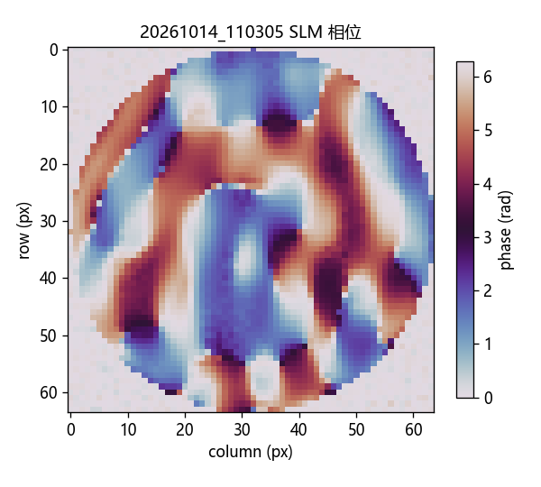{width=150} | {width=150} |

| 运行 | target 内能量占比 (EE_in_target, 渲染图近似) | target 均匀度 RMS (渲染图近似) | 实测 CV | 实测 EE |
|------|---------------------------------------------|--------------------------------|---------|---------|
| `20261014_105041` | 0.0400 | 0.4685 | 0.9019 | 0.9209 |
| `20261014_105205` | 0.0420 | 0.4401 | 0.8650 | 0.8741 |
| `20261014_105339` | 0.0439 | 0.4329 | 0.7142 | 0.7622 |
| `20261014_105438` | 0.0370 | 0.4882 | 0.6624 | 0.7173 |
| `20261014_105535` | 0.0438 | 0.4194 | 0.6529 | 0.6134 |
| `20261014_110203` | 0.0345 | 0.5179 | 0.6851 | 0.6944 |
| `20261014_110305` | 0.0288 | 0.6318 | 0.8088 | 0.7471 |

上述每轮的 `run_config.json`、`probes/manifest.json`、逐帧 `.npz`、拟合系数、最佳相位、CCD 图与轨迹均在相应目录。共 70 条帧记录，曝光回读最高 0.400 ms，时间戳无缺项，辅助原始帧峰值最高 140/255；`raw_frame` 是稳定平均帧后的**另一次**读数，不能与保存的稳定帧逐像素配对。所有轮次均通过每张留出相关性 0.5 的最低门槛，且设备正常关闭。不同形状目标面积不同，复合分数不能跨形状直接排名。

实际 CCD 图仍表现为亮斑和散斑团，长方形、三角形、五角星均未形成可辨、均匀的实心轮廓。runner 的 `accepted` 只表示该轮综合分数高于自身平场，不代表形状达标。尤其五角星分数仅比自身平场约高 0.0135。

## 快速重拟合是否有效

新增 `scripts/slm/evaluate_model_in_loop_refit.py`：对同一运行保存的两张训练帧，分别从零系数和当轮 10 步拟合系数预测，**分别**重拟合非负模型增益与加性背景（杂散光）项，再对未参与拟合的六张留出逐帧评分。结果在 `data/debug/slm_model_in_loop/20261014_refit_analysis/paired_holdouts.json`。种子 85 的五轮里，短拟合相对零系数的整体留出均值均略低；自由相位下降：无扰动方形 0.7874→0.7473、扰动方形 0.8294→0.7601、长方形 0.8318→0.7664、三角形 0.8463→0.7846、五角星 0.8316→0.7722。这些轮次共用训练和留出指令种子，也相隔数分钟，不能视作独立统计样本。

随后把 `--step-a-iterations 0` 接入正式 runner：仍采训练探针拟合 NNLS 增益/加性背景（杂散光）项，跳过 Zernike 更新，继续做六张留出门槛和 Step B。新种子 86 的零步与 10 步轮次在指令层的 2 张训练、6 张留出相位**逐位相同**。各自训练帧上配对复算见 `paired_new_seed.json`：10 步候选总体相关性 0.8307→0.8417，但自由相位 0.8224→0.7767。两轮实际 CCD 成形呈 CV/EE 权衡：零步 0.685/0.694，10 步 0.809/0.747；10 步复合分数略高，但均匀度更差。两轮采集先后进行，没有同曝光交错重放，故不能把 CV/EE 差全部归于系数拟合。

当前证据不支持“2 探针、10 步 Zernike 更新已学到受扰动后的正确正向模型”。更合理的快速路径是将零系数、旧系数和短拟合都保留为候选，训练帧仅用于低参数拟合；另用自由相位作候选选择，再采**未参与选择**的新自由相位与成形相位作最终验收。模型改进需同时提升自由相位预测和实测目标形状，不能只看总体相关性或 Step A 训练损失。下一轮应复核真实入射振幅、面板配准与 CCD 采样，几何更新优先倾斜/离焦扫掠；继续维持 Daheng 0.4 ms 上限和原始帧留存。

## 交错重放复核（11:12）

为排除上述两轮先后采集造成的部分时间偏差，把两轮保存的最佳相位在同一次设备会话中按 `flat,A,B,flat,B,A,flat` 交错重放；A 是零步，B 是 10 步。工具 `ao_shaping.tools.slm.model_in_loop_replay` 在比较前检查目标形状、光路参数、固定扰动文件及相位尺寸；本次长方形指标使用长方形掩码和真实相机的 90° 旋转。数据位于 `data/debug/slm_model_in_loop_replay/20261014_1115_zero_vs_refit/`，含 7 张归一化帧、7 张辅助原始帧、逐帧 UTC 微秒时间戳与配置。成形帧都固定 0.400 ms，原始峰值 94–149/255，均未饱和；设备已正常关闭并恢复原显示。

| 相位    | 次序  |          CCD CV |              EE |        综合分数 |
| ------- | ----- | --------------: | --------------: | --------------: |
| A 零步  | 1 / 5 | 0.6761 / 0.6685 | 0.6858 / 0.6899 | 0.6501 / 0.6537 |
| B 10 步 | 2 / 4 | 0.8007 / 0.7992 | 0.7368 / 0.7375 | 0.6642 / 0.6648 |
| A 均值  |       |          0.6723 |          0.6878 |          0.6519 |
| B 均值  |       |          0.7999 |          0.7372 |          0.6645 |

同曝光交错结果与先前两次独立运行方向一致：B 的 EE 高 0.0493、综合分数高 0.0126，但 CV 高 0.1276（均匀度更差）。两次 B 的 CV 相差 0.0015，A 相差 0.0075；这使单纯的采集顺序成为上述权衡的较弱解释。这里比较的是**两个已优化相位**，不是只改变 Step A 的严格因果消融；两个相位也经历各自独立的 Step B 搜索。因此不能由此证明 10 步重拟合本身带来 EE 改善。

平场三张的自动曝光为 0.059 / 0.121 / 0.121 ms。后两张同曝光的归一化总光量相差约 0.47%，第一张与后两张差约 10%，其中曝光差引入的短曝光响应非线性尚未分离，**不可**直接记为激光/光路漂移。下一轮平场也应锁定同一安全曝光，再用该对照判断漂移；若持续做跨曝光拟合，须先标定相机线性响应。当前长方形仍为散斑团，均匀实心形状目标未实现。

## 主仓库合并核查（16:48 报错后）

主仓库 `banckend` 合并后，GUI 构造 `SlmModelInLoopConfig` 时因缺少 `freeform_holdout_count` 字段立即抛出 `AttributeError`；同一路径的 runner 参数映射也漏传该字段。进一步检查发现留出测量分支引用未定义的 `holdout_family`，且逐测量 `step_sink` 已声明但四个测量点均未调用。现已在主仓库补齐配置与参数映射，恢复标准/Zernike/自由相位留出生成和家族标签、平场/标定探针/Step A/Step B 的逐帧回调，并移除重复的 `pupil_oversampling` 声明。自由相位留出默认仍为 0；未启用时保留原有探针种子序列。Daheng 曝光配置上限仍为 0.4 ms。

离线模拟和 GUI 参数测试通过；此轮未重新采集 CCD 帧，也未验证实验成形指标。下一次实验先用固定低功率、曝光不超过 0.4 ms 的短运行确认 GUI 配置和留出记录，再恢复完整闭环对照。历史实验原始数据与本报告中的量化结论未作改动。

## 五种目标形状实验复核（17:08–17:14）

合并修复后，在已由 GUI 释放设备句柄的条件下，用 Santec SLM #1 和 Daheng CCD 顺序测试圆形、正方形、长方形（2:1）、三角形、五角星。五轮均为种子 87、无额外相差扰动、目标包围宽度 100 相机像素、单轮、2 张训练探针、Step A 0 步、4 张标准留出加 2 张自由相位留出、Step B 80 步；沿用 `20261013_105911/bench_geometry.json` 和面板中心 `(960,670)`。旧几何相关性 0.8376 是历史标定值，**本轮没有重新测量几何相关性**。`Step A 0 步` 仍采训练帧并拟合非负增益及加性背景（杂散光）项，不更新 Zernike 系数。

| 形状 | 数据目录（`data/debug/slm_model_in_loop/` 下） | 平场→成形分数 | 实测 CV | 实测 EE | 6 张留出相关性均值 | 2 张自由相位相关性均值 | 成形预测相关性 |
| --- | --- | ---: | ---: | ---: | ---: | ---: | ---: |
| 圆形 | `20261014_170820` | 0.5874→0.7297 | 0.7244 | 0.8296 | 0.8264 | 0.7529 | 0.8294 |
| 正方形 | `20261014_171043` | 0.5048→0.6606 | 0.8629 | 0.7432 | 0.8271 | 0.7666 | 0.7882 |
| 长方形 | `20261014_171219` | 0.5869→0.6401 | 0.6874 | 0.6717 | 0.8040 | 0.7343 | 0.8164 |
| 三角形 | `20261014_171301` | 0.5880→0.6715 | 0.5767 | 0.6964 | 0.8179 | 0.7415 | 0.8428 |
| 五角星 | `20261014_171340` | 0.5805→0.6033 | 0.7379 | 0.6219 | 0.8234 | 0.7629 | 0.7961 |

每轮 `probes/manifest.json` 恰有 10 张帧（平场 1、训练 2、留出 6、成形 1），全部有 UTC 时间戳及曝光回读；留出均带 `smooth`、`zernike` 或 `freeform` 标签。平场自动曝光约 0.05 ms，训练、留出与成形帧均为 0.400 ms，未超过上限；逐轮辅助原始帧峰值最高分别为 166、170、186、193、196/255。原始帧为稳定平均后的另一次 CCD 读取，不能与稳定帧逐像素配对。设备每轮均正常关闭。

五张 `best_far_field.png` 显示的是随目标形状变化的散斑团，没有清晰、均匀的实心轮廓；五角星仅比自身平场高 0.0228 分。`accepted` 和留出相关性通过，只能说明当前复合指标提升及探针上的预测达到门槛，**不能**证明目标形状已实现。不同形状的掩码面积不同，分数、CV 和 EE 不应直接跨形状排名。五轮相隔数分钟且平场自动曝光不同，本轮也不是同曝光交错重放，不能据此量化光路漂移或形状选择的因果收益。

GUI 已把五种形状作为中文可选项，底层值仍为 `square/rectangle/triangle/star/circle`，并开放自由相位留出数；五种选择到配置类的映射有离线测试。下一步应在固定安全曝光下交错重放各形状的成形相位，并增加与目标掩码的形状相似度指标；先复核真实入射振幅和面板配准，再决定是否增加 Step B 迭代或模型自由度。曝光仍须保持不高于 0.4 ms。

## 深度学习与物理正向模型的同帧核查（设备下线后）

设备下线后，读取上述五轮的 30 张留出帧（每轮 smooth/Zernike/freeform 各 2 张）和 5 张成形帧，比较保存的物理 Zernike 预测、昨日训练的冻结 U-Net 预测，以及每轮只用其 2 张训练探针微调 10 步的 U-Net 预测。三份 U-Net checkpoint 的初始化种子分别为 20261013/14/15，均为 121,177 个参数、相位 cos/sin 加曝光协变量输入。所有评价帧的实际曝光回读均为 **0.400 ms**。历史 checkpoint 来源 run 的全部曝光帧共含 47 个不同相位，与今日评价 run 的 13 个不同相位无重合；今日五轮共用种子 87，故 35 张帧并非 35 个独立相位。

| 模型 | 30 张留出相关性，三种子范围 | 30 张留出预测 CV / EE，三种子范围 | 5 张成形相关性，三种子范围 | 5 张成形预测 CV / EE，三种子范围 |
| --- | ---: | ---: | ---: | ---: |
| 物理 Zernike | 0.8294 | 1.558 / 0.4699 | 0.8040 | 0.6298 / 0.6441 |
| U-Net 冻结 | -0.0420 至 0.0401 | 0.115–0.284 / 0.0650–0.0705 | -0.0974 至 0.1571 | 0.074–0.367 / 0.0645–0.0804 |
| U-Net 两探针微调 | -0.0401 至 0.0403 | 0.112–1.191 / 0.0599–0.0659 | -0.1045 至 0.0834 | 0.075–0.216 / 0.0643–0.0705 |
| 同帧 CCD（非模型） | 1.0000 | 1.237 / 0.7174 | 1.0000 | 0.7088 / 0.7187 |

表中 CV/EE 均在保存的 192×192 模型网格、相同可观测掩码和各形状对应的 36 模型像素目标掩码上复算；它们不能与上节直接在原始 CCD 网格计算的 CV/EE 混写。CV 小也可能只是预测图趋于平坦：U-Net 的 EE 只有约 0.06–0.08，相关性接近零，故其低 CV **不代表**整形更均匀。物理模型按相位族的留出相关性为 smooth 0.8357、Zernike 0.8558、freeform 0.7965；U-Net 种子 20261013 的冻结值分别为 -0.0655、-0.0564、-0.0041，微调后分别为 -0.0562、-0.0571、-0.0070。自由相位泛化依旧是物理模型较弱的一组，但仍明显优于当前 U-Net。

逐帧 CSV、三个模型的预测网格、配置和相位重合检查保存在 `data/debug/slm_model_compare/20261014_5shape_seed_20261013_verified/`、`...20261014_verified/`、`...20261015_verified/`。复现入口为 `scripts/slm/compare_model_in_loop_saved_checkpoints.py`，评分复用 `compare_model_in_loop_unet.py`。这个比较检查的是**真实光路帧上的正向预测**：目前只有物理模型执行过 Step B 并把候选相位下发 SLM；U-Net 没有执行实验反向优化或闭环验收，不能声称它的实验整形效果。按本次留出结果，现有 U-Net 不具备替代物理模型实验闭环的预测质量。设备已下线，后续要先扩大跨日、跨相位族训练集并做独立留出验证，再讨论 U-Net 候选相位的实验门槛测试。

## 设备下线后的交接（2026-10-15）

本节仅核对已保存的代码与记录，未连接 SLM、CCD 或激光。五种形状的运行证明目标选择、相位下发、CCD 采集和物理模型闭环均能执行；现有 CV、EE、综合分和模型相关性不能替代轮廓相似度验收。长方形、三角形和五角星仍被目视判为散斑团，目标实心轮廓尚未得到实验验证。仓库内路线图 `docs/slm/闭环光束整形_文献与优化建议_20261014.md` 将轮廓重合或 Hausdorff 验收列为 #115；当前 `beam_metrics.py` 与模型闭环验收尚未提供这项指标。GitHub API 在当前执行环境不可达，因此这里未声称已核对远端 issue 的最新状态或 #134 的具体要求。

下次设备恢复时，先根据新的平场和面板扫描重新确认入射位置、光轴及安全曝光；历史 `(960,670)` 只能作为旧会话记录。Daheng 仍沿用代码中更严格的 0.4 ms 上限，不因用户许可的 0.6 ms 放宽。随后在同一固定曝光下对 flat、已保存最佳相位和新候选相位交错重放，逐帧保留原始读数、回读曝光、UTC 时间戳和形状掩码指标到 `data/debug`；增加轮廓相似度验收后再判断是否真正生成特定形状。深度模型需先通过跨运行、跨相位族的独立留出门槛，目前不应进入实验 Step B。
