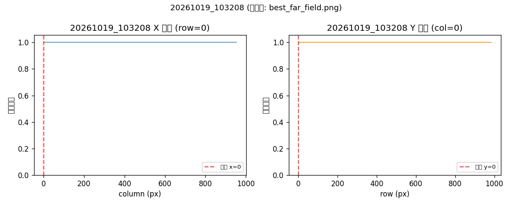
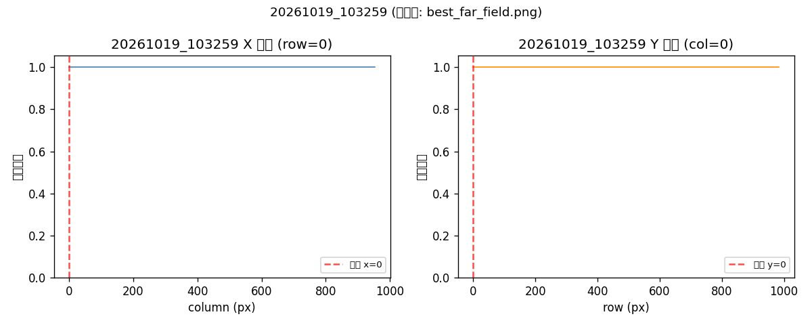
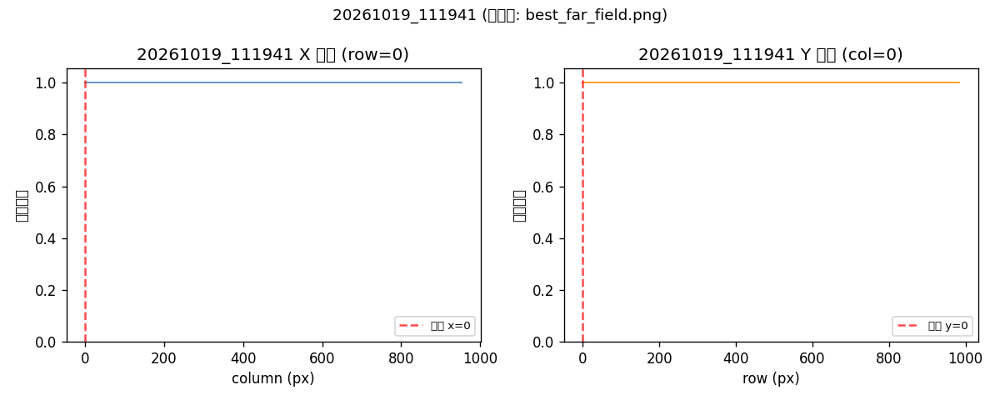

# 相机位置调整后的正向模型校正与多形状整形（2026-10-19）

## 09:41 开始：设备发现与当前会话探测

用户已确认释放相机。受限进程内 `gxipy.DeviceManager().update_device_list()` 返回
`(0, [])`；同一 SDK 在沙箱外枚举到 Daheng `MER2-507-23GM NIR`，序列号
`FJB24112232`，地址 `192.168.0.11`，访问状态 `1`。因此此前的枚举失败
不能作为相机离线的证据。本轮实验进程在能发现设备的环境中运行。

自动入口 `scripts/slm/model_in_loop_auto.py` 已补充子进程的 `src`、`libs`
导入路径，保留原有 `PYTHONPATH`；对应离线测试 5 项通过。
本轮配置和控制台日志位于
`data/debug/model_in_loop_auto/20261019_camera_reposition/`，目标为矩形，
配置宽度 60 相机像素，模型网格 128，padding 8，1 轮闭环，seed 19。
不输入历史几何文件，当前光路重新定位、探测曝光和测量几何。

真实设备打开成功：Santec #1 控制器 `22030108`，1064 nm，内存显示模式；
CCD 全帧尺寸 `2592×1944`。本次画面探测得到曝光上限 `2.0655 ms`；
这是当前光路的测量值。初始平相位参考峰值 `14/255`，FWHM `61.6 px`，
质心约 `(1365.8,1021.0)`，与此前会话不同，后续指标不能直接跨会话比较。

此前仅作了一组不保存数据的最小离线检查，确认四种形状可通过现有可微函数
执行前向及反向传播。96 网格、尺寸 32、120 步、seed 17 的模型内结果为：

| 目标 | CV | EE | IoU |
| --- | ---: | ---: | ---: |
| 方形 | 0.9078 | 0.7753 | 0.0551 |
| 矩形 | 0.9669 | 0.7845 | 0.0463 |
| 三角形 | 1.0103 | 0.8450 | 0.1031 |
| 五角星 | 1.0417 | 0.8538 | 0.1362 |

这些值只说明短迭代预算下形状仍未充分形成，不是新光路上的整形结果。
本轮结论以实验 CCD、独立相位留出预测和固定曝光复测为准。后续结果按时间追加。

## 09:48：全板入射定位完成，开始新几何测量

5×4 扫描选中面板中心 `(960,720)`。第三行 `(960,720)` 的配对能量变化
约为 `-0.350`，相邻 `(1320,720)` 约为 `-0.282`；前两行响应明显较弱。
20 个位置均未因配对漂移而被剔除，最大配对平场强度漂移
`1.1986832844446581%`，整轮强度漂移 `8.007665086345209%`。
后者只作报告量，定位使用逐点前后平场归一化。

整轮质心位移 `10.530695183028293 px`，参考 FWHM
`41.24371054190905 px`，当前流程的 FWHM 比例判据上限为
`20.621855270954526 px`，因此定位阶段通过。位移虽通过门槛，仍需在
后续预测及整形验收中关注；不能把通过定位视作整个实验系统没有漂移。
证据：`data/debug/slm_model_in_loop/20261019_094121/panel_scan/`。

定位进程释放设备后，自动启动几何扫描；重新打开设备成功，曝光自动探测
仍返回 `2.0655 ms`。此阶段平相位参考峰值 `13/255`，FWHM
`38.4 px`，质心 `(1368.8,1032.4)`。截至本节记录时，几何扫描仍在采集，
尚无正向模型留出验证或目标整形结论。

## 10:04：曝光初始化修复与首轮矩形结果

几何扫描得到 55 个测量点，宽度响应拟合相关系数
`0.8811449970024858`，相机/模型尺度 `2.614022035287756`。
但相位斜坡尺度与独立视场估计相差约 `530%`，照明束腰不可辨识，
因此该相关系数不能代替独立相位的图像预测验证。

首次进入优化器时，Daheng 自动模式在探测完范围后重新使用 `0.020 ms`，
导致低计数全帧触发零级光斑不可检测。初始化现改为调用共享
`working_exposure_ms`，从当前探测范围确定起始曝光并考虑设备最小曝光，
保留显式配置优先级。相关模型与曝光单元测试共 145 项通过。
复测复用本次扫描所得几何和面板中心，成功进入 Step A/B。

复测目录 `data/debug/slm_model_in_loop/20261019_100334/`：

| 阶段 | CV | EE | IoU |
| --- | ---: | ---: | ---: |
| 基线 | 0.3997529820668537 | 0.1541370195457368 | 未记录 |
| 1 轮后 | 0.4545879812255449 | 0.14369992795333472 | 0.2924242424242424 |

虽然后续将该轮标记为 accepted，实际 CV 和 EE 均变差，不能作为匀化成功。
同一批原始留出 CCD 的离线对照中，零像差模型相关性约 `0.5388`，
短程拟合后约 `0.5419`，提高有限。此次未采集自由相位留出样本，
不支持对自由相位泛化的结论。精确逐样本结果见该目录的 `refit_comparison.json`。

### 首轮矩形 X/Y 光强截面

首轮矩形运行 `20261019_100334` 的远场强度在 X、Y 方向上的光强截面如下：

{width=90%}

## 10:23：聚焦与两个彗差方向扫描

按用户建议新增可复用工具
`ao_shaping.tools.slm.panel.alignment_probe`，直接调用已有 Fresnel 焦度扫描及规范
Zernike 相位生成函数。单幅宽度不用于推断离焦正负；采用双向焦度探针、边界扩展
和局部细化。彗差通过两个面板轴的 `(3,-1)`、`(3,1)` 模式逐轴探测，
在重新估计局部强度质心后，比较左右及上下镜像误差。

本次使用面板中心 `(960,720)`、半径 `450 px`，原始证据保存在
`data/debug/alignment_probe/20261019_focus_coma/`。设备读出的曝光范围
`0.02–1000.0 ms` 用于此次自适应曝光；每个候选均另行判断可测区间。

| 项目 | 平相位 | 聚焦后 |
| --- | ---: | ---: |
| 峰值/曝光（counts/ms） | 11.867511827166469 | 460.7376387592614 |
| FWHM（px） | 47.23371801277261 | 13.747441906842653 |

最佳校正焦度 `+0.644356158432213 m⁻¹`，SLM 等效焦距
`1551.9367463377803 mm`，峰值/曝光比增益 `38.82344045401039`。
半曝光线性复测比 `1.0283400809716599`，通过 `0.8–1.2` 的本次检查。
该等效焦距不能直接换算为相机轴向位移。

在聚焦相位上叠加 `(3,-1)=+0.75 rad`、`(3,1)=0 rad` 后：

| 项目 | 聚焦基线 | 聚焦加彗差校正 |
| --- | ---: | ---: |
| 左右镜像误差 | 0.12529358038941768 | 0.08832385604463151 |
| 上下镜像误差 | 0.11287399816797482 | 0.06971803725457132 |
| 平均镜像误差 | 0.11908378927869626 | 0.07902094664960141 |
| RMS 半径（px） | 10.260935101485272 | 9.040047416439414 |

此处是有限扫描范围内的可用校正，不是唯一物理像差反演；另一方向的零系数
只表示本次扫描未保留非零候选，不能据此断言光路无该方向彗差。
原始相位保持未包裹弧度，并由驱动统一转换。探测结束恢复平相位。

## 10:30：固定曝光交替重放与中心重复性

新工具的 `--verify-directory` 模式复用校正文件，固定实际曝光
`0.242 ms`，三组相位重放按正序/逆序交替，每次稳定后平均 3 帧。
独立证据：`data/debug/alignment_probe/20261019_focus_coma_verify/`。

| 指标 | 聚焦相位，均值 ± 样本标准差 | 聚焦加彗差相位，均值 ± 样本标准差 |
| --- | ---: | ---: |
| 平均镜像误差 | 0.12565426361709073 ± 0.0004603288421158255 | 0.08748262117984544 ± 0.0004230386194027703 |
| RMS 半径（px） | 10.553446350492244 ± 0.012867178286811724 | 9.180193751484294 ± 0.026473444169151636 |
| 中心 x（px） | 1399.9457343465126 ± 0.032779840371804675 | 1395.0839917125047 ± 0.0502423497623486 |
| 中心 y（px） | 971.0792797752797 ± 0.06740940826264609 | 969.9201649423194 ± 0.04588633051052684 |

不对称度改善约 `30.4%`，并且没有以增加光斑半径为代价。
组合校正后的中心可稳定重复测量；这里没有绝对位置参考，不能将重复性等同于
绝对定位准确度。相位校正使中心发生真实变化，后续必须重新定位，不能沿用平相位中心。

## 10:34：组合校正下的多形状模型验证

使用现有显式相位叠加接口 `--phase-disturbance-file` 加载组合校正，
使其在基线、训练和留出探针中均生效；此次用该接口传输已知校正，未添加随机干扰。
沿用本次未校正状态的几何仅作诊断，并由独立留出验证决定是否允许 Step B。
每组为 8 个训练探针、3 个独立留出探针，seed 19，目标尺寸 60 相机像素，
纯均匀度目标 `w_uniformity=1`、`w_efficiency=0`。

| 目标 | 数据目录末级 | 留出平均相关性 | 结果 |
| --- | --- | ---: | --- |
| 矩形 | `20261019_103208` | 0.39179945967321644 | 拒绝 Step B |
| 三角形 | `20261019_103259` | 0.4054942991569767 | 拒绝 Step B |
| 五角星 | `20261019_103347` | 0.41172875411904375 | 拒绝 Step B |

以上目录均位于 `data/debug/slm_model_in_loop/`。三组都低于相关性门槛
`0.5`，没有生成可验收的目标整形结果；基线 CV/EE 不能冒充优化后的指标。
聚焦与对称性改善确已测得，但尚未证明 model-in-loop 的匀化效果得到改善。

### 五种形状远场 X/Y 光强截面

新几何下的多形状运行，远场强度在 X、Y 方向上的光强截面如下：

| 形状 | 运行目录 | X/Y 光强截面 |
|------|----------|--------------|
| 矩形 | `20261019_103208` | {width=200} |
| 三角形 | `20261019_103259` | {width=200} |
| 五角星 | `20261019_103347` | {width=200} |

下一步应在组合校正始终叠加的条件下重新测量照明范围和传播几何，再用多相位族
独立留出数据验证正向模型；不能降低留出门槛强行进入目标合成。
操作方法、数据说明及适用边界见 `docs/slm/slm_alignment_probe.md`。

## 11:01：保持组合校正的几何重测

继续目标整形任务，新增几何扫描参数 `--phase-offset-file`，确保曝光探测、
参考相位、斜坡和所有 Zernike 探针始终叠加相同的组合校正。
自动会话几何入口也传递配置中的 `phase_disturbance_file`。记录保存实际显示的总相位，
补充 PKL 字符串时间戳字段的输出，相关扫描与会话测试 46 项通过。

新实验数据为
`data/debug/model_in_loop_hw_runbook/20261019_corrected_geometry/`，
标准 Recorder 数据为 `data/debug/model_in_loop_hw_sweep/20261019_105952/`。
固定曝光 `0.1 ms`，55 个扫描点。校正参考 FWHM
`13.190511654144814 px`，相机/模型尺度改为 `1.046721266686389`；
与未校正状态的 `2.614022035287756` 有明显差异。
两个倾斜轴斜率分别约 `-5.136`、`+5.330 cam px/rad`，
物理倾斜检查比 `0.98`，但视场尺度交叉检查仍相差约 `152%`，
束腰仍不可辨识。宽度响应拟合相关系数 `0.8475606214115755`，
仅作几何诊断指标，后续仍必须通过独立相位图像预测验证。

随后开始用新几何采集 16 个训练探针、4 个 Zernike 留出及 2 个自由相位留出，
尝试低参数像差模型校正与矩形整形。此时尚无该次优化的结果。

## 11:04–11:21：新几何下的泛化、采样与信号强度对照

补充说明：上一节的“4 个 Zernike 留出”是当时记录的简写；实际标准留出包含
2 个平滑相位及 2 个 Zernike 相位，另外有 2 个自由相位。三次运行均使用
16 个训练探针、seed 23、Step A 200 步、系数信赖域 5 rad，保持组合校正及新几何。
该参数用于诊断，不作为其他光路的默认推荐。

| 配置与目录末级 | 平滑留出 1 / 2 相关性 | Zernike 留出 1 / 2 相关性 | 自由相位留出 1 / 2 相关性 | 全部均值（约） |
| --- | --- | --- | --- | ---: |
| 1× 采样，`20261019_110323` | 0.8735195103270142 / 0.8362722191958367 | 0.8293974378600828 / 0.7808163310657726 | 0.10809744720463046 / 0.11287290523199307 | 0.5902 |
| 2× 采样，`20261019_111359` | 0.8617445358624598 / 0.838271278068364 | 0.8369779660572005 / 0.7839305166156176 | 0.1769400162703657 / 0.18637662300709912 | 0.6140 |
| 2× 采样、提高信号，`20261019_111941` | 0.8619686452957025 / 0.8459317812140393 | 0.843371046810663 / 0.7822954593466529 | 0.24067471296295845 / 0.2765470863645751 | 0.6418 |

### 新几何下的远场 X/Y 光强截面

新几何下的三次运行，远场强度在 X、Y 方向上的光强截面如下：

| 目标 | 运行目录 | X/Y 光强截面 |
|------|----------|--------------|
| 矩形 | `20261019_110323` | {width=200} |
| 三角形 | `20261019_111359` | {width=200} |
| 五角星 | `20261019_111941` | {width=200} |

目录均在 `data/debug/slm_model_in_loop/` 下。前两次工作曝光约 `0.344 ms`、
`0.375 ms`；2× 采样时部分探针峰值只有满量程的约 `3.9–5.9%`。
第三次以 `0.1 ms` 起始，当前会话显式上限 `20 ms`，标准探针实际曝光约
`2.845–5.174 ms`、峰值约 `53–86%`；自由相位达到 `20 ms` 仍只有约
`9.8–12.2%`。该上限只适用于此次诊断，不是新增永久限制。

三次运行的自由相位均低于逐样本相关性门槛 `0.5`，状态为
`aborted_unidentifiable`，未进入可验收的 Step B 整形。全部平均值超过门槛不能
覆盖自由相位失败；输出的 `best_phase.npy` 和图像可能只是保留的基线/已验证状态。
被拒绝运行的 `fitted_coefficients.npy` 为已接受状态，本次系数范数为零，
不能把它误认作拒绝前的拟合最优系数再做模型效果结论。

这些运行采用相同相位族、种子及几何，但分别采集了新 CCD 帧，
不是同一帧上的严格单变量实验。采样和信号改善后自由相位相关性提高，
仍不能据此认定已解决传播模型失配。局部聚焦的半曝光线性检查
也不能证明此次全部 `2.845–20 ms` 曝光范围线性。

## 收尾结论：已验证、部分支持与尚未验证

| 发现 | 证据与结论边界 |
| --- | --- |
| 当前光路存在可补偿的聚焦误差 | FWHM `47.23371801277261 -> 13.747441906842653 px`，峰值/曝光增益 `38.82344045401039`；不能直接换算相机轴向位移 |
| 聚焦后彗差方向探针有实际作用 | 固定 `0.242 ms` 三组交替重放，平均镜像误差 `0.12565426361709073 -> 0.08748262117984544`，约改善 `30.4%`，RMS 半径同时降低 |
| 校正后中心重复性改善了定位可用性 | 当前中心约 `(1395.0839917125047,969.9201649423194)`，样本标准差约 `(0.0502423497623486,0.04588633051052684) px`；无绝对位置参考 |
| 聚焦前几何不能直接用于聚焦后 | 相机/模型尺度 `2.614022035287756 -> 1.046721266686389`；重测仍有尺度交叉检查冲突与束腰不可辨识 |
| 新几何改善了标准相位族预测 | 标准留出相关性约 `0.78–0.87`；自由相位仍仅约 `0.11–0.28`，不可宣称复杂相位泛化成功 |
| 增加采样和信号仅部分缓解问题 | 2× 与提高曝光后自由相位相关性仍未过门槛，单独增加迭代不构成解决方案 |
| 旧 accepted 标记不足以证明改善 | 早期运行 CV `0.3997529820668537 -> 0.4545879812255449`、EE `0.1541370195457368 -> 0.14369992795333472`，均变差 |
| 当前多形状结果不能验收 | 矩形、三角形、五角星均未取得通过本轮独立模型门槛的匀化结果；基线指标不能当作整形后指标 |

当前最有依据的剩余问题是：平滑训练探针对自由相位覆盖不足，实际照明振幅和
面板相位映射尚未充分测量，传播几何仍有未解释矛盾。它们是待区分的原因，
本轮没有唯一确定哪一项主导，也未证明“相位梯度过大”是匀化瓶颈。
本轮没有新增 U-Net 同帧迁移对照、完整曝光响应模型或可训练照明振幅模型。

## 完整操作流程与后续所有候选方向

完整分阶段操作、命令、产物、异常恢复和 20 项 FAQ 已固化为
[跨光路流程手册](../../docs/slm/model_in_loop_workflow_faq.md)。流程顺序如下：

1. 建立设备/光路配置与数据目录，确认 SDK、占用、位深、增益和波长/LUT。
2. 固定相位多曝光测响应、记录回读值，检查饱和及信号下限，并插入漂移参考。
3. 全板定位 SLM 入射区域，细化照明范围；扫描聚焦及两个彗差方向，固定曝光复测。
4. 在相同校正状态下重新定位 CCD、测传播几何及坐标映射，保存实际总相位。
5. 实际加载多带宽相位，采集 CCD，按种子、相位族及会话分训练/独立留出。
6. Step A 冻结可靠几何，迁移低参数正向物理模型；训练集拟合增益和背景，
   用全部独立留出检验泛化，失败则记录原因并停止目标合成。
7. Step B 冻结已通过模型，可微优化输入相位；保持相同已知校正，用 CCD 决定接受/回退。
8. 对最终候选做同曝光交替重放，报告完整/去零级 CV、EE、IoU、漂移及耗时。
9. 归档配置、相位、响应、几何、模型、留出清单、逐次时间戳和失败原因；下次先快速复核。

| 优先级 | 可行思路 | 应如何验证 / 当前实现状态 |
| --- | --- | --- |
| P0 | 偏心、椭圆、截断照明及少参数振幅拟合 | 测实际照明，再比较椭圆高斯与低分辨率非负振幅；待实现训练接口 |
| P0 | 多带宽训练、独立自由相位留出 | 数据覆盖优化相位的梯度与空间频率；现有留出已经暴露问题，不降低门槛 |
| P0 | 传播尺度、旋转/镜像与实际面板插值一致化 | 同一组保存相位比较预测；2× 已测但仍失败，4× 与有限带宽尚待验证 |
| P0 | 相机多曝光响应及按曝光背景拟合 | 比较单调 LUT、多项式、双指数、Bezier、逻辑函数；先线性化或按曝光拟合背景，留出验证 |
| P1 | 聚焦/彗差并入自动预检 | 工具及固定曝光验证已完成；自动脚本全部阶段尚未完整串联 |
| P1 | 非均匀方斑初相位上的梯度约束实验 | 比较平滑基底、相位平滑与硬件带宽；单独检验梯度假设，保证目标信号不趋零 |
| P1 | 加权 GS、混合振幅反馈与可微目标比较 | 使用同一初相位、同一测量预算，报告达到同一 CV/EE 的时间；本轮未完成 |
| P1 | 零级识别掩码和离轴载波择优 | 掩码规则固定且报告面积；先纯载波测位移/效率，再叠加整形并考虑空间滤波 |
| P1 | 会话指纹缓存与按变化恢复 | 保存设备/几何/响应/校正指纹，快速复核后选择重测模块；完整条件恢复待实现 |
| P2 | 小残差网络、混合模型与 U-Net 同帧对照 | 物理模型先通过，统一训练与留出帧，比较参数量、迁移成本及相关性/CV/EE |
| P2 | 时间复用、多平面与积分强度约束 | 区分相干/非相干条件与相机积分时间；多平面计算本身不会自动消除真实散斑 |

进一步建模的原则是先测量可辨识物理量，再增加少量可训练参数，最后考虑深度残差。
多模型或多方法比较应使用相同留出原始帧，在线方法比较则交错采集并监控漂移。
不能把本轮不同时间的新帧运行包装成同帧对照。

## 证据索引与工程化交接

| 路径（仓库相对） | 用途 |
| --- | --- |
| `data/debug/model_in_loop_auto/20261019_camera_reposition/` | 配置及各阶段控制台日志，包括 `recalibrated_rectangle.log`、`oversampled_rectangle.log`、`high_snr_rectangle.log` |
| `data/debug/slm_model_in_loop/20261019_094121/` | 初始入射扫描、曝光及未校正几何 |
| `data/debug/slm_model_in_loop/20261019_100334/` | 初始矩形运行与 `refit_comparison.json` |
| `data/debug/alignment_probe/20261019_focus_coma/` | 聚焦、彗差、组合校正文件、逐次原始帧及时间戳 |
| `data/debug/alignment_probe/20261019_focus_coma_verify/` | 独立固定曝光重放及 `verification.json` |
| `data/debug/slm_model_in_loop/20261019_103208/`、`20261019_103259/`、`20261019_103347/` | 旧几何下矩形、三角形、星形的留出失败证据；后两项同属前述父目录 |
| `data/debug/model_in_loop_hw_runbook/20261019_corrected_geometry/` | 组合校正保持叠加的扫描与几何拟合 |
| `data/debug/model_in_loop_hw_sweep/20261019_105952/` | 几何扫描标准 Recorder 原始记录 |
| `data/debug/slm_model_in_loop/20261019_110323/`、`20261019_111359/`、`20261019_111941/` | 新几何、2× 采样、提高信号三次运行；后两项同属前述父目录 |

本任务工程化内容：自动入口传递 SDK 导入路径；修正预检后初始曝光回退；
新增复用已有离焦扫描的聚焦/彗差工具和独立重放；几何扫描及自动会话传递已知校正；
几何 Recorder 保存实际总相位和 UTC 字符串时间戳。没有新增第二套 Zernike 数学实现。
与上述修改相关的离线验证此前合计 178 项通过，后续几何扫描与会话测试 46 项通过；
这些批次可能有覆盖重叠，不将其相加为唯一测试数。

按用户要求收尾，不再启动设备测试。上述实验运行均已结束；本轮未新增硬件作业。
原始证据全部保留，未删除失败数据，也未改写此前时间段记录。

### 收尾校验

本次收尾重新执行定位工具、自动入口、几何扫描及会话预检相关测试：
`54 passed in 16.88s`。新增流程手册、交接手册及本报告的本地 Markdown 链接检查无缺失。
术语统一 dry-run 输出 `0 个文件, 0 行`，`git diff --check` 无空白错误。
这些检查均为离线检查，没有打开设备；实验失败边界保持如上，不以测试通过替代光学验收。
