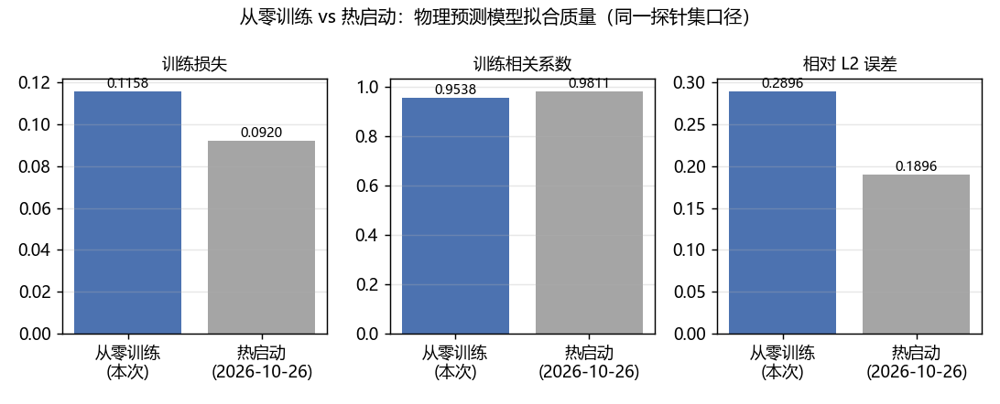
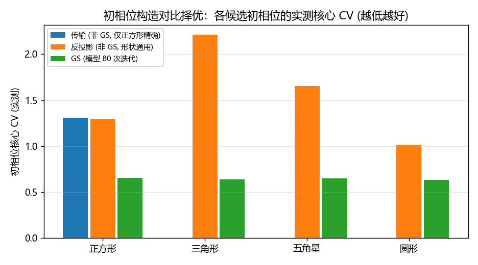
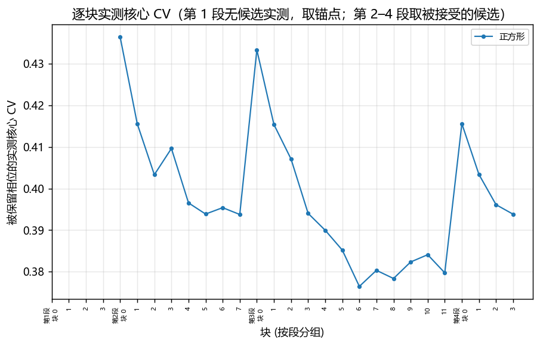
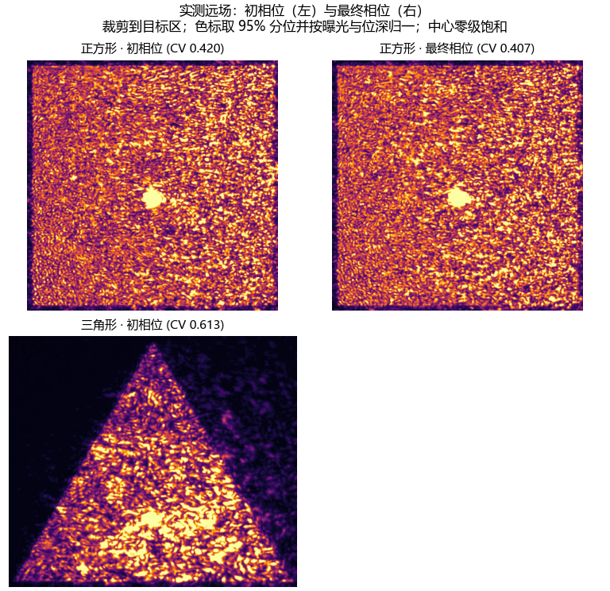
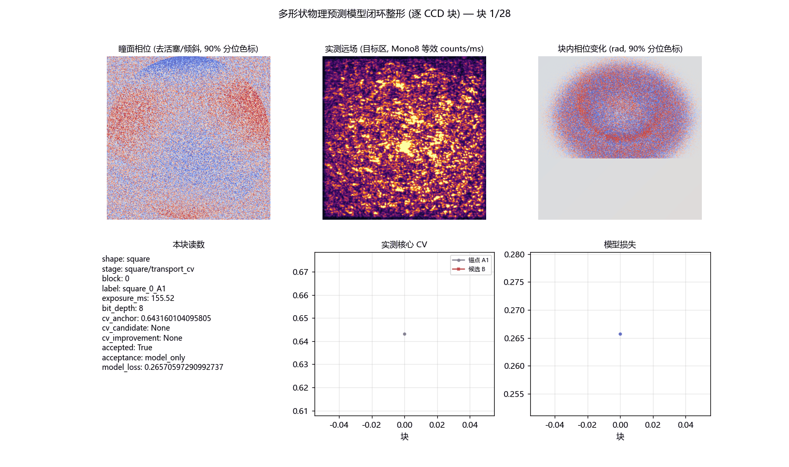

# 1200 CCD 像元多形状的物理预测模型可微整形（从零训练，2026-10-27）

<!-- provenance:start -->
> **生成脚本**: [`scripts/slm/generate_multishape1200_report.py`](../../../scripts/slm/generate_multishape1200_report.py)
> **复现命令**: `python scripts/slm/generate_multishape1200_report.py`
> **数据/关联脚本**: [`src/ao_shaping/runners/slm/transfer_shapes_runner.py`](../../../src/ao_shaping/runners/slm/transfer_shapes_runner.py)
> **数据/关联脚本**: [`src/ao_shaping/tools/slm/transfer/recording.py`](../../../src/ao_shaping/tools/slm/transfer/recording.py)
> **数据/关联脚本**: [`src/ao_shaping/tools/slm/transfer/geometric_seed.py`](../../../src/ao_shaping/tools/slm/transfer/geometric_seed.py)
> **数据/关联脚本**: [`src/ao_shaping/tools/slm/transfer/validate.py`](../../../src/ao_shaping/tools/slm/transfer/validate.py)
> **数据/关联脚本**: [`src/ao_shaping/tools/slm/transfer/capture.py`](../../../src/ao_shaping/tools/slm/transfer/capture.py)
> **数据/关联脚本**: [`src/ao_shaping/tools/slm/transfer/fit.py`](../../../src/ao_shaping/tools/slm/transfer/fit.py)
> **数据/关联脚本**: [`src/ao_shaping/tools/slm/transfer/replay_phases.py`](../../../src/ao_shaping/tools/slm/transfer/replay_phases.py)
> **数据/关联脚本**: [`src/ao_shaping/algorithm/signal_processing/multishape_objective.py`](../../../src/ao_shaping/algorithm/signal_processing/multishape_objective.py)
> **运行环境**: 实验（Santec #1 与 Daheng，1064 nm，1200 CCD 像元）
> **说明**: 从零训练物理预测模型 + 四种形状的 CCD 锚定整形 + 初相位实测择优 + Recorder 过程记录。
<!-- provenance:end -->

## 1 本轮做了什么

会话目录：`D:/Projects/TIFO/AO-shaping/data/debug/slm_transfer/multishape1200_20261027`。设备：Santec SLM #1 + Daheng MER2-507-23GM NIR，1064 nm；目标边长 1200 CCD 原生像元。

本轮把 2026-10-26 的正方形流程**从零**跑了一遍，并把同一套流程用到另外三种形状上：

1. **从零训练物理预测模型**：当前光路采集 12 个相位探针 + 正负光栅 + 首尾参考，由该采集**单独**生成名义检查点（`bootstrap`），再在探针上拟合（`fit`），全程无任何历史模型参与。
2. **逐形状 CCD 锚定整形**：每种形状跑四段（初相位 → Mono12 → 续跑 → 稠密），每块的接受判据都是**实测**核心 CV 下降。**本轮只跑完了正方形**：四种形状的初相位择优全部完成，三角形的整形段在第 1 块后被操作者中止，五角星与圆形尚未进入整形段（见 §3）。
3. **共同重放**：各形状的初相位与最终相位在同一位深、同一曝光下重放。
4. **Recorder 记录**：逐 CCD 块写入 Recorder（相位 / 实测远场 / 块内相位变化 / CV 前后 / 接受判决），导出 CSV + HDF5 + 过程 GIF。

### 1.2 测量口径

| 项 | 本轮取值 | 说明 |
|---|---|---|
| 目标 | 边长 1200 CCD 原生像元 | 四种形状用同一边长；三角形/五角星按外接圆半径 600、圆形按半径 600 生成 |
| 零级排除 | 半径 60 CCD 原生像元 | 固定排除实测零级核心圆盘；**只从评价里排除，没有物理消除零级** |
| 核心 | 目标形状再腐蚀 | 第 1–3 段腐蚀 2 个采样格，第 4 段 8 CCD px |
| 接受判据 | 第 1 段：模型损失（`model_only`）；第 2–4 段：同曝光 A/B 顺序检查（`sequential_ccd`） | 第 1 段**没有**实测判决，不能表述为「通过 CCD 验收」 |
| 曝光 | 每段各自测光，段内固定 | 跨段、跨曝光的原始 counts/CV 不可直接比较；共同重放（同位深、同曝光）才是可比口径 |
| 位深 | 第 1 段 8 bit，第 2–4 段 12 bit | Mono12 的 counts/16 折算成 Mono8 等效单位 |

四段流程与 2026-10-26 的正方形链一致：初相位 → Mono12 → 续跑 → 稠密（`--window-step 2` 采样 + 宽带载波模型）。每段的块数/步数/学习率见下表。

| 段 | 块数 | 每块更新 | 相位学习率 | 相位步长上限 (rad) | 采样步长 (CCD px) |
|---|---:|---:|---:|---:|---:|
| 第 1 段 (初相位, 模型判据) | 4 | 15 | 0.03 | 0.25 | 4.0 |
| 第 2 段 (Mono12, 实测 CV 判据) | 8 | 20 | 0.025 | 0.2 | 4.0 |
| 第 3 段 (续跑) | 12 | 15 | 0.02 | 0.15 | 4.0 |
| 第 4 段 (稠密采样 + 宽带模型) | 4 | 20 | 0.015 | 0.12 | 2.0 |

### 1.1 从零训练 vs 热启动：模型质量

同一探针集、同一拟合口径下，从零训练（本次）与热启动（2026-10-26 用上一轮模型迁移）的拟合质量：

| 口径 | 训练损失 | 训练相关系数 | 相对 L2 | 选中的迭代 |
|---|---:|---:|---:|---:|
| 从零训练（本次） | 0.11580 | 0.9538 | 0.2896 | 39 |
| 热启动（2026-10-26） | 0.09198 | 0.9811 | 0.1896 | 60 |

从零训练**没有**达到热启动的拟合质量，但差距是有限的（相关系数 0.954 vs 0.981）。关键工程细节：标称初始化给出的照明位置与实测相差约 150 面板像元，而 Adam 的默认位置学习率走不完这段距离，因此本轮把位置学习率提到 4 面板像元/步（`--amplitude-center-lr 4.0`）并把迭代数从 60 提到 150；位置学到的结果（见下表）与热启动一致到十几像元。

| 参数 | 从零训练 | 热启动 |
|---|---|---|
| 照明中心 (面板像元) | [977.8, 721.9] | [987.3, 719.6] |
| 照明宽度 (面板像元) | [335.5, 267.7] | [371.7, 207.6] |
| 离焦 (屈光度) | -0.003095 | -0.006697 |
| 增益 / 加性背景 | 75.48 / 0.5797 | 148.21 / 0.4957 |



⚠️ 两种模型的**像差分解**不同（热启动把更多像差吸收进 Noll 残差项），绝对预测因此不可直接比较；本轮只用相对量。

## 2 初相位的三种构造与实测择优

正方形流程的非 GS 初相位是「传输」构造：对拟合入射振幅平方的两个边缘分布求累积分布，把各自能量映射到目标均匀区间，积分频率生成原始弧度相位。**可分离相位在数学上无法产生不可分离的远场**，所以这套构造只对正方形精确。

为其它形状补了一条形状通用的非 GS 路线「反投影」：把目标在模型自己的 FFT 栅格上做一次逆变换，取其相位（无迭代、无测量反馈）。并把模型自带的 GS 种子作为第三个候选。

三者的初相位在同一块、同一目标下**实测**核心 CV（越低越好）：

| 形状 | 传输 (非 GS, 仅正方形精确) | 反投影 (非 GS, 形状通用) | GS (模型 80 次迭代) | 采用 |
|---|---|---|---|---|
| 正方形 | 1.3083 | 1.2940 | 0.6570 | GS (模型 80 次迭代) |
| 三角形 | — | 2.2104 | 0.6393 | GS (模型 80 次迭代) |
| 五角星 | — | 1.6516 | 0.6469 | GS (模型 80 次迭代) |
| 圆形 | — | 1.0127 | 0.6308 | GS (模型 80 次迭代) |



**模型自己怎么说？** 同一批初相位在**冻结模型**里的核心 CV（离线重算，与实测同一栅格）：

| 形状 | 传输 (模型内) | 反投影 (模型内) | GS (模型内) | 反投影所需频率 (周期/面板像元) |
|---|---:|---:|---:|---:|
| 正方形 | 0.0009 | 0.0251 | 0.0071 | 0.445 |
| 三角形 | — | 0.0750 | 0.0209 | 0.516 |
| 五角星 | — | 0.0876 | 0.0217 | 0.464 |
| 圆形 | — | 0.0256 | 0.0090 | 0.549 |

两列读数放在一起看：「传输」在模型里几乎完美（核心 CV ≈ 0.00x），在实验系统里却是最差的一档；GS 在模型里并不更好，实测却最好。**模型的绝对量不可信**（常数加性背景项远大于核心的实测总均值），所以初相位不能按模型内读数选，必须实测。

反投影那一列还给出另一条硬约束：它需要的瞳面空间频率若超过 0.5 周期/面板像元，**器件无法表示**（控制 Nyquist），即使模型内读数不差也要先被这条约束否掉。

**这一节改变了 2026-10-26 的正方形流程。** 那次流程的第一段用的是「传输」初相位；本轮先实测了三种初相位的核心 CV，**四种形状全部由 GS 胜出**，因此第一段统一用 GS 初相位。

⚠️ 因此本报告的正方形结果**不是** 2026-10-26 那次流程的逐位复现：流程结构（四段、判据、模型、采样）一致，初相位构造不同。要复现那次流程，应显式 `--initial-phase transport --no-seed-bakeoff`；**本轮没有执行这一变体**（设备在正方形四段跑完后由操作者中止，见 §3）。

## 3 逐形状整形结果

每段的「初相位 → 最终」核心 CV（实测，同曝光同掩膜口径见 `config.json`）：

| 形状 | 第 1 段 (初相位, 模型判据) | 第 2 段 (Mono12, 实测 CV 判据) | 第 3 段 (续跑) | 第 4 段 (稠密采样 + 宽带模型) |
|---|---|---|---|---|
| 正方形 | 0.639 → 0.393 | 0.490 → 0.424 | 0.471 → 0.391 | 0.420 → 0.407 |
| 三角形 | 0.613 → — ⚠1/4 块 | 未运行 | 未运行 | 未运行 |

接受块数（`summary.json` 的 `accepted`）：

| 形状 | 第 1 段 (初相位, 模型判据) | 第 2 段 (Mono12, 实测 CV 判据) | 第 3 段 (续跑) | 第 4 段 (稠密采样 + 宽带模型) |
|---|---|---|---|---|
| 正方形 | 4/4 | 8/8 | 11/12 | 4/4 |
| 三角形 | 1/1 | 未运行 | 未运行 | 未运行 |

⚠️ **本轮运行被操作者中止**：三角形 的整形段没有跑完（上表里标 ⚠ 的格子是中止时已完成的部分）。已完成的正方形四段与四种形状的初相位择优数据是完整的；其余三种形状只有初相位层面的实测结果，没有整形结果，不能据此声称它们已被整形。






两处读法要注意：

- 轨迹曲线的**最后一点**是第 4 段最后一块的**候选**读数，而「最终相位」是同一相位在块结束后**另一次**采集的读数；两者相差约 0.013，是同相位重复测量的波动，不是矛盾。报告引用哪一个必须说明口径。
- 远场图里三角形的右格为空：该形状的整形段中止，没有最终相位采集；正方形那一行才是完整的「初相位 vs 最终相位」对照。

## 4 共同重放

⚠️ **本轮没有共同重放**：运行在正方形四段完成后被中止，重放阶段未执行。因此本报告的段间比较只能用各段自带的同曝光对照（`square_seed_replay` 与 `square_final`），不能声称跨段是同曝光同位深的比较。

## 5 Recorder 记录与过程动画

逐 CCD 块的记录写在 `records/process.csv`（标量列）与 `records/process.h5`（含数组列）里，数组列另存为 `records/process_sidecars/*.npy`。每条记录含：形状、段、块号、实测曝光与位深、锚点/候选核心 CV 及其差、接受判决与判据、模型损失、该块的瞳面相位、实测远场画面与块内相位变化。



动画由 `transfer/recording.py::render_process_gif` 渲染（记录本身由 Recorder 持有）：上排是去活塞/倾斜后的瞳面相位、实测远场（裁剪到目标区、色标取 95% 分位，中心零级饱和）与块内相位变化；下排是本块读数、实测核心 CV 轨迹（灰：锚点 A1，红：候选 B）与模型损失轨迹。

## 6 复现命令

```bash
# 模型侧（探针采集 + 从零训练 + 控制分辨率导出）
python -m ao_shaping.tools.slm.transfer.capture --out <session>/capture --execute \
    --grid 384 --count 12 --frames 3 --exposure-max-steps 12 --save-dataset
python -m ao_shaping.tools.slm.transfer.bootstrap --dataset <session>/capture --out <session>/initial
python -m ao_shaping.tools.slm.transfer.fit --dataset <session>/capture \
    --checkpoint <session>/initial/frozen_parameters.json --out <session>/fit \
    --iterations 150 --span 120 --adaptation full --amplitude-center-lr 4.0 --device cuda
python -m ao_shaping.tools.slm.transfer.geometric_seed --checkpoint <session>/fit/frozen_parameters.json \
    --out <session>/model640 --grid 640 --fft 2048

# 整形 + 重放 + 记录（一条命令跑完四种形状）
python src/ao_shaping/main.py slm-transfer-shapes --out <session> --model-dir <session> \
    --shapes square --shapes triangle --shapes star --shapes circle --device cuda --execute

# 只从已跑完的分段目录重建 Recorder 记录 (离线)
python src/ao_shaping/main.py slm-transfer-shapes --out <session> --records-only
```

本报告由 `scripts/slm/generate_multishape1200_report.py` 离线生成；它只读会话目录，不重新测量。
