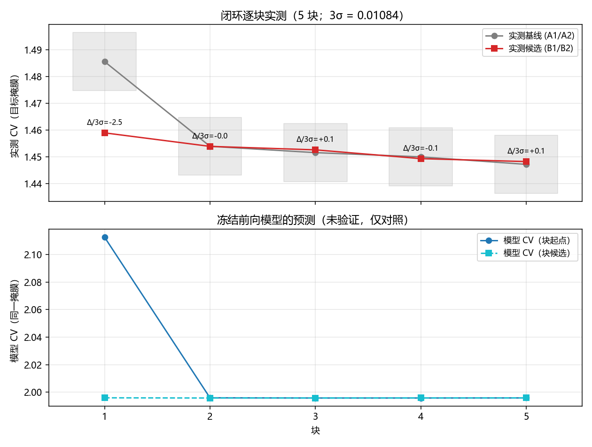
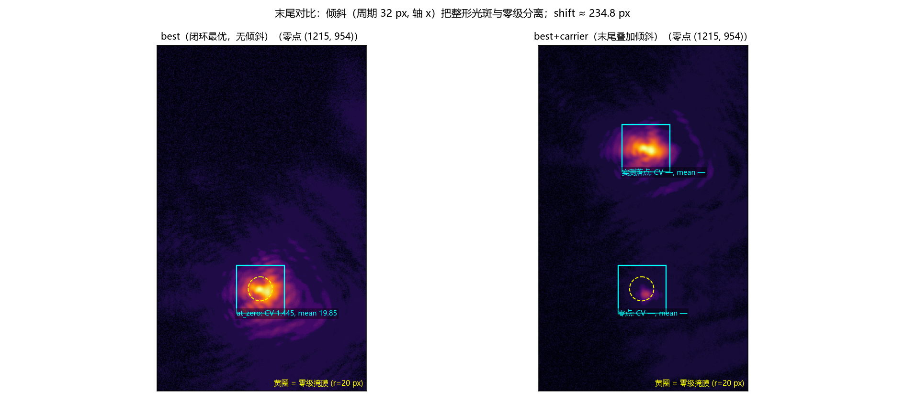

# 当前配置下的可微整形能力测试（五角星目标 + 末尾叠加倾斜）

<!-- provenance:start -->
> **生成脚本**: [`scripts/slm/generate_capability_report.py`](../../../scripts/slm/generate_capability_report.py)
> **复现命令**: `python scripts/slm/generate_capability_report.py --run-dir data/debug/multishape_forward/star08_20261023_191213`
> **数据/关联脚本**: [`scripts/slm/run_multishape_capability.py`](../../../scripts/slm/run_multishape_capability.py)
> **数据/关联脚本**: [`src/ao_shaping/utils/image/target/masks.py`](../../../src/ao_shaping/utils/image/target/masks.py)
> **运行环境**: 离线（读设备运行落盘产物）
> **说明**: 五角星（面积 7200 px²）0.8 ms 下的同一协议运行；首块 Δ −0.02662（2.46σ），载波使零点能量占比 3.76%→0.20%
<!-- provenance:end -->

## 摘要

当前配置下（五角星（面积 7200 px²）、载波周期 32 px、轴 x、同帧定心、闭环不加倾斜）跑完 5 个闭环块，目标掩膜上**零级重叠处**的最佳实测 CV 为 **1.4482**（块 5）；末尾叠加倾斜后整形光斑实测移至**−y 方向 234.0 px（另一轴 +6.6 px）**，零点 20 px 内能量占比 0.0376 → 0.0020（约 19× 下降）；落点处目标掩膜 CV = 1.7281，但该帧 peak = 247.0（接近饱和）⇒ **不作为质量读数**。**模型方向尚未验证，本报告只陈述实测。**



## 1. 方法与边界

* **同帧定心**：先显示初值相位抓一帧，用**该帧**的 argmax 定位零级实测位置
  (1215, 954)（col, row），同时用它建模型掩膜与实测掩膜——不再按历史 spot
  定方向后再在设备侧重定中心。
* **闭环不加倾斜**：优化在零级位置上做五角星；倾斜（载波周期 32 px，
  轴 x）只在末尾展示时叠加，使整形光斑与零级分离（零级由未调制光直接透过，留在原位）。
* **判据**：本次等效面积掩膜的 3σ = 0.01084（run.json 的
  `three_sigma_resolution`，来自当次实测的噪声地板）；Δ÷3σ 只作噪声参考。
* **一次运行的局限**：单一会话、单一初值相位、单一 seed；冻结前向模型检查点
  `D:\Projects\TIFO\AO-shaping\data\debug\physical_forward_defocus\refit_after_focus_20261023_145446`；运行起始 2026-10-23T11:12:16.976872+00:00（UTC）。

## 2. 闭环逐块表

| 块 | 基线 CV | 候选 CV | Δ | Δ÷3σ | 漂移 (A2−A1) | 零级占比·基线 | 零级占比·候选 | 模型 CV 前→后 |
|---|---|---|---|---|---|---|---|---|
| 1 | 1.48559 | 1.45897 | -0.02662 | -2.46 | +0.00144 | 0.0400 | 0.0391 | 2.1126 → 1.9960 |
| 2 | 1.45394 | 1.45392 | -0.00002 | -0.00 | -0.00058 | 0.0391 | 0.0388 | 1.9960 → 1.9958 |
| 3 | 1.45158 | 1.45262 | +0.00104 | +0.10 | +0.00110 | 0.0390 | 0.0387 | 1.9958 → 1.9958 |
| 4 | 1.45000 | 1.44934 | -0.00066 | -0.06 | -0.00251 | 0.0386 | 0.0384 | 1.9958 → 1.9959 |
| 5 | 1.44719 | 1.44824 | +0.00104 | +0.10 | -0.00371 | 0.0384 | 0.0383 | 1.9959 → 1.9959 |

Δ÷3σ = Δ ÷ 本次等效面积掩膜的 3σ（= 0.01084）；漂移 = A2−A1 的同相位重复差。

## 3. 末尾对比

末尾展示两组相位：`best`（闭环最优，无倾斜）与 `best+carrier`（叠加周期 32 px 的**面板 x 向**斜坡；几何预测标量 |K/周期| ≈ 234.8 px）。

| 指标 | best @零点 | best+载波 @零点 | best+载波 @**实测落点** |
|---|---|---|---|
| CV（目标掩膜） | 1.4454 | 1.2691 | 1.7281 |
| mean_core（目标掩膜） | 19.850 | 1.368 | 23.196 |
| 零点 20 px 内能量占比 | 0.0376 | 0.0020 | 0.0020 |
| peak（全帧） | 181.6 | 247.0 | 247.0 |

载波把整形光斑实测移到**−y 方向 234.0 px（另一轴 +6.6 px）**（|Δ| ≈ 234.1 px）；三列读数的差别就是「整形光斑还在零级位置」与「光斑已经离开、零点只剩未调制残光」的差别（零点能量占比 0.0376 → 0.0020）。



## 4. 观察与限制

1. **目标掩膜口径**：栅格化后的目标掩膜 7199 px²、核心掩膜 6305 px²（相对名义 7200 px² 的填充率 100.0%）。零级掩膜（r = 20 px 圆盘，面积 ≈ 1257 px²）占目标掩膜面积 17.5% —— 目标掩膜 CV 是“五角星 + 零级”的复合指标，不是目标形状单独的均匀度。

2. **零级扣除的必要性**：本次零级能量占比 ≈ 0.0376（目标框内），零级峰正对框中心，不扣除零级时任何均匀度读数都被零级主导（本次逐块实测 CV ≈ 1.46 即源于此）；本运行只给出“带零级”与“载波分离后”两种读数，未做逐帧零级扣除，方斑单独的 CV 尚不能从本运行给出。

3. **单次运行不做显著性**：5 个块同一次会话、同一初值、同一 seed，“Δ÷3σ”只是相对本次掩膜噪声地板的参考刻度，不构成显著性检验；跨会话/跨光路比较需要独立的重复运行。

4. **闭环内未加倾斜 ⇒ 目标位置与零级重叠**：优化在零级位置上做目标形状，目标框中心即零级中心，闭环逐块的 CV 因此含零级贡献；倾斜只在末尾展示时叠加，分离后的读数（§3）才是“方斑离开零级”的状态。

5. **模型方向未验证**：模型 CV 逐块基本平走（2.113 → 1.996），与实测同量级但无方向性信息——本运行不能证明冻结前向模型的梯度方向正确，摘要的声明以本节为准。

6. **位移方向必须实测，不能由斜坡轴向推断**：本实验系统的 SLM **竖向安装**，面板 x 向斜坡在 CCD 上给出的是 **y 向**位移（本报告实测 +6.6, -234.0 px，|Δ| = 234.1 px，与 |K/周期| = 234.8 px 的标量一致）。⚠️ 2026-10-23 早前版本按 x 轴摆了 `at_plus`/`at_minus` 两个框，量到的是**背景不对称**，那两组数与由此得出的「＋x 侧」结论已作废；本版改为从两帧差分实测位移后再取读数。

7. **载波可能伤均匀度（提示，非结论）**：best@零点 CV = 1.4454，载波@实测落点 CV = 1.7281。两列口径不同（零点那列含零级峰，落点那列是纯图案 + 载波量化误差），**不能直接相减归因**。但周期 32 px 的斜坡在面板上约只有 32 个灰阶/2π，量化偏粗、易生谐波；若下一步要同时满足「与零级分离」和「形状均匀」，应先换更长周期（P = 64/96 ⇒ 位移约 117/78 px，仍在视场内）再比一次。

## 5. 复现

```bash
# 1) 设备运行（数据生产，需 2f 实验系统；参数见该脚本 docstring）
python scripts/slm/run_multishape_capability.py --execute --wait-until-idle 1800 \
    --checkpoint <refit 目录> --seed-panel <初值.npy> --noise-floor <噪声地板.json> \
    --target-side-px — --carrier-period-px 32 \
    --blocks 5 --out data/debug/multishape_forward/star08_20261023_191213

# 2) 本报告（离线，不碰设备）
python scripts/slm/generate_capability_report.py --run-dir data/debug/multishape_forward/star08_20261023_191213
```

原始帧（`block{N}_{A1|B1|B2|A2}_*.npy`、`final_best.npy`、`final_best_plus_carrier.npy`、
`best_panel.npy`）与 `run.json` 全部在 `data/debug/multishape_forward/star08_20261023_191213/`；本脚本只读这些文件。
