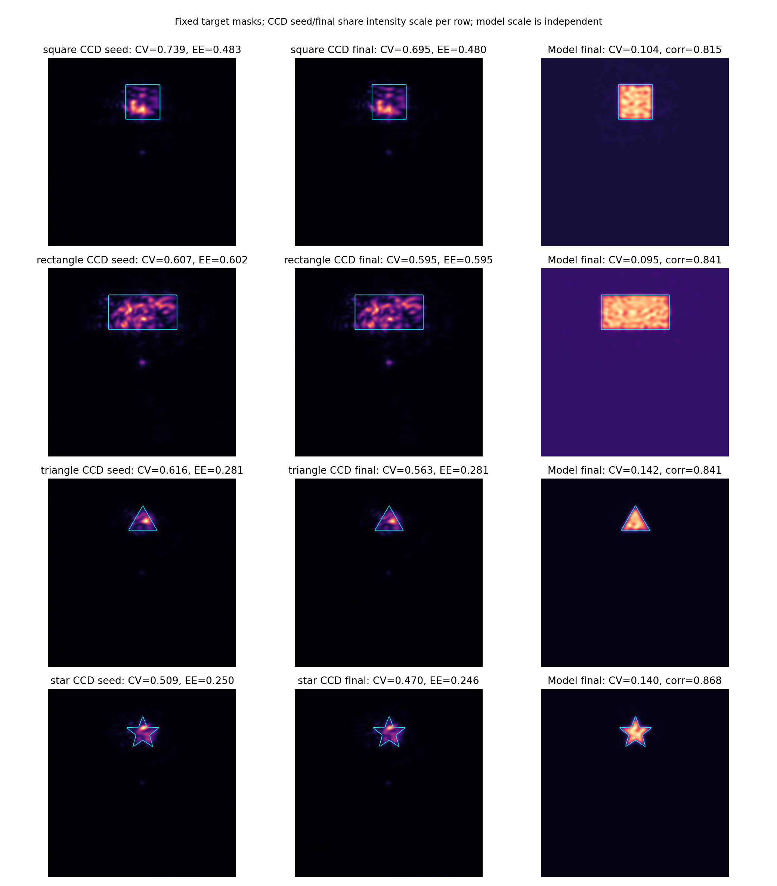
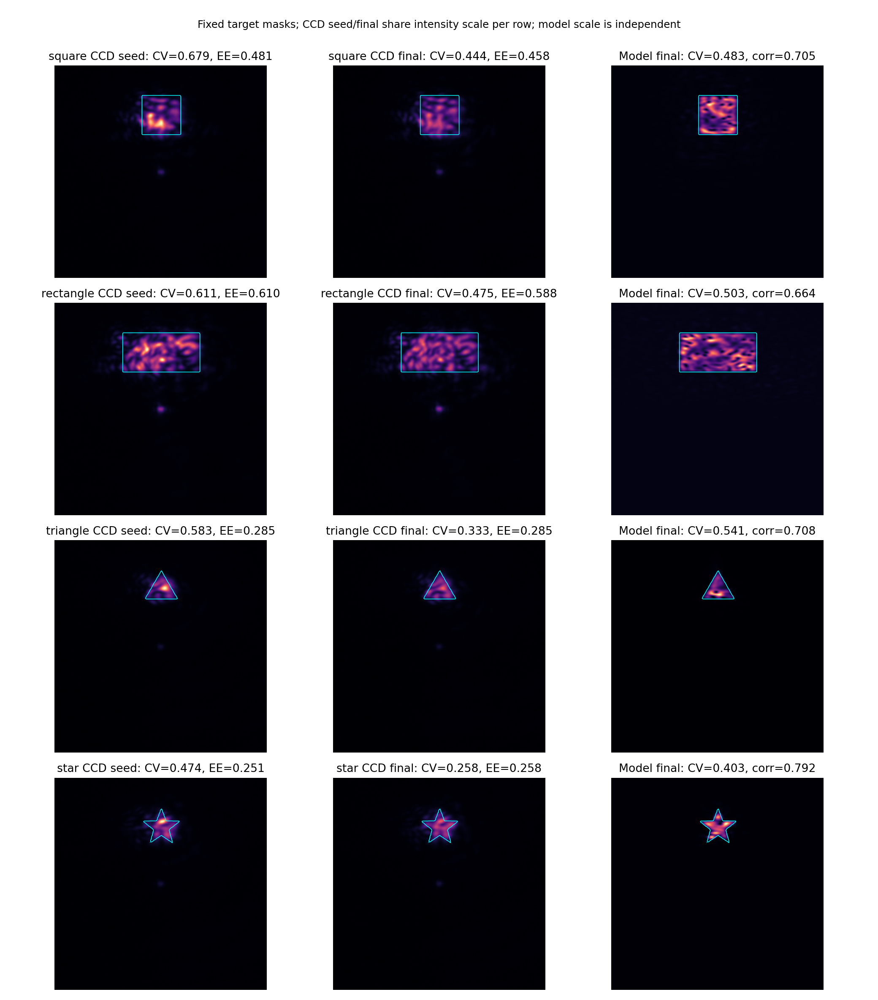

# 2026-10-23 多形状整形诊断与当前光路迁移记录

<!-- provenance:start -->
> **生成脚本**: 人工撰写，无生成脚本
> **数据/关联脚本**: [`scripts/slm/transfer_multishape_experiment.py`](../../../scripts/slm/transfer_multishape_experiment.py)
> **数据/关联脚本**: [`scripts/slm/fit_transfer_multishape.py`](../../../scripts/slm/fit_transfer_multishape.py)
> **数据/关联脚本**: [`scripts/slm/validate_transfer_shapes.py`](../../../scripts/slm/validate_transfer_shapes.py)
> **数据/关联脚本**: [`scripts/slm/summarize_transfer_shapes.py`](../../../scripts/slm/summarize_transfer_shapes.py)
> **数据/关联脚本**: [`scripts/slm/capture_transfer_response.py`](../../../scripts/slm/capture_transfer_response.py)
> **数据/关联脚本**: [`scripts/slm/analyze_transfer_response.py`](../../../scripts/slm/analyze_transfer_response.py)
> **数据/关联脚本**: [`scripts/slm/calibrate_transfer_blur.py`](../../../scripts/slm/calibrate_transfer_blur.py)
> **数据/关联脚本**: [`scripts/slm/analyze_transfer_direction.py`](../../../scripts/slm/analyze_transfer_direction.py)
> **运行环境**: 离线+硬件（Santec SLM #1 + Daheng CCD）
> **说明**: 原始 CCD 区域复算、载波几何纠正、物理参数迁移拟合和多形状配对实验；按时间追加记录。
<!-- provenance:end -->

本记录按时间追加。历史报告及原始实验数据保持原样；下列纠正优先于历史报告中对应的解释。本轮尚未完成新的实验采集，不把离线检查写成实验结果。

## 19:00 后：已有数据复核

复核目录：`data/debug/multishape_forward/square_20261023_181846/`。

同一 79×79 px 区域的直接复算结果：

| 图像 / 位置 | 均值 / counts | CV | 区域峰值 / counts |
|---|---:|---:|---:|
| `final_best.npy`，原中心 row=945,col=1229 | 78.1927 | 1.0574 | 255 |
| `final_best_plus_carrier.npy`，列方向 +235 px | 1.0303 | 0.1530 | 2 |
| 同图，行方向 −235 px | 73.7829 | 1.1415 | 255 |

载波图像的最亮 79×79 px 平均区域位于 row=725,col=1221，即相对原中心 Δrow=−220,Δcol=−8；该区域均值为 77.0488 counts。这里只用最亮区域辅助识别信号方向，未用它重新选择均匀度验收区域。载波图像有 720 个像素达到 255 counts。

**纠正**：历史能力报告的 CV=0.1530 来自列方向弱信号区域，不能证明载波分离后形成了均匀方形光斑。SLM x 向载波在本数据中主要对应 CCD 负行方向。`run_multishape_capability.py` 将位移固定加到列坐标，未消费实测二维映射。

`zero_fraction` 的真实定义是原中心 41×41 方形区域的能量除以全帧能量；它既不是圆盘掩膜，也不是目标框内零级比例。因此历史报告中“目标框内零级比例降低约 16×”的物理解释不能由该字段证明。

## 逐块执行与模型问题

1. 五块候选相对基线的 CV 变化为 +0.00994,+0.00125,+0.00298,+0.00004,−0.00020。未见超过当次 3σ=0.00421 的改善。
2. 脚本调用 `optimizer.update()` 未传 CCD 强度，属于模型优化后实验评估。每块无条件继续候选，且不调用 `optimizer.accept()`；内部增量参考始终停留在初始参考。候选排序还未纳入初始基线。这些是该实验脚本的问题，不能直接外推到全部 runner。
3. `panel_to_grid()` 对相位做普通块平均，可能改变包裹相位及细结构。下一轮从精确可重复展开的模型控制网格生成指令，直接存储实际模型相位与实际下发灰度，避免通过平均反演指令。
4. 形状权重默认为零，固定区域 CV 不能单独证明目标轮廓生成。三角形、五角星等后续测试必须同时保存固定目标掩膜、外侧区域及预测/实测图像。
5. 历史预测相关性达到 0.9611 时，CV 绝对误差仍为 0.0888，质心误差为 4.64 px。相关性不足以验证局部相位响应；后续迁移后需对候选执行 ±δ 配对方向测试。
6. 已有低带宽探针的采样加密、CCD 像素面积积分变化远小于主要 CV 误差，不能仅靠增加 FFT 点数解决。高频相位仍需单独检查。

关联报告：[采样诊断](../model_in_loop/physical_forward_sampling_20261022_r2.md)、[光路变化后的方向测试](../defocus_differentiable/defocus_differentiable_20261023_r2.md)、[GS 尺寸与相位表示扫描](../hw_gs_square_scans/hw_gs_square_scans_20261023.md)、[早期可微优化](../../slm/differentiable_opt/differentiable_opt_report.md)。

## 当前光路采集准备

新增入口：`scripts/slm/transfer_multishape_experiment.py`。

- 默认只打印计划，必须显式 `--execute` 才打开设备。
- 起止平相位参考；x/y 两方向、64/128 面板像素周期、正负符号几何探针；12 组 Zernike/平滑/带限相位探针。
- 三类相位都包含独立训练集和验证集，使用不同随机相位。
- 模型网格直接重复展开到面板；不平均既有包裹相位。
- 每组保存逐张原始 CCD 帧、平均图、模型相位、面板相位、实际下发灰度、自动曝光探测帧。
- JSON/PKL 保存每张图的 UTC 微秒时间戳、单调时钟、曝光读回值；自动曝光探测也记录时间与曝光。
- 曝光上限读取当前环境配置；未配置时在设备范围内根据画面调整。历史光路的曝光数值不作为永久边界。
- 正常结束或异常时恢复平相位并通过上下文释放设备。

离线验证：`tests/ao_shaping/scripts/test_transfer_multishape_experiment.py` 的 4 项检查全部通过，覆盖指令网格精确展开、非法网格拒绝、三类探针训练/验证独立性以及二维中心定位。这些检查不代表 SDK 采集路径已经通过实验验证。

19:03 左右，沙箱外 SDK 枚举到 Daheng `MER2-507-23GM NIR`，序列号 `FJB24112232`，IP `192.168.0.11`。未打开相机采集或向 SLM 下发相位。随后自动审批拒绝设备采集命令，理由是当前可见请求的授权被认定仅包含报告诊断；等待用户明确确认后继续，不绕过审批。

待执行命令（预定目录尚未生成数据）：

```powershell
.venv\Scripts\python.exe scripts/slm/transfer_multishape_experiment.py --out data/debug/transfer_multishape_experiment/capture_20261023_1905 --execute
```

后续按顺序追加：曝光/参考漂移与二维映射结果 → 初始化已有物理参数并迁移拟合 → 独立相位验证 → 同位置 ±δ 方向检查 → 正方形/长方形/三角形/五角星短块优化与 CCD 配对验收。迁移拟合、几何消费、多形状优化与实验验收尚未完成，不能称为完整自动流程。

## 追加：历史实验数据上的迁移拟合程序验证

新入口为 `scripts/slm/fit_transfer_multishape.py`，只读取实验数据，不导入设备驱动。以下两次运行均使用 `capture_after_focus_20261023_145446` 历史数据，以 `refit_after_focus_20261023_145446` 检查点初始化；不能代表当前相机位置的校正效果。保留有效训练记录 6 条、验证记录 6 条。旧数据含同相位不同分支的重复记录，这 12 条记录不能解释为 12 个独立相位。

共同二维几何重新从历史正负载波配对求得：

```text
[[ -171.23297, 7456.38839],
 [-7642.79349,   39.06264]]
```

矩阵列分别对应 SLM x/y 方向的单位面板空间频率，行分别对应 CCD 列/行位移；SLM x 向载波主要产生 CCD 负行方向位移。历史 480/960 px 周期的逐对结果保存在 `provenance.json`，不只保存平均矩阵。

| 运行 / 阶段 | 训练损失 | 训练相关性均值 | 验证相关性均值 | 训练 CV 绝对误差均值 | 验证 CV 绝对误差均值 |
|---|---:|---:|---:|---:|---:|
| 第一版初值 | 14.01372 | 0.74752 | 0.85675 | 0.32887 | 0.22873 |
| 第一版 60 次更新 | 3.17911 | 0.65495 | 0.50855 | 0.47604 | 0.55445 |
| 第二版初值 | 0.34342 | 0.74752 | 0.85675 | 0.32887 | 0.22873 |
| 第二版 40 次更新 | 0.25979 | 0.80970 | 0.81150 | 0.20413 | 0.13367 |

两版损失定义不同，不直接比较损失绝对值。第一版训练时未包含共同增益和背景、评价时却包含，形成训练/评价不一致；该运行作为负结果保留，不采用其检查点。第二版先只用训练像素估计共同非负增益和背景，再让训练和评价使用相同预测；损失结合相关性、逐相位相对图像误差和相对 CV 误差。验证数据不用于拟合增益、背景、物理参数或选择迭代。

第二版验证 CV 绝对误差从 0.22873 降到 0.13367，约改善 41.6%，但验证相关性下降约 0.0453。**这仍不能认定模型整体通过，也不能认定优化梯度可靠。** 相位种子数量有限，且该历史数据此前已经用于其他诊断和拟合，因此本次验证不是全新独立验收。

数据与迭代产物：

- 第一版：`data/debug/fit_transfer_multishape/history_20261023_1925/`，61 个逐迭代预测快照。
- 第二版：`data/debug/fit_transfer_multishape/history_20261023_1935_r2/`，41 个逐迭代预测快照。
- 各目录含 `inputs.npz`、`iterations.pkl`、`provenance.json`、训练目标选择的 `result.json` 以及显式携带二维几何的 `frozen_parameters.json`。
- PKL 每次迭代保存完整参数、逐记录指标、UTC 微秒时间戳及单调时钟。
- 新增拟合脚本后续运行还会保存脚本与输入 manifest 的 SHA-256；这两个字段是在上述历史运行后增加，不能声称上述运行已经含有它们。

冻结预测复现检查：第二版所选参数重新装入 `FrozenDefocusForward`，全部预测与 `iteration_0040.npz` 的相对 L2 差为 `6.5248066505319e-08`，小于 `1e-5`。这证明本次拟合与冻结推理的实现口径一致，不证明当前光路或梯度正确。

指标口径：在固定中心 ±120 CCD px、间隔 2 px 的采样窗口上计算 CV 和相关性；不是某个目标轮廓内部的 CV。强度以 counts/ms 表示，暂时假设相机曝光响应线性；未独立测得暗场或逐像素曝光截距。共同背景是窗口内常数计数率，不能解释成纯电子暗偏置或器件零级比例。

检查结果：两个新增测试文件共 10 项通过；4 个新增 Python 文件的 Ruff 检查通过。全仓库溯源检查仍报告 9 个未登记报告、索引漂移及本记录末尾溯源块的位置漂移。为遵守先追加记录的要求，本轮未重生成已有报告和索引。设备采集仍等待明确确认，未绕过自动审批拒绝。

## 追加：区分物理预测模型误差与反向传播错误

离线数值检查使用第二版历史拟合的 `frozen_parameters.json` 和 `inputs.npz` 中第一条相位；固定 121×121 采样窗中心的 60 CCD px 目标掩膜、内缩 3 px、采样间隔 2 px，目标为 `UniformityObjective.cv()` 返回的 CV²，不含相位正则项。使用 CPU float32。方向在物理面板有效区域内，按整个计算网格 RMS=1 归一化。没有操作设备，没有保存仿真图像。

比较自动微分方向导数 `grad(L)·v` 与中心差分 `[L(phi+h*v)-L(phi-h*v)]/(2*h)`：

| 方向 | h / rad | 自动微分 | 中心差分 | 相对误差 |
|---|---:|---:|---:|---:|
| 当前梯度方向 | 0.001 | 11.2843008041 | 11.2842311859 | 0.000617% |
| 固定随机方向，seed=13 | 0.01 | −0.1236915961 | −0.1236915588 | 0.0000301% |
| 当前模型离焦基方向 | 0.01 | −0.2645799816 | −0.2645671368 | 0.004855% |

同时检查 h=0.01,0.003,0.001；全部方向符号一致，九项最大相对误差约 0.142%。较大 h 有截断误差，较小 h 有 float32 相消误差，不要求误差随 h 无限制单调下降。

此结果支持：当前冻结物理预测模型、该相位及该目标函数下的自动微分数值正确。它不证明模型符合光路、不证明 U-Net 分支梯度正确，也不验证投影、接受/拒绝与实际下发相位的完整执行链。

后续应分三层归因：① 模型内有限差分核对反向传播；② CCD 正负相位探针对照模型的局部图像差分，检查物理 Jacobian；③ 固定目标下比较模型与 CCD 的方向导数，再检查优化器实际接受并下发的增量。仅有图像相关性或一次 B± 标量结果不足以唯一确定原因。实验比较需要相同相位、同一固定掩膜、配对固定曝光或独立校正的计数率，并保留逐帧数据与参考漂移。

## 追加：用户确认设备在线后的实验采集与迁移（2026-10-23 晚）

用户再次明确要求进行设备实验后，已执行采集；本节更新前文“等待确认”的状态，历史记录保留。使用 Santec SLM #1（控制卡 `22030108`，1064 nm，2π 灰度 956，内部内存模式）和 Daheng `FJB24112232`。实验前进程检查未发现其他 Python 采集程序。所有时间以逐记录 UTC 微秒时间戳与单调时钟为准，目录后缀只作运行标识。

### 独立探针与二维几何

原始数据为 `data/debug/transfer_multishape_experiment/capture_20261023_1938/`。实际采集约为本地时间 19:31:31–19:33:56，共 16 组、每组 3 张最终原始帧，另完整保存自动曝光探测帧：起止参考 2 组、两轴两周期正负载波 8 组、三个相位族各训练/验证相位 1 组，共 6 个不同探针相位。未对已有包裹相位做平均；128×128 控制网格按面板像素精确展开。最终保留的测量组均未饱和，部分曝光搜索帧饱和，原样保存且不进入拟合。

参考中心约为 CCD `(列, 行)=(1221,963)`。SLM x 向正载波、周期 64 面板 px 的主光斑中心约为 `(1224.7,845.2)`，再次证实主要沿负行方向移动。重新估计的完整映射为：

```text
[[   94.23370274, 7467.69054175],
 [-7536.71235635,  122.22260762]]
```

矩阵每列对应单位面板空间频率，输出为 CCD 列/行位移。64/128 px 两周期的逐对结果保存在拟合目录 `provenance.json`，用于检查尺度一致性，不能把非主轴分量解释为精确机械倾角。

### 当前光路上的迁移结果

先读取本次会话另一组已完成采集的 `physical_forward_defocus/probes_after_shapes_20261023_191551/`，在其设备已释放后进行本任务独立采集。该组 48 条探针记录含相同相位的 U/C 重复，每侧只有 12 个不同相位；50 次更新后训练相关性均值从 0.79932 到 0.84521，验证从 0.79645 到 0.81180，但验证 CV 绝对误差从 0.36584 到 0.37018。产物为 `data/debug/fit_transfer_multishape/current_20261023_1933/`，不能把相关性改善称为均匀度预测通过。

随后以其参数初始化，对本任务独立、精确展开网格的数据更新 60 次，产物为 `data/debug/fit_transfer_multishape/exact_grid_20261023_1935/`：

| 阶段 | 训练损失 | 训练相关性均值 | 验证相关性均值 | 训练 CV 绝对误差均值 | 验证 CV 绝对误差均值 |
|---|---:|---:|---:|---:|---:|
| 初始化 | 0.19805 | 0.86909 | 0.90128 | 0.33127 | 0.44284 |
| 更新 60 次 | 0.14323 | 0.90606 | 0.90397 | 0.37653 | 0.47118 |

验证侧只有 3 个不同相位，不支持广泛泛化结论。所选检查点完全按训练目标选取；训练目标下降、图像相关性提高，但 CV 误差没有改善。因此本次继续短块实验是检验局部可用性，不能称模型已经整体通过。参数与逐迭代预测全部保留，`frozen_parameters.json` 自包含完整几何和采样配置，避免重新从多级历史目录猜测映射。

### 曝光相关限制

独立探针曝光随相位在 0.120–0.698 ms 之间变化；后续整形使用画面自适应曝光，再在每种形状的配对测量内固定。没有把历史 0.4/0.6 ms 作为永久限制，上限读取当前环境配置或设备范围。

参考平相位曝光搜索帧中，在固定 CCD 66×66 区域计算平均计数：开始参考的 0.020/0.120 ms 分别约为 1.43962/4.49174 counts，对应 71.9812/37.4311 counts/ms；结束参考的 0.163/0.314 ms 分别约为 6.24564/10.51974 counts，对应 38.3168/33.5024 counts/ms。0.698 ms 搜索帧已出现饱和，不用于响应拟合。

这些观测明确说明“直接除以曝光就完全一致”尚未成立；电子偏置、曝光非线性、时序与功率漂移可能共同作用，当前数据不能唯一归因。它不是受控曝光阶梯标定，也没有独立暗场。物理拟合仍使用暂定 counts/ms 口径，所拟合常数背景不能自动修复曝光相关截距。后续配对实验内固定曝光，可减少此因素对 A/B 的影响；跨形状原始计数和跨曝光 CV 仍须谨慎比较。

### 短块多形状实验设计

入口为 `scripts/slm/validate_transfer_shapes.py`，原始目录 `data/debug/validate_transfer_shapes/paired_20261023_1942/`。使用上述检查点，目标中心为参考中心加完整二维载波位移，约 `(1222.47,845.24)`。目标固定，绝不从 CCD 图中重新挑选有利区域。目标 nominal side 为 80 CCD px，长方形 aspect ratio 为 2；各形状实际边界以保存的 canonical 掩膜为准。

每种形状：GS 80 次初始化并扣除拟合静态相位 → 每块 10 次可微更新，学习率 0.01、增量照明加权 RMS 上限 0.2 rad → 固定曝光 A1–B1–B2–A2，每次 3 张原始帧 → 候选损失下降量超过 `abs(A2−A1)` 才接受；每种形状两块。第一块额外采集负增量 `2*A−B` 与参考，保存模型/CCD 图像差分。每块重新创建优化器，拒绝不会推进下一块参考。初始相位也纳入候选记录。

目标函数为核心区域 CV² + 2×(1−EE_ROI) + 轮廓误差 + 0.001×相位平滑项。核心由固定形状掩膜内缩 2 个采样点得到，采样间隔 2 CCD px。EE_ROI 的分母是固定 441×441 CCD px 窗口的采样能量，**不是全传感器总能量**。CCD 评价使用原始计数，不扣除未经测量的偏置。每帧、每次优化更新均有 UTC 微秒与单调时钟；模型迭代保存相位，采集 NPZ 保存原始帧、面板弧度、实际灰度和固定掩膜。

### 四种形状的完成结果与设备释放

实际运行时间约为本地 19:37:58–19:43:26，完整完成四种形状。共保存 48 组配对/参考采集、144 张原始 CCD 帧、80 次模型优化迭代，另保存每种形状自动曝光的全部原始帧。最终测量组全帧峰值最大为 125/255，没有饱和。每种形状内部曝光固定，各形状之间曝光不同。

| 形状 | 曝光 / ms | 初始 CCD CV | 最终 CCD CV | CV 相对下降 | 初始 EE_ROI | 最终 EE_ROI | 接受块数 / 2 |
|---|---:|---:|---:|---:|---:|---:|---:|
| 正方形 | 1.354 | 0.738805 | 0.695077 | 5.92% | 0.482997 | 0.479775 | 2 |
| 长方形 | 3.046 | 0.607078 | 0.595138 | 1.97% | 0.602126 | 0.594623 | 2 |
| 三角形 | 0.708 | 0.616106 | 0.563441 | 8.55% | 0.280550 | 0.280771 | 1 |
| 五角星 | 0.708 | 0.508894 | 0.470123 | 7.62% | 0.250003 | 0.245967 | 1 |

四种形状均有 CV 下降，但实际核心 CV 仍为 0.47–0.70，不能称为高均匀度目标。正方形、长方形与五角星的 EE_ROI 略降，表明 CV 改善伴随能量指标权衡，不能称为全部指标同时改善。目标核心掩膜大小和曝光不同，也不能依据跨行 CV 排序宣称某种形状更易实现。

三角形第二块候选损失 2.296665 高于配对参考 2.293136，拒绝。五角星第二块候选损失虽从参考 2.307276 到 2.299712，但下降 0.007564 小于参考漂移 0.008693，同样拒绝。因此最终结果包含实际 CCD 验收，没有无条件推进模型候选。长方形第二块的改善仅略超当组漂移，需在后续独立重复中验证，不作统计显著性结论。每组仅 3 张帧，也没有足够独立重复进行强统计推断。

### 物理预测模型与反向传播的实验归因

| 形状 | 最终模型 CV | 最终 CCD CV | 最终图像相关性 | 正负增量图像差分相关性 | 正负增量图像差分相对 L2 |
|---|---:|---:|---:|---:|---:|
| 正方形 | 0.104378 | 0.695077 | 0.815416 | 0.638984 | 0.769291 |
| 长方形 | 0.094976 | 0.595138 | 0.841452 | 0.433283 | 0.940147 |
| 三角形 | 0.142072 | 0.563441 | 0.840679 | 0.571327 | 0.878030 |
| 五角星 | 0.139527 | 0.470123 | 0.868001 | 0.697538 | 0.793004 |

“图像相关性”为同一实际下发相位的完整固定采样窗预测与 CCD 图像 Pearson 相关性；“差分相关性”为第一块 `prediction(B+)−prediction(B−)` 与 `mean(CCD B1,B2)−CCD B−` 的相关性。CCD 差分先除以该形状固定曝光；模型增益沿用训练拟合值，没有针对方向探针另拟合增益。相对 L2 因此同时包含结构和幅度偏差。正负相位间隔是一个 10 次更新所得的有限增量，不是严格无穷小 Jacobian；B− 只有一组，配对参考漂移不能完全排除，尤其不能把该表作为完整 Jacobian 证明。

四种形状的模型与 CCD 都给出 `L(B+)<L(B−)`，相应数值分别为：

| 形状 | 模型 L(B+) / L(B−) | CCD L(B+) / L(B−) |
|---|---|---|
| 正方形 | 2.271080 / 2.301631 | 1.971071 / 2.060233 |
| 长方形 | 2.177834 / 2.197781 | 1.491681 / 1.524601 |
| 三角形 | 2.338696 / 2.373211 | 2.296100 / 2.395135 |
| 五角星 | 2.374064 / 2.416671 | 2.316418 / 2.352814 |

结合前面的模型内中心差分检查，本次证据支持：**当前物理分支自动微分没有表现出符号错误；实测能沿部分模型方向改善；物理预测模型却严重低估目标内部的非均匀度，局部图像响应也只部分匹配。** 目前主要应处理预测偏差、探针覆盖和曝光/背景口径，而不是认定反向传播算子失效。该结论限于本次物理分支、四个种子附近及本目标函数，不证明所有相位的梯度正确，也不涵盖 U-Net 分支。

固定曝光配对消除了本形状 A/B 的曝光设置差别，但没有校正电子截距；预测中使用训练得到的恒定背景，而实际 CCD 背景在不同曝光下的口径尚未匹配。因此模型 CV 偏小既可能包含场结构误差、拟合高斯展宽抑制细结构，也可能包含背景对归一化指标的偏置。当前拟合 `sigma_ccd_px≈3.516` 是有效展宽参数，不能不经独立检查就解释为相机真实点扩散函数。不能仅从本表唯一归因于相位梯度过大、某个器件效应或某种传播采样。

图像可见目标的大致轮廓及与目标分离的零级光，CCD 内部仍存在明显亮暗结构；三角形和五角星的小尺寸边角还不充分。没有把弱背景均匀度当作成功。下一轮应优先：

1. 固定相位、固定光路做交错曝光阶梯与参考复测，分开曝光偏置/响应与时间漂移；必要时逐曝光拟合加性背景，先明确电子截距后再使用 counts/ms。
2. 将此次实际下发的 GS 种子、接受/拒绝候选和正负增量纳入下一版**训练集**，追加新的独立形状相位作为**验证集**；这些本次验收样本一旦用于迁移，就不能再次声称独立验收。
3. 检查目标内部高频误差及有效展宽参数，增加相位局部扰动图像差分损失，限制只能通过展宽/背景降低 CV 的拟合退化。保留完整二维几何，避免重新出现行列混淆。
4. 在可信局部方向内做 CCD 强度锚定的短块可微更新，并增加独立配对重复；继续保留初始相位、逐块接受/拒绝以及固定轮廓/外侧能量约束。

离线汇总工具为 `scripts/slm/summarize_transfer_shapes.py`。可复算数值与输入哈希保存在 [results.json](artifacts/paired_20261023_1942/results.json)，图像为 [CCD/模型对照](artifacts/paired_20261023_1942/ccd_model_comparison.png)。图中每行 CCD 初始/最终使用相同计数色标；模型使用独立色标，不作绝对亮度一致性暗示。



19:43:25 下发恢复平相位，19:43:26 SLM 日志确认关闭；采集进程退出码 0，相机上下文正常退出，设备句柄已释放。没有关闭激光或设备电源，也未继续占用设备。离线汇总不打开设备。

验证：3 个本任务测试文件共 17 项通过，4 个采集/拟合/验证/汇总入口 Ruff 检查通过。全仓库术语 dry-run 仍有 112 个既有文件、354 行待统一，本任务新增报告与脚本未出现在命中清单；本次不修改其他实验与历史目录。未执行 git commit。

## 追加：交错曝光标定、有效展宽迁移与 CCD 强度锚定

此前“设备已释放”描述对应前一轮运行结束。根据持续实验任务，之后在确认无其他采集程序占用时，继续补充以下测量；前文原样保留。

### 交错曝光的独立验证

使用 `scripts/slm/capture_transfer_response.py`，数据为 `data/debug/capture_transfer_response/ladder_20261023_1952/`，实际采集约为本地 19:50:14–19:51:18。固定平相位与上一轮正方形最终相位，分别自动选取未饱和参考曝光，再依次测量相对曝光 `1,.25,1,.5,1,.125,1,.5,.25,.125,1`。低于设备最短曝光的请求截到设备下限，实际读回值逐帧记录。共 22 组、66 张原始测量帧，另存全部自动曝光搜索帧；无暗场、无人工遮光。没有隐式丢帧，三张帧都保留，可以检查曝光切换后的帧间差别。

离线分析入口为 `scripts/slm/analyze_transfer_response.py`，产物为 `data/debug/analyze_transfer_response/ladder_20261023_1952/`。对固定 CCD 采样网格逐像素拟合 `counts=slope*exposure_ms+intercept`；仅每个曝光的第一次出现进入拟合，其余重复采集作验证。输出保留有符号截距，不截成非负值，也不把它命名为实测暗场。

| 固定相位 | 实际曝光档 / ms | 重复参考 ROI 均值极差 / 均值 | 验证逐像素 RMSE / counts | ROI 截距中位数 / counts |
|---|---|---:|---:|---:|
| 平相位 | 0.020,0.030,0.060,0.120 | 1.326% | 0.5769 | 0.8834 |
| 方形相位 | 0.198,0.397,0.794,1.588 | 0.956% | 0.9064 | 0.6686 |

平相位使用主峰附近半径 15 个采样点的圆形区域；方形使用固定目标掩膜，包含边缘，**不是前一节内缩后的核心 CV**。ROI 均值的仿射响应拟合：平相位截距/斜率约为 0.02705 ms，方形约为 0.03828 ms。方形 ROI 均值响应的逐曝光交叉验证相对 RMS 约为 0.679%；这只是区域均值响应，不替代逐像素响应验证。

方形 1.588 ms 首组原始掩膜 CV=0.75606，扣除该相位训练得到的逐像素截距后约为 0.76679；0.198 ms 验证组原始 CV=0.68814，校正后为 0.76520。说明正截距会让低照度图像看起来更均匀；校正后跨曝光 CV 更一致。与此同时，在较长曝光、目标均值约 30 counts 时，截距只带来约 0.01 的 CV 变化，**不能解释此前模型 CV≈0.1 与 CCD CV≈0.7 的主要差距**。

上述截距仍可能含未充分建模的低光响应、固定照明与漂移误差，且只在各自固定相位上验证。未将它逐像素应用到其他相位，也未把平相位测得截距直接当作整幅暗场。19:51:18 正常恢复平相位并释放设备。

### 用目标形状校正有效展宽与辐射尺度

新增 `scripts/slm/calibrate_transfer_blur.py`，读取前轮四种形状的初始种子图像。**正方形、三角形用于拟合和参数选择；长方形、五角星不参与参数选择。** 固定已迁移的静态相位、入射振幅和完整二维几何，仅扫描有效展宽 σ=0,0.5,1,2,3.515916109085083 CCD px，每档只用训练像素估计一组共享非负增益与常数背景。目标为训练侧相对图像 MSE 加核心 CV 相对误差平方。数据为 `data/debug/calibrate_transfer_blur/shapes_20261023_1956/`，保存各档全部预测和自包含检查点。

| 有效展宽 / CCD px | 训练目标 | 验证目标 | 验证核心 CV 绝对误差均值 | 验证相对图像 MSE 均值 |
|---|---:|---:|---:|---:|
| 3.515916109085083（重拟合增益/背景） | 0.86403 | 0.74528 | 0.38591 | 0.27021 |
| 0（仅按训练目标选择） | 0.69937 | 0.57937 | 0.27958 | 0.33024 |

所选增益约 125.2425、常数背景约 0.9951 counts/ms。验证核心 CV 偏差改善约 27.6%，但图像误差恶化，相关性也下降；这是围绕均匀度预测的局部迁移权衡，不是完整物理预测模型全部通过。即使 σ=0，四种形状预测核心 CV 仍约 0.28，低于 CCD 的 0.51–0.74，所以展宽不是唯一原因；也不能据此认定器件没有点扩散或串扰。

这四张种子图像此前已用于诊断，验证形状也不是全新盲测。正方形、三角形一旦参与这次拟合，就不能继续称作该新检查点的独立验证数据。后续使用新的 CCD 配对采集评价实际控制收益。

### CCD 强度锚定的局部可微更新

`validate_transfer_shapes.py` 新增 `--mode anchored` 和 `--seed-run`。回放前要求保存的目标掩膜与 CCD 网格逐项一致；每块先采集 A1，形成固定曝光下的实测强度 `I_A`，再构造局部代理：

```text
I_local(phi) = max(I_A + F(phi) - F(phi_A), 1e-8)
```

调用已有优化器的实测强度梯度路径：目标函数在这个强度上计算，Jacobian 仍取完整冻结物理预测模型 `F`。在参考相位上强度与 CCD 一致，后续模型只提供强度变化量。每块重新采集并建立参考；不是每次模型迭代都重新采集 CCD，也不是全局正向预测已经准确。负值截断用于避免非物理代理强度，不能解释成测得负光强。

该实现仍用固定形状目标与外侧能量项，保留逐块 A–B–B–A 验收、增量 RMS 上限和拒绝回退。模型内 10 次迭代的相位、代理目标与梯度记录照常保存。为区分前轮结果，原模型模式保留为默认 `--mode model`；历史记录与产物没有覆写。

新运行目录为 `data/debug/validate_transfer_shapes/anchored_20261023_2002/`，使用新展宽检查点，起点为前轮每种形状已经接受的最终相位，每种形状 4 块×10 次更新。以下结果在该运行结束后追加。

### 锚定实验完成结果

实际运行本地时间约为 19:57:26–20:02:01。四种形状共 16 块全部通过各自固定曝光 A–B–B–A 验收，共 80 组采集、240 张原始 CCD 帧、160 次模型迭代；测量组最高全帧峰值 135/255，没有饱和。核心掩膜、目标轮廓和 EE_ROI 定义沿用前轮。

| 形状 | 本轮固定曝光 / ms | 本轮初始 CV | 最终 CV | CV 相对下降 | 初始 → 最终 EE_ROI | 初始 → 最终核心均值 / counts |
|---|---:|---:|---:|---:|---|---|
| 正方形 | 1.588 | 0.679462 | 0.443523 | 34.72% | 0.480732 → 0.458136 | 33.699 → 31.479 |
| 长方形 | 3.141 | 0.611375 | 0.475132 | 22.28% | 0.609629 → 0.588485 | 33.783 → 31.513 |
| 三角形 | 0.747 | 0.582752 | 0.333408 | 42.79% | 0.285485 → 0.284880 | 40.008 → 38.840 |
| 五角星 | 0.747 | 0.474072 | 0.257699 | 45.64% | 0.250720 → 0.257781 | 36.886 → 38.021 |

均值保持在约 31–39 counts，固定掩膜内有实际信号；不是通过测量弱背景得到低 CV。图像显示四种形状的目标区域仍被照亮，内部亮暗结构减弱，但边缘、三角形/五角星顶角及外侧能量仍需改善。正方形、长方形的 EE_ROI 有小幅下降，不能称为无代价匀化。

起点相位来自前轮最终相位，但本轮重新采集得到的初始 CV 与前轮结束不同，曝光与时间也不同。表中降幅只使用**本轮同曝光**初始/最终，不把跨会话变化算作优化收益。本轮同时调整了有效展宽、辐射尺度、强度锚定方式和块数，未做这些因素的全因子对照，因此不能把所有额外收益唯一归因于某一个改动。

### 为什么原模型损失上升，CCD 却更均匀

本轮第一块方向探针中，正方形、长方形、三角形的原始模型目标 `L(F(B+))` 反而略高于 `L(F(B−))`；若只观察模型自身目标，可能把实验有效方向误判为错误。离线工具 `scripts/slm/analyze_transfer_direction.py` 使用同一 A1 实测强度、相同物理预测模型与实际下发的正负增量复算局部代理目标，结果如下：

| 形状 | 原始模型 L(B+) / L(B−) | 实测锚定代理 L(B+) / L(B−) | CCD L(B+) / L(B−) | 图像差分相关性 |
|---|---|---|---|---:|
| 正方形 | 1.821432 / 1.816293 | 1.805622 / 2.080163 | 1.815661 / 2.028029 | 0.743315 |
| 长方形 | 1.748280 / 1.738640 | 1.370477 / 1.660119 | 1.428807 / 1.570551 | 0.637046 |
| 三角形 | 1.866709 / 1.834016 | 2.163196 / 2.519498 | 2.200847 / 2.435650 | 0.676520 |
| 五角星 | 1.874033 / 1.888870 | 2.179842 / 2.501060 | 2.225919 / 2.392226 | 0.759463 |

锚定代理与 CCD 四项都认为正向增量更好。由此可以区分：**绝对强度分布预测不准会使目标函数的图像梯度作用在错误起点上；这与传播模型的局部 Jacobian 完全不可用是不同问题。** 本次用 CCD 替换目标计算起点后，保留物理预测模型提供的局部增量响应即可取得明显改善。图像差分仍有较大相对 L2 误差，不能称 Jacobian 精确，也不能据此跳过后续 CCD 验收。

对四个 A1 相位沿实际候选增量分别核对锚定目标的自动微分与中心差分，h=0.1,0.03,0.01 共 12 项，符号全部一致，最大相对误差约 **0.02461%**。产物为 `data/debug/analyze_transfer_direction/anchored_20261023_2002/`。这些是已采集相位上的模型数值核对，不是新增光路采集；不代表全部反向传播分支或全部相位都正确。

原始物理预测模型在最终四种相位上的图像相关性约为 0.7054、0.6637、0.7085、0.7920，仍未达到整体准确预测；因此本轮成果是**通过当前光路迁移与实测锚定形成了可验证的局部可微控制流程**，不是完整消除了物理预测模型误差，更不证明任意光路可以不经探测直接整形。

数值和输入哈希见 [锚定实验 results.json](artifacts/anchored_20261023_2002/results.json)，图像见 [CCD/模型对照](artifacts/anchored_20261023_2002/ccd_model_comparison.png)。每行 CCD 初始/最终使用相同计数色标，模型使用独立色标。



20:01:59 恢复平相位，20:02:00.676 SLM 日志确认关闭，采集进程退出码 0、相机上下文正常退出。此后只读取保存的数据，未再次操作设备。逐记录审计确认 80 组采集及 160 次迭代均有 UTC 微秒时间戳、单调起止时钟，原始帧、指令相位、灰度、网格及掩膜齐全；时间戳为主机采集调用时刻，不冒充相机内部曝光触发时间。

后续优先级：增加完全独立的形状/相位验证集；将本次图像差分用于物理参数或少参数残差迁移；继续区分有效展宽、背景与相位响应误差；在保持目标能量和边缘约束下增加短块配对重复。当前未单独完成 U-Net 分支对照，也没有以本次物理分支结果代替该项验证。

收尾验证：4 个本任务测试文件合计 **20 项通过**，覆盖探针几何、检查点、目标掩膜、目标函数数值梯度、锚定参考一致性、错误目标回放拒绝以及曝光重复验证帧不进入拟合。新增/修改实验入口 Ruff 检查通过。全量检查本轮锚定的 80 个 NPZ，原始帧尺寸、相位/灰度尺寸、固定目标/网格、未饱和条件、曝光读回和时间戳字段全部符合记录要求，审计产物为 `data/debug/validate_transfer_shapes/anchored_20261023_2002/artifact_audit.json`。

日志解释：`iterations.pkl` 的 `phase` 是该次更新完成后的候选相位，`terms` 是用于计算该次梯度的更新前目标值；两者不应误配为同一相位上的重新前向评价。逐块接受/拒绝依据始终是后续独立 CCD 配对采集。设备实验数据与原始报告段落均未覆写，未执行 git commit。
