# 离焦光路下正方形、长方形、三角形整形：从零探测、物理模型微调与实验复现

<!-- provenance:start -->
> **生成脚本**: 人工撰写，无生成脚本
> **数据/关联脚本**: [`scripts/slm/generate_multishape_reproduction_figures.py`](../../../scripts/slm/generate_multishape_reproduction_figures.py)
> **数据/关联脚本**: [`src/ao_shaping/tools/slm/transfer/workflow.py`](../../../src/ao_shaping/tools/slm/transfer/workflow.py)
> **数据/关联脚本**: [`src/ao_shaping/tools/slm/transfer/artifacts.py`](../../../src/ao_shaping/tools/slm/transfer/artifacts.py)
> **数据/关联脚本**: [`src/ao_shaping/algorithm/signal_processing/physical_forward_fit.py`](../../../src/ao_shaping/algorithm/signal_processing/physical_forward_fit.py)
> **数据/关联脚本**: [`src/ao_shaping/algorithm/signal_processing/multishape_objective.py`](../../../src/ao_shaping/algorithm/signal_processing/multishape_objective.py)
> **数据/关联脚本**: [`scripts/slm/bootstrap_transfer_checkpoint.py`](../../../scripts/slm/bootstrap_transfer_checkpoint.py)
> **数据/关联脚本**: [`scripts/slm/transfer_multishape_experiment.py`](../../../scripts/slm/transfer_multishape_experiment.py)
> **数据/关联脚本**: [`scripts/slm/fit_transfer_multishape.py`](../../../scripts/slm/fit_transfer_multishape.py)
> **数据/关联脚本**: [`scripts/slm/validate_transfer_shapes.py`](../../../scripts/slm/validate_transfer_shapes.py)
> **数据/关联脚本**: [`scripts/slm/calibrate_transfer_blur.py`](../../../scripts/slm/calibrate_transfer_blur.py)
> **运行环境**: 离线（读取已保存的 Santec/Daheng 实验数据）
> **说明**: 三形状从零探测、物理参数微调、GS 与 CCD 锚定闭环复现手册；图片和参数 CSV 由离线脚本生成。
<!-- provenance:end -->

日期：2026-10-23。本文依据已保存的 Santec SLM #1 / Daheng CCD 实验数据整理，配图阶段不占用设备。原始实验过程与历史判断保留在 [诊断与迁移记录](diagnosis_and_transfer_20261023.md)。

**已经验证的结果**：在本次离焦光路上，少参数物理模型经过当前光路迁移，再配合 CCD 强度锚定、短块可微优化和 A–B–B–A 验收，可以改善三种形状内部的均匀度。**没有验证的范围**：任意新光路的冷启动一次收敛、U-Net 分支、多次独立实验的重复性。本报告提供冷启动的完整可执行入口，同时明确其新增入口仅做离线验证；本次量化结果来自已有检查点迁移，不能称作冷启动实验结果。

## 1. 先理解本报告的三种复现

| 路径 | 是否操作设备 | 是否需要旧模型 | 可以复现什么 |
|---|---|---|---|
| 记录复核 | 否 | 仅读存档 | 所有图表、参数变化和已完成实验指标 |
| 当前光路重新实验 | 是 | 推荐本次检查点，重新采集并迁移 | 相同算法、采集顺序和验收规则；数值会随功率、位置、像差变化 |
| 新光路从零开始 | 是 | 不需要；新增初始化入口 | 新几何、名义模型初始化、拟合、GS 和局部闭环；需要验证初始拟合的收敛范围 |

本报告中的硬件入口固定针对 **1200×1920、8 μm 像元节距、1064 nm 的 Santec SLM**；采集探针支持指定相机，三形状验收入口目前固定 Daheng #0 / Santec #1。它不是已经兼容任意型号、任意波长的通用控制器。更换这些条件应先调整驱动配置和物理常量，再重新验证采样与传播。

## 2. 本次实验的结果与图片

以下只比较 `anchored_20261023_2002` 内同形状、同曝光的初始与最终测量，每组平均 3 张原始 CCD 帧。CV 越低越均匀；EE_ROI 越高，固定相机窗口中的能量越集中在目标内。

| 形状 | 固定曝光 / ms | 初始核心 CV | 最终核心 CV | 相对下降 | 初始 → 最终 EE_ROI | 核心平均计数初始 → 最终 |
|---|---:|---:|---:|---:|---|---|
| 正方形 | 1.588 | 0.679462 | 0.443523 | 34.72% | 0.480732 → 0.458136 | 33.699 → 31.479 |
| 长方形 | 3.141 | 0.611375 | 0.475132 | 22.28% | 0.609629 → 0.588485 | 33.783 → 31.513 |
| 三角形 | 0.747 | 0.582752 | 0.333408 | 42.79% | 0.285485 → 0.284880 | 40.008 → 38.840 |

三种形状各 4 块，每块 10 次模型更新，12 块均接受。包含五角星的完整运行共 80 组、240 张测量原始帧、160 次模型更新；本表三种形状对应 60 组、180 张、120 次。测量组全帧最高峰值 135/255。自动曝光搜索帧另存，不能混入这些测量组统计。

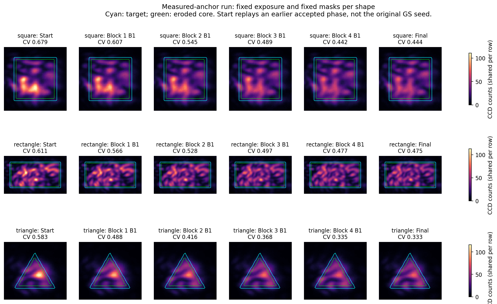

每行使用相同 CCD 计数色标；青色为目标边界，绿色为核心掩膜。中间图片是各块 B1 候选测量，最终图片是独立最终采集。图像确认目标内有实际信号，但仍有散斑和边缘误差。正方形、长方形的 EE_ROI 略降，不能将结果描述为无代价匀化。

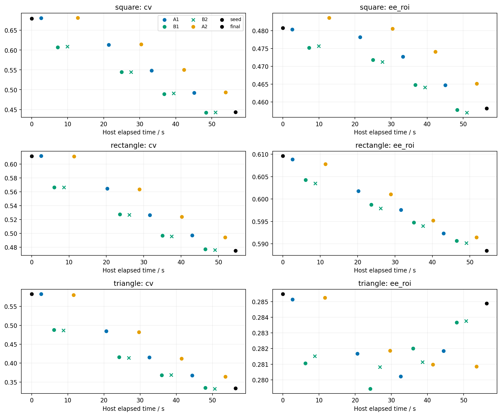

A1、A2 是同一已接受相位的前后测量；B1、B2 是同一候选相位的两次测量。由于每块最后重新加载 A，相位序列中的指标有意往返，不能把散点连成单调迭代曲线。横轴为主机单调时钟换算的相对秒数，包含相位等待、采集、压缩写盘及优化时间。

### 2.1 原始 GS 起点与后续起点必须区分

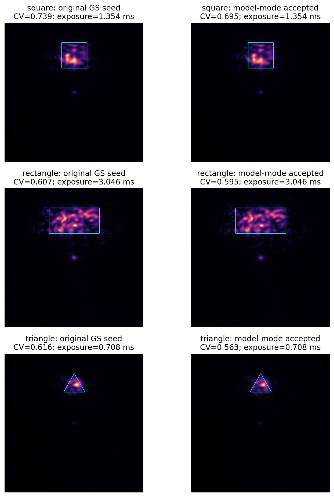

该图来自较早的 `paired_20261023_1942`，左列才是原始 GS 种子。正方形 CV 0.738805 → 0.695077，长方形 0.607078 → 0.595138，三角形 0.616106 → 0.563441；三角形第二块未通过验收。之后才做展宽/辐射尺度校准，并在前轮已接受相位上启动锚定实验。两次运行曝光和时间不同，不能把两轮图像的计数或 CV 差直接归为某一算法改进的因果收益。

## 3. 从零开始需要探测哪些量

### 3.1 建立设备与光路记录

1. 确认相机未被 GUI、官方软件或其他采集进程占用。所有设备访问使用上下文管理器；退出时恢复平相位并关闭设备。
2. 记录 SLM 编号、序列号、波长、2π 灰度、校正文件状态，相机型号、序列号、位深、曝光读回和分辨率。本次 SLM #1 板号 22030108，2π 灰度 956；CCD 为 MER2-507-23GM NIR，序列号 FJB24112232，2592×1944、8 bit。这些是本次条件，不是自动适用于下次的常数。
3. 调整光路和功率后，重新采集平相位参考、双轴正负倾斜和多相位族。采集块内保持光路稳定；开始/结束平相位不同，应检查漂移而不是归因于优化。
4. 不假设入射光位于 SLM 中心，也不假设相机横轴对应 SLM 横轴。入射振幅中心/宽度由多相位数据拟合；变化较大时，先用项目面板扫描/离焦扫描工具缩小初始化范围。

### 3.2 自动曝光

每个探针先用 `adapt_exposure` 从短曝光开始，根据图像反馈调整，在相机提供的曝光范围内搜索。正值环境变量 `AO_DAHENG_MAX_EXPOSURE_MS` 表示**本次光路的附加上限**；缺失或为 0 时使用相机范围与画面反馈，不沿用历史 0.4/0.6 ms 常数。采集保留曝光搜索中的原始帧、最终曝光读回及状态；最终状态不是 `ok` 或测量帧峰值达到 250/255 就终止本轮比较并保留数据。

模型拟合输入使用 `counts / exposure_ms`，故依赖当前曝光区间近似线性。每种形状开始时重新调整一次曝光，随后它的全部 A/B 测量保持不变。曝光补偿不能自动消除短曝光偏置，不能对每张图做独立峰值归一化后声称响应已标定。

本次曝光阶梯复核：固定相位下平相位参考 ROI 波动范围/均值约 1.326%，方形约 0.956%；重复曝光验证 RMSE 约 0.5769、0.9064 counts。未遮光，只能得到照明条件下的截距，不能称为暗场。短曝光偏置确实改变 CV，但不足以解释全部模型偏差。响应分析目录为 `data/debug/analyze_transfer_response/ladder_20261023_1952/`。

### 3.3 完整二维几何标定

加载 `ramp_x/y`，周期 64、128 面板像元，正负号各一次。相位是未包裹弧度：

\[
\phi_{a,P,s}(x,y)=s\,2\pi q_a/P,\quad s\in\{-1,+1\}.
\]

对每个轴，根据两种周期的正负光斑位置，估计映射矩阵的对应列：

\[
M_{:,a}=\operatorname{mean}_P\left[(c_{a,P,+}-c_{a,P,-})P/2\right],\qquad c=o+M\nu.
\]

`c=(column,row)`，不是数组的 `(row,column)`；`ν` 单位为周期/面板像元。本次：

```text
M = [[   94.23370273675027, 7467.690541753378],
     [-7536.712356347185,    122.22260762035876]]
zero reference = (1221, 963) CCD px
```

正 SLM x 倾斜主要让 CCD 行号减小，历史上按 CCD 列方向选 ROI 曾读到弱背景，产生过虚假的低 CV。当前几何函数检查两轴正负配对和矩阵条件数，但光斑定位仍基于平滑峰值及局部质心：离焦严重、强零级或多峰时必须看原始双轴图，不能只信 JSON。

### 3.4 相位族和数据分组

探针由三类组成，随机种子固定并逐相位划分训练/验证：

- Zernike：Noll 4–11，独立高斯系数，标准差 0.6 rad；使用项目 canonical 生成器。
- 平滑随机：8×8 随机网格双线性扩展到 128×128。
- 带限随机：24×24 随机网格双线性扩展到 128×128。

后两类标准差归一到 1.5 rad。每连续 6 个探针，前 3 个用于训练，后 3 个用于验证，使每类都覆盖两个分组。本次精确网格拟合只有 3 训练 + 3 验证，足以做流程诊断，但不足以证明广泛泛化。新采集建议至少 24 个探针，并增加独立随机种子复测；重复帧不能作为独立相位样本。

## 4. 物理正向模型结构与参数微调

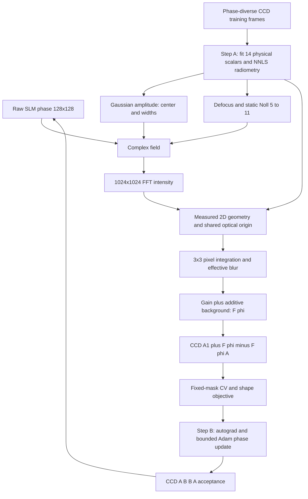

这不是 U-Net，也不存在卷积层权重。本次 Adam 微调的 **14 个标量**为离焦 1、共享光轴原点 2、入射振幅中心 2、振幅宽度 2、Noll 5–11 静态像差 7。训练像素另外以 NNLS 拟合增益与非负加性背景（杂散光）项 2 个标量；有效展宽是离散候选选择。映射矩阵由倾斜探测确定，不由目标图像逐帧任意平移拟合。

输入振幅与相位模型为：

\[
A(x,y)=\exp[-((x-c_x)/w_x)^2-((y-c_y)/w_y)^2]\,H_{panel},
\]
\[
\psi=\phi+d\,s_D Z_4+\sum_{j=5}^{11}a_j Z_j,\qquad
s_D=\frac{\pi(960\cdot8\times10^{-6})^2}{2\sqrt3\,(1064\times10^{-9})}.
\]

`w_x/w_y` 是**振幅**的 1/e 宽度参数，不应标为光强标准差。Zernike 在完整 1920×1920 网格上按项目约定生成并采样；离焦为等效屈光度参数，不能直接当作相机轴向移动毫米数。

传播为 `A exp(iψ)` 经中心补零 FFT，取模方；再使用 `M⁻¹(c−o)` 将 CCD 坐标映射到频域，以每个 CCD 像元 3×3 子点双线性采样平均模拟像素积分，最后施加有效高斯展宽、增益和加性项。传播归一化复用既有物理实现，不能换 FFT 尺寸后任意重归一化掩盖能量标度变化。

### 4.1 模型微调的损失与学习率

只用训练相位的像素估计共享 NNLS 增益/背景。使用同一预测计算训练损失及验证指标：

\[
L_A=(1-\rho)+0.25\,\mathrm{relativeMSE}(I/\bar I)
 +0.25\,\mathrm{mean}\left[\frac{CV_{pred}-CV_{CCD}}{\max(CV_{CCD},0.1)}\right]^2.
\]

具体平均与归一化顺序以 `fit_transfer_multishape.py` 为准。Adam 学习率：离焦 0.01、光轴原点 1.0、入射中心 0.5、对数宽度 0.01、像差系数 0.03。每次记录后更新；离焦限制在 [-2,2]，振幅中心在 [0,1920]，宽度在 [80,800]。每步都存参数、预测、指标和时间；只按训练损失选择检查点，验证相位不参与选择。

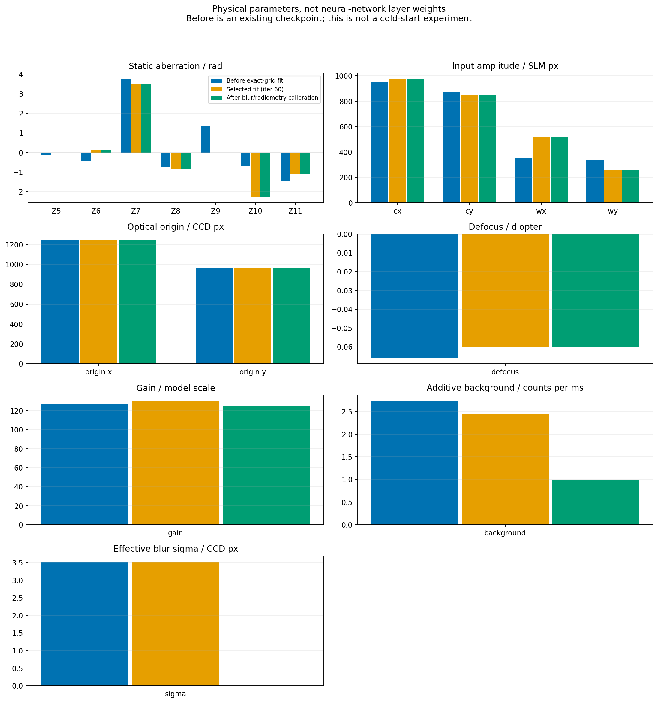

柱状图的“微调前”是精确网格迁移的第 0 次记录，**已经继承较早拟合结果**，不是全零模型。蓝色为该起点，橙色为训练损失选中的第 60 次记录，绿色为随后有效展宽/辐射尺度校准。不同单位分图呈现，不按一个混合尺度比较。全部原值见 `artifacts/reproduction_20261023/parameter_values.csv`（`.csv` 受 `.gitignore:7` 约束不入仓库，仅在采集机上存在，故此处只作路径标注不作链接）。

| 参数 | 第 0 次 | 选中第 60 次 | 展宽校准后 |
|---|---:|---:|---:|
| 等效离焦 / m⁻¹ | -0.06578328 | -0.05982841 | -0.05982841 |
| 振幅中心 x / 面板 px | 951.5753 | 972.7274 | 972.7274 |
| 振幅中心 y / 面板 px | 870.1917 | 846.5529 | 846.5529 |
| 振幅宽度 x / 面板 px | 356.4335 | 518.5029 | 518.5029 |
| 振幅宽度 y / 面板 px | 336.8444 | 258.0349 | 258.0349 |
| 增益 / 模型标度 | 127.5157 | 129.9917 | 125.2425 |
| 加性项 / counts·ms⁻¹ | 2.731868 | 2.454683 | 0.995066 |
| 有效展宽 σ / CCD px | 3.515916 | 3.515916 | 0 |

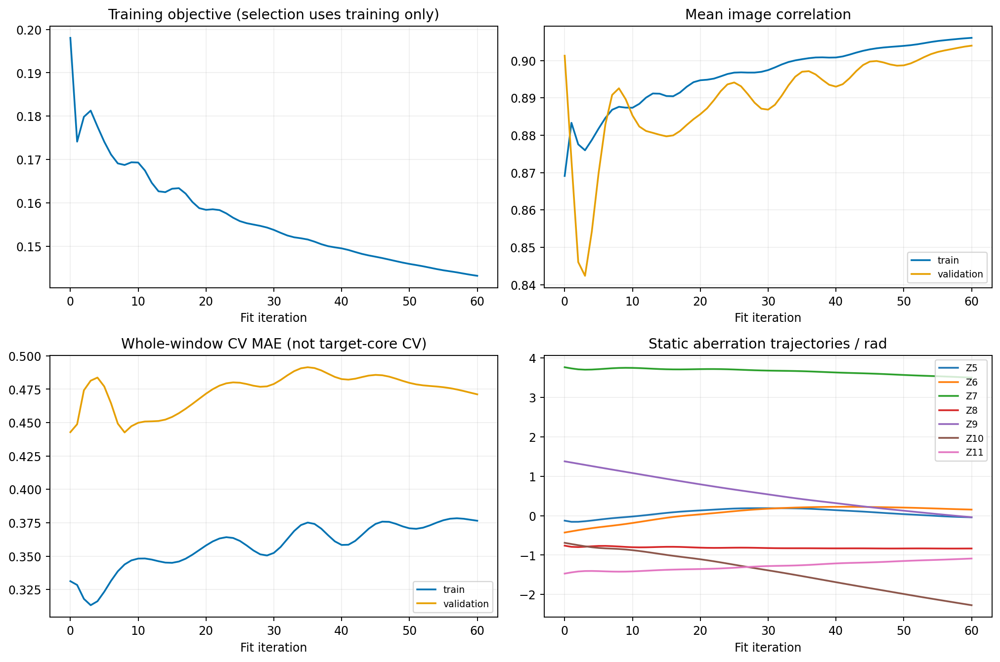

训练相关性约 0.86909 → 0.90606，验证相关性约 0.90128 → 0.90397；验证全窗口 CV MAE 却由约 0.44284 增至 0.47118。图中的全窗口 CV 误差不是整形表里的核心 CV，不能混用。**提高相关性不等于模型能准确预测均匀度。**

后续用正方形、三角形种子作为校准图像，搜索 σ=0、0.5、1、2、3.515916109085083；每个候选仅由这两种图像拟合辐射尺度并按训练分数择优，长方形/五角星作检查。σ=0 在此有效模型中改善 CV 误差，但整图 MSE 变差；它不证明相机物理 PSF 为零。已经进入校准的图像不再是该模型的独立验证集。

## 5. 三种目标形状如何生成

所有目标复用 `utils/image/target/patterns.py:create_target_shape`，在 512×512 参考光栅上生成，再按 CCD 实际坐标双线性采样；不从实测图中挑选最均匀的小区域。

| 目标 | `--side 80` 的具体含义 | 方向/范围 |
|---|---|---|
| 正方形 | 边长名义 80 CCD px | CCD 行列轴对齐 |
| 长方形 | 短边 80、长边 160 CCD px | 长边沿 CCD 列方向；`aspect_ratio=2` |
| 三角形 | 此入口传入 `radius_ratio=80/512`，所以外接圆半径 **40** CCD px | 顶点朝上，理想宽约 69.28、高 60、边长约 69.28 CCD px |

三角形的 `side` 并不是三角形边长；这是当前 API 中不同形状参数含义的实际差别。离散边界及插值后的有效像元数以存档 `target` 为准。

目标区为 `target>0.5`，核心区再腐蚀 2 个采样像元（每个采样间隔 2 CCD px）。CV 用核心区域总体标准差/均值；EE_ROI 用整个目标区积分/固定相机采样窗口积分。窗口为中心 ±220 CCD px、步长 2，即 221×221 采样，覆盖名义 441×441 CCD px 范围；它不是对全传感器所有像元的总能量积分。

目标中心取平相位零级参考加离轴位移：`target_xy = zero_xy + M[:,0]/64`。本次约为 `(1222.4724,845.2389)`。这样零级与目标空间分离，而不是从光学上消灭零级。没有光阑时零级仍存在，不能把它所在的窗口能量从 EE 分母中偷偷删掉。

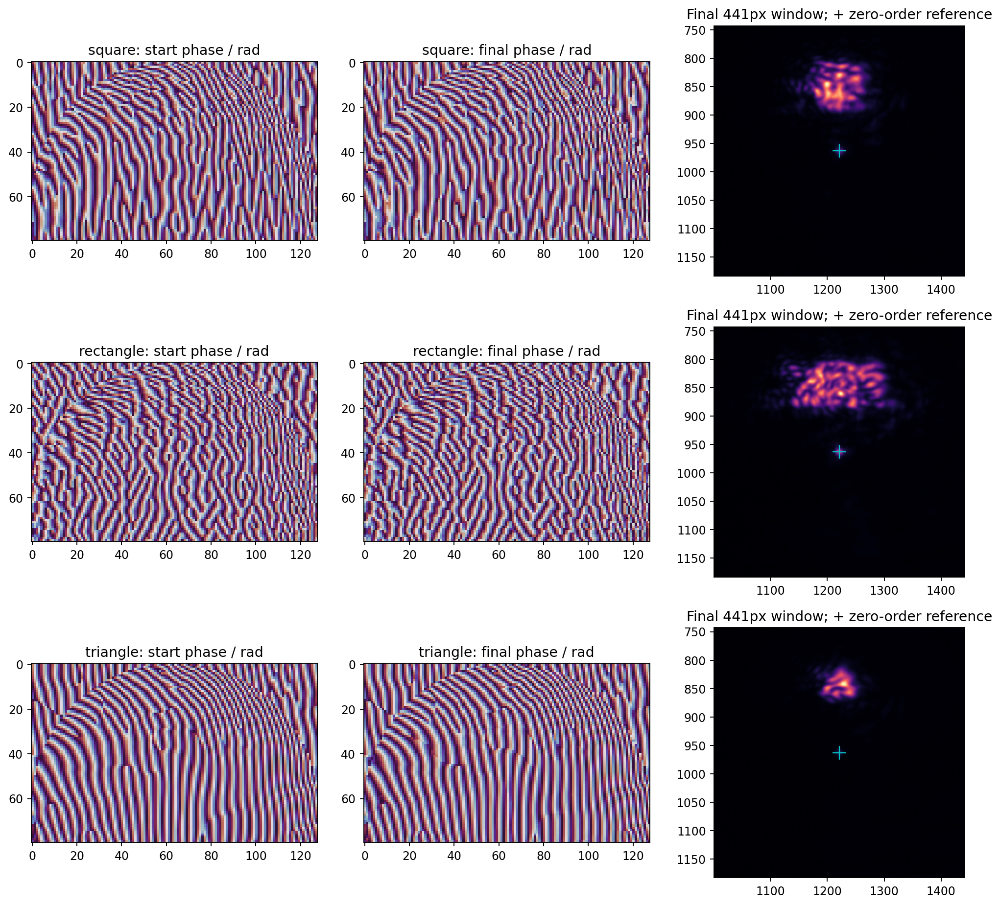

相位图仅为显示取模到 [0,2π)；算法与磁盘 `model_phase/panel_phase` 保留 raw 弧度，唯一器件包裹/量化入口是 `Santec.create_phase_from_array()`。128×128 控制网格每格精确重复 15 面板像元，取扩展后前 1200 行，得到 1200×1920；不对包裹相位做均值降采样。

## 6. GS 初始化与可微优化的确切顺序

### 6.1 GS 产生起始相位

1. 用测得的完整二维映射，将相机目标放到 FFT 频域对应位置；输入平面固定为拟合的振幅 `A`。
2. `gerchberg_saxton(..., iterations=80, propagation="fft")` 交替传播和振幅投影：目标面使用目标振幅 `sqrt(target)` 并保留当前复场相位；逆传播后恢复输入振幅。
3. 截取控制网格，从 GS 相位中减去拟合的静态离焦与 Noll 5–11 像差，再加载 SLM。

离轴位置已经包含在目标频域的位置中，不能再无条件叠加同一载波造成双重偏移。GS 是初始化，真实 CCD 才决定它是否实现目标；标准 GS 对指定目标振幅有约束，不能简单说只约束“非零区域”。

### 6.2 冻结模型，优化相位

本次每块重新获取参考相位 `φ_A` 的 CCD 图像（A1），固定模型参数 θ，构造局部强度代理：

\[
I_{local}(\phi)=\max\{I_{A1}/t+F_\theta(\phi)-F_\theta(\phi_A),10^{-8}\}.
\]

模型负责局部变化，实测图像负责参考强度。每次模型更新不调用相机；每块结束才做实际候选采集。对图像的目标为：

\[
L_B=CV^2_{core}+2(1-EE_{ROI})+
(\sum T)\sum\left(\frac{I}{\sum I}-\frac{T}{\sum T}\right)^2
+0.001 R(\delta\phi),
\]

其中 `R` 是相邻相位差的余弦平滑项。Adam 对控制网格中的相位增量更新，学习率 0.01；每块 10 次，块内相对于已接受参考的照明加权 RMS 上限 0.2 rad，并去除 piston 和整体倾斜。**0.2 rad 是块参考附近的增量限制，不是每次都允许再累加 0.2 rad。** 模型参数在此阶段不更新。

实现细节应与理想公式区分：当前 `measured` 路径先求目标对代理强度的梯度，再调用完整 `F` 的 Jacobian 反传；相位平滑项以 detached 增量评价，不给此路径贡献相位梯度。负值截断也未显式传递截断掩膜的导数。因此应把它解释为局部代理更新；未截断区域才与公式的直接链式求导一致。当前 CCD 验收以零增量评价图像目标，不包含候选相位平滑惩罚。复现本次结果应保留此实现；后续若补齐导数，需要另做配对实验，不能把新版本曲线冒充本次记录。

### 6.3 CCD 配对验收与回退

顺序为 A1 → 模型内 10 次更新 → B1 → B2 → A2。每次切换相位等待 0.6 s，再采 3 帧；相机曝光保持不变。

\[
L_A=(L_{A1}+L_{A2})/2,\quad L_B=(L_{B1}+L_{B2})/2,\quad D=|L_{A2}-L_{A1}|.
\]

只有 `L_B < L_A − D` 才接受候选，否则保留上一已接受相位。每块创建新的优化器，拒绝候选不会改变后续参考。第一块还加载 `φ_minus=2φ_A−φ_B`，与正向候选比较局部方向。最终独立采集一次已接受相位。

本次三形状图像差分相关性约 0.7433、0.6370、0.6765。四种形状共 12 项已存方向上的自动微分/中心差分核对符号一致，最大相对误差约 0.02461%。这支持当前实现的局部数值导数可用，不代表物理模型全局准确。原模型在最终正方形、长方形、三角形上的图像相关性仍约 0.7054、0.6637、0.7085。

## 7. 可以照着执行的 PowerShell 流程

以下命令在仓库根目录执行。采集默认只打印计划，只有显式 `--execute` 才访问设备。每次使用新目录；不要覆盖本报告原始数据。

### 7.1 环境与新一轮采集

```powershell
Set-Location D:\Projects\TIFO\AO-shaping
$py = Join-Path (Get-Location) '.venv\Scripts\python.exe'
$tag = Get-Date -Format 'yyyyMMdd_HHmmss'
$base = "data/debug/three_shape_reproduction/$tag"
$capture = "$base/capture"

# 若环境尚未安装，先按本项目配置安装；已有实验环境无需重复安装。
# uv sync --extra ml

# 0 表示没有本次用户指定的附加曝光上限，仍受设备范围和图像反馈约束。
$env:AO_DAHENG_MAX_EXPOSURE_MS = '0'
$env:OMP_NUM_THREADS = '4'
$env:OPENBLAS_NUM_THREADS = '4'

& $py scripts/slm/transfer_multishape_experiment.py --out $capture --count 24 --frames 3
& $py scripts/slm/transfer_multishape_experiment.py --out $capture --count 24 --frames 3 --execute
```

运行前确认激光已开启、光路已调好、设备可独占。上述曝光变量应按当前光路需要设置，不能把此示例的 0 当作必须选择。探针阶段共 2 个平相位参考、8 个倾斜、24 个随机相位，约 34 组测量，另有曝光搜索帧。当前没有通用“激光关闭”自动判别，弱信号时应停止检查，不能只看低 CV。

### 7.2 冷启动：没有旧检查点时

新增 `bootstrap_transfer_checkpoint.py` 从当前采集的正负倾斜矩阵及平相位位置建立**名义初始化**，不加载任何旧模型。默认振幅中心与宽度仅为初值，应尽量用面板探测信息替换。下面的零离焦不是已测事实：

```powershell
& $py scripts/slm/bootstrap_transfer_checkpoint.py --dataset $capture --out "$base/initial" --center 960 600 --width 400 300 --defocus 0
& $py scripts/slm/fit_transfer_multishape.py --dataset $capture --checkpoint "$base/initial/frozen_parameters.json" --out "$base/fit" --iterations 100 --span 160
```

较强离焦时，可先执行现有离焦扫描，再用其结果确定初始化范围；补偿相位与模型像差的符号应通过 ± 扰动验证。也可分别以多个 `--defocus` 初值建立独立目录并拟合，只按训练目标选择，最后用未参与选择的相位验证。单次局部 Adam 不保证从任意离焦收敛。入射中心初值距离实际太远时同样应先做面板探测。

此冷启动入口已在保存的当前光路数据上检查几何与参数文件兼容性，并完成 2 次离线拟合更新、正常输出自包含检查点。产物为 `data/debug/three_shape_reproduction/offline_bootstrap_20261023/`；这不是完整收敛验证，未新增设备实验验证其最终整形指标。本次成果不是从该名义初值获得，不能把 §2 的 CV 用作冷启动保证。

### 7.3 已有模型时迁移，再做一次精确网格拟合

将初始模型替换为已有检查点，其他步骤相同。以下为适用本次存档的迁移路径：

```powershell
$initial = 'data/debug/fit_transfer_multishape/current_20261023_1933/frozen_parameters.json'
& $py scripts/slm/fit_transfer_multishape.py --dataset $capture --checkpoint $initial --out "$base/fit" --iterations 60 --span 120
```

§7.2 与 §7.3 是二选一，不能用相同 `$base/fit` 目录连续执行。拟合窗口不足以覆盖探针光强时应增大 `--span`，并保持训练/验证口径一致。

从新采集平相位参考读取零级位置，再对三种形状先运行模型模式：

```powershell
$rows = Get-Content "$capture/manifest.json" -Raw | ConvertFrom-Json
$reference = $rows | Where-Object { $_.label -eq 'reference_start' } | Select-Object -First 1
$zx = [math]::Round($reference.spot_xy[0])
$zy = [math]::Round($reference.spot_xy[1])
$checkpoint = "$base/fit/frozen_parameters.json"

& $py scripts/slm/validate_transfer_shapes.py --checkpoint $checkpoint --out "$base/model" --zero-xy $zx $zy --shapes square rectangle triangle --side 80 --blocks 2 --updates 10
& $py scripts/slm/validate_transfer_shapes.py --checkpoint $checkpoint --out "$base/model" --zero-xy $zx $zy --shapes square rectangle triangle --side 80 --blocks 2 --updates 10 --execute
```

查看计划中的目标位置和 CCD 图，确认离轴目标、零级均在窗口内，目标没有被传感器边缘截断。脚本检查固定窗口，当前不会根据任意新离焦和目标尺寸自动求最佳载波；必要时调整 `--period` 或 `--side`，并重新建立匹配目标。

### 7.4 曝光与有效展宽校准，再做锚定优化

```powershell
& $py scripts/slm/capture_transfer_response.py --source "$base/model" --out "$base/response" --execute
& $py scripts/slm/analyze_transfer_response.py --source "$base/response" --out "$base/response_analysis"
& $py scripts/slm/calibrate_transfer_blur.py --source "$base/model" --checkpoint $checkpoint --out "$base/blur" --sigmas 0 0.5 1 2 3.515916109085083

& $py scripts/slm/validate_transfer_shapes.py --checkpoint "$base/blur/frozen_parameters.json" --out "$base/anchored" --seed-run "$base/model" --zero-xy $zx $zy --shapes square rectangle triangle --side 80 --mode anchored --blocks 4 --updates 10 --frames 3 --execute
& $py scripts/slm/summarize_transfer_shapes.py --run "$base/anchored" --out "$base/summary"
& $py scripts/slm/analyze_transfer_direction.py --run "$base/anchored" --out "$base/direction_analysis"
```

`capture_transfer_response.py` 使用保存的正方形相位，`calibrate_transfer_blur.py` 训练只读取正方形/三角形种子，并以源运行内其余形状作检查，因此上面的三形状运行可直接衔接。示例 σ 列表保留本次候选便于重现，不代表新光路的最佳范围。曝光响应分析目前是诊断工具，并未把逐像元反响应 LUT 自动接入正向模型；不要把执行分析误认为已自动做暗场/平场线性化。

若已有校准并想直接使用 GS → 锚定闭环，可省略模型模式和展宽扫描，在锚定命令中删除 `--seed-run`；这样从新 GS 种子开始，但**不等同本次先模型模式、后锚定的历史过程**。

`--seed-run` 会核对网格与目标逐项相等；更换中心、载波、目标尺寸后不能原样回放。脚本正常退出或异常都会在 `finally` 中尝试恢复平相位并释放上下文设备；进程强制终止、SDK 阻塞或硬件断连仍需人工确认，不应直接拔电代替关闭。

### 7.5 仅离线复核本报告

```powershell
& $py scripts/slm/generate_multishape_reproduction_figures.py
```

这条命令不访问设备，从本地 `data/debug` 生成本报告所有 PNG、参数 CSV 和带输入 SHA-256 的 [figure_data.json](artifacts/reproduction_20261023/figure_data.json)。它更新图表，不覆盖人工撰写的本文件。原始数据受忽略规则管理，只有 Git 中的 Markdown/PNG 不足以重新计算；移交时应同时交付下一节目录。

## 8. 原始数据、时间戳与移交目录

| 内容 | 仓库根相对目录 | 关键文件 |
|---|---|---|
| 当前光路探针 | `data/debug/transfer_multishape_experiment/capture_20261023_1938/` | config、manifest、逐组 NPZ、capture_records.pkl |
| 精确网格迁移 | `data/debug/fit_transfer_multishape/exact_grid_20261023_1935/` | inputs.npz、iterations.pkl、iteration_*.npz、result、frozen_parameters |
| 原 GS 与模型模式 | `data/debug/validate_transfer_shapes/paired_20261023_1942/` | manifest、summary、逐帧数据、*_best.npy |
| 曝光阶梯 | `data/debug/capture_transfer_response/ladder_20261023_1952/` | 原始测量帧与曝光搜索帧 |
| 展宽/辐射校准 | `data/debug/calibrate_transfer_blur/shapes_20261023_1956/` | result.json、frozen_parameters.json |
| 最终锚定实验 | `data/debug/validate_transfer_shapes/anchored_20261023_2002/` | 80 个采集 NPZ、manifest、iterations、summary、artifact_audit |
| 方向与数值梯度 | `data/debug/analyze_transfer_direction/anchored_20261023_2002/` | 每形状差分 NPZ、result.json |

采集文件保存 `raw_frames`（3×1944×2592）、实际 `panel_gray`、`panel_phase`、128×128 `model_phase`、`camera_xy`、目标和核心掩膜。帧记录有 UTC 微秒字符串、主机单调起止纳秒值、曝光读回；时间是主机调用记录，**不是传感器内部曝光触发时间戳**。

拟合 `iterations.pkl` 每条对应那一步记录的参数与预测；相位优化 `iterations.pkl` 的 `phase` 则是**更新后**相位，`terms` 是生成该更新梯度时的**更新前**目标，不能将二者直接当成同一状态画“预测对照”。本报告变化曲线使用实际配对 CCD 记录，避开该错配。

实验最终相位存为 `square_best.npy`、`rectangle_best.npy`、`triangle_best.npy`。它们只是模型控制网格，不是可以不经驱动直接发送的灰度图；转换必须用相同重复映射及波长/LUT。不要在光路变化后仅凭文件名认定历史最佳相位仍然最佳。

## 9. FAQ 与故障判定

**光路变化后到底要重新做多少？** 新采集平相位、双轴倾斜、多相位探针；用已有模型迁移，检查曝光响应和局部 ± 方向，再做短块验收。功率变化优先检查曝光/辐射尺度，中心变化检查几何与振幅中心，离焦/相差变化重拟合相位项。无法用一句“只变功率”跳过验证，也无需每次重新推导算法。

**模型预测很好看，CCD 却不均匀，是否反向传播错了？** 分别检查固定相位图像预测、AD/有限差分、实际 ± 相位扰动三个层面。本次 AD 数值核对通过，但绝对预测仍偏，且原模型目标在三个形状首块上给出与 CCD 不一致的优劣；CCD 锚定后方向恢复一致，说明绝对预测偏差是关键因素之一。

**三角形为什么比方形窄？** 当前入口对正方形解释 `side` 为边长，对三角形通过 `radius_ratio` 得到半径 `side/2`。应以固定目标掩膜和上文尺寸表为准，不能期待同为 80 就等面积。

**零级还在，为什么不从指标里减去？** 当前目标已离轴，核心掩膜通常不含零级。EE_ROI 分母仍包含固定窗口内零级和其他能量，这有助于保留能量代价。若以后使用零级剔除指标，应另外保存掩膜，同时报告原口径，不能替换历史指标。

**曝光降低后 CV 反而更低，是效果更好吗？** 不一定。偏置占比升高可降低 CV，背景区域也可能有低 CV。应同时看固定目标轮廓、核心均值、饱和计数、EE 和原始 CCD；只在同曝光配对内判断变化。

**为什么还要拍 A2？** 它检测同一相位下的实验漂移；候选改善未超过该漂移时拒绝，避免将激光/光路变化误认成算法收益。该规则不是正式统计显著性检验，后续仍需独立重复实验与误差区间。

**长方形 EE 较高，是否优于三角形？** 三种目标面积、边界和曝光不同，不能以此给出算法排序。本报告只比较同一形状优化前后。三角形的尖角更容易暴露采样和相位带宽问题。

**能否加载相位后立刻测量？** 本次固定等待 0.6 s，没有逐次自适应稳定判据。换设备或刷新模式时应验证等待时间；存下的主机时间不能证明液晶已在所有条件下稳定。

**是否已经适合任意光路无人值守？** 尚未。现有工具固化了当前 Santec/Daheng 的数据链、模型迁移、局部优化与回退。新光路的入射探测、目标/零级识别、载波选择、强离焦多初值、曝光线性区和独立验证仍须检查。下一步应自动化这些检查，并补齐锚定分支的平滑/截断导数，再用新的 CCD 配对实验评估，不将未验证内容写成已完成能力。

## 10. 本次报告整理的验证范围

配图由保存的原始数据生成，参数柱状图选择点来自训练损失记录，源文件 SHA-256 和逐阶段 CCD 指标一并导出。新增冷启动入口不导入设备，只生成明确标记为名义初始化的独立检查点。报告没有新增相位加载或采集，也没有把本次物理分支结果扩展到 U-Net。设备已在原运行结束时释放；本次整理未重新占用。

新增初始化与三形状校准选择测试连同现有几何、拟合、锚定、回放、曝光响应测试合计 **23 项通过**；本次脚本 Ruff 检查通过。图片已人工核对 CCD 演变、参数单位与结构图。仓库全量术语与溯源检查另有既存待处理记录，本次仅校验并整理本报告与相关入口，未批量改写历史实验结论。

三形状展宽校准还使用存档原始种子数据完成了一次 σ=0 的离线衔接检查，正常得到增益 125.24250338264454、加性项 0.9950655618520944，与四形状原运行的训练结果一致；验证分数因仅含长方形而不同。这一检查没有新增采集，产物保存在上述离线检查目录的 `three_shape_blur/`。

全量报告溯源测试为 555 项通过、7 项失败；失败涉及另 6 份报告未登记，以及原有诊断/形状对照报告的溯源块不同步。本报告的溯源块和全部 16 个相对链接通过独立核对。全量 Ruff 有 6 项问题，位于 `capture_hdr_metrics.py`、`fix_report_links.py` 和 `slm_square_shaping.py`，不是本报告新入口；未将全仓库检查写成通过。术语 dry-run 原先已有约 112 个文件需处理，本报告经局部核对无需术语替换。

## 11. 追加：工程化入口及完整设备复现（20:46–20:56）

在用户要求检验复现、集成可复用代码之后，使用统一入口完成一轮新的物理设备实验。以下为新增记录，不替换前述历史结果。设备枚举确认 Daheng MER2-507-23GM NIR、序列号 FJB24112232；使用同一 Santec SLM #1，重新采集当前光路，未仅回放历史预测。

### 11.1 工程化后的代码与命令

九个实验脚本的实现迁入 `src/ao_shaping/tools/slm/transfer/`，旧脚本保留兼容命令与公开函数入口。物理拟合器抽到 `algorithm/signal_processing/physical_forward_fit.py`；目标掩膜、损失、GS 与锚定数学函数抽到 `algorithm/signal_processing/multishape_objective.py`；曝光响应诊断抽到 `utils/image/exposure_response.py`。新 `src` 实现不导入 `scripts`，导入/计划/离线操作不加载驱动。

统一入口支持 `plan`、`doctor`、`run`、`audit`、`replay`。每个会话统一保存配置与阶段日志，阶段失败立即记录错误，已有目录拒绝覆盖。新增操作手册见 [统一入口操作手册](../../../docs/slm/slm_transfer_workflow.md)。设备编号、相机后端、形状、尺寸、载波和迭代数可从同一入口传入；默认先打印计划，必须显式 `--execute` 才调用设备。曝光响应分析仍是诊断，不冒充自动完成逐像元响应反演。

实际执行参数如下，复测时应更换输出目录：

```powershell
.venv\Scripts\python.exe -m ao_shaping.tools.slm.transfer run `
  --out data/debug/transfer_integration/live_20261023 `
  --checkpoint data/debug/calibrate_transfer_blur/shapes_20261023_1956/frozen_parameters.json `
  --count 12 --iterations 20 --blocks 2 --updates 10 --frames 3 --execute
```

本轮使用 12 个随机探针、20 次迁移拟合、每形状 2 个锚定块；与默认 24 探针、60 次拟合、4 块不同，目的是验证完整设备流程。本轮原始目录为 `data/debug/transfer_integration/live_20261023/`；阶段日志见 [journal.json](artifacts/integration_20261023/journal.json)。

### 11.2 CCD 确认的整形与匀化

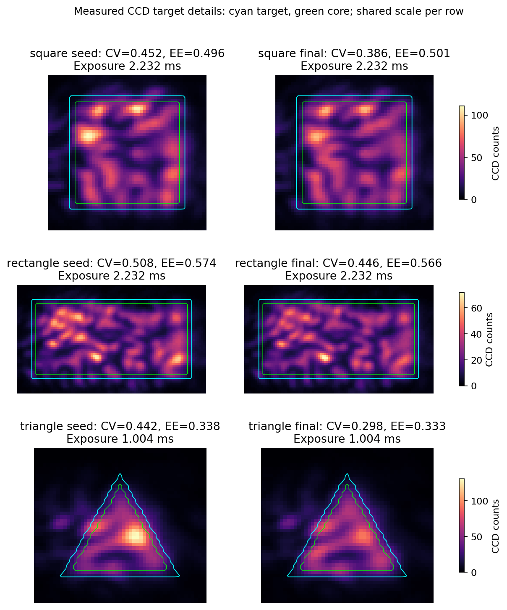

每行是该形状锚定阶段同曝光的初始与最终 CCD 图，色标相同；青色目标、绿色核心。可直接辨认正方形、长方形和三角形，目标内部亮暗差异有所减小。仍有散斑和边界误差，不能称为严格均匀平顶。

| 形状 | 固定曝光 / ms | 初始 CV | 最终 CV | CV 相对下降 | 初始 → 最终 EE_ROI | 核心均值初始 → 最终 / counts |
|---|---:|---:|---:|---:|---|---|
| 正方形 | 2.232 | 0.452114 | 0.386122 | 14.60% | 0.496256 → 0.501093 | 40.807 → 41.239 |
| 长方形 | 2.232 | 0.507869 | 0.446451 | 12.09% | 0.573532 → 0.566341 | 23.705 → 23.147 |
| 三角形 | 1.004 | 0.442288 | 0.298102 | 32.60% | 0.337922 → 0.333083 | 54.161 → 52.191 |

6 个锚定候选块全部通过 A–B–B–A 漂移验收。之前的模型模式 6 个候选块中 5 个通过，长方形第 2 块拒绝，后续锚定从上一已接受相位继续；由此也实际覆盖了拒绝回退路径。长方形、三角形的 EE_ROI 略降，仍需保留能量代价判断。不能跨两次实验的不同曝光、功率与模型版本，把最终 CV 差归因于工程化本身。

完整相机窗口及物理预测见 [CCD/模型对照图](figures/integrated_ccd_20261023.png)，对应数值与检查点哈希见 [results.json](artifacts/integration_20261023/results.json)。最终模型/CCD 相关性约 0.8452、0.7869、0.8616；模型核心 CV 约 0.2923、0.3087、0.2780，仍不能完全替代 CCD 测量。

### 11.3 采集量、可追溯性与设备释放

| 阶段 | 测量组 | 原始 CCD 帧 | 其他记录 |
|---|---:|---:|---|
| 当前光路探针 | 22 | 66 | 平相位参考 2、双轴倾斜 8、随机探针 12；另存曝光搜索帧 |
| GS/模型模式 | 36 | 108 | 三形状各 2 块，合计 60 次相位更新 |
| 曝光阶梯 | 22 | 66 | 平相位与正方形固定相位各 11 档/重复组合 |
| CCD 锚定 | 36 | 108 | 三形状各 2 块，合计 60 次相位更新 |
| 合计 | 116 | 348 | 不含额外自动曝光搜索帧；另有 20 次模型参数拟合 |

锚定测量全帧最高峰值 156/255，未饱和。新审计入口重新读取全部 36 组锚定 NPZ，重算 CV、均值、EE、峰值、图像目标，核对面板/模型相位、目标核心、曝光、主机时钟和逐块接受判定，通过；逐文件 SHA-256 见 [audit.json](artifacts/integration_20261023/audit.json)。有效展宽候选再次选择 σ=0；含义仍是当前有效模型择优，不是物理 PSF 测量。

本轮 9 项保存方向上的 AD/中心差分核对符号一致，最大相对误差约 0.01161%，见 [direction.json](artifacts/integration_20261023/direction.json)。这只检验这些相位及方向。

20:55:45.572 日志确认 SLM #1 已关闭；相机上下文随设备阶段退出，随后审计、图片和方向检查均离线完成。`journal.json` 的全部 10 个阶段均为 `complete`。本轮 PowerShell 的 `2>&1` 重定向把正常 loguru stderr 记录包装成 `NativeCommandError`，外层命令状态不等于实验阶段失败；控制台末尾已有 `Session complete`，原始数据和审计均完整。统一 CLI 随后将正常 INFO 日志定向到 stdout，避免同类命令行误判。

### 11.4 离线复现与回归

在设备实验前，包入口已重算原锚定实验的 80 组/240 帧、16 块验收，指标与存档一致；另完成一次两次拟合更新、三形状各 80 次 GS 和各 3 次可微相位更新的离线会话。产物分别在 `data/debug/transfer_integration/replay_20261023/` 和 `offline_20261023/`。

迁移相关的核心/兼容入口/工作流测试最终为 30 项通过；依赖被抽离物理拟合器、相位探针与曝光响应的旧采样及数据采集回归另有 48 项通过，合计 78 项。包导入测试明确阻止 `scripts` 和驱动导入，确认离线接口不依赖脚本目录或原生 SDK。相机曝光读取统一经公共兼容助手，并以不提供旧曝光属性的设备替身验证回读与退出释放。当前通用能力仍限定为已记录设备与模型常量；没有把这轮已有检查点迁移扩大解释为任意光路冷启动保证。

## 12. 2026-10-24：小幅光路变化的分级适配与仿真验证

本节为设备停用后的离线追加；§1–§11 的实验值保持原有口径。新增代码没有进行本日 CCD 实验验收。旧版结构图仅保留为[历史绘图存档](figures/model_structure_20261023.png)，正文结构流程采用 Mermaid 源码。

### 12.1 历史分析对应的设计选择

[采样与像元积分诊断](../model_in_loop/physical_forward_sampling_20261022_r2.md)提示，整幅图相关性较高仍可能伴随 CV 预测偏差，应同时检查传播采样、像元积分、曝光偏置与剩余峰宽。[诊断与迁移记录](diagnosis_and_transfer_20261023.md)及本报告方向检查说明，应区分正向预测误差和自动微分实现误差；不能在正向模型失配时只增加逆向迭代。[离焦可微优化记录](../defocus_differentiable/defocus_differentiable_20261023_r2.md)也应与后续 CCD 配对结果一起阅读。

因此，小幅功率变化先更新共享强度尺度；小幅入射偏移先更新入射中心和 CCD 光轴原点；验证不足时才重新拟合离焦、光束宽度和静态像差。每阶段保留零次光学更新的候选，避免本来只有亮度变化却产生不必要的像差补偿。

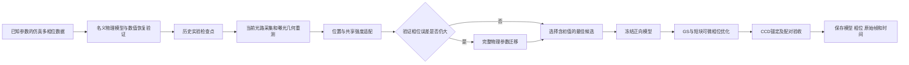

新增 `--adaptation auto` 为统一入口的默认历史检查点适配方式。位置阶段最多 30 次更新；相关性小于 0.85 或相对 L2 大于 0.25 时增加完整拟合。用验证相位平均 `1 − correlation + relative_l2` 选择阶段，因此本节验证集参与模型选择，不是独立最终测试集；CCD 配对验收仍是最后判据。这两个阈值是升级启发式，尚未经过多光路统计标定，不代表达到它就必然可以均匀整形。

只选一个形状时自动跳过需要三形状配合的曝光响应/展宽校准；无需额外记住跳过参数。单形状模式依赖旧响应模型仍适用，默认三形状流程仍执行完整诊断。已有显式完整拟合与兼容脚本入口保留。

### 12.2 已知扰动的离线恢复结果

使用 `transfer simulate` 生成线性、无噪声、同传播模型的数据。每组包含 12 个随机探针，其中 6 训练、6 验证，另有参考和双轴正负倾斜共 10 组；每组 3 张模拟原始图像，曝光在 0.5/1/1.5 ms 间交替。控制网格 32×32、FFT 256、每像元一次采样，用于快速数值验证，不代表实验采样收敛结论。SLM 像元尺度仍按 8 μm 解释。

| 扰动 | 自动选择 | 验证相关性 | 验证相对 L2 | 验证整窗口 CV 绝对偏差 |
|---|---|---:|---:|---:|
| 功率 ×0.8，无入射移动 | 只更新几何与强度的初始候选 | 约 1.000000 | 2.23×10⁻⁷ | 9.54×10⁻⁷ |
| 功率 ×1.2，入射中心移动 (12, −8) SLM 像元，适配前 | 初始候选 | 0.998981 | 0.045399 | 0.138175 |
| 同上，位置适配后 | alignment，第 24 次更新 | 0.999927 | 0.012131 | 0.019465 |

位移实验的真值中心为 `(972, 592)`，恢复为 `(970.442, 593.276)`，单位为 SLM 面板像元；离焦和 Noll 5–11 保持历史值。纯功率变化组没有触发不必要的光学更新。这里 CV 指多相位预测整窗口的 CV，不是方形目标核心 CV，更不能直接与 §11 的实验匀化值相比较。

两组选择记录见 [位移与光强变化](artifacts/adaptation_20261024/mild_shift.json)和[纯光强变化](artifacts/adaptation_20261024/power_only.json)。完整逐次预测、参数、模拟原始图像及真值保存在 `data/debug/slm_transfer/synthetic_20261024_shift/`、`synthetic_20261024_fit/`、`synthetic_20261024_power/`、`synthetic_20261024_power_fit/`。另以同一个 `run --offline` 完成三形状各 80 次 GS 初始化和 3 次可微更新，阶段日志见 [离线一键流程](artifacts/adaptation_20261024/offline_journal.json)，相位与预测在 `data/debug/slm_transfer/synthetic_20261024_shapes/`。

复现命令：

```powershell
$py = '.venv\Scripts\python.exe'
$sim = 'data/debug/slm_transfer/new_synthetic_session'
& $py -m ao_shaping.tools.slm.transfer simulate --out $sim --count 12 --power 1.2 --shift 12 -8
& $py -m ao_shaping.tools.slm.transfer run --out "${sim}_result" --dataset $sim --checkpoint "$sim/nominal.json" --offline --iterations 30 --updates 3
```

### 12.3 仿真训练到实验迁移的可执行顺序

1. 用确定种子和不同功率/入射位置生成仿真相位—曝光—图像样本，真值单独保存。先检查物理参数恢复与前向/逆向计算；训练、验证使用不同相位。仿真生成器当前只覆盖功率和入射位置，不能用它证明非线性相机、LUT 或零级光适应性。
2. 实验恢复后，以上次接受模型作初始化，采集当前相位族与倾斜几何。先自动曝光，再以曝光读回值归一化；只有相机在已校准线性区时此操作才成立。高衰减滤光片不能证明电子偏置为零。
3. 先只迁移位置及共享强度，再按验证误差升级为完整拟合。数据未改善时保留初始候选；逐阶段分数、参数和时间全部保留。宽度、离焦变化较大时直接指定 `--adaptation full`，严重截光或目标越界则重新面板探测。
4. 冻结模型后才优化相位，采用固定目标核心掩膜、短块更新和 CCD 锚定；每块 A–B–B–A 验收并拒绝退化候选。若 AD/差分一致而 CCD 正负方向响应不符，优先补采探针修正正向模型局部 Jacobian。
5. 多个独立光路、独立种子和不同功率下复测，分别报告目标核心 CV、EE、相关性、曝光和接受率。验证集选择出来的模型还需独立 CCD 验收，不能以仿真预测替代。

当前物理模型本身就是强先验，不需要大型深度网络预训练。若后续希望进一步减少采集成本，可用覆盖离焦、入射位置/宽度、像差、响应曲线的仿真库训练小型参数估计器，实验阶段只迁移低维参数或小残差；必须按光路参数组合分组验证，且先单独验证传播采样与响应模型。这是后续可行思路，尚未集成神经网络训练入口。

一键实验命令、单形状选择、仿真样本生产、光路变化诊断表与适用范围均见[统一入口操作手册 §7–§9](../../../docs/slm/slm_transfer_workflow.md#7-小幅变化后一键重新生成形状)。本报告结构流程统一使用 Mermaid；CCD 对照、参数柱状图和轨迹图仍保留数值图像。

### 12.4 检查记录与适用范围

本轮迁移适配、统一工作流及旧脚本兼容性共 37 项测试通过；连同全树报告检查为 602 项通过、3 项失败。失败项均为本次未修改的历史报告缺少溯源登记：`tmp_sac_run_showcase.md`、`measure_shape_sensitivity/sensitivity.md`、`shape_objective_comparison/objective_comparison.md`。本报告的溯源和相对链接通过检查。全仓 Ruff 通过、术语 dry-run 为 0 个文件、`git diff --check` 通过；溯源同步只读检查无已登记内容漂移，同时提示上述 3 份未登记报告。

本轮验证证明了匹配传播模型下的小幅扰动恢复，以及设备离线时的完整计算流程；没有证明任意光路、会话内连续漂移或非线性曝光下的一次整形成功。下一次设备恢复后，应以当前光路完整运行并保存 CCD 配对结果，重点确认固定核心 CV、位置误差与跨相位预测偏差，而不是只检查离线相关性。

## 13. 2026-10-24：历史接受相位迁移后的零 GS 实验

### 13.1 当前光路采集与物理模型迁移

本轮使用 Santec #1（序列号 22030108，1064 nm）与 Daheng MER2-507-23GM NIR（FJB24112232），从 10-23 已接受的三形状相位继续优化。采集参考相位、双轴正负倾斜和 12 个相位多样性探针，共 22 组、每组 3 帧；其中随机探针 6 训练、6 验证。本轮及后续两组优化都没有调用 GS，历史相位本身的早期生成过程见 §11。

当前参考中心约 `(1227, 963)`，历史中心约 `(1223, 963)`。自动曝光的探针档位约为 0.275–3.120 ms，均未饱和。开始和结束参考在各自中心周围 241×241 像元窗口内，曝光归一化通量分别为 235876.36 和 191017.65 counts/ms，变化约 −19.0%；峰值归一化读数变化约 −15.3%。由于两次曝光不同，这些值同时受到功率、光路及曝光响应影响，不能单独归因为激光功率变化。

模型先执行 30 次位置适配，再执行 30 次完整拟合。验证集阶段选择结果：

| 候选 | 验证相关性 | 验证相对 L2 | 选择分数 |
|---|---:|---:|---:|
| 原光学参数，更新几何及辐射尺度 | 0.865412 | 0.482264 | 0.616852 |
| 位置适配 | 0.849790 | 0.494394 | 0.644604 |
| 完整物理参数迁移 | 0.878933 | 0.439439 | 0.560506 |

最终选择完整迁移模型。误差仍大，不能把它称为已完成全局准确标定。静态相位修正 RMS 约 1.08860 rad；载波频率增量为 `(-0.0001851401, 0.0002461092)` cycles/SLM pixel。相位迁移使用新旧静态像差差值和完整二维几何，随后从该相位开始 CCD 优化；下表的“初始”均指本轮测得的迁移后相位。

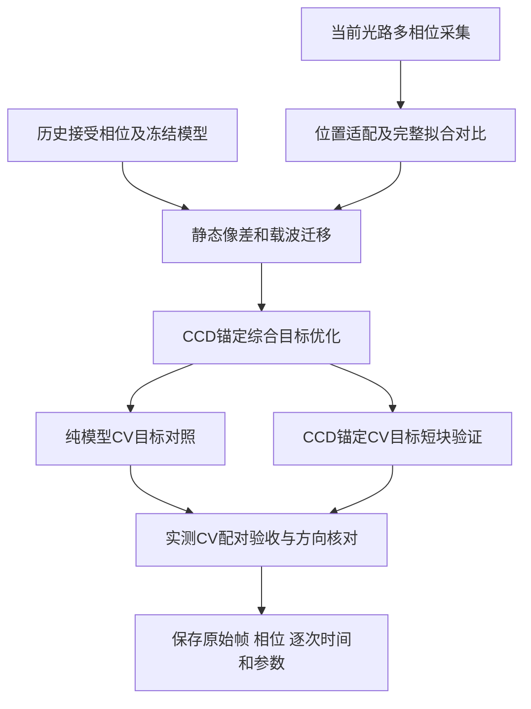

### 13.2 CCD 锚定综合目标：4 块 ×10 次更新/形状

首轮在 09:21 左右开始采集，09:31:39 关闭 SLM，设备上下文退出。各形状在自己的配对比较中保持 4.320 ms 固定曝光。结果如下，CV 越低越好：

| 形状 | 初始 CV | 最终 CV | CV 相对变化 | EE_ROI 初始 → 最终 | 接受块 |
|---|---:|---:|---:|---|---:|
| 正方形 | 0.411065 | 0.352688 | 降低 14.20% | 0.456625 → 0.469611 | 2/4 |
| 长方形 | 0.493086 | 0.395372 | 降低 19.82% | 0.548886 → 0.538467 | 4/4 |
| 三角形 | 0.251872 | 0.256491 | 增加 1.83% | 0.403071 → 0.423258 | 4/4 |

正方形和长方形均匀度改善，三角形没有改善。三角形的综合目标下降主要伴随 EE 增加，说明综合目标的接受结果不等同于 CV 改善，故补充纯 CV 目标与 CV 接受判据。

### 13.2.1 SLM 相位与 CCD 远场（初始 vs 最终）

以下为三形状在 CCD 锚定综合目标优化前后的 SLM 相位（左）与 CCD 远场光斑（右）对比。相位来自 `anchored/iterations.pkl` 的 block 0 iter 0 与 block 3 iter 9；远场来自 `anchored/capture_*.npz` 的平均帧。

| 形状 | SLM 相位（初始 → 最终） | CCD 远场（初始 → 最终） |
|---|---|---|
| 正方形 | 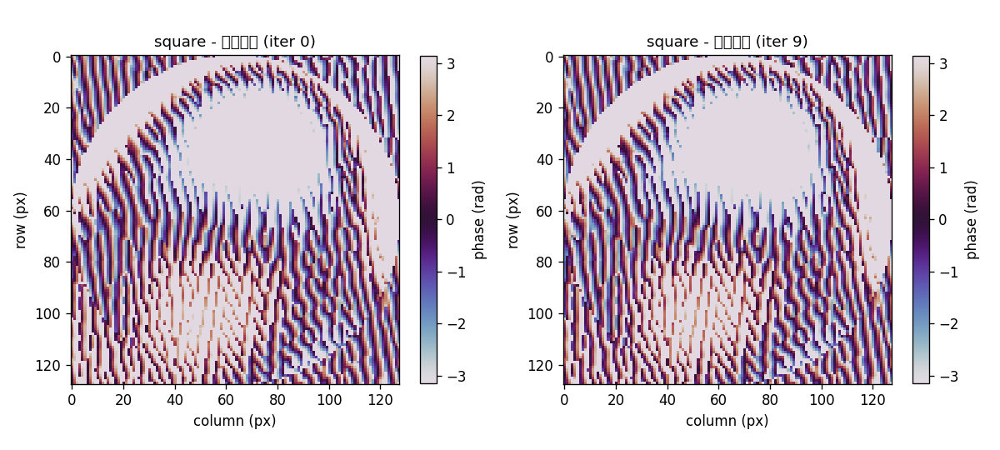 |  |
| 长方形 | 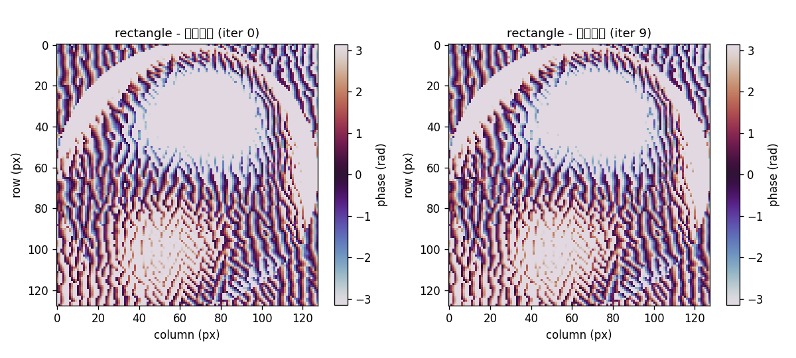 |  |
| 三角形 | 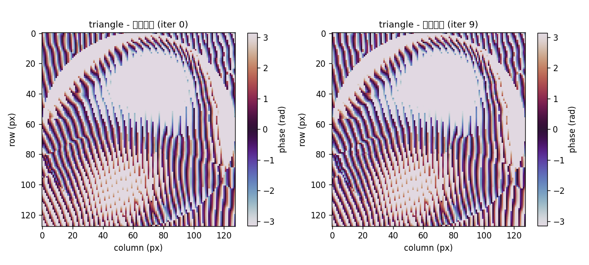 | 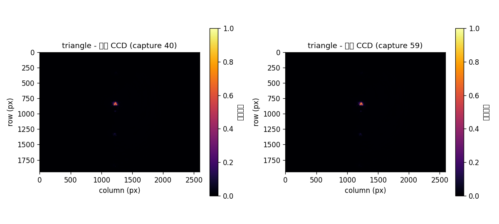 |

### 13.2.2 迭代过程 metrics

以下为三形状在 4 个块 × 10 次更新中的迭代过程 metrics（loss、CV、EE、shape_loss、grad_norm）：

| 形状 | 迭代 metrics |
|---|---|
| 正方形 | 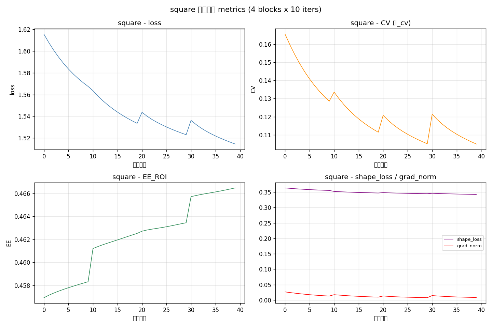 |
| 长方形 | 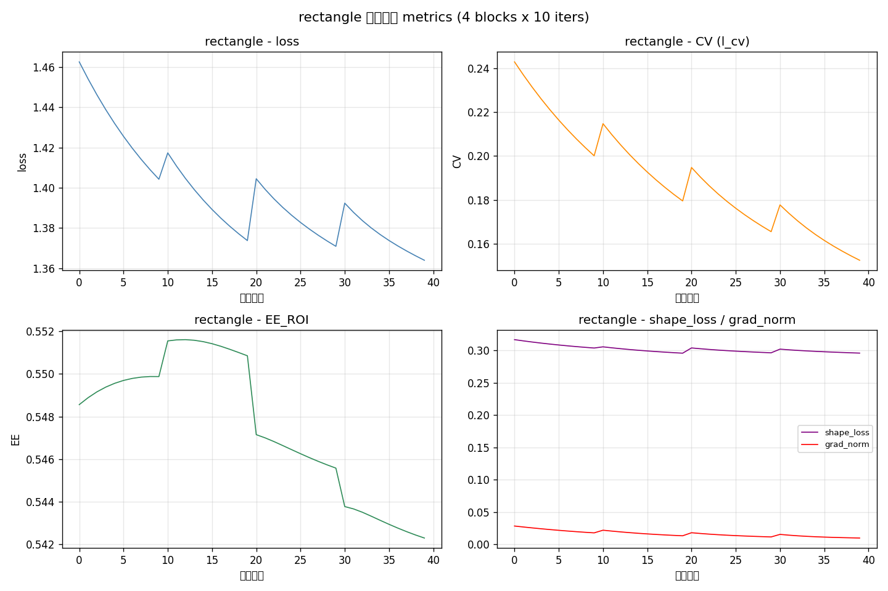 |
| 三角形 | 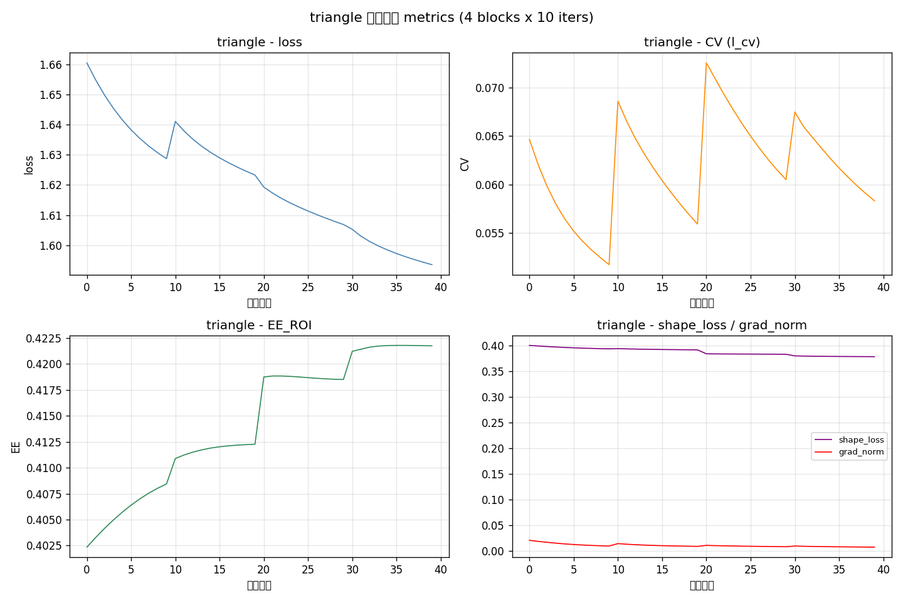 |

### 13.2.3 三形状 CV/EE 对比

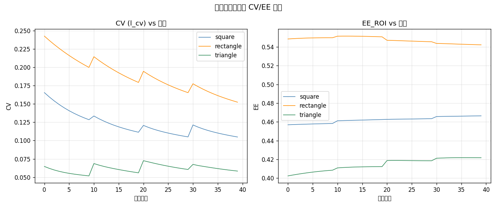

首轮设备测量、原始数据审计和图像汇总完成后，离线方向检查遇到历史迁移相位 `float64` 与传播采样网格 `float32` 不一致。已仅在方向分析入口将相位统一为 float32，重新计算通过；9 项 AD/中心差分符号一致，最大相对误差约 0.01370%。原始失败的 `journal.json` 保留，恢复结果在 `direction_recovered/`，不将失败历史改写为首次全部完成。

原始会话：`data/debug/slm_transfer/live_no_gs_20261024_0926/`。其中 `capture/` 为本轮原始探针，`fit/` 包含所有候选及逐次预测，`anchored/` 为全部配对帧、相位及 120 次更新记录，`source_snapshot/` 为本轮代码归档。

### 13.3 纯模型 CV 对照：3 块 ×10 次更新/形状

第一组补充命令漏传 `--mode anchored`，沿用了当时独立 CLI 的 `model` 默认模式。因此本组严格记为**纯模型 CV 对照**，不能当作 CCD 锚定结果。它继承本轮迁移模型及首轮接受相位，不执行 GS，以固定核心 CV 平方生成候选，再以实测 CV 配对验收。

| 形状 | 曝光 ms | 初始 CCD CV | 最终 CCD CV | 接受块 |
|---|---:|---:|---:|---:|
| 正方形 | 4.320 | 0.366324 | 0.366842 | 0/3 |
| 长方形 | 7.995 | 0.408276 | 0.415657 | 0/3 |
| 三角形 | 3.597 | 0.297481 | 0.314236 | 1/3 |

本组没有整轮 CV 净改善。正方形、长方形保留原相位；同一相位的测量指标仍有时间变化，所以不能把终值相对初值的全部差异都归因为算法更新。三角形最后一块在局部配对中通过 CV 判据，但整轮最终 CV 仍更高。

模型内部第一块的逐次 CV 平方确实下降，例如正方形约从 0.126064 降到第 10 次更新前的 0.087903；相应 CCD 候选 CV 却由参考约 0.366 升到约 0.380。记录说明纯模型优化成功降低自己的目标，仍不能保证实际 CV 下降。该证据指向模型预测、局部响应与实际光路间的差异，不能据此说自动微分本身算错。

本组 48 组/144 张原始测量帧全部通过审计，最高峰值 195/255。设备于 09:39:24 释放。原始目录为 `data/debug/slm_transfer/live_no_gs_cv_20261024/`，离线审计、图像及方向检查在 `live_no_gs_cv_20261024_analysis/`。为避免再混用模式，独立 CLI 现在在指定 `--seed-run` 且未显式指定模式时默认选择 `anchored`；明确的 `--mode model` 仍支持纯模型对照。

### 13.4 更正后的 CCD 锚定 CV：2 块 ×5 次更新/形状

明确指定 `--mode anchored --objective cv --accept-metric cv`，仍继承首轮迁移模型及首轮最终接受相位。每块重新取得 A1 CCD 图像，用 `I_A1 + F(phi) − F(phi_A)` 更新局部图像代理，以固定核心 CV 平方反传；每块候选由实测 CV 配对验收。2 块 ×5 次为本轮短块验证设置，共 30 次模型相位更新。

| 形状 | 固定曝光 ms | 初始 CCD CV | 最终 CCD CV | CV 降低 | EE_ROI 初始 → 最终 | 接受块 |
|---|---:|---:|---:|---:|---|---:|
| 正方形 | 4.320 | 0.379939 | 0.362122 | 4.69% | 0.514667 → 0.502400 | 2/2 |
| 长方形 | 7.868 | 0.434794 | 0.416166 | 4.28% | 0.627446 → 0.619833 | 2/2 |
| 三角形 | 3.540 | 0.367151 | 0.323879 | 11.79% | 0.396573 → 0.392302 | 2/2 |

本组 6 块全部通过 CV 验收，三形状在本组各自固定曝光下的最终 CV 均下降。EE 有小幅下降，符合本组优先匀化的目标；图像中仍有热点和散斑，不能称为理想均匀平顶。不同轮次的初始状态、曝光和时间不同，不能直接以跨轮绝对 CV 排名推断哪种模式具有普遍优势，亦不能把模型模式与锚定模式的差异完全归因为单一因素。

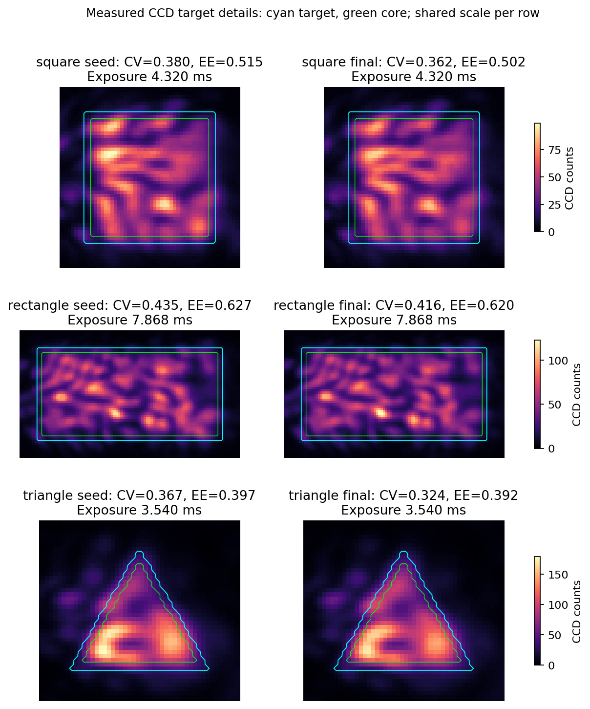

全部 36 组/108 张原始帧通过重算审计，最高峰值 183/255。保存方向上 9 项 AD/中心差分符号一致，最大相对误差约 0.00379%，见[最终方向检查](artifacts/no_gs_20261024/anchored_cv_direction.json)。SLM #1 于 **09:47:04.652** 关闭，相机上下文退出；其后工作全部离线。

原始目录：`data/debug/slm_transfer/live_no_gs_cv_anchored_20261024/`；分析目录：`data/debug/slm_transfer/live_no_gs_cv_anchored_20261024_analysis/`。最终接受相位分别为原始目录中的 `square_best.npy`、`rectangle_best.npy`、`triangle_best.npy`。模型检查点仍为首轮 `fit/frozen_parameters.json`，不需要重新执行 GS。

### 13.5 为什么必须区分模型图像与 CCD 锚定图像

损失梯度为 `J_F(phi)^T · grad_I L(I)`。纯模型模式把 `I=F(phi)` 代入；CCD 锚定模式以真实参考图像加模型增量构成 `I`。即使相同模型 Jacobian 的自动微分没有实现错误，基线图像偏差也会改变 CV 对光强的梯度方向。因此，“模型自己的 CV 降低”与“CCD CV 降低”不是同一个验收条件。

本轮支持的结论是：迁移后的少参数物理模型配合真实参考图像，能够继续改善已有三形状的实测均匀度；独立纯模型 CV 优化没有获得整轮净改善。模型全局相位泛化与绝对 CV 预测偏差仍需改进。保存方向的有限差分通过只验证该软件模型的微分，不证明物理 Jacobian 已准确，也不覆盖所有相位。

首轮综合目标与纯模型 CV 的图像记录分别见下图，保留失败/取舍结果，不仅展示成功情况：

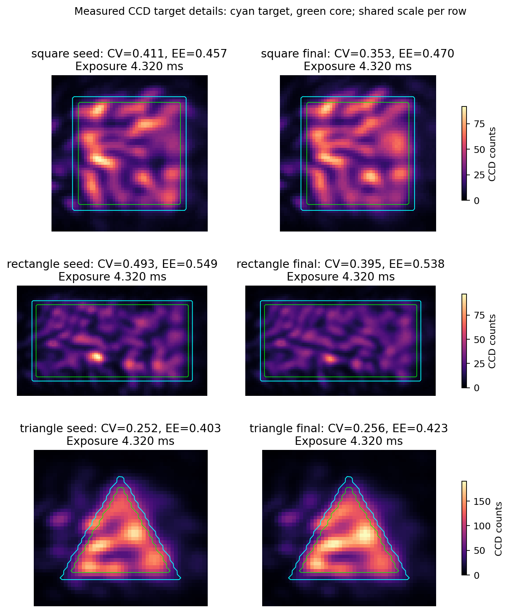

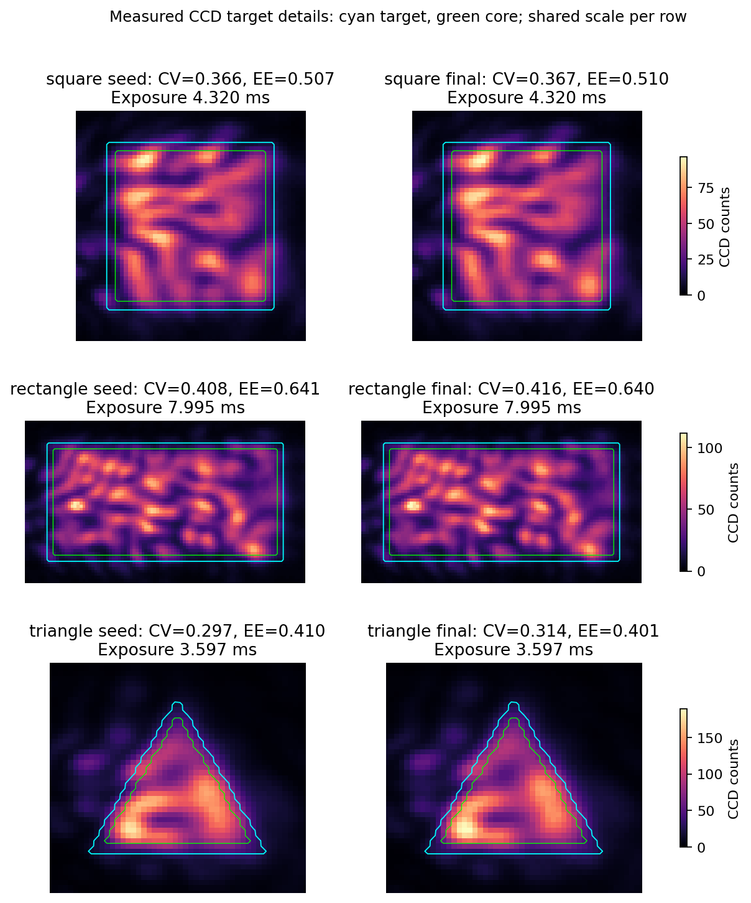

### 13.6 数据完整性、复现命令及下一步

三轮共采集 **166 组、498 张原始测量帧**，另保存自动曝光搜索帧；执行 240 次相位更新（包含未接受候选）、60 次物理参数梯度更新。每次相位更新的 `iterations.pkl` 包含主机 UTC 微秒时间及单调纳秒起止值；这些是主机调用时间，不是相机硬触发曝光时钟。三轮原始测量审计均通过；首轮原失败阶段与离线修复记录均保留。

可复算汇总见[三轮结果与原始文件哈希](artifacts/no_gs_20261024/combined.json)、[迁移模型选择](artifacts/no_gs_20261024/fit_selection.json)、[最终轮审计](artifacts/no_gs_20261024/anchored_cv_audit.json)和[最终轮配置](artifacts/no_gs_20261024/anchored_cv_config.json)。每轮目录有 `source_snapshot/`，保留相应代码及 SHA-256。图像生成入口为 `transfer.summary`，方向分析入口为 `transfer.direction`，原始重算入口为 `transfer audit`。

完整一键迁移、零 GS、CV 优先的下一次运行方式：

```powershell
$py = '.venv\Scripts\python.exe'
$out = "data/debug/slm_transfer/$(Get-Date -Format 'yyyyMMdd_HHmmss')"
& $py -m ao_shaping.tools.slm.transfer run --out $out `
  --checkpoint data/debug/slm_transfer/live_no_gs_20261024_0926/fit/frozen_parameters.json `
  --seed-run data/debug/slm_transfer/live_no_gs_cv_anchored_20261024 `
  --seed-policy transfer --skip-calibration --objective cv --accept-metric cv --execute
```

需要仅复用当前模型继续一小段时，显式写明模式，并保持当前几何和目标兼容：

```powershell
& $py -m ao_shaping.tools.slm.transfer.validate `
  --checkpoint data/debug/slm_transfer/live_no_gs_20261024_0926/fit/frozen_parameters.json `
  --seed-run data/debug/slm_transfer/live_no_gs_20261024_0926/anchored `
  --seed-policy strict --zero-xy 1227 963 --shapes square rectangle triangle `
  --mode anchored --objective cv --accept-metric cv --blocks 2 --updates 5 `
  --out $out --execute
```

其中第二条只适用于本轮几何，不是换光路时的默认入口。下一步应优先利用接受相位周围的正负小扰动数据微调局部预测响应，检查曝光线性化和共享增益/加性背景项，缩短参考采集至实际优化的间隔，并保留 CV 验收。强随机探针的全图相关性不能单独替代这些检查。当前只验证了这套设备、这一光路及历史接受相位的续优化，没有证明任意光路冷启动或会话内连续变化都能一次完成。
