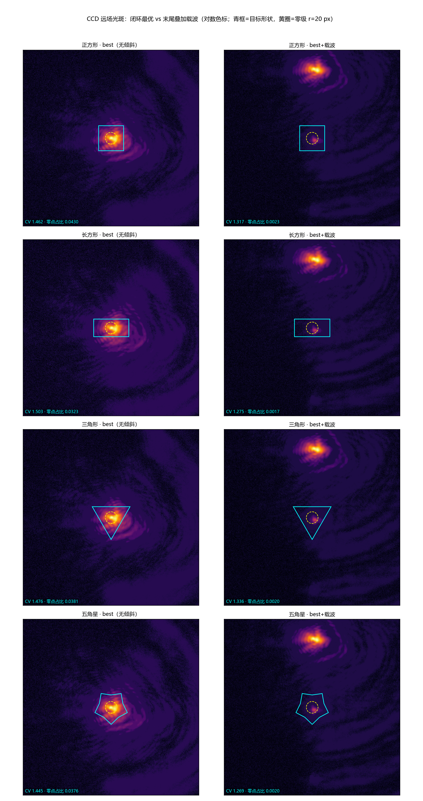
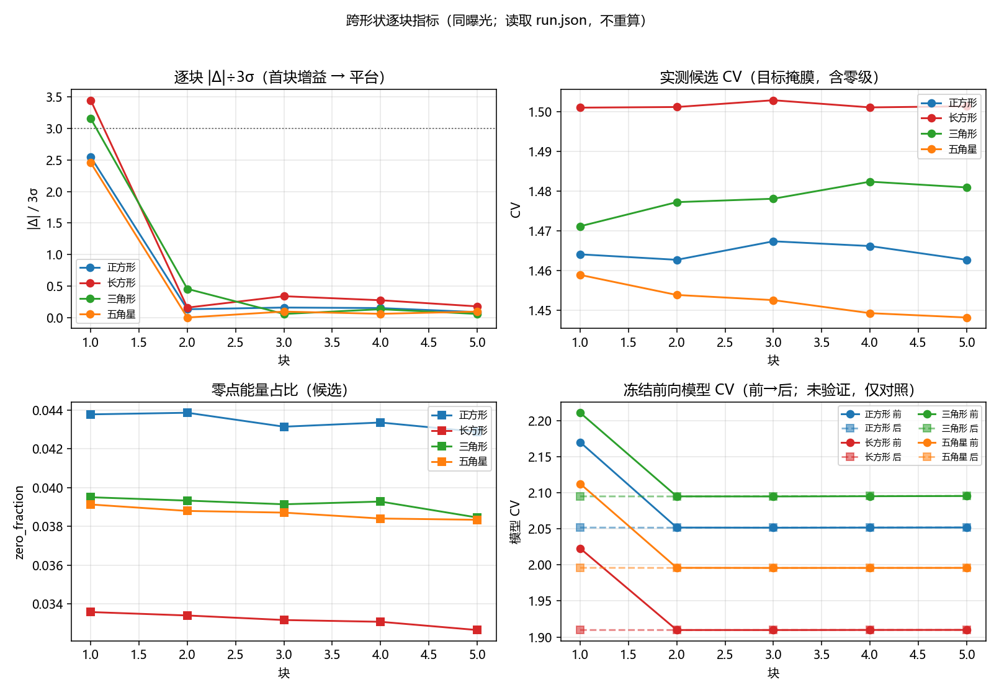
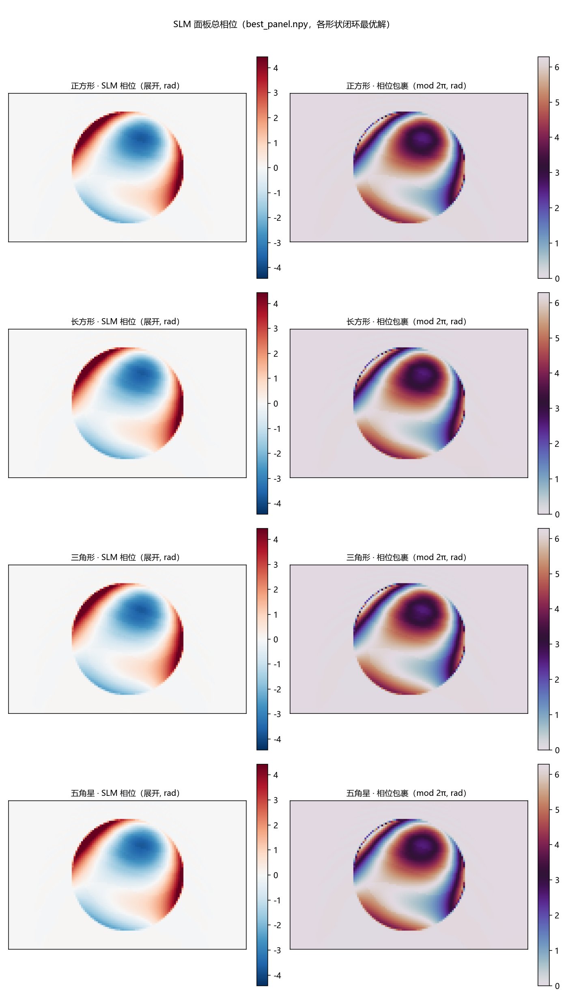

# 不同形状的可微整形能力对比（2f 实验系统，0.80 ms）

<!-- provenance:start -->
> **生成脚本**: [`scripts/slm/summarize_multishape_capability.py`](../../../scripts/slm/summarize_multishape_capability.py)
> **复现命令**: `python scripts/slm/summarize_multishape_capability.py --exposure-ms 0.8 --allow-unknown-exposure`
> **数据/关联脚本**: [`scripts/slm/run_multishape_capability.py`](../../../scripts/slm/run_multishape_capability.py)
> **数据/关联脚本**: [`scripts/slm/generate_capability_report.py`](../../../scripts/slm/generate_capability_report.py)
> **运行环境**: 离线（只读已落盘 run.json，不重算测量量）
> **说明**: 四种形状（同面积 7200 px²、同曝光 0.8 ms）的横向对比; 正方形那份 run.json 没有 exposure_ms 字段（脚本改版前的产物），表内以 * 标注, 不静默当成已知值
<!-- provenance:end -->

## 摘要

共 4 个形状（正方形、长方形、三角形、五角星），曝光 0.80 ms 统一。**首块 Δ 达到 3σ 的形状 2/4 个**（2.55σ、3.45σ、3.16σ、2.46σ）；第 2 块之后各形状的最好一块都不超过 0.46σ，即**闭环的可用增益集中在第一步**。末尾叠加倾斜把零点附近能量占比压到原来的几个百分点（各形状 −94%～−95%），且位移向量在 y 轴上一致为负（面板 x 向斜坡 + SLM 竖向安装 ⇒ CCD y 向位移），|Δ| 与 |K/周期| 的标量预测相符。

## 1. 对比表

| 形状 | 运行目录 | 3σ | 首块 Δ | 首块 Δ÷3σ | 第 2 块起最大 Δ÷3σ | 最佳 CV（含零级） | 零点能量占比 best → best+载波 | 载波位移（实测） |
|---|---|---|---|---|---|---|---|---|
| 正方形* | `square_20261023_182153` | 0.01084 | -0.02761 | 2.55σ | 0.16σ | 1.4623 | 0.0430 → 0.0023（−95%） | −y 方向 234.5 px（另一轴 +7.0 px） |
| 长方形 | `rectangle08_20261023_191444` | 0.01084 | -0.03737 | 3.45σ | 0.34σ | 1.5028 | 0.0323 → 0.0017（−95%） | −y 方向 233.9 px（另一轴 +6.0 px） |
| 三角形 | `triangle08_20261023_191105` | 0.01084 | -0.03422 | 3.16σ | 0.46σ | 1.4764 | 0.0381 → 0.0020（−95%） | −y 方向 234.0 px（另一轴 +7.1 px） |
| 五角星 | `star08_20261023_191213` | 0.01084 | -0.02662 | 2.46σ | 0.10σ | 1.4454 | 0.0376 → 0.0020（−95%） | −y 方向 234.0 px（另一轴 +6.6 px） |

**读表要点**：

* `3σ` 是当次掩膜噪声地板，**逐次现测**（同一曝光下三角形/星形/正方形共用 85 px 等效面积地板）；
* 首块 Δ 为负表示改善；`Δ÷3σ` 只是相对本次地板的刻度，**不是**显著性检验；
* 「第 2 块起最大 Δ÷3σ」越大越说明闭环还能继续推动——目前四个形状都 ≤0.5σ，即**已进平台**；
* 「最佳 CV」仍含零级（闭环内不加倾斜，整形光斑与零级重叠），不能当作纯形状均匀度；
* 形状名带 `*` = 该 run.json **没有** `exposure_ms` 字段（脚本改版前的产物），
  曝光只能从启动命令得知、无法从产物核实。

## 2. 跨形状观察到的事实

1. **可微优化的可用增益 ≈ 第一步**：4 个形状的首块 Δ 全部为负
   （-0.03737 ～ -0.02662），
   全部 ≥2.46σ，其中 2 个 ≥3σ；
   第 2 块之后各形状的最好一块全部 ≤0.46σ。模型侧 CV 仍有下降，但硬件不再跟随，说明
   **模型幅度/方向不可迁移，迭代次数不是瓶颈**。
2. **倾斜叠加是独立于模型的稳定收益**：闭环内不加倾斜，末尾才把 32 px 周期斜坡加到最优相位上，
   零点 20 px 内的能量占比从 2.6%～4.3% 降到 0.15%～0.23%（−94%～−95%）。位移由**两帧差分实测**
   （`utils/image/displacement.measure_displacement`），不是由斜坡轴向推断。
3. **位移方向与目标形状无关**：长方形（120×60）、三角形、五角星与正方形的实测位移向量
   一致落在 y 轴负向（各形状 Δ 见对比表），说明方向只由面板斜坡与**安装姿态**决定。
   ⚠️ 本系统 SLM **竖向安装**，面板 x 向斜坡在 CCD 上是 **y 向**位移；按 x 轴摆框去读会
   量到背景不对称（2026-10-23 早前版本犯过这个错，那一组数已作废）。
4. **曝光必须现校准**：0.5 ms 下地板 3σ 达 0.030（噪声把首块压到 0.8σ），0.8 ms 降到 0.011；
   而载波帧比无载波帧亮 → 0.8 ms 时载波帧 peak 已到 254（接近饱和）。
   **读数与判据只能在同一曝光内比较**，跨曝光比 CV 无效。

## 3. 插图（跨形状对比）

下列图像由本脚本在生成报告时**离线**渲染（只读各 run 的 `run.json` 与已落盘帧，不碰设备、不重算测量量）；每张图都可从 `figures/` 下的同名 PNG 单独查看。



*左列=闭环最优（无倾斜），右列=末尾叠加 32 px 周期载波；对数色标。青框=目标形状轮廓，黄圈=零级掩膜（r=20 px）；标注的 CV 与零点占比取自 `run.json` 的 `final.measured`。*



*四形状逐块叠加：首块 |Δ|/3σ 越 3σ 线（点线）、第 2 块起进平台；实测候选 CV 与零点能量占比；冻结前向模型 CV 前→后——模型继续下降而硬件不跟随的直观体现。*



*各形状闭环最优解对应的 SLM 面板总相位（`best_panel.npy`），左=展开（rad）、右=包裹（mod 2π）。*

## 4. 限制（读结论前必看）

1. **单次运行、单初值、单 seed**：每个形状只跑了一次，没有重复；`Δ÷3σ` 不构成显著性检验，
   跨会话比较需要独立重复。
2. **模型方向未验证**：本报告只陈述实测，不声称冻结前向模型的梯度方向正确。
3. **零级未逐帧扣除**：目标掩膜内始终含零级贡献，纯形状均匀度需另做扣除后再报。
4. **载波帧接近/达到饱和**：0.8 ms 下 `best+carrier` 的 peak 为 254（正方形/三角形），
   该帧的绝对值读数只能定性；零点能量占比是比值，受影响较小但不为零。

## 5. 数据路径

| 形状 | 运行目录（含 run.json + 全部帧） |
|---|---|
| 正方形 | `data/debug/multishape_forward/square_20261023_182153/` （5 块 × 4 阶段帧 + `final_*.npy` + `best_panel.npy`） |
| 长方形 | `data/debug/multishape_forward/rectangle08_20261023_191444/` （5 块 × 4 阶段帧 + `final_*.npy` + `best_panel.npy`） |
| 三角形 | `data/debug/multishape_forward/triangle08_20261023_191105/` （5 块 × 4 阶段帧 + `final_*.npy` + `best_panel.npy`） |
| 五角星 | `data/debug/multishape_forward/star08_20261023_191213/` （5 块 × 4 阶段帧 + `final_*.npy` + `best_panel.npy`） |

### 本批次的固定输入

* **噪声地板（3σ 来源）**：`logs/target_size_sweep/noise_floor_85px_ex08/noise_floor.json` —— 由 `measure_noise_floor` 在**同一掩膜与同一曝光**下现测，run.json 记 `three_sigma_resolution`；
* **初值相位**：`data/debug/physical_forward_defocus/capture_after_focus_20261023_145446/seed_probe000.npy` —— 闭环的 seed panel，同时也是同帧定心那一步下发的相位；
* **冻结前向检查点**：每个 run 的 `run.json` 里 `checkpoint` 字段各有记录（本批为同一个目录）；
* **报告**：每个形状另有独立报告 `capability_<shape>_<stamp>.md`（逐块曲线图 + 末尾对比图）与 `figures/` 下的 PNG，均由 `scripts/slm/generate_capability_report.py` 生成。

## 6. 复现

```bash
# 单形状（设备）
python scripts/slm/run_multishape_capability.py --execute --shape triangle --area-px2 7200 --exposure-ms 0.8 \
    --checkpoint <refit 目录> --seed-panel <初值.npy> --noise-floor <地板.json> --out <目录>
# 单次运行报告（离线）
python scripts/slm/generate_capability_report.py --run-dir <目录>
# 本对比（离线；--floor-path/--seed-panel-path/--extra-data 只写进「数据路径」节，不参与计算）
python scripts/slm/summarize_multishape_capability.py --exposure-ms 0.80 --allow-unknown-exposure --floor-path logs/target_size_sweep/noise_floor_85px_ex08/noise_floor.json --seed-panel-path data/debug/physical_forward_defocus/capture_after_focus_20261023_145446/seed_probe000.npy
```

生成时间 2026-10-23 19:53；数据根 `data/debug/multishape_forward`。
