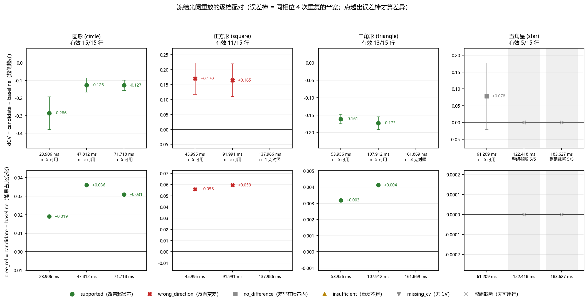
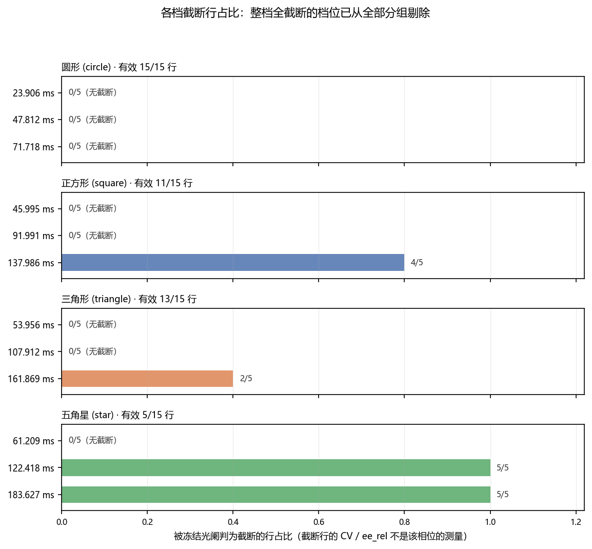
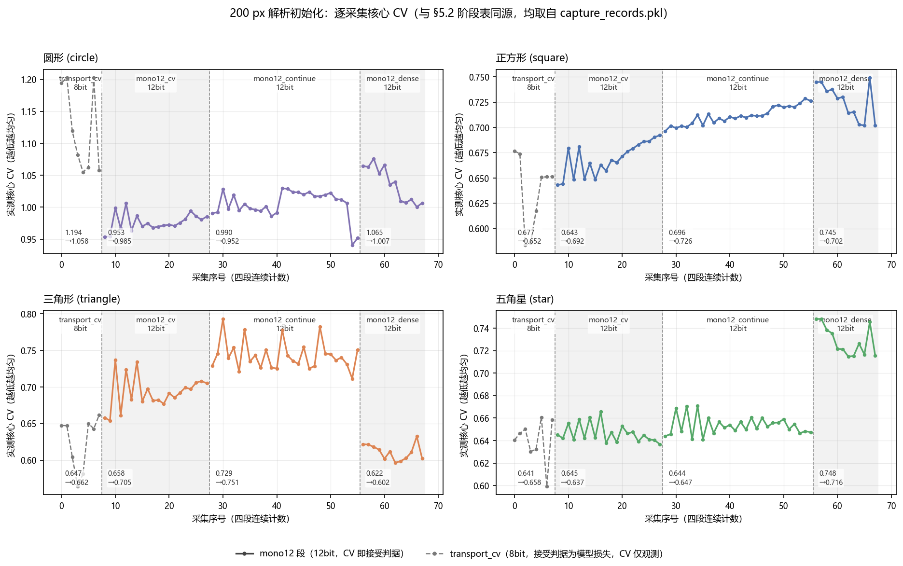
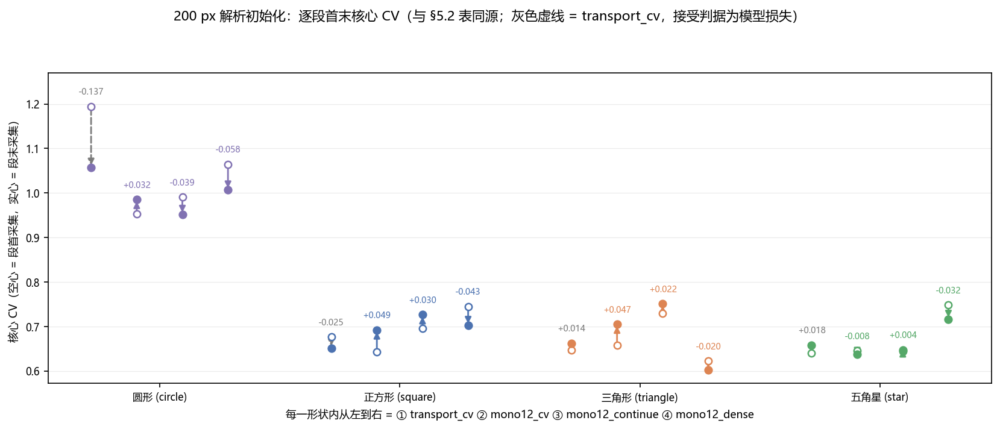
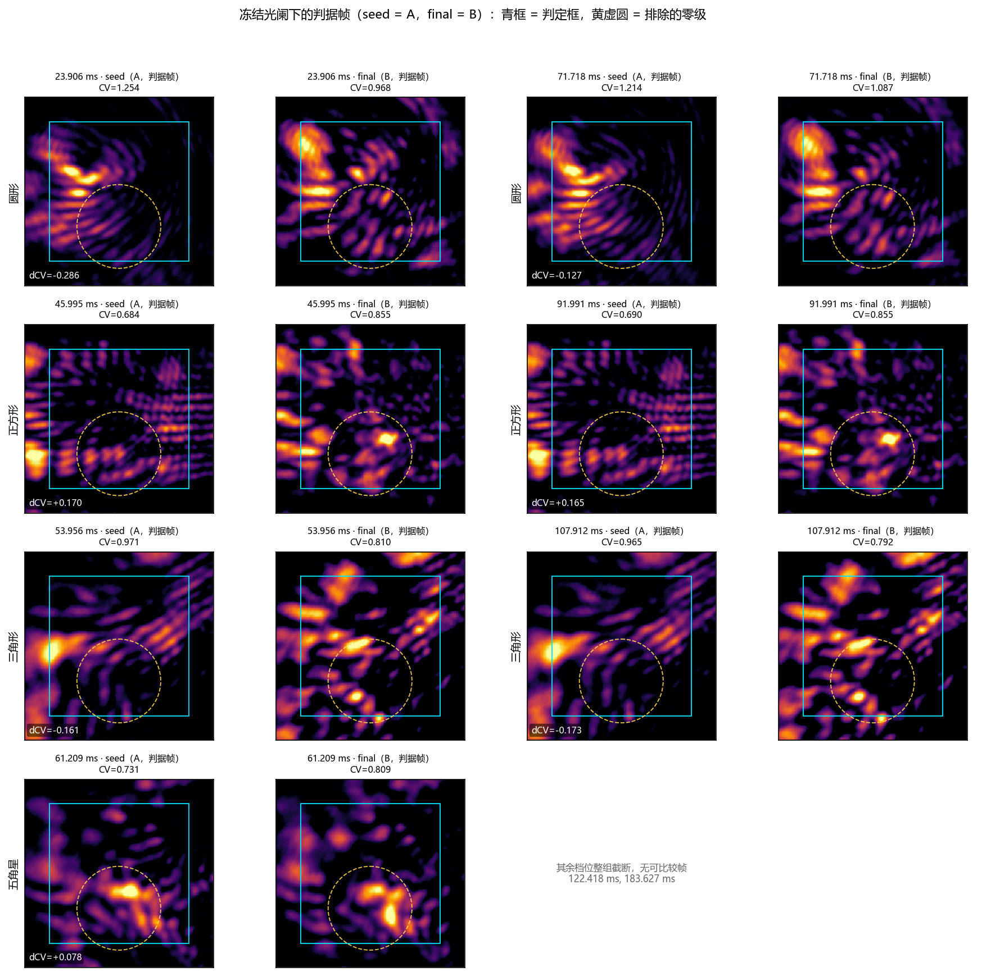
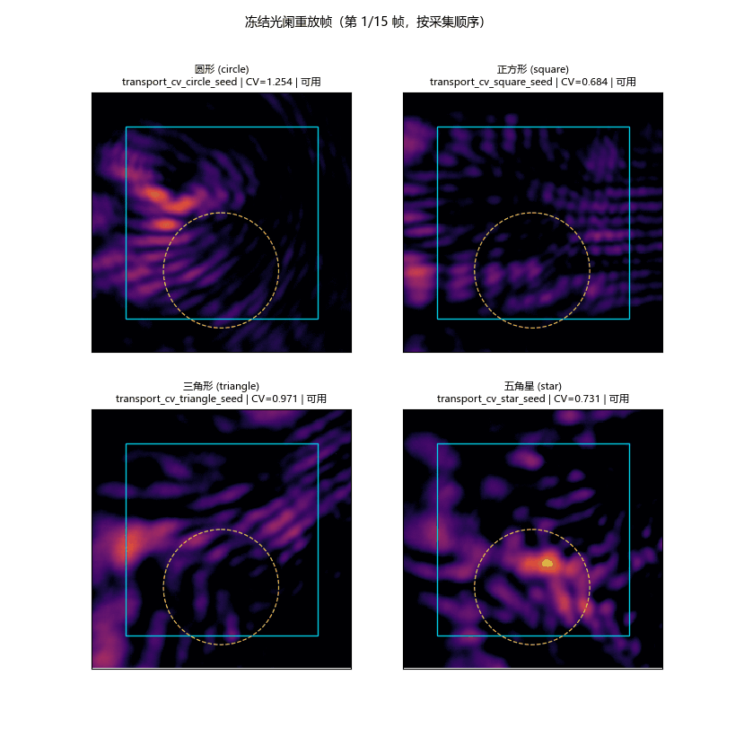

# 2026-10-29 设备在线多尺度整形：实验中记录

<!-- provenance:start -->
> **生成脚本**: 人工撰写，无生成脚本
> **数据/关联脚本**: [`src/ao_shaping/runners/slm/transfer_shapes_runner.py`](../../../src/ao_shaping/runners/slm/transfer_shapes_runner.py)
> **数据/关联脚本**: [`src/ao_shaping/tools/slm/transfer/validate.py`](../../../src/ao_shaping/tools/slm/transfer/validate.py)
> **数据/关联脚本**: [`src/ao_shaping/tools/slm/transfer/capture.py`](../../../src/ao_shaping/tools/slm/transfer/capture.py)
> **数据/关联脚本**: [`src/ao_shaping/tools/slm/transfer/fit.py`](../../../src/ao_shaping/tools/slm/transfer/fit.py)
> **数据/关联脚本**: [`src/ao_shaping/tools/slm/transfer/replay_phases.py`](../../../src/ao_shaping/tools/slm/transfer/replay_phases.py)
> **数据/关联脚本**: [`scripts/slm/audit_replay_blocks.py`](../../../scripts/slm/audit_replay_blocks.py)
> **数据/关联脚本**: [`scripts/slm/probe_optical_path_validity.py`](../../../scripts/slm/probe_optical_path_validity.py)
> **数据/关联脚本**: [`scripts/slm/analyze_session_time_budget.py`](../../../scripts/slm/analyze_session_time_budget.py)
> **数据/关联脚本**: [`scripts/slm/generate_multishape_nogs_20261029_figures.py`](../../../scripts/slm/generate_multishape_nogs_20261029_figures.py)
> **运行环境**: 硬件（Santec #1 SLM + Daheng CCD；WFS / NLight DM / MIICAM 未连接）
> **说明**: 2026-10-29 设备在线多尺度整形会话的实测记录：lane 00–05 实际执行、06–24 未开始（25 条编制中完成 5 条、部分完成 1 条）。200 px 解析初始化四形状各 4/4 阶段完成，冻结光阑重放审计（已剔除饱和行）给出circle（15/15 有效，dCV −0.286/−0.126/−0.127，三档 supported）与 triangle（13/15，−0.161/−0.173，两档 supported）；square（11/15，+0.170/+0.165，两档 wrong_direction，约噪声三倍 → 真实回归）与 star（5/15，仅一档，no_difference）。600 px 仅 circle 前两段（1.0986→0.7993、0.7447→0.6268），无重放，不参与跨尺度对比。含审计工具缺陷（`clipped` 行被标注却仍进入分组均值）及其本轮修正（剔除后 circle 一位未变，triangle/square 各失去一档，star 失去两档）。§5.5 逐组合字段台账：本轮 objective 以 `formation=False` 运行，`l_partition` / `l_boundary` 逐轮恒为 0.0，故形状覆盖 / 边界误差与 Zernike 增量三项**未测**（不是未报），结论只覆盖「更均匀 + 能量没丢」。配图由 `generate_multishape_nogs_20261029_figures.py` 渲染：CV 轨迹与逐段首末柱取自 `capture_records.pkl`（与 §5.2 表同源），冻结光阑审计图直接调用 `audit_block`/`summarise_block`（与 §5.1 表同源），帧图与 GIF 为 `common_replay/*.npz` 的判据帧。
<!-- provenance:end -->

> 本文是**当次设备会话的运行记录**（`lane 00–05` 实际执行、`06–24` 未开始）。
> 判定口径与跨会话汇总见同目录 `multishape_scale_live_20261028.md` §7；
> 提速改动见该文 §5.7 / §5.8；质量改动（issue #213 各项）见 `next_round_20261029.md`。

## 1. 会话目标

在 2026-10-28 的 1200 px 单尺度结果之上回答两件事：

1. **尺度是否可外推**——同一流程在 200 / 600 / 1200 px 目标上是否都给出可复现的
   CV 改善；
2. **初始化是否必须分开报**——`严格冷启动`（平场 / 随机相位）与 `解析初始化`
   （反投影 / 能量映射）是否给出不同结论。

第 2 点用**目录隔离**保证不可合并：两类初始化落在不同会话目录

```
p20261029_strict_cold_s{200,600,1200}_<shape>
p20261029_analytic_init_s{200,600,1200}_<shape>
```

## 2. 前置门禁

| 项 | 状态 | 证据 |
|---|---|---|
| 光路有效性探针 | 通过，退出码即判定，未通过不开跑 | `scripts/slm/probe_optical_path_validity.py` |
| 平场基线 | 通过（`flat_restored=true`） | 会话开头与每次中断后 |
| 模型检查点 | lane 00 重拟合产出 | `p20261029/frozen_parameters.json` |
| 曝光上限 | `AO_DAHENG_MAX_EXPOSURE_MS` 未设 → 画面探测 | 逐块 `adapt_exposure` |

被遮挡的实验系统读数**不写盘**：先过探针，失败即终止该 lane，不产生可引用结果。

## 3. lane 编制（25 条）

| lane | 会话 | 形状 | 状态 |
|---|---|---|---|
| 00 | `p20261029`（模型重拟合） | — | 完成 |
| 01 | `analytic_init_s200` | circle | 完成（4/4 阶段） |
| 02 | `analytic_init_s200` | square | 完成（4/4 阶段） |
| 03 | `analytic_init_s200` | triangle | 完成（4/4 阶段） |
| 04 | `analytic_init_s200` | star | 完成（4/4 阶段） |
| 05 | `analytic_init_s600` | circle | **中途终止**（2/4 阶段） |
| 06–08 | `analytic_init_s600` | square / triangle / star | 未开始 |
| 09–12 | `analytic_init_s1200` | 四形状 | 未开始 |
| 13–24 | `strict_cold_s{200,600,1200}` | 四形状 | 未开始 |

每条 lane 一个 `data/debug/slm_transfer/multishape_nogs_20261029/lanes/*.ps1`，
参数写死在脚本里，避免命令行漂移。

## 4. 时间线（UTC，本地 = UTC+8）

| 时刻 | 事件 |
|---|---|
| 01:36:44 | lane 00 启动（模型重拟合） |
| 01:54:18 | lane 00 完成 |
| 02:34:43 | lane 01（circle）`common_replay` 释放设备 |
| 02:43:50 | lane 01 resume 复跑（journal 被重写，见 §6） |
| 02:53:41 – 03:03:25 | lane 02（square） |
| 03:04:33 – 03:13:23 | lane 03（triangle） |
| 03:14:32 – 03:26:47 | lane 04（star） |
| 03:45:40 – 03:47:11 | lane 05（s600 circle）前两阶段 |
| 03:50 | 设备下线，链路与被中止 lane 全部终止 |

## 5. 逐组合结果

判定用 `scripts/slm/audit_replay_blocks.py` 的**冻结孔径**口径重算，不用阶段
manifest 的 `metrics.cv`——后者用各阶段自己的 `objective.core`，逐阶段腐蚀量
不同，跨阶段不可比。

### 5.1 `analytic_init_s200`：三口径 + 饱和审计

每组 3 档曝光 × 5 行 = 15 行，12 bit，零级排除比例 `0.2719`（四形状一致）。
`clipped` = 峰值 ≥ 98% 满量程的采集，**已从所有分组均值中剔除**
（`scripts/slm/audit_replay_blocks.py` 本次修正：它此前打印「excluded from any
comparison」，但分组均值仍包含这些行）。

| 形状 | 有效行 | `dCV`（seed→final，按曝光档） | 判定 | 噪声半宽 | `ee_rel` |
|---|---|---|---|---|---|
| circle | 15 / 15 | **−0.2864** / **−0.1263** / **−0.1273** | supported ×3 | 0.0925 / 0.0396 / 0.0291 | 0.307 / 0.317 / 0.318 |
| triangle | 13 / 15 | **−0.1613** / **−0.1732** | supported ×2 | 0.0132 / 0.0181 | 0.273 / 0.270 |
| square | 11 / 15 | +0.1704 / +0.1646 | `wrong_direction` ×2 | 0.0526 / 0.0547 | 0.243 / 0.248 |
| star | **5 / 15** | +0.0784 | `no_difference` ×1 | 0.0991 | 0.360 |

（第 3 档在 triangle 与 square 上都没有 seed 行可比——前者 seed 被截断，后者
4 个 final 全被截断——因此不产生 `dCV`。star 的后两档整组不可用。）



> **图 1** 上表逐格的可视化（`--only audit`）：上排 `dCV = candidate − baseline`，
> 误差棒是**同一相位 4 次重复**的半宽——点越出误差棒才算差异，所以 square 的
> `+0.170/+0.165` 落在棒外（约 3 倍噪声）而 star 的 `+0.078` 落在棒内，两条判定
> 在图上直接可读。下排是同一批配对的 `ee_rel` 变化，用来区分「变均匀」与
> 「丢能量换均匀」。灰色阴影列 = 该档**整组截断**、已剔除（star 后两档 5/5）。
> 图上每一个点都是 `scripts/slm/audit_replay_blocks.py` 自己算出来的数，
> 与上表逐位一致（同一函数，不是另一套口径）。



> **图 2** 「为什么那几档退出了分组」（`--only saturation`）：每行一个形状，
> 各自使用**自己的**曝光梯（circle 23.9–71.7 ms、star 61.2–183.6 ms），
> 因此不共用横轴。circle 全程 0 截断；star 后两档 5/5 全截断 ⇒ 只剩一档可判。

四条读法：

1. **circle 是唯一三档全干净的形状**：0 饱和行，`dCV` 在三档上同号且都越过
   重复性半宽，`ee_rel` 随曝光略升（0.307→0.318），不是「丢能量换均匀」。
2. **triangle 的改善成立，但只有两档**：第三档的 seed 行被截断，只剩 3 个 final，
   无法比较。这不影响前两档的结论。
3. **square 的 `wrong_direction` 是真的**：剔除饱和行后，两个可用档的
   `dCV` 仍为 **+0.17 / +0.16**，而它们的噪声半宽只有 0.053 / 0.055——效应量约为
   噪声的 3 倍。第三档的 4 个 final 全部截断、无法判定。所以 square 不是
   「测不到」，而是**闭环把它做差了**。
4. **star 只剩一档可判**：另两档整组截断（共 10/15 行）。唯一可判的那档是
   `no_difference`，`ee_rel` 0.360 明显高于其他三个形状——星形目标的光斑能量
   分布与方/圆/三角本就不同，只用 CV 描述它会漏掉信息。

> **本节的数字与「修正前」不同**：修正前 square 报 `+0.1578`（含饱和行）且
> star 报「两档 `no_difference` + 一档 `wrong_direction`」——后者的那一档整组都是
> 饱和行，**已撤回**。修正方向见 `next_round_20261029.md` 的 P0-2（现已落地）。

### 5.2 阶段级 CV 轨迹（`analytic_init_s200`，仅同形状内可比）

| 形状 | 阶段 | 行数 | seed CV | final CV |
|---|---|---|---|---|
| circle | `transport_cv` | 8 | 1.1943 | 1.0577 |
| circle | `mono12_cv` | 20 | 0.9534 | 0.9854 |
| circle | `mono12_continue` | 28 | 0.9905 | 0.9517 |
| circle | `mono12_dense` | 12 | 1.0645 | 1.0065 |
| square | `transport_cv` | 8 | 0.6767 | 0.6516 |
| square | `mono12_cv` | 20 | 0.6432 | 0.6921 |
| square | `mono12_continue` | 28 | 0.6963 | 0.7262 |
| square | `mono12_dense` | 12 | 0.7448 | 0.7021 |
| triangle | `transport_cv` | 8 | 0.6474 | 0.6618 |
| triangle | `mono12_cv` | 20 | 0.6581 | 0.7050 |
| star | `transport_cv` | 8 | 0.6406 | 0.6583 |
| star | `mono12_cv` | 20 | 0.6450 | 0.6368 |

**只能横读**（同形状、相邻阶段的 seed → final）。竖读会把不同腐蚀量的 `core`
当成同一把尺子。跨阶段、跨形状一律用 §5.1。

值得注意的是：`transport_cv`（8 bit、**无** `ccd_check`）在四个形状上都几乎不动
甚至略升，而 `mono12_cv`（12 bit、逐块 CCD 校验）才开始出现真正下降。两段的差别
只有位深与「有没有逐块实测校验」两处，而 square 的回归（§8 第 2 条）恰好发生在
校验拦不动的地方——同一件事的两面，也正是 issue #213 质量项 3a 要升级的机制。



> **图 3** 上表的折线形态（`--only cv`）：横轴是**采集序号**（四段连续计数，
> 竖直虚线 = 段边界），纵轴是该次采集实测的核心 CV；每个阶段窗口左下角标出
> 该段的「首采集 → 末采集」。灰色虚线是 `transport_cv`——它是 8 bit 且**接受判据
> 为模型损失**，CV 只是观测值，故不参与「CV 下降」的论断。可见 circle/triangle
> 在第 2 段明确下行，square 在第 2、3 段明确**上行**，与图 1 的符号一致。



> **图 4** 同一张表的另一种读法（`--only dumbbell`）：每段空心点 = 段首采集、
> 实心点 = 段末采集，箭头方向即该段净变化，数字为 Δ。这是「只横读、不竖读」
> 那条限制的直接体现——段与段之间换过腐蚀后的 `core`，量级不可比，只有段内
> 首末差可比。

### 5.3 s600 circle（lane 05，未完成）

| 阶段 | 行数 | seed CV | 末条 CV | 状态 |
|---|---|---|---|---|
| `transport_cv` | 8 | 1.0986 | 0.7993 | 完成 |
| `mono12_cv` | 16 | 0.7447 | 0.6268 | **被终止**（8 块中 4 块） |

两阶段都朝下，但 `mono12_cv` 只跑一半，**不构成结论**，也不参与跨尺度对比。
该目录没有 `common_replay`、没有 `released.json`。

### 5.4 会话级记账

| 项 | 值 |
|---|---|
| 完成会话 | 5（lane 00–04） |
| 完成阶段 | 17（16 完整 + 1 部分） |
| 完成验收块 | 112（4 形状 × 28） |
| 零级排除比例 | 0.2719（s200 全部 12 bit 组一致） |
| 饱和行 | circle 0 / triangle 2 / square 4 / star 10（各 15） |
| 有效重放行 | circle 15 / triangle 13 / square 11 / star 5（各 15） |
| 模型检查点 | `p20261029/frozen_parameters.json` |
| 相位来源 | 逐阶段 `manifest.json` 的 `phase` / `seed_run` 字段 |
| 预测 vs 实测 | 逐块 `jacobian` 字段**本次不存在**（该守卫于本次之后实现） |

### 5.5 逐组合字段齐全性（十项要求 × 本轮实际）

| 字段 | 本轮 | 落点 / 证据 | 缺失原因 |
|---|---|---|---|
| 冻结核心 `cv` | 有 | 审计三档 `dCV`（§5.1）；逐阶段 §5.2 | — |
| 相对 `ee_rel` | 有 | 审计 `ee_rel` | — |
| 零级排除比例 | 有 | 0.2719（12 bit 组一致） | — |
| 饱和比例 | 有 | 审计 `clipped` 行数 | — |
| 相位来源 | 有 | `plan.initial_phase` = `backprojection`；各阶段 `manifest.json` 的 `phase` / `seed_run` | — |
| 模型检查点 | 有 | journal `model` 阶段 `status=reused` → `p20261029` | — |
| 精确时间戳 | 有 | journal `timestamp_utc` + 每块 `summary.json` 的 `timestamp_utc` / `monotonic_ns` | — |
| 预测 vs 实测 | **部分** | `anchored` 模式逐轮用预测强度做锚定（`iterations.pkl` 的 `terms['mode']`），但**差值标量未落盘** | 只能离线用 `forward.predict(phase)` 与同相位捕获帧复算 |
| 形状覆盖 | **无** | — | objective 走 `cv` 变体（`--objective cv` ⇒ `cv_only=True`）：抽查 `circle/mono12_cv` 第 0 轮，`l_partition` / `l_boundary` / `l_peripheral` / `l_floor` **全为 0.0**，即本轮根本没计算这些项 |
| 边界误差 | **无** | — | 同上（`l_boundary`） |
| Zernike 增量 | **无** | — | 相位是控制网格上的**像素级全图**，没有 Zernike 参数化，增量无从定义 |

三条缺失的后果必须写清：按 [next_round §1.1](next_round_20261029.md) 的口径，
「形状覆盖 / 边界误差」空白意味着 §8 里 circle / triangle 的 `supported`
**只覆盖「更均匀 + 能量没丢」两项**，不覆盖「长成了目标形状」；star 的
`ee_rel` 偏高（0.360）也正好落在这一空口上，无法判断是形状没长成还是目标外漏光。

下一轮的补齐方式（已在 next_round 就位）：

1. **形状覆盖 / 边界误差** = `ShapeObjective(formation=True)` 的 `l_partition` /
   `l_boundary`，随每块 `decision` 落盘（`--objective formation` 已接线，
   next_round §6 / §9）。⚠️ 换 `--objective` 就是**换实验变体**：`formation` 的 loss
   组成与 `cv` 变体不同，其结果不得与 `cv` 变体的 dCV 混读，须单独成组并单列。
2. **Zernike 增量** = 每阶段结束时把相位按 Noll 序拟合一次（canonical：
   `utils/wavefront/zernike_calc`），存进阶段摘要。
3. **预测-实测差** = 每块记录 `forward.predict(phase)` 与同相位实测帧的标量差
   （前向已可用：`scripts/slm/_bench_frozen_forward.py`）。

## 6. 失败与修复

| 现象 | 根因 | 处理 |
|---|---|---|
| lane 01 首次重放 34/64 次后无 `released.json` | 核心区饱和触发守卫，replay 中止 | 改曝光梯重放；`released.json` 是完成标记，`config.json` 不是 |
| lane 01 的 `journal.json` 只剩一条 `plan` | `_Journal` 每次进程启动为空，`--resume` 会**重写**整份 journal | 已知行为；阶段历史以各阶段目录与 `journal_first_attempt.json` 为准 |
| lane 02 seed-only 试跑被跳过 | resume 门按 `manifest.json` 存在与否判断，seed-only 试跑也写 manifest | `7d672959` 修：`blocks=0` 时同样写 manifest 并标记 |
| 重放 ladder 跨尺寸共用 | ladder 按 1200 px 标定，200 px 首档即饱和 | `d0805383` 修：ladder 随 `side` 缩放 |
| `audit_replay_blocks.py` 读不到 s200 目录 | 默认平铺布局，本次是 `<session>/<shape>/common_replay` | 传 `--session <session>/<shape>` |

## 7. 设备释放

- 03:50 UTC 终止；所有阶段进程、lane 链与被中止的 relaunch 均已结束。
- SLM 与 Daheng CCD 由上下文管理器关闭，`released.json` 记于各 `common_replay`。
- **下一位操作者**：
  1. `p20261029_analytic_init_s600/circle` 的 `mono12_cv` 是半成品，`--resume`
     从第 5 块继续；该目录没有 `common_replay`，重放需单独跑；
  2. lane 06–24 从未启动，目录不存在，可直接按 `lanes/*.ps1` 开跑；
  3. `--profile-timing` 只在 lane 05 打开（01–04 运行时该开关尚未提交），
     `--async-capture-write` 全程关闭 ⇒ 01–04 与 05 的采集耗时口径不同。

## 8. 结论与未决

> ⚠️ **结论的适用范围**：§5.5 的字段台账显示本轮**没有**形状覆盖 / 边界误差 /
> Zernike 增量三项。因此下面每一条的「成立」都只覆盖**更均匀（CV）与能量没丢
> （`ee_rel`）**这两项，不覆盖「长成了目标形状」。按 next_round §1.1 的口径，
> 这是"部分口径的结论"，报告时不得简写成"整形成功"。

1. **200 px 解析初始化**：circle 的改善在三档曝光上全部成立（0 饱和行，
   `ee_rel` 未降）；triangle 在两档上成立（第三档失去 seed 行）。
2. **square 是本轮唯一「真的变差」的形状**：剔除饱和行后，两个可用档的
   `dCV` 仍为 +0.17 / +0.16，约为噪声半宽的 3 倍。这不是测量问题，是**闭环把它
   做差了**——正是 issue #213 质量项 3a（逐块 Jacobian 方向校验）要查的模型方向问题。
3. **star 只有一档可判**（`no_difference`，`ee_rel` 0.360 为四形状最高），另两档
   整组截断。星形目标需要形状特定的指标，CV 单值不够——而本轮恰恰没算形状项
   （§5.5），所以这一条只能记为"待测"。
4. **600 / 1200 px 与全部 `strict_cold` lane 没有数据**，两类初始化的对比问题
   **仍未回答**。s600/circle 仅两段，且没有重放审计。
5. **质量侧前两项**（3a 逐块 Jacobian 校验、1b 频域带限）代码已实现并通过单元
   测试，尚无设备数据；1b 默认关闭、等实测 MTF。下一次实验按
   `next_round_20261029.md` 的顺序跑，其中形状覆盖 / 边界误差、Zernike 增量、
   预测-实测差三项需在下一轮按 §5.5 的补齐方式随每块落盘。

### 8.1 佐证帧：审计到底比较了哪两张图



> **图 5** 首档与末档的**判据帧**（`--only aperture`）：seed = A、final = B，
> 青框 = 冻结判定框（边长 200 px），黄虚圆 = 被排除的零级盘。标题里的 CV 与
> 左下角 `dCV` 就是图 1 同一次`judge_pair`的数字，所以这是「审计比的是什么」的
> 逐图证据，而不是另画的示意图。square 行肉眼可见核心被做成了更不均匀的团块
> （`dCV = +0.170/+0.165`），triangle 行则明显趋于抹平（`−0.161/−0.173`）。



> **图 6** 重放帧动画（`--only gif`，2 fps，15 帧 = `common_replay` 的 15 条
> 采集，按采集顺序）：四个面板各自跟随本形状的同一序号行（行数较少的形状停在
> 末帧），标题给出 `label | CV | 可用/截断`。截断帧仍留在动画里并标注——它们是
> **被剔除**的证据，而不是没有发生。

---

## 9. 光功率变更与 s600 批次重启

> **时间戳**：2026-10-29 14:42–15:01（同一实验系统，同一 SLM/相机）
> **触发**：操作者把遮挡完全移出光路，并告知「激光功率可能和上午不同」。

### 9.1 重新定标：遮挡完全移出后的光通量

| 时刻 | 光路状态 | 光通量 (counts/ms) | 占参考 | 建议曝光 | 判定 |
|---|---|---|---|---|---|
| 14:44 | 遮挡部分移出 | 4.36 | 69%（参考 6.33） | 20 ms → 峰值 91 counts（**不在**目标带 100–200） | `ok` |
| 14:57 | 遮挡**完全**移出 | **4.81** | **77%**（参考 6.26） | 20 ms → 峰值 100 counts（在目标带） | `ok` |

两点读数：

1. 「完全移出」这个动作本身值 **+10%** 光通量（4.36 → 4.81）——说明 14:44 那次
   探针判 `ok` 时，光路里确实还剩散射体。这是 `weak_path` 门禁（阈值 = 参考的
   50%）没拦住、但值得记下来的一次中间态。
2. 剩下的 **23%** 差额不能再归给遮挡。操作者已告知激光功率可能与上午不同，因此
   这 23% **既不能**当作「光路还没修好」，**也不能**把本批的 `ee_rel` / `cv`
   绝对值与上午 01–04 直接比较（见 §9.2）。

口径提醒：光通量参考是历史 `ok` 探测的中位数，**激光功率一变这个参考就失准**。
显式重定基目前只有 `--reference-counts-per-ms`（每条 lane 都要传）；落盘式重定基
见 §9.4 的待办。

### 9.2 批次重启：一个会话不跨功率

14:51 启动的 `05 --resume` 两分钟即退出（见 §9.3），但它先暴露了一个更严重的问题：
上午 s600/circle 的 `transport_cv` 是**旧功率**下采的，若在同一会话里续跑后三段，
一个会话就要横跨两个功率状态——而本轮所有审计口径（`(曝光, 位深, 形状)` 分组）
都不含「功率」这一维，事后无法把它们分开。

处置：

- 上午的会话目录整体归档为
  `data/debug/slm_transfer/multishape_nogs_20261029/p20261029_analytic_init_s600/circle_powerA_20261029`
  （§5.3 的数字保留原始档案，不删）；
- 15:00 起 `circle` 从零重跑，本批八条 lane（`05` 四段 + `06/07/08` + `13–16`）
  **全部在当前功率下**完成：批内可比较，与上午批不可比较。

### 9.3 `--resume` 在「段被中断」的目录上崩

`--resume` 复用了上午的 `transport_cv` 目录后，`validate.accepted_seed(args.seed_run, ...)`
抛 `StopIteration`（`src/ao_shaping/tools/slm/transfer/validate.py:350`）：被复用的
seed 运行目录里没有 `{shape}_final` 那条记录，因为上午的 `mono12_cv` 是被强制中断的。
症状是阶段刚开始就退出、退出码非零、`journal.json` 只多一行。

**结论**：`--resume` 只对「每段都有 `manifest.json`、且每段都采到了 `{shape}_final`」
的目录安全；中断落在段中间时不要用 `--resume`，改为归档重跑（本次即如此）。

### 9.4 未决

| 项 | 现状 | 归属 |
|---|---|---|
| 光功率变了之后的一键重定基 | 只有 `--reference-counts-per-ms` 一次性覆盖；改写每条 lane 脚本容易漏 | `--rebaseline` 落盘式基线（记录前后值）待实现 |
| `--resume` 的段中断语义 | 崩溃而不是「从段首重跑」 | 需在 `accepted_seed` 缺失 `{shape}_final` 时回退 |
| 本批 8 条 lane 的结果记账 | 15:00 起跑，逐条 `audit_replay_blocks.py` 后补 | 本节后续追加

### 9.5 激光功率 0.7 → 1.0（15:17–15:32 之间发生，改掉了整个批次的条件）

> **触发**：操作者告知「使用过程中激光功率被调高（0.7 → 1.0）」。

#### 探针读数（同一条门禁，逐条 lane 起跑时各测一次）

| 时刻 | 来源 | counts/ms | 相对参考 |
|---|---|---|---|
| 15:01 | lane 05 起跑探针 | 4.77 | 1.38×（参考 3.45） |
| 15:17 | lane 06 起跑探针 | 6.01 | 1.69×（参考 3.55） |
| 15:32 | lane 07 起跑探针 | **31.67** | 8.60×（参考 3.68） |
| 15:42 | 单独复测 `preflight_power1p0_20261029` | **28.22** | 7.39×（参考 3.82） |

15:42 那次复测的细节：可用窗口 **0.2 / 1 / 2 / 5 ms**（原来 1–50 ms），建议曝光
**5 ms → 峰值 143 counts**（在目标带内），平场 FWHM 36.6 px（原来 52.1 px）。

#### 改动落在哪一块：逐块辐射率

`p20261029_analytic_init_s600/square` 的 `records/process.h5` 里 `core_peak / exposure_ms`：

| 块 | 曝光 (ms) | 峰值 (counts) | counts/ms |
|---|---|---|---|
| `square_7_B` | 361.39 | 1698 | 4.70 |
| `square_8_B` | 361.39 | 1813 | 5.02 |
| **`square_9_B`** | **73.18** | **2556** | **34.9** |
| `square_10_B` | 73.18 | 2577 | 35.2 |

同一块序列里曝光自己降到 73 ms 却仍给出 2556 counts ⇒ 不是曝光策略造成的，
**入射辐射率在 `square_8_B` 与 `square_9_B` 之间跳了约 7 倍**。

#### 处置：一个会话不跨功率（第二次同类处置）

| 目录 | 状态 | 原因 |
|---|---|---|
| `circle_power0p7_20261029` | 四段完整（14:59–15:15） | 全程 0.7 功率 |
| `square_power0p7mixed_20261029` | **混合**（块 0–8 在 0.7，块 9 起在 1.0） | 不可作任何配对 |
| `triangle_power1p0partial_20261029` | 中断（15:30 起跑、15:38 人为停止） | 只跑了 1.5 段 |

三条全部归档保留原始档案，**不删**；`1.0` 功率下从 `circle` 重新起跑。

#### 两个必须记住的口径限制

1. **`bench_reference` 今天几乎失效。** 当前枚举到的 SLM 序列号是 `23020027`，
   而上午 06:44 那次记录的序列号是 `22030108`——按「换 SLM 不沿用旧参考」的规则，
   今天只有 4 条 **2026-10-22** 的旧记录能匹配，参考因此落到 3.45–3.82，
   于是 28.22 counts/ms 被判成「739%」而**照样 `ok`**。它仍能挡住「完全无光」
   （全挡时约 1 counts/ms ≈ 26% 参考），但挡不住 60% 衰减。真正修法是
   §9.4 的落盘式重定基。
2. **模型检查点是在 0.7 功率下标定的**（`p20261029/frozen_parameters.json`：
   `gain = 60.64`、`counts_scale = 16`、`full_scale = 4095`）。6× 辐射率之下
   它是否仍成立，靠每块的 `A1` 锚定吸收整体标度——但这是**假定**，所以本轮
   先只跑 `circle` 一条 lane 验证，确认可观再放其余七条。
