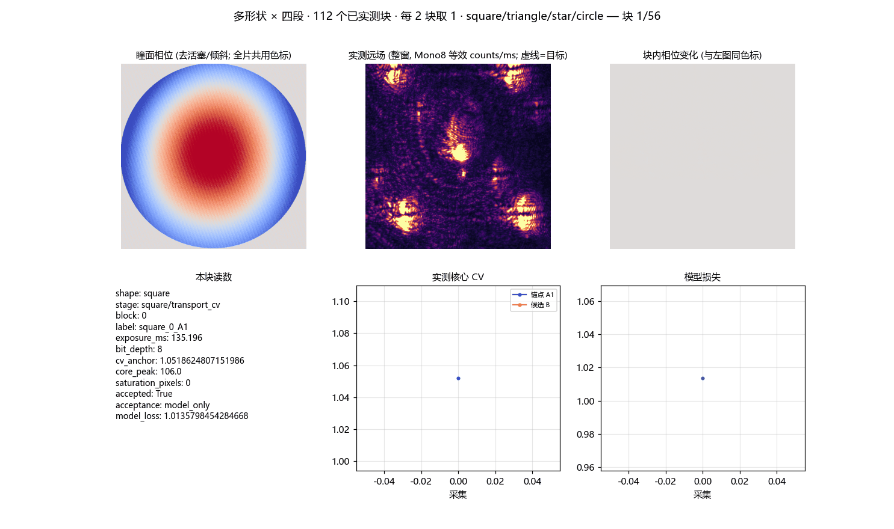
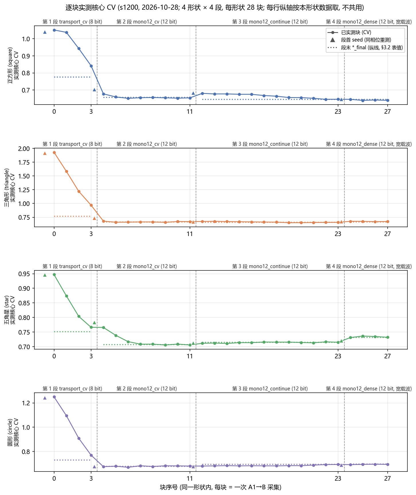
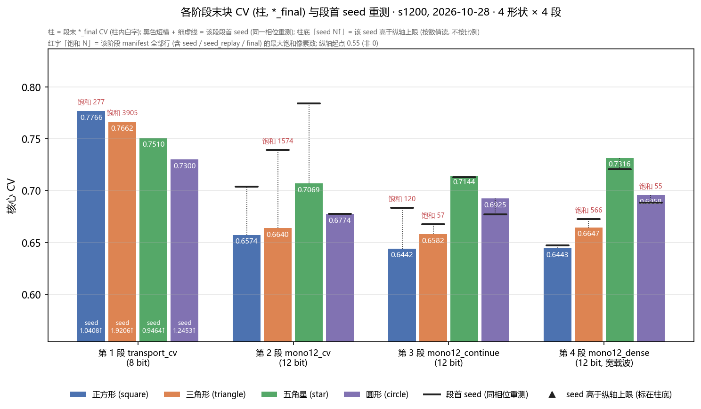
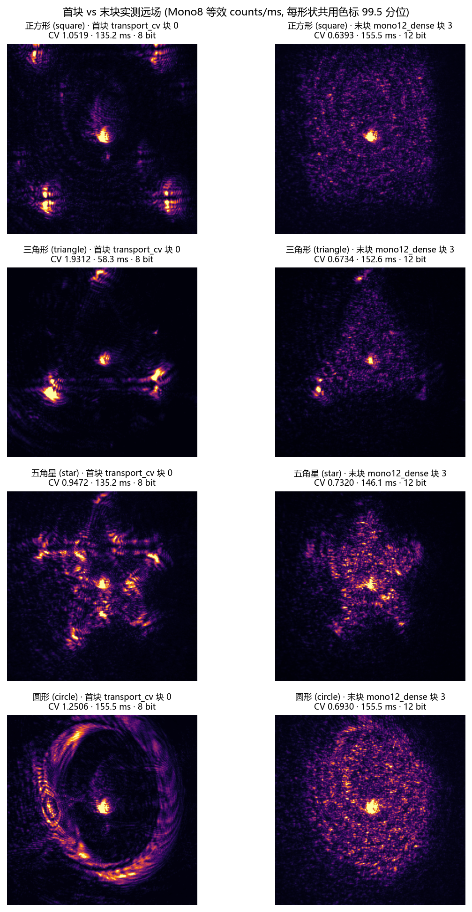
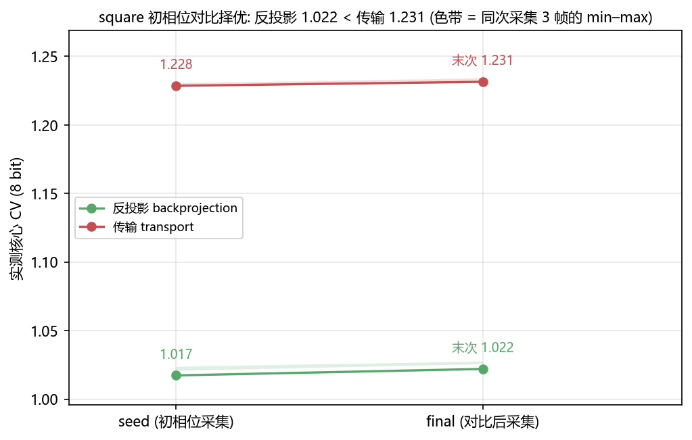
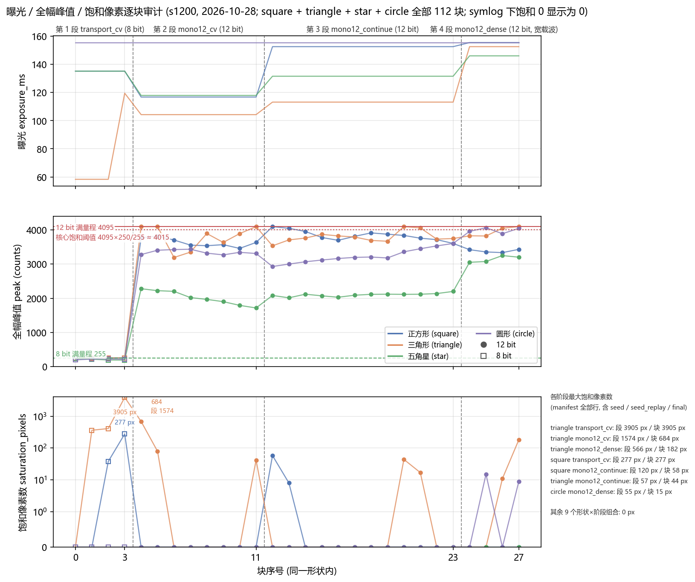

# 多形状 × 三尺度同载波闭环整形：实验中记录（2026-10-28）

<!-- provenance:start -->
> **生成脚本**: 人工撰写，无生成脚本
> **数据/关联脚本**: [`src/ao_shaping/runners/slm/transfer_shapes_runner.py`](../../../src/ao_shaping/runners/slm/transfer_shapes_runner.py)
> **数据/关联脚本**: [`src/ao_shaping/tools/slm/transfer/capture.py`](../../../src/ao_shaping/tools/slm/transfer/capture.py)
> **数据/关联脚本**: [`src/ao_shaping/tools/slm/transfer/fit.py`](../../../src/ao_shaping/tools/slm/transfer/fit.py)
> **数据/关联脚本**: [`src/ao_shaping/tools/slm/transfer/validate.py`](../../../src/ao_shaping/tools/slm/transfer/validate.py)
> **数据/关联脚本**: [`src/ao_shaping/tools/slm/transfer/replay_phases.py`](../../../src/ao_shaping/tools/slm/transfer/replay_phases.py)
> **数据/关联脚本**: [`scripts/slm/generate_multishape_scale_live_figures.py`](../../../scripts/slm/generate_multishape_scale_live_figures.py)
> **运行环境**: 硬件（Santec #1 SLM + Daheng CCD；WFS / NLight DM / MIICAM 未连接）
> **说明**: 多形状 × 三尺度同载波闭环整形：实验中记录（2026-10-28）。Session A（1200 原生 px）的 16 个形状×阶段（square/triangle/star/circle 各 4 段）全部完成，共 112 个验收块（28 块/形状；journal 16 条 ``complete``、无 error/failed）；records 已导出（process.csv 179,587 B / process.h5 428,279,000 B / 336 个 sidecar）；common_replay 完成，common_replay_dense 仍在写盘、本次未消费；s600 / s200 跨尺度未开始。一次早期 relaunch 在 square/transport_cv 触发饱和守卫而中止，原完成数据未受损。
<!-- provenance:end -->

> 本记录是**实验中**事实来源：设备身份、几何与入射、曝光范围、已用时长逐项标注为本次实测 / 历史 / 待定；优化指标只记过程值，结论留到实验后分析。

## 1. 阶段目标与待验假设

本轮要回答的（详见规划报告 §1，H1–H4）：

- **H1** 物理预测模型闭环在**无 GS** 时能否把四个形状都整形到位（GS 由 `--no-gs-seed` 强制排除，原因见规划 §1 与下文 §2）。
- **H2** 同一载波（面板周期 48 px）、同一零级排除口径（半径 60 px）下，四形状的可迁移性。
- **H3** 200 格零级在实测载波位移下**不再与目标分离**（规划时按位移 201.70 估算为「干净参照」，实测为 14.76 / −129.70，见 §2 勘误）；200 仍可比，但须与 5.61% 的零级剔除面积一并读。
- **H4** 本轮曝光工作点能否避开核心饱和（上轮 `peak=4095` 为可避免操作缺陷）。

本记录不回答这些问题，只钉死「进行到哪一步、哪些已实测、哪些待定」。

## 2. 当前可信事实（会话专属）

| 项 | 值 | 来源 |
|---|---|---|
| SLM 身份 | LCOS-SLM-001（Santec #1），driveboard `22030108`，optionboard `23020027`，LCOS `KB1881T050`，产品序列 `240236000005` | 预检 `artifacts/device_preflight_20261028.json` **本次实测** |
| SLM 版本 | DLL 0250 / Drive 0322 / Option 0321 / FPGA 0110 | 预检 **本次实测** |
| SLM 波长支持 | `[532, 1017]` nm（设备支持列表）；实验激光 1064 nm | 设备读回 + 阶段 `config.json` 的 `wavelength_nm=1064`（**本次实测** / 实验激光约定） |
| CCD 身份 | Daheng SN `FJB24112232`，1944×2592，12 bit | 预检 **本次实测** |
| CCD 曝光范围 | 0.02 – 1000 ms；请求=读回（2.0→2.0、5.0→5.0、12.0→12.0） | 预检 **本次实测** |
| 曝光上限旋钮 | `AO_DAHENG_MAX_EXPOSURE_MS` 未设（`configured_limit_ms=0`） | 预检 **本次实测** |
| 光路离焦 | `model640/frozen_parameters.json` 的 `defocus_diopter=0.330` | fit **本次实测** |
| 零级定位 | 载波探针 `zero_estimate=[1303, 971]`；fit `zero_xy=[1294.0, 986.0]`（下游阶段用后者） | 载波探针 + fit **本次实测** |
| 载波位移 | `model640` 实测 `ramp_matrix[:,0]/48 = (14.76, −129.70)` | fit **本次实测**（H3 勘误） |
| 窗口半跨 | 1200→900、600→620、200→420（面板 px） | 规划 + 几何 `artifacts/geometry_plan.json` |
| 零级排除半径 | 60 px（全三尺度） | 规划 |
| 重放曝光阶梯 | 15 / 60 / 150 / 300 ms（×4 重复 `--replay-exposures`） | 规划 §6 |
| 载波周期 | 48 面板 px（全三尺度统一） | 规划 |
| GS 初相位 | 由 `--no-gs-seed` **强制排除**（本轮新增旗标） | 规划 §1 + runner |
| 种子对比择优 | square：backprojection CV 1.022 胜 transport 1.231；triangle/star/circle 单一候选 backprojection，跳过实测比较 | seed_bakeoff 目录 **本次实测** |
| 已用设备时长 | 16 段：02:26:05 – 03:33:58 UTC（约 68 min，含 `star/mono12_cv` 的 20 min 重启）；随后 records 导出至 03:38:25、`common_replay` 重放到 03:45:09 ⇒ 设备总占用约 79 min（另加预检 ~1 min；`common_replay_dense` 的尾段未计入） | journal 时间线 + 预检时间戳 |
| 规划授权时长 | ~3 小时连续设备时间（A+B+C） | 规划 §10 |

**H3 勘误（实测，已写入规划报告）**：规划时按载波位移 201.70 px 估 200 格零级「41.7 px 净空、剔除面积 0」；实测位移 `(14.76, −129.70)` 使零级只在 y 上离目标框边 29.70 px，60 px 排除区与目标框重叠 **30.30 px 深、占目标面积 5.61%**。几何守卫（`validate.py:114`）只查目标框是否越出采样窗，**不查排除区与目标框是否重叠**，故不会失败。H3「干净参照」前提因此减弱：200 仍可比，但须与 5.61% 零级剔除面积一并读。1200 / 600 剔除面积分别为 0.79% / 3.14%。

**种子对比择优（本次实测）**：square 在 `--seed-bakeoff` 下实测核心 CV，backprojection（1.022）< transport（1.231）→ 采用 backprojection；triangle/star/circle 仅 backprojection 一个候选（GS 被排除），跳过实测比较直接采用，记入 journal。

## 3. 数据 / 过程（Session A，1200 原生 px）

数据目录：`../../../data/debug/slm_transfer/multishape_scale_20261028/s1200/`。

### 3.1 模型与种子（均完成）

`capture` → `fit` → `model640` + 宽载波 `model_wide640` → `seed_bakeoff`。fit 的 `defocus_diopter=0.330`，残差 Noll（5–11 阶）见 `model640/frozen_parameters.json`。

### 3.2 四形状 × 四阶段整形结果（16/16 完成，112 块）

4 个形状 × 4 个阶段 = 16 行。`transport_cv` 每形状 4 块、`mono12_cv` 8 块、`mono12_continue` 12 块、`mono12_dense` 4 块 ⇒ 每形状 28 块、四形状合计 **112 块**（每块 = 一次 A1(+B) 采集；`transport_cv` 只采集 A1 并按模型损失验收）。`段首 seed` 是进入该段时对上一段末相位的**同相位重测**（第 1 段即初相位采集），`段末 final` 是该段最后一次 `*_final` 采集；两者之差才是段内变化。

| 形状 | 阶段 | bit | 段首 seed CV | 段末 final CV | 段内峰值 | 饱和像素（manifest 最大） | 曝光 ms |
|---|---|---|---|---|---|---|---|
| 正方形 | transport_cv | 8 | 1.0408 | 0.7766 | 255 | 277 (square_3_A1) | 135.196 |
| 正方形 | mono12_cv | 12 | 0.7038 | 0.6574 | 3923 | 0 | 116.782 |
| 正方形 | mono12_continue | 12 | 0.6836 | 0.6442 | 4095 | 120 (square_seed) | 152.600 |
| 正方形 | mono12_dense | 12 | 0.6472 | 0.6443 | 3465 | 0 | 155.520 |
| 三角形 | transport_cv | 8 | 1.9206 | 0.7662 | 255 | 3905 (triangle_3_A1) | 58.320 / 119.503 |
| 三角形 | mono12_cv | 12 | 0.7391 | 0.6640 | 4095 | 1574 (triangle_seed_replay) | 104.288 |
| 三角形 | mono12_continue | 12 | 0.6676 | 0.6582 | 4095 | 57 (triangle_seed) | 113.185 |
| 三角形 | mono12_dense | 12 | 0.6728 | 0.6647 | 4095 | 566 (triangle_final) | 152.600 |
| 五角星 | transport_cv | 8 | 0.9464 | 0.7510 | 244 | 0 | 135.196 |
| 五角星 | mono12_cv | 12 | 0.7838 | 0.7069 | 2325 | 0 | 117.936 |
| 五角星 | mono12_continue | 12 | 0.7128 | 0.7144 | 2200 | 0 | 131.581 |
| 五角星 | mono12_dense | 12 | 0.7204 | 0.7316 | 3343 | 0 | 146.067 |
| 圆形 | transport_cv | 8 | 1.2453 | 0.7300 | 226 | 0 | 155.520 |
| 圆形 | mono12_cv | 12 | 0.6778 | 0.6774 | 3435 | 0 | 155.520 |
| 圆形 | mono12_continue | 12 | 0.6771 | 0.6925 | 3699 | 0 | 155.520 |
| 圆形 | mono12_dense | 12 | 0.6883 | 0.6958 | 4095 | 55 (circle_1_A1) | 155.520 |

- `段内峰值` = 该阶段 `manifest.json` **全部行**（含 seed / `seed_replay` / final）的最大全幅峰值；`饱和像素` 同理取全行最大值并注明落在哪一行，`0` 表示该阶段任何一行都没有饱和像素。峰值/饱和都是**全幅**（含零级，零级在核心外），核心饱和守卫（`250/255`）逐块判定。
- **8 bit 段（`transport_cv`）的 CV 不能与 12 bit 段直接比**：满量程 255 下三角形一块饱和 3905 px、峰值顶死在 255，其 0.7662 属削顶读数；同相位换到 12 bit 重测的四个差值见 §4a。
- 各形状本会话最好的一段（段末 `final` CV）：正方形 **0.6442**（`mono12_continue`）、三角形 **0.6582**（`mono12_continue`）、五角星 **0.7069**（`mono12_cv`）、圆形 **0.6774**（`mono12_cv`）。五角星与圆形后两段的段末反而高于其段首（0.7128→0.7144、0.6771→0.6925），**四段不是单调收敛**（§4d）。



*图 3-1（`figures/process_s1200_20261028.gif`，56 帧，1485×880，由 `Recorder` 过程渲染）*：正方形 / 三角形 / 五角星 / 圆形**各 4 段、合计 112 个已实测** CCD 块的逐块过程（每块 = 一次 A1(+B) 采集；上排瞳面相位 / 实测远场 / 块内相位变化，下排本块读数 / 实测核心 CV / 模型损失）。112 块逐一成帧会超出体积预算，故按**每 2 块取 1**均匀抽帧成 56 帧（块 0、2、…、110），片内标题写明「112 块 · 每 2 块取 1 · 块 N/56」；首帧 = square/transport_cv 块 0，末帧 = circle/mono12_dense 块 2（第 56 个抽样帧，块 111 未抽到）。片尾标注为「square/triangle/star/circle 各 4 段, 全部已实测」。瞳面相位与块内相位变化两格**全片共用一套色标**（偏移取各帧中位数的中位数，跨度取各帧 `|f − 其自身中位数|` 的 90% 分位的最大值）：逐帧各自归一会把每帧拉回满量程。实测口径：相邻块 `|Δ|` 的逐像素最大值中位数约 **0.24 rad**、90% 分位约 **0.42 rad**，而全片共用色标半幅 **26.29 rad**（约各帧自身离散 15.2 rad 的 1.7 倍；全片相位中位偏 −0.38 rad）——逐帧归一恰好把这 0.24 rad 放大到满量程，整帧差异被抹平，这正是早前版本左上角「没变化」的原因。现已修复并由 `scripts/slm/render_multishape_scale_process_gif.py` 重新出图。



*图 3-2（`figures/cv_trajectory_s1200_20261028.png`）*：上述 112 块的核心 CV 逐块轨迹，**四行、每形状 28 块**（横轴 = 同一形状内的块序号，竖向虚线 + 段名切出四个阶段）。**每行纵轴按本形状数据单独取**（含该行 4 个段首 seed 与 4 个段末 final），1–2 个百分点的段内起伏因此仍可见；四行不共用纵轴，跨形状只比 §3.2 的表值，不比图上高度。三角形行被其首块 1.9312 撑到 1.93 的量程，其后 27 块压在行下半部——这是真实量程、未截断。▲ = 段首 seed（第 2–4 段为对上一段末相位的同相位重测，第 1 段即初相位采集），同色点线 = 该段 `*_final` 水平（表值的图形化）。`transport_cv` 只采集 A1 且按模型损失验收（`accept_metric=loss`），该段画的是锚点序列；其余三段画 A1→B 后的候选值。图上不标数值（28 块/行，任何数字都会压在块点上），数值见 §3.2 与图 3-3。



*图 3-3（`figures/stage_final_cv_s1200_20261028.png`）*：16 根柱 = 4 个阶段 × 4 个形状的**段末** `*_final` CV（柱内白字，与 §3.2 逐位一致）；每根柱上的黑色短横 + 细虚线 = **该段段首 seed**（同一相位重测），两者之差即段内变化。纵轴起点 0.55（非 0，出图内已标注）。`transport_cv` 的 8 bit 段首（1.0408 / 1.9206 / 0.9464 / 1.2453）远高于 12 bit 段末，按比例画会把所有柱压到一成高度，故在柱底以白字 `seed N↑` 标注、**不按比例画**。红字「饱和 N」= 该阶段 manifest 全部行（含 seed / `seed_replay` / final）的最大饱和像素数，共 7 处：三角形 `transport_cv` 3905、正方形 `transport_cv` 277、三角形 `mono12_cv` 1574、三角形 `mono12_dense` 566、正方形 `mono12_continue` 120、三角形 `mono12_continue` 57、圆形 `mono12_dense` 55；其余 9 个形状×阶段组合为 0。



*图 3-4（`figures/ccd_first_last_s1200_20261028.png`）*：**四行**（正方形 / 三角形 / 五角星 / 圆形），每行**首块**（`transport_cv` 块 0 的 A1，即初相位下发后的第一次采集）与**末块**（`mono12_dense` 块 3 的 B，本次闭环的最后一次块采集）的实测远场。首块：正方形 CV 1.0519 / 135.2 ms / 8 bit、三角形 1.9312 / 58.3 ms / 8 bit、五角星 0.9472 / 135.2 ms / 8 bit、圆形 1.2506 / 155.5 ms / 8 bit；末块：正方形 0.6393 / 155.5 ms / 12 bit、三角形 0.6734 / 152.6 ms / 12 bit、五角星 0.7320 / 146.1 ms / 12 bit、圆形 0.6930 / 155.5 ms / 12 bit。按 Mono8 等效 counts/ms 归一（每形状左右两格共用 99.5 分位色标），把「曝光不同、位深不同」的首末两格拉到可比口径；末块是块内最后一次候选采集，与 §3.2 的段末 `*_final`（收口采集）不是同一帧，数值不必相等。

### 3.3 journal 时间线（16/16 阶段 complete，无 error）

```
02:26:05  plan / model reused / geometry / capture_geometry / wide_model 完成
02:30:06  seed_bakeoff 完成（square: backprojection 胜 transport）
02:31:19  square/transport_cv        完成     02:39:04  square/mono12_dense       完成
02:40:01  triangle/transport_cv      完成     02:42:51  triangle/mono12_cv        完成
02:47:31  triangle/mono12_continue   完成     02:49:52  triangle/mono12_dense     完成
02:51:16  star/transport_cv          完成     02:51:16  star/mono12_cv 启动（03:11:44 再次启动）
03:15:14  star/mono12_cv             完成     03:19:35  star/mono12_continue      完成
03:21:47  star/mono12_dense          完成     03:21:47  session complete
03:24:25  circle/transport_cv        完成     03:27:31  circle/mono12_cv          完成
03:31:53  circle/mono12_continue     完成     03:33:58  circle/mono12_dense       完成
03:33:58  session complete
03:38:25  record complete（Recorder 导出 records/）
03:42:18  replay 启动 → 03:45:09 replay complete（common_replay/）
03:46:45  replay 启动（common_replay_dense/；最后一条 journal 03:48:40 仍为 running）
```

- **16 条**形状×阶段条目（square / triangle / star / circle × 4 段）全部 `complete`；journal 的 `status` 只出现 `complete | reused | running | skipped` 四种，**无 error / failed**。四个形状的 4 段块数为 4 / 8 / 12 / 4，合计 **112 块**（manifest 的 `*_A1` + `*_B` 行，每形状 28 块）。
- 两处重启：`star/mono12_cv` 有两条 `running`（02:51:16 与 03:11:44）⇒ 该段被重启过一次，最终 03:15:14 `complete`，目录下 manifest 20 行、末条 `star_final`（无半条残留）；`triangle/mono12_dense` 曾在更早的进程里写盘完成而 journal 未记 `complete`（§3.4），本次已在 02:49:52 记为 `complete`。
- `records/` 已导出（`record complete` 03:38:25）：`process.csv` 179,587 B、`process.h5` 428,279,000 B、`process.gif` 27,766,237 B（逐块过程 GIF，本报告不用它作图），外加 **336 个** `process_sidecars/*.npy`。
- `common_replay/` 完成（03:42:18 启动 → 03:45:09 `replay complete` + `released.json` 记相机/SLM 上下文已关）：16 个来源相位（每形状 4 个 = `transport_cv` 段首 seed + `transport_cv` / `mono12_cv` / `mono12_continue` 段末 final；`mono12_dense` 段末不在其中）× 3 档曝光 20 / 50 / 90 ms = **48 次重放**，manifest 48 行。**注意**：其 90 ms 块末 4 条（`star/mono12_continue`、`circle/transport_cv`、`circle/mono12_cv`、`circle/mono12_continue`）因关设备前 SLM USB 掉线前兆而失效（`core_peak`≈25、mean 骤降到 ~15 计数、CV≈0.045），由 `common_replay_r2/`（洁净重测，36 条）覆盖，分析以 `common_replay_r2` 为准。
- `common_replay_ladder_trial/`（15 / 60 / 150 / 300 ms × 16 相位，应 64 次）只写出 **34 次**、无 `released.json` ⇒ **未完成**，本记录只登记、不作证据（其 15 / 60 / 150 ms 的 CV 趋势仍被实验后分析引用，见 `multishape_scale_analysis_20261028.md` §3e）。
- `common_replay_dense/` **已完成**（24 条 = `mono12_dense` 段 final + seed × 4 形状 × 20 / 50 / 90 ms，全部 `released.json`，无零字节、无饱和离群）：2.0 网格的洁净重放证据，已被实验后分析消费。

### 3.4 中断与重启（已由续跑补全）

- **早期一次中断**：`triangle/mono12_dense` 的 `manifest.json` 已写全（末条 `triangle_final`）但 journal 未记 `complete`（进程被杀在 `journal.record` 之前）。数据未损坏，续跑把该段补成 `complete`（02:49:52），并继续 star、circle 直至 16/16。
- **早期一次 relaunch 中止**：该次尝试复用 `--model-dir`、未改生产代码，在 `square/transport_cv` 的采集处触发 `validate.py:254`：

```
RuntimeError: saturated capture retained; stop paired comparison
```

  该次尝试在进入整形循环时即中止，**未触及已完成数据**（目录下无 0 字节 capture，原 manifest 完好）；就 `square/transport_cv` 而言，8 bit 段的全幅峰值本来就顶到 255（核心判据 `--meter-target` 下才算通过，见 §4a），因此重跑该段本就容易先撞守卫。判定为曝光起点瞬态 + 8 bit 满量程的组合，非数据损坏。后续改为只针对**尚不存在**的阶段目录续跑（`validate.run` 对已存在目录 `mkdir(exist_ok=False)` 会抛 `FileExistsError`），16 段全部补齐。

## 4. 关键判断与证据（三层）

按规划 §1 的三类证据分别记状态：

1. **模型选择证据（fit 验证集）**：`model640` 已 fit（`defocus_diopter=0.330`，残差 Noll 见 frozen_parameters）；`model_wide640` 由 `geometric_seed.export_frozen_parameters` 导出（宽载波重新标定映射）。**本次实测**，验证误差留给实验后分析。
2. **CCD 候选验收证据（逐块 CV）**：16 段的段首 seed / 段末 final 见 §3.2，8 bit 段落在 0.7766–1.9206，12 bit 段落在 0.6574–0.7838。**过程值**，非结论。
3. **重放证据**：`common_replay/` 已生成（16 相位 × 20 / 50 / 90 ms = 48 次，§3.3），但本记录**未做重放饱和审计**；`common_replay_ladder_trial/`（15 / 60 / 150 / 300 ms）只写出 34/64 次、`common_replay_dense/` 仍在写盘 ⇒ **该层证据未闭合**。重放路径无饱和守卫（`replay_phases.replay` 不检查满量程），审计办法见 §5。



*图 4-1（`figures/seed_bakeoff_square_20261028.png`）*：对应 §2「种子对比择优」与本节第 2 条候选验收证据 —— square 的两个候选各只有两次采集（seed 与 final），实测 CV 反投影 1.017 → 1.022、传输 1.228 → 1.231，色带为同次采集 3 帧的 min–max；backprojection 的末次 1.022 低于 transport 的 1.231，故采用前者。triangle / star / circle 只有 backprojection 一个候选，未做实测比较，此图不含它们的数据。

### 4.1 读数口径与饱和审计（四条硬约束）

**（a）8 bit 段是削顶读数，8→12 bit 的差值不是优化增益。** 三角形 8 bit 段一块饱和 **3905 px**、峰值顶死在 255，其 0.7662 是削顶后的读数。同一相位换到 12 bit 重测（下一段的段首 seed）四个差值为：正方形 0.7766 → 0.7038（**−7.28 pp**）、三角形 0.7662 → 0.7391（**−2.71 pp**）、五角星 0.7510 → 0.7838（**+3.28 pp**）、圆形 0.7300 → 0.6778（**−5.22 pp**）。符号三降一升 ⇒ bit 边界是**测量模式差异**，不是优化增益；任何跨 bit 的「提升/退步」都不成立。

**（b）三角形在 12 bit 段仍有削顶，其 CV 只是乐观上界。** 三角形 `mono12_cv` 的 manifest 最大饱和 **1574 px**（落在 `triangle_seed_replay` 行；块内最大 684 px），`mono12_dense` 最大 **566 px**（落在 `triangle_final`），三段峰值都顶到 4095 满量程。正方形 `mono12_continue` 120 px、圆形 `mono12_dense` 55 px 属轻度；其余阶段为 0。饱和像素与核心（半径 60 px 排除区之外）是否逐块重叠未核验 ⇒ 三角形的三个 12 bit CV 记为**乐观上界**，不作精确刻度。

**（c）同相位重测的差值 ≤ 2.62 pp ⇒ CV 差 ≤ 2 pp 不是证据。** 相邻两段对同一相位各测一次 CV 的配对（段末 final vs 下一段段首 seed）：正方形 0.6574 / 0.6836（**2.62 pp**）、三角形 0.6640 / 0.6676（0.36）、五角星 0.7069 / 0.7128（0.59）、圆形 0.6774 / 0.6771（0.03）；`mono12_continue` → `mono12_dense` 四组为 0.6442 / 0.6472（0.30）、0.6582 / 0.6728（1.46）、0.7144 / 0.7204（0.60）、0.6925 / 0.6883（0.42）。全部落在 **0.0–2.6 pp**，与 §4b 的削顶幅度同一量级 ⇒ 2 pp 以内的 CV 差**不构成证据**，只能记为测量重复性。

**（d）验收按 CV，但探索配额非单调 ⇒ 段末不是段内最优。** 12 bit 三段的 `config.json` 均为 `accept_metric="cv"` + `exploration_budget=0.25`（`transport_cv` 为 `accept_metric="loss"`），候选里混有贪心与探索，段内 CV 不保证单调。两处反向：五角星 `mono12_continue` 段末 0.7144 高于段首 0.7128（**+0.2 pp**，段内峰值 2200）；圆形 `mono12_continue` 段末 0.6925 高于段首 0.6771（**+1.5 pp**，段内峰值 3699）。⇒ `*_final` 是**段末收口采集**，不是该段最优值；本报告一律不称段末为「该阶段最好」，段内最好值需回 manifest 逐块取。



*图 4-2（`figures/exposure_peak_saturation_s1200_20261028.png`）*：上述饱和审计的逐块依据，**四形状全部 112 块**同一块轴（横轴 = 形状内块序号，竖向虚线切段）。上格 `exposure_ms`（每段内固定：正方形 135.196 / 116.782 / 152.600 / 155.520 ms；三角形 58.320 / 104.288 / 113.185 / 152.600 ms，其中 `transport_cv` 末块抬到 119.503 ms；五角星 135.196 / 117.936 / 131.581 / 146.067 ms；圆形 155.520 ms × 4），中格全幅峰值 `peak`（红线 4095 = 12 bit 满量程，点线 4095×250/255 ≈ 4015 = 核心守卫阈值，绿虚线 255 = 8 bit 满量程；实心点 = 12 bit，空心方 = 8 bit），下格全幅饱和像素数（symlog，`0` 显示为 0）。饱和面板只做三处短标注以免互相压字：三角形 `transport_cv` **3905 px**（下方）、正方形 `transport_cv` **277 px**（上方）、三角形 `mono12_cv` 的块内 **684 px**（该段 manifest 最大 1574 px，落在 `seed_replay` 行，标注为「684 / 段 1574」）。右侧表格按 manifest 口径列出**全部 7 个非零阶段**的最大值，并把对应块内最大值并列（段 / 块两个口径分开写），末尾注明其余 9 个形状×阶段组合为 0。

> §3.2 图 3-1–3-4 与本节的图 4-1、4-2 全部离线生成（不接 SLM / 相机，只读上表运行目录的阶段子目录），可用 `python scripts/slm/generate_multishape_scale_live_figures.py` 重新生成。

## 5. 结论、未决问题与下一步

**本会话结论（16/16 阶段完成、112 块全部实测）**：

- **正方形与三角形在 12 bit 段继续下降**：正方形 0.7766（8 bit）→ 0.7038（同相位换 12 bit）→ 0.6836 → **0.6442**（`mono12_continue` 段末）→ 0.6443（`mono12_dense`）；三角形 0.7662 → 0.7391 → 0.6676 → **0.6582** → 0.6647。两条链在 `mono12_cv` / `mono12_continue` 段内的降幅（**≥ 3.5 pp**）远超 §4c 的 2.62 pp 重复性，是本会话唯一有区分力的变化；`mono12_dense`（宽载波）对两者只再动 ≤ 1.5 pp，落在重复性内。
- **五角星与圆形在 `mono12_cv` 之后不再改善**：五角星 0.7838 → **0.7069**（本会话最好）→ 0.7144 → 0.7316；圆形 0.6778 → **0.6774** → 0.6925 → 0.6958。`mono12_continue` 与 `mono12_dense` 两段都**变差**（+0.2 / +0.6 pp 与 +1.5 / +0.7 pp）⇒ 四段链**不是单调收敛**，不能写成「越跑越好」；这与 §4c 的重复性同量级，说明这两段在 12 bit 下已无明显可优化余量（也可能是探索配额把段末拉离段内最优，见 §4d）。
- **H4（避开核心饱和）只在核心口径成立**：12 bit 段无一触发 `250/255` 核心守卫，但三角形 `mono12_cv` 仍有 **1574 px** 全幅饱和、`mono12_dense` **566 px**（§4b），其 CV 只能算乐观上界；8 bit 段被满量程 255 削顶（三角形 3905 px），只作锚点、不作刻度。
- **H1（无 GS 可整形）在四形状上都产生了可见的整形效果**：8 bit 首块 → 12 bit 末块 的块内 CV 为正方形 1.0519 → 0.6393、三角形 1.9312 → 0.6734、五角星 0.9472 → 0.7320、圆形 1.2506 → 0.6930（图 3-4）。这是过程值；「到位」判定要等重放审计与 s600 / s200 的跨尺度结果。
- **H2 / H3 暂不判定**：跨尺度可迁移性（同载波、同 60 px 零级排除）要三尺度齐备才可比；200 格的零级剔除面积已达 5.61%（§2 勘误），该尺度的「参照」性质已减弱。

**未决问题**：
1. ~~`common_replay/`（16 相位 × 20 / 50 / 90 ms = 48 次）的**饱和审计未做**~~ → **已补**：离线审计见 §5.1，`transport_cv_triangle_seed` / `transport_cv_triangle_final` 两行被扣留，其余 46 行可用。
2. `common_replay_ladder_trial/`（15 / 60 / 150 / 300 ms）只写出 **34/64** 次、无 `released.json`；`common_replay_dense/` 至 03:48:40 仍在写盘 ⇒ 曝光阶梯这条证据链未闭合（§5.1 的审计报告里 `ladder_trial` 只到 150 ms 且每格只有 1 个相位）。
3. **s600 / s200 未开始**：跨尺度（H2、H3）无可比数据。
4. 五角星 / 圆形在 `mono12_cv` 之后变差的原因未定位：是探索配额（§4d）、模型在宽载波下的失配，还是 8 bit → 12 bit 切换后曝光工作点变化？现有数据不足以分开。

### 5.1 离线重放审计结果（2026-10-28 补，免设备）

依据 §5「下一步」第 1 条，用 `scripts/slm/audit_replay_blocks.py` 重读三个已归档重放块。
该脚本用**冻结的传感器像素孔径**（源段 `config.json` 的 `target_xy` / `side` / `core_margin` /
`zero_radius`）重算每个重放帧的 CV 与相对能量，而不是复用各段自己的 `metrics.cv` —— 后者用的是
**当段腐蚀后的核**，dense 段每步腐蚀一次、采样步长减半，同一帧会报出不同的「均匀度」。

| 重放块 | 可用行 | 扣留行 | 备注 |
|---|---|---|---|
| `common_replay` | 46/48 | `transport_cv_triangle_seed`、`transport_cv_triangle_final`（峰值 ≥ 98% 满量程） | 12 bit、20/50/90 ms 三档齐；三角形三档全部落在饱和里 |
| `common_replay_r2` | 47/48 | `transport_cv_triangle_seed` | 18/24 格判「越过噪声」，与上一块同向 |
| `common_replay_dense` | 24/24 | — | 20/50/90 ms，每格 seed / final 各 1 次（故多格 `insufficient_repeats`） |
| `common_replay_ladder_trial` | 32/34 | `transport_cv_triangle_seed`、`transport_cv_square_seed` | 只到 60 ms（15/60 两档），150/300 ms 未写出 |

「扣留行」是按**帧峰值 ≥ 98% 满量程**判的，与 manifest 里的 `core_peak` 无关 —— 核心外的
一个削顶像素同样说明这一帧的曝光不是比较所假定的那个。注意 `n_usable` 统计的是「读得出来」的
行数，被扣留的行仍在表里，只是不参与相位配对。

**dense 段的结论（与 §5 一致，现在有了统一口径）**：`common_replay_dense` 的 seed → final
在四个形状、三个曝光档共 12 格里**没有一格成立** —— 正方形三档都是 `insufficient_repeats`
（`ΔCV = −0.014 / −0.020 / −0.015`，每格最终相位只测过一次）、三角形 / 圆形多数方向相反
（`wrong_direction`：`+0.104 / +0.000 / +0.012` 与 `−0.015 / +0.003 / +0.002`）、
五角星两档同时丢了相对能量（`energy_lost_with_cv`，`−0.021 / +0.035 / −0.018`）。
⇒ **dense 段没有可判定的整形增益**，§3.2 里 dense 段末 CV 的下降只能记为段内过程值。

**seed → final 在 `common_replay` / `common_replay_r2` 上是成立的**（正方形 −1.24 / −0.88、
三角形 −1.32 / −1.58、五角星 −0.16 / −0.12、圆形 −0.53 / −0.55，两轮同向同量级）：
这说的是**整段 recipe**（transport_cv → mono12 → continue）确实改变了远场，不是 dense 段。

**重复性的量级**：`common_replay` 把同一 `final` 相位在三个曝光档各测一次（`phases=finalx3`），
所以那行 `replicate spread` 是**跨曝光**的散布（正方形 ±0.52、三角形 ±1.23、五角星 ±0.024、
圆形 ±0.024）—— 它说明的是「曝光会改变读数」，**不是**设备噪声，因此不能当噪声带用。
同曝光的噪声仍以 §4c 的 0.0–2.6 pp（`common_replay` vs `common_replay_r2` 同一相位、同一曝光）为准。

**统计口径**：`2/2**n` 是符号翻转检验的下限，`n = 5` 时 `2/32 = 0.0625 > 0.05` ⇒
**每个条件至少要 6 次重复**才能谈 p<0.05；少于 6 次只报效应量。审计里同一相位只测过一次时
报 `insufficient_repeats`，**不会**把跨相位散布借来当噪声。

### 5.2 设备上线后的执行计划（已生成，待跑）

计划由 `scripts/slm/plan_multishape_campaign.py` 生成（`--check` 校验通过，**25 条 lane**），
落在 `data/debug/slm_transfer/multishape_nogs_20261029/`：`plan.json` +
`lanes/NN_<session>.ps1`。

| 维度 | 取值 |
|---|---|
| 路线 | `strict_cold`（`--initial-phase random`，只加载波，不读目标、不用物理预测模型）与 `analytic_init`（`--initial-phase backprojection`，用拟合光学但仍 0 次 GS） |
| 尺寸 | 200 / 600 / 1200（原生 CCD px），窗口 420 / 620 / 900 |
| 形状 | circle / square / triangle / star |
| 顺序 | `route` → `size` → `shape`；同尺寸连跑，相机窗与曝光只落位一次 |
| 重复预算 | 每条件 6 次（`2/2**6 = 0.031`，唯一能到 p<0.05 的最小值） |
| 每条件必报 | `fixed_core_cv` / `shape_agreement`(IoU + 边界) / `relative_energy`，外加零级排除比例、饱和比例、相位来源、模型检查点 SHA-256、曝光读回 |

**lane 00 (`p20261029_refit`) 先在当前实验系统上重拟合模型**。拟合好的检查点带着它被拟合时
那台实验系统的辐射度量（曝光响应增益、本底、面板在该光功率下的响应），跨一次激光/衰减变化
复用它，每个预测强度都被整体缩放，而**没有一处会报错**。所以 lane 00 走 from-zero 分支
（不带 `--model-dir`），写下的正是 lane 01–24 通过 `--model-dir` 指向的目录
`<campaign>/p20261029`，并顺带把一个形状跑完四段，让会话至少留下一个不来自旧功率的锚点。
`plan.json` 的 `model_power_check` 记录了必须先比较的两件事：`fit/result.json` 在**同一批
验证集相位**上的 holdout 误差（refit 目录 vs 被复用目录），以及前置探针给出的建议曝光 vs 被复用
采集当时的曝光。规则写在计划里：refit 赢就说明旧检查点不再是同一条光路，旧功率下的每个数
都只能当「另一条光路的读数」，不能当 baseline。

**两条路线绝不合并**：`strict_cold` 才能回答「闭环能否从零开始工作」；`analytic_init` 即使
名字里没有 GS，也用了解析结构，把它写成「冷启动成功」是错的。两者可以共用同一个
`--model-dir` —— 模型不是初相位。

**每条 lane 的第一行是 `probe_optical_path_validity.py` 且以退出码为门禁**（`0` = `ok`，
`2` = `low_snr` / `no_response` ⇒ `exit 1`，不许开始花会话时间）。中断后用 `--resume` 重入
同一 lane：已完成阶段跳过、不重测（`--order stage` 让同尺寸四形状按阶段纵向推进，中断只损失一段）。

> ⚠️ `--replay-exposures` 是 click 的 `multiple=True`：`--replay-exposures 20 50 90` 会被
> 报「多余位置参数」，必须重复旗标。生成器已逐项展开，手写命令时注意。

**下一步（最有区分力）**：
- **先解决 §5.3 的光路**（2026-10-29 实测：相机上没有激光），否则任何 lane 都会被前置探针拒绝。
- **跑 §5.2 的 25 条 lane**（设备上线后），顺序按 `order_index`（lane 00 refit 先行）；任何一条被前置探针拒绝就先处理光路，不要跳过去跑下一条。
- **补完曝光阶梯**：`common_replay_ladder_trial` 的缺失 replay 索引可续跑（`replay_phases.replay` 不覆盖已存在文件），不重跑已完成的 34 次。
- **审计新会话**：每个会话结束立刻 `python scripts/slm/audit_replay_blocks.py --session <新会话>`，先把被扣留的饱和帧列出来再谈 CV。
- **实验后分析**：把三层证据（模型验证集 / 逐块 CV / 重放审计）+ §4.1 的四条口径 + 跨尺度比较写进 `multishape_scale_analysis_20261028.md`。

### 5.3 2026-10-29：设备在线，但相机上没有激光（探针拒绝，campaign 未开跑）

结论先行：**这条光路当前不向相机送光**，不是曝光不足，抬曝光救不回来。前置探针三次都给
`low_snr`（退出码 `2`），按门禁不开任何 lane。

**三次实测（同一台相机 daheng #0 / 同一台 SLM #1 / 同一段代码路径）**：

| 时刻 (UTC) | 阶梯 | 读数 | 判定 |
|---|---|---|---|
| 2026-10-28 08:30 | 0.05–50 ms | 可用窗口 0.2/1/2/5/10 ms，峰值 204 counts @10 ms，饱和 242 counts（8-bit） | `ok` |
| 2026-10-29 09:13 | 0.05–150 ms | 每档峰值 2–4 counts，可用窗口为空 | `low_snr` |
| 2026-10-29 09:16 | 200/500/1000 ms | 峰值 5/9/15 counts；1000 ms 全帧均值 3.96 counts/px（该帧总量 1.997e7 counts，形状是平坦本底，无光斑） | `low_snr` |

同一批原始帧的离线统计（`data/debug/optical_path_probe/`）：

| 帧 | 峰值 | 全帧均值 | p99.9 | ≥50 counts 的像素 | argmax |
|---|---|---|---|---|---|
| 10-28 10 ms | 204 | 0.769 | 67 | 7 697 | (981, 1302) |
| 10-29 1000 ms | 12 | 3.963 | 6 | 0 | (1, 86)，画幅边缘 |

10-29 的 1000 ms 帧曝光是 10-28 那帧的 100 倍，峰值却低 17 倍，且**没有任何像素超过 50 counts**；
argmax 落在画幅边缘，是读出噪声的形状而不是光斑。

**散射测试（区分「没有光」与「光被偏出画幅」）**：平场相位是镜子，直流光斑原则上可能落在
传感器外，所以只凭平场黑帧不能定罪。200 ms、每种相位 3 帧，比**全帧总和**（与光斑落点无关）：

| 相位 | 全帧总和 (counts) | 相对平场 | 峰值 |
|---|---|---|---|
| 平场 | 9 739 130 | — | 7 |
| 随机相位 a | 9 732 321 | −6 809 (−0.07 %) | 6 |
| 随机相位 b | 9 738 396 | −733 | 7 |
| 闪耀 128 px 周期 | 9 723 376 | −15 753 | 6 |
| 闪耀 32 px 周期 | 9 723 035 | −16 094 | 6 |
| 闪耀 8 px 周期 | 9 692 373 | −46 756 | 6 |
| 平场复测 | 9 721 814 | −17 315 | 6 |

随机相位把入射光散成满画幅光环，**任何落点都在传感器内**；它抬不起全帧总和（差 −0.07 %，与
平场复测的 −0.18 % 同量级），就说明**没有激光进入相机**。平场与复测之间 1.7e4 counts 的差
（0.18 %）也说明这轮写入/显示是生效的、读数可重复，不是「卡住的画面」。

**为什么这不是模型问题**：本节的判定只用到相机读数与原位切换的相位，没有经过拟合模型、
没有经过 `--model-dir`。也正因为功率已经变化（且现在根本无光），§5.2 的 lane 00 refit 与
`model_power_check` 是**必须**的：旧检查点（`s1200` / `s600_fixed`）连当时的辐射度量都不再
代表今天的实验系统。

**要检查的物理链路（按代价从低到高）**：① 激光出光（钥匙/快门/联锁、功率设定、激光器自身
显示）；② 衰减片 / 半波片+偏振片 / ND 是否被插入或转动；③ 光纤耦合与准直（在入纤/出纤处用
红外卡看）；④ 光阑、光路挡块；⑤ 相机前的滤光片/盖；⑥ SLM 面板是否在显示图案（用红外卡看
反射面，而不是只看软件日志）。

**操作注意**：用 PowerShell 把探针的 stderr 一起管道出去（`2>&1 | Tee-Object`）会让
`$LASTEXITCODE` 变成 1，退出码 2 被掩盖。lane 脚本不接管道，因此门禁判据不受影响；手工复现时
要直接看进程退出码。

## 6. 设备释放状态

- 中断进程与被中止的 relaunch 均由上下文管理器释放 SLM/CCD；预检记录 `flat_restored=true`（SLM 已复位到平场）。
- **当前**：SLM + Daheng CCD 均**已释放**（两个 `session complete` 分别记于 03:21:47 与 03:33:58，`common_replay` 的 `released.json` 记于 03:45:09）。
- **下一位操作者注意**：
  1. `common_replay_dense/` 的 replay 在 03:46:45 启动、最后一条 journal（03:48:40）仍为 `running`，本报告**未读取该目录**；动设备前先确认该次 replay 已自行结束，否则会与仍在写盘的后台采集抢相机。
  2. `common_replay_ladder_trial/` 只有 34/64 次重放、无 `released.json`，属未完成，不要当成完整数据集引用。
  3. Session A 的**跨尺度部分未开始**（s600、s200），SLM/CCD 可作为空闲设备使用，但不要原地覆盖 `data/debug/slm_transfer/multishape_scale_20261028/s1200/` 下的任何阶段目录（续跑依赖其 `seed_run` 链）。
  4. 续跑前不需重新预检，但需确认 SLM DLL 路径与相机 SDK 仍在环境内。
