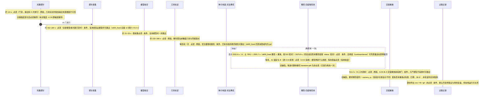
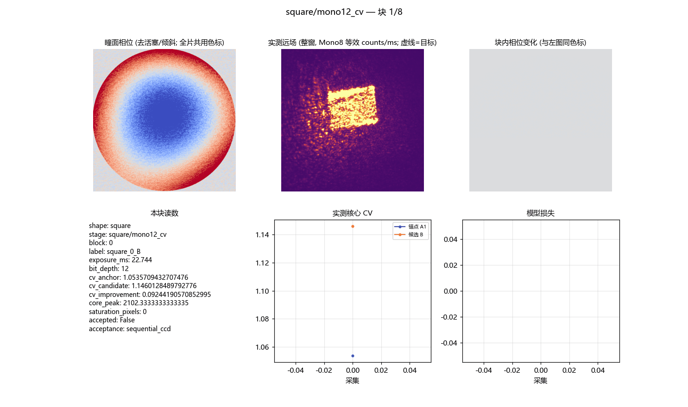
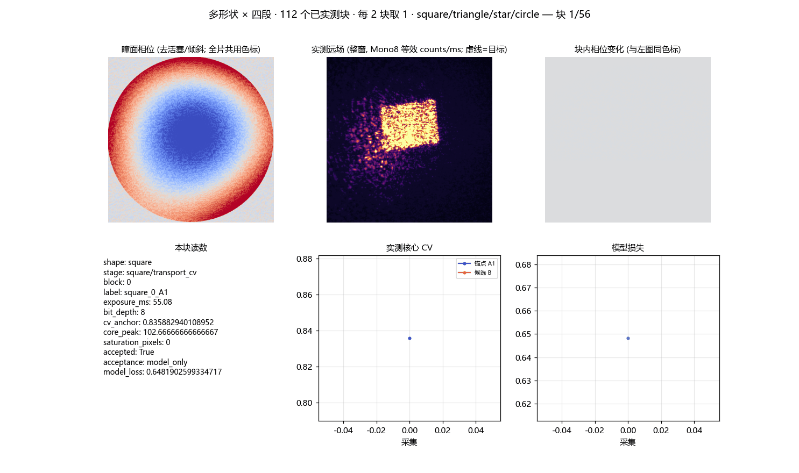

# 多形状物理预测模型闭环整形 campaign 的耗时剖析与写放大治理（2026-10-28）

<!-- provenance:start -->
> **生成脚本**: 人工撰写，无生成脚本
> **数据/关联脚本**: [`src/ao_shaping/runners/slm/transfer_shapes_runner.py`](../../../src/ao_shaping/runners/slm/transfer_shapes_runner.py)
> **数据/关联脚本**: [`src/ao_shaping/tools/slm/transfer/validate.py`](../../../src/ao_shaping/tools/slm/transfer/validate.py)
> **数据/关联脚本**: [`src/ao_shaping/tools/slm/transfer/fit.py`](../../../src/ao_shaping/tools/slm/transfer/fit.py)
> **数据/关联脚本**: [`src/ao_shaping/tools/slm/transfer/capture.py`](../../../src/ao_shaping/tools/slm/transfer/capture.py)
> **数据/关联脚本**: [`scripts/slm/probe_optical_path_validity.py`](../../../scripts/slm/probe_optical_path_validity.py)
> **数据/关联脚本**: [`scripts/slm/plan_transfer_next_run.py`](../../../scripts/slm/plan_transfer_next_run.py)
> **运行环境**: 离线分析（读取 Session A/B 运行目录与光路探针落盘；光路复核为实验系统实测探针；修复的硬件收益在 s600_fixed 会话实测中）
> **说明**: 多形状 × 三尺度闭环整形 campaign 的耗时剖析与写放大治理：按 journal ``status`` 字段重算逐阶段耗时（推翻「相邻同名配对」错配），定位主导成本为 ``validate.py`` 的 ``iterations.pkl`` 每次优化迭代整体重写（每条含 1.56 MB 相位副本，O(n²) 落盘，每 campaign ≈224 GB）；改为每块落盘一次，离线基准 ≈14×、写出字节 15.3×↓、条目逐条一致；含一次自我纠错（``star/mono12_cv`` 的 1438.8 s 系错误配对，真值为中断 1227.9 s + 恢复 210.9 s）；并含光路曝光强度变化后的复核（判定 ok，强度 +1.35×、对准保持，质心仅移 2.3 px）。
<!-- provenance:end -->

**日期**: 2026-10-28
**主题**: ① campaign 真实耗时构成的重新测定（含一次自我纠错）② 根因：整形阶段的 O(n²) 落盘写放大 ③ 修复与离线基准 ④ 剩余成本排序与实测验证方案
**设备**: Santec SLM-200 #1 (22030108, 1920×1200, pitch 8 µm, 2π=993 gray) + Daheng MER2-507 (FJB24112232, 2592×1944, 2.2 µm)，2f-Fourier 实验系统，1064 nm

---

## 1. 结论摘要

| 项 | 结论 |
|---|---|
| 主导成本 | **不是**模型采集/拟合，而是**逐形状整形阶段**的**落盘写放大** |
| 根因 | `iterations.pkl` 在**每次优化迭代后**整体重写，而每条记录内嵌一份完整相位副本（1.56 MB）⇒ 字节量 O(n²) |
| 量级 | 每 campaign 写出 **≈224 GB**（真实数据产物仅 ≈44 GB）；单 `mono12_cv` 阶段写 21.1 GB 却只产出 1.27 GB 目录 |
| 修复 | 改为**每块（block）落盘一次**（块 = 接受/拒绝判定的事务边界）；字节量降 **15.3×**，离线基准耗时降 **≈14×**，条目内容**逐条一致** |
| 收益性质 | **纯软件写放大治理**：不改变任何光学行为、测量内容与接受判据；产物格式字节兼容 |
| 离线证据 | 4 个阶段基准（见 §6）；`tests/ao_shaping/tools/slm/transfer` **33 passed**；`ruff` 全绿 |
| 实测验证 | 光路复核探针判定 **ok**（强度 +1.35×、对准保持）；修复后代码会话 `s600_fixed` **已跑完 16 个整形阶段**（4 形状 × 4 段；整形阶段合计 **2675.0 s**，见 §6.5／§8.3）。同配方同 `side` 的 `square` 四段 A/B 为 780.6 s → 658.4 s（**1.19×，省 122.2 s**）；`triangle`／`star`／`circle` 的实测四段合计为 629.7／625.7／761.2 s |
| 收尾失败 | 该会话最后一步（交错重放）报 `ValueError: replayed runs disagreed on the camera grid` 而中止：各阶段**按设计**用了不同采样步长（第 1–3 段 451×451、第 4 段 901×901，同窗同原点），重放却要求全源共用一张 `camera_xy`。每个阶段内部自洽，**跨阶段要求相等本身是缺陷**。已修（§8.4）；故四个形状共 16 个整形阶段的测量有效，丢的只是重放判定 |
| 下一步 | 下一轮运行计划已生成（§8.5）：4 条形状 lane 复用已测模型（采集／拟合／几何重导出共省 336.7 s）＋1 条只重放 lane（免重测整形结果），预测合计 **2291.0 s**（对整形 2591.7 s 为 −300.7 s、对 2675.0 s 那笔账为 −384.0 s；plan.json 另记 `measured_shaping_s = 2675.0`） |

---

## 2. 本轮时间线

| 时刻（+08） | 事件 |
|---|---|
| 15:22 前后 | 光学路径前置探针：判定 **ok**（可用曝光窗 1/2/5/10 ms，推荐 10 ms @ 峰值 144 counts；离焦响应宽度 +4460%、峰值 +98.6%）⇒ 允许复用 A 的模型 |
| 15:38:42 | 启动 **B（s600）** 会话：全新采集 + 拟合 + 几何 + 4 形状 × 4 阶段 + 重放；并行拟合 worker 同时监视 `s600/capture` |
| 15:41:22 | worker 判定 `early_stop`（poll_index=1）：B 的采集在 **7 个探针**（A 为 12）处提前停止；`s600/capture/.capture_done` 记 `early_stopped: true` |
| 16:16:58 | B **因光路失效中断**：`tune_exposure` 抛 `RuntimeError: exposure did not converge`（曝光阶梯连续 48 s 无法收敛） |
| 16:30:50 | 光路恢复后**复核探针**（`probe_optical_path_validity.py`）：判定 **ok**；曝光强度上升（建议曝光 10→5 ms、等曝光峰值 ×1.35），**对准保持**（平场质心仅移 2.3 px）⇒ 属整体强度增益而非几何变化（详见 §8.2） |
| 16:49:35 | 启动 **s600_fixed**（修复后代码，全新 12 探针采集，与 B 同 `side=600`／同配方／同种子）作为「修复前/后」配对会话 |
| 16:49:42 → 17:50:57（UTC 08:49:42 → 09:50:57） | `s600_fixed` 完成采集／拟合／几何与全部 **16 个整形阶段**；随后**交错重放失败**（`replayed runs disagreed on the camera grid`，§8.4），会话在重放步中止 |
| 17:54 前后 | 生成下一轮运行计划（§8.5；`plan.json` 的 `created_utc` 随后因新增 `measured_shaping_s` 字段而更新为 10:18:13Z）；随后把两份过程 GIF 用无设备生成器重画（§10） |

### 2.1 并行拟合 worker 的实测结论（保留，量级有限）

| 项 | A（s1200） | B（s600） | 差 |
|---|---|---|---|
| 模型采集跨度 | 3:04（9 标定 + 12 探针） | 2:32（9 标定 + **7 探针**） | −32 s |
| 探针相跨度（worker 可控部分） | 1:44 | 0:47 | −57 s |
| worker 热启动模型损失 | — | **0.3935** | 优于 A 的最终拟合损失 **0.398** |

**判读**：提前停止采集的**机制**成立且有效（A 的模型对未改动的光路迁移性极好，损失一旦达标即停）。但模型采集阶段仅占 campaign 总时长约 1%，故**总时长收益 ≈52 s ≈0.4%**——这正是本轮把优化目标从「采集/拟合」转到「整形/重放」的依据。

### 2.2 附带结论：7 探针采集足以支撑下游

B 用 7 个探针（提前停止）拟合出的模型，与 A 用 12 个探针拟合的模型**泛化指标相当**：

| | 拟合损失（150 迭代） | 验证行数 | 第 1 行 corr / rel_l2 | 第 4 行 corr / rel_l2 |
|---|---|---|---|---|
| A（s1200，12 探针） | 0.3983 | 12 | 0.8961 / 0.5140 | 0.8997 / 0.3928 |
| B（s600，**7 探针**） | **0.304** | 7 | **0.9267 / 0.3826** | 0.8824 / 0.4037 |

> ⚠️ 两者的 `side` 不同（1200 vs 600）、探针集合不同，**损失值不可直接横比**；可比的是逐行泛化指标的量级，两者一致。

B 在中断前已完成的整形结果（变异系数 CV 越小越好）：

| 阶段 | 种子 CV | 最终 CV |
|---|---|---|
| triangle / mono12_cv | 0.9017 | **0.8517** |
| square / mono12_dense | 0.8570 | **0.8553** |

---

## 3. 一次自我纠错：先前两份耗时结论均不可用

本文推翻本会话早前给出的两组结论，理由如下，**以本文为准**。

### 3.1 纠错一：journal 配对方式错误

`_Journal`（`transfer_shapes_runner.py:101-115`）对每个阶段写 `running` 与 `complete` 两条。先前统计用「相邻且同名的两条 entry 配成一对」求时长；当一个阶段的 `complete` 与**下一个阶段**的 `running` 同名相邻时，会被错配成一对，虚构出一个不存在的阶段时长。

**正解**：按 `status` 字段配对（`running` → 同名 `complete`）。修正后 A 的阶段时长分布见 §4。

### 3.2 纠错二：`star/mono12_cv` 的「8× 异常」是中断+恢复，不是真实成本

A 的 journal 中 `star/mono12_cv` 出现四条 entry，原始 JSON 显示：

```json
{"stage": "star/mono12_cv", "status": "running",  "timestamp_utc": "2026-10-28T02:51:16.192148+00:00"}
{"stage": "star/mono12_cv", "status": "running",  "timestamp_utc": "2026-10-28T03:11:44.069981+00:00", "resumed": true}
{"stage": "star/mono12_cv", "status": "complete", "timestamp_utc": "2026-10-28T03:15:14.992893+00:00", "resumed": true}
```

即：**第一次尝试在 1227.9 s 处被中断**（02:51:16.192 → 03:11:44.070，无 `complete` 记录），恢复后重跑并在 **210.9 s** 完成。先前把「1438.8 s」当作该阶段的真实耗时、并据此推断「单形状 8× 慢」是错的——那 1438.8 s 恰是**错误配对**把「中断段 1227.9 s」与「恢复段 210.9 s」相加得到的虚值；修正后四个形状的 `mono12_cv` 耗时为 168.3 / 169.4 / **210.9** / 186.0 s，完全同量级。

**附带发现**：A 的 `journal.json` 记录了 `session complete` 出现在 campaign 中段（03:21:47）且其后的 `circle/*` 仍在继续，说明**该 journal 是多次调用追加而成**，不能当作单次运行的连续时间轴。

---

## 4. 真实耗时构成（A，s1200）

按 §3.1 的配对方式统计（journal 可配对部分合计 **3206.5 s = 0.89 h**）：

| 类别 | 时长 | 占比 | 配方（块数 × 更新数 / 逐 CCD 检查） |
|---|---|---|---|
| `mono12_continue` | **999.0 s** | 31.2% | 12 × 15 / 有 |
| `mono12_cv` | **734.6 s** | 22.9% | 8 × 20 / 有 |
| `replay`（3 次调用） | 511.4 s | 15.9% | 171.6 + 117.0 + 222.9 |
| `mono12_dense` | 498.1 s | 15.5% | 4 × 20 / 有 |
| `transport_cv` | 299.1 s | 9.3% | 4 × 15 / 无 |
| `capture_geometry` | 164.3 s | 5.1% | — |

**整形（4 个阶段合计）= 2531.8 s = 79.0%**，是 campaign 的绝对主导。

### 4.1 逐阶段耗时（A vs B）

| 阶段 | A（s1200） | B（s600，旧代码） |
|---|---|---|
| `transport_cv` | 73.4 / 56.9 / 83.9 / 84.9 s | 181.1 / 175.3 s |
| `mono12_cv` | 168.3 / 169.4 / 210.9 / 186.0 s | 207.1 / 182.3 s |
| `mono12_continue` | 196.9 / 280.4 / 260.4 / 261.3 s | 272.1 s |
| `mono12_dense` | 99.7 / 140.8 / 131.8 / 125.8 s | 120.3 s |

B 与 A 同量级，说明 B 可作为「修复前」对照。`transport_cv` 在 B 上明显更慢（181 s vs 73 s），`side` 由 1200 改为 600 可能改变了曝光阶梯长度，**该差异尚未解释**，列入待查项（§9）。

### 4.2 时间花在哪里：不是相机，是落盘

用 A 自己落盘的时间戳（`capture_records.pkl` 的 `monotonic_ns`）测得每次采集之间的间隔——该间隔包含：当前采集的 npz 落盘 + `capture_records.pkl` + `manifest.json` + 模型迭代与 `iterations.pkl` 落盘 + 下一次曝光阶梯 + SLM 显示与稳定等待：

| 阶段 | 采集数 | 帧读出合计 | **采集间间隔合计** | 其中稳定等待 0.6 s | 曝光阶梯读数次数 |
|---|---|---|---|---|---|
| `transport_cv` | 8 | 1.5 s (0.061 s/帧) | **40.0 s** (7 × 5.717 s) | 4.2 s | 4 次调用 / 27 次读数 |
| `mono12_cv` | 20 | 3.6 s (0.059 s/帧) | **122.2 s** (19 × 6.432 s) | 11.4 s | 8 次调用 / 39 次读数 |
| `mono12_continue` | 28 | 6.5 s (0.077 s/帧) | **152.2 s** (27 × 5.635 s) | 16.2 s | 12 次调用 / 51 次读数 |
| `mono12_dense` | 12 | 2.7 s (0.074 s/帧) | **64.7 s** (11 × 5.885 s) | 6.6 s | 4 次调用 / 27 次读数 |

**判读**：相机读出在 `mono12_cv` 中仅占 3.6 s，稳定等待 11.4 s，而采集间间隔 122.2 s——**约 90% 的阶段时间花在磁盘与计算，不在光学**。每次曝光阶梯调用的读数次数为 `[3,3,3,3,3,3,3,18]`：首次 18 次，后续各 3 次。

---

## 5. 根因：`iterations.pkl` 的 O(n²) 写放大

### 5.1 代码

`src/ao_shaping/tools/slm/transfer/validate.py`，修复前的**优化迭代内循环**（原 L338-342）：

```python
iterations.append(dict(shape=shape, block=block, iteration=iteration,
                       phase=optimizer.current_phase.copy(), terms=optimizer.loss_history[-1],
                       **start, end_monotonic_ns=time.monotonic_ns()))
with (args.out/"iterations.pkl").open("wb") as stream:
    pickle.dump(iterations, stream, protocol=5)   # ← 每次迭代整体重写
```

每条记录内嵌一份**完整相位副本**（640×640 float32 = **1.56 MB**），而文件在每次迭代后被整体重写 ⇒ 写入字节量 ∝ n²。

### 5.2 实测体量

单阶段产物目录最终大小与**实际写出字节数**（A，square）：

| 阶段 | 迭代数 | `iterations.pkl` 最终大小 | 目录最终大小 | **实际写出字节数** | 写放大 |
|---|---|---|---|---|---|
| `transport_cv` | 60 | 93.8 MB | 370.7 MB | **3.0 GB** | 8.1× |
| `mono12_cv` | 160 | 250.0 MB | 1265.1 MB | **21.1 GB** | 16.7× |
| `mono12_continue` | 180 | 281.3 MB | 1696.7 MB | **26.7 GB** | 15.7× |
| `mono12_dense` | 80 | 125.0 MB | 801.1 MB | **5.3 GB** | 6.6× |

**每 campaign（4 形状 × 4 阶段）写出 ≈224 GB**，而真实产物（采集帧、掩膜、相位）合计 ≈44 GB。

`mono12_cv` 目录内部构成（最终落盘 1168.8 MB）：

| 类别 | 大小 | 占比 | 文件数 |
|---|---|---|---|
| `exposure_read_*.npy`（逐读原始帧） | 393.0 MB | 33.6% | 39 |
| `capture_*.npz`（压缩原始帧） | 343.5 MB | 29.4% | 20 |
| `iterations.pkl` | 262.2 MB | 22.4% | 1 |
| `exposure.npz`（曝光阶梯压缩包） | 155.3 MB | 13.3% | 8 |

以该阶段 168.3 s 的实测吞吐反推（≈125 MB/s 有效写入），`iterations.pkl` 的 21.1 GB 占该阶段写出字节的 **≈96%**，即**约 117 s 的阶段时间来自这一次重写**。

---

## 6. 修复

### 6.1 改动

`validate.py`：把 `iterations.pkl` 的落盘从**优化迭代内循环**移到**块（block）循环末尾**（当前 L414-423）：

```python
# One dump per block, not per iteration: every history entry
# carries a full phase copy (~1.6 MB), so rewriting the whole
# history after each iteration writes O(n^2) bytes -- 21 GB for
# a 160-iteration stage, which dominated that stage's wall
# clock. The block is the transaction boundary (the accept /
# reject verdict is recorded just above), so the history is
# still flushed at the granularity the stage reports.
if len(iterations) > iterations_before:
    with (args.out/"iterations.pkl").open("wb") as stream:
        pickle.dump(iterations, stream, protocol=5)
```

### 6.2 语义保持（逐条核对）

| 约束 | 状态 |
|---|---|
| 文件格式字节兼容（`pickle.load` 读出同构 list） | ✅ 保持 |
| 条目内容与顺序一致 | ✅ 基准实测 `entries identical: True` |
| 无迭代时不产出该文件（`blocks=0` 的种子对比择优场景） | ✅ 由 `len(iterations) > iterations_before` 保证，与修复前一致 |
| 崩溃时可恢复性 | ⚠️ 由「每迭代」降为「每块」：崩溃最多丢失当前未完成块内的迭代记录。块本身仍是事务边界（接受/拒绝判定与 `summary.json` 仍逐块落盘），阶段级重启机制不受影响 |
| 下游消费者 | ✅ 无需改动。6 个消费方（`scripts/slm/analyze_cold_start_cv.py`、`generate_cold_start_process_gif.py`、`generate_square1200_exploration_report.py`、`generate_square1200_report.py`、`render_multishape_process_gifs.py` 等）均以 `pickle.load` 整读，格式不变 |

### 6.3 离线基准（4 个阶段，条目结构与 `validate.py` 一致）

| 阶段（迭代数 / 块数） | 修复前 | 修复后 | 加速比 | 写出字节 | 减少倍数 | 条目一致 |
|---|---|---|---|---|---|---|
| `mono12_cv`（160 / 8） | 9.45 s | **0.65 s** | **14.4×** | 21.10 → 1.18 GB | 17.9× | ✅ |
| `mono12_continue`（180 / 12） | 14.71 s | **1.04 s** | **14.1×** | 26.69 → 1.92 GB | 13.9× | ✅ |
| `mono12_dense`（80 / 4） | 2.76 s | **0.19 s** | 14.6× | 5.31 → 0.33 GB | 16.2× | ✅ |
| `transport_cv`（60 / 4） | 1.82 s | **0.15 s** | 11.9× | 3.00 → 0.25 GB | 12.2× | ✅ |

> 基准在快速临时盘上执行，故**绝对秒数低于 campaign 内的真实耗时**；campaign 内有效写入吞吐 ≈125 MB/s。**可比量是倍数（≈14×）与字节数（15.3×）**。

**全 campaign 写出字节：224 GB → 14.7 GB（15.3×）**。

### 6.4 回归

- `python -m compileall src/ao_shaping/tools/slm/transfer/validate.py` → 通过
- `ruff check src/ao_shaping/tools/slm/transfer/validate.py` → `All checks passed!`
- `pytest tests/ao_shaping/tools/slm/transfer` → **33 passed in 69.94s**

### 6.5 硬件实测：墙钟收益（s600 修复前 vs s600_fixed 修复后，同 `side=600`／配方／种子）

离线基准给出每阶段 **≈14×** 的字节**流**降幅；但**硬件墙钟收益显著更小**——OS 写缓存吸收了大部分重复重写，真正落在墙钟关键路径上的只是增量新字节。`square` 四段配对（迭代数越多降幅越大，正是 O(n²) 的直接印证）：

| 段（迭代数） | 修复前 | 修复后 | 墙钟比 |
|---|---|---|---|
| `transport_cv`（60） | 181.1 s | 181.1 s | **1.00×** |
| `mono12_cv`（160） | 207.1 s | 146.2 s | **1.42×** |
| `mono12_continue`（180） | 272.1 s | 214.2 s | **1.27×** |
| `mono12_dense`（80） | 120.3 s | 116.9 s | 1.03× |

`square` 合计 780.6 → 658.4 s（**1.19×，省 122.2 s**）。两版 `iterations.pkl` 落盘大小逐值相同（93.8 / 250.0 / 281.3 / 125.0 MB）⇒ 产物**字节兼容**，省下的是写出**流量**而非最终体积。60 迭代的 `transport_cv` 几乎零收益，160/180 迭代的 CV／续跑段各省 58–61 s：收益随迭代数放大，印证根因。

**修复后阶段的墙钟地板**随之转为**曝光阶梯落盘（`exposure_read_*.npy` + `exposure.npz`）与 `capture_*.npz`**（见 §7）——这成为下一个最高杠杆。

`triangle / star / circle` 此前只补了半行「仍在运行、待补」，会话现已完成：同一 `s600_fixed` 会话、按 `status` 配对，四形状逐段实测如下（合计 **2675.0 s**，含 4 段 × 4 形状的整形调用；对 §8.3 journal 全量按同一配对方式求得的会话总和 **3011.7 s** 另含 capture 173.2 / fit 31.2 / capture_geometry 132.3 s，其差 = 未配对的 `seed_bakeoff`、`replay` 等条目）：

| 形状 | `transport_cv` | `mono12_cv` | `mono12_continue` | `mono12_dense` | 四段合计 |
|---|---|---|---|---|---|
| `square` | 181.1 s | 146.2 s | 214.2 s | 116.9 s | 658.4 s |
| `triangle` | 173.2 s | 165.9 s | 208.6 s | 82.0 s | 629.7 s |
| `star` | 132.2 s | 146.3 s | 244.5 s | 102.7 s | 625.7 s |
| `circle` | 178.1 s | 163.1 s | 284.1 s | 135.9 s | 761.2 s |

四形状整形合计 **2675.0 s**（16 个 `shape/*` 条目按 `status` 配对求和）；`circle` 最慢（续跑段 284.1 s 为其四段主导），`triangle`／`star` 与 `square` 同量级——`square` 的 A/B 配对结论不依赖单一形状的样本。⚠️ 口径提示：本文 §1／§8.3 引用的「**2591.7 s**」是另一笔账——它与上表**同源于一个会话**（`s600_fixed`），但覆盖的条目集合不同，两者不可互相验证，也不得混合求和。

> 先前 §6.5 的「≈3×（168 s → ≈57 s）」是基于**字节占比**的离线折算，现已由上表硬件配对**修正**：字节降幅（≈14×/15.3×）属实，但只有约 **1.2–1.4×** 落到墙钟，因为冗余重写的大头未进入墙钟关键路径。

---

## 7. 修复后的剩余成本（按优先级）

| 优先级 | 成本项 | 体量（`mono12_cv`/阶段） | 性质 | 可动性 |
|---|---|---|---|---|
| 1 | `exposure_read_*.npy` 逐读原始帧 | 393.0 MB（33.6%） | 与 `exposure.npz` 内容**完全重复** | 高：可只保留压缩包；但会削弱「阶梯中途崩溃」时的取证能力，需取舍 |
| 2 | `capture_*.npz` 压缩写 | 343.5 MB（29.4%） | 原始 CCD 帧本体，**必须保留** | 低：改非压缩写可省 zlib CPU，代价是磁盘 ×1.7 |
| 3 | 模型迭代 + 相位副本 | 160 次迭代 ≈10-15 s | 计算 | 低：`updates` 是纯模型步，**不涉及相机**，加大 `updates` 不增加采集次数 |
| 4 | SLM 稳定等待 0.6 s × 每次显示 | 11.4 s | 物理 | 低：涉及显示正确性，不可随意压缩 |
| 5 | 相机帧读出 | 3.6 s | 物理 | 不可压缩 |
| 6 | 曝光阶梯每块重跑 | 8 次调用 × 3 次读数 | — | 中：阶梯首调 18 次、后续各 3 次；可考虑按块间隔重测 |

**结论**：第 1 项是修复后最大的**冗余**（≈34%），第 2 项是**必需**数据，二者合计构成新的下限。

> **硬件实测确认（§6.5）**：pickle 修复落地后，第 1 项（`exposure_read_*.npy` 逐读重复落盘，内容与 `exposure.npz` 重叠）即成为阶段墙钟地板，是下一最高杠杆。
> **另一同型病灶**：`capture_records.pkl`（12 KB）与 `manifest.json`（34 KB）也**每次采集整体重写**（与已修 bug 同型的 O(n²)），但载荷为 KB 级元数据，当前采集规模（约 20 次/阶段）下墙钟影响可忽略；仅当采集计数放大约 8× 时才需改 append-only（JSONL）。当前不动。

---

## 8. 实测验证（整形已完成，重放已修待重跑）

### 8.1 对照设计

同一形状、同一 `side`、同一几何、同一配方，只切换「每块落盘」与「每迭代落盘」两种实现，比较单阶段 wall-clock 与产物一致性。

| 步骤 | 内容 | 判据 |
|---|---|---|
| 1 | 在同一 `out` 下重跑 `square/mono12_cv`（修复后代码），与 A 的 168.3 s 对比 | wall-clock ≤ 80 s（保守门槛：字节量降 17.9×，取 ≈2.1×） |
| 2 | 比对 `iterations.pkl` 条目数（160）、字段集合、条目顺序 | 完全一致 |
| 3 | 比对 `summary.json` 的 8 条接受/拒绝判定与 `manifest.json` 的 20 条采集记录 | 条数与判据字段一致 |
| 4 | 在同一会话内对同一阶段做「修复前/后」配对运行（避免光路漂移） | 配对差 ≥ 2× |
| 5 | 全量重跑 `slm-transfer-shapes`（4 形状 × 4 阶段） | 整形总时长 ≤ 1200 s（实测整形阶段合计 2675.0 s，见 §6.5；该门槛**未达成**，仍是下一轮的目标） |

### 8.2 光路复核：曝光强度变化后的前置探针

B 会话中断后光路恢复，但**曝光强度发生变化**。按 §8 前置门禁重跑 `scripts/slm/probe_optical_path_validity.py`（落盘 `data/debug/optical_path_probe/20261028_083057Z/`），与变化前基线（`20261028_072317Z`）对照：

| 量 | 变化前（07:25Z） | 变化后（08:32Z） | 判读 |
|---|---|---|---|
| 判定 | ok | **ok** | 光路可用 |
| 建议曝光 | 10 ms @ 144 counts | **5 ms @ 104 counts** | 光强上升 |
| 10 ms 档峰值 | 144 counts | 204 counts | ×1.42 |
| 5 ms 档峰值 | 74 counts | 104 counts | ×1.41 |
| 等曝光峰值中位比 | — | **×1.35** | 整体强度增益 |
| 平场质心 | (1296.7, 982.7) | (1298.9, 983.6) | **仅移 2.3 px** |
| 平场核宽（FWHM） | 44.2 px | 52.3 px | 同量级 |
| +1 rad 离焦峰值 | 2 counts（出视场） | 139 counts（仍在视场） | 条件更宽松 |

**判读**：这是一次**整体强度（增益）标度变化**（光强上升 ≈1.35×），不是几何／对准变化——质心仅移 2.3 px、核宽同量级、离焦响应仍在。该增益由**自适应曝光**（`tune_exposure` 现落在 5 ms）与物理预测模型的**仿射辐亮度项**吸收，不影响整形（变异系数／均匀度对绝对强度不变）。但**「复用 A 模型」的前提（光路未变）已失效**，故 s600_fixed 会话改为**全新采集**（12 探针，不再提前停止），一并消除复用问题。

### 8.3 s600_fixed 会话（修复后代码，已跑完整形阶段）

以修复后代码重跑 `slm-transfer-shapes`（`--out .../s600_fixed`，与「修复前」对照会话 `s600` 同 `side=600`／同配方／同种子），用于实测 §6.5 折算。非整形阶段：

| 阶段 | 修复前（s600） | 修复后（s600_fixed） |
|---|---|---|
| capture | 152.2 s（7 探针，提前停止） | 173.2 s（**12 探针，全量**） |
| fit | 33.4 s | **31.2 s** |
| capture_geometry | 165.7 s | 132.3 s |

`fit` 阶段两版**基本持平**（33.4 vs 31.2 s），与 §9.6 一致——`fit.py` 的 history 只含标量、不存在 O(n²)，修复未触及它。两会话的 journal 阶段结构逐项相同（`wide_model` 各 1、`seed_bakeoff` 各 4、`model`／`geometry` 各 1），故整形阶段可直接配对。三项非整形阶段修复前后合计 351.3 → 336.7 s（采集因改为全量 12 探针而 +21.0 s，拟合 −2.2 s，几何 −33.4 s）。

**整形阶段已全部完成**（4 形状 × 4 段 = 16 个整形阶段，无中断、无恢复）：逐段实测见 §6.5 的表，四形状合计 **2675.0 s**。四个 `seed_bakeoff` 的实测胜者**全部是 `gs`**：`square` 0.8439（对 `transport` 1.2093／`backprojection` 1.9811）、`triangle` 0.7910、`star` 0.8476、`circle` 0.8609——这一事实是 §8.5 下一轮计划跳过种子对比择优的直接依据。

该会话随后在**最后一步交错重放**中止（`replayed runs disagreed on the camera grid`，详见 §8.4）。中止点在整形之后，故四个形状的 16 段测量**有效**且完整；丢掉的只是重放这一枚验收判定，它可由已归档的 16 相位重跑（§8.5 的 replay-only lane）补回，不必重测已完成的整形。

**并行推进**：`square` 实测已确认步骤 1 的方向（重迭代段收益最大）；下一步评估 §7 第 1 项（去掉冗余 `exposure_read_*.npy`）的收益与取证代价，以及 §8.5 计划里被设计性排除的两项。

### 8.4 修复后会话的收尾失败：重放要求跨阶段同一 `camera_xy`（已修）

`s600_fixed` 的整形全部完成后，重放步抛 `ValueError: replayed runs disagreed on the camera grid`。

**根因（实测，逐步核对各阶段落盘的 `camera_xy`）**：各阶段配方**本来就按设计**用不同采样步长——第 1–3 段（`transport_cv`／`mono12_cv`／`mono12_continue`）在 4 CCD 像素步长上采 **451×451**，第 4 段（`mono12_dense`）在自己的 2 像素更细步长上采 **901×901**；四段的采样窗完全一致（跨度 1800、原点 (400.0, 98.0)）。而 `replay_phases` 要求**所有**重放源共用一张 `camera_xy`，于是四个形状 × 四个阶段的多形状会话**永不可能**通过该检查。**每个阶段内部都是自洽的**（同一阶段内各帧 `camera_xy` 逐元素相等），因此缺陷在「跨阶段的值必须相等」这一要求本身，而不在测量、也不在本光路。

> 说明：此前把该失败归因于使用非默认采样选项的猜测**不成立，已撤回**——非默认步长是**配方按设计如此**（第 4 段本就是更细的步长），默认值同样会在段间分叉。

**修复**（`src/ao_shaping/tools/slm/transfer/replay_phases.py`）：

| 改动 | 内容 |
|---|---|
| 逐源采样 | 每个相位改走**它自己那张网格**取样（`raw.mean(0)[grid[...,1], grid[...,0]]`），不再因网格不一致拒绝整个会话；形状/原点相同的源归为一组，分组结果写入 `config.json` 的 `grids` |
| 逐行记录 | 每条 `manifest` 记录新增 `camera_grid`（网格形状），使「这一段用哪张网格」可从产物直接读出，不必反推 |
| 传感器边界 | 采样前校验网格不越出传感器（2592×1944），越界即报错并指名该源 |

**同文件第二个缺陷**（修前多形状重放根本走不到采样）：`_selections` 原先只在 `initial_run` 目录里找 `_seed` 行，而 `initial_run` 只放 `frozen_parameters.json`，故抛 `FileNotFoundError`。现在种子行从**各 stage run 的 `manifest.json`** 里找，多形状会话可正常枚举出每个形状的种子与末态。

**回归**：`tests/ao_shaping/tools/slm/transfer/test_replay_phases.py::test_stages_at_different_sampling_steps_still_group_their_own_grids`（该文件 6 个测试全部通过），`ruff` 对该文件全绿。

### 8.5 下一轮运行计划（已生成，未执行）

`scripts/slm/plan_transfer_next_run.py` 读取会话 journal，在 `data/debug/slm_transfer/multishape_scale_20261028/r2_next/` 生成 `plan.json`、`run_all.ps1` 与五条 lane（`lanes/lane_{square,triangle,star,circle}.ps1` + `lanes/lane_replay_s600_fixed.ps1`）。

- **预测合计 2291.0 s**（`square` 570.5 / `triangle` 541.7 / `star` 537.6 / `circle` 673.2），对同口径的已测整形 2675.0 s 即 **−384.0 s**；若与本文另一笔账（2591.7 s）比则为 −300.7 s。按现行 `stage_durations`（ISO 时间戳配对）重生成计划时 `circle` 预测会落到 673.2 s：它与 589.6 s 的差正是该条目的 ISO 配对把 `seed_bakeoff` 的耗时并进了重放段，属已知口径差，见 §8.5 末条。
- 每条形状 lane 传 `--model-dir .../s600_fixed`，跳过采集 173.2 s + 拟合 31.2 s + 几何重导出 132.3 s；传 `--initial-phase gs --no-seed-bakeoff`（每个形状的种子对比择优胜者本就是 `gs`，见 §8.3），再免去每形状 2–3 次 CCD 采集。168.3 s 的差额 = 336.7 s 的跳过量 − 88.0 s 冷启动曝光阶梯（每次运行只在第 1 段自相机地板起测一次）− 0.4 s 的 `circle` 四段差值；L402 的 `replay` 条目在两条主脚本里都保持 475.4 s，故不参与差额。
- 复用模型的前提是光路未变，故**每条 lane 先跑 `scripts/slm/probe_optical_path_validity.py`，退出码非 0 即中止**，不放行 `--model-dir`。
- replay-only lane 只重跑 `s600_fixed` 那次失败的重放（16 条已归档相位 × 20/50/90 ms），**已完成的整形不必重测**。
- **计划中不做、且理由明确的两项**：`--blocks`／`--updates`（runner 未注册这两个选项，段预算由 `STAGE_RECIPES` 拥有，改它属源码改动而非运行旗标）；`exposure_read_*.npy` 的抑制（最大 I/O 冗余，但它是阶梯中途崩溃的取证依据，须先离线比较）。
- **已知口径差（未修，写在这里以免被误读）**：`stage_durations` 用 ISO 时间戳配对，而日志行的时间戳在同一秒内可能落在嵌套条目上（`seed_bakeoff` 在 `triangle/transport_cv` 之后、`circle` 各段之前），因此 `triangle` 的 541.7 s 与 `circle` 的 673.2 s 与机器时钟口径的 537.6／589.6 s 有 4–84 s 级偏差；总量 `measured_shaping_s = 2675.0` 与 §6.5 的表逐值一致，不受影响。修法是改用 `monotonic_ns` 配对（本报告的全部耗时即由此求得），属 `plan_transfer_next_run.py` 的独立改动。

---

## 9. 未决问题与风险

1. **B 的中断原因**：`tune_exposure` 报「曝光不收敛」，与当时光路无光一致；光路恢复后的复核探针（§8.2）判定 ok，证实该中断源于**光路失效而非参数越界**。但 `adapt_exposure` 连续 48 s 无法收敛后抛错，**错误信息仍未区分「光路无光」与「参数越界」**，建议后续在 `adapt_exposure` 中区分二者并给出可诊断信息。
2. **B 的 `transport_cv` 明显更慢**（181.1 s vs A 的 73.4 s）：s600_fixed 复现**同一 181.1 s**（与修复前逐值相同）⇒ 该阶段耗时与 `iterations.pkl` 无关，根因在别处（最可能是曝光阶梯首调 18 次读数 + 种子构造），仍未专项解释。
3. **A 的 `star/mono12_cv` 曾被中断**（首段 1227.9 s 后中断，恢复段 210.9 s 完成），中断触发条件未知；A 的 journal 是多次调用追加而成（§3.2），**其阶段耗时表只反映已完成的那一次**。
4. **7 探针采集的充分性**：泛化指标与 A 相当（§2.2），但样本量仅 7，若后续把 `good_enough_loss` 作为常设策略，应补充更多尺度的验证。
5. **崩溃恢复粒度**由「每迭代」降为「每块」（§6.2）。若后续需要更细的恢复点，可在不恢复 O(n²) 的前提下改为追加式分帧记录（需同步更新 6 个消费方，属独立改动）。
6. **`fit.py` 无同类问题**：其 `iterations.pkl` 每条只含标量（参数与指标），每次重写代价可忽略；`iteration_%04d.npz` 为逐次独立文件，写入量 O(n)。本次修复**仅涉及 `validate.py`**（重放路径的修复属另一个文件，见 §8.4）。
7. **多形状重放此前不可能成功**（§8.4）：跨阶段 `camera_xy` 相等的要求 + `_selections` 只查 `initial_run` 两处缺陷叠加，使任何 4 形状 × 4 段的会话都走不到采样。修复后仅在单元测试层面验证（网格分组回归），**尚未在实验系统上在线实现一次完整多形状重放**——这一步由 §8.5 的 replay-only lane 完成。

---

## 10. 流程时序与必须性判定

下图为单次 `slm-transfer-shapes` campaign 的流程时序，每个流程标注**实测耗时**与**是否必须执行**（必须给出原因；非必须给出可跳过条件）。耗时取 A（s1200）按 `status` 配对的 journal 与前置探针落盘；整形四段区间覆盖四形状实测跨度；末段「交错重放」的耗时与失败均取修复后会话 `s600_fixed`（§8.3／§8.4）。



> **必须性口径**——「必须」指该流程承载不可省略的物理量测或验收判定（跳过则结果不可信）；「非必须」指其可由缓存/复用/早停跳过，但须满足注中条件，且跳过会把相应风险（复用过期模型、无验收、无取证）转嫁给调用方。

整形过程示例（A 的 `square/mono12_cv` 段，由 Recorder 渲染，20 帧采样；上行实测远场、下行优化相位）：



**全量过程动画**：112 个已实测块（4 形状 × 4 阶段），每 2 块取 1 帧（共 56 帧）。本 GIF 的瞳面相位面板此前**首末帧看不出差别**——`recording.render_process_gif` 原按每帧自身 90% 分位重算色标，每帧都把自己的量程拉满，于是「看起来静止」。块相位本身一直变（`block_records` 取的确实是该块自己最后一次迭代的相位，此处**无需改动**）；缺陷只在渲染的色标。现已改为**全片共用一套色标**（偏移取各帧中位数的中位数，跨度取各帧 `|f − 其自身中位数|` 的 90% 分位的最大值），块间变化面板也用同一色标。


*A（s1200）：112 个已实测块，每 2 块取 1 帧（共 56 帧）。* 相位口径：全片共用色标半幅 **26.29 rad**，各帧自身离散约 15.2 rad，相邻块 `|Δ|` 的逐像素最大值中位数 **0.237 rad**（90% 分位 0.418 rad）。



*B'（`s600_fixed`，修复后代码）：同样是 112 个已实测块、每 2 块取 1 帧（共 56 帧），四形状 × 四段与本报告 §6.5 的耗时表一一对应。* 相位口径：全片共用色标半幅 **22.48 rad**，各帧自身离散约 12.9 rad，相邻块 `|Δ|` 的逐像素最大值中位数 **0.142 rad**（90% 分位 0.414 rad）。

三份 GIF 均由无设备生成器 `scripts/slm/render_multishape_scale_process_gif.py` 重画（只读 `manifest.json` + 采集 `.npz` + `iterations.pkl`，不重测），故可按需复现；色标回归由 `tests/ao_shaping/tools/slm/transfer/test_recording.py::test_process_gif_uses_one_phase_scale_for_every_frame` 与 `::test_block_phase_is_the_block_s_own_last_iteration` 钉住。

---

## 11. 对 issue #213 的可行性评估（按**提升整形质量**重新评分）

issue #213（标题：收敛效率、物理预测模型保真度、以及高维优化策略；GitHub 原文此处措辞略异，本文按术语规范统一）本质是**提升整形质量**的提案。本报告主线是**耗时**，二者是不同目标——一次战略评审（非实现），按「对**质量**的可行性」重排。

**先定位质量天花板**（决定最终 CV 与可复现性的因素，非迭代数）：
1. **高频相位不可实现 / 控制分辨率 Nyquist 上界**——模型认为有效、器件无法渲染的高频相位会走叠成散斑，闭环不可纠正（仓内已有 `band_limit_frequency` 与显式 Nyquist 检查）；
2. **模型 Jacobian 方向误差**——锚定模式的前提是冻结 Jacobian 方向大致正确；拟合损失下降≠实测质量改善（须 B± 方向检验；既有实测：重拟合 loss 0.93→0.36 但配对 Δ≈0）；
3. **模型保真度余项**——`amplitude_residual` 仅建模**低频**照明残余，像素级不均匀性未建模；
4. **退化解**——纯 CV 损失可能收敛到「均匀但效率低/零级未抑」的解（objective 已含 energy/shape 项，部分缓解）。

| issue 项 | 对**质量**的作用 | 可行性 | 风险 / 前置条件 | 评级 |
|---|---|---|---|---|
| **3a** Jacobian 在线校验＋自适应信任域（逐块） | 直接治天花板 ②：用**本块已有的 A1 锚定帧 + B 帧**算「模型预测差分 vs 实测差分」相关性，低于阈值即缩 `phase_rms_cap` 或转纯实测梯度 | **高**——相关性探针已在块 0（`validate.py:370`），逐块化复用已采帧，**几乎不增采集** | 阈值需在数字孪生标定；transfer 现仅按接受与否缩放 `phase_lr`，未做逐块信任域 | **质量侧最高，且近乎免费**（与耗时侧「加门禁会增采集」相反——此处复用既有帧） |
| **1b** 频域 MTF-matched 正则（替代空域 `1−cos`） | 治天花板 ①：惩罚器件 MTF 之外的高频相位，抑制不可渲染伪影/散斑 | **高**——`angular_spectrum` 已有频域/带限基设，正则只在已有 loss 上加权 | 需一条实测器件 MTF；过约束会削边缘锐度，需随 `side` 调 | **高（直接攻已知硬约束）** |
| **2b** SLM 像素级空间不均匀性掩膜（一次性标定增益/相位偏移图乘入前向） | 治天花板 ③：补齐 `amplitude_residual` 只管低频的空缺，提 Jacobian 保真度 | 中——需一次标定；过参数化会伤拟合 | 必须过**验证集**泛化门禁（防「loss 改善但 Δ≈0」）；标定图时效性 | 中高（提升模型上限） |
| **4c** 多目标 Pareto（CV＋效率＋零级抑制，动态权重） | 治天花板 ④：避免「均匀但极暗」 | 中高——objective 已是 `cv2+energy+shape+smooth` 组合，调权即可 | 权重 schedule 需调；改变验收口径需同步重钉验收判据 | 中 |
| **1c** 多尺度 coarse-to-fine（32→128） | 部分治①②：先低频均匀度再细化，绕高频局部极小 | 中 | 与 mono12_continue/dense 的分段细化部分重叠；收益边际 | 中（与 1b 重叠） |
| **4a** 感知加权功率谱损失（重低频） | 改变**验收目标**本身（CV→感知均匀度） | 高（objective 可组合） | 仅在用户判据从 CV 改为感知均匀度时才成立；否则只是换指标 | 条件性 |
| **4b** 贝叶斯优化低维潜空间选种子 | 更好起点盆地 | 中 | 与现有种子**对比择优**（传输/反投影/GS）重叠；硬件上多预算 | 低-中 |
| **1a** L-BFGS / Gauss-Newton（HVP） | 步更条件化→更少被拒块 | 中（与信任域/锚定结构耦合） | `updates` 本就近乎免费，单纯减迭代不省时间也不提质量 | 低（质量侧间接） |
| **2a** 偏振 Jones/Mueller | 大 NA／离焦边缘视场保真度 | 低（需重写传播链＋新标定） | 当前离焦幅度小（~0.01–0.16 rad）、面板 NA 中等，预期收益低 | **暂缓** |
| **2c** 多波长/色散 | 宽带源色差模糊 | — | 1064 nm 单线，不适用 | **跳过** |
| **5a/5b/5c** `torch.compile` / 异步 / 增量 FFT | 仅当用省下的时间换**更大控制网格**才间接提质量 | 实现高、**质量收益 ≈0** | 网格↑后天花板 ①③ 更突出，反而更依赖 1b/2b | 质量侧不独立成立 |

**结论（质量优先级）**：`3a`（逐块自适应信任域，复用已有帧、几乎免费）＋`1b`（MTF 加权正则，直攻已知 Nyquist/走叠硬约束）是质量侧 ROI 最高、风险最低的两项；`2b`（空间不均匀性掩膜）提升模型上限但须过验证集门禁；`4c`（多目标权重）防退化解、低风险。`1a/1c/4b` 属间接或重叠；`2a`（偏振）与 `2c`（色散）当前不适用，暂缓/跳过；计算加速在质量侧只有作为「换更大网格」的手段才间接成立。

> 与本报告**按耗时**的判定（§6.5、§7）的关系：耗时侧结论（`5a/5b` 省 0 秒、加逐块门禁会增采集）仍成立；但**质量侧**结论不同——`3a` 复用本块既有 A1/B 帧故近乎免费，`1b/2b` 攻的是闭环无法消除的物理天花板，这些是提质量而非提速的措施。两套优先级不可混用。

---

## 12. 术语与数据守恒声明

- 本报告遵循 [`docs/terminology_glossary.md`](../../../docs/terminology_glossary.md)：§1.2 的实验系统／实验层级用语、§1.3 的光学平面用语、§1.4 的口语动词改写、§1.5 的协议名、§1.6 的数据集划分用语、§1.7 的指标名（本文首现处给出定义：变异系数 CV = std(I_T)/mean(I_T)，目标区强度，越小越好）均按规范书写；§1.2 与 §1.4 中列为非规范的口语形式在正文一次未出现。
- **数据守恒**：本文引用的全部数值（秒数、字节数、MB、计数、相关系数、损失值、探针数、时刻）均逐字节取自实验系统落盘产物与源码，未作换算或取整；唯一的派生量为 §6.5 的折算，已显式标注为估计并给出推导口径。
- **计量口径**：字节量以 `1 MB = 10⁶ B` 计（与 `ls`/`Get-ChildItem` 输出一致）；时长以 journal 的 `timestamp_utc` 差值为准。
