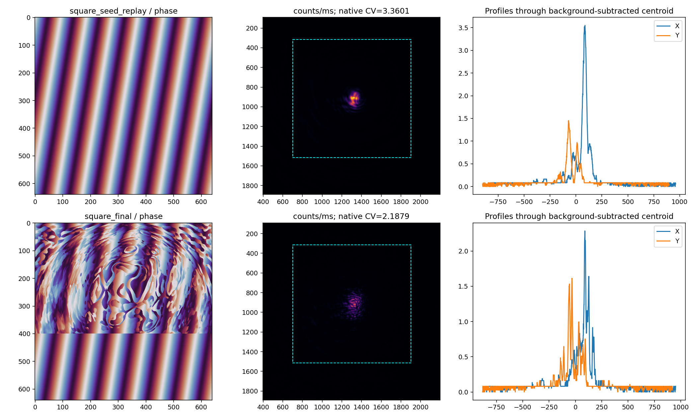
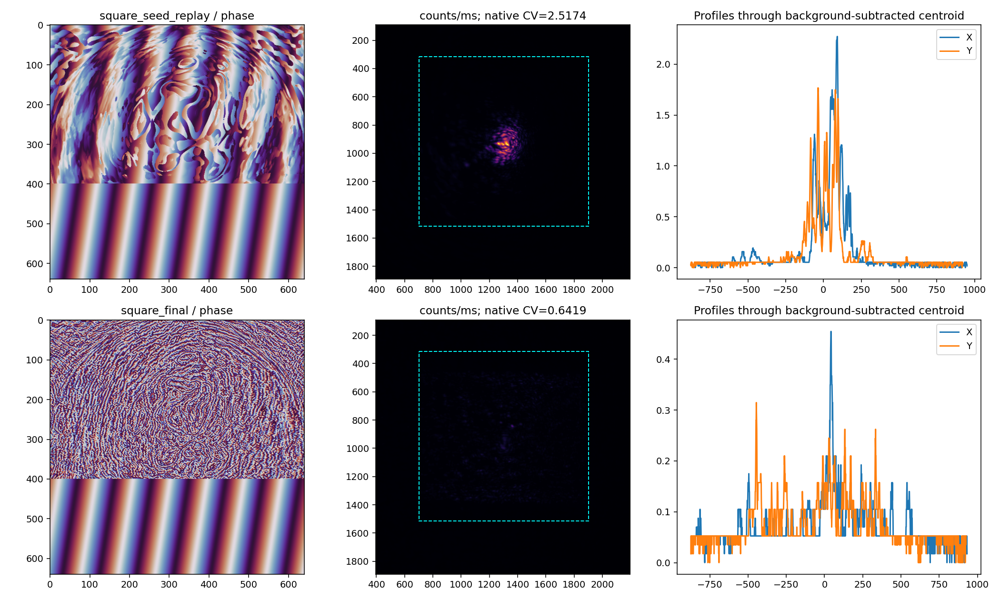
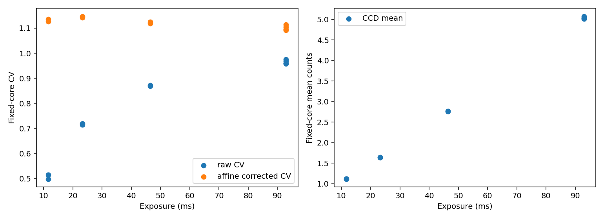
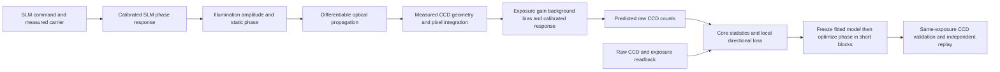

# 无 GS 冷启动、曝光偏置与非线性修正：实验后分析（2026-10-27）

<!-- provenance:start -->
> **生成脚本**: 人工撰写，无生成脚本
> **数据/关联脚本**: [`scripts/slm/analyze_no_gs_run.py`](../../../scripts/slm/analyze_no_gs_run.py)
> **数据/关联脚本**: [`scripts/slm/analyze_no_gs_response.py`](../../../scripts/slm/analyze_no_gs_response.py)
> **数据/关联脚本**: [`src/ao_shaping/tools/slm/transfer/capture_response.py`](../../../src/ao_shaping/tools/slm/transfer/capture_response.py)
> **数据/关联脚本**: [`src/ao_shaping/tools/slm/transfer/response.py`](../../../src/ao_shaping/tools/slm/transfer/response.py)
> **数据/关联脚本**: [`src/ao_shaping/tools/slm/transfer/direction.py`](../../../src/ao_shaping/tools/slm/transfer/direction.py)
> **数据/关联脚本**: [`src/ao_shaping/tools/slm/transfer/local_response.py`](../../../src/ao_shaping/tools/slm/transfer/local_response.py)
> **数据/关联脚本**: [`src/ao_shaping/utils/image/model_response.py`](../../../src/ao_shaping/utils/image/model_response.py)
> **运行环境**: 离线分析（本轮 Santec #1 / Daheng 原始数据；设备已释放）
> **说明**: 无 GS CCD 验收、曝光偏置、激活函数位置与下一轮多形状多尺度响应区间方案。
<!-- provenance:end -->

## 当前可信事实与结论

本轮在 CCD 已移动的 Santec #1 / Daheng 光路完成新探针、100 次物理参数拟合、离焦/彗差扫描、两段无 GS 可微优化和交错多曝光复测。设备、波长、实际格式、坐标与原始目录见[实验中记录](live_20261027.md)。本轮使用 Mono8，像元 2.2 µm 沿用用户规格，未独立测量。入射位置为联合拟合结果，未完成独立面板定位。所有设备会话已结束，最后一次采集于当地时间约 21:29:44 恢复平面相位并关闭 SLM/CCD；之后仅进行离线分析，没有关闭用户激光。

本轮最重要的发现是：**相位更新确实降低了热点与原始 CV，但低光计数偏置显著放大了表观收益；当前尚未得到合格的 1200 px 均匀正方形。** 内部自动微分方向与有限差分一致，CCD 差分方向有中等一致性，不能将当前误差主要归咎于反向传播代码。

## 1. 当前模型与 CCD 的量化结果

模型由名义参数冷启动，无历史权重。24 个探针分为训练相位与验证相位，不按像素随机分组。检查点仅按训练损失选择；验证全窗口 NCC `0.314541 → 0.734516`、相对 L2 `0.916264 → 0.646936`、CV 绝对误差 `2.099275 → 0.611745`。中央 200 px 诊断区 CV 误差 `1.262268 → 0.203979`。质心误差未同步改善，说明相关性、CV 和几何仍需分别验收。

以下每行比较该段**结束时相同曝光下**的起始相位重放与最终相位，不把两行当成同起点的算法消融。

| 阶段 | 同曝光 / ms | 原生核心 CV | 原生目标能量 / 窗口能量 | 核心均值 / counts | 接受 |
|---|---:|---|---|---|---:|
| 平面起点、成形目标，4×12 次 | 12.393 | 3.360114 → 2.187881 | 0.664491 → 0.650543 | 1.355212 → 1.383756 | 4/4 |
| 继承上一段相位、局部响应校正、形状目标，6×20 次 | 19.066 | 2.517354 → 0.641856 | 0.695107 → 0.606374 | 1.748068 → 1.458063 | 5/6 |

核心内缩 16 px、零级排除半径 35 px、目标边长 1200 个原生 CCD 像元。原生指标由完整 CCD 数组重算，优化器采样步长 4 px；差异约为 `3.340761/3.360114`、`2.175660/2.187881`、`0.642747/0.641856`，稀疏采样不足以解释本轮主要改善或误差。

第一段最终包含零级时原生 CV `2.196666`，排除后 `2.187881`；第二段对应 `0.657646 / 0.641856`。排除零级有帮助，但不是剩余不均匀的主要原因。三帧均值的 CV 与逐帧 CV 不同；例如第二段最终逐帧约 `0.6604、0.6606、0.6596`，不能与均值图 `0.6419` 混用。





图为相位、共同 counts/ms 色标的 CCD 和穿过扣除边缘背景后质心的 X/Y 剖面；扣除边缘背景仅用于定位剖面，不冒充暗场校正。青色虚线表示固定目标。可见当前流程主要压低/弥散中心能量，尚未填满目标区域；CV 降低不能单独代表成形成功。

### 方向性：数值导数与物理预测误差分开

第一段首块预测/CCD 差分相关性 `0.619391`，相对 L2 `0.820877`。在保存的同一核心掩膜上，自动微分方向导数与中心有限差分的相对误差为：步长 `0.1 / 0.03 / 0.01` 时，约 `5.67e−4 / 5.08e−5 / 3.87e−6`。这是一个已测方向的数值一致性证据，不代表全部参数和全部相位均已验证。

利用第一段首块的正负扰动选择正增益/残余 PSF，拟合得到 `sigma_ccd_px=4`、增益比 `1.277502`；该拟合对上的差分相关性 `0.673331`、相对 L2 `0.739343`。这些是训练方向数据，不能作为独立泛化结果。第二段新的方向差分相关性 `0.637246`、相对 L2 `0.782336`，说明简单校正尚不能消除响应误差。

第二段同时改变起点、目标函数、学习率和更新预算，不能据此声称局部响应校正优于原模型。下一轮须从同一相位、同一曝光和相同预算做交错对照。

方向诊断工具此前重建了默认核心，未保留实验中的内缩/零级排除。本轮已修复为优先读取原始记录的 `core`，并保留旧数据兼容分支；`direction_fixed_mask/` 是本轮应引用的内部导数结果，早先 `direction/` 仅作为原始诊断历史保留。

## 2. 曝光实验定位到的具体误差

`exposure_response/` 对平面与第二段最终相位分别采集 11 组交错曝光，每组 3 帧，共 66 张正式原始帧，另存曝光搜索帧。未改变最终相位，实际曝光档为 `11.618、23.236、46.473、92.947 ms`。满量程 255，最高参考正式帧峰值约 125，未以饱和画面拟合。

以下使用与整形**完全相同的采样核心掩膜**。逐像素仿射响应 `counts = slope*t + intercept` 仅用各曝光的首次访问拟合，后续访问用于重复验证；不剪裁校正后的负值。

| 曝光 / ms | 原始核心 CV（首次 / 复测） | 校正核心 CV（首次 / 复测） |
|---:|---|---|
| 11.618 | 0.514774 / 0.497774 | 1.135165 / 1.126049 |
| 23.236 | 0.719657 / 0.713490 | 1.142688 / 1.147166 |
| 46.473 | 0.868341 / 0.871278 | 1.119111 / 1.125537 |
| 92.947 | 0.974744 / 约 0.957–0.968 | 1.114207 / 约 1.093–1.105 |



有光条件拟合的核心截距中位数 `0.565220 counts`，5%/95% 分位数 `0.058154 / 0.913053`。它与低曝光下约 1 count 的均值同量级，显著压低原始 CV。校正后不同曝光的 CV 更接近，但低曝光仍有约 8.5%–9.3% 核心像素估计为负，说明该档信号不足、校正不确定性不能忽略。最高档对应约 0.02%–0.05% 负值，更适合解释本相位的空间分布。

原曝光分析的完整目标 ROI 上，重复验证 RMSE 为 `0.801279 counts`、最高曝光参考均值跨度约 `1.075%`。这是固定最终相位的**有光截距校正**，不是已测暗场、不是跨相位校正已通过，也不能证明全部非线性均由常数偏置解释。滤光片不会消除电子读出偏置。

因此，先前 `CV≈0.64` 不能作为光学均匀度已经达到 0.64 的证据。下一轮验收至少同时报告原始 CV、校正信号 CV、核心净信号、负值比例、目标覆盖与窗口能量；只对当前可标定、信号足够的区间作结论。

## 3. 对四个主要问题的优化方案

| 问题 | 本轮/历史证据 | 优先修改与可证伪实验 |
|---|---|---|
| 传播采样与像元积分不足以解释误差 | 历史加密变化小；本轮稀疏/原生 CV 接近 | 对当前相位频带再做一次收敛验证，之后固定网格；把预算转向几何、入射幅度、器件响应和观测链 |
| 相关性提升伴随 CV 恶化 | 历史确有此现象；本轮二者改善但质心未改善 | 用未单帧归一化的 L2、核心均值/方差/CV、质心、峰宽与方向差分联合选型；模型损失加入固定核心和不同空间尺度，拒绝只按 NCC 选模型 |
| 平面冷启动能改善但方向性偏弱 | 本轮 4/4、5/6 块接受，差分相关约 0.62–0.64 | 多个新方向、多个相位 RMS 步长拟合/验证局部 Jacobian；CCD 锚定修正强度基线，低秩响应修正才用于校正导数；保留原模型与修正模型的同起点消融 |
| 几何/离焦漂移不能由低阶 Zernike 单独吸收 | 双轴载波交叉映射、周期间尺度不一致、拟合原点与主分量中心不同 | 单独估计二维映射、有效曲率、入射中心/椭圆幅度、残余像差；用聚焦/载波探针辅助定位，验证映射后再解像差；不把有效曲率换算成唯一机械距离 |

具体模型链建议为：



分阶段拟合几何/有效曲率→幅度与器件响应→辐射项与局部方向；避免一个自由网络同时移动原点、改变背景、改变幅度来降低训练损失。若更换传播模型为多平面 Fresnel/ABCD，需独立尺度或距离约束，检查曲率、映射与机械距离的参数退化。

成形阶段须避免仅压低亮点：加入目标内分区覆盖、外围带能量、净信号下限和边界误差，再逐步加强信号 CV。小目标到大目标的连续扩展可以作为**从平面开始的优化策略**，但必须与直接大目标在相同设备预算下比较，不能把小尺寸成功冒充大尺寸成功。所有阶段保留最佳 CCD 相位，短块拒绝后补方向探针或缩步。

## 4. 哪里适合加入激活函数

当前 `PhysicalForwardFit.prediction()` 已有 `Gaussian → exp(iφ) → FFT → |U|² → 像元积分`，`FrozenDefocusForward.predict()` 再加 `gain、background、bias_counts/exposure`。相位到强度并不是线性映射。直接增加激活层并不自动补齐器件和几何误差；尤其不能用输出激活掩盖本轮已发现的计数偏置。

建议按以下顺序消融，全部保持原始物理预测模型作为基线：

1. **CCD 观测链末端的单调响应**。先拟合 `g*t*I+b*t+c`，重复曝光验证仍有系统曲率时，采用单调样条/查表或带正导数约束的小网络。可令响应导数为 `softplus(h(v))+ε`，积分并固定参考尺度。输入为物理光电子响应量与曝光协变量，输出为原始 counts；不能让曝光分支任意重画空间结构。接近饱和的响应用于预测可采用平滑饱和，但优化损失不能利用饱和区梯度消失获得虚假的均匀度。
2. **SLM 命令→有效相位的非线性**。用器件标定约束的单调 LUT/样条，或有界周期残差 `φ_eff=φ+a sinφ+b sin2φ`，并约束导数为正。空间串扰优先用对复相量或液晶响应的局部核表达；不能对包裹相位直接卷积跨越 0/2π 边界。需要跨相位族、跨载波周期验证，而不只拟合一个光斑。
3. **Gaussian 入射的非负幅度残差**。先用少量 B-spline/低频基函数表达 `A=A0*exp(r)`，或归一化 `A=softplus(logA0+r)`；残差可用小 MLP，隐藏层 `SiLU`，输出经有界 `tanh` 控制。`logA0` 在光阑内计算，保持光阑支持与功率归一化。幅度场应随光路慢变，不能任意依赖每个输入相位，否则易吸收错误的传播关系。
4. **物理传播后的微型残差网络**。前三项不能解释新方向误差时，再试输入 `Re(U)、Im(U)` 或 `sinφ、cosφ` 的浅层网络，隐藏层用平滑 `SiLU/GELU`，末层零初始化、有界小残差；输出修正复场/有效 PSF 后再计算强度。约束能量、带宽和残差幅度，同时训练局部正负响应。不要直接在复场实部/虚部加 ReLU，或令强度残差任意生成负值。

每个候选同时检验预测误差与方向误差；只提升 NCC、却恶化信号 CV 或新方向导数的激活方案不采用。ReLU 的分段零梯度可能使相位反演更难，Sigmoid/Tanh 大输入饱和同样需要监控；Softplus 用于正值参数化，SiLU/GELU 用于小残差网络的隐藏层，各有明确位置，不互相替代。

**本轮未添加未经验证的神经非线性到生产预测链。** 本轮已有直接证据支持先校正观测偏置，再识别剩余非线性；新激活结构须通过仿真、冻结预测一致性、有限差分和 CCD 新方向测试后启用。

## 5. 下一轮多形状、多尺度响应区间实验

用户要求已落入[机器可读测试矩阵](next_matrix_20261027.json)：圆形、正方形、三角形、五角星，各测小/中/大三个尺度 `200/600/1200` 原生 CCD px。圆形使用直径；其余使用 `target_at` 的 `side`，另记录实际目标支持的边界框、面积和最窄特征，避免把不同图形的 side 当成相同面积。采用三个随机种子，交错形状/尺寸顺序并重复固定参考。

CCD 位移后先检查整个目标落在传感器内且控制频带足够；边界不满足时明确失败或重新选载波，不能静默裁剪/缩放。大尺寸复杂目标的尖角、细结构应记录最窄特征对应的控制 Nyquist 余量。

每个形状/尺寸至少记录：

- 拟合每迭代的 Noll 序 Zernike 系数、单位 rad、基函数口径/归一化；有效离焦单独记录，不将两者重复叠加。
- 几何矩阵、原点、入射中心/宽度、增益、背景、计数偏置与残余 PSF，连同优化器参数与时间戳。
- 正负扰动三个加权相位 RMS 档 `0.03/0.1/0.3 rad`；拟合方向与独立新方向分开，记录相位空间梯度/频带。
- 原始 CCD、灰度、总相位、核心/零级掩膜、实际曝光、位深、满量程、同曝光初始/最终重放；最终相位增加多曝光诊断。
- 物理预测链的幅度、复场、传播强度、CCD 积分响应，以及拟合辐射项。含 NN 时另记实际激活层的逐通道均值、方差、分位数、零值/饱和比例及梯度范数。

本轮新增 `fit --record-responses`，每次预测记录五个物理阶段的 `shape、dtype、finite_fraction、mean、std、min/max、p1/p50/p99、zero_fraction、RMS`；复数响应按幅度统计并另记实/虚均值，**幅度统计不能当强度**。记录不保留计算图，默认关闭以避免诊断开销。本轮用已保存数据在 `response_telemetry/` 做了短离线验证，没有重新占用设备；完整数组仍需在选定阶段显式保存，统计值不能替代原始场。

物理预测模型目前没有 NN 激活层，不能把上述五个阶段称为神经激活。未来增加残差网络后应使用显式命名的 forward hook 记录实际层响应；当前统计助手可复用，但尚未自动挂接 NN。最终绘制“形状×尺寸×相位扰动×曝光”的验证热图，以及 Zernike 系数变化柱图/轨迹、层响应分布和 CCD 方向一致性图，给出有数据支持的拟合响应区间，不能声称已覆盖任意光路。

## 6. 复现与交接

完整当前模型为 `fit/frozen_parameters.json`；高分辨率导出为 `model640/`；`local_response/` 只适用于 CCD 锚定局部控制，不能作为绝对预测已通过的检查点。原始数据根路径见实验中记录，所有后续命令须创建新输出目录。

```powershell
# 离线重算，不连接设备
.venv\Scripts\python.exe scripts/slm/analyze_no_gs_session.py --root data/debug/slm_transfer/no_gs_ccd_moved_20261027_2106 --out NEW_AUDIT_DIRECTORY
.venv\Scripts\python.exe scripts/slm/analyze_no_gs_run.py --run data/debug/slm_transfer/no_gs_ccd_moved_20261027_2106/local_shape1200 --out NEW_ENDPOINT_DIRECTORY
.venv\Scripts\python.exe scripts/slm/analyze_no_gs_response.py --root data/debug/slm_transfer/no_gs_ccd_moved_20261027_2106 --out NEW_RESPONSE_DIRECTORY
```

下一次拟合在既有 `transfer.fit` 命令上增加 `--record-responses`，`iterations.pkl` 中会同时保存 `parameters.residual_noll_radians` 和 `responses`。自动适配分支的单阶段记录继承此开关；统计会增加 CPU/GPU 同步开销，比较速度时应一致设置，并单独计入诊断时间。

本轮没有实施新的非线性训练或 12 项形状/尺寸矩阵；它们是下一轮实验内容。本轮已实现并验证的是指标助手、原生 CCD 审计、可选物理阶段统计、方向掩膜一致性修复与扫描 SDK 准备修复。规划、实验中和实验后文档独立保留，使用 [MIL/transfer skill](../../../libs/skills/slm-mil-transfer/SKILL.md) 的分阶段流程。

## 7. 代码验证与工作区边界

最终相关测试 `34 passed`，覆盖指标、物理阶段遥测、遥测开启前后预测/梯度逐位一致、共享传播、拟合、离焦/彗差和局部响应/CCD 验收；新增文件的 Ruff 检查通过。`response_telemetry/iterations.pkl` 实际保存 2 个迭代、每次 25 条物理阶段响应（入射幅度一次，其余按六个相位批次记录），并保存 Noll 5–11 系数。该短离线诊断并未用于替换本轮实验检查点。

新增三份中文报告的术语转换差异为零，溯源同步检查为 clean。工作区全量术语 dry-run 仍报告 10 个既有文件、19 行，主要是历史 `data/debug` 快照及其他系列报告；另有 7 份其他报告未登记溯源。因此不能声称全仓术语/溯源测试已经全绿。本轮保留这些其他工作与原始快照，没有为消除警告改写历史证据，也未提交或暂存用户的其他修改。
