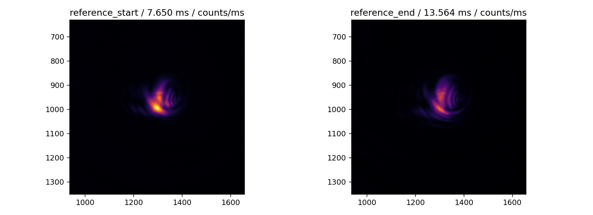
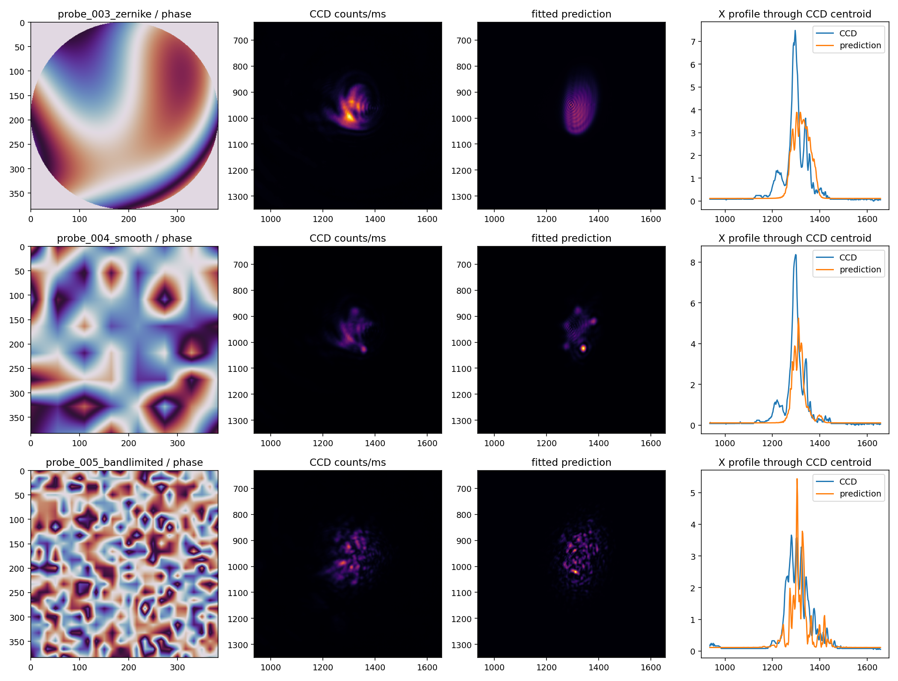

# CCD 移动后无 GS 冷启动：实验中记录（2026-10-27）

<!-- provenance:start -->
> **生成脚本**: 人工撰写，无生成脚本
> **数据/关联脚本**: [`src/ao_shaping/tools/slm/transfer/capture.py`](../../../src/ao_shaping/tools/slm/transfer/capture.py)
> **数据/关联脚本**: [`src/ao_shaping/tools/slm/transfer/fit.py`](../../../src/ao_shaping/tools/slm/transfer/fit.py)
> **数据/关联脚本**: [`src/ao_shaping/tools/slm/panel/alignment_probe.py`](../../../src/ao_shaping/tools/slm/panel/alignment_probe.py)
> **数据/关联脚本**: [`src/ao_shaping/tools/slm/transfer/validate.py`](../../../src/ao_shaping/tools/slm/transfer/validate.py)
> **数据/关联脚本**: [`scripts/slm/analyze_no_gs_session.py`](../../../scripts/slm/analyze_no_gs_session.py)
> **运行环境**: 实验（Santec #1 / Daheng；CCD 移动后的无 GS 探针与可微优化）
> **说明**: 本轮原始数据、曝光读回、几何、物理预测与同曝光验收的实验中记录。
<!-- provenance:end -->

## 当前可信事实

本轮收到设备与激光在线、CCD 已移动的明确授权后采集。使用 Santec SLM #1（标识 `22030108`），1064 nm，内部内存模式，读回 2π 灰度 `993`；未叠加 GUI 校正或隐藏载波。Daheng 枚举型号 `MER2-507-23GM NIR`、序列号 `FJB24112232`，原始图像 `2592×1944`。本轮采集为 Mono8（满量程 255）；2.2 µm 来自用户提供的规格，本轮未独立测量。Mono12 能力不等于本次文件已使用 Mono12。

设备曝光范围读回 `0.020–1000 ms`，本轮没有继承历史 0.4/0.6 ms 限制。曝光按当前图像探测；每个正式 CCD 配对块内固定，块间允许调整。未遮光，不声称测得暗场。各会话使用上下文管理器，结束恢复平面相位并释放连接。原始数据根目录：

```text
data/debug/slm_transfer/no_gs_ccd_moved_20261027_2106/
```

物理参数从名义 Gaussian 入射初始化，未加载历史权重；相位从平面加当前载波开始，GS 调用数为零。入射位置尚未经独立面板扫描，本轮拟合位置只是模型参数，不是独立测量的参考（真值）。

## 采集与诊断

第一轮 `capture/` 保存 38 组、每组 3 帧，共 114 张正式原始帧：前后平面参考、两轴三周期正负载波、24 个跨相位族探针。三种族为低阶 Zernike、平滑随机和带限随机；训练/验证按相位分组，均不含 GS。曝光搜索帧另存，失败与原始数据不覆盖。

| 项目 | 本轮结果 |
|---|---|
| 起始参考曝光 / 主分量中心 | 7.650 ms / `(1296.485, 991.101)` CCD px |
| 结束参考曝光 / 主分量中心 | 13.564 ms / `(1300.384, 996.528)` CCD px |
| 参考峰值率 | `13.856 → 9.732` counts/ms |
| 全传感器总计数率 | `419312.636 → 290724.540` counts/ms |
| 两轴载波拟合矩阵第一行 | `[563.639, 7349.231]` |
| 两轴载波拟合矩阵第二行 | `[-9681.519, -141.600]` |

矩阵单位为 CCD px / (cycles / SLM panel px)。非对角项占主导，不能把面板 x/y 默认当成相机 x/y。三周期的 x 轴主要尺度分别约 `−7804、−10616、−10624`，提示主分量定位、载波频率响应或时间变化仍存在影响；本轮不把平均矩阵当成已精确验证的几何标定。

前后参考曝光不同，计数率变化不能单独证明激光功率变化；相机有光偏置、非线性与时间漂移需要固定相位的交错曝光进一步分离。



图使用共同 counts/ms 色标；这是原始数组渲染，不是自动拉伸截图。

## 从名义参数拟合当前光路

`nominal/ → fit/` 在控制网格 384、FFT 1024、三点像元积分、CCD 步长 2 px 的固定窗口中训练 100 次。训练参数包括有效曲率、二维原点、Gaussian 入射位置/宽度与低阶残余像差；辐射项仅由训练相位估计。最佳检查点按训练损失选择，未按以下验证数字挑选。

| 验证口径 | 名义初始化 | 当前拟合 |
|---|---:|---:|
| 全窗口 NCC | 0.314541 | 0.734516 |
| 全窗口相对 L2 | 0.916264 | 0.646936 |
| 全窗口 CV 绝对误差 | 2.099275 | 0.611745 |
| 全窗口质心误差 / CCD px | 16.400115 | 19.320307 |
| 中央 200 px 诊断区 NCC | 0.262313 | 0.593357 |
| 中央 200 px 诊断区 CV 绝对误差 | 1.262268 | 0.203979 |

本轮相关性与 CV 预测同时改善，但几何质心误差没有同步改善；全窗口结果仍不足以证明模型适合长程控制。中央 200 px 是诊断区，不是已经整形的目标，以上 CV 是预测误差，不是最终均匀度。



相位图为 `twilight`，CCD 与预测为共同强度色标的 `inferno`，X 剖面穿过 CCD 强度质心。图来自验证相位，拟合未使用其像素。尚未独立标定电子偏置，图中未扣除所谓实测暗场。

拟合有效曲率 `−0.288794 m⁻¹`，原点 `(1294.431, 950.452)`，入射中心 `(1008.534, 696.416)` 面板 px、幅度宽度 `(612.092, 549.368)` 面板 px。这些是联合拟合的有效参数，不应解释为唯一的机械失调反演。

## 独立离焦 / 彗差扫描

`alignment_r2/` 使用显式名义面板中心 `(960,600)`、半径 `540`；它与物理预测模型坐标约定不同，不能直接复制系数。离焦扫描得到补偿候选 `+0.346940 m⁻¹`（焦距 `2882.341 mm`），峰值计数率相对平面提高约 `14.088` 倍，候选点两曝光比检查为 `1.0`。这些是扫描器诊断结果；部分相位切换发生稳定等待超时，相关位置/宽度须视为暂定。

两模式彗差扫描在聚焦基线上选择 `[1.0,0.0] rad`，最终对称误差 `0.118052`、RMS 半径 `11.364462 px`；聚焦基线复测为 `0.341689`、`16.444409 px`。这是同一聚焦基线内的补偿证据，不是唯一的像差估计，也未直接应用为整形叠加项。正式整形仍在当前离焦光路执行，由其自己的物理预测模型处理有效曲率。

第一次启动扫描因 SDK 路径未准备而未采图，目录 `alignment/` 保留；随后使用 `alignment_r2/` 采集。已修正工具入口的 SDK 准备，避免下次依赖手工设置 `PYTHONPATH`。

## 1200 px 正方形短块测试

将同一物理参数导出为控制网格 640、FFT 2048；这只改变数值采样，不声称模型重新标定。`plane_square1200/` 使用平面相位加周期 128 的载波，目标边长 1200 个原生 CCD 像元，窗口半宽 900 px、采样步长 4 px，核心内缩 16 px，排除原参考中心半径 35 px 的零级区域。目标固定，排除前后与信号能量须结合查看。

采用 CCD 锚定短块、成形目标、4 块 × 12 次更新、相位 RMS 限幅 0.3 rad、初始学习率 0.03。A–B–B–A 本轮仅为诊断显式开启，用于同时取得首块正负方向与漂移对照；不改变项目默认关闭的设置。所有接受决定来自同曝光 CCD 比较。最终同曝光重放与方向检查完成后，结果在[实验后分析](analysis_20261027.md)记录。

## 数据与重算

`capture_records.pkl` 保存正式采集组和每帧曝光、UTC、单调时钟；`iterations.pkl` 保存拟合/优化迭代及主机时间。时间戳是主机采集调用时间，不是相机触发同步精度。原始帧、面板相位、实际灰度、模型相位和曝光搜索帧分别保留。离焦扫描保存自身读帧与相位；内部稳定等待读取不属于其正式 manifest，不能声称记录所有 SDK 内部帧。

```powershell
.venv\Scripts\python.exe scripts/slm/analyze_no_gs_session.py --root data/debug/slm_transfer/no_gs_ccd_moved_20261027_2106 --out NEW_AUDIT_DIRECTORY
```

新指标函数保留原始 L2、单帧仿射消除后的诊断 L2、CV、窗口能量份额和方向性指标。单帧仿射拟合只用于误差分解，不能作为曝光校正通过的证据。
