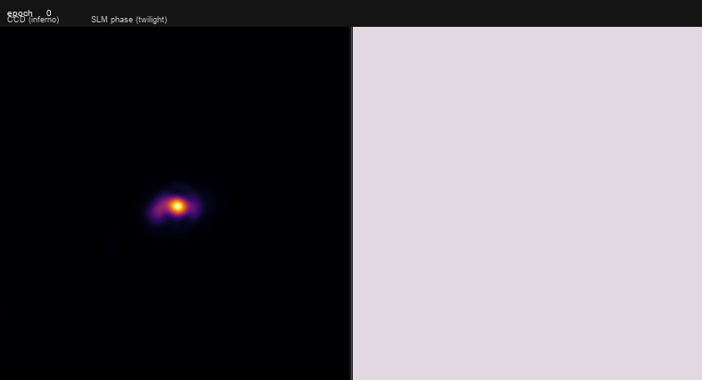
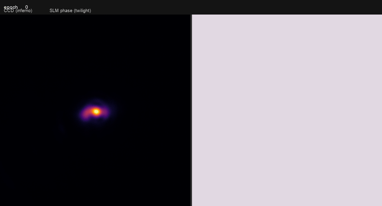
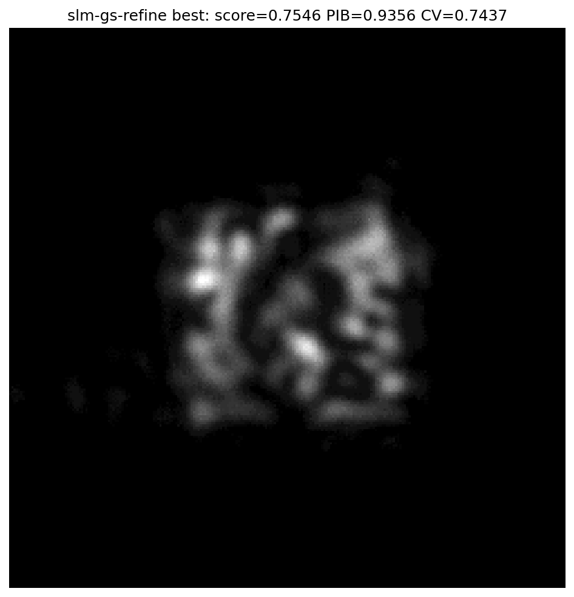
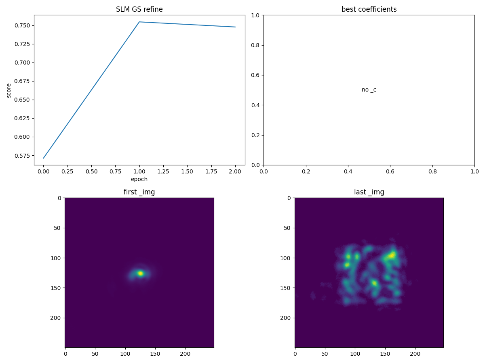
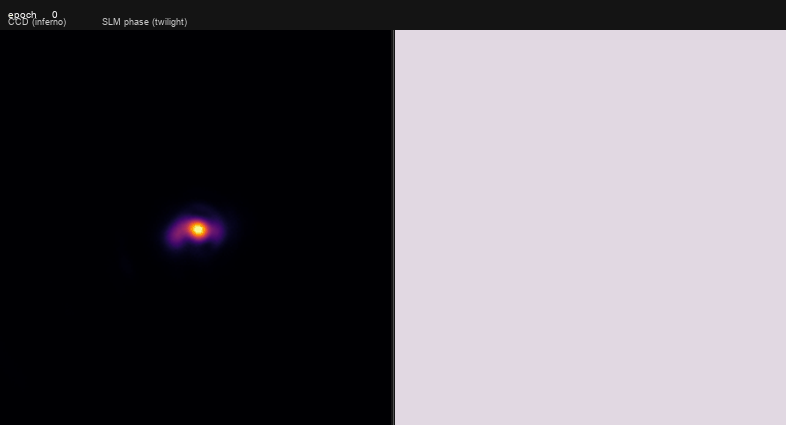
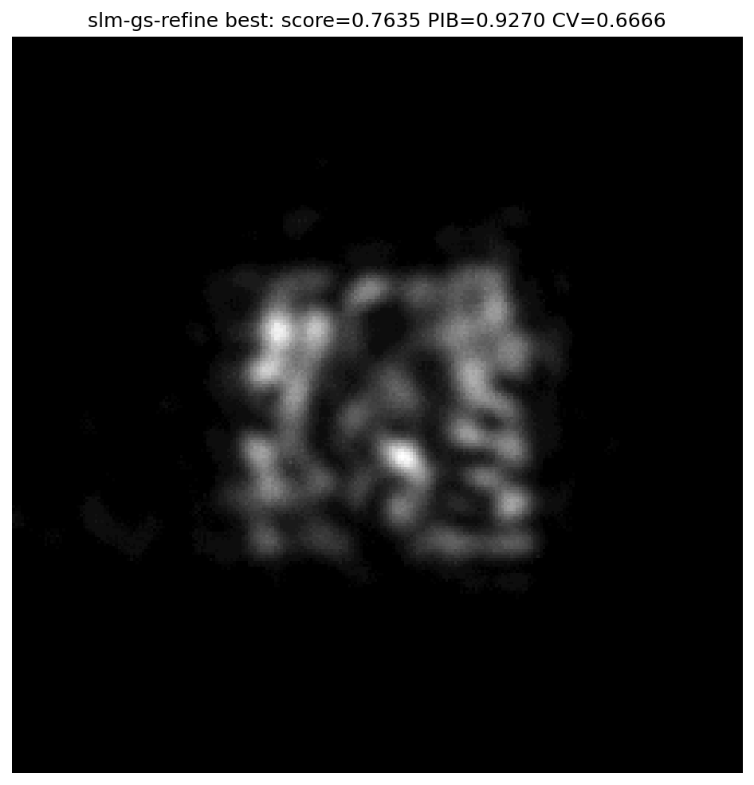
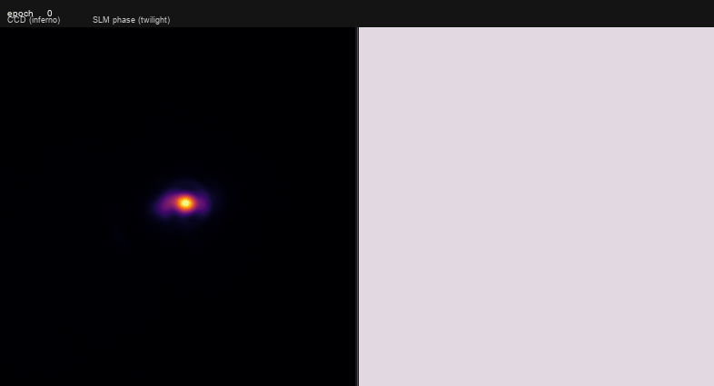
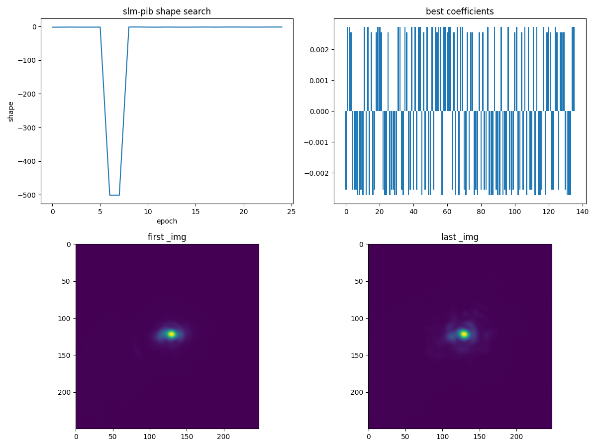

# 2026-10-10 在线方斑整形复测

<!-- provenance:start -->
> **生成脚本**: 人工撰写，无生成脚本
> **运行环境**: 硬件
> **说明**: 2026-10-10 在线复测正文为人工实测记录 (SLM 22030108 + 大恒 CCD FJB24112232)；逐帧产物由 main.py 各子命令的 --debug 产生，scripts/slm/compare_shape_debug.py 只渲染对照图
<!-- provenance:end -->

**本轮结论**（在线复测，固定 1 ms 曝光 / 100×100 像素目标）：三组 SPGD 在三个步长量级上全部失败（δ=0.05 无梯度、0.35 噪声内空转、0.5 弥散光场），**瓶颈不是 Zernike 基表达能力，而是实验系统在当前设置下无法分辨该梯度**——目标被照明漂移主导。GS 的优势来自开环逆设计提供的物理先验起点，其均匀性增益真实。待验证判据：在同一连接内交错重放平场/候选相位，并对被优化量本身建立同相位重复噪声底，以区分"SPGD 参数未调对"与"SPGD 在此实验系统看不见梯度"。原始数据 55 个运行目录（约 4.6 GB）已按原结构并入 `report/shape_trials/`。

Santec SLM `22030108` 与 Daheng CCD `FJB24112232` 在本次测试中均在线。
所有实验运行通过 `main.py` 子命令执行，使用固定 1 ms 曝光、100 x 100 像素目标；
优化测量每次平均 3 帧（`spgd-square` 的独立运行除外）。各运行目录保存了标准
`--debug` PNG、PKL、JSON，完整配置以目录中的 JSON 为准。SLM 在每次 GS 测试结束后
恢复至原灰度 0。

### 原始数据位置

本次隔离工作树中生成的实验原始数据已按原目录结构复制到主仓库
`report/shape_trials/`：55 个运行目录、216 个文件、4,595,377,197 字节。
包括本报告引用的 GS、Zernike SPGD、全频随机相位 SPGD，以及设备稳定性与相位重放记录。
迁移后逐文件核对了相对路径、字节数和 SHA-256，216 个文件全部一致。原始 PKL
受仓库 `*.pkl` 忽略规则约束，保存在主仓库工作目录中，**不随 Git 提交或推送**；
克隆仓库时只有报告和图像，离线复算需要这些本地数据。原目录仍保留作为迁移备份。

## 已测结果

| 记录目录 | 条件与结果 |
| --- | --- |
| `device_flat_interleaved_average_20261010/` | 同一相机连接交错采集三帧批量均值和三次单帧软件均值，各五次。背景中位数都是 0.66667；CV 分别 2.93998/2.93873，箱内能量 0.69533/0.69461，Pearson 0.27406/0.27409。差异处于平场波动范围内；两组使用不同的实际帧。 |
| `hardware_fractional_baseline_20261010/` | `slm-pib spgd --objective shape --target-shape square --target-size 100 --n-max 15 --log-uniformity --w-uniformity 2 --epochs 24`，最佳轮次 5，shape 从 -2.453 升至 -1.918。 |
| `device_replay_wuniformity_paired_20261010/` | 均匀性权重 2 的相位重放 CV 2.240-2.265、Pearson 0.347-0.351、能量约 0.699；权重 4 的 CV 2.614-2.636、Pearson 0.302-0.304、能量约 0.688。提高权重没有帮助。 |
| `hardware_freeform_square_20261010/` | `spgd-square` 的 12 x 12 全频随机相位跑 24 轮，最佳仍为初始平场。该算法的 EE 与 `slm-pib` 箱内能量定义不同。 |
| `hardware_gs_centered_20261010/` | 全幅定位 0 级 `(x=668,y=1026)` 后再开 CCD 窗口。12 次 GS、padding 1：平场综合分 0.5726，GS 0.6880，PIB 0.8340、CV 0.8451。首次错误左上角开窗的运行已排除。 |
| `hardware_gs_100iter_20261010/` | padding 1 增至 100 次 GS，GS 分数 0.6803；增加迭代未优于 12 次。 |
| `hardware_gs_pad2_20261010/` | 12 次 GS、padding 2：平场 0.5713，GS 0.7195，一轮细化最佳 0.7225，PIB 0.8923、CV 0.8092。 |
| `hardware_gs_pad3_20261010/` | 12 次 GS、padding 3：平场 0.5712，GS 0.7546，PIB 0.9356、CV 0.7437。旧 GIF 展示的就是这次 GS 帧。 |
| `hardware_gs_pad4_20261010/` | 12 次 GS、padding 4：平场 0.5677，GS 0.7460，一轮细化最佳 0.7492，PIB 0.9217、CV 0.7336。综合分未继续提高。 |
| `hardware_gs_pad3_refine24_20261010/` | 12 次 GS、padding 3、24 轮全频随机相位细化：平场 0.5720，GS 0.7509，细化第 19 轮最佳 0.7635，PIB 0.9270、CV 0.6666。这是本批次最高综合分，但图中仍有热点和空洞。 |
| `hardware_shape_coverage1_20261010/` | `slm-pib spgd`、5 x 5 覆盖率权重 1、24 轮：最佳 epoch 9，新 shape 分数 -1.6412，箱内能量 0.6610。按各帧最大点定位的分块覆盖率约 0.486，与旧权重 0 候选最佳帧的 0.486 基本相同；未见填框改善。 |

## 复现当前最佳记录

在完整项目环境、设备在线且光路保持本次状态时，从仓库根目录执行：

```powershell
uv run .\main.py --dir report/shape_trials/hardware_gs_pad3_refine24_20261010 --debug slm-gs-refine --cam-type daheng --cam-id 0 --exposure-time-ms 1 --cam-size 250 --slm-number 1 --slm-wavelength 1064 --target-side 100 --side-factor 1 --n-eval-frames 3 --gs-iters 12 --far-field-padding 3 --phase-grid 12 --epochs 24 --seed 0
```

旧 GIF 中视觉效果较好的 GS 帧使用相同参数，只把输出目录改为
`report/shape_trials/hardware_gs_pad3_20261010`，并将 `--epochs 24` 改为
`--epochs 1`。这两次属于不同相机会话，不能把分数差直接归因于细化轮数。
两次运行的完整参数均保存在各自 `debug/` 目录下的 JSON 中；随机种子只能固定
算法采样，不能消除硬件和光路状态变化。

## 图像与相位

以下 GIF 使用已有的 `scripts/slm/generate_pearson_pkl_gif.py` 从对应 debug PKL 生成，
左侧为 CCD，右侧为 SLM 相位。GS 动画依次展示平场、GS、一次 SPGD 测量；
Zernike 动画从 24 轮中抽取 12 帧。该脚本**逐帧归一化 CCD 图像**，动画可用于观察
形状，不能用画面亮度跨帧比较能量。GS 使用 `--max-frames 3 --fps 2 --max-dim 512`，
Zernike 使用 `--max-frames 12 --fps 3 --max-dim 512`，输出目录均为 `figures/`。













新 GIF 由同一脚本以 `--max-frames 14 --fps 3 --max-dim 512` 生成。
用 debug PKL 的原始 CCD 数组，在各自固定的 100 x 100 像素目标框内计算：
旧 GIF 的 GS 帧有 4.2% 像素低于框内均值的 10%，26.9% 低于均值的 50%；
24 轮运行的最佳帧分别为 2.2% 和 26.1%。这些比例表明目标框已有较大范围受光，
但亮度分布仍不均匀。新运行的 5 x 5 分块能量重叠率为 0.859（1 为各块均匀），
不足以代表逐像素均匀。各帧曝光均为 1 ms、三帧平均。

## 待实验验证的评分项

对另一组 `hardware_fractional_baseline_20261010/` 原始 CCD 记录，四角背景中值约为
0.3333 count，占原始整帧积分约 20.2%–20.7%。按同一 ROI 扣背景并截零后，
epoch 0 的 CV 从 2.864 变为 3.004、盒内能量从 0.716 变为 0.825；
原最佳 epoch 5 的 CV 从 1.961 变为 2.058、盒内能量从 0.699 变为 0.807。
25 个记录的最佳轮次仍是 epoch 5。背景修正改变绝对量值，但没有单独解决均匀性。

新增的 `slm-pib spgd --w-coverage` 默认值为 0，仅在显式设定时为 `shape` 目标加入
5 x 5 分块覆盖率；该新增项先做四角背景中值扣除，旧评分不变。离线纯函数测试中，
均匀填满方框的覆盖率为 1，仅中心 20 x 20 像素亮斑为 0.04。
目标函数与工具测试 82 项、runner debug 测试 23 项、CLI 帮助测试 77 项均通过；
在线 24 轮测试确认该参数可运行，但**尚无填框改善证据**。旧运行最佳帧的
5 x 5 覆盖率约 0.486，新运行最佳帧约 0.486；两者来自不同会话，且新分数含额外
覆盖率奖励，不能直接比较两个 shape 分数。后续需在同一连接内交错重放权重 0/1
候选相位。新运行的 CCD 与 SLM 相位动画包含全部 25 条记录，debug 原始 PKL 留在
`hardware_shape_coverage1_20261010/`，未加入 Git。

```powershell
uv run .\main.py slm-pib spgd --dir report/shape_trials/hardware_shape_coverage1_20261010 --debug --cam-type daheng --cam-id 0 --exposure-time-ms 1 --cam-size 250 --slm-number 1 --objective shape --target-shape square --target-size 100 --n-max 15 --zernike-radius 600 --log-uniformity --w-uniformity 2 --w-coverage 1 --n-eval-frames 3 --epochs 24 --seed 0 --delta 0.05 --lr 1
```





运行时还发现 `slm-pib` 未继承顶层 `--debug/--dir`：首次把两项放在主命令前，
优化正常完成，但没有保存预期的 debug 文件。现已修复参数继承并补定向测试；
上面的复现命令仍把两项明确放在 `spgd` 后，适用于修复前后的版本。

GS 的最佳图像仍有分离的热点与空洞，**没有形成均匀的 100 x 100 像素方斑**。
GS 的 PIB/CV 综合分与 `slm-pib` 的 shape 分数不同，不跨算法直接排序；
各 padding 条件来自不同相机会话，也不能单凭分数归因。下一次应在同一连接内交错
重放平场与候选相位，并同时评价方框覆盖率、CV、PIB 和综合分。GS runner 的
`--debug`、相机开窗、原 SLM 显示状态恢复、正负测量记录和 GS 采纳提示已修复。

## 为什么本次 SPGD 没有达到 GS 的效果

为消除两套优化器内部分数定义不同的影响，统一从四组 debug PKL 的原始 CCD 数组
复算。每组以该组**平场帧的峰值**固定 100 x 100 像素目标框，之后同组所有帧沿用
该框；以四角中位数扣除背景并截零。比较各自原优化目标选出的最佳帧，而非重新挑选
最有利于某一指标的帧。四组均为 1 ms 曝光、每次平均 3 帧。

| 原始记录和候选帧 | 盒内能量 PIB | 框内 CV（越低越好） | 5 x 5 能量覆盖率 |
| --- | ---: | ---: | ---: |
| `hardware_fractional_baseline_20261010/`，Zernike SPGD epoch 5 | 0.8072 | 2.0587 | 0.4832 |
| `hardware_shape_coverage1_20261010/`，Zernike SPGD epoch 9 | 0.7811 | 2.3512 | 0.4857 |
| `hardware_gs_pad3_20261010/`，GS 帧 | 0.9356 | 0.7437 | 0.8368 |
| `hardware_gs_pad3_refine24_20261010/`，细化 epoch 19 | 0.9270 | 0.6666 | 0.8587 |

覆盖率把目标框划成 5 x 5 块，计算各块能量占比与均匀目标的重叠率；1 表示每块
各有 1/25 的框内能量。各组平场的覆盖率为 0.318–0.357。两次 Zernike SPGD
的最佳帧都比各自平场有所改善，但仍主要把能量集中于框中少数区域。加入覆盖率奖励
后，实测覆盖率从 0.4832 到 0.4857，跨会话差异不足以证明奖励有效。
以上数值可在主仓库根目录用只读脚本复算（读取本地原始 PKL，不连接设备）：

```powershell
uv run python scripts/slm/compare_shape_debug.py report/shape_trials/hardware_fractional_baseline_20261010 report/shape_trials/hardware_shape_coverage1_20261010 report/shape_trials/hardware_gs_pad3_20261010 report/shape_trials/hardware_gs_pad3_refine24_20261010
```

综合代码审计与原始 PKL 复算，更准确的结论是：**SPGD 没有"未收敛"，而是根本没有改变光场。**
上文测量表说明 GS 帧与 Zernike 最佳帧的物理差距很大；但把三组 SPGD 运行的**相位是否真的
动了**、以及**分数是否只是在跟着亮度漂**逐项查完后，可以把原因定位得更具体。

### GS 的增益是开环的，且几乎全部来自均匀性

GS 的综合分是 `0.5*PIB + 0.5/(1+CV)`（与记录逐位吻合：平场 0.5*0.9141+0.5/4.3496=0.5720，
GS 0.5*0.9175+0.5/1.7116=0.7509）。平场→GS 的 +0.1789 中，**PIB 项只贡献 +0.0017，
CV 项贡献 +0.1772**（CV 3.350→0.712）。GS 靠一个粗略正确的光路模型做傅里叶逆设计就拿到
了这个均匀性增益——它**不需要梯度**，只要几何模型别错太多，这也正是 对比择优 不会把整轮
跑坏的原因。

### SPGD 细化阶段的"提升"等于测量选择偏差

`slm_gs_refine.py:925-954` 显示，每轮只测 `dof±delta` 两个扰动探针，**从不测量真正提交的
`dof`**；记录用的 `score` 就是 `max(pos,neg)`，而 `best_phase` 保存的是**胜出的那个随机
探针** `dof±delta`，不是收敛后的迭代点。本次 `delta=0.35`、144 个自由度，即保存的
`best_phase.npy` 相对真正挣到该分数的迭代点带有一个 ±0.35 rad 的随机相位偏移。

复算 24 轮细化的分数轨迹：报告增益 +0.01263；而"48 次抽样取最优"的选择偏差约 0.01374，
**偏差是增益的 1.09 倍**。扣除后净增益 −0.0011（0.23σ），且轨迹是振荡而非单调。换言之，
这 +0.0126 与纯测量噪声无法区分。

### 探针差分本身不含梯度信息

以 `|pos−neg|` 把 24 轮分成高/低两半，高分差轮次的下一步平均变化是 −0.0047，低分差轮次
反而 +0.0051（方向相反）；`corr(第 i 轮 pos−neg, 第 i→i+1 轮分数变化) = −0.064`，
`pos−neg` 的 lag-1 自相关 −0.055（独立噪声≈0）。五组同相位重复记录的 shape_score
组内标准差为 0.00089–0.00478，而单探针 σ≈0.0049——**信号与噪声同量级，SNR≈1**。
代码注释（`slm_zernike_pib.py:421`）也印证：`dJ_noise = 4e-4`，而"0.1 rad 扰动只让 J 动
2.8e-4"，即在**文档标称的可用 delta** 下信号已低于噪声；本次 Zernike 运行进一步只用了
`delta=0.05`。

### Zernike 运行是最干净的证据：相位压根没动

`slm_pib_shape_20261010_093101`（delta=0.05, lr=1.0, n_max=15 → K=136）复算：
**`max|c|` 仅 0.0042 rad = 波长的 0.07%**，`‖c−c0‖`=0.036。0.07% 的波长无法重塑远场，
即 24 轮后 SLM 图案与平场在物理上不可区分。但记录分数从 −2.453 "升"到 −1.918（+0.524），
而 `R²(J ~ max_brt)=0.390`、`max_brt` 跨 43.2%：同一相位重复测量时亮度本身就漂 37–45%。
既然相位可证未变，**这个 +0.524 全部是照明漂移**——与目标函数内部实现无关，光学事实已经
排除了其他解释。

### `spgd-square` 是相反的失效

`slm_square_20261010_094134` 用了 `delta=0.5`（pinned，工作区约 0.1、0.2 就已触发亮度折叠
守卫的 5 倍），`max|c|=0.50 rad`，相位被弥散；`R²(J ~ max_brt)=0.725`、`corr=−0.852`。
其 `quality` 的 best-of-25 就是**第 0 行（初始平场）**，与上文"最佳仍为初始平场"一致；
J 的"改善"只因为 J 有 72.5% 是一个亮度计。

### 结论

三组 SPGD 都在三个步长量级上失败（0.05 无梯度、0.35 噪声内空转、0.5 弥散光场），因此
**瓶颈不是 Zernike 基表达能力，而是实验系统在当前设置下无法分辨该梯度**——目标被照明漂移
主导。GS 的优势来自开环逆设计提供的有物理先验起点，其增益是真实的均匀性改善。

仍待验证：现有数据里不存在可分辨梯度的 SPGD 工作点，无法区分"SPGD 只是参数没调对"与
"SPGD 在这实验系统上看不见梯度"。判据实验是在同一连接内交错重放平场/候选相位（匹配帧数与
稳态等待），并对**被优化的那个量本身**建立同相位重复噪声底（本文给出的是 shape_score/
box_cv 的噪声底，非 GS 综合分）。
