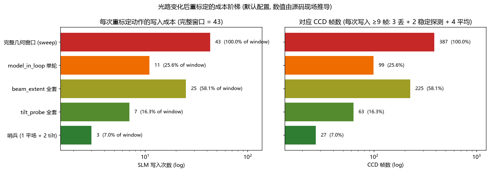
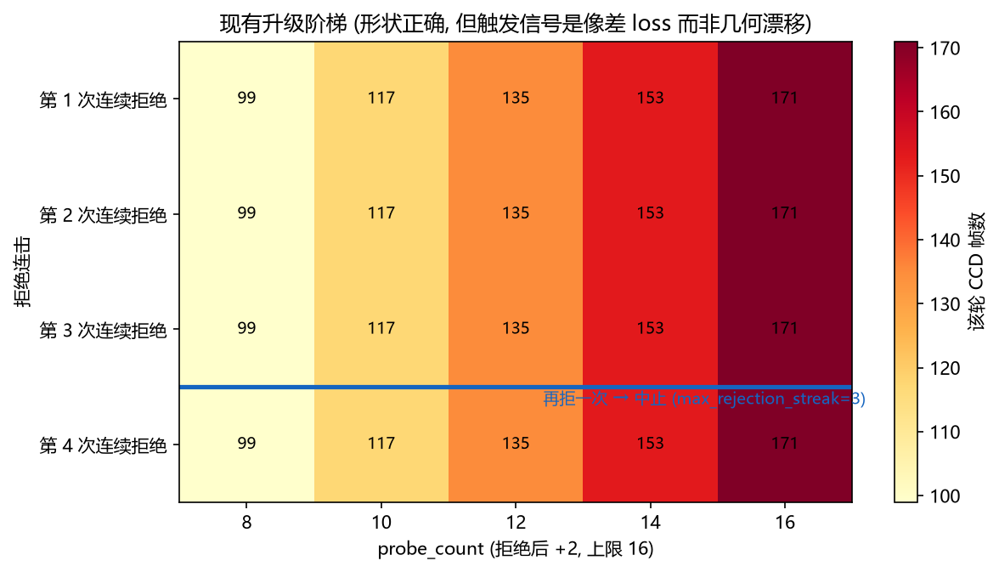

# 光路变化后的在线重标定：效率分析 (2026-10-13)

<!-- provenance:start -->
> **生成脚本**: [`scripts/slm/generate_online_recal_efficiency_report.py`](../../scripts/slm/generate_online_recal_efficiency_report.py)
> **复现命令**: `python scripts/slm/generate_online_recal_efficiency_report.py`
> **运行环境**: 离线
> **说明**: 光路变化后在线重标定的效率分析。成本模型与常量全部由源码现场推导(dataclasses/inspect 读默认值 + 扫描源码树统计重复字面量 + 调用 default_sweep_points() 枚举点数), 故不随代码漂移; §6 文献数字为人工核实; §7 为提案, 本报告不含任何新测量
<!-- provenance:end -->

## 0. 一句话

"在线微调"目前把**两件不同的事**混在一起：几何标定（瞳孔中心 / 光斑半径 / 远场像素尺度，
物理量，错了就是错了）与像差前向模型重拟合（补偿量，**几何错了也能"拟合成功"**）。
先分层、再按「重测成本 × 敏感度」排序，才是提效的正确入口——
而不是去优化已经优化得最好的那个环节。

> ⚠️ **本报告的性质**：成本模型全部由**源码现场推导**（§3、§4），因此不会与代码漂移；
> §6 的文献数字是**人工核实过的外部引用**；但 §7 的建议是**提案，未在本台架验证**。
> 报告里没有任何一个新测量。

## 1. 问题：几何误差会被像差系数吸收，然后被冻结

`slm_model-in-loop` 的在线循环每轮做两件事，它们**可辨识性完全不同**：

| | 作用 | 谁在解 | 错了会怎样 |
|---|---|---|---|
| **几何** | 瞳孔中心 / 盘半径 / 光腰 / 远场尺度 | `model_in_loop_shaping.calibrate_bench_geometry`（散斑相关打分） | 像差拟合会**吸收**它 |
| **像差** | Zernike 系数向量 | `_fit_aberration_at_probes`（Adam 最小化 loss） | 误差被 Step B 冻结 |

关键耦合：Step B 用的是**冻结**像差下的全像面自由相位
（`shape_phase_with_frozen_aberration`）。所以一旦几何错了，Step A 会把它"解释"成
像差，Step B 再把这个错误解释固化成相位——**全程不报错**。
这是静默失效，不是收敛慢。

因此提效的第一原则不是"跑得更快"，而是**别把几何问题当像差问题解**。

## 2. 参数分层：按重测成本 × 敏感度

| 层 | 参数 | 现场读到的值 | 重测成本 | 结论 |
|---|---|---|---|---|
| **T0** | SLM 像素间距 | `8 µm` | 0 | 物理常量，**不该变** |
| **T0** | 面板尺寸 | 1920×1200 | 0 | 同上 |
| **T0** | 曝光上限 | `7 ms` | 0 | 同上 |
| **T1** | 远场像素尺度 `TILT_SHIFT_SCALE` | **7400** | 3 次写入（哨兵） | ✅ **应在线** |
| **T1** | 瞳孔中心 | `(960, 600)` | 同上 | ✅ **应在线** |
| **T2** | 瞳孔盘半径 / 光腰 | `beam_radius=450 px` | 25 次写入 | ⚠️ 专用窗口 |
| **T3** | Zernike 像差向量 | — | 11 次写入/轮 | ✅ 已在线 |

**结构事实**：远场尺度是恒等式 `focal_scale = λ·f / (d_slm · p_cam)`，
`f` 与 `p_cam` 只有一个自由度。**当前代码却有两个独立常量**（`7400` 与
`camera_pixel_um`），可以静默分叉——见 §3。

## 3. 🔴 P0：同一个常量在代码里有 4 处赋值副本

下表由**扫描源码树、只认模块级赋值**得到（`scan_constant_assignments("7400")`）：

| 位置 | 符号 |
|---|---|
| `src/ao_shaping/optimizer/wfless/slm_gs_refine.py:109` | `_TILT_SHIFT_SCALE_PX` |
| `src/ao_shaping/runners/runner_common.py:137` | `_TILT_SHIFT_SCALE_PX` |
| `src/ao_shaping/tools/kernels/bench_kernels.py:116` | `TILT_SHIFT_SCALE` |
| `scripts/slm/generate_bench_probe_report.py:77` | `FALLBACK_TILT_SHIFT_SCALE` |

> ⚠️ 口径说明：直接 grep `7400` 会得到 11 处命中，但其中 **6 处是注释与文档字符串里的叙述**
> （`slm_gs_refine.py` 的推导说明、`matrix_utils.py` 的 docstring、`tilt_probe.py` 的斜率注释），
> **不算重复定义**。本报告只数赋值。

**为什么是第一优先级**：这正是 `generate_bench_probe_report.py` §1.3
"stale-geometry guard" 要防的失效模式，但**发生在代码里而不是数据里**。
光路一动，若只改其中一处，另 3 处会静默保持旧值——
几何守卫查的是文件，不是 import 图。

### 3.1 但"直接 import 它"是错的修法

`generate_bench_probe_report.py:16-18` 给出了它硬编码的**明确理由**：

> *That constant is used as a literal (`7400`) rather than imported, because its
> defining module transitively pulls in the hardware driver packages.*

本报告**实测**了这个理由（在全新解释器里 import `bench_kernels`）：

| 副作用 | 实测 |
|---|---|
| 引入 `ao_shaping.drivers.*` | 否 |
| 引入 `ctypes` | **是** |
| **加载原生 SDK（`gxipy`）** | 否 |

⇒ 理由**方向成立但比原文写的弱**：
驱动包并未被拖进来，
`ctypes` 也被引入——
对一个纯离线报告生成器这是不该有的副作用（运行时可见 `register_camera` 的 DEBUG 行）；
但由于 PEP-562 惰性契约，**真正的原生 SDK 并未被加载**。

**所以正确修法不是"那 4 处都 import 一次"**——那会把硬编码当初要避开的副作用重新引进来。
正确修法是把这些纯常量下沉到一个**零导入叶子模块**，让 4 处都能无副作用 import。
仓库已有现成先例与配套守卫：`utils/cli/params.py`（AGENTS.md 明确记载的零导入叶子，
并由 `tests/ao_shaping/utils/test_cli_params_leaf.py` 做 **AST 级**遍历守卫——
grep 挡不住藏在函数体里的延迟 import）。

## 4. 成本模型（默认配置，数值现场推导）

每次相位写入的固定开销，来自 `bench_kernels.display_and_average` 的签名：

> `3` 帧丢弃 + ≥2 帧稳定探测（`stable_tol=0.02`）
> + `4` 帧平均，首等 `0.5 s`，
> 上限 `max_wait_s=6 s`
> ⇒ **每次写入 ≥9 帧 CCD**

| 动作 | SLM 写入 | CCD 帧 | 占完整窗口 |
|---|---|---|---|
| 哨兵（1 平场 + 2 tilt） | 3 | 27 | 7.0% |
| `tilt_probe` 全套 | 7 | 63 | 16.3% |
| `beam_extent` 全套 | 25 | 225 | 58.1% |
| `model_in_loop` **单轮** | 11 | 99 | 25.6% |
| **完整几何窗口（sweep）** | **43** | **387** | 100% |

两个可直接用的结论：

- **哨兵比完整窗口便宜 14×**，甚至比一轮 `model_in_loop`
  还便宜 3.7×。⇒ 光路没动时，不该触发全量重标定。
- sweep 点数 42 由探针**自己的** `default_sweep_points()` 现场枚举得到
  （ramp 5×2 轴、tilt 2×2 轴、defocus 8、astig 4×2 模式、coma 4×2 模式、spherical 4
  ⇒ 42；按每条系数列表只算一次会少数 15 点）。

runbook 的采集阶段默认探针数（`--probes`，另行扫描）：

- `src/ao_shaping/tools/slm/compare_disturbance.py:177: parser.add_argument("--probes", type=int, default=4)`
- `scripts/slm/model_in_loop_hw_runbook.py:1095: ap.add_argument("--probes", type=int, default=12)`

## 5. 提效杠杆（按收益/成本排序）

### 5.1 几何探针必须用随机相位，不是平滑 Zernike —— 最高优先级

这是本仓库**自己已经踩过并记录**的坑，两句话必须放在一起读：

> runbook 记载：*Zernike 探针在大面板半径上构建，会让受照明核心近乎平坦，
> 因此没有散斑可相关，求解器会饱和在搜索网格边缘。*
> —— 而 `calibrate_bench_geometry` **恰恰是靠散斑相关打分**的。

两者不矛盾的前提是：探针与打分**都用**随机相位。现状是
`_calibrate_geometry` 走随机探针（已正确），而 sweep 阶段仍用平滑 Zernike。

外部佐证：Schroff et al., *arXiv:2408.07672* —— 数字孪生用 **10 个随机 SLM 相位图案、
约 5 分钟、λ/170** 标定傅里叶成像系统，并顺带解出像素串扰。

### 5.2 分级触发：复用已有的升级阶梯，只换触发信号

`SlmModelInLoopConfig` 已经内置一条**形状正确**的阶梯：

| 字段 | 值 |
|---|---|
| `probe_count` | 8 |
| `escalate_probe_count` | 2 |
| `max_probe_count` | 16 |
| `max_rejection_streak` | 3 |
| `damp_lr_factor` | 0.5 |
| `holdout_probe_count` | 2 |
| `n_eval_frames` | 4 |

"拒绝 → 降 lr → 加探针 → 连拒 3 次即中止"的逻辑是对的，
**但它由 Step A 像差 loss 触发，而不是由几何漂移触发**。改触发源即可复用，
不需要新机制——这也是本报告里唯一"几乎零成本"的高收益项。

### 5.3 把"重测"变成"重分析"

Recorder 已落盘全部帧（`utils/io/file.py::Recorder`、`save_recorder_debug_artifacts`），
`gs_refine_replay.py::load_replay_plan` 已能离线重放。未利用的是：
一次 sweep 的帧本可**同时**解出尺度 + 盘半径 + 光腰 + 各模式偏移
（`calibrate_bench_geometry_from_sweep` 就是这么做的），现在拆成多轮 = 重复采集。

### 5.4 SPGD 不能用来辨识传递矩阵 —— 别指望它

Vorontsov & Sivokon 1998 (*JOSA A* 15:2745) 的 SPGD 是**纯梯度**方法：
它从度量变化估梯度方向，**从不辨识 actuator→detector 传递矩阵**。
D-SPGD (2002, *JOSA A* 19:356) 的"10–20 迭代、与分辨率无关"是**梯度**效率，不是辨识效率。

想做在线辨识，正确工具是 RLS：

- *arXiv:2203.04915* —— 递归最小二乘在线更新影响矩阵，样本数少于批量 LS
- *Opt. Express* 29(21):33741 (2021) —— 影响矩阵是**局部的、随形状变化**的
- *arXiv:2311.17779* (Themis) —— 用**随机指令标定交互矩阵** + Kalman 滤波

### 5.5 自动重对准的精度指标可对齐

| 方法 | 精度 | 来源 |
|---|---|---|
| SPRINT 交互矩阵错位估计 | **<0.1 SA, <0.1°, <1% 放大率** | *arXiv:2406.15336* |
| DOPC 数字传播自对准 | 轴向 1.5 cm / 面内 5 mm / 旋转 5°，PBR ~30% | *Opt. Express* 22:14054 (2014) |
| 单像素实空间对准 | 亚 mm / mrad / 亚像素，**PBR >90%** | *Phys. Rev. Applied* 21,014004 (2024) |

⇒ 若光路真的动了，SLM↔CCD 的错位（平移/旋转/放大）应该用**交互矩阵**估，
而不是用单轴斜率估。

## 6. SOTA 参考成本表（外部文献，人工核实）

| 方法 | 测量次数 | 来源 |
|---|---|---|
| 模态无感 AO | ≈ **N+1**（N 模态） | Booth 2006, *Opt. Express* 14:1339 |
| 低频度量 | **3 / 模态** | Débarre 2007, *Opt. Express* 15:8176 |
| Hadamard 三步干涉 | **3N**（N=4096 时可压 10–20%） | *JOSA A* 40(1):45 (2023) |
| 单次无参考 | **1 帧 / 200 Zernike 模态** | *Light: Sci. Appl.* 2026, s41377-026-02241-5 |
| 在线 SLM 标定 | **10 图案 / ~5 min / λ/170** | *arXiv:2408.07672* |
| 影响矩阵在线更新 (RLS) | 样本数 **少于**批量 LS | *arXiv:2203.04915* |

> 本项目的 42 点 sweep 已经优于 N+1（Hadamard 3N 对 N≈14 即 42），
> **探针设计是好的，贵在每次都要跑满**。

## 7. 建议执行顺序（提案，未验证）

| 优先级 | 动作 | 收益 | 风险 |
|---|---|---|---|
| **P0** | 把重复常量下沉到零导入叶子模块，再让 4 处 import（§3.1，**不是**直接 import） | 消除静默不一致 | 低（纯清理 + AST 守卫） |
| **P0** | 几何探针统一改随机相位（§5.1） | 求解器脱离饱和边界 | 低 |
| **P1** | 加 3 写入门哨兵，驱动已有升级阶梯（§5.2） | 光路未动时省 ~14 帧 | 中（改运行时行为） |
| **P1** | Step A 加几何一致性校验：尺度偏差过大时**拒绝该轮** | 堵住"像差吸收几何误差"（§1） | 中（可能频繁中止） |
| **P2** | 一次 sweep 多解参数，离线复用帧（§5.3） | 减少重复采集 | 中 |
| **P3** | 上 RLS 影响矩阵在线更新（§5.4） | 替代部分重标 | 高 |

**求解器已有的拒绝门槛**（可复用来定哨兵阈值）：
`_MIN_CORRELATION=0.75`、`_MAX_DEFOCUS_FIT_RMS=0.1`、
`_MIN_SHIFT_CORRELATION=0.3`、
在线循环 `min_geometry_correlation=0.5`。

## 8. 边界与撤回声明

- **本报告不含任何新测量**。§4 的每个数字都来自源码默认值；
  §6 的每个数字都是外部已发表结果（人工核实）。§7 全部是提案。
- 哨兵阈值（相对 `7400` 的百分比）**尚未确定**——它取决于你的重对准公差要求，
  本报告不替它选默认值。选错的后果是"该升不升"或"不该升乱升"，两者方向相反，
  必须在台架上量出来而不是拍。
- 早期检索里出现的 `arXiv:2610.02518` **查无此文，已弃用**；
  `arXiv:2005.08562`（WaveBlocks）**未能独立复核**，因此未列入 §6。
- §5.4 的"SPGD 不辨识传递矩阵"是**方法学判断**，不是本台架实测；
  若要下结论需构造一个"模型故意错误"的对照实验。
