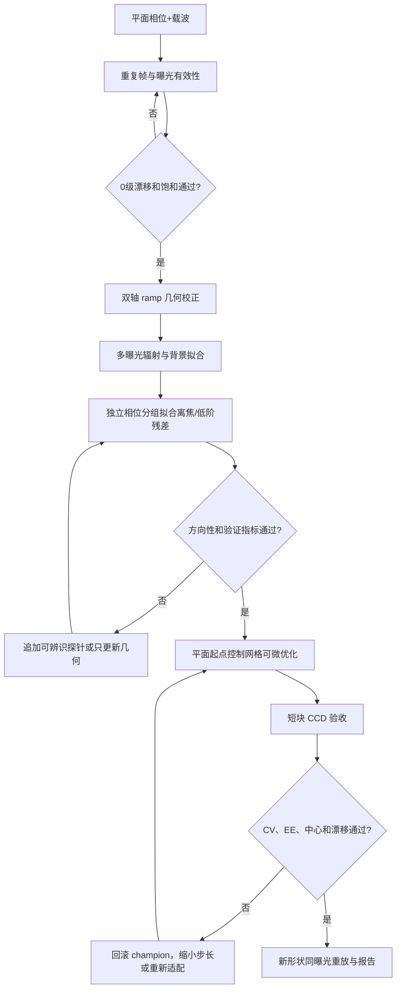

# 无 GS 起点的物理预测模型与可微整形方案（2026-10-27）

<!-- provenance:start -->
> **生成脚本**: 人工撰写，无生成脚本
> **数据/关联脚本**: [`src/ao_shaping/utils/image/physical_model_metrics.py`](../../src/ao_shaping/utils/image/physical_model_metrics.py)
> **数据/关联脚本**: [`src/ao_shaping/tools/slm/transfer/fit.py`](../../src/ao_shaping/tools/slm/transfer/fit.py)
> **数据/关联脚本**: [`src/ao_shaping/tools/slm/transfer/validate.py`](../../src/ao_shaping/tools/slm/transfer/validate.py)
> **运行环境**: 离线（历史报告分析与下一轮实验规划；未连接设备）
> **说明**: 无 GS 相位起点：分层指标、物理参数与局部响应校正、CCD 验收及缓漂实验设计；不新增实验测量结论。
<!-- provenance:end -->

本文是设备采集前完成的跨系列分析与规划；本文历史数值来自下列报告，未重新计算历史数组。收到后续设备授权后的本轮测量独立记入[实验中记录](no_gs_ccd_moved/live_20261027.md)与[实验后分析](no_gs_ccd_moved/analysis_20261027.md)，不将规划中的假设改写为测量事实。新增离线指标辅助函数及其测试，尚未接入生产闭环。

### 当前可信事实

| 项目 | 来源与状态 |
|---|---|
| 本次任务 | 离线分析、指标改进、实验设计；未连接 SLM/CCD |
| 历史设备 | Santec #1、Daheng、1064 nm、2.2 µm、Mono12/4095 来自历史会话；不是本次已测标定 |
| 当前在线状态、独占权限、实验时长 | 待下次实验确认，本次不依赖这些条件 |
| 入射位置、CCD 原点、几何映射、离焦 | 下次先读可信会话资产，短参考检验有效性；变化时只重测失效部分 |
| 当前曝光范围/满量程/LUT | 待读回；读取设备能力和环境配置，不沿用历史 0.4/0.6 ms 或 50/100 ms 为固定边界 |
| 初相位与权重来源 | 相位必须 plane/random 加当前载波；允许仿真先验或历史物理参数用于迁移学习，禁止历史整形相位/GS 种子 |

## 1. 目标与结论先行

本方案的目标是用可校正的物理预测模型生成目标相位，并以少量 CCD 闭环测量适配失调与缓漂。初始相位只允许使用平面相位加离轴载波，或带固定随机种子的低频随机相位；不得调用 GS、GS 拟合相位或历史整形相位作为起点。模型冷启动（MIL）与有预训练基座的迁移学习分别记录，不能把“模型从零拟合”当成“相位没有使用 GS”的证据。

现有证据支持以下判断：

1. 传播采样、FFT 加密和 CCD 像素面积积分造成的预测变化很小，已保存实验中预测相对 L2 的中位变化不超过约 `0.7%`，CV 误差均值变化小于 `0.004`，不是当前主要误差源。
2. 曝光、计数偏置和加性背景（杂散光）项会显著影响 CV/EE；跨曝光直接比较会把相机响应变化误认为相位收益。每个配对块必须使用同一曝光，并保存相机实际读回值。
3. 相关性不能单独作为模型选择标准。冷启动中验证相关性曾由 `0.8471` 升至 `0.9127`，但 CV 绝对误差由约 `0.6434` 恶化至约 `0.8995`；几何尺度偏差也可能保持高相关性而改变光斑宽度。
4. 无 GS 的平面相位流程已有改善观察：三角形实验中 CV `0.6632 → 0.5967`，接受 `3/4` 块。[三角形/五角星报告](tri_plane_20261027/tri_plane_20261027.md)的 GS 数值 `0.6659 → 0.6118` 来自五角星，曝光也不同，不能据此证明平面起点优于 GS。原报告不同段落的形状标签存在混淆，正式初始化对照前应核验配置和原始记录。
5. 模型方向性仍是首要风险。历史差分方向相关性约 `0.31–0.39`，因此模型损失下降不能替代 CCD 配对验收。低阶像差适配在仿真中有效，高阶像差和几何漂移需要独立参数族，不能用更多 Zernike 系数混合解释。
6. [最新迁移学习实验](transfer_square1200/transfer_square1200_20261027.md)中，干扰后原点偏移 `(76.1, -12.9) px`；全参数适配使验证相关性从约 `0.36` 提升至 `0.839`，但差分相关性只有 `0.289`，纯模型候选 `0/2` 接受；CCD 锚定段 `2/4` 接受，最终 CV `0.5940 → 0.5729`。这是“绝对预测改善不足以保证梯度可用”的最新证据，不是当前模型已经替代 GS 的证明。
7. [多形状 1200 报告](multishape1200/multishape1200_20261027.md)虽从零拟合物理参数，实际四种形状均在初相位对比中选择了 GS；正方形的完成结果不能算无 GS 证据。传输相位模型内 CV `0.0009`、CCD CV `1.3083`，进一步提示背景、频带和模型外推严重失配。三角形优化中止，五角星/圆形尚无完整整形结果。

结论是：下一轮应把指标分层、方向性验证、几何/离焦适配、曝光一致性放在长块相位更新之前。未通过全局模型验收时，只做有明确预算、逐块 CCD 判决的局部诊断实验，不能继续纯模型长程优化。

## 2. 指标体系：模型预测、光斑质量和漂移必须分开

新增离线辅助工具 [`physical_model_metrics.py`](../../src/ao_shaping/utils/image/physical_model_metrics.py) 复用项目规范 `masked_cv`、`masked_energy_fraction`。它不连接设备，也不覆盖原始帧；调用方必须传入明确的核心掩膜和可选的 0 级排除掩膜。它不改变现有 runner 选择或验收逻辑，后续需显式接入。

### 2.1 采集有效性指标（第一层）

每帧及每个配对块保存：

- `exposure_ms`：相机设置值和读回值；模型比较使用 counts/ms，原始 counts 同时保留。
- `saturation_fraction`：按相机实际位深和有效满量程计算；饱和帧不进入模型拟合或配对判决。
- `frame_repeat_std`：同一相位同一曝光的重复帧标准差；它用于估计测量噪声地板。
- `zero_order_center`、`zero_order_exclusion`：平面参考帧探测的 0 级中心与排除区域；排除区域只作用于核心 CV，不修改原始帧。
- `drift_px`：A1 与 A2 平面参考的中心位移和强度比变化。

饱和、未稳定、缺少读回或信号不足的测量标记为无效或待复测，不通过调节复合分数掩盖。0 级排除前后 CV 必须并列，记录排除面积；用于 EE 的目标掩膜与用于 CV 的核心掩膜分开。局部排除 0 级并不允许声称全光斑均匀；整窗饱和时 EE 只能标记为受截断的诊断值。

### 2.2 物理预测模型的预测指标（第二层）

对训练集、独立验证集和新相位分别计算：

| 指标 | 作用 | 选择规则 |
|---|---|---|
| `pearson_ncc` | 结构相似性 | 仅诊断，不能单独选模型 |
| `relative_l2_raw` | 未消除辐射误差的总误差 | 检查绝对预测是否失真 |
| `relative_l2_affine_diagnostic` | 单帧内拟合增益/截距后的形状误差 | 仅供误差分解，不能作为辐射校准已通过的证据 |
| `cv_abs_error` | 预测与测量均匀度差 | 必须与 NCC 同时报告 |
| `ee_abs_error` | 核心能量比例误差 | 检查能量泄漏和目标窗口 |
| `centroid_error_px` | 核心强度质心误差 | 传 `camera_xy` 时是原生 CCD px；缺省仅为数组格点，不是几何标定验收 |
| `direction_correlation` | 正负探针差分方向一致性 | 可微优化的必要门槛 |
| `direction_relative_l2` | 差分幅值误差 | 判断 Jacobian 是否过大/过小 |
| `direction_sign_agreement` | 像素级梯度方向一致率 | 检查逆向传播符号 |

`compute_forward_metrics()` 中预测必须已处于 counts/ms（传曝光时）或 counts（不传曝光时）的相同单位。真实验证的增益/背景/计数偏置仅由训练相位估计，冻结后应用于验证集；逐验证帧拟合仿射项只能作诊断。近零均值、零差分和常数图的相关性返回未定义，不能当成 CV=0 或方向通过。非法数组直接拒绝，不以补零掩盖。

`compute_directional_metrics()` 比较同曝光、同扰动幅度的模型与 CCD 差分，额外提供未去均值的 cosine、响应范数与有符号幅值比；像素符号一致率在低信号下不稳定，只能辅助判断。还须记录标量目标的方向导数符号一致率、候选排序一致率，以及实际下降量/预测下降量，判断模型是否能指导优化。相关性、像素符号和目标下降是三个不同事实。

### 2.3 整形结果指标（第三层）

在固定相机采样网格、固定目标掩膜和同一曝光下计算：

- 核心 `CV`：目标区域腐蚀两格后的 CV；若需要排除 0 级，额外应用固定排除掩膜并记录排除像素数。
- `EE_core`：目标核心能量/整窗能量；整窗固定，不能把窗口随候选相位改变。
- `IoU`：相对峰值阈值的亮区与目标掩膜交并比，用于形状边界，不替代 CV。
- `centroid_error_px`、`FWHM_x/y`、二阶矩半径：防止通过把光斑压成小亮点来降低某一局部指标。
- `phase_rms`、空间梯度 RMS、相位总变差：作为硬件可实现性和高频噪声诊断，不作为唯一目标。
- `time_to_best`、`accepted_fraction`、`rollback_count`：比较 GS 迭代与物理预测模型流程的效率。

同时报告**原生分辨率 CV**与固定物理尺度低通后的 CV：前者包含可解析散斑，后者诊断宏观梯度。低通核以 CCD 原生 px/µm 预登记，不能根据候选自适应平滑来获得漂亮曲线。当前优化网格上间隔采样的 CV 与像元面积积分、原生全像元 CV 是三种不同定义。帧均值图的空间 CV 与逐帧 CV 分布也分别报告。只在采样 CV 上改善而原生 CV 变差的候选不能称为均匀度整体改善。

推荐采用有效性约束后的向量判决。下列为方案结构，不是已经验证的固定阈值：

```text
valid measurement
  → validation: 新方向上的目标导数符号/候选排序优于随机，响应超过重复噪声
  → same-exposure shaping: 形成形状后最小化 CV，维持最小信号/EE/形状覆盖约束
  → final replay: CV、EE、IoU 和中心误差同时与平面起点比较
```

先用重复帧确定每项不确定度，再预登记最小可检测改善。按相位/方向组做配对区间或符号翻转检验，不能把每个像素当独立样本。绝对 CV 误差较大时仍可进行有限预算的局部提议实验，但必须标注模型未通过、缩短块长并由 CCD 判决，不能宣称全局模型已可用。

## 3. 物理预测模型建议

建议以明确的可微链描述观测：

```text
U_in = amplitude(x; illumination) * exp(i * [device_phase(phi) + aberration])
I_optical = pixel_integral(abs(propagation(U_in; geometry, curvature, aperture))**2)
counts(t) = response(t * [gain * I_optical + background]) + bias_counts + noise
```

`response` 缺少非线性标定时先固定为线性并声明假设；固定滤光片不能证明电子偏置为零。单曝光无法区分光学背景与计数偏置，固定相位跨曝光扫描必须交错重复参考。`pixel_integral` 是单个 CCD 像元的面积积分，和稀疏评价网格间隔分开。相干 0 级若有证据，应在场上叠加再平方，不能只用强度背景项替代。

当前 `defocus_forward_core.py` 已把传播、CCD 采样、像素积分和离焦相位集中到一个共享核心，应继续保持单一数学实现。建议把可学习参数分成三组，按可辨识性逐级开放：

### 3.1 快速适配组（每次光路变化都可更新）

1. CCD 0 级原点 `(x0, y0)`。
2. 面板频率到 CCD 像元的 `2×2` ramp 仿射矩阵。
3. 入射振幅中心和宽度 `(cx, cy, wx, wy)`。
4. 共享光学增益、非负加性背景（杂散光）项和曝光无关计数截距；若功率缓漂，用参考测量估计低维时间增益，禁止逐帧自由拟合消除残差。

这组参数对应位置、尺度、入射光斑和响应变化。必须使用独立 ramp、平面和载波探针拟合，不能让 Zernike 系数吸收几何误差。

### 3.2 光路模型组（离焦或镜片位置变化时更新）

1. Noll `Z4` 离焦系数。
2. 优先辨识有效曲率 `A/B` 与二维载波尺度。`slm_axial_offset_m` 和参考曲率不能在单一 CCD 平面上同时自由拟合；独立距离估计需要已知几何及足够多的已知平面/相位多样性，而不是增加一个自由距离就自动可辨识。CCD 恰在后焦面且无截光时，SLM 非前焦面只改变输出相位，不改变强度。
3. 低阶残差 `Z5–Z11`，以 L2 正则和步长信任域限制。
4. 必要时加入相机像素积分 `pixel_samples=3` 和有效展宽，但只有在多相位独立验证中持续改善 `relative_l2_affine` 与 `cv_abs_error` 才保留。

历史结果表明，简单高斯模糊和固定非相干背景不能共同解释 U/C 两个分支；因此不能把所有残差都拟合成一个 sigma。[轴向校正报告](axial_plane/axial_plane_20261026.md)的条件扫描只改善验证 L2 `0.1030%`，最优在 `−0.2 m` 边界且未采用，不支持继续优先扩大距离自由度。只有载波/入射位置变化伴随功率截断时，才引入有限透镜口径和 SLM→透镜→CCD 双段传播。

### 3.3 慢变化组（仅在有证据时更新）

SLM 相位 LUT、填充因子、相干 0 级比例和振幅耦合需要专门的载波频率/方向、参考相位和多曝光探针。它们不能和离焦、入射中心、背景项同时无约束拟合，否则参数不可辨识。

## 4. 无 GS 起点的优化算法

### 4.1 阶段 A：几何和辐射校正

1. 显示平面相位加低频离轴载波，采集 3–5 次重复帧，得到 0 级中心和噪声地板。
2. 以正负两个方向、至少三个周期的 ramp 估计 `2×2` 几何矩阵。
3. 在 2–3 个曝光档采集同一相位，拟合共享增益和非负加性背景（杂散光）项；曝光档内必须留一档重复验证。
4. 用平面、低频随机和低阶 Zernike 扰动分组训练/验证，拟合快速适配组，再按验证集选择检查点。

### 4.2 阶段 B：物理参数拟合

固定几何后，以训练相位上的联合损失拟合离焦和低阶残差：

```text
L_model = L_image / s_image
        + w_cv L_CV_core / s_cv
        + w_ee L_EE_target / s_ee
        + w_J L_local_response / s_J
        + λ ||Δphysical||²
```

`L_image` 使用训练共享响应后的强度误差或有独立噪声标定时的异方差似然；不能逐帧减去最有利背景。`s_*` 为训练数据/重复噪声估计的固定标度，`w_*` 在开发验证集预登记并消融，不编造“最佳权重”。`L_CV` 同时覆盖核心与整窗，`L_EE` 用完整目标/固定整窗；`L_local_response` 比较多个正负小扰动的差分或 JVP。各项归一化后才有可比较的权重意义。每次更新保存标量与参数，按预定间隔存全量预测；曝光变化后的预测必须重新使用实际曝光。

### 4.3 阶段 C：模型上的逆向传播

以平面载波相位作为 `phase_0`，不加载 GS 或历史整形相位。物理参数可来自当前冷启动或已声明来源的迁移学习；两者分组。采用两级参数化：

1. **控制网格阶段**：先计算载波与目标边界所需频率，确认每个轴满足控制网格 Nyquist 及器件带宽，再选网格。不能默认 `64×64` 或 `128×128` 足以覆盖 1200 原生 CCD px；历史大目标曾用 640 网格，仍须在当前 ramp/口径下核验。FFT 补零不会增加 SLM 的可控带宽。
2. **残差阶段**：冻结低频解，只开放小幅高频残差；每块更新后把相位映射到 SLM 面板，记录量化前后相位。

模型目标建议为：

```text
formation: minimize L_shape + w_E (1 - EE_target)
uniformity: minimize CV_core² + λ_s R_circular_phase
            subject to EE_target >= E_min,
                       mean_core >= S_min,
                       shape_error <= H_max,
                       weighted_RMS(delta_phase) <= trust_radius
```

先形成目标再匀化，避免冷启动时只优化 CV 把光弥散到窗外。约束阈值由当前信号/任务预登记，不能从最终测试结果调节。相位正则采用复相位相邻差（如 `1−cos(Δφ)`），不惩罚纯 `2π` 包裹；同时监控加载灰度及全相位的带宽，不能用原始相位 RMS 大就推断梯度过大。

第一种算法仍采用现有 Adam + 小信任域 + CCD 锚定；锚定形式 `I_meas(phi0)+F(phi)−F(phi0)` 只纠正值，不修复 Jacobian。优先测试新增方向探针拟合低秩响应校正：以 8–16 个低频/像差方向的 CCD 差分约束模型 JVP，在未参与拟合的方向上验收。若通过，再比较投影 Gauss–Newton/LM 与 Adam 的采集成本；不应直接替换成熟实现而不做仿真导数检验。

### 4.4 阶段 D：短块 CCD 验收与漂移处理

每个普通块执行当前接受相位 A → 候选 B 的同曝光顺序检查。可选 A–B–B–A 中 A1/A2 均为**当前接受相位**，B1/B2 为候选；平面/载波参考另作稀疏漂移探针，不能把两者混为一谈。A–B–B–A 保持默认关闭；稳定且收益远大于噪声时用顺序检查，漂移接近候选收益或发生拒绝连串时临时启用。现有历史对照受时序和曝光混杂，尚不能证明永久关闭更好。`model_only`、`sequential_ccd`、配对验收分别标注。

形成目标后以 CV 为主，EE/信号/形状作为防退化约束。允许有界非单调探索且始终保存 champion，最终交错重测。更新信任域用实际下降/预测下降比，而非仅连续拒绝就加探针。缓漂由参考残差触发分级适配：仅光强变化→响应增益；中心/尺度变化→几何与入射；方向响应变化→离焦/像差/JVP；高阶残差持续→扩充探针及少量残差参数。固定参考和目标不能在验收中偷偷平移来消除失调。

## 5. 实验分组与数据保存

### 5.1 最小可辨识实验

| 组 | 初相位 | 探针 | 目的 |
|---|---|---|---|
| P0 | 平面+载波 | 3 次重复 | 噪声、0 级中心、曝光线性 |
| P1 | 平面+载波 | ramp ±x/±y | 几何矩阵和方向符号 |
| P2 | 平面+载波 | 低频随机 ±扰动 | 入射中心/宽度与离焦 |
| P3 | 平面+载波 | Z4、Z5–Z11 正负扰动 | 物理 Jacobian 泛化 |
| P4 | 平面起点 | 控制网格优化 | 无 GS 的可微整形 |
| P5 | 平面起点 | 新相位重放 | 独立 CCD 验收 |

每组保留原始 CCD 帧、相位数组、实际加载灰度、相机设置和读回曝光、位深/满量程、目标/核心/0 级掩膜及哈希、模型预测、残差图、参数快照和精确时间戳。PKL 每次迭代记录 UTC 微秒、单调纳秒起止、模型版本和源文件索引；这是主机时间，不假称传感器触发时刻。任何失败或饱和数据都保留并标记，不删除以获得更好均值。

### 5.2 形状顺序

先用 `1200 px` 正方形确认核心指标和漂移判决，再用长方形、三角形和五角星检验形状泛化。每个形状使用同一物理参数基座；相位每次从 plane/random 新建。曝光可按画面在块间自适应，但最终 A/B 必须在共同有效曝光下重放，不能跨曝光相减。不同形状窗口需事先容纳完整外接尺寸和外溢区域，长方形的长边不能误用正方形边长。

### 5.3 仿真与实验系统并行

仿真用于检验可微梯度、参数可辨识性、不同离焦和几何偏移的稳健性，也可构造迁移学习先验。随机化离焦、ramp、入射中心/宽度、LUT 量化、曝光增益和背景项；波长范围须符合设备，不能无依据任意变化。按光路参数组合分组验证；再用 CCD 适配低维误差。物理参数生成器不必用神经网络学习已知传播；小型残差网络只有在跨相位方向性持续改善时才加入，漂移期间先冻结其权重。

### 5.4 下一轮执行预算和对比

以下是起始预算，可根据稳定帧读取耗时缩减；以正式采集次数而非 GPU 迭代次数比较成本。

| 阶段 | 建议数据/预算 | 固定条件与判别问题 |
|---|---|---|
| E0 数值实现 | 3 个相位状态、多个方向及有限差分步长 | 同一冻结模型上 autograd 与中心差分；float64 基准/float32 部署分别记录，量化后可微近似另验 |
| E1 采集可辨识性 | 3 组当前参考；双轴 ±ramp、3 周期；2 种相位×3 曝光并重复中间档 | 参考间隔固定；估计响应、几何、漂移和噪声，不把时间变化拟合成曝光非线性 |
| E2 基座拟合 | 24 个独立相位，预划分 12 训练/6 开发/6 封存 | 再现低频随机、Zernike、目标附近相位族；同相位多曝光及相近方向不跨组 |
| E3 Jacobian | 8 个训练方向+4 个封存方向，每方向 ±扰动、2 幅度、每次 3 帧 | 在平面和一次已形成目标附近分别验；小幅响应低于噪声时提高幅度但检查局部线性 |
| E4 无 GS 整形 | 每变体 8 块，每块先 5 次可微更新，固定正式测量预算 | 每次从相同 plane/random 起点，块间允许测光；终点共同曝光交错重放 |
| E5 缓漂适配 | 功率、入射位置、低阶像差分别扰动；最后测试组合 | 用已知可逆 SLM 相位模拟低阶像差；真实入射位移需操作者设置，不能把 tilt 当成入射位移 |

E4 先比较：M0 旧式相关性主导的物理参数拟合；M1 曝光/核心/整窗联合拟合；M2 M1 加局部 JVP 训练；M3 M2 加触发式少参数缓漂跟踪。所有变体使用相同非 GS 相位起点、探针数据划分、控制带宽和正式采集预算；模型架构逐项增加，避免一次改变全部因素。先用一个种子筛选明显失败项，再对有希望的两个变体做至少 3 次独立初始化/光路扰动重复；统计功效不足时只报告效应与区间，不宣称普适优势。

主终点是达到预登记形状覆盖/信号约束后，最终共同曝光重放的原生核心 CV；次终点为形状误差、EE_ROI、达到指定 CV 的时间、CCD 帧数、适配帧数、扰动后恢复时间和最坏阶段退化。时间同时报告含标定总耗时与已标定后的在线耗时，避免把模型训练时间排除却计入 GS 全部成本。此轮不需要 GS 起点；若引用历史 GS 数据，只能作背景，不据跨会话差异宣称速度/均匀度胜出。

### 5.5 区分实现错误、预测错误与优化困难

| 观察 | 可支持的判断 | 下一步 |
|---|---|---|
| 模型内部 autograd 与中心差分不符 | 导数/坐标/插值实现问题 | 修实现并重做仿真，不加训练参数掩盖 |
| 内部导数正确，模型差分与 CCD 不符 | 观测响应/设备加载/物理 Jacobian 失配 | 核验同曝光、实际灰度、稳定等待，再拟合 JVP/器件响应 |
| 绝对图像不准但多个新方向排序正确 | 可局部提议，不能全局预测 | 小信任域 CCD 锚定与短块验收 |
| 模型方向和 CCD 一致但形状停滞 | 约束/控制带宽/目标可达性或局部优化问题 | 改分辨率、形成目标阶段、步长及有界探索，保持模型对照 |
| 同相位 CV 随时间变化大于候选收益 | 缓漂/测量问题妨碍归因 | 插入交错参考并触发分级适配，而非无限增加优化步数 |

## 6. 分析与报告模板

每次运行报告必须按下面顺序展示：

1. 采集有效性：曝光、满量程、饱和、重复噪声、0 级漂移。
2. 模型预测：训练/验证/新相位的 NCC、仿射 L2、CV/EE 误差、中心误差。
3. 方向性：正负扰动的三项指标和差分图。
4. 逆向传播：每次更新的模型损失、相位 RMS/梯度、预测 CV/EE。
5. CCD 配对：A/B 帧、同曝光、原始与校正图、接受/回滚原因。
6. 最终重放：平面起点与最终相位的同曝光、同掩膜、同位深对照。
7. 适用边界：离焦、几何漂移、曝光范围和未辨识物理项。

报告中的 GIF 只能由保存的原始帧和相位重建；不得把预测帧插值后标为 CCD 观测。每个 GIF 帧应标出 `round/block/iteration`、曝光读回、phase timestamp 和 `measured/model` 标签。

## 7. 推荐实施顺序



第一轮建议只跑 P0–P4 的正方形，确认指标和方向性；第二轮再扩展三角形与五角星。这样可以把“模型不准”和“逆向传播错误”分开，而不会再用大量 GS 迭代替代诊断。

## 8. 复现实验入口

离线指标测试：

```powershell
$env:PYTHONPATH='src'
uv run pytest tests/ao_shaping/utils/image/test_physical_model_metrics.py -q
```

先生成不连接设备的计划（以下形状和网格是待核验的大目标配置，不是已通过实验的保证）：

```powershell
python -m ao_shaping.tools.slm.transfer plan --out data/debug/slm_transfer/no_gs_next `
  --initial-phase plane --shapes square --side 1200 --period 128 `
  --window-span 900 --window-step 4 --core-margin 8 `
  --capture-grid 384 --control-grid 640 --fft-size 2048 `
  --count 24 --frames 3 --iterations 100 --blocks 4 --updates 5 `
  --exposure-max-steps 12 --save-dataset --adaptive-exposure --device auto
```

当前入口没有 `--gs-iterations` 选项，禁止猜测参数。`--initial-phase plane` 决定实际冷启动，审计 `cold_phase` 的 `gs_calls=0`、相位来源和调用路径；不要传 `--seed-run`。上述计划无 `--checkpoint` 时是 MIL 冷启动；迁移学习变体显式提供物理参数检查点，并再次确认其相位生成路径没有 GS。

执行前核对 `run --help`、计划 journal、当前几何/控制带宽、CCD 格式能力与目标窗口。生产默认验收仍可能为 `model_only`；需要 CCD 配对时显式 `--abba`，或直接使用 `transfer.validate` 的 `--ccd-check` 顺序检查。新增指标/JVP 损失/向量约束尚属下一轮工程化事项，不能把计划命令描述为已经自动执行全部新协议。

本方案不改变已有 GS 工具；GS 可以保留为历史对照，但不再作为无 GS 物理预测模型验证的必要前置步骤。

## 9. 历史证据与适用边界

| 来源 | 支撑本方案的发现 |
|---|---|
| [采样/响应/峰宽诊断](model_in_loop/physical_forward_sampling_20261022_r2.md) | 采样非主要误差；联合训练后后采 U/C 的 CV 误差仍为 `0.0975/0.0888`，不能只看相关性 |
| [多形状误差诊断](multishape_capability/diagnosis_and_transfer_20261023.md) | 错误几何与低信号区可给出虚假低 CV |
| [无 GS 冷启动](cold_start/cold_start_20261026.md) | 平面可能只弥散光而不形成形状；相关性提高可伴随 CV 误差恶化；ABBA 成本/收益对照有时序混杂 |
| [CV 预测误差定位](cold_start/cv_diagnosis_20261026.md) | 曝光偏置修正改善整窗，却使最终相位核心 CV 误差 `0.122984 → 0.205925`，需要目标相位族验证 |
| [仿真先验与迁移学习](sim_pretrain_transfer/sim_pretrain_transfer_20261024.md) | 模型来源与相位来源必须独立审计；历史接受相位重放不是冷启动 |
| [低参数快速适配（仿真）](fast_recal_adapter/fast_recal_adapter.md) | 14 个低阶参数在低阶漂移下有收益，在高阶漂移下无净收益；不能当成已实测的万能适配 |
| [1200 px 探索实验](square1200_exploration/exploration_20261026.md) | 同曝光重放 CV 改善约 `19.72%/17.94%`，但时序混杂；保留探索为可选项 |
| [SLM 轴向校正](axial_plane/axial_plane_20261026.md) | 单平面距离不唯一，轴向项未明显改善预测 |
| [最新三角形/五角星](tri_plane_20261027/tri_plane_20261027.md) | 平面起点已有改善；不同形状与曝光不能比较初始化优劣 |
| [最新多形状从零训练](multishape1200/multishape1200_20261027.md) | 实际用了 GS 初相位，且部分流程中止，不能作为本目标的完成证据 |
| [干扰后的迁移学习](transfer_square1200/transfer_square1200_20261027.md) | 当前原点重锚避免增益归零；相关性恢复未使局部方向可靠 |

本轮没有设备操作，也没有新增实验成功结论。上述建议中，离线指标实现已补充；联合 JVP 训练、向量约束、触发式适配控制器和随机交错实验矩阵均待下一轮实现与验证。
