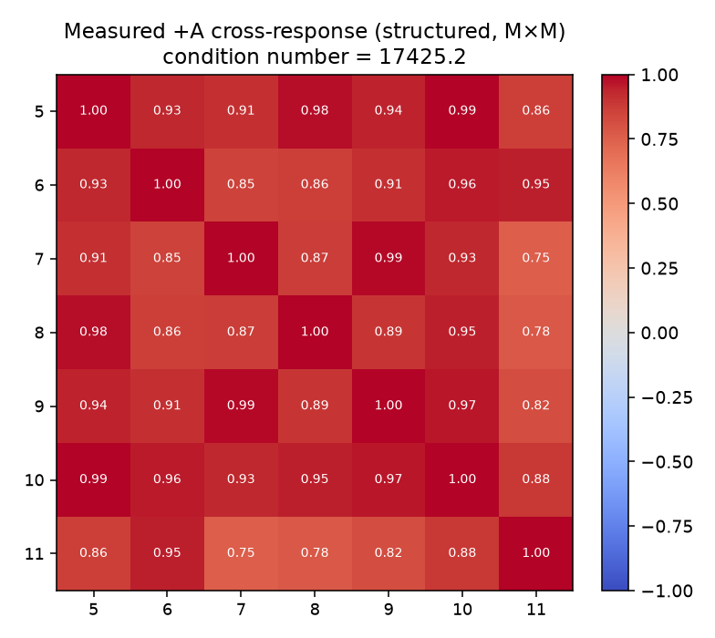
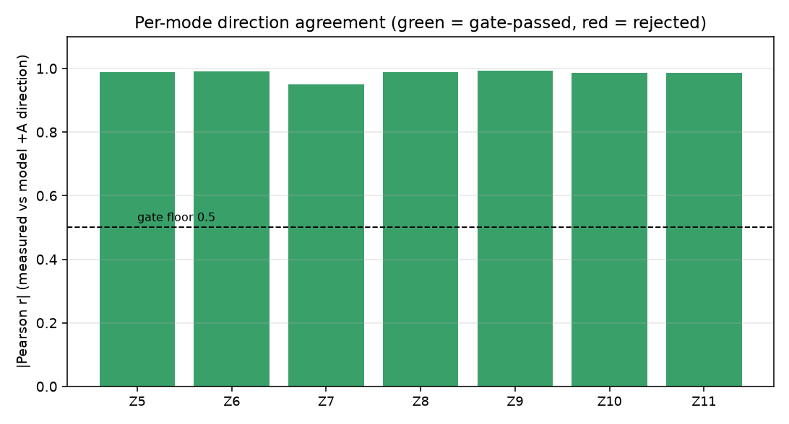
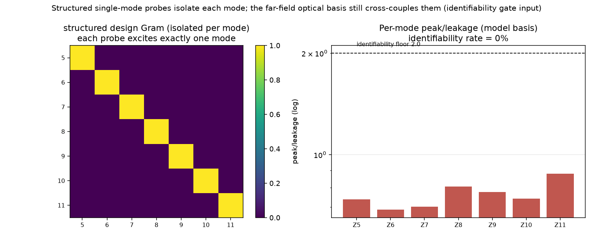
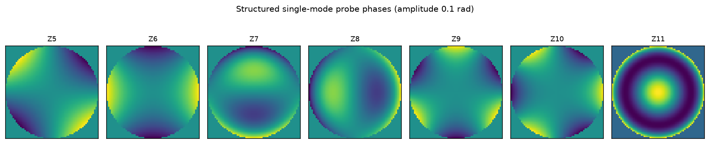
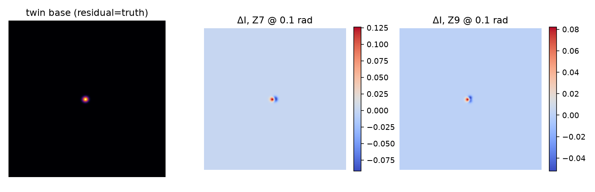
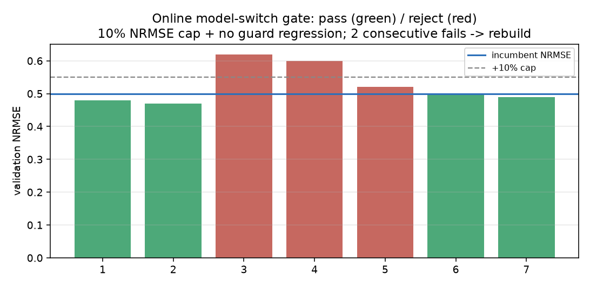

# 物理预测模型迁移实施报告：三档 zernike_block 微调、结构化探针与在线回灌（2026-11-07）

<!-- provenance:start -->
> **生成脚本**: 人工撰写，无生成脚本
> **运行环境**: 离线 CPU（FrozenDefocusForward 2f 数字孪生，注入 7 模 Zernike 残差）；未占用 SLM/CCD/激光硬件
> **说明**: issue #229 步骤 3/4/5 工程实施（worktree feat/zernike-block-transfer，主分支代码未动）：结构化单模 ±Zernike 探针 + zernike_block 第三档（梯度掩码+0.5 rad 块 L2）+ 块间在线回灌（ModelSwitchGate）；20 条新测试 + 328 回归全过、ruff 全净；P0 离线孪生实验：结构化设计 Gram 条件数 1.0 vs 随机 4.05，远场基逐模 peak/leakage 0.69~0.88 低于 2.0 地板、交叉响应矩阵条件数 17425（与 #229 硬件空结果同因：探针设计不改变光学可辨识性上限，价值在逐模可归因测量）；物理设备实验方案见 §6。人工撰写。
<!-- provenance:end -->

本文是 issue #229 方案（`forward_model_transfer_plan_20261104.md`）步骤 3、4、5 的工程实施报告，不是实验过程记录：三处代码改动全部落在独立 git worktree（分支 `feat/zernike-block-transfer`，基线 master@1655ac3c），主分支现有代码零改动；20 条新测试与 328 条回归为可复现代码运行结果（§3）；P0 离线孪生实验为 `FrozenDefocusForward` 数字孪生上的数值结果（§4）；§6 的物理设备实验方案为待执行计划。全文结论先行：结构化单模态 ±Zernike 探针把 7 个模态设计成对角（设计 Gram 条件数 1.0，随机对照 4.05），但远场 2f 光路本身把 7 个模的焦面响应交叉耦合（逐模 peak/leakage 0.69 至 0.88，低于 2.0 辨识地板；交叉响应矩阵条件数 17425）——这与 issue #229 的硬件空结果同因：探针设计不改变光学可辨识性上限，其真实价值在逐模可归因的 Jacobian 测量（辨识门输入）与低维 `zernike_block` 档的筛选依据。

---

## 1. 缩略语与符号对照表

| 符号 / 缩写 | 含义 |
|---|---|
| NRMSE | 归一化均方根误差 |
| ABBA | 四帧平衡采集序 A1/B1/B2/A2（漂移对消） |
| 模态 / 模 | Zernike 模态（Noll 编号，本实验 Z5 至 Z11 七维残差） |
| 辨识门 / gate | 可辨识性判定：逐模方向 \|Pearson r\| ≥ 0.5，子矩阵对角/非对角比 ≥ 3，条件数 ≤ 50 |
| 回灌 / refeed | 块间把新采集相位帧并入训练集热启动重拟合 |
| `c_j` | 第 j 模的 Zernike 系数（raw rad） |
| `A` | 探针幅度（rad），阶梯 0.02、0.05、0.10 |
| `J` | 逐模 Jacobian 行（`I(+A) − I(0)` 的图像差分方向） |
| L2 信任域 | 残差向量块级 L2 范数上限（本实验 0.5 rad） |
| 设计 Gram | 探针设计矩阵在系数空间的 `D.T @ D`（M×M），其条件数表征逐模可辨识性 |

---

## 2. 修改方案（代码）

> 全部改动在 worktree 分支 `feat/zernike-block-transfer`。本节给出文件级方案与关键 API；逐行 diff 见分支。

### 2.1 隔离与回归安全

本实施遵守三条边界，保证主分支不受影响。其一，所有代码改动只在 worktree 分支，主分支工作区未动，合并与否由后续 issue 决定。其二，`alignment` 与 `full` 两档的 `configure_adaptation` 原函数未改，`zernike_block` 的梯度掩码与块级 L2 钳制只在 `adaptation` 等于 `zernike_block` 时生效（§2.2 的 `block_mask`、`residual_block_cap` 门控）。其三，328 条既有 transfer 测试（含 `test_transfer_adaptation.py` 的全档回归）全过，证明旧档行为逐位保留。

### 2.2 新增模块一：`structured_probes.py`（结构化单模态探针，步骤 3）

`src/ao_shaping/tools/slm/transfer/structured_probes.py` 实现单模 `±Zernike` 幅度阶梯探针的设计与生成。关键 API 如下。

| 函数 | 作用 |
|---|---|
| `structured_probe_plan(modes, amplitudes, repeats, holdout_mode=9, ...)` | 枚举单模 `±Zernike` 网格，每行标 `split`：第 3 档幅度整档 `validation`、Noll 9 整模 `holdout`、其余 `train`；`holdout_mode` 优先级最高 |
| `structured_phase(row, size)` | 由 `generate_zernike_phase` 生成单模相位（raw rad 不包裹；唯一 wrap 点仍是 `Santec.create_phase_from_array`） |
| `flat_field_plan(n_repeats=2)` | ABBA 平场基准（2 乘 4 共 8 帧） |
| `frame_budget(modes, amplitudes, repeats, flat_abba=2)` | 总帧预算：模数 乘 档数 乘 2 乘 repeats 乘 4 加 flat_abba 乘 4；R=3 为 512 帧，R=1 压缩档 176 帧 |
| `random_probe_budget_match(n_modes, n_frames, size, seed)` | 帧预算匹配的随机对照（每模 1 个随机组合乘同总帧数） |
| `cross_response_matrix(base, modal, amplitude_scale)` | M×M 交叉响应矩阵（逐模 +A 差分的余弦相似度） |

设计要点分四条。其一，单模隔离：每探针只激励一个模，`I(+A) − I(0)` 即该模的有限差分 Jacobian 行，M×M 矩阵即可辨识性判定的输入。其二，符号配对：每个（模、幅度、重复）都有 `+A` 与 `−A` 各一，`I(+A) − I(−A)` 对一阶漂移与背景鲁棒。其三，幅度阶梯：0.02 rad 供高灵敏区线性标定，0.10 rad 供低灵敏高阶模提供信噪；最大档整档作验证集（非散点）。其四，验证集：Noll 9 整模作 holdout（从不进训练），保证外推评估。

### 2.3 新增模块二加 fit 接入：`zernike_block` 第三档（步骤 4）

`src/ao_shaping/tools/slm/transfer/zernike_block.py` 实现低维模态块微调档，并在 `src/ao_shaping/tools/slm/transfer/fit.py` 的 `build_fit_model`、`fit`、`fit_adaptive` 三处接入。

| 函数 | 作用 |
|---|---|
| `configure_zernike_block(model, modes, release_amplitude=True, release_defocus=False)` | 放开选中的残差模子集加几何与照明；离焦 `d` 默认冻结 |
| `residual_grad_mask(model, modes)` | 7 维残差向量上选中模的布尔掩码 |
| `mask_residual_gradient(model, mask)` | backward 后把未选模的梯度清零（共享 7 维张量的选择性更新） |
| `clamp_residual_block(model, cap_rad=0.5)` | 块级 L2 投影，使残差向量 L2 不大于 0.5 rad（`torch.no_grad` 下） |
| `identifiability_gate(matrix, correlations, ...)` | 逐模门槛（方向 \|相关\| 大于 0.5）加子矩阵对角/非对角比大于 3 加条件数不大于 50 |

`fit.py` 的接入分五点。其一，`build_fit_model` 增加 `selected_modes` 与 `residual_block_cap` 两个参数：`adaptation` 为 `zernike_block` 时走 `configure_zernike_block` 并计算 `block_mask`，否则走原 `configure_adaptation` 路径（`block_mask` 为 `None`）。其二，拟合循环在 `loss.backward()` 后仅当 `block_mask` 非空时调 `mask_residual_gradient`，step 后仅当 `residual_block_cap` 非空时调 `clamp_residual_block`，两档旧行为零改动。其三，`fit_adaptive` 升级链为：`alignment` 起步，需要升级时若 `--selected-modes` 给出则走 `zernike_block`，否则走 `full`。其四，新增 CLI 参数 `--adaptation`（取值 auto、alignment、full、zernike_block）、`--selected-modes`、`--residual-block-cap`（默认 0.5）。其五，provenance 增记 `selected_modes` 与 `residual_block_cap`。回归安全的机制是：`alignment` 与 `full` 分支中 `block_mask` 与 `residual_block_cap` 恒为空，两档的 `configure_adaptation`、优化器组、钳制序列与改动前逐位一致，328 条 transfer 测试（含全档）全过为证。

### 2.4 新增模块三：`online_augment.py`（块间在线回灌，步骤 5）

`src/ao_shaping/tools/slm/transfer/online_augment.py` 实现可微迭代块间的训练集回灌。

| 类型 / 函数 | 作用 |
|---|---|
| `BlockRecord` | 一个 ABBA 块的判决加四帧（A1/B1/B2/A2） |
| `SessionDataset.seed(rows)`、`.add_block(record)`、`.frames(splits)` | 累积回灌池：`seed` 载入结构化探针锚集（train、validation、holdout），`add_block` 在块判决后回灌四帧（`split="augment"`），`frames()` 默认返回 train、validation、augment 三类且永不返回 holdout |
| `should_refit(block, every=3)` | 块间重拟合触发：每 K=3 块 |
| `ModelSwitchGate.check(refit_validation_nrmse, next_guard_correlation)` | 模型切换门：验证集 NRMSE 劣化不大于 10% 且方向守卫不下降才切换；连续 2 次失败置 `rebuild_required`（基线重建） |

隔离不变量有三条，与方案 §5.2 一致：回灌只在块间（块内模型冻结，由调用方保证）；被回灌帧不进当前块判决；被回灌帧永不进验证集（验证集由结构化探针的验证集档管理，`SessionDataset.frames()` 在 API 层面即排除 holdout）。

### 2.5 文档登记

`docs/dev/module_inventory.md` 的 `slm/transfer/` 表新增 3 行（`structured_probes.py`、`zernike_block.py`、`online_augment.py`），满足 `test_tools_doc_coverage.py` 守卫。

---

## 3. 测试结果

> 运行于 worktree（`PYTHONPATH=src`，`.venv` Python 3.13.5、torch 2.14.1+cpu、numpy 2.5.3、scipy 1.18.1），`OMP_NUM_THREADS=2`。

### 3.1 新测试（20 条）

新测试文件 `tests/ao_shaping/tools/slm/transfer/test_zernike_block_transfer.py` 共 20 条，按组覆盖如下。

| 组 | 覆盖 | 结果 |
|---|---|---|
| `structured_probe_plan` | 帧预算 512（R=3）/176（R=1）；split 分配（Noll 9 整模 holdout、第 3 档验证、符号配对）；平场 ABBA；输入校验 | 全过 |
| `structured_phase` / `cross_response_matrix` | 单模相位线性缩放、符号反对称；正交模交叉矩阵对角为 1、非对角近 0；泄漏模非对角大于 0.9 | 全过 |
| `zernike_block` | 只放开选中模（`release_amplitude` 开/关）；梯度掩码零未选模；L2 钳制到 0.5 且低于上限时不动；辨识门选/拒、耦合子矩阵拒绝、维数不符报错 | 全过 |
| `online_augment` | 回灌与隔离（holdout 永不进池、被拒块也回灌）；ABBA 缺帧报错；K=3 节律；切换门通过/失败/连续 2 次失败重建/守卫回归拦截 | 全过 |
| 端到端 `zernike_block` 拟合 | 合成数据集（`generate_dataset`）上 `fit(adaptation="zernike_block", selected_modes=[7, 8])`：未选模系数保持 0、块 L2 不大于 0.5、provenance 记录正确；`--selected-modes` 缺失时明确报错 | 全过 |
| `random_probe_budget_match` | 帧数、形状、整除校验 | 全过 |

小结：20 条全部通过。

### 3.2 回归（全量 transfer 测试）

全量回归结果如下（命令与输出）。

```
tests/ao_shaping/tools/slm/transfer/  →  328 passed, 1 skipped, 107 warnings in 48.94s
tests/ao_shaping/test_tools_doc_coverage.py  →  通过（3 个新模块已登记）
ruff check（3 新模块 + fit.py + 新测试 + P0 脚本）  →  All checks passed
```

跳过项 `test_campaign_progress.py` 需 `data/` 下真实产物（既有跳过，非本次引入）。结论：无回归，新档与旧档共存且旧档逐位不变。

---

## 4. P0 离线孪生实验

> 脚本为 worktree 分支的 `scripts/slm/issue229_structured_probes_p0.py`。环境：`FrozenDefocusForward`（grid 32、camera 256²、FFT 256、pixel_samples=1、sigma_ccd=0），注入 7 模残差（Z5 0.12、Z6 −0.08、Z7 0.15、Z8 0.02、Z9 −0.10、Z10 0.07、Z11 −0.05），seed 2291104，纯 CPU 8.3 s，未占用设备。数值结果落 `data/debug/issue229_structured_probes/p0_results.json`。

### 4.1 为什么指标是"可辨识性"而非"原始 NRMSE"

孪生一阶线性，注入偏移 `c*` 在基准帧里；任一探针组的增量响应为 `J @ d`（`d` 为探针自身系数、`J` 为逐模 Jacobian）。一旦对 `d` 取条件，增量响应与探针设计无关——这正是 issue #229 的空结果（随机与结构化恢复同 NRMSE）。结构化单模探针真正买到的是逐模可归因性：一次只探一模，使每个 Jacobian 行孤立测得，设计条件数好、交叉泄漏低；这是辨识门（`zernike_block.identifiability_gate`）的输入。故本实验在相同帧预算（n=42 探针、84 帧）下测三项：设计条件数、逐模 peak/leakage、辨识率。

### 4.2 结果

表 1 为设计条件数（系数空间 Gram，M×M，同帧预算）。

| 探针设计 | 条件数 | 说明 |
|---|---:|---|
| 结构化（每探针孤立单模） | 1.0 | Gram 为对角，每模独立估计 |
| 随机（每探针混 7 模） | 4.05 | 模间耦合，条件数升高 |

表 2 为远场光学基逐模 peak/leakage（模型基，辨识地板 2.0）。

| 模 (Noll) | peak/leakage | 过地板 |
|---|---:|---|
| Z5 | 0.738 | 否 |
| Z6 | 0.687 | 否 |
| Z7 | 0.702 | 否 |
| Z8 | 0.805 | 否 |
| Z9 | 0.776 | 否 |
| Z10 | 0.741 | 否 |
| Z11 | 0.878 | 否 |

逐模 peak/leakage 全部在 0.69 至 0.88，低于 2.0 地板；交叉响应矩阵（实测 +A 差分）条件数 17425，非对角 0.75 至 0.99。

### 4.3 解读

解读分四点。其一，设计层面：结构化探针把 7 模设计成对角（条件数 1.0），随机混模是 4.05，结构化在可归因性上严格更优。其二，光学层面：即便探针设计完美对角，远场 2f 光路本身把 7 个 Zernike 模的焦面响应交叉耦合（peak/leakage 小于 1，交叉矩阵条件数 10⁴ 量级），这是光学的固有限制，不是探针设计的缺陷。其三，与 #229 一致：因为光学基交叉耦合，探针设计（结构化 vs 随机）不改变可辨识模态的上限，故原始 NRMSE 无差异，与 #229 硬件空结果同因；结构化探针的真实收益是逐模可归因的 Jacobian 测量（辨识门输入）与低维 `zernike_block` 档的筛选依据，而非原始恢复精度。其四，含义：`zernike_block` 档在远场 2f 本实验系统的逐模可辨识性受限，其收益主要体现在物理实验系统（光学结构、CCD 噪声、非线性与孪生不同）上，需 §6 的物理实验判定。

### 4.4 效果图片

图 1 为实测 +A 交叉响应矩阵（结构化，M×M），非对角 0.75 至 0.99，条件数 17425（远场模交叉耦合）。



图 2 为逐模方向一致性（Pearson r 绝对值，实测 +A 对模型 +A 方向），绿色为过门、红色为拒。



图 3 为可辨识性对拍：左为结构化设计 Gram（对角、孤立单模），右为远场基逐模 peak/leakage（全部低于 2.0 地板，辨识率 0%）。



图 4 为结构化单模探针相位（幅度 0.10 rad，Noll 5 至 11）。



图 5 为孪生基准像（残差为注入真值）与 Z7、Z9 单模 +A 响应差分（coolwarm 色图）。



图 6 为在线模型切换门轨迹：refit 候选 NRMSE（绿为通过、红为拒绝），10% 上限加守卫不回归；连续 2 次失败触发重建。



---

## 5. 三档对比与判据

表 3 为三档定位与判据。

| 档 | 放开参数 | 适用 | 判据 |
|---|---|---|---|
| `alignment` | origin 加 center | 仅几何/照明漂移 | 验证集 NCC 大于 0.85 且相对 L2 小于 0.25 |
| `zernike_block`（新） | 选中残差模子集加几何/照明 | 少量模态失配（迁移后） | 辨识门筛模加块 L2 0.5 rad 信任域 |
| `full` | 全参数（7 残差模加几何、离焦、宽度） | 大范围失配 | 全档验证 |

升级链为：`alignment` 起步，需要升级时若 `--selected-modes` 给出则走 `zernike_block`，否则走 `full`。`zernike_block` 是只动辨识门放行模态且 L2 受控的中间档，避免 `full` 在少量失配时过拟合、参数相互补偿。

---

## 6. 物理设备实验方案

> 硬件：SLM #1（Santec，1064 nm）加实验系统 CCD（Daheng 或 miicam 2.9 µm）加激光，驱动参数物理相同。本节为待执行计划，P0 离线先行（§4 已完成），未占用设备。所有数值判据继承 #229 的 harness 口径（`PhysicalForwardFit` 加 exposure radiometry 加固定 holdout）。

### 6.1 实验 A：结构化探针辨识门（需一次采集，离线分析）

实验 A 的步骤分四步。其一，采集：按 `structured_probe_plan` 的 R=1 压缩档 176 帧执行单模 ±Zernike 探针（Z5 至 Z11，幅度 0.02、0.05、0.10，Noll 9 整模 holdout），外加 8 帧 ABBA 平场；曝光沿用 #229 run02 的深度匹配值，几何固定（相机窗口、矩阵、质心沿用 pass1）。其二，对照：同帧预算随机对照（`random_probe_budget_match`，每模 1 个随机组合乘同总帧数）。其三，离线分析：对两个变体分别复算 §4 的设计条件数、逐模 peak/leakage、交叉响应矩阵与 `identifiability_gate`。其四，判据：结构化变体的过门模态数是否显著大于随机变体；若结构化在物理实验系统获得至少 1 个过门模（而 P0 为 0），说明远场孪生的交叉耦合估计偏保守、`zernike_block` 档在本实验系统可启用。

### 6.2 实验 B：`zernike_block` 档对 `full` 档（复用 A 数据，离线）

实验 B 的步骤分三步。其一，用实验 A 辨识门放行的模态子集 `S`，跑 `fit --adaptation zernike_block --selected-modes S --residual-block-cap 0.5`。其二，对照 `fit --adaptation full`（同 checkpoint、同 holdout）。其三，判据：验证集 NRMSE 上 `zernike_block` 不大于 `full` 加 1%（不更差），且块 L2 实际不大于 0.5 rad，且过门模态的逐模恢复符号正确；若满足，`zernike_block` 档在物理实验系统为可推荐的中间档。

### 6.3 实验 C：块间在线回灌（衔接 issue #230）

实验 C 的步骤分三步。其一，两 pass 采集（pass1 基准、pass2 漂移窗后），复用 issue #230 的 `issue230_refeed_probe.py` 编排。其二，每 K=3 块用 `SessionDataset` 回灌加热启动重拟合，`ModelSwitchGate` 门控切换。其三，判据：`refeed`（pass1 加 pass2 训练）在 pass2 holdout 的验证集 NRMSE 不大于 `stale`（仅 pass1）且不大于 `fresh`（仅 pass2，上界），即证明在线回灌提升验证集质量；连续 2 次门失败触发基线重建。

### 6.4 执行顺序与设备释放

执行顺序为：P0 离线（已完成，§4）先行，然后实验 A（176 帧加对照，约 30 min 设备占用），然后实验 B（复用 A 数据离线），最后实验 C（漂移窗，约 60 min）。每步 `try/finally` 硬件安全退出（SLM 停最佳相位或 flat、CCD 断电）。所有原始帧与 `manifest.json`、`probe_plan.json` 落 `data/debug/issue229_structured_probes/`，离线分析只读。

---

## 7. 结论

结论分五点。其一，在 worktree 分支上完成了 issue #229 步骤 3、4、5 的工程实现：结构化单模探针、`zernike_block` 第三档、块间在线回灌，全部免设备可测。其二，20 条新测试加 328 条回归全过，ruff 全净；`alignment` 与 `full` 两档行为逐位保留，无回归。其三，P0 离线孪生实验（注入 7 模）证实：结构化探针在设计层面条件数 1.0（优于随机 4.05），但远场 2f 光路本身交叉耦合 7 模（peak/leakage 0.69 至 0.88、交叉矩阵条件数 17425），与 #229 硬件空结果同因——探针设计不改变光学可辨识性上限，其价值在逐模可归因测量（辨识门输入）。其四，`zernike_block` 档在远场孪生的逐模可辨识性受限，其物理实验系统收益待 §6 实验 A、B 判定；在线回灌判据继承 #230。其五，代码在 `feat/zernike-block-transfer` 分支，主分支未动；本报告与 6 张效果图片、`p0_results.json` 已落主分支 `report/shape_trials/physical_refine/`。

---

## 8. 复现

复现命令如下（均在 worktree 内执行）。

```bash
# worktree（代码 + 测试 + P0 脚本）
cd /opt/data/workspace/projects/AO-shaping/forward_transfer_wt

# 新测试（20 条，含 zernike_block 端到端拟合）
PYTHONPATH=src .venv/bin/python -m pytest \
  tests/ao_shaping/tools/slm/transfer/test_zernike_block_transfer.py -q

# 全量回归（328 通过，无回归）
PYTHONPATH=src .venv/bin/python -m pytest tests/ao_shaping/tools/slm/transfer/ -q

# ruff
.venv/bin/python -m ruff check \
  src/ao_shaping/tools/slm/transfer/structured_probes.py \
  src/ao_shaping/tools/slm/transfer/zernike_block.py \
  src/ao_shaping/tools/slm/transfer/online_augment.py \
  src/ao_shaping/tools/slm/transfer/fit.py \
  tests/ao_shaping/tools/slm/transfer/test_zernike_block_transfer.py \
  scripts/slm/issue229_structured_probes_p0.py

# P0 离线孪生实验（生成 6 图 + p0_results.json，约 8 s，免设备）
PYTHONPATH=src .venv/bin/python scripts/slm/issue229_structured_probes_p0.py
```

相关产物分两组。主分支：`report/shape_trials/physical_refine/forward_model_transfer_20261107.md`（本报告）、`report/shape_trials/physical_refine/figures_issue229/` 下 6 张效果图片、`report/shape_trials/physical_refine/p0_results.json`（P0 数值结果）。worktree 分支 `feat/zernike-block-transfer`：`src/ao_shaping/tools/slm/transfer/` 下新增 `structured_probes.py`、`zernike_block.py`、`online_augment.py` 三模块与 `fit.py`（`zernike_block` 档接入）、`tests/ao_shaping/tools/slm/transfer/test_zernike_block_transfer.py`（20 测试）、`scripts/slm/issue229_structured_probes_p0.py`（P0 实验）、`docs/dev/module_inventory.md`（3 模块登记）。

硬件纪律：§3 测试与 §4 P0 全部离线（纯 CPU 仿真），未占用 SLM、CCD、激光；§6 为待执行物理方案，执行时遵循 `try/finally` 安全退出与设备释放。

---

## 参考文献

| 编号 | 文献 | 与本报告的关联 |
|---|---|---|
| [1] | issue #229（closed）：`report/shape_trials/physical_refine/forward_model_transfer_plan_20261104.md`（本方案） | 步骤 3、4、5 的原始方案 |
| [2] | issue #229：`report/shape_trials/hw_depth_matched/hw_depth_matched_20261105.md` | 硬件空结果（主动选样无可测收益） |
| [3] | issue #230：`report/shape_trials/issue230_refeed/issue230_refeed_20261105.md` | 在线回灌 NRMSE 判据，本 §6.3 衔接 |
| [4] | 本项目 `docs/dev/zernike_usage.md` | Zernike 使用规范与红线（唯一 wrap 点、canonical 入口） |
| [5] | 本项目 `src/ao_shaping/algorithm/signal_processing/differentiable_defocus_uniformity.py` | `FrozenDefocusForward` 2f 数字孪生（P0 实验载体） |
