# 物理预测模型结构·微调·光路探测·可微优化技术报告（含 issue #229 迁移学习整合方案）

<!-- provenance:start -->
> **生成脚本**: 人工撰写，无生成脚本
> **运行环境**: 离线规划文档；其 P1 已于 2026-11-05 实验执行（probe_optical_path_validity）
> **说明**: 物理预测模型迁移实验计划（P0–P6 阶段、探针族、zernike_block 档与在线回灌门）；人工撰写。
<!-- provenance:end -->

本文是技术报告，不是实验过程记录：所有模型结构、公式、参数表、算法步骤、集成点与验收门都以可复算的方式给出；涉及实测的数值只引用已有报告与 issue，并标注出处。全文结论先行：现有物理预测模型是一条参数可解释的确定性 2f 链路，其参数空间天然是低维模态结构；因此微调不需要全参重训，探测不需要随机盲探，训练集不需要离线随机相位集，而应该用少量定向 Zernike 主动探针做模态响应辨识，再用可微迭代中实际下发并采集的相位帧在线扩充训练集。本文据此给出 issue #229 的修改方案与实验计划（§6 与 §7，GitHub issue 同步更新）。

---

## 1. 缩略语与符号对照表

| 符号 / 缩写 | 含义 |
|---|---|
| 2f | 双焦距傅里叶变换光路（傅里叶平面 CCD 成像） |
| SLM | 空间光调制器（本实验系统：Santec SLM-200，1920×1200，8 µm 像元，1064 nm 下 2π 对应 993 灰度） |
| CCD | 焦面相机（Daheng MER2-507，2592×1944，2.2 µm 像元） |
| NCC | 归一化互相关（Pearson 口径，对增益与曝光不敏感） |
| NRMSE | 归一化均方根误差 |
| CV | 变异系数（目标掩膜内强度标准差除以均值） |
| EE | 目标核心区能量占比（能量分数） |
| ABBA | A 参考、B 候选、B 重复、A 重复的交错重放协议 |
| AB | 与 ABBA 同义的成对探针记号 |
| LUT | 查表（相位灰度表或 CCD 单调响应表） |
| PSF | 点扩散函数（相机侧 blaze 卷积核即其离散近似） |
| MIL | 模型在环（model-in-loop，从零在线重拟合，无预训练基座） |
| 迁移学习 | 有预训练基座：源域参数热启动加少量探针定向微调 |
| 信任域 | 参数或相位增量范数的上界约束 |
| `c_j` | 第 j 个 Noll 模态的 Zernike 系数（raw rad） |
| `Z_j` | 第 j 个 Noll 模态在控制网格上的基函数（raw rad 单位模态） |
| `d` | 离焦参数（屈光度，diopter） |
| `scale_d` | Noll 4 单位系数对应的离焦标度（本文 §2.5 计算值为 50.27 m 等效焦距量纲） |
| `ramp_matrix` | 面板斜坡（x、y 两轴）到相机位移的 2×2 实测线性映射 |
| `focal_intensity` | 中心化零填充加 FFT 的远场强度算子 |
| 结构化探针 | 本文 §4.3 的定向单模态 ±幅度探针 |
| 盲探 | 现有 `probe_grid` 的随机 Zernike / 平滑 / 带限三族随机相位探针 |
| 在线扩充 | 本文 §5.3：把可微迭代中已采集的相位帧回灌训练集 |

---

## 2. 物理预测模型结构

### 2.1 两条物理预测模型路径的分工

仓库内存在两条"相位到 CCD 强度"的正向路径，本文的"物理预测模型"特指第一条，微调与探测方案全部针对它：

| 路径 | 实现 | 参数性质 | 是否本文对象 |
|---|---|---|---|
| 物理预测模型 | `PhysicalForwardFit`（拟合侧，`src/ao_shaping/algorithm/signal_processing/physical_forward_fit.py`）与 `FrozenDefocusForward`（冻结推理侧，`differentiable_defocus_uniformity.py`） | 显式、可解释：离焦、原点、高斯照明、ramp 几何、Zernike 残差、辐射项 | 是 |
| 深度前向模型 | `ZernikeCoeffNet` 系列（`src/ml/zernike/forward_model.py`，`ZernikeCoeffConvNet` / `ZernikeCoeffMLP`） | 权重不可按 Noll 模态逐模态解释，只能全量微调 | 否（仅作对照） |

`ZernikeCoeffNet` 把 `(B, n_coeffs)` 系数向量直接回归为远场强度图，输出经 `peak_normalize` 峰值归一化。它的权重与 Noll 模态之间没有一一对应关系，无法做"单模态定向微调"，这是 issue #229 明确排除它的原因，本文沿用该边界。

### 2.2 物理预测模型的计算链

`FrozenDefocusForward.predict`（冻结推理，可微，`phase` 为唯一叶子）与 `PhysicalForwardFit.prediction`（拟合侧，同一套数学）的计算链逐项一致，共八个环节：

(1) 相位合成：`phase_all = base_phase + d·scale_d·Z4 + Σ_j c_j·Z_j`。`base_phase` 是 SLM 下发的控制相位（128×128 控制网格，raw rad 不包裹）；`d` 是离焦；`Z4` 是 Noll 4（离焦）基；求和项是可选残差模态（默认 Z5 至 Z11，`defocus_phase` 内用 `einsum` 实现）。

(2) SLM 非线性（可选，默认关闭）：命令相位先过 `slm_phase_nonlinearity`，即 `φ_eff = φ + a·sin(φ) + b·sin(2φ)`，系数 `slm_phase_a`、`slm_phase_b` 在检查点携带时启用，全零时链路逐位保持历史基线。

(3) 照明幅度：`amplitude = exp(−((x−cx)/wx)² − ((y−cy)/wy)²)·mask`，高斯入射光瞳，`mask` 为照明截止行（1200 px 以下）。可选乘性幅度残差 `exp(amp_residual)`（低频傅里叶基，默认空）。

(4) 复光场：`field = amplitude·exp(i·phase_all)`。

(5) 远场传播：`focal_intensity(field, fft_size)`，即中心化零填充加 `fftshift(fft2(ifftshift(·), norm="ortho"))`，默认 `fft_size=1024`。再乘 `irradiance_scale(pitch, fft_size)` 保持辐照度物理单位（参考对：15 px 间距、512 FFT）。

(6) 相机采样：`camera_sample_grids` 把相机网格 `(H,W,2)` 经 `ramp_matrix` 的逆映射到频域网格，`grid_sample` 双线性插值并做 `pixel_samples`（默认 3）个子像元偏移平均，得到相机采样网格上的强度。

(7) 相机点扩散（冻结侧）：blaze 高斯核 `conv2d`（`sigma_ccd_px` 参数，核宽 25 px）。

(8) 辐射项（冻结侧）：`I_ccd = gain·I + background`，可选 `bias_counts/exposure`（曝光相关偏置）与单调 CCD 响应 `MonotonicResponse` LUT（`monotonic_ccd_h`，默认空）。

拟合侧与冻结侧的差只在两处：Zernike 基的采样方式（冻结侧在 1920² 全面板生成后用 `map_coordinates` 到控制网格，拟合侧在自己的控制网格上直接生成）；以及第 (7)(8) 步后处理只由冻结侧应用。两者共用部分（面板几何、高斯幅度、相机网格、辐照度标度）已抽到 `defocus_forward_core.py`（issue #199 R2），`test_defocus_forward_core.py` 逐位锁定。

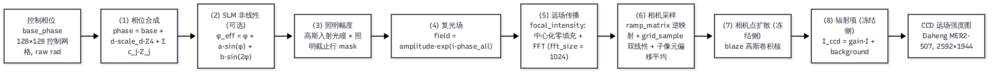

```mermaid
flowchart LR
  A["控制相位 base_phase<br/>128×128 控制网格, raw rad"] --> B
  B["(1) 相位合成<br/>phase = base + d·scale_d·Z4 + Σ c_j·Z_j"] --> C
  C["(2) SLM 非线性 (可选)<br/>φ_eff = φ + a·sin(φ) + b·sin(2φ)"] --> D
  D["(3) 照明幅度<br/>高斯入射光瞳 × 照明截止行 mask"] --> E
  E["(4) 复光场<br/>field = amplitude·exp(i·phase_all)"] --> F
  F["(5) 远场传播<br/>focal_intensity: 中心化零填充 + FFT (fft_size = 1024)"] --> G
  G["(6) 相机采样<br/>ramp_matrix 逆映射 + grid_sample 双线性 + 子像元偏移平均"] --> H
  H["(7) 相机点扩散 (冻结侧)<br/>blaze 高斯卷积核"] --> I
  I["(8) 辐射项 (冻结侧)<br/>I_ccd = gain·I + background"] --> J
  J["CCD 远场强度图<br/>Daheng MER2-507, 2592×1944"]
```


### 2.3 几何与单位（黄金值）

核心几何常数全部来自单一事实源 `utils/slm/bench_constants.py`：

| 量 | 值 | 出处 |
|---|---|---|
| SLM 面板 | 1920×1200，像元 8 µm | `SLM_PANEL_W/H`、`SLM_PITCH_M` |
| 控制网格 | 128×128（`grid_size`），覆盖 1920 px 全宽，间距 `pitch = 1920/128 = 15 px` | `FrozenDefocusParameters.grid_size` |
| 远场网格 | 1024²（`fft_size`），间距 15 µm/px | 128 网格 15 px 间距经 4 倍 FFT |
| 入射光瞳 | 中心 `(960, 600)` 面板 px，半径 450 px（直径 7.2 mm） | `BEAM_CENTER_PANEL`、`BEAM_RADIUS_PANEL` |
| 波长 | 1064 nm | `LASER_WAVELENGTH_M` |
| 2f 焦面标度 | `TILT_SHIFT_SCALE = 7400`：整幅 2π 斜坡每面板 px 的相机位移标度，实测 1/P 律（周期 120/240/480/960/1920 位移 62.1/30.3/14.7/6.9/3.4 px，0.2 px 内一致） | `TILT_SHIFT_SCALE` 及 docstring |

ramp 标度是实测值，不是由 `f·λ/d` 推算的：naive 公式在本实验系统上偏差约 17.5 倍，且面板轴与相机轴互换 90 度（`bench_constants.py` docstring 明记），所以 2f 焦面尺度一律以 `TILT_SHIFT_SCALE` 与 ramp 探针标定为准，不得从第一性原理推导。

### 2.4 可训练参数表（`PhysicalForwardFit` 现状）

| 参数 | 含义 | 初始值 | 学习率 | 约束（`update` 内 clamp） | 默认是否可训练 |
|---|---|---|---|---|---|
| `d` | 离焦（屈光度） | `−focus_diopter` 或 `initial_defocus` | 0.01 | ±2 屈光度 | 否（`full` 档开启） |
| `origin` | 光轴截距（共享，2 维相机 px） | `(1360, 1020)` | 1.0 | 无 | 是 |
| `center` | 高斯照明中心（2 维面板 px） | 传入值 | 0.5 | `[0, 1920]` | 否（`learn_amplitude` 开启） |
| `log_width` | 高斯照明宽度对数（2 维） | `log(260)` | 0.01 | `log(80)~log(800)` | 否（同上） |
| `residual` | 残差 Zernike 系数（Z5 至 Z11，7 维） | 0 | 0.03 | 无 | 否（`learn_residual` 开启） |

损失为去均值余弦相似度（`update` 内实现）；`tools/slm/transfer/fit.py` 的 `fit_loss` 在其上再加相对 L2 与 CV 项，并把辐射项（`fit_radiometry`）解耦为增益/偏移/曝光偏置，在训练样本上估计后冻结应用于验证集。

### 2.5 模态响应标度（单模态探针的预测 Jacobian 依据）

Noll 4 的离焦标度由 `diopter_scale()` 给出，代入黄金几何：

```
scale_d = π·(960·8e-6)² / (2·√3·1064e-9) = 50.27
```

即 Noll 4 系数每 1 rad（按 Noll 约定 `Z4 = √3·(2r²−1)`）对应 50.27 量纲的屈光度折算。由此可预估值量：0.03 rad 的 Noll 4 探针在远场造成的光斑尺寸变化量级为 `(0.03·scale_d)` 对光瞳曲率的相对扰动，在 15 µm/px 的远场网格上可测（阶段 C 探针的 ±0.03 rad 设计值即源于此量级与 `probe_optical_path_validity` 的 Noll 4 扫描口径）。各模态的方向预测 Jacobian 不靠手算，直接用 `FrozenDefocusForward.predict` 对 `c_j` 做有限差分（单次前向本机实测约 14 ms，见 `jacobian_guard.py` docstring），与实测差分做 `direction_agreement`。

---

## 3. 微调方案

### 3.1 现状：adaptation 两档与中间档缺失

`tools/slm/transfer/adaptation.py::configure_adaptation` 目前只有两档：

| 档 | 放开参数 | 用途 |
|---|---|---|
| `alignment` | 仅 `origin` 与 `center`（位置/照明） | 会话间几何漂移吸收 |
| `full` | 全部：`d`、`origin`、`center`、`log_width`、`residual`（Z5 至 Z11） | 跨光路全参重拟合 |

`fit.py` 的 `auto` 档按验证集质量升级：`correlation < 0.85` 或 `relative_l2 > 0.25` 时从 `alignment` 升到 `full`。问题在于：没有"低维 Zernike 参数块"档——当迁移后只有少数模态失配时，`full` 会放开 11+ 个参数去拟合少量定向样本，过拟合风险高且参数间互相补偿（#221 阶段 D 已把"参数互相补偿可辨识性检查"列为验收项）；`alignment` 又完全不管像差。中间缺的正是 issue #229 要落的 `zernike_block` 档。

### 3.2 三档微调设计（新增 `adaptation="zernike_block"`）

| 档 | 放开参数 | 触发条件 | 信任域 |
|---|---|---|---|
| `alignment`（现有） | `origin`、`center` | 新会话几何漂移 | 无（位置量，由 ramp 探针锚定） |
| `zernike_block`（新增） | 已辨识模态对应的 `residual[j]` 子集，加 `center`、`origin`，可选照明 `log_width` | §4.3 主响应门槛通过（对角主导）的模态集合非空 | 参数块 L2 范数 ≤ 0.5 rad（#229 既定，Step A 实测该量级主导泛化） |
| `full`（现有） | 全部 | `zernike_block` 后验证集改善 < 训练集改善 50%，且排除几何漂移后仍不满足 | 无 |

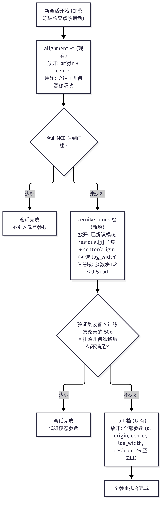

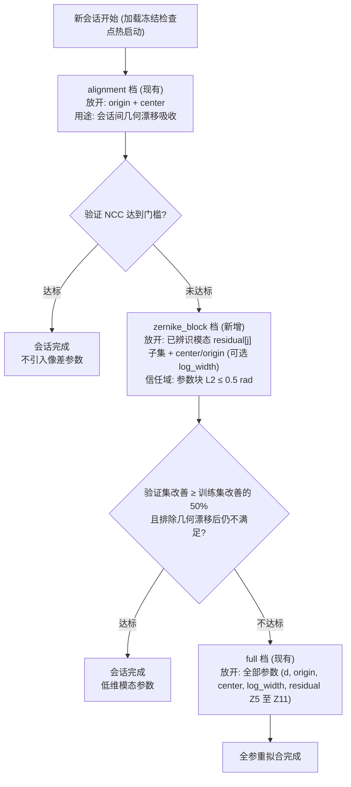


实现要点（回归安全，不动现有 golden 数值）：

(1) `configure_adaptation` 增加第三分支：`zernike_block` 档只对传入的模态索引集合放开 `residual[j]` 的 `requires_grad`，其余模态保持冻结；`residual` 是单一 7 维参数张量，按索引切片后包装成独立 `nn.Parameter` 视图或按掩码梯度实现，优化器组按模态分学习率（沿用 `residual` 的 0.03）。

(2) `fit.py::build_fit_model` 已把 `basis` 按模态传入 `PhysicalForwardFit`（`basis_arrays`），新增档不需要改基构造，只改 `configure_adaptation` 的放开集合与 `fit` 主循环的信任域 clamp（新增 `residual_block_l2_cap=0.5`，仅对该档生效，`alignment`/`full` 档行为逐位不变）。

(3) 升级链：`alignment` 不达标（验证 NCC 低于门限）不直接升 `full`，先走 `zernike_block`；`zernike_block` 仍不达标才升 `full`。升级决策落盘 `adaptation.json`（现有机制），记录每次升级的依据。

(4) 验收沿用 #221 阶段 D 口径：训练/验证相位族不相交；验证集改善 ≥ 训练集改善的 50%；24 h 内 `gain_map` 类参数相对漂移 < 5%；每引入一组参数后做可辨识性检查（参数两两相关性，互相补偿超过 0.7 的模态对合并进残差项而不单独开放）。

### 3.3 与深度模型路径的边界

`zernike_block` 只更新物理预测模型的低维系统参数，不同时反演未知入射像差（那是 #182 的对象）；不引入多频载波/频分锁相（#208 的对象）；不增加逐像素 freeform（#126 的对象）。`ZernikeCoeffNet` 保持全量微调，不参与本方案。

---

## 4. 光路探测方案

### 4.1 前置门（会话开始，先于一切相位下发）

复用 `scripts/slm/probe_optical_path_validity.py`（光路守卫 `light_guard.py` 的 `OpticalPathInvalid`，exit code 3 语义）执行四项检查：

| 检查 | 内容 | 判据 |
|---|---|---|
| 曝光线性 | 0.125× 至 1× 全幅阶梯（现有 `FRACTIONS` 序列） | 计数比与曝光比偏差 ≤ 2%（训练段内） |
| 离焦响应 | Noll 4 ±0.03 rad 对称扫描 | 有响应（非零差分）、记录正负不对称度 |
| 同相位漂移 | 平相位 AB 两次重复 | 零差分 RMS < 3×重复噪声底 |
| 饱和 | 各帧 `saturated_fraction` | 必须为 0（0.98×满量程否决线，#221 阶段 E 口径） |

门不过停在设备层，不得改判为"模型失败"（#221 阶段 A 停止条件）。

### 4.2 现有盲探的缺陷（为什么"盲目"）

现有 `tools/slm/transfer/probes.py::probe_grid` 的三族探针：

| 族 | 生成方式 | 缺陷 |
|---|---|---|
| `zernike` | Noll 4 至 11 各 `rng.normal(0, 0.6)` 随机系数 | 7 个模态同时随机组合，单模态响应被耦合淹没 |
| `smooth` | 8×8 噪声放大到控制网格 | 全频混合，与低维模态结构无关 |
| `bandlimited` | 24×24 噪声放大 | 同上 |

盲探在物理上有五个问题：

(1) 参数空间是低维模态结构，盲探却在全相位空间均匀采样，绝大多数样本落在"模型用不到、参数不可辨识"的方向上，样本效率低。

(2) 模型在随机相位的外推区误差最大。#221 实测：仿真孪生 45 对同批配对的方向余弦中位 0.0288、符号一致率 0.5056，随机相位上模型预测差；96 块方向守卫全部 `contradict`。盲探把最外推的相位拿去当训练点，等于用模型最不可信的数据区做拟合。

(3) 单模态主导关系无法从混合随机样本中分离：`Zernike` 族样本里 7 个系数同时变化，Jacobian 行不稀疏，`direction_agreement` 无法归因到具体模态。

(4) 随机相位高频成分在 SLM 非线性与衍射效率上不可控（高频相位对灰度量化噪声敏感），采集成本与风险偏高。

(5) 无符号：#221 记录离焦响应强烈不对称（+A 峰值涨 18 至 28%，−A 跌 27 至 28%），随机正负混合无法建立带符号的模态响应曲线。

### 4.3 结构化主动探针方案（替代盲探）

探针定义：单模态 `c_j = ±A_k`，其余模态为 0，`j ∈ {5, 6, …, 11}`（Z5 至 Z11 共 7 个高阶模态；piston/tip/tilt 单列为几何探针，不进模态拟合）。Noll 4 离焦是独立标量参数 `d`，其 ±0.03 rad 响应已在 §4.1 前置门验证，不占本探针预算。相位由 `generate_zernike_phase({j: ±A_k}, (size, size))` 生成（唯一规范入口，raw rad；唯一 wrap 点在 `Santec.create_phase_from_array`，严禁自行 mod 2π）。

幅度阶梯：`A ∈ {0.02, 0.05, 0.10} rad`（`A_k` 索引 1 至 3）。0.02 rad 给离焦等高灵敏度模态做小步长线性区标定；0.10 rad 给低灵敏度高阶模态出信号。符号必须成对出现（不对称响应见上）。

帧预算（M=7 模态，K=3 幅度，R=3 重复，每点 4 帧 ABBA 式交错，含平场参考）：

```
帧数 = M × K × 2(符号) × R × 4 + 8(平场参考 ABBA×2) = 7×3×2×3×4 + 8 = 512
```

采集节奏与现有 `capture` 相同（单帧含 0.3 s 稳定等待与 16 帧采样平均，`local_forward` 口径），512 帧约 2 至 3 小时设备时间，可拆两个会话。若帧预算需压缩，优先砍重复（R=1）而不是砍模态或符号：模态覆盖与符号完整性是辨识的前提，重复次数只影响噪声估计。

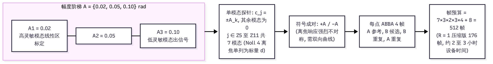

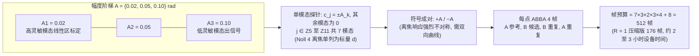


每帧记录（沿用 `capture.py` manifest 口径）：`file`、`label`（如 `zn07_p005_r2`）、`split`、`exposure_ms`（设置值与读回值）、相位灰度（实际下发）、时间戳。`split` 划分：每个模态的第 3 档幅度整档留作验证集（`split="validation"`），训练只用前两档；模态间再留 1 个模态（默认 Noll 9）整模态不进训练，作独立验证集模态。

主响应门槛（每模态，进微调前的前提验证）：

(1) 模型预测方向：`J_j = predict(c_j=+A) − predict(c_j=0)`（冻结模型，有限差分，单次前向）。

(2) 实测方向：`M_j = I(+A) − I(0)`（同曝光 AB 差分）。

(3) `direction_agreement(J_j, M_j)`（`jacobian_guard.py`，Pearson 相关，阈值 `low=0.5`/`high=0.85`）：`agree` 或 `weak` 且 |相关| ≥ 0.5 的模态进 `zernike_block` 微调集；`contradict` 的模态不进微调，归入残差/几何项排查（可能是 ramp 几何错、照明偏、或该模态被 CCD 量程截断）。

(4) 交叉响应矩阵：由 M 个模态的 ±A 差分构建 M×M 矩阵（对角 = 主响应，非对角 = 交叉泄漏）。验收：对角/非对角范数比 ≥ 3，矩阵条件数 ≤ 50（#229 奇异值门槛口径）。不满足的模态对降权或合并。

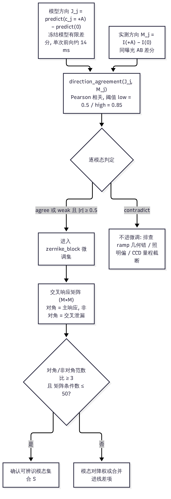

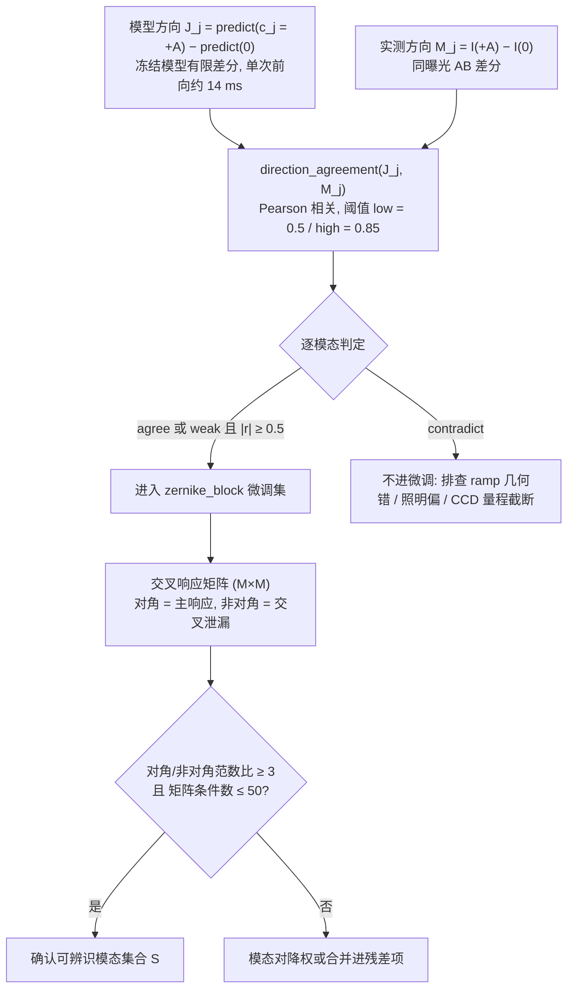


### 4.4 几何探针（与模态探针分离）

piston/tip/tilt 是几何质心位移，不是模型系数：用两轴 64 px 周期倾斜（现有 `TILT_SHIFT_SCALE` 口径的 ramp 探针）与平场质心测 `ramp_matrix` 与 `origin`，只喂给 `alignment` 档。倾斜探针 ± 成对，验证 7400 标度在新会话的漂移量（`CoordinateTransform.compare_with_ramp_matrix` 已实现方向核对，量级不参与判定）。

---

## 5. 可微优化方案

### 5.1 可微闭环链（现状）

`FrozenDefocusForward.predict` 对 `phase` 全链可微（`grid_sample` 可微、`focal_intensity` 的 FFT 可微、blaze 卷积可微）。优化链：

(1) 目标函数：`UniformityObjective`（掩膜 CV 平方加形状项与相位平滑项）或 `multishape_objective`（formation/cv 两档，`--objective formation` 已接线）。

(2) 优化器：Adam，相位信任域（`local_forward` 口径：组合更新最大绝对值 ≤ 0.8 rad；`UniformityObjective.phase_smoothness` 项 `w_phase=0.01`）。

(3) 方向守卫：每块用 A1（锚定相位）与 B（候选相位）的免费差分跑 `direction_agreement`，`TrustRegionSchedule` 按 `agree/weak/contradict` 收缩下一步长上限；守卫只调步长，不改接受判定。

(4) 接受判定：同曝光 ABBA 实测（覆盖/IoU/CV/EE 八项底线，#221 阶段 E 冻结口径），模型预测收益不作为接受依据。

### 5.2 在线训练集扩展（本文新增核心机制）

现状问题：可微迭代每块已经采集了 A1/B 相位帧（ABBA 协议），这些数据在判决后即被丢弃；下一轮拟合仍只用会话开始的随机盲探数据。可微迭代访问的相位邻域正是模型最需要数据的地方，而现有流程把最值的数据扔掉了。

机制定义（块间重拟合，块内模型冻结）：

(1) 回灌规则：每块 ABBA 判决后，把该块全部四帧（A1、B1、B2、A2，含相位、曝光、时间戳）追加进会话数据集 `session_dataset`，标记 `split="augment"`。被拒相位的帧同样回灌——拒绝块给出的是"该方向不改善"的负样本，对模型校准同样有价值。

(2) 块间重拟合：每 K=3 个块（可配 1 至 5）触发一次 `PhysicalForwardFit` 热启动重拟合：参数初值取上一轮冻结检查点，数据为 §4.3 结构化探针（锚点，防漂移）加累计 `session_dataset`。重拟合走 `zernike_block` 档（§3.2），冻结几何（ramp 矩阵固定为本会话值），只允许已辨识模态块与照明参数动。

(3) 模型切换门：重拟合后在新验证集（§4.3 验证集的模态/幅度，不回灌数据）上评估：验证 NRMSE 不劣化（劣化 ≤ 10%）且方向守卫 `direction_agreement` 在下一块 A1/B 对上不下降，才切换新模型；否则保留旧模型并标记 `drift_flag`，连续 2 次失败触发基线重建（重跑 §4.3 结构化探针）。

(4) 块内冻结约束：重拟合只发生在块间（块与块之间，ABBA 判决完成后）。块内 120 步 Adam 迭代中模型权重与参数完全冻结，梯度方向来自单一固定模型——这保证"同一模型给方向、同一模型被验证"，避免训练目标在优化过程中移动。

(5) 训练/判决隔离：回灌帧只用于块间重拟合，不参与当前块的接受判决；当前块判决只用本块 ABBA 四帧。验证集永远来自独立相位（未参与任何拟合），沿用 #119 的独立验证集原则，不得把"训练探针拟合改善"当作通过。

(6) 成本核算：重拟合是离线操作（结构化探针约 50 点加累计帧，128 网格 FFT 1024，GPU 单块前向约 14 ms），每次约 1 至 2 分钟，相对 3 块设备时间（约 10 分钟）占比 < 10%。无额外硬件采集：回灌帧全部是 ABBA 协议本来就采集的帧。

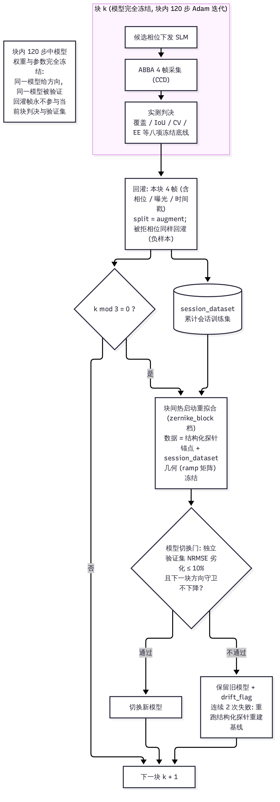

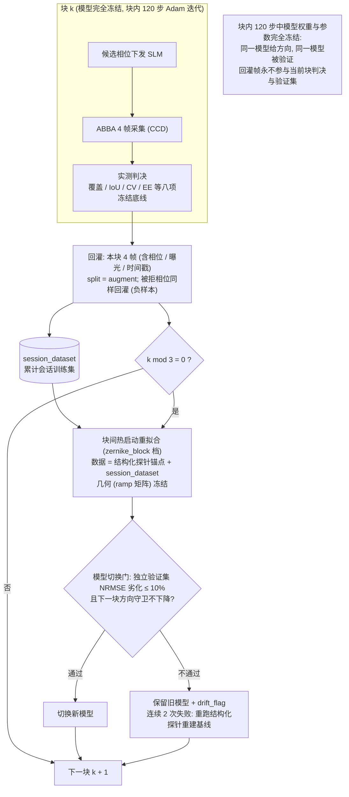


### 5.3 与现有模块的集成

| 模块 | 现状 | 本文用途 |
|---|---|---|
| `transfer/capture.py` | 盲探采集（`probe_grid` 三族） | 新增 `structured` 族入口（§4.3），manifest 字段不变 |
| `transfer/adaptation.py` | `alignment`/`full` 两档 | 增 `zernike_block` 档 |
| `transfer/fit.py` | `build_fit_model`、`fit_loss`、`auto` 升级 | 升级链插入中间档；信任域 clamp 按档生效 |
| `transfer/jacobian_guard.py` | 方向守卫与步长调度 | 模态级门槛（§4.3 步骤 3）与模型切换门（§5.2 步骤 3）复用 `direction_agreement` |
| `transfer/validate.py` | 候选验收 | 不变（接受判定始终 CCD 实测） |
| `scripts/slm/probe_optical_path_validity.py` | 光路前置门 | 不变，作为 §4.1 |
| `bench_twin`（数字孪生） | 仿真侧 | §6 合成先行：在孪生上注入已知模态误差，验证结构化探针的辨识与门限 |

---

## 6. issue #229 深度整合分析

### 6.1 #229 现状

issue #229（"#221 阶段 D 子任务：基于少量 ±Zernike 主动探针的模态响应辨识与参数化物理预测模型微调"）已给出正确的问题定义：主动 Zernike 探针、模态响应辨识、低维参数块微调、独立模态验收。其技术路线（#229 原文四步）方向正确，但有三处与现状脱节：

(1) 未回答"迁移"：#229 的微调假设从零开始收集探针；现状是已有多个会话的冻结物理参数检查点（`FrozenDefocusParameters`，含 `ramp_matrix`、`residual_noll_radians`、`slm_phase_a/b` 等），新会话应从旧检查点热启动，而不是每次重采全量。

(2) 未利用迭代数据：#229 的探针预算是一次性的（M 模态 × K 幅度 × R 重复）；#221 阶段 E 的可微迭代每块已经在采 ABBA 帧，这些数据在 #229 原文中不存在，是"少量探针"之外最便宜的第二数据源。

(3) 未量化盲探对照的基线：#229 要求"核心对照（相同硬件帧预算）：无微调 / 随机相位探针 / Zernike 主动探针"，但没有给出随机探针的帧预算分配（三族 1:1:1 还是按模态数分配）与"随机探针在哪个区域差"的机理说明，导致该对照只能证"少样本收敛"，不能证"结构化比随机好"的因果。

### 6.2 盲探的失败机理（定量归因）

结合 #221 实测数据，盲探路径的失败不是"样本不够"，而是"样本落在模型外推区"：

(1) 方向余弦崩溃：仿真孪生 45 对同批配对方向余弦中位 0.0288（错配对照 0.0102），符号一致率 0.5056，即孪生模型在随机相位邻域的方向预测与实测接近随机。实验侧 96 块方向守卫全 `contradict`（#221 §1.5）。

(2) 拟合改善与方向可用脱节：transfer 全参适配使验证相关性从约 0.36 升到 0.839，但差分相关性只有 0.289，纯模型候选 0/2 接受（#221 §1.3）。即"绝对预测改善"不保证"局部方向可用"，而盲探数据恰好只优化绝对预测（随机相位的全局形状拟合）。

(3) 能量/EE 近而 CV 差：六组实测/模型能量比 1.021 至 1.106，但 CV 差 2.1 至 3.3 倍（#221 §1.3）。随机相位把能量分布拟合对了，细结构（决定 CV 的高频分量）没拟合对——这正是结构化探针要针对的方向：单模态探针的 Jacobian 行稀疏，细结构误差能归因到具体模态。

结构化探针的样本效率来源：M 个模态的 2M·K 个定向样本直接张成参数空间的主方向，每个样本的 Fisher 信息集中在 1 个模态上；等帧预算的随机探针把同样的信息摊到全相位空间，有效秩远低于模态数。

### 6.3 迁移学习优化方案（#229 修订版）

总原则：旧参数热启动，新会话定向微调，迭代数据在线增广，独立相位验收。五步：

(1) 热启动（0 帧）：新会话加载最近可用冻结检查点 `FrozenDefocusParameters`（`load_frozen_parameters`），取 `ramp_matrix`、`origin`、`amplitude_center/width`、`defocus_diopter`、`residual_noll_radians`、`slm_phase_a/b` 作初值。`slm_axial_offset_m` 非零时先过 `effective_parameters()` 吸收轴向偏移，避免双重计入。

(2) 几何对齐（约 40 帧）：§4.4 几何探针（两轴 ramp 各 ±、平场 ABBA×2），只跑 `alignment` 档，更新 `ramp_matrix`/`origin`。验收：质心位移预测 vs 实测偏差 ≤ 1 px（`TILT_SHIFT_SCALE` 0.2 px 重复口径）。

(3) 模态辨识（§4.3 预算，约 512 帧或压缩版）：结构化 ±Zernike 探针，主响应门槛筛出可微调模态集合 `S`。产出：M×M 响应矩阵、每模态 Jacobian 方向一致性、交叉泄漏图。

(4) 低维块微调（`zernike_block` 档）：只放开 `S` 中模态加照明，信任域 0.5 rad，损失用图像域 L1（#229 既定，Step A 对拍单项收益最大）。训练集 = 结构化探针前两档幅度加已回灌帧；验证集 = 第三档幅度加验证集模态 Noll 9。

(5) 可微迭代加在线扩充（§5.2）：进入 #221 阶段 E 闭环，每 K=3 块回灌重拟合，模型切换门把关。

与 #229 原文的增删：

| #229 原文 | 修订 |
|---|---|
| 主动探针设计 | 保留，幅度阶梯定值 {0.02, 0.05, 0.10} rad，帧预算定值 512（可压缩） |
| 主响应门槛 | 保留，阈值定值（方向 \|相关\| ≥ 0.5；交叉比 ≥ 3；条件数 ≤ 50） |
| 低维参数块微调 | 保留，`zernike_block` 档实现细节见 §3.2 |
| （无） | 新增：热启动步骤（迁移语义） |
| （无） | 新增：在线训练集扩展（§5.2，回灌帧块间重拟合） |
| 核心对照 | 修订：随机探针族按"每模态 1 个随机组合 × 同总帧数"分配，不是 1:1:1 三族等分；对照组必须同曝光、同 A/B 判决链 |
| 验收 | 保留独立模态/独立运行验收，新增模型切换门的验证 NRMSE 不劣化条款 |

### 6.4 验收标准（修订版）

(1) 结构化探针可辨识性：在 `bench_twin` 上注入已知模态误差（单模态 0.03 至 0.1 rad），结构化探针在 3 重复下 100% 识别注入模态（符号加幅值误差 < 30%），同预算随机探针组识别率 < 70%（离线先行，不占设备时间）。

(2) 迁移有效性：热启动加 `alignment` 档后，未调参的旧模型在验证集（Noll 9 整模态加第三档幅度）NRMSE 相对旧会话基线劣化 ≤ 20%；`zernike_block` 微调后劣化 < 5%。

(3) 方向可用：闭环第一块的方向守卫 `direction_agreement` 相关 ≥ 0.5（`COSINE_GATE` 口径），且 3 块内至少 2 块 `agree`。

(4) 在线扩充有效：启用回灌后第 5 块起的验证 NRMSE 不劣化（相对未回灌对照），且模型切换门 2 次内通过。

(5) 核心对照（相同帧预算）：结构化探针组相对随机探针组，在相同候选相位族上的方向相关与候选接受率同时更优；只报告训练损失下降不算通过。

(6) 统计口径：每结论由重复导出（ABBA 4 帧）的不确定度支撑；4 次重复结构上到不了 p < 0.05（`min_attainable_pvalue` 口径），只报效应量，不做显著性声称。

---

## 7. 实验计划（帧预算与判定表）

### 7.1 阶段划分

| 阶段 | 内容 | 帧预算 | 设备时间 | 依赖 |
|---|---|---|---|---|
| P0 离线 | `bench_twin` 注入模态误差，结构化 vs 随机探针辨识率对拍（§6.4 第 1 条） | 0 | 数小时（GPU） | 无 |
| P1 前置门 | `probe_optical_path_validity` 四项检查 | 约 60 | 0.5 小时 | 设备在线 |
| P2 几何对齐 | ramp ±、平场 ABBA | 40 | 0.5 小时 | P1 过 |
| P3 模态辨识 | 结构化 ±Zernike 探针（512 帧或 R=1 压缩版 176 帧） | 512（176） | 3 小时（1 小时） | P2 过 |
| P4 块微调 | `zernike_block` 离线重拟合与验证 | 0（复用 P3 帧） | 0.5 小时（离线） | P3 过 |
| P5 闭环 | 可微迭代加每 3 块回灌，≥ 10 块 | 每块 4 帧（ABBA）× 10 块 = 40 | 1 小时 | P4 过 |
| P6 对照 | 同帧预算随机探针闭环（与 P5 对照） | 40（探针 176 随机版已含在 P3 压缩预算内） | 1 小时 | P3 过 |

总设备时间约 5 至 6 小时（全量）或 3.5 小时（P3 压缩版），可拆两个会话执行；P0 与 P1 可并行（离线/在线独立）。

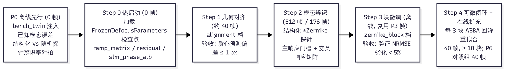

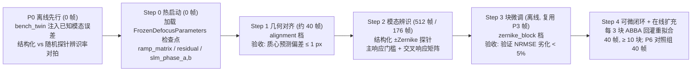


### 7.2 各阶段判定表

| 阶段 | 通过条件 | 不通过时的动作 |
|---|---|---|
| P0 | 结构化 100% 识别注入模态，随机组 < 70% | 调整注入幅度或门限后重跑；仍不通过则重审模态选择 |
| P1 | 四项全过，饱和 0，漂移 < 3×噪声底 | 停设备层，不改判模型 |
| P2 | 几何对齐后质心预测偏差 ≤ 1 px | 重测 ramp（增加周期数），不进入 P3 |
| P3 | 至少 4 个模态过主响应门槛；响应矩阵对角比 ≥ 3 | 门槛内模态数 < 4：先查 P1/P2（几何错会让所有模态一起失真），再查照明偏；仍不通过则本方案降级为"几何加离焦"两参版 |
| P4 | 验证 NRMSE 劣化 < 5%（相对热启动基线） | 退回 `alignment` 档，不进入 P5 的模型梯度路径 |
| P5 | 方向守卫首块 ≥ 0.5 且 3 块内 2 块 agree；八项冻结底线全过 | 首块 < 0.5：标 `no_information`，停模型梯度，转同曝光实测差分或 SPGD（#221 阶段 C 停止规则） |
| P6 | 结构化组方向相关与接受率同时优于随机组 | 只有一项优：报告不判定优劣，记录效应量，追加预算 |

### 7.3 记录与产物（每阶段落盘）

(1) P3：响应矩阵 JSON、每模态 Jacobian 方向一致性 JSON、响应矩阵图（对角/非对角热力图）。

(2) P4：`adaptation.json`（档位决策）、验证/训练 NRMSE 表、参数变化表（初值到终值，逐模态）。

(3) P5：每块 ABBA 读数 JSON、回灌事件日志（哪块触发了重拟合、模型是否切换、切换前后验证 NRMSE）、方向守卫时间序列。

(4) 全部产物进 `report/shape_trials/physical_refine/` 对应子目录，报告经 `scripts/_common/provenance.py` 登记后由 `sync_report_provenance.py` 同步索引。

### 7.4 与相邻 issue 的边界

| issue | 边界 |
|---|---|
| #221 | 本文是其阶段 D 的实施细化（D1 几何、D2 相机响应、D3 静态像差、D4 局部复增益中的 D3 部分）；阶段 A 至 C 的前置不变 |
| #182 | 本文只更新低维系统参数，不反演未知入射波前；模型切换门失败后的"残差自校准"归 #182 |
| #208 | 不引入多频载波/频分锁相；被估对象是物理预测模型参数而非入射波前 |
| #126 | 不增加逐像素 freeform，不直接优化目标形状 |
| #119 | 验收沿用独立验证集、跨运行原则；回灌帧永不进入验证集 |
| #123/#139 | 不确定性探针与本方案的正交性：结构化探针是"定向"，#123 类是"主动不确定性"，两者数据可合并不互斥 |

### 7.5 不做什么

(1) 不因"模型 loss 下降"声称实验改善。

(2) 不在块内改模型（模型切换只发生在块间）。

(3) 不用回灌帧做当前块的接受判决。

(4) 不把随机探针的"总帧数"与结构化探针的"模态覆盖数"混为同一预算单位。

(5) 不在 P0 通过前占用设备时间跑 P3 全量（压缩版也等 P0 门限确认后再采）。

---

## 8. 文献支撑的模型结构优化思路

本节面向 `PhysicalForwardFit`（拟合侧）与 `FrozenDefocusForward`（冻结推理侧）这条共用计算链，给出有文献依据的结构优化思路。定位是规划性优化路线，不是已实现功能；每条给出文献依据、可接入点与收益判断，供后续 issue 拆分。

### 8.1 与同领域可微模型的对照定位

本实验系统的物理预测模型与剑桥组 2026 年提出的全视场夫朗禾全息投影数字孪生（Wojcik et al., arXiv:2610.02518）在结构上同族：两者都是「相位型 SLM 加傅里叶透镜焦面相机」的紧凑可微传播链，都用物理可解释参数（SLM 特性、照明、光瞳、杂散光、相机）做参数化，并从「噪声探测的全息图与图像对」中在位辨识参数。差异有三点：其一，该文献的孪生覆盖整个第一衍射级视场并显式建模了像元间串扰（4π 相位调制域）与场依赖光瞳像差，本文 §2.2 计算链的远场网格为 1024²、当前未显式建模像素间串扰；其二，该文献用噪声探测（noise-probed）做参数辨识，本文 §4.3 的结构化 ±Zernike 探针与之同族但更稀疏定向，辨识对象是模态响应矩阵而非全视场光瞳像差面；其三，该文献明确不做相机在环精修（camera-in-the-loop），而本文 §5 的 CCD 锚定可微闭环与 ABBA 回灌恰是相机在环机制。结论：本文模型不是精度最高的孪生，但参数维度低、单次前向 14 ms，适合在线迭代；结构优化的方向是把孪生文献中已被证明必要的项（串扰、场依赖光瞳像差、杂散光复振幅）按代价收益比选择性引入。

### 8.2 计算链的结构优化项（按优先级）

| 优先级 | 优化项 | 文献依据 | 可接入点 | 预期收益与代价 |
|---|---|---|---|---|
| P0 | 像素间串扰项（SLM 相位灰度的空间低通泄漏） | 2610.02518 证明串扰是全视场重构的主要误差源之一，4π 调制域可补偿 | `slm_phase_nonlinearity` 环节 (2) 旁：在 SLM 平面加可学习小核卷积（3×3 或 5×5，对称约束），替代或并行现有正弦非线性 | 串扰是高频相位灰度图案的系统误差；小核卷积参数量 10 量级，不破坏低维结构。代价：核与现有 `slm_phase_a/b` 功能部分重叠，需可辨识性检查（§3.2 口径） |
| P0 | 杂散光零级项升级为复振幅（含相位） | 2610.02518 以复振幅恢复零级杂散光并抑制；2602.04330 讨论像差与杂散光对重建质量的影响 | 环节 (8) 辐射项旁：现有 `background` 加性标量升级为「DC 分量加复振幅点源」的叠加 | 固定热点（`docs/slm/slm_transfer_workflow.md` §9 故障表第 5 行「所有相位都出现固定热点」）当前只能由加性背景近似；复振幅模型能解释热点形状与位置。代价：多 3 个参数，需与 `bias_counts` 做可辨识性 |
| P1 | 场依赖光瞳像差（低阶 Zernike 场系数展开） | 2610.02518 用场依赖光瞳像差测量支撑全视场；2602.04330 证明 camera-in-the-loop 标定像差提升一致性 | 环节 (1) 相位合成旁：在控制网格上加 2 至 3 个低频空间基（低频傅里叶或低阶 Zernike 的空间展开），系数可训练 | 当前 `residual` 是全光瞳 7 模态全局系数，无法表达「视场边缘像差更大」的结构。代价：参数按基个数线性增长，须与 §4.3 模态辨识联动（场依赖项与模态残差可能互相补偿） |
| P1 | SLM 非线性从正弦双基升级为逐像元 LUT 加平滑先验 | 2505.22482（非线性显微成像中的 SLM 在位标定，直接用成像信号标定灰度到相位响应，无干涉仪）与 2602.04330（camera-in-the-loop 标定） | 环节 (2)：LUT（993 灰度级）加总变分/二次光滑正则，可微（spline 插值） | 正弦双基只能表达全局周期项；逐像元 LUT 能吸收像元间制造差异与温漂。代价：993 维参数，必须用平滑先验压有效自由度（约 10 量级），且 LUT 与串扰核需联合可辨识性 |
| P2 | 传播从标量 FFT 升级为角谱法（有限口径与近场选项） | 2610.11274（矢量 D2NN 用完整角谱）；2609.16404（可微射线加波动混合引擎，指出标量模型在大视场与偏振下的局限） | 环节 (5) `focal_intensity`：增加 `angular_spectrum` 后端开关（同接口），远场近似保留为默认 | 当前远场网格 15 µm/px 对 7.2 mm 光束、1024 FFT 是自洽的；当目标扩大（`docs/slm/slm_transfer_workflow.md` §13 大尺寸目标）或 SLM 离焦面（`slm_axial_offset_m` 非零）时标量远场近似误差上升。代价：角谱比 FFT 约 3 至 5 倍计算量，破坏 14 ms 预算，需离线重拟合或降采样 |
| P2 | 相机响应从 blaze 高斯升级为实测 PSF 加增益场 | 2610.02518（相机参数可解释化）；2602.04330（像差标定对衍射效率的影响） | 环节 (7)：blaze 核由平场像差标定（现有 `blur.py` 口径）的实测 PSF 替代；`gain` 标量升级 2×2 块增益场 | blaze 假设对 CCD 离焦与像元积分是高阶近似；实测 PSF 消除离焦与模型离焦参数的互相补偿（§3.1 中 `d` 与 `log_width` 互相补偿的根源之一）。代价：PSF 核约 625 维（25 px 宽），用高斯混合（2 至 3 项）参数化 |
| P3 | 可微反演：由差分强度测相（TI 方程族）替代部分探针 | 2606.27176（由傅里叶域差分强度测量解相位偏微分方程，金字塔传感器口径） | 与 §4.3 探针互补：±A 探针的差分强度对 `(I(+A) − I(−A))` 与 `(I(+A) + I(−A) − 2I(0))` 恰好是 TI 方程的一阶与二阶项，可直接给出该模态的局部响应 | 零额外帧成本（ABBA 四帧已含），把探针从「图像域拟合」升级为「强度域解析式」，辨识精度上限更高。代价：仅对低阶模态成立（TI 近似域），高阶模态仍走图像域 |

### 8.3 优化项与现有方案的接口

(1) 优先级 P0 的两项（串扰核、复振幅杂散光）与 §3.2 的 `zernike_block` 档正交：它们改的是计算链环节 (2)(8) 的结构，不是模态系数；实现后 `zernike_block` 档放开集合不变，只是每档的基函数更准。验收沿用 §7.2 P0 口径（bench_twin 注入对应误差，结构化探针辨识率不降）。

(2) P1 的两项（场依赖像差、LUT）进入 §4.3 的辨识流程：场依赖基与 LUT 在结构化探针之前用平场与倾斜探针标定（不占 512 帧模态预算），标定后冻结参与模态辨识，避免与模态系数互相补偿。

(3) P2 角谱后端以开关实现，`focal_intensity` 接口不变；`FrozenDefocusForward` 与 `PhysicalForwardFit` 同步切换，`defocus_forward_core.py` 抽出共享采样（issue #199 R2 口径），逐位回归锁测试。

(4) 所有新增参数默认关闭（零值初始化，链路逐位保持历史基线），与现有 `slm_phase_a/b` 的启用机制一致；启用后必须重跑 §7.2 的 P0 离线对拍，确认新参数在孪生上不劣化辨识率。

### 8.4 文献清单

| 编号 | 文献 | 与本报告的关联 |
|---|---|---|
| [1] | Wojcik, Singh, Joyce, Wilkinson. Digital twin for full field-of-view Fraunhofer holographic patterning. arXiv:2610.02518, 2026 | 同族可微孪生：串扰 4π 补偿、场依赖光瞳像差、复振幅杂散光、噪声探测参数辨识 |
| [2] | Hubmer, Weissinger, Ramlau, Scherzer. On Fourier Phase Retrieval from Differential Intensity Measurements with Applications to Wavefront Sensing. arXiv:2606.27176, 2026 | 差分强度测相的 TI 方程族，§4.3 探针差分的解析式升级依据 |
| [3] | de la Fuente Herrezuelo. Physics-Informed Neural Networks for Optimal Beam Shaping in Flat Optics. arXiv:2607.18012, 2026 | 蒙日安培方程 PINN 求解相位；与本文可微优化互补（设计侧 vs 控制侧） |
| [4] | Cox, Sasikumar, Vellekoop. Inline calibration of spatial light modulators in nonlinear microscopy. arXiv:2505.22482, 2025 | 无干涉仪的 SLM 在位标定（成像信号自标定），LUT 升级项的依据 |
| [5] | Zimmermann, Brenner, Haist, Reichelt. Impact of aberrations in SLM-based far-field holography. arXiv:2602.04330, 2026 | camera-in-the-loop 标定像差与杂散光对重建质量/衍射效率的影响 |
| [6] | 本地资料：`paper_gs_refine_experiment_3/8_深度学习在傅里叶光束整形中的优势与本项目实践`（OpenViking 归档） | 「物理基座加学习残差」策略的定量边界：闭式物理预测模型在在线控制中的优势与深度学习补全表示的适用域 |

文献 [1] 与 [2] 为本文模型结构优化提供直接先例；[3] 至 [5] 分别对应反演设计、器件标定、像差标定三个相邻方向；[6] 是仓库内既有实验证据，约束「不整体替换物理链，只按环节增补结构」的总边界。

---

## 9. 结论

物理预测模型是低维模态参数加确定性傅里叶传播的结构，这一结构决定了三条工程结论：微调应该按模态块进行（`zernike_block` 档），探测应该用定向 ±Zernike 探针而不是随机盲探，训练集应该用可微迭代中实际下发并采集的相位帧在线扩充而不是离线随机集。issue #229 的问题定义正确但缺迁移语义与迭代数据利用，本文 §6 的修订版方案（热启动、几何对齐、模态辨识、块微调、在线扩充五步）与 §7 的帧预算判定表即可执行；GitHub issue 已按本文更新。 模型结构层面的后续优化路线（串扰项、复振幅杂散光、场依赖像差、逐像元 LUT、角谱后端、差分强度测相）见 §8，均按「默认关闭、孪生对拍验收」原则实现，不改变本文 §3 至 §7 的探测与微调方案。
