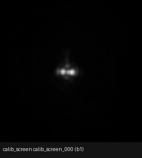
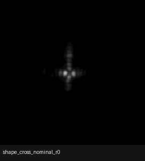
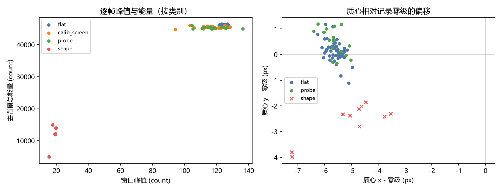
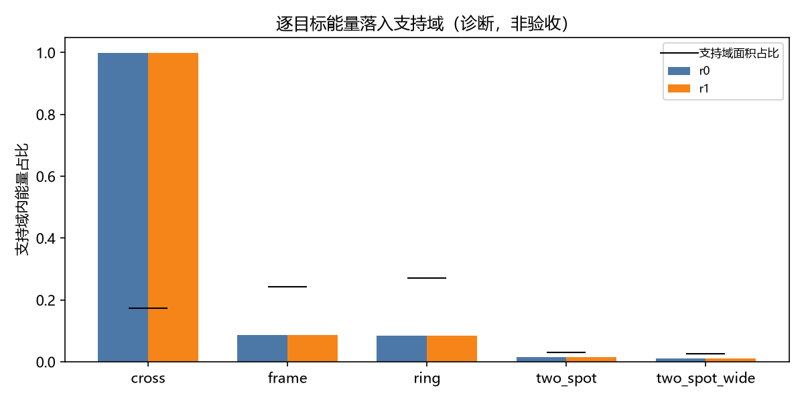

# 测量传递层、对齐评分与有界零级：离线结果和下一次实验准备（2026-11-02）

<!-- provenance:start -->
> **生成脚本**: 人工撰写，无生成脚本
> **数据/关联脚本**: [`scripts/ml/sim2f_fov_hw_session.py`](../../../scripts/ml/sim2f_fov_hw_session.py)
> **数据/关联脚本**: [`scripts/ml/sim2f_fov_hw_refine.py`](../../../scripts/ml/sim2f_fov_hw_refine.py)
> **数据/关联脚本**: [`scripts/ml/sim2f_physical_residual.py`](../../../scripts/ml/sim2f_physical_residual.py)
> **数据/关联脚本**: [`src/ml/sim2f/calibrate.py`](../../../src/ml/sim2f/calibrate.py)
> **数据/关联脚本**: [`src/ml/sim2f/measurement.py`](../../../src/ml/sim2f/measurement.py)
> **数据/关联脚本**: [`src/ml/sim2f/optics.py`](../../../src/ml/sim2f/optics.py)
> **数据/关联脚本**: [`src/ml/sim2f/pinn.py`](../../../src/ml/sim2f/pinn.py)
> **数据/关联脚本**: [`scripts/ml/sim2f_fov_hw_figures.py`](../../../scripts/ml/sim2f_fov_hw_figures.py)
> **运行环境**: 离线分析（历史物理会话 + 生产会话对齐评分 + 约束残差拟合 + 几何初值孪生干跑；设备下线，无新增 CCD 采集）
> **说明**: 顺序测量层/相干零级标定的验证集对照、生产会话探测器无关对齐评分与几何支持域、标定迁移与有界离焦/缩放扫描、约束残差拟合、历史会话驱动的任意形状代理闭环、几何初值孪生干跑与下一次实验步骤；全幅与逐目标分数只作模型诊断，孪生闭环和干跑只作流程证据，不作为物理整形成功或 CCD 验收证据。
<!-- provenance:end -->

## 1. 结论与证据边界

- 在同一 100 帧物理标定会话、同一 75/25 划分上，顺序拟合通过验证集门禁。探测器 MTF 为 `psf_sigma_px=1.2778840065002441`，相干零级为 `eta=0.07723905146121979`；背景保持结构项且未拟合。
- 相对冻结旧标定，验证集 NCC 增加 `0.0037217736244202`，L1 减少 `0.0040361881256104`。这是同一会话的模型预测对照，不是新增 CCD 采集。
- 生产会话 120 项已按**探测器无关**口径重算：模型强度与经过中值去基底、截断的实测计数比较，增益在几何支持域上闭式投影。生产平场组 `n=48` 的 `ncc_calib=0.9319441083320138`、`l1_calib=0.8404240079013158`；探针组 `n=32` 为 `0.9345563026282729` / `0.8502180257814786`。此前生产 NCC 约 `0.27` 是探测器光度和 `pred > 0` 支持域共同造成的评分假象，不是模型本身的预测能力。
- 整形组 `n=40` 的总体 `ncc_calib=0.6894551484044369`，但该均值被 `two_spot`/`two_spot_wide` 的 fitted 帧拉高；`ring`、`cross`、`frame` 的 `ncc_calib` 仍在 `0.331325 ~ 0.403016`。模型对这三种形状仍不具备可用预测力，不能据全幅或逐目标 NCC 宣称物理整形成功。
- 在已记录的实测帧上，fitted 命令相对 nominal 提高了五类目标的实测目标内能量，但 `ring`、`cross`、`frame` 的质心误差同时变差。这是对既有帧的离线重算，不是闭环优化结果；物理验收仍须现场 `sequential_ccd`。
- 约束残差拟合只使用标定会话的平/网络帧，生产会话（含其平场）保持验证集。`data_only` 变体把验证集 L1 从 `0.4657527780532837` 降到 `0.31624037683010103`，但 100 行只对应 46 个唯一命令，25 个验证集行中 16 行与训练命令重复，真正无重复的验证集只有 9 行；该结果只作离线诊断。
- 另以该历史会话离线执行了任意形状闭环入口（4 种脚本已实现形状、每种 2 轮）；标定通过验证集门禁，且 16/16 个拟合更新被孪生设备代理接受。该试验使用历史帧构造的确定性代理，不是 CCD 在线反馈或物理整形验收；详见第 5 节。
- 名义孪生干跑在修正画布 `[x,y]` 映射后 2/2 轮接受，且孪生实测与模型预测逐项一致。它只证明采集、裁剪、指标和验收管线对齐。
- 设备本轮下线，未执行物理 `sequential_ccd`。下一次实验命令已列在 §7。

## 2. 标定会话顺序拟合

数据：`data/debug/sim2f_fov_calib`；旧标定保持只读，新产物写入 `data/debug/sim2f_fov_calib_seq_20261102`。测量传递位于相机仿射之后，表示探测器 MTF，不表示光路离焦；相干零级在 pupil（瞳面）传播中与调制场叠加。

| 指标 | 冻结旧标定 | 顺序测量层/零级标定 |
|---|---:|---:|
| 验证集 NCC | 0.9104582071304321 | 0.9141799807548523 |
| 验证集 L1 | 0.46484503149986267 | 0.4608088433742523 |
| 训练集 NCC | 0.9177432656288147 | 0.920582115650177 |
| 训练集 L1 | 0.47424134612083435 | 0.4734904170036316 |
| 验证集增益 | 365.304443359375 | 363.13702392578125 |
| `psf_sigma_px` | 恒等传递 | 1.2778840065002441 |
| 相干零级 `eta` | 标称 0.1 | 0.07723905146121979 |

拟合顺序为几何/像差、冻结后单独拟合 MTF、再单独拟合有界 `eta∈[0,0.5]`。新标定 `ok=True`、`reason=null`，训练/验证各 75/25 帧。原始摘要见[旧标定](artifacts/calibrate_old_summary.json)与[顺序标定](artifacts/calibrate_sequential_summary.json)。

## 3. 生产会话对齐评分

### 3.1 评分口径与几何支持域

生产会话原生帧为 `1944×2592`，记录零级为 `(x,y)=(1268,942)`。`analyze` 取以零级为中心的 `1944` 方形裁剪；纵向起点被传感器边界夹到 `0`，裁剪原点为 `[296,0]`，零级落在裁剪图 `[972,942]`，而方形中心是 `y=972`，因此存在 `zero_order_offset_xy=[0,-30]`。本版按记录零级做确定性平移对齐，不做图像配准。

对齐质量与裁剪夹取分开记录，三者不可混读：

| 量 | 值 | 含义 |
|---|---|---|
| `zero_order_measured_xy` | `[1268.0105946710692, 943.9965823624049]` | 首帧平场 `flat_0000` 的 argmax + 3×3 质心，原生坐标 |
| `zero_order_measured_source` | `flat_0000` | 实测零级取用的帧 |
| `zero_order_residual_px` | `1.9966104720053075` | 实测零级相对**记录**零级的偏差 |
| `zero_order_aligned_xy` | `[972.0, 942.0]` | 平移后模型光轴在裁剪图中的落点，等于 `crop_sq_zero_order_xy` |
| `zero_order_align_residual_px` | `1.9966104720053075` | 实测零级相对**对齐后光轴**的偏差 |
| `zero_order_offset_xy` | `[0, -30]` | 仅由传感器边界裁剪夹取产生，平移已精确抵消 |

实测零级与记录零级相差约 `2 px`，全部来自纵向；对齐残差因此与记录残差同值。若首帧平场没有正峰值，这四项实测字段写 `null` 并登记到 `undefined_metrics`，不补零。本轮该列表为空。

模型可覆盖的远场窗口半宽为

```text
fft_length * far_field_pitch_m / (2 * ccd_pixel_um * 1e-6)
= 512 * 4.618e-6 / (2 * 2.2e-6)
= 537.3737373737374 px
```

支持域是该几何窗口与平移有效掩膜的**交集**（`support = aligned & geometric`）：`valid_support_bbox=[435,405,1510,1480]`、`valid_support_shape=[1075,1075]`、`valid_support_fraction=0.3057907945096445`、`score_mask_count=1155625`。模型支持域外的相机像素没有模型样本，不能进入 L1/NCC/质心/D86/EE 的评分像素集合。

评分路径固定为：

1. 模型以 `detector=False` 前向，避免把探测器光度响应重复计入已经被 `prepare_frame` 处理的实测帧；探测器语义只保留在采集与训练。
2. 预测与实测均在**完整裁剪帧**上做 `prepare_frame`：先减去本帧中值，再在 0 处截断。
3. `ncc_calib`/`l1_calib`/`gain_calib` 在几何支持域上闭式投影增益，口径对齐 `ml.sim2f.calibrate._scores(fit_gain=True)`；这是主指标。
4. `ncc_all`/`l1_all` 使用同一几何支持域，但保留裁剪后的原始单位化和截断，不先去基底，只作基底敏感性的诊断对照。
5. 能量类指标 `truth_energy_in_support` 与 `energy_total_ratio` 用**整帧**单位化后的分数，因此不会把支持域归一化误读成“模型把能量放大了”；质心、D86、峰值仍只在支持域内计算。
6. 未定义的指标写 JSON `null` 并登记到 `undefined_metrics`；本轮该列表为空，不补造数值。

### 3.2 分组结果

| 组 | n | `ncc_calib` | `ncc_all` | `l1_calib` | 质心误差 px | 实测支持域能量占比 | `energy_total_ratio` |
|---|---:|---:|---:|---:|---:|---:|---:|
| calib（平场/标定屏） | 48 | 0.931944 | 0.920239 | 0.840424 | 8.203619 | 0.366974 | 2.725003 |
| probe（探针） | 32 | 0.934556 | 0.921616 | 0.850218 | 13.915140 | 0.364935 | 2.740218 |
| shapes（整形） | 40 | 0.689455 | 0.676680 | 0.909641 | 11.207986 | 0.368411 | 2.715629 |

平场与探针组说明：训练时冻结的标定仍能把生产会话的平场/探针帧预测到约 `0.93` NCC；这与旧版 `0.27` 的差别来自评分口径，不是新采集。`l1_calib` 的约 `0.84` 底值包含测量量化底噪：生产与标定平场原始计数是 `1/3 count` 的整数倍，约三成像素为 0；对这类帧，先中值去基底再截断会把低于中值的噪声折成 0，L1/RMSE 类指标不可能降到接近 0。标定摘要中的 `measurement.background_fraction=0.0` 也没有为这一底噪单独建模。

`energy_total_ratio` 约 `2.7` 不表示模型预测的总能量是实测的 2.7 倍。它是“预测落在支持域内的全局能量分数”除以“实测落在支持域内的全局能量分数”：模型在支持域外没有样本，预测的支持域分数接近 1，而实测仍有约 63% 的能量落在支持域外。因此该比值度量的是支持域截断，不是光度增益；增益看 `gain_calib`，形状看 `ncc_calib`/`l1_calib`。

完整逐项摘要见[对齐评分摘要](artifacts/production_analysis_aligned3_summary.json)，共 120 项。残差拟合为 `0.48803025484085083 → 0.35938435792922974`，`ok=True`、`rank=8`、`condition=6.240137860167714`；只用平/已知参考帧，不用整形帧重拟合。

### 3.3 逐目标结果

下表每格是同目标两个重复帧的算术均值，完整单帧数值在摘要 artifact 中。`NCC`、`L1` 为 `ncc_calib`、`l1_calib`；`EE_meas` 是实测帧在目标掩膜内的能量分数；`EE_pred` 是模型预测的同一分数；质心误差只在支持域内计算。

| 目标 | 变体 | NCC | L1 | 质心误差 px | EE_meas | EE_pred |
|---|---|---:|---:|---:|---:|---:|
| ring | nominal | 0.335761 | 1.035440 | 6.369808 | 0.113091 | 0.093418 |
| ring | fitted | 0.344464 | 1.000049 | 10.943594 | 0.167553 | 0.793580 |
| cross | nominal | 0.331325 | 0.964035 | 8.034896 | 0.132742 | 0.499632 |
| cross | fitted | 0.403016 | 0.975189 | 20.733086 | 0.167570 | 0.860785 |
| frame | nominal | 0.331890 | 1.027010 | 2.815795 | 0.111033 | 0.084653 |
| frame | fitted | 0.340835 | 0.996577 | 11.018500 | 0.160674 | 0.777083 |
| two_spot | nominal | 0.170010 | 1.016917 | 11.958720 | 0.129350 | 0.090516 |
| two_spot | fitted | 0.946387 | 0.850125 | 5.870063 | 0.178196 | 0.999997 |
| two_spot_wide | nominal | 0.136462 | 1.010331 | 81.135744 | 0.136986 | 0.080492 |
| two_spot_wide | fitted | 0.948338 | 0.849122 | 5.986493 | 0.177379 | 0.999997 |

读法必须分开：

- `NCC` 是模型预测与实测帧的一致性，不是形状质量。fitted 的 NCC 全面高于 nominal，只说明模型对 fitted 命令的预测更贴合对应实测帧；`ring`/`cross`/`frame` 的绝对值仍低，模型不能作为这三类形状的可靠代理。
- `EE_meas` 才是实测帧自身的形状指标：五类目标的 fitted 帧都比 nominal 帧更高（`+0.035 ~ +0.055`），说明这些 fitted 命令确实把更多实测能量放进目标掩膜。它是同一生产会话内既有帧的对照，不是新闭环，也不是 CCD 验收。
- 质心误差没有同步改善：`ring` 从 `6.369808` 升到 `10.943594`、`cross` 从 `8.034896` 升到 `20.733086`、`frame` 从 `2.815795` 升到 `11.018500` px；只有两个 `two_spot` 变体明显下降。目标内能量提高可能以偏离目标中心为代价。
- `EE_pred` 在 fitted `two_spot`/`two_spot_wide` 接近 `1`，而 `EE_meas` 只有约 `0.18`。模型在这两个目标上空间相关性高，但预测的能量集中度明显过强，不能把 `EE_pred` 当作实测形状读数。

### 3.5 采集帧可视化（CCD GIF 与诊断图）

下图是对同一 100 帧采集（`data/debug/sim2f_fov_hw_20261102`，曝光 `0.3 ms`，记录零级 `(1140, 940)`）的可视化诊断：动画按采集顺序回放，散点图与柱图只用于诊断帧质量与目标支持域能量分布，**不是**整形成功或 CCD 验收证据。

- 全部 100 帧（平场/标定屏/probe/shape）按采集顺序回放，每帧裁到以记录零级为中心的 256 px 窗口：
- 10 个 shape 帧（5 类目标 × 2 重复）回放，去背景后按 0–20 count 显示：
- 左图：每帧窗口峰值 vs 去背景总能量（按类别着色）；右图：质心相对记录零级的偏移（flat/probe/shape）：
- 逐目标能量落入支持域（r0/r1 两个重复；黑线为支持域面积占比）：

从图中可读出的诊断结论（与 §3.3 一致）：shape 帧峰值仅约 `15–20` count，远低于 flat 的约 `125` count，说明 0.3 ms 曝光对 shape 命令的信噪比偏低；所有帧质心相对记录零级向左下方偏移约 `(-5.6, +0.15)` px，因此下一轮 refine 前应先做零级复测（见 §7）；能量落入支持域的差异主要由目标类型决定，`cross` 几乎全部能量落进支持域而 `two_spot`/`ring`/`frame` 只有约 `0.01–0.09`，与 §3.3 的 `EE_meas` 一致。

### 3.4 标定迁移与有界离焦/缩放扫描

同一标定跨会话迁移并不等价：标定只在 `data/debug/sim2f_fov_calib` 的平/参考帧上拟合，生产会话的平场与整形帧没有参与拟合；生产平场组仍有约 `0.93` 的 NCC，说明平场层面可迁移，但不能据此把生产整形帧的残差归因于同一组标定参数。逐目标低 NCC 更可能来自模型对相位族的响应不足，而不是单一平移或增益错误。

对 `defocus_m` 与 `zoom` 做了有界离线扫描，产物见[扫描摘要](artifacts/defocus_zoom_scan_20261102.json)。在 `zoom=0.5488116145133972` 下，`defocus=0.010084735` 使标定会话平场达到 `ncc=0.9702773690223694`、`l1=0.39045923948287964`，生产平场为 `ncc=0.9306029677391052`、`l1=0.48803025484085083`；更远或更近的离焦都变差。该扫描只解释“平场最佳焦点”附近的模型行为，不证明整形帧的相位响应正确。

同一扫描还暴露出模型对相位的敏感性偏弱：在 256 窗口内，不同相位命令的窗口总能量与 D86 变化很小。可微优化若依赖这一响应，会退化为对目标掩膜的平滑拟合；本轮因此没有把 PINN/可微优化结果当作可用闭环，只保留为诊断。

## 4. 约束残差拟合

新增离线入口 `scripts/ml/sim2f_physical_residual.py`，只读标定会话 `data/debug/sim2f_fov_calib` 的平/网络帧；不命令硬件、不写相位、不做闭环。分割固定为 `SPLIT_SEED=0`、`HOLDOUT_FRAC=0.25`，生产会话整体保持验证集（包括其平场）。拟合复用 `src/ml/sim2f/pinn.py` 的约束残差网络，`fit_residual` 签名冻结；`data_only` 变体只开数据项与平滑项，`pinn` 变体再加支持域与频带项。

| 变体 | 验证集 L1 起点 → 终点 | 验证集 NCC 起点 → 终点 | 无重复验证集 L1 起点 → 终点 | 无重复验证集 NCC 起点 → 终点 |
|---|---:|---:|---:|---:|
| `data_only` | 0.4657527780532837 → 0.31624037683010103 | 0.9129529523849488 → 0.9310687375068665 | 0.4344811836878459 → 0.2946951273414824 | 0.9581315384970771 → 0.9753202663527595 |
| `pinn` | 0.4657527780532837 → 0.3174571317434311 | 0.9129529523849488 → 0.9315231347084045 | 0.4344811836878459 → 0.29594722390174866 | 0.9581315384970771 → 0.9748158852259318 |

两个变体的训练 L1 都降到约 `0.32`，`data_only` 略优于 `pinn`。但验证集数字有两个必须披露的限制：

- `MeasuredBench` 按精确命令相位查表，100 行只折叠出 46 个唯一命令；25 个验证集行中有 16 行与训练命令重复，真正无重复的只有 9 行。上表“无重复验证集”列才是不共享命令的读数，但它样本太少，不能外推。
- 记录只有单一曝光，没有曝光对，探测器线性项在两个变体中都不存在；`delta_rms_rad=2.165318499529148`、`delta_max_abs_rad=4.131892681121826` 的残差是在该单曝光数据上的拟合，不是可迁移的像差真值。

完整产物见[残差拟合摘要](artifacts/physical_residual_calib_20261102.json)。该入口 `evidence_status=offline_physical_reference_only`、`acceptance_status=not_ccd_acceptance`。

## 5. 任意形状闭环离线试验与名义孪生干跑

### 5.1 历史物理会话驱动的离线代理闭环

产物位于 `data/debug/sim2f_shape_trials_production_20261102_supported`，完整逐变体/逐轮明细见 `artifacts/trials.json` 与 `artifacts/summary.json`（在 `data/debug` 会话目录内）。入口先从历史 120 个样本重新拟合基准标定（90 训练 / 30 验证），再对 4 种内置形状运行 flat、net_open、net_finetune。它使用“拟合标定孪生作为设备代理 + 漂移像差、标定孪生作为模型”的配对；每轮所谓设备验收，是同一确定性仿真代理上的分数门，不是相机在线测量。标定训练/验证 NCC 为 `0.88162761926651 / 0.9005685448646545`，L1 为 `0.5143126249313354 / 0.48475736379623413`；拟合 beam `width_scale_x/y=0.502173125743866 / 1.5370328426361084`、camera `zoom=0.6556795239448547`、像差 RMS `2.343791 rad`。这份重新拟合结果不同于第 2 节专用顺序测量层/零级标定，不能与之混为同一组参数。

下表列出 `net_finetune` 两轮迭代的起点→终点指标；`objective`、L1 越低越好，NCC、目标内能量（EE）越高越好，`cv_in_support` 越低表示支撑域内越均匀。接受数为每形状两轮设备代理门的通过数。该短程结果只说明离线代理闭环路径能够运行并接受候选，不代表达到目标质量；例如 frame、two_spot 的目标内能量仍低，不能称为成功整形。

| 配对 | 目标 | 支撑占比 | objective | NCC | EE | cv_in_support | 接受轮数 |
|---|---|---:|---:|---:|---:|---:|---:|
| nominal | ring | 0.171692 | 1.599302 → 1.538482 | 0.123630 → 0.160486 | 0.346742 → 0.365999 | 1.410137 → 1.189735 | 2/2 |
| nominal | cross | 0.275208 | 1.151797 → 1.068927 | 0.356053 → 0.421488 | 0.876216 → 0.912641 | 2.122035 → 1.792691 | 2/2 |
| nominal | frame | 0.514160 | 2.134539 → 2.098881 | -0.146332 → -0.145383 | 0.053990 → 0.071327 | 2.368482 → 2.224266 | 2/2 |
| nominal | two_spot | 0.093597 | 2.243015 → 2.219834 | -0.063024 → -0.058013 | 0.003326 → 0.016377 | 3.499654 → 4.624339 | 2/2 |
| calibrated | ring | 0.171692 | 1.575255 → 0.941744 | 0.125661 → 0.460129 | 0.347421 → 0.600603 | 1.327073 → 0.670669 | 2/2 |
| calibrated | cross | 0.275208 | 1.141871 → 0.657459 | 0.362202 → 0.629957 | 0.879260 → 0.928405 | 2.092926 → 1.035111 | 2/2 |
| calibrated | frame | 0.514160 | 2.132519 → 1.569769 | -0.149321 → -0.059669 | 0.055324 → 0.379869 | 2.417423 → 1.524995 | 2/2 |
| calibrated | two_spot | 0.093597 | 2.240609 → 1.981469 | -0.063568 → 0.073170 | 0.004495 → 0.183062 | 3.535658 → 2.902898 | 2/2 |

校准配对的设备代理由拟合标定状态再叠加 `seed=11` 漂移，模型为拟合标定状态；nominal 配对则为拟合标定设备代理与裸模型。两者都属于模拟比较，并非独立实测真值。特别是 `min_gain=0` 且计算用代理与模型共享仿真实现，16/16 接受不能外推为硬件候选接受率或 CCD 验收通过率。`two_spot_wide` 不在脚本的 `build_masks` 支持形状中，未纳入本试验；第一次带该参数的调用在产出汇总前因 `KeyError` 退出，之后用支持形状重跑成功，失败调用未作为实验结果。

### 5.2 名义孪生干跑

产物：`data/debug/sim2f_fov_dryrun_aligned_20261102`；摘要副本见[干跑摘要](artifacts/dryrun_aligned_summary.json)。旧适配器曾把零级 `[x,y]` 当作 `[y,x]`，导致同相位模型增益与孪生实测方向相反；修正后增加“孪生实测 = 模型预测”回归断言。

| 阶段 | NCC | L1 | 目标内能量 | 实测结果 |
|---|---:|---:|---:|---|
| 参考 | -0.060744 | 1.995168 | 0.002416 | — |
| 第 1 轮 | -0.029324 | 1.698753 | 0.161913 | 接受 |
| 第 2 轮 | 0.127747 | 1.113437 | 0.536080 | 接受 |

每一轮的孪生实测与预测均逐项一致。此干跑不加载拟合标定，不是物理 CCD 证据，也不证明新标定能改善真实相机闭环。

## 6. 验证与未决门禁

- 术语 dry-run 本轮已清零：`python scripts/_common/term_unify_20261016.py --check` 应报告 `0 个文件`；正文不使用旧术语写法。
- 报告溯源校验 `python scripts/sync_report_provenance.py --check` 通过；`tests/ao_shaping/scripts/test_report_provenance.py` 为 `728 passed, 1 skipped`。`ruff check` 对本报告不适用（Markdown 不是 Python 源）；对改动的 Python 文件单独运行。
- 聚焦测试覆盖 `scripts/ml/sim2f_fov_hw_session.py` 的对齐/支持域/评分契约与 `scripts/ml/sim2f_physical_residual.py` 的分割/查表/拟合契约；`tests/ao_shaping/scripts/test_sim2f_fov_hw_session.py` 共 26 项通过，其中 `TestAnalyzeZeroOrder` 用合成平场覆盖 `+2 px` 偏移和全零帧两条路径。`tests/ao_shaping/scripts/test_sim2f_fov_hw_refine.py` 由 7 项增至 11 项：新增默认容差 `0` 仍拒绝 2 px 漂移、容差内采纳漂移并强制重采参考、超出容差仍拒绝、低峰值守卫使运行判 `failed` 四条；`test_sim2f_fov_hw_refine.py` 与 `test_sim2f_fov_hw_session.py` 合计 37 项通过。生产会话回归为 120 项、`undefined_metrics` 为空、无 `NaN`，零级诊断见 §3.1。
- 模块体量门禁仍有一项与本报告无关的阻塞：`src/ao_shaping/gui/slm/transfer_desktop/page.py` 当前 879 行，超过 800 行基线且未登记；该文件不在本轮改动范围内，不抬高 baseline。
- 全量测试收集受缺失的可选依赖限制（OOPAO/PySide6）。`TestPublishedReproduction.test_it_is_bit_exact_on_the_published_run_s_device` 是本轮唯一的既有失败项：CUDA/PyTorch 版本差异使逐位一致性不成立，但 `1e-4` 相对容差仍通过；不放松该容差。
- **未决门禁**：全幅/逐目标分数只是模型诊断；物理接受仍以现场同曝光 `sequential_ccd` 为准，需要相机、SLM、光路和现场安全检查。

## 7. 下一次实验准备

历史无设备预检已确认生产会话 120 项完整、待采 0，新标定可加载且 `calibration_ok=True`，见[预检产物](artifacts/next_hardware_preflight.json)；这是会话/标定准备证据，不是本轮硬件就绪证据。**当前硬件检查点：未取得 CCD、SLM 与光路现时可用性的确认；本轮未运行真实 `sequential_ccd`，也未启动硬件采集。**`preflight` 只检查会话与标定并可选构造孪生，不代替现场相机、SLM、光路和曝光检查；开始物理实验前仍须现场预检。

设备恢复并完成现场安全检查后，在仓库根目录执行：

```powershell
$env:PYTHONPATH='D:\Projects\TIFO\AO-shaping\libs'
$env:AO_DAHENG_MAX_EXPOSURE_MS='18.8846'

python scripts/ml/sim2f_fov_hw_session.py preflight `
  --session data/debug/sim2f_fov `
  --calibration data/debug/sim2f_fov_calib_seq_20261102 `
  --dry-run

$out = "data/debug/sim2f_fov_refine_ring_$(Get-Date -Format yyyyMMdd_HHmmss)"
python scripts/ml/sim2f_fov_hw_refine.py `
  --source data/debug/sim2f_fov `
  --calibration data/debug/sim2f_fov_calib_seq_20261102 `
  --out $out `
  --target ring `
  --start-phase phases/shape_ring_nominal_r0.npy `
  --rounds 4 --iters 40 `
  --exposure-ms 1.753 `
  --recapture-reference
```

最后一条命令不含 `--dry-run`，才会打开真实设备。采集保持原生全幅，分析阶段再裁剪；不要用在线 ROI 改变零级位置。开始前先记录一帧平场并核对记录零级与实测峰值/质心的偏差；若偏差超过约 2 px，先修正零级记录再运行闭环。

本轮针对实验时实际卡住的两点，给 `scripts/ml/sim2f_fov_hw_refine.py` 加了两个**默认关闭**的有界入口（默认行为与改动前逐字一致）：

1. `--zero-order-tolerance-px N`（默认 `0`）：`0` 仍是原样拒绝（实测零级与记录不一致即报错，本轮实验时记录 `(1140, 940)`、实测 `(1140, 942)` 就卡在这里）。传入 `N > 0` 后，切比雪夫距离 ≤ `N` px 的漂移被采纳为本次运行的有效零级，同时**强制重采参考帧**，使参考帧与候选帧共用同一对齐，绝不把两种对齐的帧放在一起比较；漂移与是否重采参考都写进运行摘要（`zero_order_recorded_xy`、`zero_order_effective_xy`、`zero_order_drift_px`、`zero_order_tolerance_px`、`zero_order_reference_recaptured`）。超过 `N` 仍按原样拒绝。实验命令里可加 `--zero-order-tolerance-px 3`。
2. `--min-window-peak-count C`（默认 `0`，即不检查）：任一采集帧在分析窗口内的峰值低于 `C` count 时直接判失败（`status="failed"`，错误信息给出 stem、实测峰值与要求值）。按 §3.5 的实测，0.3 ms 下 shape 帧窗口峰值只有 `15–20` count、flat 约 `125` count，因此该守卫让“接近噪声底却仍有微弱正向增益”的候选帧无法被接受；取值应随下一轮曝光重新定，不要照抄。

下一轮采集建议同时补齐本轮暴露出的可辨识性问题：

1. **多曝光探针**：至少两组曝光，用于分离探测器线性项与模型增益；单曝光数据无法拟合该项。
2. **唯一命令验证集**：规划时保证训练/验证命令不重复；本轮 `MeasuredBench` 的 46 个唯一命令和 9 行无重复验证集不足以支撑残差结论。
3. **零级位置诊断**：每帧写入记录零级、实测峰值/质心、对齐后残差与模型-实测窗口偏差，作为对齐质量的独立读数，不用图像配准替代记录值。
4. **有界闭环**：ring 只作为首个有界试验；在接受前同时看实测 `EE`、质心与 NCC，不以单一模型分数接受。

## 8. 产物索引

- [顺序标定摘要](artifacts/calibrate_sequential_summary.json)、[旧标定摘要](artifacts/calibrate_old_summary.json)
- [生产对齐评分摘要（120 项）](artifacts/production_analysis_aligned3_summary.json)
- [约束残差拟合摘要](artifacts/physical_residual_calib_20261102.json)
- [有界离焦/缩放扫描](artifacts/defocus_zoom_scan_20261102.json)
- [名义孪生干跑摘要](artifacts/dryrun_aligned_summary.json)
- [下一次硬件预检](artifacts/next_hardware_preflight.json)
- [采集帧可视化摘要](artifacts/figures_summary.json)
- 历史旧口径摘要保留为[旧标定分析](artifacts/production_analysis_old_summary.json)与[顺序标定分析](artifacts/production_analysis_seq_summary.json)，仅作评分口径演进的对照，不再作为当前结论。
- 可视化资产：[采集帧 GIF](images/ccd_capture_sequence.gif)、[形状帧 GIF](images/ccd_shape_sequence.gif)、[帧质量散点图](figures/ccd_stats_scatter.png)、[支持域能量图](figures/shape_encircled_energy.png)；生成脚本 [`scripts/ml/sim2f_fov_hw_figures.py`](../../../scripts/ml/sim2f_fov_hw_figures.py)。
