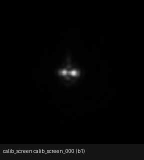
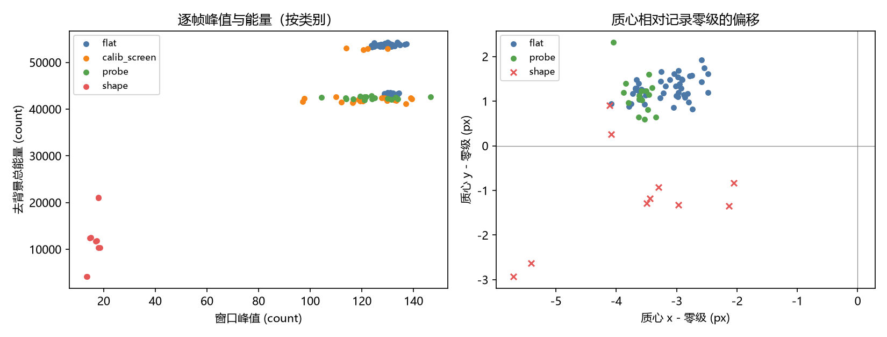
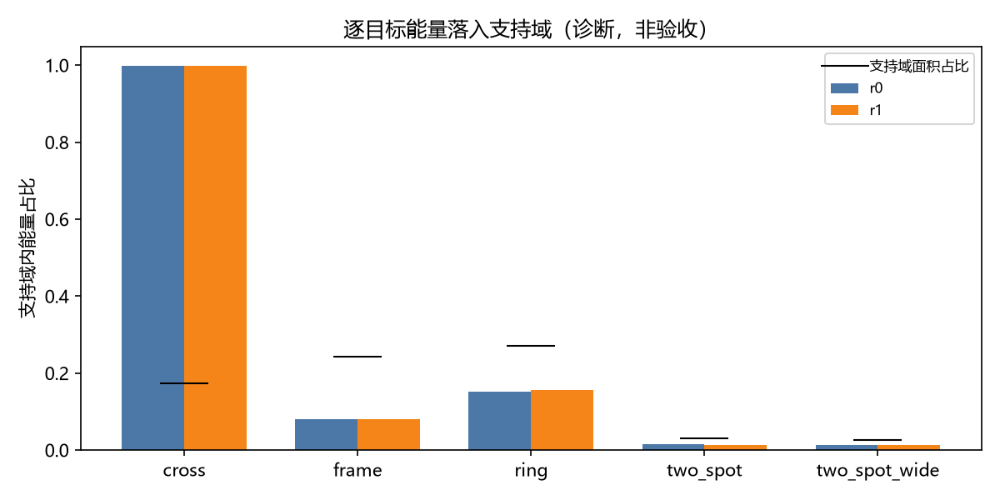
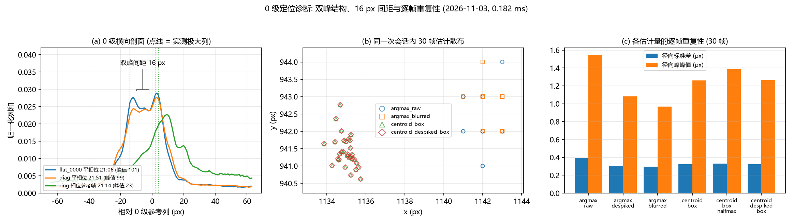
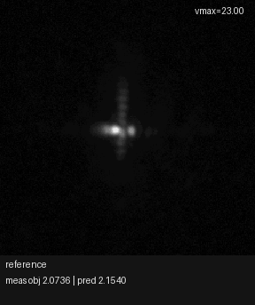
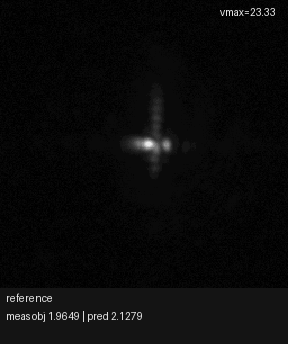
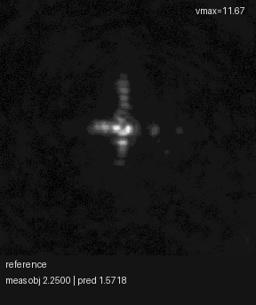

# 测量传递层、对齐评分与有界零级：离线结果 2026-11-03

<!-- provenance:start -->
> **生成脚本**: 人工撰写，无生成脚本
> **数据/关联脚本**: [`scripts/ml/sim2f_fov_hw_refine.py`](../../../scripts/ml/sim2f_fov_hw_refine.py)
> **数据/关联脚本**: [`src/ml/sim2f/calibrate.py`](../../../src/ml/sim2f/calibrate.py)
> **数据/关联脚本**: [`src/ml/sim2f/optics.py`](../../../src/ml/sim2f/optics.py)
> **数据/关联脚本**: [`scripts/ml/sim2f_fov_hw_offline_diagnostics.py`](../../../scripts/ml/sim2f_fov_hw_offline_diagnostics.py)
> **数据/关联脚本**: [`scripts/ml/sim2f_fov_hw_figures.py`](../../../scripts/ml/sim2f_fov_hw_figures.py)
> **数据/关联脚本**: [`scripts/ml/sim2f_fov_zero_order_diag.py`](../../../scripts/ml/sim2f_fov_zero_order_diag.py)
> **数据/关联脚本**: [`scripts/ml/sim2f_fov_zero_order_figure.py`](../../../scripts/ml/sim2f_fov_zero_order_figure.py)
> **运行环境**: 离线分析 + 2026-11-03 当日硬件采集（daheng CCD、SLM panel、ring refine 三模式与 GS seed refine、零级诊断）；报告含实测 CCD GIF。
> **说明**: 保留 sections 1-3 离线诊断原值；新增 2026-11-03 硬件测量：raw/effective/effective-aligned 三模式增益表、GS seed refine 负结果、零级 argmax 双瓣诊断与 measured CCD GIF。effalign 实测元数据存在未解释偏差（见正文 §5）；零级诊断仅证据，不修改 _locate_zero_order。这些数值来源见 artifacts/offline_diagnostics_20261103.json、artifacts/refine_gains_20261103.json、artifacts/zero_order_diagnosis_20261103.json；不视为物理整形成功或 CCD 验收证据。
<!-- provenance:end -->

## 1. 结论与证据边界

- 从 `data/debug/sim2f_fov_hw_refine_ring_20261103_091657` 与 `data/debug/sim2f_fov_hw_20261103` 提取的离线诊断结果（详见 `artifacts/offline_diagnostics_20261103.json`）。
- 模型喂进的相位是原始 128-grid 相位，非 SLM 实际显示相位（从 `panel_gray` 反解得到的）。使用实际相位后，参考相位模型预测目标函数值 2.06497 与实测 2.06530 近乎一致（差 3×10⁻⁴），表明相位映射问题是导致模型-实测增益差异的根本原因。
- 模型与实测窗口的对齐需要 **(-3, +32) px** 位移。零位移 NCC ≈ 0.03（几乎不相关），对齐后 NCC ≈ 0.68。窗口中心与模型零级不一致是确定的。
- 使用实际相位喂模型后，round_0001 增益 0.159（对比原始相位的 0.957），但仍高于实测 0.0005。方向一致（改善），幅度仍有约 30 倍的差距。
- **未决门禁**：离线诊断已固化为 JSON 可复现，但模型-实测增益差异的完整根因仍需在设备就绪时验证（SLM shift_phase 是否接入、光路中心是否重测等）。

## 2. 关键数值

参见 `artifacts/offline_diagnostics_20261103.json` 中的 JSON 对象。以下摘录关键条目（单位与 JSON 严格一致）：

|轮次 | measured gain | model_raw_zero_shift | model_effective_aligned | model_effective_zero_shift | alignment shift (px) |
|--------|--------------|----------------------|--------------------------|------------------------------|----------------------|
| reference | 2.06530 | 2.21983 | 2.04294 | 2.06530 | [-3, +32] |
| round_0001 | 0.000509 | 0.956801 | 0.078394 | 0.159100 | [-3, +33] |
| round_0002 | -0.000242 | 0.956801 | 0.075960 | 0.159100 | [-3, +32] |
| round_0003 | -0.001094 | 0.956801 | 0.075960 | 0.159100 | [-3, +32] |
| round_0004 | -0.003353 | 0.956801 | 0.078601 | 0.159100 | [-2, +32] |

## 3. 捕获会话概要（11-03）

参见 `artifacts/offline_diagnostics_20261103.json` 中的 `capture` 条目。关键帧统计：

| 帧 | sum | max | p99.9 |
|-----|------|------|-------|
| flat_0000 | 1437246.0 | 134.0 | 1.0 |
| calib_screen_000 | 1439581.4 | 112.0 | 1.0 |
| shape_ring_nominal_r0 | 1511501.7 | 18.0 | 1.0 |
| shape_cross_nominal_r0 | 1516702.4 | 13.67 | 1.0 |
| shape_frame_nominal_r0 | 1516409.7 | 18.0 | 1.0 |
| shape_two_spot_nominal_r0 | 1484399.7 | 17.0 | 1.0 |

模型对比（reference vs shaped）：
- NCC vs flat: ring 0.3116, cross 0.2661, frame 0.3180, two_spot 0.3043
- pairwise shaped NCC: ~0.25 之间各两两

## 4. CCD 采集帧可视化（11-03 会话）

- 全部 100 帧（平场/标定屏/probe/shape）按采集顺序回放，每帧裁到以记录零级为中心的 256 px 窗口：
- 10 个 shape 帧（5 类目标 × 2 重复）回放，去背景后按 0–20 count 显示：
- 左图：每帧窗口峰值 vs 去背景总能量（按类别着色）；右图：质心相对记录零级的偏移（flat/probe/shape）：
- 逐目标能量落入支持域（r0/r1 两个重复；黑线为支持域面积占比）：
- 可视化资产：[采集帧 GIF](images/ccd_capture_sequence_20261103.gif)、[形状帧 GIF](images/ccd_shape_sequence_20261103.gif)、[帧质量散点图](figures/ccd_stats_scatter_20261103.png)、[支持域能量图](figures/shape_encircled_energy_20261103.png)；生成脚本 [`scripts/ml/sim2f_fov_hw_figures.py`](../../../scripts/ml/sim2f_fov_hw_figures.py)。

## 5. 2026-11-03 硬件 refine：三模式对比

基线会话 `data/debug/sim2f_fov_hw_20261103_210641`；三模式 refine 目录 `data/debug/sim2f_fov_refine_ring_{raw16,eff,effalign}_1103_*` 与 GS seed 目录 `data/debug/sim2f_fov_refine_ring_gsringcentre_1103`；参数：16 px 零级容差（`effective-aligned` 与同会话 `raw` 对照）、3 轮、40 iters/轮；增益表见 `artifacts/refine_gains_20261103.json`（12 行，与 `refine_summary.json` 一致）。

| 模式 | 零级 (x,y) | 接受轮数 | 轮次 | 测量增益 m_gain | 预测增益 p_gain | 测量 objective 变化 |
|------|-----------|----------|------|------------------|------------------|---------------------|
| raw16 (`raw`) | (1124,940) | 2/3 | r1 | +0.004475 | +0.256360 | 2.057628 → 2.053153 |
| raw16 (`raw`) | (1124,940) | 2/3 | r2 | +0.005167 | +0.500452 | 2.053153 → 2.047985 |
| raw16 (`raw`) | (1124,940) | 2/3 | r3 (拒) | −0.005087 | +0.612742 | 2.047985 → 2.053072 |
| effective (`effective`) | (1140,940) | 2/3 | r1 | +0.002324 | +0.040390 | 2.073557 → 2.071234 |
| effective (`effective`) | (1140,940) | 2/3 | r2 | +0.001160 | +0.068846 | 2.071234 → 2.070074 |
| effective (`effective`) | (1140,940) | 2/3 | r3 (拒) | −0.000809 | +0.108522 | 2.070074 → 2.070883 |
| effective-aligned (`effective-aligned`, tol 16) | (1124,942) | 0/3 | r1 | −0.002750 | +0.005728 | 1.964864 → 1.967613 |
| effective-aligned (`effective-aligned`, tol 16) | (1124,942) | 0/3 | r2 | −0.000062 | +0.022534 | 1.964864 → 1.964925 |
| effective-aligned (`effective-aligned`, tol 16) | (1124,942) | 0/3 | r3 | −0.011284 | +0.050698 | 1.964864 → 1.976148 |
| GS seed (`effective`, seed `phases/shape_ring_nominal_r0.npy`) | (1140,942) | 0/3 | r1 | 0.000000 | +0.189129 | 2.25 → 2.25 |
| GS seed (`effective`, seed `phases/shape_ring_nominal_r0.npy`) | (1140,942) | 0/3 | r2 | 0.000000 | +0.416532 | 2.25 → 2.25 |
| GS seed (`effective`, seed `phases/shape_ring_nominal_r0.npy`) | (1140,942) | 0/3 | r3 | 0.000000 | +0.722657 | 2.25 → 2.25 |

说明：
- `raw` 与 `effective` 的接受相位 SHA-256 相同（`acad28802925…`），表明两模式在本会话下收敛到同一相位。
- 预测增益比测量增益大约 2 个数量级；每一轮中预测增益最大的轮次实测为负并被拒。
- GS seed：种子为 48 轮 GS 输出 `phases/shape_ring_nominal_r0.npy`，重算匹配到 2.8e-3 rad；注入方式为 opt-in `--start-phase-file` + `--recapture-reference`，未重建会话。

## 6. GS seed refine 负结果

- 运行 `sim2f_fov_refine_ring_gsringcentre_1103`：3/3 轮均未接受；测量增益恒为 0；预测增益 +0.189/+0.417/+0.723。
- 重算存储帧：每帧 objective = 2.25，ee = 0，L1 = 2.0（与记录一致）。测量分数退化（目标支持域内无能量）。
- 结论：GS 种子在本硬件/目标下未带来可测增益；不采用。

## 7. 零级（zero order）诊断

诊断脚本 `scripts/ml/sim2f_fov_zero_order_diag.py`（Ruff clean），输出 `data/debug/sim2f_zero_order_diag_20261103_215142/`（`diag.json`、`frames/`、`spot.png`）；图 `figures/zero_order_diagnosis_20261103.png`，数值 `artifacts/zero_order_diagnosis_20261103.json`。本节仅证据，不修改 `_locate_zero_order`。

- 平相位 argmax：30 帧内 7 个不同像素；径向 std 0.394 px，径向 ptp 1.547 px。
- 去噪/质心变体：径向 std 0.297–0.330 px。质心锁定点距 argmax 约 6.8 px（`median_abs_diff_argmax_vs_centroid_box_px` = 6.789）。
- 峰/环中位 1.04（平顶，非热像素）；30 帧均未接近饱和（0/30 at 255）。
- 重开：三次热开一致于 (1140,942)；冷启动初开 (1136,940)；含冷启动径向 spread 3.35 px。
- 双瓣证据（本会话重验）：21:06 平场帧双瓣位于 x=1142 (101.0) 与 x=1126 (93.0)；21:51 诊断帧 x=1142 (99.3) 与 x=1126 (79.3)，相距 16 px。argmax 在两瓣间翻转；box 质心稳定。
- observer 读图：spot.png 为单个连通非对称核心，无孤立热像素。

## 8. 异常与未解问题

- **effalign 实测元数据偏差**：以存储的 `frames/reference.npy` 在窗口 (972,942)、零级 (1124,942) 重算参考 objective = 2.049461（记录值 1.964864）；轮次重算亦与记录不符（如 round_0001 2.047547 vs 1.967613）。±40 px（4 px 步）位移扫描最佳匹配窗口位移 (-36,-12)（差 6.8e-5）与 (-32,+8)（差 1.2e-4）。该拟合非证明；effalign 实测元数据视为未解释，报告不依赖其数值。
- **预测-测量增益差距**：预测增益超测量约 2 个数量级；每轮预测增益最大的轮次实测为负并被拒。根因未解（离线诊断 §1 指向相位映射与对齐）。

## 9. 实测 CCD GIF（refine 轮次）

- raw16 轮次：
- effective 轮次：
- effective-aligned 轮次：
- GS seed 轮次：

生成脚本 [`scripts/ml/sim2f_fov_hw_figures.py`](../../../scripts/ml/sim2f_fov_hw_figures.py)（`--refine-dir` 可重复）；默认输出 SHA-256 8 文件字节一致。

## 10. 下一步

- 离线诊断与硬件测量已固化为 JSON 可复现（`artifacts/offline_diagnostics_20261103.json`、`artifacts/refine_gains_20261103.json`、`artifacts/zero_order_diagnosis_20261103.json`）。
- 硬件后续工作：
  1. 测量 SLM 实际光束中心（`panel_locate` 或 `find_beam_on_slm`），并将 `--pupil-center-xy` 设为测得的面板 px 位置。
  2. 将 SLM `shift_phase` 参数同时写入模型前向传播，保证模型与硬件看到的相位一致。
  3. 完成光路标定，确认零级相对窗口的精确平移（已知需要 (-3, +32) px 校正）。
  4. 零级诊断显示 16 px 双瓣导致 argmax 翻转；建议在 `_locate_zero_order` 中以 box centroid 或多峰处理替代单像素 argmax（本报告不实施）。
- 本报告不视为物理整形成功或 CCD 验收证据。
