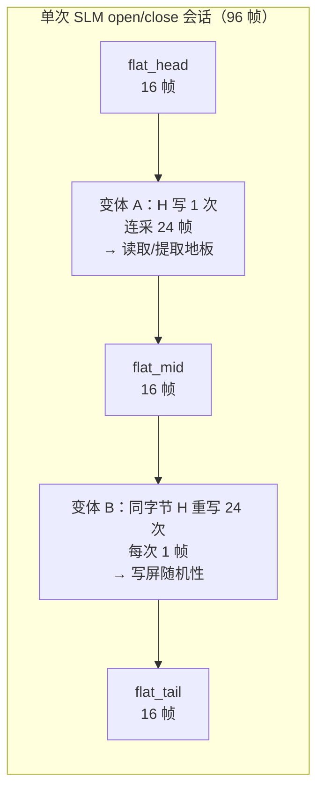

# S1f 随机抖动归因探针 · 离线准备报告

<!-- provenance:start -->
> **生成脚本**: 人工撰写，无生成脚本
> **运行环境**: 离线（未占用 SLM/CCD/激光）
> **说明**: S1f 探针离线准备与自检报告：三变体契约（A 同写屏 24 帧地板 / B 同字节 24 次各 1 帧 / C flat 头中尾各 16 帧）、ratio 与 drift 冻结判据、§9 光强预检门禁与采集/判读脚本设计；含 run_01 无光作废记录（§9）。提交 aca0b987 / 93bcc0ff。
<!-- provenance:end -->

**日期**：2026-11-27
**状态**：离线准备完成，**未占用 SLM/CCD/激光**，等待用户授权实验
**预注册**：`docs/dev/s1f_jitter_attribution_prereg_20261127.md`

---

## 摘要

- **问题**：S1e 修复 `non_contiguous_memmove_transpose` 后，确定性层已闭环（轴型从 `col-type` ~94 px 恢复为 `row-type` ~58 px，送屏字节由 F 序 `b98be9a6…` 变为 C 序 `7276d9da…`），但 D1 仍为 `inconclusive`，残留约 **1.6 px** 随机抖动未归因，S1 维持 `BLOCKED`。
- **关键线索**：`run_05_postfix` 中「同一次写屏、两帧之间」的 `intra_upload_dist` 已达 1.68–1.85 px，与跨上传 pairwise 1.665 px 同量级。该指标写屏状态固定，说明抖动大头**可能不在 SLM 写屏**，而在相机读出/质心提取或光路慢漂移——但 S1e 口径无法把三者分开。
- **本探针**：采用**三变体分层**，在同一会话内分别测量 L1 读取/提取噪声地板、L2 写屏随机性、L3 光路慢漂移，共 **96 帧 / 28 次写屏**，单次 SLM open/close，曝光 0.05 ms。
- **本轮产出**（全部离线）：新预注册 1 份、采集脚本 1 个、判读脚本 1 个、离线门禁测试 2 份（35 项全过）、本报告。**不改变 S1 状态、不改 S1e 冻结判据、不碰 S1e 原始数据**。

---

## 1. 背景与归因缺口

### 1.1 已确认事实

| 项目 | 修复前 | 修复后 |
|---|---|---|
| H 送屏字节（sha256） | `b98be9a6…`（F 序裸 buffer） | `7276d9da…`（逻辑 C 序） |
| H 远场轴型 | `col-type` ~94 px | `row-type` ~58 px |
| D1 两两最大距离 | `D-fail`（1.585 px，n=6） | `inconclusive`（1.665 px，有效 4 < 5） |
| `intra_upload_dist` | — | H `s1e_a2` 1.85、`s1e_a5` 1.68 px |
| flat 参考头尾漂移 | — | 1.225 px |

### 1.2 为什么 S1e 无法归因

S1e 的 `intra_upload_dist` 定义为**同一次 upload（同一次写屏）后两帧的主瓣距离**。写屏状态在两帧之间完全不变，因此该值只反映「读取 + 质心提取」层，不包含写屏随机性。而跨上传 pairwise 距离把写屏与读取混在一起。两者都**不能**单独量化光路慢漂移。要定位 ~1.6 px 的来源，必须把三层拆开、在同一会话内独立测量。

---

## 2. 探针设计：三变体分层



### 2.1 三层与度量

| 层 | 变体 | 操作 | 度量 |
|---|---|---|---|
| L1 相机读出 / 质心提取 | A（`same_write`） | H 写屏**一次**，连采 24 帧 | 主瓣位置帧间散布 `A.rms_px` |
| L2 SLM 写屏随机性 | B（`repeat_write`） | 同一 H 字节重写 24 次，每次 1 帧 | 主瓣位置写屏间散布 `B.rms_px` |
| L3 光路慢漂移 | C（`flat_drift`） | flat 头/中/尾各写屏一次，各 16 帧 | 0 级中心 `zr_head→zr_tail` 漂移 |

### 2.2 会话布局（96 帧 / 28 次写屏）

| 段 | pattern_id | array | 写屏次数 | 帧数 | 作用 |
|---|---|---|---|---|---|
| 1 | `flat_head` | flat | 1 | 16 | 变体 C 头部参考 |
| 2 | `s1f_a01`…`s1f_a24` | H | 1 | 24 | 变体 A 地板 |
| 3 | `flat_mid` | flat | 1 | 16 | 变体 C 中部参考 |
| 4 | `s1f_b01`…`s1f_b24` | H | 24 | 24 | 变体 B 写屏随机性 |
| 5 | `flat_tail` | flat | 1 | 16 | 变体 C 尾部参考 |

- 帧全局连续编号 0000–0095，`frame_filename(index, pattern_id)` 命名，存 `<out>/frames/`。
- 变体 A 的 24 帧共享 `write_index=1`；变体 B 的 24 帧各对应一次写屏。

---

## 3. 冻结复用与边界

| 复用件 | 用途 |
|---|---|
| `flat_phase` / `grating_phase` / `phase_to_gray` | 图样相位与灰度 builder，不重实现相位数学 |
| `find_spots` / `principal` | 亚像素质心与主瓣选取，与 S1e 判读同一求解器 |
| `s1d` 的 `acquire_device_lock` / `camera_identity` / `frame_filename` / `utc_now` / `write_json` / `require_drive_board_entry` | 设备锁、身份、命名、时间戳 |
| `FROZEN_PANEL_SHAPE=(1200,1920)`、`ENCODING_MAX_GRAY=1023`、`GRATING_PERIOD_PX=128`、`NATIVE_CCD_SHAPE=(1944,2592)` | 物理常数，与 S1e 一致 |

**不改写**：§12.16 冻结判据、S1b/S1c/S1d 与 A/P 原始记录、S1e 采集/判读脚本、`driver.py` 守卫。**不碰** `scripts/_common/provenance.py`。

---

## 4. 判读指标与裁定规则

| 指标 | 定义 |
|---|---|
| `zr_head` / `zr_mid` / `zr_tail` | flat 三组各帧 `find_spots(min_dist=20)` 最亮斑质心的逐轴中位 |
| `A.rms_px` | 变体 A 主瓣位置逐轴标准差合成 `hypot(std_row, std_col)` |
| `B.rms_px` | 变体 B 同上 |
| `pairwise_max_px` | 该变体内主瓣位置两两 `hypot` 最大值 |
| `drift_head_to_tail_px` | `hypot(zr_tail − zr_head)` |
| `ratio` | `B.rms_px / A.rms_px`；`A.rms_px ≤ 0` 时记 `None`（不写 `inf`） |

### 4.1 裁定

| 条件 | 裁定 | 含义 |
|---|---|---|
| `ratio ≤ 1.3` | **V1 读取/提取主导** | 重写同一字节不显著增加散布，~1.6 px 归因于相机读出 + 质心提取 |
| `ratio ≥ 2.0` | **V2 写屏随机性主导** | 重复写同一字节显著移动远场 |
| `1.3 < ratio < 2.0` | **V3 混合** | 报两分量占比 |
| `ratio is None` | **undetermined** | 地板为 0，无法定级 |
| `drift_head_to_tail_px ≥ 1.0` | `drift_material=true` | 光路漂移在同一会话内已不可忽略 |

**交叉核对（仅佐证）**：把 `A.rms_px` / `B.rms_px` 与 S1e `run_05_postfix` 的 `intra_upload_dist`（1.68–1.85 px）比较。

---

## 5. 离线门禁结果

| 门禁项 | 命令 | 结果 | 退出码 |
|---|---|---|---|
| 采集脚本定向测试 | `pytest tests/.../test_s1f_jitter_attribution_capture_20261127.py -q --import-mode=importlib` | 10 passed | 0 |
| 判读脚本定向测试 | `pytest tests/.../test_s1f_jitter_attribution_judge_20261127.py -q --import-mode=importlib` | 25 passed | 0 |
| 两文件合并复跑 | 上述两文件同批 | 35 passed | 0 |
| ruff | `ruff check` 四个新 `.py` | All checks passed | 0 |
| BOM 约定 | 四个新 `.py` 首字节均非 `EF BB BF` | 无 BOM | 0 |
| 术语门禁 | `term_unify_20261016.py --dry-run` 过滤 `s1f` | 本线 0 命中 | 0 |
| 计划模式只读 | 无参数运行采集脚本 | 打印 plan、零目录、零设备锁 | 0 |

**计划模式实测关键值**：`n_frames_expected=96`、`n_writes_expected=28`、`frozen_h_physical_sha256=7276d9da3b2a5ea536d56ea944adcfdcb38c98ad1dd01c1433d1b2219ac8218e`、首帧 `flat_head@write_index 0`、末帧 `flat_tail@write_index 27`、变体 A 的 `write_index` 唯一为 1。

> 仓库级 `test_conventions.py` 仍有 10 项失败，全部指向**他车道**正在改/未跟踪的文件（`.slim/`、`AGENTS.md` 链接、`src/` blind-except 棘轮、缺失的 `tests/.../test_drift_feedback.py` 等），**无 `s1f` 命中**；本线新增文件不在其 offender 列表内。

---

## 6. 实验清单（用户授权后执行）

```powershell
# 1) 计划模式自检（只读，不取锁）
.venv\Scripts\python.exe scripts/slm/s1f_jitter_attribution_capture_20261127.py

# 2) 定向门禁（应 35 passed）
.venv\Scripts\python.exe -m pytest tests/ao_shaping/scripts/test_s1f_jitter_attribution_capture_20261127.py tests/ao_shaping/scripts/test_s1f_jitter_attribution_judge_20261127.py -q --import-mode=importlib

# 3) 上机采集（单会话 96 帧；占用 SLM #1 + Daheng cam0，约 1–2 min）
.venv\Scripts\python.exe scripts/slm/s1f_jitter_attribution_capture_20261127.py --execute --exposure-ms 0.05 --out data/experiments/attribution_20261123/s1/s1f_jitter_attribution_20261127/run_01 --wait-until-idle 1800

# 4) 离线判读（不占设备）
.venv\Scripts\python.exe scripts/slm/s1f_jitter_attribution_judge_20261127.py --capture-dir data/experiments/attribution_20261123/s1/s1f_jitter_attribution_20261127/run_01 --out report/shape_trials/s1f_jitter_attribution_20261127/
```

### 6.1 实验前后必须报告

- 占用设备：SLM #1（`video_mode=0`）、Daheng cam0；**不操作激光、不采 dark、不并行占用**。
- 采集期间**不判读**，判读全部离线。
- 释放：以 `released.json.closed_normally == true` 与 `summary.json.status == "ok"` 为准；背对背 open/close 冷却 ≥ 200 s。
- 异常中止：饱和计数 > 0 即中止；`NativeCommandError` 若来自 loguru stderr 不是真实错误，以退出码与 `summary.status` 为准。

---

## 7. 风险与未决项

| 项 | 说明 | 处置 |
|---|---|---|
| 曝光 0.05 ms | 沿用 S1e 用户裁决（G3 饱和即降曝光），非冻结默认 0.087 ms | 已在预注册登记；若 flat 峰仍偏高按 G3 再降并记录 |
| 单会话漂移 | 96 帧约 1–2 min，漂移可能混入变体 B | 用 flat 头/中/尾三点量化并报 `drift_material` |
| 弱 H 主瓣 | 0.05 ms 下 H 峰仅 306–362，质心提取噪声可能偏大 | 变体 A 正是测该地板；交叉核对 `intra_upload_dist` |
| 结论不外推 | 本探针只归因，不判定 S1 解锁 | S1 解锁仍需另行预注册的 D-pass |
| 仓库脏工作树 | 271 项他车道改动，约定测试 10 项失败 | 只提交本线 6 个文件，逐路径 `git add` |

---

## 8. 结论与下一步

1. 离线准备完成：预注册、采集、判读、门禁全部就绪，计划模式零副作用。
2. **本探针不改变 S1 状态**；它回答的是「~1.6 px 抖动来自哪一层」。
3. 下一步（需用户授权）：
   - 授权后按 §6 实验采集一次 `run_01`；
   - 离线判读得 V1/V2/V3 之一；
   - 若 V1（读取/提取主导），后续优化方向是质心提取与曝光/SNR，而非 SLM 写屏；
   - 若 V2（写屏主导），再回到写屏路径做更细的字节/时序分层。

---

## 附录 A · 本线文件清单

| 文件 | 说明 |
|---|---|
| `docs/dev/s1f_jitter_attribution_prereg_20261127.md` | 预注册（契约） |
| `scripts/slm/s1f_jitter_attribution_capture_20261127.py` | 采集脚本（计划/执行双模式） |
| `scripts/slm/s1f_jitter_attribution_judge_20261127.py` | 离线判读脚本 |
| `tests/ao_shaping/scripts/test_s1f_jitter_attribution_capture_20261127.py` | 采集门禁（10 项） |
| `tests/ao_shaping/scripts/test_s1f_jitter_attribution_judge_20261127.py` | 判读门禁（25 项） |
| `report/shape_trials/s1f_jitter_attribution_20261127/s1f_jitter_attribution_prep_20261127.md` | 本报告 |

## 附录 B · 绑定 commit

- 代码与预注册提交：`aca0b987`
- 本报告提交：`aca0b987`（与代码同一提交；本段由紧随其后的溯源绑定提交回填）

---

## 9. 实验后状态：run_01 作废（无光）

- `run_01` 已按 §6 采集，96 帧 / 28 次写屏，设备正常释放（`released.json` 全 true，05:09:50Z），但**全场无有效光强**：flat 峰 41 counts（S1e 同曝光 2524 counts），背景均值一致、写屏 digest 正确 → 光学输入缺失。
- 其判读输出系噪声峰跳变假象，**已作废**，存于 `invalid_run01_no_light/`，不得引用；S1 状态不变。
- 已在预注册 §9 登记数据质量门禁（`peak - median >= 50`），采集与判读均会拒绝无光会话；复采须先恢复激光出光/快门，再执行 §6 为 `run_02`。
