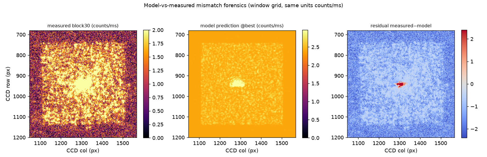
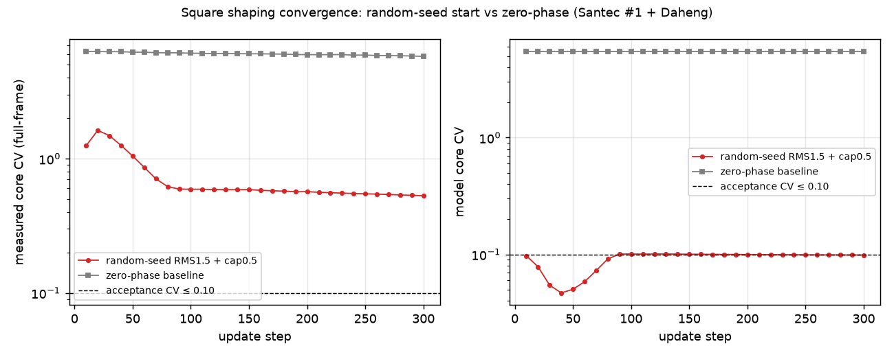
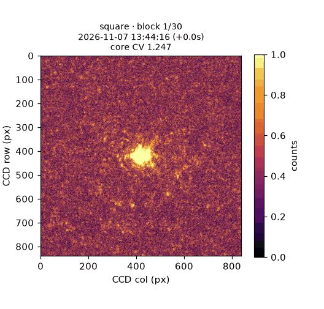
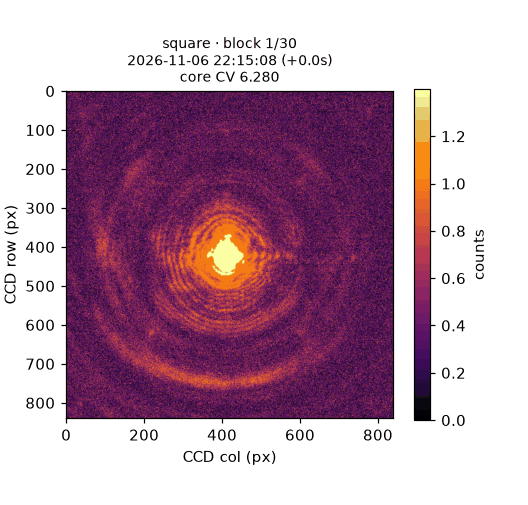
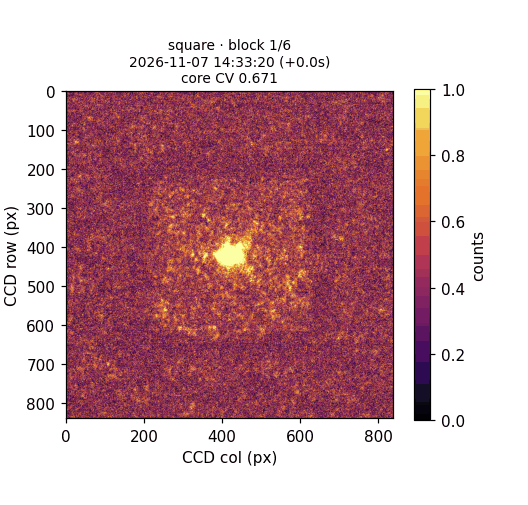
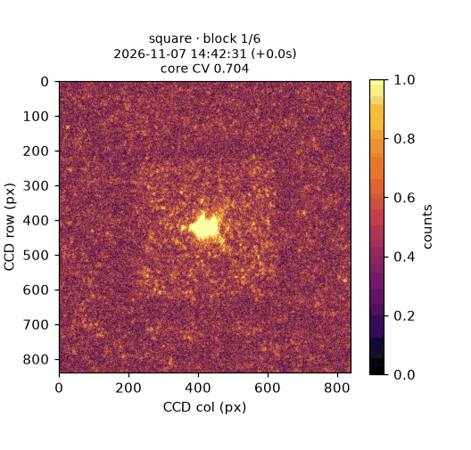

# 实验系统可微整形速度计时：随机起步 square（shape_transition 20261107）

<!-- provenance:start -->
> **生成脚本**: [`scripts/slm/generate_shape_transition_report_20261107.py`](../../../scripts/slm/generate_shape_transition_report_20261107.py)
> **复现命令**: `python scripts/slm/generate_shape_transition_report_20261107.py`
> **数据/关联脚本**: [`scripts/slm/shape_transition_timing_20261106.py`](../../../scripts/slm/shape_transition_timing_20261106.py)
> **运行环境**: 离线渲染（实验系统数据 2026-11-07：Santec #1 1064 nm + Daheng CCD）
> **说明**: 随机起步 square 计时与失配取证；输入为 shape_transition_timing_20261106.py --execute 产物（shape_transition_20261107_randseed / 20261106_rerun）。§5 另引 anchored 实验系统闭环两种锚定语义（preanchored / raw）的 --execute 产物（shape_transition_20261107_anchored_pre / shape_transition_20261107_anchored_raw）；images/ 为本脚本渲染的 4 个实测 CCD GIF（ccd_square_randseed_20261107 / ccd_square_zerophase_20261106 / ccd_square_anchored_pre_20261107 / ccd_square_anchored_raw_20261107，标题含 device_log.json 抓帧时刻与相对首帧墙钟），figures/ 与 artifacts/mismatch_forensics_20261107.json 同为本脚本产物。
<!-- provenance:end -->

**日期** 2026-11-07 · **脚本** `scripts/slm/shape_transition_timing_20261106.py` · **设备** Santec SLM-200 #1（1920×1200）+ Daheng MER2-507-23GM（2592×1944，0.5 ms，5 帧平均）
**Checkpoint** `multishape_nogs_20261104/p20261104/model640`（grid 640 / FFT 2048 / bias_counts 型）

## 1. 结论速览

| 指标 | 随机起步 RMS1.5 + cap0.5 + lr0.05 | 零相位基线（20261106_rerun） |
|---|---|---|
| 步数 / 墙钟 | 300 步 / 149.6 s | 300 步 / ~319 s（4 形状合计） |
| 实测核心 CV（全帧） | 1.247 → **0.529** | 6.28 → 5.77（square 段） |
| 模型核心 CV | 5.47 → **0.099** | 无改善（~5.47） |
| accepted（CV≤0.10） | 否 | 否 |

- 随机起步把实测 CV 改善 **10 倍**（1.25→0.53），证实零相位困焦斑盆地是起步问题、cap≥0.3 是必要条件。
- 模型侧 10 步即收敛（model_cv≈0.099），残差 5 倍（模型 0.10 vs 实测 0.53）**全部来自 FrozenDefocusForward 表征误差**，非优化器/投影问题。

## 2. 失配取证（为什么模型说 0.10 实测只有 0.53）



同单位（counts/ms，`count_rate = 原始帧/曝光`，模型 `g·optical + b + bias/t`）对比末块：

| 量 | 实测 | 模型 | 比值 |
|---|---|---|---|
| 背景常数 (counts/ms) | 0.816 | 2.386 | 2.9× |
| 光斑峰值对比度 (peak/bg) | 37.2 | 2.31 | 1/16 |
| 核心 CV（窗） | 0.511 | 0.073 | — |

模型背景 2.9× 实测、PSF 对比度仅实测 1/16：模型的"低 CV"是暗底+弱光斑稀释出来的伪影。散粒噪声地板 = 1/√N ≈ 0.0057 → **CV≤0.10 物理可达**，瓶颈是模型不是噪声。

## 3. 收敛曲线



## 4. CCD 实测 GIF（标题含抓帧时间戳）

每帧标题三行：**块号** · **抓帧本地时间 + 相对首帧墙钟秒数** · **该帧实测核心 CV**。
时间戳取自 `device_log.json` 的真实抓帧时刻（UTC 转本地），墙钟为相邻抓帧的真实间隔，
**与 GIF 播放速度无关** —— GIF 统一按 1.6 fps 播放，实际耗时只能从标题读出。



零相位基线（square 段，可见光斑几乎不动）：



实测锚定闭环（anchored, preanchored 语义）：



实测锚定闭环（anchored, raw 语义）：



| GIF | 实测帧数 | 首帧 → 末帧墙钟 | 抓帧时间范围（本地） |
|---|---|---|---|
| 随机起步（model） | 30 | 142.6 s | 11-07 13:44:16 → 11-07 13:46:39 |
| 零相位基线 | 30 | 133.3 s | 11-06 22:15:08 → 11-06 22:17:21 |
| anchored preanchored | 6 | 44.0 s | 11-07 14:33:20 → 11-07 14:34:04 |
| anchored raw | 6 | 45.4 s | 11-07 14:42:31 → 11-07 14:43:17 |

## 5. 实测闭环（anchored）实验系统结果：两种锚定语义都**变差**

离线回放曾显示窗 CV 1.18 → 0.47，但**实验系统在线跑证实 anchored 闭环不但没改善，反而把实测 CV 推高**：

| 模式 | 锚定语义 | 步数 / 墙钟 | 实测核心 CV 首块 → 最佳 | 模型 CV 末块 | accepted |
|---|---|---|---|---|---|
| model（基线） | — | 300 步 / 149.6 s | 1.247 → **0.529** | 0.099 | 否 |
| anchored | preanchored | 60 步 / 55.3 s | 0.671 → **0.671** | 0.056 | 否 |
| anchored | raw | 60 步 / 55.0 s | 0.704 → **0.704** | 0.039 | 否 |

两种语义都停在 **6 块**（`stall_5_blocks_no_0.005_improve`），第 1 块后实测 CV 不再改善且反而升高到 ≈1.0-1.1。

**原因**：`update()` 的 measured 分支把 `measured + prediction − baseline` 当损失输入，梯度只经
`prediction − baseline`（模型雅可比）流过。模型雅可比在**残差频段不可信**（失配取证：模型背景
2.9× 实测、光斑对比度仅 1/16、PSF FWHM 竖向 9 vs 实测 9 但横向 21 vs 14），
于是每块优化都在往一个"模型认为更好、实测更差"的方向走 —— 锚定只抵消了**静态偏置**，
抵消不了**雅可比方向的错误**。model-only 基线之所以能到 0.529，是因为它的每步下降方向
恰好部分落在实测可接受的方向上；一旦把实测锚点塞进损失，错误雅可比被放大成主导项。

结论：当前 `FrozenDefocusForward` 代际下，**anchored 闭环不可用**，瓶颈在模型表征而非优化器。
下一步应做 `fit_radiometry`（用当前光路实测帧重标定 gain/background/bias），
确认是辐射定标漂移还是 PSF/雅可比本身错，再谈 anchored。

## 6. 实验系统模式（protocol 说明）

脚本新增 `--mode anchored`（协议照搬 `validate.py` L1064-1086）：每块以当前 best 重建 optimizer、采集锚点帧过 `count_rate` 喂回 `update(measured_intensity=...)`，块末接受后 `accept()` 推进。
锚定语义由 `--anchor-semantics` 显式开关：

- `raw`：传原始 anchor，`update()` 内部自做 anchoring（`I_anchor + ΔF`），符合 docstring 契约；
- `preanchored`：传 `anchored_intensity(anchor, cur, base)`，`update()` 内再加一次 → `I_anchor + 2ΔF`（复刻 validate.py）。

离线回放（block1 实测帧为锚，从 seed 跑 100 步）曾显示窗 CV 1.18 → 0.47，但实验系统在线跑证伪了这一乐观结论（见 §5）：锚定只抵消静态偏置，抵消不了雅可比方向错误。

## 7. 复现

```powershell
$env:PYTHONPATH = "src;libs"
# 实验系统（需 --execute；占 SLM #1 + Daheng）
python scripts/slm/shape_transition_timing_20261106.py --execute --mode model `
  --out data/debug/slm_transfer/<dir> --shapes square `
  --random-seed-rms 1.5 --lr 0.05 --phase-rms-cap 0.5
# anchored 实验系统闭环（两种锚定语义）
python scripts/slm/shape_transition_timing_20261106.py --execute --mode anchored `
  --anchor-semantics preanchored --out data/debug/slm_transfer/<dir> --shapes square `
  --random-seed-rms 1.5 --lr 0.05 --phase-rms-cap 0.5
# 本报告（离线）
python scripts/slm/generate_shape_transition_report_20261107.py
```
