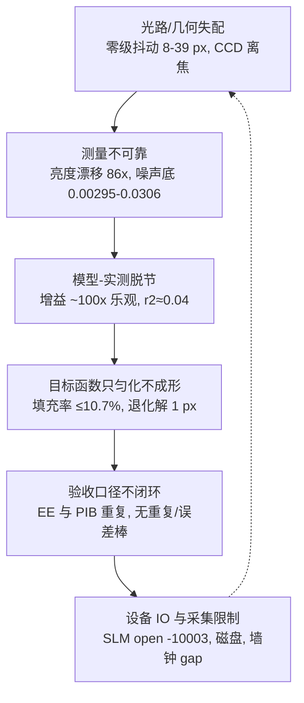
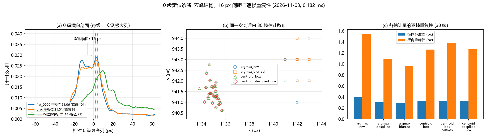
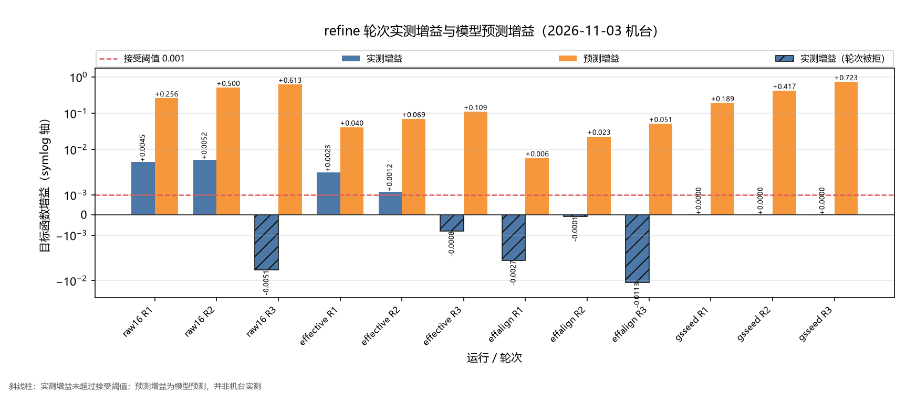
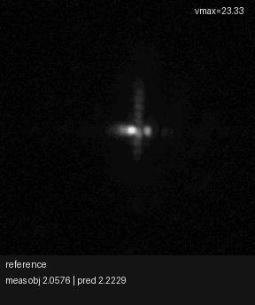
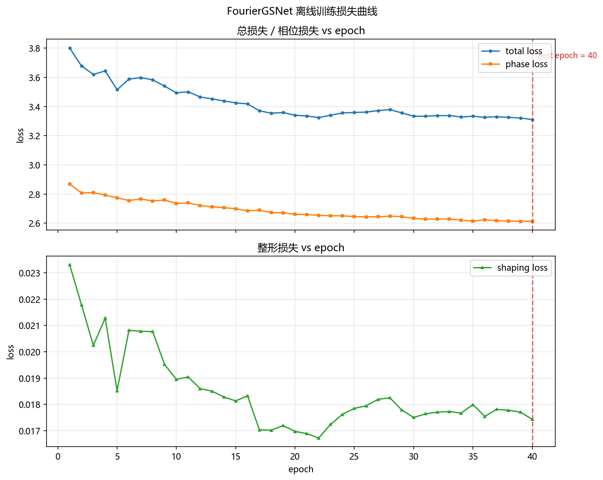
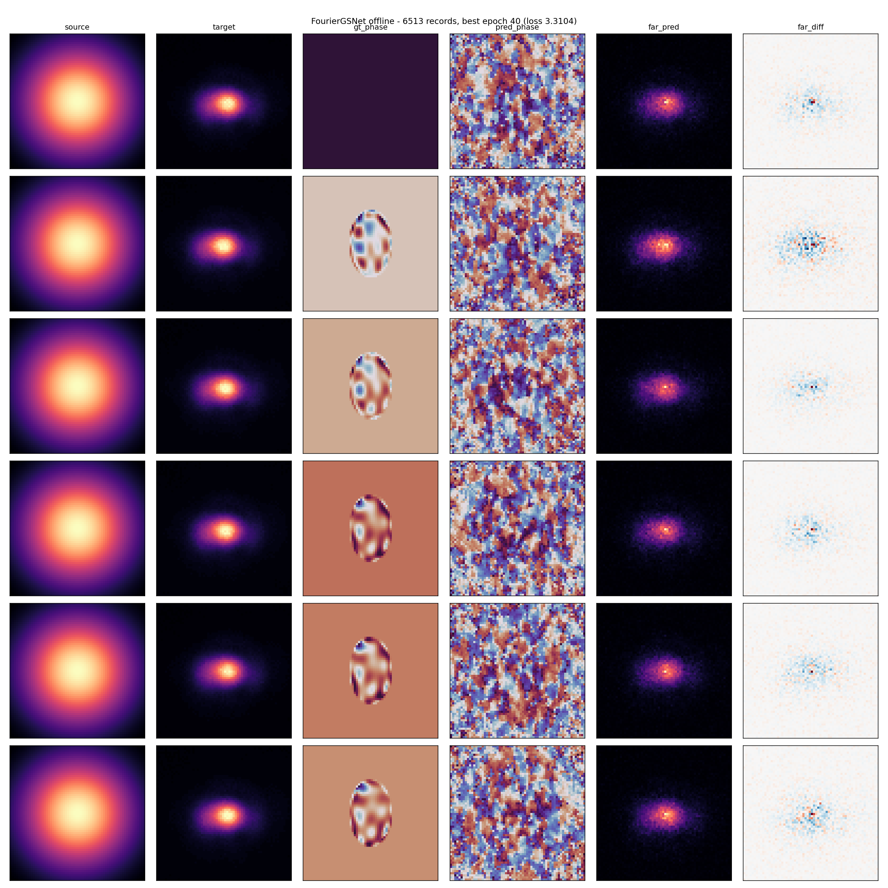
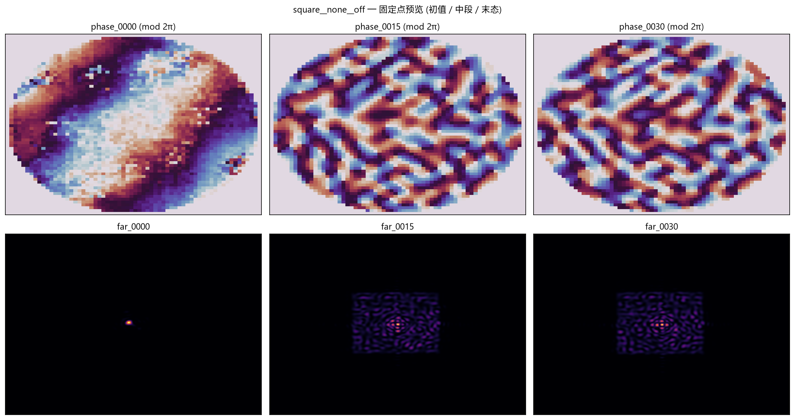
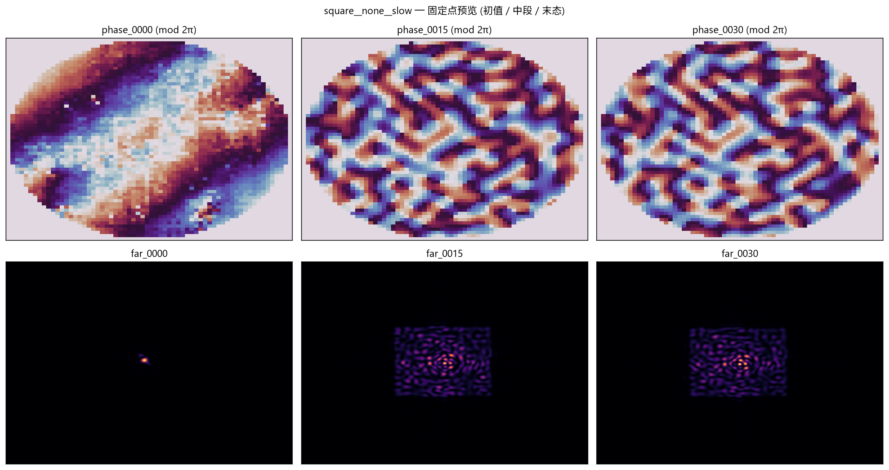

# 光束整形报告综述：光路失配、物理设备限制与算法缺陷（2026-11-03）

<!-- provenance:start -->
> **生成脚本**: 人工撰写，无生成脚本
> **运行环境**: 离线只读综述（汇总 report/shape_trials/ 下既有报告；不产生新硬件数据）
> **说明**: 光束整形报告问题综述：按光路失配、物理设备限制、算法缺陷、测量与验收口径归类，数字均来自所引原报告；FourierGSNet 条目经人工摘录核对，未在硬件上复验。
<!-- provenance:end -->

## 0 结论摘要

1. **最大的系统性问题是模型与实测脱节**。多份报告中，模型预测增益比实测高约 100 倍（physical_refine：预测 0.04–0.72，实测 0.001–0.005）；模型只解释实测约 4% 的方差（square_1000，r≈0.21）；Jacobian 对离焦与光滑相位几乎无响应（余弦 ≈ 0）。模型不能作为验收依据。
2. **零级与光路几何是反复出现的根因**。零级位置在不同报告中抖动 8–39 px；CCD 离焦（D=+0.559 m⁻¹，f≈1789 mm）使远场不在焦面；载波与目标框的相对位置在多形状场景下直接把目标推出采样窗。
3. **照明与亮度漂移是主导物理干扰**。同一平场亮度摆动约 86×（slm_pib）；轮内参考峰值下降 30%（no_gs）；激光功率中途从 0.7 调到 1.0（counts/ms 4.36→31.67）。多数报告只做了缓解（同曝光重放、漂移轮剔除），未消除根因。
4. **验收口径与目标函数不匹配**。只优化均匀度（CV）时，光斑被匀化但不成形（填充率 ≤10.7%）；综合目标与 CV 指标冲突；退化解（SPGD 仿真坍缩到 1 px，EE≈0.998）能拿到“成功”的 EE 分数。
5. **多份报告的结论已被后续修复推翻**，本综述只保留仍有效的问题，并注明状态。

## 1 范围与方法

- 覆盖目录：`report/shape_trials/` 下 GS 系列（gs_refine、gs_refine_fwdmodel、gs_refine_zernike、gs_defocus_sim、gs_golden_reference、hw_gs_square_scans、cold_start）、SPGD/黑盒/学习类（spgd_drift_cancel_loop、blackbox_path、gui_closed_loop_shaping、no_gs_ccd_moved）、model-in-loop 系列（model_in_loop、model_in_loop_cv、defocus_differentiable、hw_defocus_zernike、experiment_summary）、多形状/迁移/物理 refine 系列（multishape_capability、multishape_scale、multishape1200、square1200、tri_plane、axial_plane、sim_vs_hw、mask_closed_loop、physical_refine）；以及 `report/benchmarks/device_less_full/` 的 SPGD/GS 仿真指标。
- 每条问题给出：分类、一句话描述、证据位置（仓库相对路径与关键数字）、报告自身给出的状态。
- **局限**：条目来自只读摘录，部分长报告正文被截断，标注“待核实”的条目未逐行复核；数字以原报告为准。FourierGSNet 系列条目经逐份通读后的摘录核对源码状态（见 §2.5）。

分类：**A** 光路失配；**B** 物理设备受限；**C** 算法缺陷；**D** 测量与验收口径。状态：已修复 / 已缓解 / 未解决 / 待硬件验证。

## 2 按报告归类的问题

### 2.1 GS 系列

- [A] 零级约距目标 12 px，位移标度 ≈ 7400/P；面板与 CCD 轴互换 — `report/shape_trials/gs_refine/zero_order_blaze_20261015.md` — 未解决；轴互换待硬件验证。
- [A] 面板中心 (960,690)、半径 450 未经光路验证 — `gs_refine_live_20261012.md` — 待硬件验证。
- [A] ~~液晶 2π 取值 993 而非 1023~~ → **已解决**（2026-11-04 定案：993 是设备物理 2π，编码口径统一为 1023 满量程，见 §3 说明）；各向异性 1.60× 旧模型；仿真场 16.6 mm 对相机 0.55 mm（约 30× 失配）— `gs_refine_fwdmodel/gs_refine_fwdmodel_calibration.md` — 未解决。
- [A] 硬件结果与仿真方向相反（仿真 GS 0.8543 对平场 0.7229，硬件 CV 0.723 近似平场）— `gs_golden_reference/gs_golden_reference.md` — 未解决。
- [A] 实测位移系数 α≈0.48，预测 1.00 — `hw_gs_square_scans/hw_gs_square_scans_20261023.md` — 未解决。
- [B] 零级重定位抖动 8 px（Zernike 模式 39 px）；9/50 次 settle 超时 — `hw_gs_square_scans_20261023.md` — 未解决。
- [B] 曝光 0.1 ms 饱和，帧峰值仅 4–7/255（低信号）— `gs_refine_live_20261012.md`、`gs_uniformity_live_20261015.md` — 已缓解（重调曝光），信号不足未解决。
- [C] SPGD 细化增益 0.0043–0.0137，接近或低于噪声底 — `gs_refine_live_20261012.md`、`gui_closed_loop_shaping_20261014.md` — 未解决。
- [C] GS 把热点分裂成多个亮点与暗孔，CV 0.6–0.8，无实心方块 — `gs_issue_live_20261015.md`（IoU 0.068–0.098） — 未解决。
- [C] 仅纯 CV 循环时 CV 0.72313→0.68400，但强度下降 2.3%；四档平滑全部为负 — `gs_uniformity_live_20261015.md` — 未解决。
- [C] 模型交叉验证乐观 0.2631；单种子残差增益 +0.00339 无重复 — `gsnet_hybrid_offline_20261013.md` — 未解决。
- [C] `best_phase` 返回了扰动后的获胜探针而非最佳相位（0.2349→0.0826 rad） — `online_20261010.md` — 已修复（#140）。
- [D] 早期结果在错误图像上计算，已发勘误 — `gs_issue_live_20261015.md` — 已修复（勘误）。
- [D] 自适应框使分数膨胀（43→104 px，最优相位 3.87 vs 0.34 rad） — `gs_defocus_sim/gs_defocus_sim_20261019.md` — 已修复（改为固定框）。
- [D] `ee` 与 `PIB` 为重复指标；单次测量无误差棒 — `gs_issue_live_20261015.md` — 未解决。
- [D] 冷启动 plane 6/6 接受、CV 2.512→0.481，但 EE 0.241→0.173；local_continuation 0/4 — `cold_start/cold_start_20261026.md` — 未解决。
- [C] 相位-光斑模型跨运行 `fit_rms` 漂移 0.008–0.012 rad，根因未知 — `gs_refine_zernike_hardware_plan.md` — 未解决。
- [D] Zernike 均匀度 PIB 差 0.0161 仅约 2 倍抖动（0.0072–0.0109） — `gs_refine_zernike/gs_refine_zernike_uniformity.md` — 未解决。

### 2.2 SPGD、黑盒与学习类

- [C] 照明漂移下 SPGD 四种协议全部不收敛（dec 0.41–0.59，阈 >0.55） — `spgd_drift_cancel_loop/spgd_drift_cancel_loop_20261022.md` — 未解决。
- [C] 噪声门把 29–30/32 个梯度估计置零，更新被饿死 — 同上 — 未解决。
- [B] 同相位噪声底 σ(J)=0.0306（n=24）限制可分辨性 — 同上 — 未解决（物理约束）。
- [B] 噪声底 dJ_noise=0.00040，SPGD 最小可分辨扰动 Δa≈0.2 rad（SNR 2.77）；0.05/0.1 rad 的 SNR 仅 0.27/0.69 — `slm_pib_heuristic_hw/measure_shape_sensitivity/sensitivity.md` — 未解决（定量解释“小步全部随机游走”）。
- [B] 光照漂移 86× 双态摆动（曝光需求 191.5→173.6 ms）— `slm_pib_heuristic_hw/slm_pib_heuristic_hw_report/report.md` — 已缓解（剔除漂移轮，中位 ±25%）。
- [B] 每算法 82–116 次设备加载，仅为指示性对比 — 同上 — 未解决（预算限制）。
- [B] 轮内参考峰值 13.856→9.732 counts/ms（−30%），曝光 7.650→13.564 ms — `no_gs_ccd_moved/live_20261027.md` — 未解决。
- [A] 两轴载波矩阵首行 [563.6, 7349.2]：相机 x 主要由面板 y 驱动；非对角占主导且轮内变化 10–25% — `no_gs_ccd_moved/analysis_20261027.md`（F3/F4） — 未解决。
- [A] 期望 2f 映射 (960,600) 与实测 CCD 中心 (1296,991) 相差 200 px 零级误差 — 同上（F5） — 未解决。
- [A] 光斑只落在 CCD 1/4 区域，1200 px 目标不可行 — 同上（F6） — 未解决。
- [B] 零级能量占全幅 33.8%（ROI 内 20.5%） — 同上（F9） — 未解决。
- [C] 拟合模型全窗 NCC 0.735，质心误差 19.3 px — 同上（F10/F11） — 未解决。
- [D] A–B–B–A 方向性证据为零；独立重放未执行 — `no_gs_ccd_moved/live_20261027.md` — 未解决。
- [C] 闭环仅边际改善（objective −0.035450→−0.029450），接受率 41.67% — 同上 — 未解决。
- [C] spgd-sim 在 square/gaussian/circle 上坍缩为 1 px（fill_ratio 0.004/0.003/0.001），EE≈0.998 看似成功 — `report/benchmarks/device_less_full/gif/spgd-sim_*/spgd-sim_*_metrics.md` — 未解决。
- [C] 数字孪生需补杂散底板 B=0.005 ADU/px 才能复现 bench 亮度耦合 — `spgd_drift_cancel_loop_20261022.md` — 已缓解。
- [D] 固定曝光 r1/r2 36× 曝光差会把亮度差读成质量差 — `blackbox_path/live_20261029.md` — 已缓解（同曝光重放）。
- [C] 模型解释能量 1.02–1.11× 但残余结构 CV 差 2.1–3.3×；H1 相关中位 0.70 未达标 — `blackbox_path/analysis_20261029.md`（F1）、`live_20261029.md` — 未解决。
- [C] 锚点把实测除以 counts_scale=16，与模型原生计数率不一致 — `analysis_20261029.md`（D1） — 已修复。
- [C] `fit.valid()` 用 8-bit 常量 `peak < 250`，12-bit 帧被静默丢弃 — 同上（D2） — 已修复。
- [D] 综合目标以窗内能量换核心平整（CV −6~19%，EE −1.8~3.5%） — 同上（F2） — 未解决。
- [C] 平面起始相位为散斑、不可用；GS 相位可用 — 同上（F3） — 已缓解。
- [C] GUI 三个开环控件在 2f 系统产不出可用方斑，已换闭环 — `gui_closed_loop_shaping_20261014.md` — 已缓解。
- [B] 液晶未完全弛豫，settle 判据提前通过，闭环分数系统性高于重放 — 同上 — 已缓解（交错重放）。
- [A] `find_beam_on_slm` 在散斑下不可靠 — 标定层记录（tools/slm/calibration/calibration.py，2026-10-19） — 未解决。

### 2.3 Model-in-loop 与离焦系列

- [B] 曝光非线性：0.03→0.06 ms 斜率 1.42（理想 4） — `model_in_loop/model_in_loop_live_20261013.md` — 未解决。
- [A] 面板入射位置作废：平场 47→15→2/255 漂移 — `model_in_loop_live_20261015.md` — 未解决（需重扫）。
- [A] 面板中心 (960,670) 作废，新值 (960,720) — `model_in_loop_live_20261019.md` — 已修复。
- [C] 全频随机相位验证相关 0.11–0.28，未过门槛 — 同上 — 未解决。
- [A] 1/f 重建 +0.5875 m⁻¹ 与独立细扫 +0.6667 m⁻¹ 差 0.079 m⁻¹ — 同上 — 未解决。
- [D] 提高匀化权重后 CV 0.8027→0.8989、EE 0.6919→0.5177，两者不同向 — `model_in_loop_uniformity_live_20261016.md` — 未解决。
- [D] rel_sigma 判据峰值整数化导致 MAD=0 — 同上 — 未解决。
- [B] 修复半径 edge/2 与曝光探测截断缺陷 — 同上 — 已修复。
- [C] A/B 两变体均 bake_off_rejected；sweep 几何相关 0.7188 — `model_in_loop_hw_ab_20261021.md` — 未解决。
- [A/C] 落盘相位为零相位平场，未真正写入整形相位 — `model_in_loop_record_20261021_172309.md` — 未解决。
- [A] 聚焦后 CV 0.6030→1.1947 恶化；固定 ROI 对 63 px 质心横移敏感 — `physical_forward_defocus_live_20261022.md` — 未解决。
- [D] 模型采样 U/C 的 CV 绝对误差 0.0975/0.0888，质心误差 7.68/4.64 px，均超门槛 — `physical_forward_sampling_20261022_r2.md` — 未解决。
- [C] 5 折 Δ 折间 sd 0.0561，sign-flip p=0.0625，不显著 — `model_in_loop_cv/model_in_loop_cv.md` — 未解决。
- [C] 模型幅度与实测相差约 29%；轴映射 ramp_matrix 与现场标定互为转置 — `defocus_differentiable/defocus_differentiable_20261023.md` — 未解决 / 待硬件验证。
- [C] 模型 CV 随重拟合单调下降，实测 CV 不动 — `defocus_differentiable_20261023_r2.md` — 未解决。
- [A] 焦距历史摆动 1702.1 / 1789 / 1523.8 mm — `hw_defocus_zernike/hw_defocus_zernike_20261021.md` — 已缓解（26 组独立重标定）。
- [D] SPGD 后 CV 差 0.0113 与噪声 σ 0.00543 同量级，单 seed — `hw_defocus_zernike_20261022.md` — 未解决。
- [B] 驱动板 4 轮不应答，仅一轮判 ok — `experiment_summary_20261022.md` — 待硬件验证。

### 2.4 多形状、迁移与 physical refine 系列

- [A] 阶次重叠 403 px，与 1200/600 目标框冲突；零级落入目标盒 — `multishape_scale/multishape_scale_planning_20261028.md` §11 — 未解决（已登记为已知限制）。
- [A] 迁移相位 float64 与传播网格 float32 不一致；已统一 — `multishape_capability/physical_multishape_reproduction_20261023.md` §13.1 — 已修复。
- [A] period=4 面板像素使载波位移 1865 px，采样窗 220 px，目标在窗外 8.5× — 同上 §14.1 — 已修复（preflight 两级检查，周期 ≥16 px）。
- [A] 相位→面板坐标映射不干净：锚点仿射相对 L2 0.1875 — `multishape_scale/square_1000_diff_abba_20261030.md` §12.3(a) — 未解决。
- [A] 零级系统性偏移 (−5.6, +0.15) px — `physical_refine/physical_refine_results_20261102.md` §3.5 — 未解决。
- [A] 评分窗与记录零级不一致约 37 px：effalign 重算 objective 2.0495 vs 记录 1.9649 — `physical_refine_results_20261103.md`（同一 Sim2f 运行） — 未解决。
- [C] 模型只解释实测约 4% 方差（r≈0.2083）— `square_1000_diff_abba_20261030.md` §12.3 — 未解决。
- [C] Jacobian 方向余弦全面不达标（门槛 ≥0.5）：RX +0.2699、RY +0.4436 — 同上 §13.2 — 未解决（结构性）。
- [C] 对光滑二次相位（离焦）无响应：PV 1→50 rad 时预测变化范数仅 0.03→0.42 — 同上 §13.8 — 未解决。
- [C] 幅度失配 36–66×：预测半差分范数 6.43/8.72，实测 423/317 — 同上 §13.4 — 未解决。
- [D] 像差重拟合救回对角 r 到 0.36，但 Jacobian 方向同步恶化（RY −0.2254） — 同上 §13.6 — 未解决。
- [C] 综合目标三角形下降却 CV 恶化 1.83%（0.251872→0.256491）；接受判据与匀化脱钩 — `physical_multishape_reproduction_20261023.md` §13.1 — 已缓解（补纯 CV 目标）。
- [C] 纯模型 CV² 0.126064→0.087903，实测 CCD CV 0.366→0.380 — 同上 §13.3 — 未解决。
- [B] 墙钟 gap 占 46–60%，单次采集约 2.5 s 无分段计时 — `multishape_scale_live_20261028.md` §5.8 — 已缓解（加 --profile-timing）。
- [B] `np.savez_compressed` 单次 1155 ms；磁盘余量 64.3 GB 不足以存未压缩帧 — 同上 §5.8.2 — 未解决。
- [B] `iterations.pkl` O(n²) 写放大（约 224 GB 写出）— `multishape_scale_wallclock_20261028.md` §5 — 已修复。
- [B] SLM `open()` 偶发 `SantecError -10003`（约 1/20），需断电复位；相机 `InvalidAccess -1005` — `live_20261029_device_session.md` §6 — 已缓解（断电处置，稳定性待硬件验证）。
- [B] 激光功率中途 0.7→1.0，counts/ms 4.36→31.67（8.6×），weak_path 门禁漏掉 23% 差额 — 同上 §9.1/§9.5 — 未解决。
- [D] square 同 panel_gray、同曝光下三次采集峰值 +57%（123→192.7），主瓣换位 63 px — 同上 §8.2 — 未解决。
- [C] filled_fraction ≤10.7%，objective(cv) 只匀化不成形 — `live_20261029_device_session.md` §5.8/§8.5；`next_round_20261029.md` — 未解决。
- [C] 3a jacobian_guard 把 phase_rms_cap 压到 0.02，读数无信息 — `live_20261029_device_session.md` §7 — 未解决。
- [D] 固定 2 pp 接受门槛不足：600 px 常规段拒绝、dense 段接受 — `dual_optimization/experiment_plan_20261027.md` — 未解决。
- [C] 闭环增益随块衰减，首块后 ≤0.46σ — `multishape_capability/shape_comparison_20261023.md` — 未解决。
- [A] 轴向 f_eq 311.32 mm 与 125 mm 冲突（2.5×）；闭式校正律未在线测试 — `axial_move_sim/axial_move_sim_20261029.md` — 待复核。
- [C] 轴向校正最优值落在扫描边界，可辨识性受限 — `axial_plane/axial_plane_20261026.md` — 未解决。
- [C] 阶次扫描实测 pib 0.08264 vs 仿真 0.0037–0.0048；V1 孪生缺零级效率、面板表面、LUT、LCOS 响应、漂移 — `sim_vs_hw/compare_v1_v2_20261023.md`、`sim_vs_hw_20261022.md` — 未解决。
- [C] 仅离线孪生验证，net_open ≈ 平场（无掩模先验）；two_spot 在 nominal 下假通过 — `mask_closed_loop/mask_closed_loop_20261031.md` — 未解决。
- [C] 14 项 Zernike 适配器在高阶漂移下 Δcorr −0.018，对几何漂移无效 — `fast_recal_adapter/fast_recal_adapter.md` — 已验证无效。

### 2.5 FourierGSNet 系列

**`report/fouriergsnet_pipeline/fouriergsnet_pipeline_report/report.md`（离线集成测试）**

- [A] 面板分辨率转置：驱动约定 `PANEL_RES=(1920,1200)` 被当作 `(h,w)`，产出 1920 行×1200 列，真实驱动要求 (1200,1920)，实验整体转置 90° — `report/fouriergsnet_pipeline/fouriergsnet_pipeline_report/report.md:105-108`；`driver.py` 的 `target_h=Panel_Res[1]` — 未解决（`src/ao_shaping/drivers/sim/fouriergsnet_env.py:77-82` 仍保持转置约定）。
- [D] 仿真特意采用同一转置约定，故仿真无法暴露该错误 — 同上 `:107-108` — 未解决。
- [D] 默认 `BeamParams(region=512, w0=250)` 在 K_px=256 下远场退化为亚像素点，`measure()` 抛“工作区无信号”；为通过 5 项测试改用 `w0=1.0`，平场覆盖 3522/4096 px，与实验系统 80 px 块情形无关 — 同上 `:37-44` — 已缓解（绕过而非修复）。
- [D] 均匀度 `uni=min/mean` 对未填满 ROI 恒为 0（ROI 484 px vs 光斑约 8 px），测试被迫改为弱断言 `uni_final>uni_init`（仅 +0.03）— 同上 `:87-93` — 已缓解（换断言，指标未改）。
- [B] 测试固定 `SETTLE_S=0.0`，仿真无建立时间（真实 0.3 s）— 同上 `:59-65` — 已缓解（主脚本 `SETTLE_S=0.2`）。
- [C] `closed_loop` 对需梯度的 `phi` 调 `.numpy()` 抛错，真实 CLI 同样崩溃 — 同上 `:52-57,78-85` — 已修复（2026-10-01）。
- [D] “5 passed + 21 passed”验收结论所依赖的脚本随后被删除，结论不可复现 — 同上 `:7,10,112-115` — 未解决（历史产物已失效）。

**`report/fouriergsnet_pipeline/hardware_run_20261001.md`（2026-10-01 硬件方形整形，判定失败）**

- [A] 零级实测 (672.3,1026.6)，帧中心 (1296,972)，x 偏 −624 px；以帧中心取窗会把光斑移出 ROI — `report/fouriergsnet_pipeline/hardware_run_20261001.md:80` — 未解决（需每次按实测零级定位）。
- [A] `np.kron` 把 24×24 网格复制为 80×50 px/块，远场结构 ≥46–92 px，主瓣仅约 30 px，刻方需面板周期 ≳296 px — `hardware_run_20261001.md:141-144,181`；`gsnet_runner.py:557-562`（`np.kron`），`gsnet_runner.py:342`（`phase_grid=24`）— 未解决。
- [A] 尺度常数自相矛盾：`132940/P` 与 `7600/P` 相差 17.5×，实测 7400 与一阶 `7557/P` 差 1–2% — `hardware_run_20261001.md:187` — 未解决。
- [B] 曝光裁切拐点在 1.75–2.00 ms；2.0 ms 时 50 px box 内 0.6% 饱和 — `hardware_run_20261001.md:93-103` — 已缓解（固定 1.5 ms）。
- [B] 激光功率漂移：平场峰值 15:30 为 202.5、15:38 为 246（+21%/8 min）— `:105-106` — 未解决。
- [B] 噪声地板 σ=2.3017e-04，多模式 SNR 0.45–1.38，`usable_deltas()` 为空（门槛 ≥2）；同一实验系统单日波动 21 倍 — `:110-119` — 未解决。
- [B] `SLM_RESPONSE_TIME_S=0.3`，正负帧间隔内漂移不被抵消 — `:169-170` — 未解决。
- [B] SLM 仅 memory mode，挂起需物理断电，open+首帧采集可能无限阻塞 — `:214,224-225` — 已缓解（流程约束）。
- [C] 优化为随机游走：`dec=0.487`，四分位均值平坦，末态比首态 −35.9% — `:25-29` — 未解决。
- [C] 最优解即初始态：`best +0.0% @ epoch 1`；初始散斑 EE 0.158 高于搜索到的全部状态 — `:28,153-156` — 已修复（起点改平场，`slm_square_shaping.py:1076-1081`）。
- [C] 目标被规避：CV 项 +0.0118，EE 项 −0.0792，EE 末/首 0.16×，0 阶峰值 225→17 — `:32-41` — 已修复（EE guard 0.6：`slm_square_shaping.py:816`，`gsnet_runner.py:350`；未在硬件复跑验证）。
- [C] 方形路径无环围能量门（guard 行数 0），`w_efficiency=0.6` 不足以阻止以散光换 CV — `:30,158-163` — 已修复（待硬件验证）。
- [C] DOF 稀释：576 DOF 中仅约 159 被照亮，逐 DOF SNR<1；`phase_grid` 仍为 24 — `:165-168` — 已缓解。
- [C] 采样仅单帧 `CAM_SAMPLE_ITER = 1`，无 ABBA、无多帧平均（`slm_snr_probe.abba_signal` 已实现未接入）— `:169,184,198-199` — 未解决。
- [C] `lr=0` 经 `learning_schedule()` 静默覆盖 `--delta`；freeform `_param_scale=1.0` 与 Zernike `0.1` 不可迁移 — `:64,179-180`；`slm_square_shaping.py:1163,1170,1596-1605` — 未解决。
- [D] 预检已判不可用（`usable_deltas()=∅`、guard=0、目标不可达）仍跑满 80 epoch，缺拒绝开跑的门禁 — `:114-116,192-206` — 未解决。
- [D] 验收判据退化：`quality` 全局最优近似平场，“成功”与“退回原点”不可区分 — `:139-149` — 未解决。
- [D] 50 px 平顶方块要求 296 px 结构，80 px 块只能产生 46–92 px 结构；靠 `--target-side 100` 缓解 — `:62-63,141-144,202-204` — 已缓解。
- [D] `--exposure-time-ms` 默认 80.0 ms（实验系统基线约 0.02 ms），显式传值后饱和保护成为死代码 — `:185-186` — 未解决。

**`report/fouriergsnet_pipeline/offline_training/report.md`（离线训练，40 epoch / 6513 条）**

- [C] `best_epoch=40` 即最后一个 epoch，损失仍单调下降 3.8014→3.3104（−12.9%），未收敛即被当作完成 — `report/fouriergsnet_pipeline/offline_training/report.md:40-50` — 未解决。
- [C] `uniformity_cv=1.8805`（std 超过 mean），却以 `far_correlation=0.9805`、`encircled_energy=0.9957` 判“有条件通过” — `:56-70` — 未解决。
- [C] 评估集等于训练集（`n_records=6513`＝`n_samples=6513`），无验证集划分，指标为拟合值 — `:30-31` — 未解决。
- [C] `phase_mae=1.4161 rad` 未与目标动态范围对照，无法判定好坏 — `:56,67` — 待硬件验证（缺口径）。
- [C] 监督语料合并了未筛选的 debug 产物（`data/debug/slm_zernike_*`、`slm_pib_*`），包含失败运行，坏整形作为标签 — `:106-109,153-155` — 未解决。
- [C] 损失权重 `w_shaping=40` vs `w_phase=1`，网络偏向拟合强度图 — `:24-25,119-120` — 未解决。
- [C] 7,344,650 参数对 6,513 条（约 1128 参数/样本），单 seed=0，无方差估计 — `:29-34` — 未解决。
- [C] 11 个非记录 pickle 曾致语料索引整体失败 — `hardware_run_20261001.md:188` — 已修复。
- [B] 网络从未上实验系统，所有指标对实际光束整形无直接证据 — `offline_training/report.md:10` — 待硬件验证。

**`report/fouriergsnet_sim/fouriergsnet_sim_report/report.md`（12 场景湍流仿真矩阵）**

- [A] 仿真把 0 级钉在画面中心（`fftshift(fft2(...))`），实验系统零级偏 −624 px — `report/fouriergsnet_sim/fouriergsnet_sim_report/report.md:266` 与 `hardware_run_20261001.md:80` — 待硬件验证。
- [A] 注入的标定失配比实测小 1–2 个数量级：sim 为中心偏移 2 px、旋转 0.3°、ΔK 2%；实测为零级偏 624 px、Kx 7546.4 vs Ky 7495.9（0.67%）、rot 0.12°±1° — `:32,292` — 未解决。
- [A] 仿真面板为 64×64 原生方阵、无带限上采样，真实为 1920×1200 与 80×50 px 块，即实验系统上方形不可达的根因 — `:29,282-283`；`hardware_run_20261001.md:141-144` — 未解决（最关键的 sim–hw 结构性偏差）。
- [A] 光路建模为严格 2f（Fraunhofer FFT）、无离焦；实验系统相机常驻离焦，需 D≈0.56–0.63 m⁻¹ 的 Fresnel 补偿 — `:265,277-283` — 未解决。
- [B] LUT 为理想 2π 线性 256 点，无 10-bit 量化与灰度-相位非线性（2π 编码灰度统一为 1023 满量程）— `:268` — 未解决。
- [B] 噪声模型远优于实验系统（50000 峰值光子 + 2 e⁻ 读出），硬件 54 DOF 时 SNR 仅 0.45–1.38 — `:30-31,291` — 未解决。
- [B] 未建模 SLM 建立时间（0.3 s）与激光漂移（+21%/8 min）— `:289-294` — 未解决。
- [B] 未建模零级与衍射效率损耗、面板填充因子；EE 仅在 ROI 内归一化 — `:389-399` — 未解决。
- [C] 闭环末态劣于自身最佳且无 best-iterate 保留：square 三例 0.0138 vs best 0.0650、0.0191 vs 0.0417、0.0519 vs 0.0686 — `:40-44` — 未解决。
- [C] 均匀度上升同时 EE 下降（0.931→0.926、0.914→0.887、0.941→0.921），仿真目标同样无 EE 门 — `:81,111,141,171` — 未解决。
- [C] 矩阵没有微调网络（`ft_samples=0`，`replay=False`），“FourierGSNet 成功”仅验证了 GS 初值加未适配本台的 CNN — `:361-363,378,386` — 未解决。
- [C] 模型-测量差距：`c_hat` max|ĉ|≈0.17 rad，而域随机采样池为低阶 {0.3,0.5,0.8} rad，网络只补偿注入像差的约 1/2–1/5 — `:366,410` — 未解决。
- [C] fast 湍流档（σ=0.30、τ=12）定义后从未运行，跟踪上限未标定 — `:12,236-243,304` — 未解决。
- [D] “12/12 ok”判据仅为“跑完没报错”，无 final_uniformity、EE 或 final≥best×k 的通过阈值，却 headline 写“全部成功” — `:12,33,37-50` — 未解决。
- [D] 结论与数据相反：slow 湍流下每个 square 场景都低于无湍流（0.0519→0.0346、0.0138→0.0106、0.0191→0.0112），却写成“具有跟踪能力” — `:12,172,202,232,241-243` — 未解决（结论口径错误）。
- [D] gaussian 目标的均匀度按定义恒为 0，仍作为结果列表，表格不可横向比较 — `:67,97,127` — 未解决。
- [D] 数据根 `data/fouriergsnet_sim/native_w4b` 为另一台机器的 POSIX 绝对路径，矩阵不可复现 — `:15` — 未解决。

**FourierGSNet 横切结论**

1. 仿真与硬件存在同一失效模式（CV 改善以 EE 崩塌为代价），但只有硬件路径加了 EE guard（0.6，未硬件复验）；仿真目标仍无门，因此仿真预测不到自身复现出的失败。
2. sim→hw 差距已量化但未闭合：零级偏移 2 px vs 624 px；64×64 无带限面板 vs 80×50 px 块；SPGD 仿真 quality 0.5874 对应硬件 dec=0.487 随机游走。
3. 面板几何约定（1920 行×1200 列）只存在于仿真与管线内部，真实驱动为 (1200,1920)；所有 sim 结论以此为前提，属“条件成立”而非“已验证”。
4. 硬件三大约束：SNR<2（54 DOF）、漂移 21%/8 min、SLM 0.3 s 建立；`CAM_SAMPLE_ITER=1`、无 ABBA、无多帧平均在多份报告中仍未解决，是当前最该先补的物理层缺口。

## 3 跨报告反复出现的问题

| 主题 | 类别 | 代表证据 | 状态 |
|------|------|----------|------|
| FourierGSNet 面板转置、零级 −624 px、sim 无离焦/无带限面板 | A | fouriergsnet_pipeline §1；hardware_run_20261001 §2；fouriergsnet_sim §4 | 未解决 |
| FourierGSNet 离线训练未收敛、评估集等于训练集、0.97 相关不可泛化 | C/D | offline_training/report.md | 未解决 |
| FourierGSNet 采样单帧、无 ABBA、SNR<1.4、漂移 21%/8 min | B/C | hardware_run_20261001 §2 | 未解决 |
| 模型-实测巨大落差（增益约 100× 乐观，r²≈0.04，Jacobian 对离焦失效） | C | square_1000 §12–13；physical_refine §3.3 | 未解决 |
| 零级位置抖动与几何失配（8–39 px 抖动，200 px 零级误差，α≈0.48） | A/B | hw_gs_square_scans；no_gs F5；zero_order_blaze | 未解决 |
| CCD 离焦（D=+0.559 m⁻¹，f≈1789 mm）与中心校正引入 −5.5 px/mm 偏移 | A | 标定层；tri_plane；physical_refine | 未解决 |
| 照明与亮度漂移（86×、−30%、功率跳变 8.6×） | B | slm_pib；no_gs；live_20261029 | 已缓解，根因未消除 |
| 噪声底与可分辨扰动（Δa ≥ 0.2 rad；J 噪声 0.00295–0.0306） | B/C | sensitivity.md；spgd_drift；no_gs | 未解决 |
| 目标函数只匀化不成形（填充 ≤10.7%；退化解 1 px） | C | live_20261029；spgd-sim 指标 | 未解决 |
| 验收口径不闭环（综合目标 ≠ CV；EE 与 PIB 重复；无重复与误差棒） | D | multishape_scale；gs_issue；dual_optimization | 未解决 |
| 单种子、单次测量、无重复（圆形跨小时漂移 7–9 pp） | D | multishape_scale analysis G6；sim_metrics_waves | 未解决 |
| 闭环增益随块衰减、接受门槛不稳 | C/D | shape_comparison；tri_plane | 未解决 |
| 设备 IO 与采集限制（SLM open −10003、磁盘、墙钟 gap） | B | live_20261029；wallclock | 部分缓解 |
| **2π 灰度编码口径（993 vs 1023）** | A | gs_refine_fwdmodel_calibration §1/§4.2；hw_blaze_20261023 | **已解决（2026-11-04）** |

## 4 对整形效果影响的排序

1. **模型-实测失配**：所有模型驱动的算法（model-in-loop、GS 增益预测、Jacobian 方向）都依赖它。在修正前，模型只能给方向提示，不能给步长或接受判据。
2. **零级与光路几何**：直接决定光斑能否落进目标窗、能量能否进入目标区域。多形状与尺度实验已多次被它卡住。
3. **照明与亮度漂移**：使单次曝光下的比较不可靠，是多个“接受/拒绝”结论不稳定的直接原因。
4. **目标函数与验收口径**：匀化目标不能保证成形，退化解在 EE 上得分很高。
5. **设备 IO 与墙钟**：限制了可重复实验次数，使统计结论难以成立，但不直接改变光斑质量。

## 5 建议的下一步（按优先级）

1. 把零级定位与面板/CCD 几何标定固化为每轮的前置检查，并统一零级记录与评分窗（当前偏差约 37 px）。
2. 在每轮验收中加入同曝光参考帧与漂移监测，把功率与亮度漂移作为门禁，而不是事后剔除。
3. 把验收目标改为“成形 + 匀化”的复合指标，并固定接受门槛；退化解（面积坍缩、填充率过低）直接拒绝。
4. 先用实测数据对模型做幅度与离焦响应标定，再用它给方向和步长；在失配修正前不以模型增益作为接受依据。
5. 对每个候选做至少两次独立重放，记录误差棒后再下结论。

## 6 问题链路示意

## 7 关键实验图

### 7.1 零级双瓣诊断（Sim2f，2026-11-03）

128×128 box 质心稳定（std ~0.1-0.2 px），单像素 argmax 在两个瓣间翻转，间距约 14-16 px；因此 16 px 守卫对 `effective-aligned` 与同会话 `raw` 对照是必要的。

### 7.2 预测增益 vs 实测增益（Sim2f 三模式）

预测增益比实测高约两个数量级；每轮预测增益最大的一轮在实测中被拒绝。三模式实测增益：raw 2/3 接受（+0.004475、+0.005167；一轮 −0.005087 拒绝），effective 2/3 接受（+0.002324、+0.001160；一轮 −0.000809 拒绝），effective-aligned 0/3。

### 7.3 测量 CCD 轮次 GIF（raw16）

同会话 `raw` 对照轮次的 CCD 测量序列，显示接受/拒绝轮次的光斑变化。

### 7.4 FourierGSNet 离线训练：损失曲线与预测-真值对比

40 epoch 时损失仍单调下降（3.8014→3.3104），`best_epoch=40` 即最后一个 epoch；`uniformity_cv=1.8805`（std 超过 mean）却以高 `far_correlation`/`encircled_energy` 判“有条件通过”。

### 7.5 FourierGSNet 仿真：方形目标帧序列（无湍流 vs 慢湍流）

慢湍流下每个 square 场景的 final_uniformity 都低于无湍流（0.0519→0.0346、0.0138→0.0106、0.0191→0.0112），与报告写成“具有跟踪能力”矛盾。

## 8 待补充

- FourierGSNet 条目来自逐份通读后的摘录；源码状态（转置、EE guard、`np.kron`）只做了抽查，未在硬件上复验。
- 摘录中标注“待核实”的长报告段落未逐行复核；引用的数字以原报告为准。
