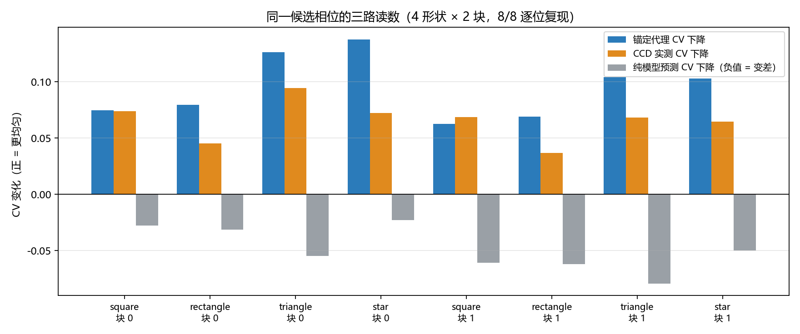

# 仿真预训练与无 GS 迁移复现（2026-10-24）

<!-- provenance:start -->
> **生成脚本**: [`scripts/slm/generate_sim_pretrain_transfer_report.py`](../../../scripts/slm/generate_sim_pretrain_transfer_report.py)
> **复现命令**: `python scripts/slm/generate_sim_pretrain_transfer_report.py`
> **数据/关联脚本**: [`scripts/slm/reproduce_transfer_block_without_gs.py`](../../../scripts/slm/reproduce_transfer_block_without_gs.py)
> **数据/关联脚本**: [`src/ao_shaping/tools/slm/transfer/pretrain.py`](../../../src/ao_shaping/tools/slm/transfer/pretrain.py)
> **数据/关联脚本**: [`src/ao_shaping/tools/slm/transfer/workflow.py`](../../../src/ao_shaping/tools/slm/transfer/workflow.py)
> **数据/关联脚本**: [`src/ao_shaping/algorithm/signal_processing/differentiable_defocus_uniformity.py`](../../../src/ao_shaping/algorithm/signal_processing/differentiable_defocus_uniformity.py)
> **数据/关联脚本**: [`src/ao_shaping/algorithm/signal_processing/multishape_objective.py`](../../../src/ao_shaping/algorithm/signal_processing/multishape_objective.py)
> **运行环境**: 离线（仿真先验 + 已存档的 Santec/Daheng 实验数据）
> **说明**: 仿真预训练的分组 CV 指标与「无 GS 的逐位复现」；两部分的检查点互不共用，报告 §1 明确分开。
<!-- provenance:end -->

## 0 结论摘要

1. **算法等价性成立**：4 形状 × 2 块的候选相位与存档 `B1` 相位**逐位相同**（8/8），全程 **0 次** `gs_seed()` 调用。也就是说，「把已接受的相位作为起点 + 锚定实测的目标函数」这一条链路可以完全脱离 GS 复现。
2. **纯模型 CV 在 8 组里 8/8 变差**，而锚定代理 CV 与 CCD 实测 CV 8/8 变好。同一候选相位、同一目标函数，两路读数方向相反 —— 判据必须在锚定项上，不能用模型绝对预测接受/拒绝。
3. **代理增益放大约 0.91–1.90×**（中位 1.56×）。方向可信，幅度不可直接引用。
4. **仿真预训练**（§2）在 60 个组合上留一组合交叉验证，离焦 R² 0.9999、入射中心平移 R² 0.93、宽度缩放 R² 0.9997，**共享像差只有 0.33**。这是匹配模型内部的可识别性，不是对实验系统的验证；且它与 §3 的复现**不共用检查点**（见 §1）。

## 1 两个独立部分，先说清口径

| | 仿真预训练（§2） | 无 GS 复现（§3） |
|---|---|---|
| 数据 | `FrozenDefocusForward` 生成的合成参数库 | 已存档的 CCD 帧与相位 |
| 产出 | `estimator.npz` + `frozen_parameters.json`（仿真先验） | 「候选相位 == 存档相位」的逐位证据 |
| 是否接触设备 | 否 | 否（读存档） |
| 能否证明模型匹配实验系统 | **不能** | **不能**（只证明算法可复现） |

复现用的检查点是 `data/debug/calibrate_transfer_blur/shapes_20261023_1956/frozen_parameters.json`，由 CCD 实测拟合得到，**不是** §2 的仿真先验。把两者混为一谈会读出一个不存在的结论：「仿真预训练已经被实验验证」。本轮没有验证它。

## 2 仿真预训练

### 2.1 这份产物是什么、不是什么

| | 内容 |
|---|---|
| 输入 | `FrozenDefocusForward` 生成的合成参数库（无相机噪声、无 LUT、无零级光） |
| 产出 | `estimator.npz`（16×5 岭回归系数）、`frozen_parameters.json`（先验检查点）、`report.json` |
| 用途 | 给冷启动一个**先验**，减少「从名义参数出发」的偏差 |
| **不用于** | §3 的复现；也不构成对实验系统的验证 |

### 2.2 参数库与特征

- 本次采样 **60** 个组合（全因子设计 90 格），每组合 **8** 个探针，FFT **128**、网格 **32**。
- 离焦轴格点覆盖（各层组合数）：-0.12: 18/18, -0.06: 18/18, +0.00: 18/18, +0.06: 6/18。
- 探针跨曝光循环 `[0.5, 1.0, 1.5]` ms；跨曝光只比较 `counts / exposure_ms`，否则曝光会被当成光路参数。
- 每组合 **16 个特征** = 8 个描述子的 mean 与 std（跨 8 个探针）；目标 = 相对名义先验的 5 维残差。
- 正向传播只用 `FrozenDefocusForward`；特征只来自「实测图 + 名义预测图」，真值参数不进特征。

### 2.3 分组交叉验证

留一**组合**（leave-one-combination-out），共 **60** 折、**60** 个留出组合全部被预测。同一组合内的探针共享同一套光路参数，按样本或按像素随机切分会让同一组合同时出现在训练与测试里 —— 那样得到的指标只反映插值能力，不反映迁移能力，所以禁止。

### 2.4 结果

| 参数 | 分组 CV MAE | RMSE | R² | 偏置 |
|---|---|---|---|---|
| 离焦（屈光度） | 0.0004611 | 0.000643 | 1.000 | -2.511e-05 |
| 入射中心 x 平移（panel px） | 2.664 | 3.129 | 0.929 | +0.05555 |
| 入射中心 y 平移（panel px） | 1.528 | 1.841 | 0.931 | -0.01328 |
| 宽度缩放 ln(s) | 0.001849 | 0.002339 | 1.000 | +4.398e-05 |
| Noll 5–11 共享像差（rad） | 0.0156 | 0.02045 | 0.331 | -0.0002608 |

墙钟：建库 52.3s；拟合（含 alpha 扫描） 0.2s；合计 52.5s（CPU，单进程）。

岭惩罚不是无关紧要的超参 —— 同一分折、同一特征，只换 α 就能把一个可识别参数压到看起来「不可识别」：

| 岭惩罚 α | 最差 R² | 离焦 R² | x 平移 R² | 像差 R² |
|---|---|---|---|---|
| 0.01 （采用） | 0.331 | 1.000 | 0.929 | 0.331 |
| 0.1 | 0.337 | 1.000 | 0.903 | 0.337 |
| 1 | 0.067 | 0.998 | 0.742 | 0.067 |
| 10 | -0.102 | 0.977 | 0.378 | -0.102 |

α=1（最初的默认值）把像差 R² 压到 0.067，α=0.01 时是 0.331 —— 差出来的 0.26 全是**正则化伪影**，不是物理可识别性。

先验检查点（`frozen_parameters.json`）由这条回归的常数项给出：`pretrain.mean_delta = [-0.073, -1.8, +0.6, +0.006601, +0.025]`，据此 `defocus_diopter = -0.0480`、`amplitude_center = (958.2, 600.6)`、`amplitude_width = (301.99, 261.72)`，`fft_size` / `grid_size` 与写入时一致，可被 `FrozenDefocusParameters.from_dicts` 直接读回。

### 2.5 五条必须与数字一起读的边界

1. **匹配模型，不是实验系统。** 参数库由 `FrozenDefocusForward` 生成、验证也用它，所以指标衡量的是「在这个传播模型内部能否反解参数」。它**不能**说明模型匹配实验系统；`report.json` 的 `caveat` 原文即此意。先验的数值本身也只等于「参数库中心 − 名义值」（离焦 −0.048 − 名义 0.025 = −0.073 等），所以它反映的是**库的设计中心**，不是实验系统的实测参数。
2. **离焦轴被截断。** 全因子设计有 5 个离焦层，本次只跑了前 60 格，最高的一层只取到一部分格点。分折仍然干净（每个留出组合从未进训练），但**正向极端层根本没有进入库**，所以那里没有可报的误差，也不能把 R² 外推过去。
3. **α 是在同一批折上选出来的**（0.01 / 0.1 / 1 / 10 对照见上表），不是嵌套 CV，所以「α=0.01 最好」带选择偏差，只能当提示性证据；但「α=1 明显更差」在四个 α 上都可复现，那一条是稳的。
4. **入射中心平移的可识别性来自口径裁剪。** 纯瞳面平移在远场只乘一个线性相位，强度分布不变；所以它只能通过「照明跑出有效口径」造成的包络/能量变化被看到。本库的 3 个平移点近乎共线（(12,−8) 与 (−18,10) 夹角约 176°），`dx_center` / `dy_center` 实为同一个一维量的两次投影，两个 R² 都 ≈0.93 属正常。
5. **像差 R²≈0.33 是这一套库的可识别性上限。** `ABERRATION_AXIS` 只到 0.05 rad，而库内探针相位自身的 std 实测为 1.24–1.73 rad（`list(pretrain.probes(32, 8, 102419))` 的 train/validation 探针），即像差只占探针自身相位的约 3%。把 §2.4 里 α 的伪影去掉后剩下的 0.33 就是这个幅度下的可识别性，不是特征取错。想抬高它必须加大像差轴或换探针族 —— 那是重新设计参数库，本轮没有做。

> 复现部分（§3）**不使用**上面这个检查点：它加载的是 CCD 实测拟合的 `calibrate_transfer_blur/shapes_20261023_1956`。

## 3 无 GS 迁移复现

### 3.1 为什么必须单独证明「不从 GS 开始」

生产链路是 `gs_seed() → 冻结前向模型 → 锚定 CCD 目标的可微更新`。直接重跑一遍会同时动两件事：GS 初始化给出的相位，以及更新循环。于是「结果一致」既可能说明更新循环被复现了，也可能只是 GS 恰好给了同一起点。
把 GS 拿掉、起点换成**上一轮已接受的相位**，就只剩更新循环这一项可变量。

> 口径声明：本次复现的起点来自一次历史 model-mode 运行的接受相位，而那次运行自己的起点是 GS。因此本报告能说的是「**这次复现没有调用 GS**」，不能说的是「**历史上从未用过 GS**」。

### 3.2 三步

1. **种子**：`<seed-run>/<shape>_final` 的 `model_phase`（块 0），或存档 `A1` 实际显示的相位（块 1 及以后）。两者的 `max|Δ|` 都为 0，见下表第 3 列。
2. **锚定**：用存档 `A1` 帧逐像素平均后除 `exposure_ms`，再按同一 `camera_xy` 采样，得到参考辐照度；基线预测取 `forward.predict(seed)`。
3. **更新**：`DifferentiableUniformityOptimizer`（`lr=0.01`、`step_rms_cap=0.2`、10 步、CPU）每次以 `anchored_intensity(measured, current, baseline)` 为输入，与 `validate.py` 的 anchored 分支逐步一致。

### 3.3 逐位判据与结果

| 形状 | 块 | 相位最大偏差 | 逐位相同 | 代理 CV | CCD CV（A1→B1） | 纯模型 CV | 增益比 |
|---|---|---|---|---|---|---|---|
| square | 0 | 0.0e+00 | 是 | 0.6812 → 0.6064 | 0.6812 → 0.6071 | 0.2722 → 0.3001 | 1.01× |
| rectangle | 0 | 0.0e+00 | 是 | 0.6118 → 0.5321 | 0.6118 → 0.5663 | 0.2726 → 0.3039 | 1.75× |
| triangle | 0 | 0.0e+00 | 是 | 0.5825 → 0.4562 | 0.5825 → 0.4879 | 0.2648 → 0.3197 | 1.33× |
| star | 0 | 0.0e+00 | 是 | 0.4742 → 0.3364 | 0.4742 → 0.4017 | 0.2483 → 0.2710 | 1.90× |
| square | 1 | 0.0e+00 | 是 | 0.6133 → 0.5506 | 0.6133 → 0.5447 | 0.3001 → 0.3607 | 0.91× |
| rectangle | 1 | 0.0e+00 | 是 | 0.5646 → 0.4954 | 0.5646 → 0.5276 | 0.3039 → 0.3660 | 1.87× |
| triangle | 1 | 0.0e+00 | 是 | 0.4844 → 0.3802 | 0.4844 → 0.4162 | 0.3197 → 0.3989 | 1.53× |
| star | 1 | 0.0e+00 | 是 | 0.3910 → 0.2880 | 0.3910 → 0.3264 | 0.2710 → 0.3209 | 1.59× |

「相位最大偏差 0.0e+00」是 `np.array_equal` 也成立的**逐位**相等，不是 `allclose` 的近似。所以下表 `CCD CV` 一列不是重新测的 —— 候选相位既然与存档 `B1` 相同，存档的那次测量就按同一性适用于它。

存档判决（loss 口径，四帧 A1/B1/B2/A2 各自独立测）：

| 形状 | 块 | 基线 loss | 候选 loss | 漂移阈值 | 存档判决 |
|---|---|---|---|---|---|
| square | 0 | 1.9165 | 1.8157 | 0.0074 | 接受 |
| rectangle | 0 | 1.4924 | 1.4288 | 0.0009 | 接受 |
| triangle | 0 | 2.2980 | 2.2008 | 0.0031 | 接受 |
| star | 0 | 2.2939 | 2.2259 | 0.0020 | 接受 |
| square | 1 | 1.8145 | 1.7360 | 0.0032 | 接受 |
| rectangle | 1 | 1.4312 | 1.3834 | 0.0002 | 接受 |
| triangle | 1 | 2.1948 | 2.1331 | 0.0035 | 接受 |
| star | 1 | 2.2140 | 2.1629 | 0.0010 | 接受 |

### 3.4 三路读数：为什么纯模型 CV 会反向



同一次更新迭代里同时存在三个数：

| 读数 | 定义 | 8 组方向 |
|---|---|---|
| 纯模型 CV | `forward.predict(candidate)` | 8/8 **变差** |
| 锚定代理 CV | `measured + pred(candidate) − pred(seed)` | 8/8 变好 |
| CCD 实测 CV | 存档 `A1` → `B1` | 8/8 变好 |

原因不神秘：`forward.predict` 的**绝对值**与 CCD 的绝对值差着一整套加性背景（杂散光）项与标度，所以它在绝对量上的 CV 与 CCD 的 CV 不是同一个物理量（0.27 vs 0.68）。优化器最小化的从来不是它 —— 是锚定代理。代理保留了实测的绝对量，只借用模型的**局部变化**，因此方向与实测一致。

这解释了一件容易被误读的事：如果只看模型 loss 下降就宣布成功，在本轮的数据上会得到相反结论。判据必须落在锚定项与实测项上。

### 3.5 代理增益的放大系数

代理增益 / 实测增益 = **0.91–1.90×**（中位 1.56×）。8 组里 7 组高估、1 组不高于实测（最低 0.91×）。含义：代理可以当**方向判据**（好/坏、接受/拒绝），不能当**幅度预报**（不能说「这一步会降 0.07」）。放大系数不是一个常数，所以也不该用一个固定折扣率把它换算成实测值。

### 3.6 这一节没有做的事

- 没有重新开相机：CCD 一列是存档读数按相位同一性引用，不是新测量。
- 没有重新采集任何帧，因此没有新的噪声估计；接受判决沿用存档的 A–B–B–A 漂移阈值。
- 没有验证检查点本身的物理正确性（离焦方向检验在本轮之前就没有通过），所以「复现成功」是**算法等价**，不是**模型正确**。

## 4 复现命令

```bash
# 块 0：种子取上一轮接受相位（<seed-run>/<shape>_final）
python scripts/slm/reproduce_transfer_block_without_gs.py --block 0 --seed-source run \
    --out data/debug/transfer_repro_no_gs/block0
# 块 1：种子取存档 A1 实际显示的相位（块 0 已接受的相位继续往下走）
python scripts/slm/reproduce_transfer_block_without_gs.py --block 1 --seed-source a1 \
    --out data/debug/transfer_repro_no_gs/block1
# 本报告
python scripts/slm/generate_sim_pretrain_transfer_report.py
```

`--seed-source run` 与 `--seed-source a1` 的存在本身就是证据的一部分：块 0 的种子是**外部**给的（与 `A1` 显示相位独立测得 `max|Δ|=0`），块 1 的种子是**链内**承接的。两条都给逐位相同，说明更新循环对起点来源不敏感。

## 5 数据路径

| 用途 | 路径 |
|---|---|
| 复现产物 | `data/debug/transfer_repro_no_gs/block{0,1}/result.json` |
| 冻结检查点（复现用） | `data/debug/calibrate_transfer_blur/shapes_20261023_1956/frozen_parameters.json` |
| 种子来源 | `data/debug/validate_transfer_shapes/paired_20261023_1942/manifest.json` |
| 复现对象（80 条 A–B–B–A） | `data/debug/validate_transfer_shapes/anchored_20261023_2002/` |
| 预训练产物 | `data/debug/slm_transfer/pretrain*/{report.json,frozen_parameters.json,estimator.npz}` |
| 本报告输入副本 | `artifacts/` |

## 6 易误读的三点

1. **「逐位相同」不等于「实验可重复」**。逐位相同说明算法（含随机性来源）是确定的；实验重复性受器件噪声限制，同一 seed 的两次硬件运行在基准点就差 ~1e-3。
2. **代理 CV 变好不等于画面变好**。代理是「实测 + 模型局部变化」，它继承了实测的绝对量，也继承了模型的局部误差；§3.5 的放大系数就是这部分误差的量化。
3. **仿真预训练不能用这一节背书**。§2 与 §3 的数据源、检查点、验证协议都不同，把 §3 的逐位复现当作 §2 的验证是本报告最容易被误读的地方。
