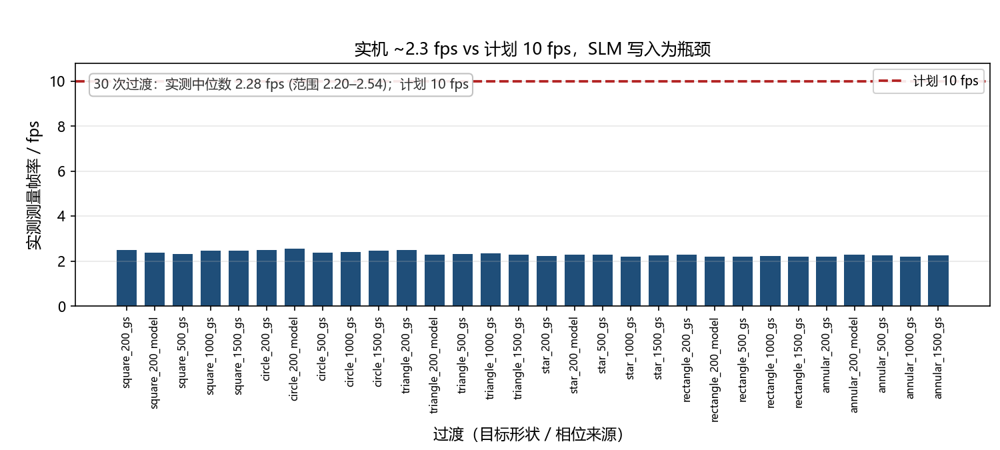
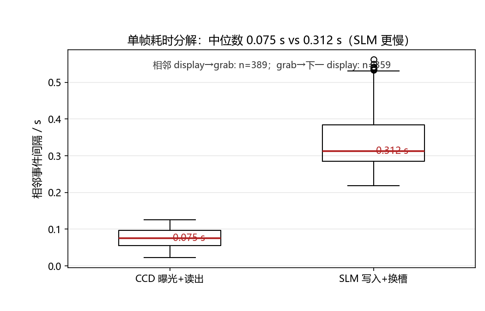

# 动态整形速度解耦采集报告（2026-11-20）

<!-- provenance:start -->
> **生成脚本**: 人工撰写，无生成脚本
> **数据/关联脚本**: [`scripts/slm/dynamic_shaping_capture_20261120.py`](../../scripts/slm/dynamic_shaping_capture_20261120.py)
> **数据/关联脚本**: [`scripts/slm/build_speed_decouple_plan_20261120.py`](../../scripts/slm/build_speed_decouple_plan_20261120.py)
> **数据/关联脚本**: [`scripts/slm/plot_speed_decouple_timing_20261120.py`](../../scripts/slm/plot_speed_decouple_timing_20261120.py)
> **运行环境**: 离线+硬件
> **说明**: 动态整形速度解耦采集正式报告：30 条 transition（24 GS + 6 model 诊断）全 ok，原始帧 (52,1944,2592) uint16，冻结曝光 0.08ms；实机约 2.3fps 瓶颈在 SLM 写入+换槽(中位 0.312s)，非 CCD 读出或像素翻转。数据来自 data/debug/slm_transfer/speed_decouple_capture_20261120_v2/。transfer light/none 仍暂停。
<!-- provenance:end -->

## 摘要

本报告记录动态整形**速度解耦**实测采集：从冻结灰度 0（flat）出发，对 24 个 GS 目标相位与 6 个在可表示半径内的 model 诊断相位，各做一次 5 s 的灰度渐变过渡，全程用 Daheng CCD 全幅采集原始 uint16 帧，冻结曝光 `0.08 ms`。采集共 30 条 transition，全部 `status=ok`，无错误日志；bench 互斥锁正常释放，SLM 与 CCD 均正常关闭。

关键结论：实机 SLM 灰度帧下发节拍为 **约 2.3 fps**（每条 5 s 实下发 12–14 帧），显著低于计划的 10 fps / 51 帧计划值。瓶颈位于 **SLM 写入 + 内存槽轮换**（相邻帧中位 `0.312 s`，最大 `0.562 s`），而非 CCD 曝光读出（中位 `0.075 s`）或 LCOS 像素翻转等待（中位 `7.8 ms`）。墙钟驱动的下发循环在硬件慢时**跳帧而不拉长过渡**，每条 transition 的末帧 `progress_t` 精确为 `1.0`（终点相位逐码精确）。因此计划字段 `frames=51` 是**计划帧数**，不代表实机下发帧数。

**重要边界**：本批 model 相位只作诊断（P3 checkpoint 双资格门 fail），不构成 transfer `light/none` 的上游资格；transfer `light/none` 采集仍暂停，未获得用户再次确认，未进入 P5，未执行 transfer `light/none` 的 `--execute`。

## 任务完成情况

- [x] T1 冻结目标与相位矩阵：`data/debug/slm_transfer/dyn_phase_matrix_20261120/manifest.json`，48 条 = `written 15` + `skipped 15` + `skipped_unrepresentable 18` + `failed 0`，逐文件 SHA256 与形状核验 0 问题。
- [x] T2 计划构建：`scripts/slm/build_speed_decouple_plan_20261120.py` 产出 30 条 transition 的 `data/debug/slm_transfer/speed_decouple_plan_20261120.json`；24 个目标全部由 GS 覆盖，model 只在可表示的 `size=200` 上产出 6 条诊断相位，500/1000/1500 model 标 `skipped_unrepresentable`，不伪造相位。
- [x] T3 12-bit 曝光探测：推荐并冻结 `0.08 ms`，peak `2212.6` / 饱和阈值 `3890.25`，未饱和；离焦响应 `responds=true`。
- [x] 修复 `RawFrameStack` 按面板 shape 预分配导致原始帧全零的缺陷：改为按首帧 CCD 原生全幅惰性预分配；回归测试与 ruff 均通过。
- [x] T4 修复后重采：新目录 `data/debug/slm_transfer/speed_decouple_capture_20261120_v2/`，30 条 transition 全部 `ok`，30 个 `frames.npy` 均为 `(52, 1944, 2592)` uint16 且非空。
- [x] 首轮失败目录 `data/debug/slm_transfer/speed_decouple_capture_20261120/` 已改名为 `..._INVALID_firstrun` 保留证据，禁止复用。
- [x] 本报告的节拍/耗时指标由 `scripts/slm/plot_speed_decouple_timing_20261120.py` 从落盘 JSON 真实读取并绘图。

## 采集参数（冻结口径）

| 参数 | 值 |
|---|---|
| 起点 | flat gray 0 |
| 每条时长 | 5 s |
| 计划 fps / 计划帧数 | 10 fps / 51 帧（计划值，非实机下发帧数） |
| 采样 | `--measure every --measure-every 1` |
| 原始帧 | `--raw-frames stack`，CCD 原生全幅 `(1944, 2592)`，不物理开窗 |
| 帧间 settle | `--inter-transition-settle-s 0.5` |
| 位深 / 曝光 | 12-bit，冻结 `0.08 ms`（`effective_full_scale=4095.0`） |
| 过渡条数 | 30（24 GS + 6 model 诊断） |
| 设备等待 | `--wait-until-idle 120` |

冻结脚本与数据 SHA256：

| 文件 | SHA256 |
|---|---|
| `scripts/slm/dynamic_shaping_capture_20261120.py` | `36a76da80622c729e14fad4480bfcf26694e4da8bf7ae7949b6f55169d9f9037` |
| `scripts/slm/build_speed_decouple_plan_20261120.py` | `4fcad7c2060ed432a5f9988b563a43191b833c0bc7ae254a24d89ca91ea7a70c` |
| `data/debug/slm_transfer/speed_decouple_plan_20261120.json` | `5eec791f722cc5dc547c99bf1a9c1d19488934de8a8238601160f6adf5340ca1` |
| `data/debug/slm_transfer/dyn_phase_matrix_20261120/` T1 fingerprint | `29d287e76202fd2c70eab017f4b1bb06824a31e7da24e28cc8ee04c72b61b160` |
| P3 checkpoint（`frozen_parameters.json`） | `380b9b87885fe70a4279dbe00fc500dcc3893b9422ddc84ccd0115e491c6619a` |

## 采集结果

### 状态与原始帧

| 指标 | 结果 |
|---|---|
| transition 总数 | 30（24 GS + 6 model 诊断） |
| `status` | 30/30 `ok`，`error=null` |
| `frames.npy` 数量 | 30 |
| 每帧 shape / dtype | `(52, 1944, 2592)` / `uint16`，全部非空 |
| `frames_meta.json` | `shape=[1944,2592]`，`exposure_ms=0.08`，`effective_full_scale=4095.0` |
| 末帧 `progress_t` | 30/30 精确 `1.0`（终点相位逐码精确） |
| 错误日志 | 无 ERROR / Exception / Traceback / abort |

GS 的 24 条覆盖 `square/circle/triangle/star/rectangle/annular` × `200/500/1000/1500` CCD px；model 的 6 条为 `square/circle/triangle/star/rectangle/annular` 的 `size=200` 诊断相位（500/1000/1500 因模型可用半径 `245.35 CCD px` 与 FFT 窗 `±253.35 CCD px` 不可表示而未生成）。

### 节拍与瓶颈（关键指标）

| 指标 | min | 中位 | max | 均值 |
|---|---:|---:|---:|---:|
| 实下发帧数/条 | 12 | 13 | 14 | 12.97 |
| 实测 fps | 2.196 | 2.284 | 2.542 | 2.319 |
| 每条耗时 / s | 5.425 | 5.611 | 5.773 | 5.590 |
| SLM 写入+换槽间隔 / s | 0.218 | 0.312 | 0.562 | 0.346 |
| CCD 曝光+读出间隔 / s | 0.023 | 0.075 | 0.126 | 0.076 |
| LCOS 像素翻转等待 / s | 0.0000 | 0.0078 | 0.0121 | 0.0078 |

按组：GS 24 条 fps 中位 `2.284`、下发中位 `13` 帧、耗时中位 `5.611 s`；model 6 条 fps 中位 `2.284`、下发中位 `13` 帧、耗时中位 `5.586 s`。两组节拍一致，说明瓶颈是设备路径而非目标类型。

成因解释：`dispatch_frames` 的时间轴由墙钟决定（`t=(now−t0)/duration_s`），硬件慢时跳帧而非拉长过渡，只在 `t>=1.0` 结束；`display` 闭包经 `SlotRotator.display_data` 每条写入前轮换 SLM 内存槽（避免同槽连写被固件当作 no-op）。每条 transition 的下发帧实际受 SLM 写入 + 换槽路径限制（相邻 grab→下一 display 中位 `0.312 s`，n=359，按 transition 分段、只统计同一段内 `0<gap<2.0 s` 的相邻对，已排除跨 transition 的 0.5 s settle；含 SDK `display_data` 调用与槽切换开销），远大于 CCD 读出（中位 `0.075 s`）与像素翻转等待（中位 `7.8 ms`）。相邻下发帧间隔均值 `0.422 s`（中位 `0.387 s`），对应约 `2.4–2.6 fps`；`run_summary` 的 fps 按含 transition 内 settle 的总耗时计算，中位 `2.284`，两者一致指向实机约 `2.3 fps` 量级。像素翻转等待由 `pixel_flip_wait_s` 按单帧最大灰度变化估算，上限 `0.2 s`，本批最大码变 `62`（满量程 1023），故仅约 `12 ms`，不构成瓶颈。

## 设备占用与释放（硬件纪律）

| 项目 | 记录 |
|---|---|
| 占用设备 | Santec SLM #1（1064 nm，memory 模式 `video_mode=0`）+ Daheng MER2-507 CCD（12-bit 全幅 2592×1944，无物理开窗） |
| 操作 | 30 条 transition 串行采集；单进程开闭一次；`--wait-until-idle 120` 持锁开跑，`try/finally` 释放 |
| 开时刻（UTC） | camera `2026-11-20T03:30:13.204408Z`；SLM #1 `2026-11-20T03:30:16.052864Z` |
| 关时刻（UTC） | SLM #1 `2026-11-20T03:33:27.744149Z`；camera `2026-11-20T03:33:27.831600Z`（均正常 close，非强杀） |
| 互斥锁 | 运行中 holder_pid `1333844`（worker）；运行结束 `is_locked=False`、`holder_pid=None` |
| 首轮失败处置 | 首轮 PID `1322728`/`1323916` 因 `RawFrameStack` shape 异常被 force-kill（非正常释放），输出目录已改名为 `..._INVALID_firstrun`，禁止复用 |
| 当前状态 | SLM/CCD 未占用；无残留采集/探针进程；bench mutex 未锁定 |

首轮失败根因：`RawFrameStack` 旧实现按 SLM 面板 `(1200,1920)` 预分配 memmap，而 CCD 返回原生全幅 `(1944,2592)`；采样线程里的 shape 校验异常被吞掉，主流程照常结束但零帧落盘（首轮 `frames.npy` shape `(52,1200,1920)` 且全零）。修复为按首帧真实尺寸惰性预分配，重采即恢复正常全幅原始帧。

## 与 transfer `light/none` 的边界

- P4 双门均为有效 `fail`：强度门最差 `relL2=0.8848927385498241`（门槛 `δ=0.20`）；方向门 pass1 `2/7`、pass2 `2/7`、pooled `4/14`（需 10）。checkpoint SHA256 `380b9b87885fe70a4279dbe00fc500dcc3893b9422ddc84ccd0115e491c6619a`。
- 未降低科学门槛，未调阈值、未换模型、未剔除行；模型过拟合诊断（iter209 选点、事后 test relL2 最低 `0.55@iter18`）与新拟合 `test relL2 0.7866` 均表明双门 fail 主要是模型/观测算子问题，重采或早停单独不足以通关。
- 本批 6 条 model 相位仅作速度解耦诊断，**不构成上游资格**；transfer `light/none` 采集未授权且继续暂停，未执行 `--execute`，未进入 P5。方向门与强度门同时 pass 且用户再次确认前，不启动 transfer `light/none` 的 `--execute`。

## 命令与校验

工作目录 `D:\Projects\TIFO\AO-shaping`，Python 为项目 `.venv`。

| 命令 | exit code | 结果 |
|---|---:|---|
| `pytest tests/ao_shaping/scripts/test_target_phase_matrix_20261120.py tests/ao_shaping/scripts/test_dynamic_shaping_capture_plan_20261120.py tests/ao_shaping/scripts/test_dynamic_shaping_capture_20261120.py -q` | 0 | 19 passed |
| `ruff check scripts/slm/dynamic_shaping_capture_20261120.py tests/ao_shaping/scripts/test_dynamic_shaping_capture_plan_20261120.py` | 0 | All checks passed |
| `pytest tests/ao_shaping/scripts/test_dynamic_shaping_capture_plan_20261120.py tests/ao_shaping/scripts/test_dynamic_shaping_capture_20261120.py -q`（修复后） | 0 | 13 passed in 6.23s |
| plan-only（新目录 `--out ..._v2`，不执行 `--execute`） | 0 | `transitions=30 total_frames=1530 expected_total_duration_s=156.000`，输出目录未创建 |
| T4 修复后 `--execute ..._v2` | 0 | 30 条 `ok`，无错误日志，设备正常关闭 |

## 溯源

- git HEAD：`ffff098c603bf86a1f787759dccdb8d596e53419`
- 采集数据：`data/debug/slm_transfer/speed_decouple_capture_20261120_v2/`
- 首轮失败证据：`data/debug/slm_transfer/speed_decouple_capture_20261120_INVALID_firstrun/`
- 冻结方案：`docs/dev/dynamic_decoupling_experiment_plan_20261120.md`；P4 证据在 `docs/dev/agent_notes_20261120.md` §9/§10。
- 工作区其他变更保持未提交；未做宽泛 `git add` 或 commit。
