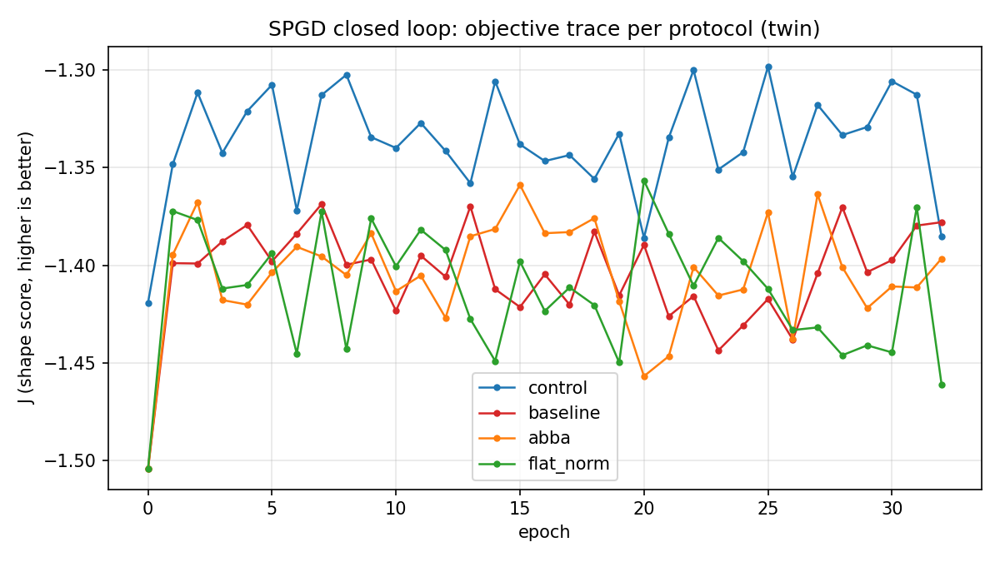
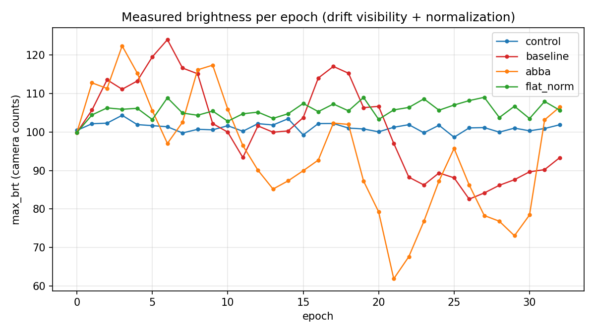
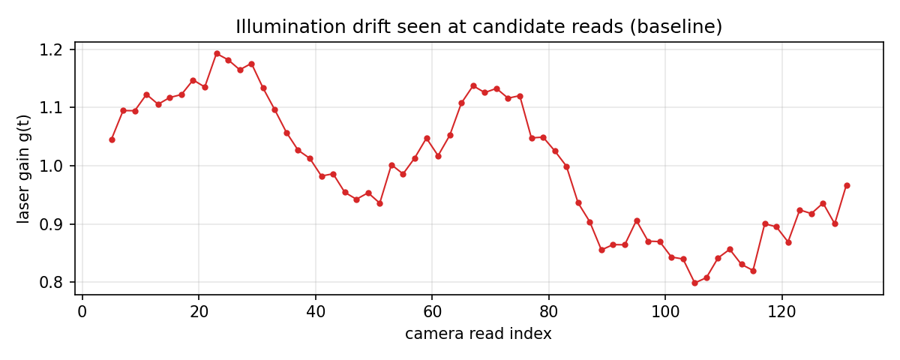
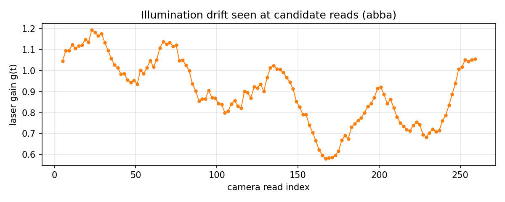
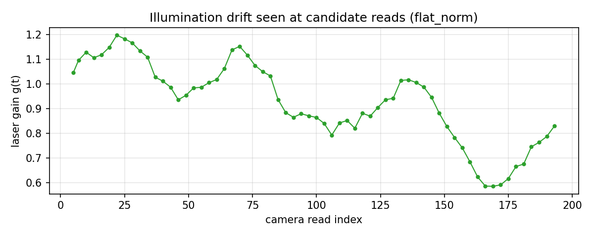

# SPGD 闭环照明漂移对消 A/B (数字孪生, #144 第 1 项 / #36 判据)

<!-- provenance:start -->
> **生成脚本**: [`scripts/slm/spgd_drift_cancel_loop.py`](../../../scripts/slm/spgd_drift_cancel_loop.py)
> **复现命令**: `python scripts/slm/spgd_drift_cancel_loop.py --epochs 32 --data-root <scratch>/full --intrinsic <scratch>/intrinsic/results.json`
> **运行环境**: 离线
> **说明**: #144 第 1 项 (照明漂移对消) / #36 验收判据的数字孪生 A/B: 在 2f-Fourier 孪生上跑真实 slm-pib SPGD 闭环, 对照 control / baseline / abba / flat_norm 四变体。孪生标定结论 (纯倍增增益对 shape 目标不可见, 须引入不随功率缩放的杂散底板 B 才能复现 bench 的亮度耦合) 也记在正文; ``--recompute`` 可只从 pkl 重算指标重写报告 (噪声门零置数按优化器判据离线复算, pkl 不落盘 _gate 列)
<!-- provenance:end -->

- 日期: 2026-10-22 20:39
- 孪生种子: 42; 漂移种子: 20261022
- 环境: 平滑漂移 a=0.12 T=61.0 次读出, 随机游走 σ=0.02 截断 ±0.3, 杂散底板 B=0.005 ADU/px
- 运行: 32 epoch/变体, 固定曝光 80 ms, 目标 100x100, delta=0.2 / lr=0.3 钉住 (调度器不接管)

## 总表

| 变体 | 协议 | dec (>0.55) | late_gain (>=10%) | verdict | R²(J~亮度) | J 首→末 | 亮度摆幅 | 噪声门零置 |
|---|---|---|---|---|---|---|---|---|
| control | off | 0.53 | +0.6 | random-walk | 0.000 | -1.419 → -1.385 | 6% | 29/32 |
| baseline | observe | 0.59 | -0.2 | not-converging | 0.071 | -1.504 → -1.378 | 41% | 30/32 |
| abba | observe+abba | 0.56 | +0.3 | not-converging | 0.030 | -1.504 → -1.396 | 64% | 29/32 |
| flat_norm | normalize | 0.41 | -0.8 | not-converging | 0.018 | -1.504 → -1.461 | 9% | 29/32 |

噪声门零置列为**离线复算** (pkl 不落盘 ``_gate`` 列, 按优化器判据 ``|diff| <= 3σ(前序 20 个 diff)`` 用 ``_diff`` 列重算, 与优化器日志一致)。

## 同相位噪声底与可分辨性 (#144 测试方法)

| 变体 | σ(J) 同相位 | 3σ 判据 | 协议采集次数 |
|---|---|---|---|
| intrinsic (drift off) | 0.0306 (n=24) | 基准行: 漂移关、杂散底板开时的读出+评估噪声底 | 24 |
| control | (无参考帧记录) | - | - |
| baseline | 0.0288 (n=64) | 3σ=0.0865, 中位 abs(ΔJ)=0.0303 → 否 | 64 |
| abba | 0.0356 (n=128) | 3σ=0.1067, 中位 abs(ΔJ)=0.0249 → 否 | 128 |
| flat_norm | 0.0326 (n=127) | 3σ=0.0977, 中位 abs(ΔJ)=0.0301 → 否 | 64 |

## 逐变体明细

### control (off)

- 退出码 0, 墙钟 216.7s, recorder 行数 33
- dec=0.531, late_gain=+0.6%, verdict=random-walk
- R²(J~max_brt)=0.000, max_brt 摆幅=5.6%
- |ΔJ| 均值=0.0349, 中位=0.0310, 噪声门零置 29 轮

### baseline (observe)

- 退出码 0, 墙钟 411.9s, recorder 行数 33
- 增益摆幅 41.5% (共 137 次读出)
- dec=0.594, late_gain=-0.2%, verdict=not-converging
- R²(J~max_brt)=0.071, max_brt 摆幅=40.9%
- |ΔJ| 均值=0.0307, 中位=0.0303, 噪声门零置 30 轮

### abba (observe, abba)

- 退出码 0, 墙钟 591.6s, recorder 行数 33
- 增益摆幅 69.2% (共 265 次读出)
- dec=0.562, late_gain=+0.3%, verdict=not-converging
- R²(J~max_brt)=0.030, max_brt 摆幅=64.1%
- |ΔJ| 均值=0.0285, 中位=0.0249, 噪声门零置 29 轮

### flat_norm (normalize)

- 退出码 0, 墙钟 653.4s, recorder 行数 33
- 增益摆幅 67.7% (共 200 次读出)
- dec=0.406, late_gain=-0.8%, verdict=not-converging
- R²(J~max_brt)=0.018, max_brt 摆幅=8.6%
- |ΔJ| 均值=0.0345, 中位=0.0301, 噪声门零置 29 轮

## 解读边界

- 本运行在数字孪生上闭环, 验证的是**协议机制** (漂移对消能否把梯度信噪比 拉回可分辨区), 不能替代 #144/#36 的实机验收; 实机结论仍需在台架复跑。
- 孪生 ``SimPibCCD.get_numpy_image`` 忽略 ``n_sample`` (不做多帧平均), 所有 σ 按单帧读出解释; 真实相机的 3 帧平均会进一步压低噪声底。
- 纯倍增增益对孪生 shape 目标不可见 (各项同缩放); 复现 bench 的亮度耦合 依赖杂散底板 B (bench 上同款通道: 总能量分母中的背景 / ROI 固定底噪)。
