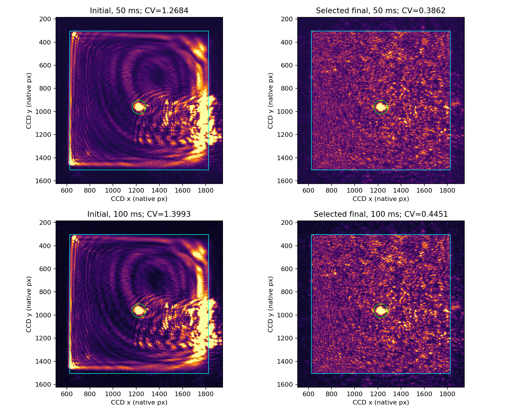
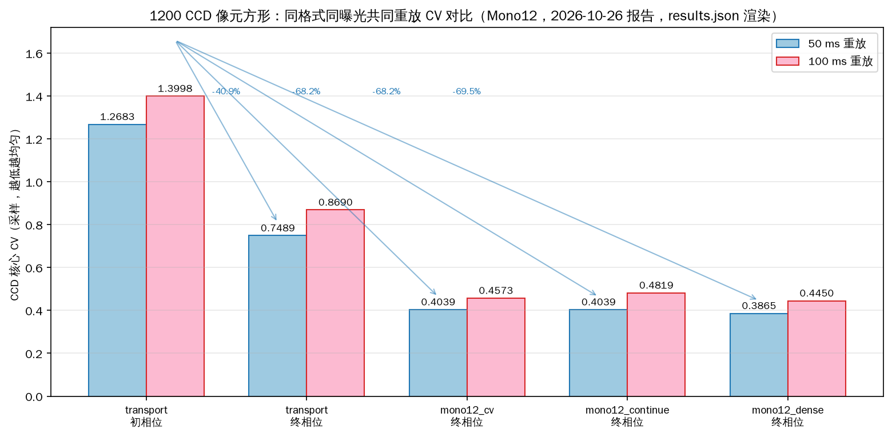
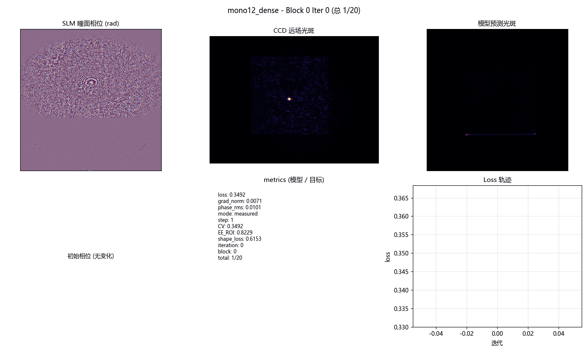
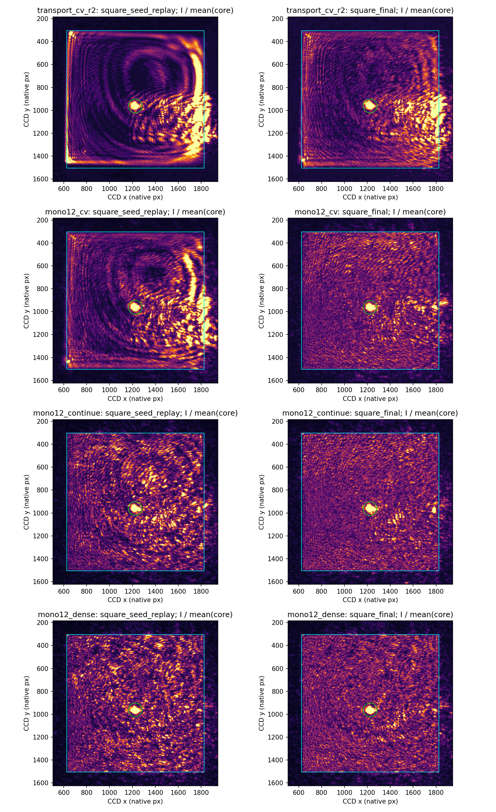
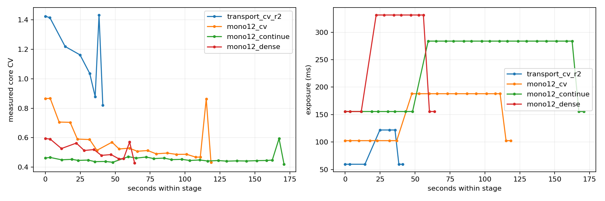

# 1200 CCD 像元正方形的物理预测模型可微匀化（2026-10-26）

<!-- provenance:start -->
> **生成脚本**: [`scripts/slm/generate_square1200_report.py`](../../../scripts/slm/generate_square1200_report.py)
> **复现命令**: `python scripts/slm/generate_square1200_report.py`
> **数据/关联脚本**: [`src/ao_shaping/tools/slm/transfer/validate.py`](../../../src/ao_shaping/tools/slm/transfer/validate.py)
> **数据/关联脚本**: [`src/ao_shaping/tools/slm/transfer/geometric_seed.py`](../../../src/ao_shaping/tools/slm/transfer/geometric_seed.py)
> **数据/关联脚本**: [`src/ao_shaping/tools/slm/transfer/camera_probe.py`](../../../src/ao_shaping/tools/slm/transfer/camera_probe.py)
> **数据/关联脚本**: [`src/ao_shaping/tools/slm/transfer/replay_phases.py`](../../../src/ao_shaping/tools/slm/transfer/replay_phases.py)
> **数据/关联脚本**: [`src/ao_shaping/tools/slm/transfer/capture.py`](../../../src/ao_shaping/tools/slm/transfer/capture.py)
> **数据/关联脚本**: [`src/ao_shaping/tools/slm/transfer/fit.py`](../../../src/ao_shaping/tools/slm/transfer/fit.py)
> **运行环境**: 实验（Santec #1 与 Daheng，1064 nm，1200 CCD 像元方形）
> **说明**: 非 GS 物理映射初相位、曝光感知迁移学习、Mono12 及 CCD 核心 CV 验收。
<!-- provenance:end -->

## 目标、设备与坐标口径

Santec SLM #1（22030108）、Daheng MER2-507-23GM NIR（FJB24112232），波长 1064 nm。目标边长 1200 CCD 原生像元，像元尺寸 2.2 µm，对应 CCD 面边长 2.64 mm；完整传感器为 2592×1944。
SLM 面板 1920×1200，控制网格从旧 128 提高至 640（每控制单元 3 面板像元），FFT 2048。优化先用 CCD 4 px 步长，最后用 2 px 步长，视场宽 1640 px；保持核心边缘腐蚀 8 CCD px。指标另以全部原生像元重算，不把采样数组宽度当作实际 CCD 像素宽度。
目标生成器原有固定 512×512 中间栅格会裁剪大目标，实验验证窗口也固定为 440 px；本轮修正为随目标扩展的栅格与显式窗口参数，旧小目标默认行为保留。
图像轴直接显示 CCD 原生像素坐标；原始 FFT 网格不是 CCD 网格，利用当前正负光栅测得的二维矩阵映射两者。像元尺寸只用于单位换算，不再乘入已用 CCD 像素标定的矩阵。

当前 ramp_matrix（CCD px / 周期频率）：

```json
{
  "matrix": [
    [
      199.162382622726,
      7540.142375611926
    ],
    [
      -7442.135784436528,
      132.64554512515133
    ]
  ],
  "per_period_matrices": {
    "x": [
      [
        165.09989270607912,
        -7463.250635612563
      ],
      [
        233.22487253937288,
        -7421.020933260494
      ]
    ],
    "y": [
      [
        7522.893708251213,
        109.15721053930974
      ],
      [
        7557.391042972638,
        156.13387971099291
      ]
    ]
  },
  "ccd_pixel_um": 2.2,
  "side_ccd_px": 1200,
  "side_mm": 2.64,
  "wide_matrix": [
    [
      129.53744151966112,
      7503.6941991364465
    ],
    [
      -7509.485573491114,
      144.36014840862026
    ]
  ],
  "wide_per_period": {
    "x": [
      [
        141.43570406594336,
        -7502.350502553667
      ],
      [
        117.63917897337888,
        -7516.620644428562
      ]
    ],
    "y": [
      [
        7502.895649946564,
        138.1515921037244
      ],
      [
        7504.492748326329,
        150.56870471351613
      ]
    ]
  },
  "relative_matrix_difference": 0.009829207811853096
}
```

## 模型与算法

采集当前光路 12 个相位探针及正负光栅、首尾参考，训练/验证各 6 相位。由上轮曝光感知物理参数迁移，60 次更新校正当前光路；保留全部预测和参数。此处不是从零权重训练。
初始整形相位不用 GS：对拟合入射振幅平方的两个边缘分布求累积分布，把各自能量映射到目标均匀区间，积分频率生成原始弧度相位，再减去拟合静态像差。正方形先沿实测光栅轴生成，再按 CCD 固定掩膜可微调整。
每块 CCD 锚定当前接受相位，冻结物理预测模型，反传纯核心 CV² 并限制相位增量。第一段按模型损失接受；Mono12 段显式启用同曝光 A/B 顺序检查，仅当候选实测 CV 降低才接受。没有启用 A–B–B–A，顺序检查不抵消时间漂移。
固定排除测得零级中心半径 60 CCD px；核心边缘再腐蚀 8 px。测光仅用目标核心，允许排除区外饱和，保存完整画面与饱和数。该策略在数值评价中排除零级，并没有物理消除零级。

## 实测结果

每段比较初始重放与最终相位的相同曝光；不能直接以跨段、跨位深的原始 counts 差值论证优化收益。

| 阶段 | 位深 | 同曝光 ms | 4 px 采样 CV 初始→最终 | 全原生像元 CV 初始→最终 | 相位更新 | CCD 接受块 |
|---|---:|---:|---:|---:|---:|---:|
| transport_cv_r2 | 8 | 59.486 / 59.486 | 1.433104 → 0.820115 | 1.433444 → 0.819218 | 60 | 4/4 (model_only) |
| mono12_cv | 12 | 102.498 / 102.498 | 0.862933 → 0.432262 | 0.861386 → 0.432165 | 160 | 8/8 (sequential_ccd) |
| mono12_continue | 12 | 155.520 / 155.520 | 0.594040 → 0.419492 | 0.594446 → 0.419809 | 180 | 11/12 (sequential_ccd) |
| mono12_dense | 12 | 155.520 / 155.520 | 0.570255 → 0.427114 | 0.570533 → 0.427314 | 80 | 4/4 (sequential_ccd) |

## 最终同格式、同曝光、同掩膜重放

直接读取存档原始相位，不重新生成或做几何迁移。全部使用 Mono12，依次以 50 ms、100 ms 重放，原始帧和时间独立保存。

| 相位 | 曝光 ms | CCD 核心 CV（采样 / 全分辨率） | 对初相位 CV 降幅 | 核心原生 counts 均值 |
|---|---:|---:|---:|---:|
| transport_cv_r2_square_seed | 50.000 | 1.268304 / 1.268377 | 0.00% | 61.568 |
| transport_cv_r2_square_final | 50.000 | 0.748936 / 0.748095 | 40.95% | 57.358 |
| mono12_cv_square_final | 50.000 | 0.403896 / 0.404071 | 68.15% | 54.632 |
| mono12_continue_square_final | 50.000 | 0.403881 / 0.403977 | 68.16% | 54.256 |
| mono12_dense_square_final | 50.000 | 0.386496 / 0.386234 | 69.53% | 53.831 |
| transport_cv_r2_square_seed | 100.000 | 1.399768 / 1.399293 | 0.00% | 107.639 |
| transport_cv_r2_square_final | 100.000 | 0.869031 / 0.868561 | 37.92% | 100.238 |
| mono12_cv_square_final | 100.000 | 0.457320 / 0.457480 | 67.33% | 93.713 |
| mono12_continue_square_final | 100.000 | 0.481910 / 0.482041 | 65.57% | 94.869 |
| mono12_dense_square_final | 100.000 | 0.445045 / 0.445146 | 68.21% | 93.080 |





### 迭代过程动画

以下 GIF 展示了 mono12_dense 阶段（最佳最终 CV 0.4271）的 CCD 锚定优化迭代过程，每帧包含 SLM 瞳面相位、CCD 远场光斑（裁剪到光斑区域）、模型预测光斑、相位变化（vs 初始）、metrics（模型/目标）与 Loss 轨迹：



重放在单一顺序下进行，包含阶段后的光路漂移与噪声，不能声称反映每次参数更新的独立因果收益。两档曝光共同用于选择候选，不能再称为独立测试集。`selection.json` 保存选择规则和全部候选分数，`best_model_phase.npy` 与 `best_panel_phase.npy` 保存选择相位（原始弧度）。

最终共同重放中，同一相位在 50 ms 和 100 ms 的 CV 仍有差异，提示曝光响应/低信号影响尚存；同曝光对照给出了更可靠的相位收益。下一轮应在 Mono12 的目标强度范围内单独标定响应，并对宽视场的加性背景（杂散光）项建模，避免把中心小窗口的常数背景推广到整个 1200 px 方形。

## 冻结模型的目标核心绝对预测

以下为未锚定的物理预测模型预测；模型输出和实测均换成 Mono8 等效 counts/ms。锚定优化用的是 CCD 图像加预测增量，不代表绝对预测已经准确。

| 最终相位 | 预测 CV | 实测 CV | 预测均值 | 实测均值 | 核心相关性 |
|---|---:|---:|---:|---:|---:|
| transport_cv_r2 | 0.057671 | 0.820115 | 0.557577 | 0.055037 | -0.338182 |
| mono12_cv | 0.082352 | 0.432262 | 0.551026 | 0.055927 | -0.276577 |
| mono12_continue | 0.087514 | 0.419492 | 0.547498 | 0.049232 | -0.244306 |
| mono12_dense | 0.080964 | 0.427114 | 0.546433 | 0.055908 | -0.025610 |

当前检查点的常数背景约 0.496 等效 counts/ms，已超过宽视场核心实测总均值约 0.05–0.06。这直接否定了将中心小窗口拟合背景作为整个大方形均匀背景的做法；它会把绝对预测均值抬高约一个数量级、把预测 CV 压低。曝光偏置修正和像素尺度一致并不足以解决这一空间外推问题。
后续应使用本次宽视场、Mono12 和目标相位附近的数据拟合空间变化的加性背景（杂散光）项，并以新的相位验证图案结构及局部响应；本轮没有把锚定优化的成功误写为绝对正向预测已经准确。






零级排除半径敏感性、全部测量指标与原始帧审计见 [results.json](artifacts/20261026/results.json) 和 [measurements.json](artifacts/20261026/measurements.json)。
图像仍有结构，不称为理想平顶光。零级附近存在饱和，原始 EE_ROI 不能作为精确物理效率；本轮优先评价固定排除掩膜下的均匀度。

## 12 bit 与曝光

实际 SDK 枚举支持 Mono8 与 Mono12；Mono12 返回 uint16 容器，保留 12 bit 原始值，满量程按 4095，不能按 uint16 容器的 65535。驱动原先仅区分 16 与其他位深，12 会回落 Mono8；本轮修正请求格式并开放相机工厂参数。
模型此前按 Mono8 counts/ms 标定。Mono12 锚定图像按原生 counts/16 转成等效单位；这只对齐码值尺度，不代表已完成独立 Mono12 非线性或噪声标定。不同曝光下 CV 仍可能不同，因此最终使用同曝光重放。不能把额外优化后改善归因于位深切换本身。

## 数据完整性与失败记录

原始数据根目录：`D:/Projects/TIFO/AO-shaping/data/debug/slm_transfer/square1200_20261026_1350`。每组保留 native raw_frames、面板灰度、原始弧度相位、目标与核心掩膜、CCD 坐标、逐帧曝光、UTC 微秒与单调纳秒时间；每次迭代保存相位、损失、梯度范数与时间。时间戳属于主机调用，不是相机硬触发时间。
首次 transport_cv 在目标测光适配中误传一维数组，触发中值滤波接口错误，随后正常释放设备；该次预搜索原始帧未落盘，只有配置和错误日志，不能计为完整采集。修复后从 transport_cv_r2 重新开始，曝光每次读取即单独落盘，即使后续阶段异常也保留原始帧。
完成段均由 audit_run 从原始帧重算并核对相位、核心掩膜、曝光、时间与接受规则。采样 CV 与全分辨率 CV 分开报告，排除区外饱和单独记录。
四段共 480 次相位更新、204 张正式整形帧，最终共同重放另有 30 张原始帧；还保留全部正式探针、几何、格式验证和曝光搜索帧。未将搜索帧与汇总 npz 的重复副本当作新增测量。
最终设备释放记录：`{'status': 'camera and SLM contexts closed', 'timestamp_utc': '2026-10-26T06:19:04.646309+00:00', 'monotonic_ns': 228607754095700}`。保存最后选择相位不等于继续占用设备；退出前恢复平相位，关闭 SLM 和相机上下文。

## 复现

```powershell
.venv\Scripts\python.exe -m ao_shaping.tools.slm.transfer.validate `
  --checkpoint D:/Projects/TIFO/AO-shaping/data/debug/slm_transfer/square1200_20261026_1350/model640/frozen_parameters.json `
  --out data/debug/slm_transfer/square1200_new_session `
  --zero-xy 1224 962 --period 128 --side 1200 --window-span 820 --window-step 4 `
  --shapes square --initial-phase transport --objective cv --mode anchored `
  --blocks 8 --updates 20 --phase-lr 0.025 --phase-rms-cap 0.2 `
  --adaptive-step --adaptive-exposure --zero-radius 60 --meter-target `
  --frames 3 --bit-depth 12 --no-abba --ccd-check --accept-metric cv --execute
```

该命令重放本次光路参数，不保证变化后的光路无须迁移。新会话先用 capture 重新测几何，再 fit 适配；高频大目标需检查控制 Nyquist 带宽。不能把1200 CCD像元误写成1200面板像元。
