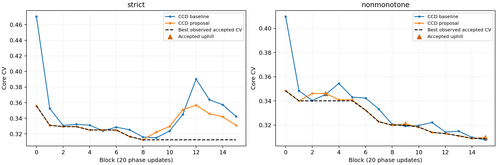
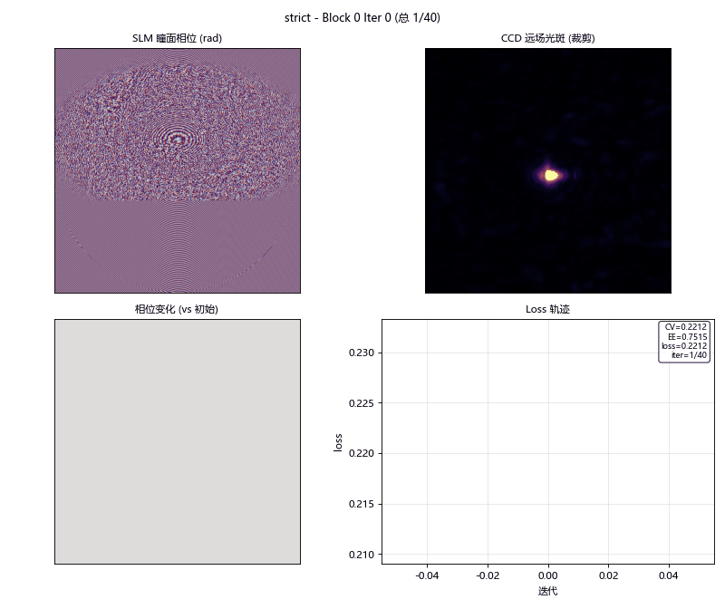
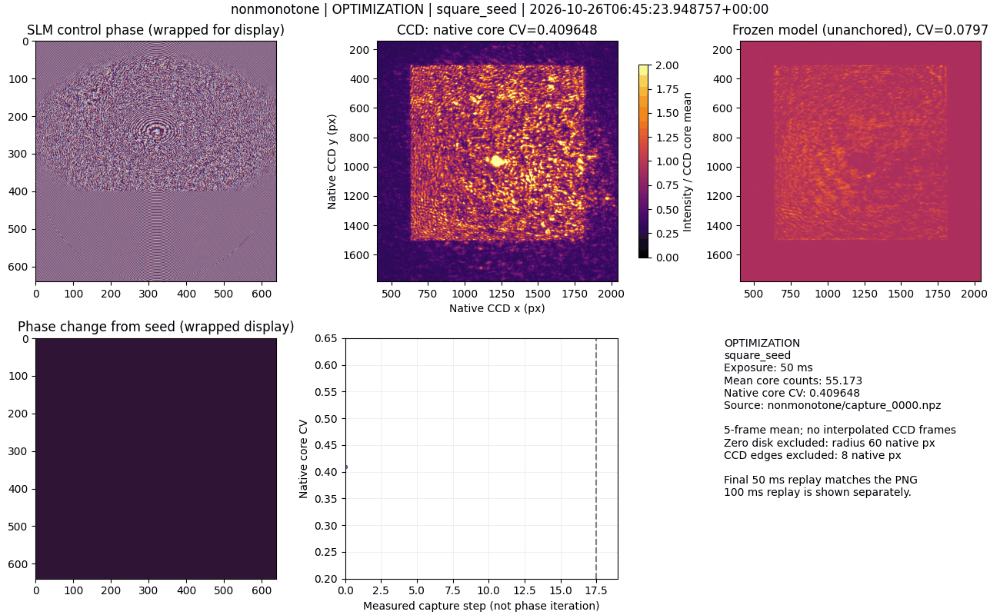
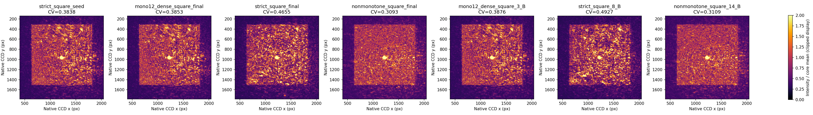

# 1200 CCD 像元方形：严格验收与非单调探索对照（2026-10-26）

<!-- provenance:start -->
> **生成脚本**: [`scripts/slm/generate_square1200_exploration_report.py`](../../../scripts/slm/generate_square1200_exploration_report.py)
> **复现命令**: `python scripts/slm/generate_square1200_exploration_report.py`
> **数据/关联脚本**: [`src/ao_shaping/tools/slm/transfer/validate.py`](../../../src/ao_shaping/tools/slm/transfer/validate.py)
> **数据/关联脚本**: [`src/ao_shaping/tools/slm/transfer/exploration.py`](../../../src/ao_shaping/tools/slm/transfer/exploration.py)
> **数据/关联脚本**: [`src/ao_shaping/tools/slm/transfer/artifacts.py`](../../../src/ao_shaping/tools/slm/transfer/artifacts.py)
> **数据/关联脚本**: [`src/ao_shaping/tools/slm/transfer/replay_phases.py`](../../../src/ao_shaping/tools/slm/transfer/replay_phases.py)
> **运行环境**: 实验（Santec #1、Daheng Mono12，1200 CCD 像元方形）
> **说明**: 同初相位、同预算的严格 CV 验收与非单调探索对照及固定曝光重放。
<!-- provenance:end -->

本轮检验拒绝 CV 恶化是否限制继续匀化。两组从完全相同的已有相位出发，使用同一冻结物理预测模型和 CCD 锚定可微优化；没有调用 GS，没有重新训练物理预测模型。

## 实验口径

Santec SLM #1、1064 nm、Daheng Mono12，满量程 4095。目标边长 1200 原生 CCD 像元，以 2.2 µm/像元计为 2.64 mm。相机窗口半宽 820 px，优化采样间隔 2 px；报告最终比较重新使用完整原生图像计算。核心向内缩进 8 px，排除零级中心 (1224, 962) 周围半径 60 px。零级没有被物理消除，核心外可能饱和，不能把此处结果解释为全光斑均匀度或准确效率。

两组均固定 50 ms、每次采集 5 帧、16 块×20 次更新、学习率 0.03、相位步长 RMS 上限 0.3 rad；A–B–B–A 关闭，每块用同曝光顺序 A/B。两组按时间先后运行，未随机交错，因此不是排除漂移的因果试验。

探索组对 ΔCV>0 的提议按 exp(−ΔCV/0.03) 接受，候选 CV 不得超过历史最佳的 1.25 倍，每 4 块恢复历史最佳相位，最终也恢复该相位。随机种子 20261026。严格组仅接受 CV 降低；探索温度默认 0，原有默认行为保持。

## 实测过程

| 策略 | 初始采样 CV | 最终采样 CV | 接受块数 | 接受恶化块数 |
|---|---:|---:|---:|---:|
| strict | 0.472236 | 0.333506 | 12/16 | 0 |
| nonmonotone | 0.408989 | 0.308874 | 15/16 | 3 |



### 迭代过程动画

以下 GIF 展示了严格验收与非单调探索的完整迭代过程，每帧包含 SLM 瞳面相位、CCD 远场光斑、模型预测光斑、相位变化、metrics（模型/目标）、Loss 轨迹：

**严格组**：



**非单调探索组**：



虚线是历史最低观测值，不能消除测量漂移；恢复同一相位后 CV 仍可能变化。严格组也可继续改善，不能将前一轮停滞直接归因于严格验收。

## 相同曝光下精确相位重放

除两组最终相位，还重放共同初相位、此前最佳相位及每组历史最低的已接受候选。每项均原样重放所保存相位，未重新叠加模型校正。下表为 5 帧均值图的原生核心 CV；逐帧 CV、均值信号和全部块级决定保存在 evidence.json。

| 重放相位 | 曝光/ms | 原生核心 CV | 核心均值/counts | 饱和核心样本 |
|---|---:|---:|---:|---:|
| strict_square_seed | 50 | 0.383804 | 54.655 | 0 |
| mono12_dense_square_final | 50 | 0.385327 | 54.579 | 0 |
| strict_square_final | 50 | 0.465455 | 57.777 | 0 |
| nonmonotone_square_final | 50 | 0.309347 | 47.540 | 0 |
| mono12_dense_square_3_B | 50 | 0.387619 | 54.925 | 0 |
| strict_square_8_B | 50 | 0.492704 | 58.088 | 0 |
| nonmonotone_square_14_B | 50 | 0.310896 | 47.785 | 0 |
| strict_square_seed | 100 | 0.443001 | 94.715 | 0 |
| mono12_dense_square_final | 100 | 0.444789 | 95.094 | 0 |
| strict_square_final | 100 | 0.531825 | 100.515 | 0 |
| nonmonotone_square_final | 100 | 0.365008 | 80.295 | 0 |
| mono12_dense_square_3_B | 100 | 0.440565 | 94.213 | 0 |
| strict_square_8_B | 100 | 0.565395 | 100.296 | 0 |
| nonmonotone_square_14_B | 100 | 0.365933 | 80.626 | 0 |

探索组最终相位相对此前最佳相位的同曝光重放结果为：50 ms：0.385327 → 0.309347，CV 降低 19.72%；100 ms：0.444789 → 0.365008，CV 降低 17.94%。这表示本轮保留相位的均匀度提高，不表示已排除时序漂移并证明策略的独立因果收益。



## 结论与后续选择

本次按 50/100 ms 原生核心 CV 的算术平均选择 `nonmonotone_square_final`；该相位已导出为原始弧度 `best_model_phase.npy` 和完整面板 `best_panel_phase.npy`。这两档曝光数据参与选择，不是新的独立测试集。

允许暂时恶化在数学上可以跨越目标函数障碍；本实验提供可复现的概率接受机制及独立保留最佳相位，但单条轨迹不能证明跨越了局部极小值。应以上表同曝光重放判断策略收益，并区分初始、探索末端、历史最佳和最终导出相位。不能用运行中的最小 CV 代替最终重放结果。

本轮严格组运行中的低 CV 未保持到重放，历史最佳候选也需要重新验收。这可能涉及入射状态漂移或相位加载响应的时间依赖，本轮未独立重测这些因素，不能确认具体来源。两组初始相位完全相同，但初始测得 CV 不同，也是时序混杂的证据；不可把全部重放差异归因于是否允许恶化。

现有物理预测模型的宽区域绝对 CV 预测仍受加性背景（杂散光）项外推误差影响，故本轮使用 CCD 锚定的相对变化；模型梯度、测量漂移和可探索范围均可能造成停滞。后续优先在宽目标区域补充相位扰动数据、分离曝光偏置与空间背景，然后比较多个随机种子和交错重放。探索作为显式可选项，不因一次实验默认开启。

## 复现与数据

原始数据目录：`data/debug/slm_transfer/square1200_explore_20261026_1435`。每组 config.json 记录几何、检查点哈希、初相位来源、全部策略参数；manifest.json 与 capture_records.pkl 记录采集；NPZ 保存完整原始帧、相位和掩膜；iterations.pkl 保存每次相位更新及 UTC、monotonic_ns、结束时间戳。时间戳是主机调用时间，不是传感器硬件触发时间。

运行同一 validate 命令时，严格组不传探索参数；探索组添加以下参数，其余参数必须相同：

```powershell
--fixed-exposure-ms 50 --no-abba --ccd-check --accept-metric cv `
--exploration-temperature .03 --exploration-budget .25 --exploration-window 4 --random-seed 20261026
```

固定曝光值只用于本次光路比较，并非跨设备或跨光路的永久限制。实际开始前仍须按当前画面选择未饱和档位。可使用 replay_phases 的 --include-best 同时比较历史最佳候选，避免把保留相位的漂移误认为策略失效。

两组原始数据均通过指标重算与验收决策审计；探索组额外重放随机数，并检查最终相位和导出文件等于历史最佳相位。

两组共保存 640 次相位更新；正式优化采集 345 帧，统一重放 70 帧，此外保留固定曝光检查原始帧。

最终设备释放记录（UTC）：`2026-10-26T06:53:24.524321+00:00`，状态 `camera and SLM contexts closed`。

数据摘要：[evidence.json](artifacts/20261026/evidence.json)。前序实验：[1200 像元方形](../square1200/square1200_20261026.md)。
