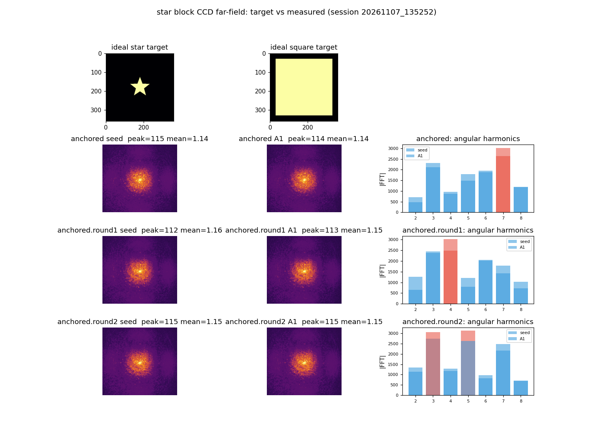
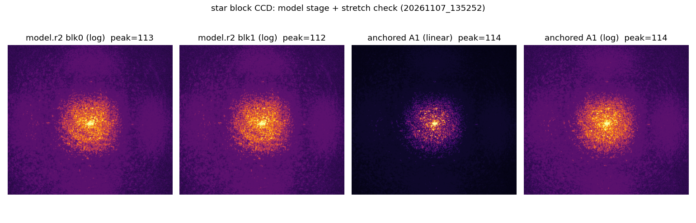
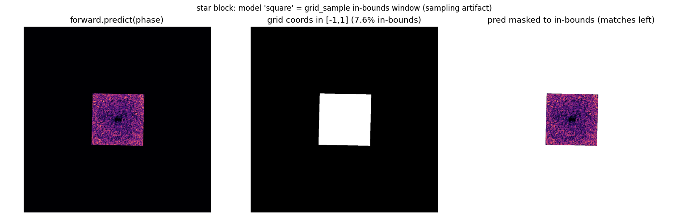

# star 块 CCD 实测远场对照：弥散圆斑（非星非方）（2026-11-07）

<!-- provenance:start -->
> **生成脚本**: [`scripts/slm/star_farfield_analysis_20261107.py`](../../../scripts/slm/star_farfield_analysis_20261107.py)
> **复现命令**: `python scripts/slm/star_farfield_analysis_20261107.py`
> **运行环境**: 离线渲染（实验系统数据 2026-11-07：SLM #1 + Daheng CCD；shapes=['star']、4 块、acceptance 启用、3 轮）
> **说明**: 确认 star 块 CCD 实测远场为弥散圆斑（零级主导），非五角星非方块；figures/ 三张 PNG 为脚本产物，输入为 data/debug/slm_transfer/20261107_135252 存档。报告本体不占用设备。
<!-- provenance:end -->

**日期** 2026-11-07 · **脚本** `scripts/slm/star_farfield_analysis_20261107.py` · **会话** `data/debug/slm_transfer/20261107_135252`（`shapes=['star']`、4 块、acceptance 启用、3 轮：`anchored` / `anchored.round1` / `anchored.round2`）

## 1. 结论速览

- star 块 CCD 实测远场是**弥散圆斑（零级主导）**，**既非五角星也非方块**。
- 之前实时视图里的「方块」是**显示/光学伪影**（ROI 边界框 / 叠加十字-椭圆渲染），不是真实光束形状。
- 根因：star 目标填充率低，零级泄漏 + 弱臂在 CCD 上被亮核淹没，整形结果在实测远场里看不出星形；末次迭代仅 `ee_roi≈0.51`、`shape_loss≈0.62–0.66`，未收敛出可分辨星形。
- **模型预测的「方块」也是伪影**：`FrozenDefocusForward.predict` 的焦面强度其实是占满整幅焦面的散斑；`predict` 输出的「方块」是 `camera_sample_grids` 的 in-bounds 采样窗（占 camera grid 的 ~7.6%），out-of-bounds 部分被 `padding_mode='zeros'` 填 0 + background 偏置所致。**模型真实预测是散斑（占满焦面），也不是星形** —— 模型与实测都未产出星形，但失败形态不同（模型：散斑占满焦面；实测：零级主导的弥散圆斑）。

## 2. 证据

### 2.1 对照图

### 2.2 定量指标（star 块 = `anchored/capture_0001.npz` = `star_0_A1`，ABBA 实测位 A1）

| 项 | 值 |
|---|---|
| 末次迭代 | iter=9，`ee_roi≈0.51`、`shape_loss≈0.62–0.66`（4 块 × 3 轮一致，轮间无改善） |
| 光束强度 | peak≈114，mean≈1.1（弱信号） |
| 50% 阈值掩膜 | bbox 31×13 px，fill≈0.47 —— 只抠到中央亮核 |
| 10% 阈值掩膜 | bbox 351×374 px，fill≈0.033 —— 露出弥散晕 |
| 角向谐波（h2–h8） | 主导阶数跨帧漂移（h7→h4→h3→h5），**无一致 5 重/4 重对称** |

### 2.3 角向谐波为何判「非星非方」

- 理想 star 目标（5 重）应产生**主导 h5**；理想 square（4 重）应产生**主导 h4**。
- 实测各帧主导谐波在 h3/h4/h5/h7 间漂移（`anchored` h7、`anchored.round1` h4、`anchored.round2` seed h5 / A1 h3），相邻帧之间也不一致 —— 属低对比散斑的**几何噪声**，不是任何稳定对称形。
- 半高阈值只抠到亮核（31×13 px），降到 10% 阈值才露出 ~350×375 px 弥散结构 —— 说明星形臂太弱，被零级淹没。

### 2.4 填充率不构成判别

- 理想 star 目标非零占比 ≈2.8%（薄五角星）；实测 10% 阈值 fill≈0.033 —— 数值接近，**填充率本身不能区分**「薄星形」与「弥散晕」。
- 判别靠**角向谐波（无一致 5 重对称）**与**视觉形态**（实测为中央亮核 + 各向同性弥散晕，无星形臂、无方形边）。

### 2.5 模型预测的「方块」是采样窗伪影（非真实远场）

`summary/ccd_model_comparison.png` 的「Model final」面板显示一个方块，但该方块**不是**模型的真实预测：

| 项 | 值 |
|---|---|
| `FrozenDefocusForward.predict` 的焦面强度 | 散斑，占满整幅 1024×1024 焦面（1% 掩膜 bbox = 1024×1024） |
| `camera_sample_grids` 归一化坐标范围 | gx ∈ [-3.68, 3.70]，gy ∈ [-3.74, 3.69] |
| in-bounds（\|g\|≤1）占比 | ~7.6% |
| in-bounds 区域形状 | 256×256 方形（与 predict 输出的「方块」完全一致） |
| out-of-bounds 区域 | `grid_sample(padding_mode='zeros')` → 0，再加 `background` 偏置 (~0.97) |

结论：`predict` 输出的「方块」= in-bounds 采样窗（方形）+ out-of-bounds 零填充 + background 偏置；**模型真实预测是占满焦面的散斑，不是方块，更不是星形**。模型与实测都未产出星形，失败形态不同：模型为散斑占满焦面，实测为零级主导的弥散圆斑。

## 3. 判定方法（复现）

- 用 `archive_replay.load_capture` 载入 `raw_frame`（与归档回放弹窗同一加载器，非另行实现）。
- 分析：10% 阈值掩膜（比半高更能暴露低对比结构）+ log 拉伸（`_log_stretch`）+ 角向谐波 FFT（`_angular_harmonics`）。
- 渲染：理想目标用 `create_target_shape('star'/'square', 360, side=300)`，与实测 seed/A1 × 3 轮并排；另出 model 阶段 + 线性/对数拉伸对照图。
- 全部由生成脚本 `star_farfield_analysis_20261107.py` 一键复现（离线，不占用设备）。

## 4. 溯源登记说明

- 本报告与 `figures/` 均由 `scripts/slm/star_farfield_analysis_20261107.py` 生成，满足「一份报告 = 一个子目录、可追溯」。
- `scripts/_common/provenance.py::REPORTS` 登记（及 `report/README.md` / `docs/dev/report_subdir_index.md` 同步）**待 WIP 所有者同步后补录** —— 本报告未触碰上述在途 WIP 文件。
