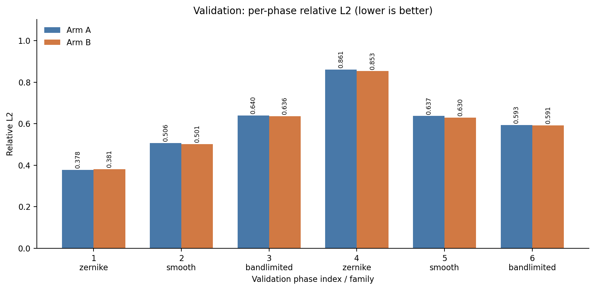
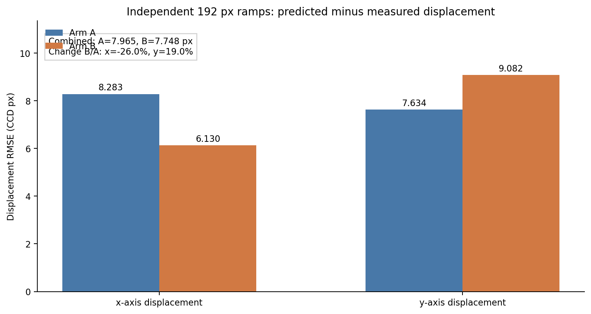

# Transfer 正向模型几何残差适配验证报告

<!-- provenance:start -->
> **生成方式**: 人工撰写；数值由冻结评估脚本计算，图由同一评估 JSON 直接绘制
> **评估脚本**: `data/debug/slm_transfer/20261124_transfer_geometry_v1/evaluate_geometry.py`，SHA256 `2cd9696b4bfd36360cca36d608042454a9185ee480dd7c2bcdf0bff7c0468d95`
> **绘图脚本**: `data/debug/slm_transfer/20261124_transfer_geometry_v1/make_geometry_figures.py`
> **复现命令**: `python data/debug/slm_transfer/20261124_transfer_geometry_v1/evaluate_geometry.py`
> **运行环境**: 硬件采集 + 离线 CPU 拟合/评估；拟合和评估阶段不打开 SLM、CCD 或激光控制器
> **预注册**: [`docs/dev/transfer_geometry_adaptation_prereg_20261124.md`](../../docs/dev/transfer_geometry_adaptation_prereg_20261124.md)
> **说明**: 本轮检验小幅全局 2×2 几何残差是否改善 transfer 正向预测。validation 与独立 192 px held-out 两道门均未全部通过，故**不支持启用几何适配，保留默认关闭**。
<!-- provenance:end -->

> 类型：实测、离线拟合与独立 held-out 验证报告  
> 日期：2026-11-24  
> 分支：`feat/transfer-geometry-calibration-20261124`  
> 总结论：**未达到预注册支持标准；`learn_geometry=False` 保持默认。**

## 摘要

本轮针对设备与装调可能引入的旋转、剪切、各向异性尺度和联动误差，在既有 signed-ramp 全局 `ramp_matrix` 之外增加默认关闭的有界几何残差：

\[
G = I + 0.05\tanh(raw),\qquad M_{camera\rightarrow panel}=M^{-1}G.
\]

残差零初始化，逐元素最大偏离 5%，导出时折叠到有效 `ramp_matrix`，不改变 checkpoint schema。基础矩阵只由 train 会话 `split="calibration"` 的 signed ramps 估计；训练 phase 用于拟合，validation 用于配对评估，独立 192 px 会话仅用于最终位移检验。

核心结果：

1. **validation 有小幅正向变化，但幅度门未通过。** 6 个 validation phase 的 relative-L2 均值由 A 的 `0.60243929` 降至 B 的 `0.59870432`，相对改善 `0.6200%`，低于要求的 `5%`。20,000 次 phase-level paired bootstrap 的相对改善 95% CI 为 `0.0709%–1.0827%`，不跨 0；correlation 均值变化 B−A 为 `+0.00268536`，通过不恶化门。三项条件未同时满足，validation 总门为 **失败**。
2. **独立 192 px 检验方向不一致。** B 的合并位移 RMSE 为 `7.747939 px`，低于 A 的 `7.965166 px`；合并 NRMSE 亦由 `0.09231689` 降至 `0.08970541`。但 x 轴误差下降 `25.987%` 的同时，y 轴误差增加 `18.962%`，超过允许的 `10%`，独立门为 **失败**。
3. **不能将样本内训练损失、validation 小改善或合并 RMSE 略降解释为泛化成功。** 本轮结果只说明当前自由度产生了有限且轴向不一致的变化，不足以支持“几何残差改善迁移预测”的结论。
4. 实现、测试、采集、A/B 拟合和独立评估均已完成；原始采集未覆盖，新产物写入独立目录。后续若继续，应优先调查成像观测模型、跨周期一致性和静态 PSF/blur，而不是继续扩大几何参数自由度。

## 1. 任务完成情况

- [x] 在隔离工作树和分支中实现默认关闭的有界几何残差。
- [x] 接线 `PhysicalForwardFit`、transfer adaptation、fit CLI、provenance 与有效矩阵导出。
- [x] 在新采集和拟合前冻结采集设计、split、A/B 配置、主指标与门槛。
- [x] 完成光路有效性探测、train/validation 采集和独立 192 px held-out 采集。
- [x] 使用同一 checkpoint、数据、预算和辐射度配置完成 A/B 离线拟合。
- [x] 完成 20,000 次 paired bootstrap 和独立 x/y 位移检验。
- [x] 保留默认关闭，未用 held-out 图样拟合参数、选择 checkpoint、选预处理或调阈值。
- [x] 完成聚焦回归、Ruff、图表和正式报告。

## 2. 验证边界与冻结判据

### 2.1 可回答的问题

本轮只检验：**在已有全局 signed-ramp 标定之后，是否仍存在可由小幅全局仿射残差校正的误差，并且该校正能迁移到未参与拟合的图样和 ramp 周期。**

不能由此推断位置相关畸变、镜头畸变、散斑、静态 PSF、运动模糊、相机非线性或任意目标形状的 CCD 验收性能。validation 不是最终独立结论；独立 192 px 会话才承担几何外推检验。

### 2.2 冻结门槛

| 判定项 | 冻结条件 | 本轮结果 |
|---|---|---|
| validation relative-L2 | B 相对 A 的均值改善至少 `5%` | `0.6200%`，**未通过** |
| validation 配对不确定性 | 20,000 次 phase-level bootstrap 95% CI 不跨 0 | `0.0709%–1.0827%`，通过 |
| validation correlation | 均值下降不超过 `0.01` | B−A=`+0.00268536`，通过 |
| 独立 192 px 合并位移 | B 的合并归一化 RMSE 低于 A | `0.08970541 < 0.09231689`，通过 |
| 独立 192 px 单轴约束 | 任一轴误差增加不超过 `10%` | y 轴 `+18.962%`，**未通过** |
| 参数与样本有效性 | 有限值、5% 界、有效帧、无饱和 | 通过 |
| 总体支持决定 | 所有必要条件同时满足 | **不支持** |

## 3. 实现与防泄漏

### 3.1 代码改动

- `physical_forward_fit.py`：新增 `learn_geometry=False`、`geometry_max_deviation=0.05`；仅显式开启时创建可学习参数，默认路径保持无数值变化。
- `adaptation.py`：仅在允许时释放几何参数，避免无意扩大优化自由度。
- `fit.py`：新增 `--learn-geometry`，记录基础矩阵、学习残差、有效矩阵和脚本/manifest 哈希；导出使用有效 `ramp_matrix`。
- 基础矩阵严格使用 `split="calibration"` ramps；capture 内存 manifest 尚未声明 `split` 时保留历史 calibration 行为，避免兼容性回归。
- 新增 `test_learn_geometry.py`，覆盖有界性、有效映射、CLI/provenance、导出以及 calibration-only 防泄漏。

### 3.2 A/B 一致性

两臂共用：

- checkpoint：`data/debug/slm_transfer/defocus_forward_20261107_focus_r2_fit/checkpoints/M3_illumination/frozen_parameters.json`；
- checkpoint SHA256：`fa7579c99fc6cd9d5f1051b2dbf0e7eca2585369f48bc07c61897db03e28d703`；
- train manifest SHA256：`00ed91199bf7d77da45bd3c637e9d79dbc7bc7742bdd4f6699141fc6487dd09b`；
- fitter SHA256：`7a9acb1bf2ab8f18030be4662a388b44a648140c9507e6e42e7a89da2b5f7631`；
- `--span 160 --iterations 100 --adaptation full --radiometry exposure --device cpu`。

唯一有意差异为 B 增加 `--learn-geometry`。最终读取 `arm_A/` 与 `arm_B/`。初次 `fit_baseline/` / `fit_geometry/` 之后，为解决无 `split` 内存 manifest 的兼容性回归而重跑两臂；最终与初次结果的 iteration、loss、逐 phase metrics 和 parameters 逐项一致，不构成结果挑选。

| 参数 | A：baseline | B：geometry |
|---|---:|---:|
| `learn_geometry` | `false` | `true` |
| 选中 iteration | 67 | 72 |
| 选中 train loss | 0.25012589 | 0.24596983 |
| 基础矩阵 | 相同 | 相同 |
| 几何残差 | 单位矩阵 | 见下式 |

B 的学习残差与有效矩阵为：

```text
G = [[1.01856029, 0.00642361],
     [0.00065443, 0.97021478]]

effective_ramp_matrix_B =
   [[ 202.24209803, 7429.70213049],
    [-7606.96180735,  168.88829176]]
```

## 4. 采集与数据质量

| 会话 | 行数与用途 | ramp 周期 | 曝光与位深 | 完整性/光检 |
|---|---|---|---|---|
| `20261124_transfer_geometry_v1` | 22 行：10 calibration、6 train、6 validation | 64、128 px | 自动曝光最终 `0.063 ms`；`Mono8` / 8 bit | `.capture_done`；`light_check.ok=true` |
| `20261124_transfer_geometry_period192_holdout_v1` | 12 行：6 calibration、6 普通 probe；仅用 192 px x/y ± ramps 评分 | 192 px | 自动曝光最终 `0.063 ms`；`Mono8` / 8 bit | `.capture_done`；`light_check.ok=true` |

前置独立光路探测 `20261124_031312Z/optical_path_probe.json` 为 `verdict.state=ok`、退出码 0：请求并回读 12 bit，曝光 `0.05 ms` 时峰值 `2601/4095`，未饱和；离焦引起宽度变化 `19.3%`、峰值变化 `21.2%`。

**位深差异披露：**前置探测回读为 12 bit，而两个 capture 会话自动光检均为 `Mono8` / 8 bit。报告不比较跨会话绝对亮度，只比较各会话内 signed-ramp 位移和拟合指标。所有评分 ramp/probe 行 `saturation_pixels=0`。首次 held-out `--count 0` 仅被 CLI 参数校验拒绝，未创建目录或打开设备；正式采集使用 `--count 6`，未改变判据。

## 5. 结果

### 5.1 Validation phase-level 配对结果

| validation phase | A relative-L2 | B relative-L2 | A−B | A correlation | B correlation |
|---|---:|---:|---:|---:|---:|
| `probe_003_zernike` | 0.377754 | 0.381068 | −0.003315 | 0.923884 | 0.921916 |
| `probe_004_smooth` | 0.506232 | 0.501166 | +0.005066 | 0.852864 | 0.856025 |
| `probe_005_bandlimited` | 0.639513 | 0.636364 | +0.003148 | 0.803661 | 0.807096 |
| `probe_009_zernike` | 0.861019 | 0.852866 | +0.008153 | 0.780781 | 0.788627 |
| `probe_010_smooth` | 0.636880 | 0.629571 | +0.007309 | 0.799080 | 0.802438 |
| `probe_011_bandlimited` | 0.593238 | 0.591190 | +0.002049 | 0.850012 | 0.850293 |
| **均值** | **0.60243929** | **0.59870432** | **+0.00373496** | **0.83504695** | **0.83773231** |



**图 1。** 六个 validation phase 中五个 relative-L2 略降、一个略升；变化幅度远小于 5% 主门，不能用多数图样同向改善替代预注册效应量要求。

Bootstrap 使用固定 seed `20261124`，以 phase 为重采样单位，不把单帧当作独立样本：

- A−B 绝对 relative-L2 均值差 95% CI：`[0.00042701, 0.00652290]`；
- 相对改善 95% CI：`[0.070879%, 1.082748%]`；
- correlation 均值差 B−A：`+0.00268536`。

因此，“方向为正且 CI 不跨 0”与“达到至少 5% 的实际改善”是两个不同判断；本轮只满足前者。

### 5.2 独立 192 px held-out 位移

| 轴 | 实测 signed-ramp 位移 `(dx, dy)` / px | A 预测 / px | B 预测 / px | A RMSE / px | B RMSE / px | B 相对 A 变化 |
|---|---|---|---|---:|---:|---:|
| x | `(−0.189268, −86.099309)` | `(1.629234, −78.018493)` | `(2.106689, −80.415052)` | 8.282906 | 6.130432 | **−25.987%** |
| y | `(86.472671, 1.984636)` | `(78.840733, 1.798317)` | `(77.392731, 1.801321)` | 7.634212 | 9.081791 | **+18.962%** |

| 合并指标 | A | B | 判定 |
|---|---:|---:|---|
| x/y 合并位移 RMSE / px | 7.965166 | 7.747939 | B 略低 |
| x/y 合并位移 NRMSE | 0.09231689 | 0.08970541 | B 略低 |



**图 2。** 合并指标略改善掩盖了轴向不一致：x 轴改善，但 y 轴退化超过冻结上限。按预注册规则，不能只挑 x 轴或合并指标宣称成功。

作为**描述性、非门槛**检查，192 px held-out 反推的矩阵列范数相对 train 64/128 px 均值约为 x `1.1033`、y `1.0968` 倍。这提示跨周期/跨会话的几何尺度并非完全一致，但样本不足以区分周期依赖、会话漂移或测量噪声；不得据此事后重标定或修改门槛。

### 5.3 综合结论

`overall_support_for_geometry_adaptation=false`。当前证据不支持在本轮装调与图样范围内启用该几何残差，更不能推广到其他日期、设备、目标形状或位置相关误差。保留默认关闭，并保留完整负结果以避免后续重复将样本内拟合误当作泛化提升。

## 6. 硬件占用、释放与关闭记录

| 时段（本地时间） | 设备与操作 | 释放/关闭结果 |
|---|---|---|
| 约 11:13:13–11:15:29 | Santec SLM #1（1064 nm）、Daheng MER2-507-23GM cam 0；光路有效性探测 | 脚本退出时 SLM 与相机正常关闭；随后确认设备锁未持有 |
| 约 11:16:20–11:20:31 | 同一 SLM/CCD；train/validation 会话 22 行采集 | 11:20:31 写入 `.capture_done`，设备锁释放，SLM #1 与 cam 0 正常关闭 |
| 约 11:25:41–11:27:17 | 同一 SLM/CCD；独立 192 px held-out 会话 12 行采集 | 11:27:17 写入 `.capture_done`，设备锁释放，SLM #1 与 cam 0 正常关闭 |
| 11:45:27 状态复核 | 本任务离线评估，不打开设备 | 默认 `DeviceLock` 当时由另一进程 PID `1589768` 持有，命令为另一会话 `s0r1_dcal_20261124` 的光路探测；本任务未干预该进程 |
| 11:53:39 最终复核 | 仅查询锁状态，不打开设备 | 默认 `DeviceLock.is_locked()=False`、`holder=None`，当前设备锁已释放 |

激光：采集使用既有 1064 nm 实验光路。该 capture/probe 流程没有激光电源或快门控制调用，因此本任务未执行激光开关动作，也不能从采集日志断言激光物理电源已关闭。采集结束后本任务不再使用 SLM、CCD 或激光照明；上述关闭结论仅针对有明确日志的 SLM #1 和 Daheng cam 0。

## 7. 验证命令与产物

| 命令 | 退出码 | 结果 |
|---|---:|---|
| 两臂 `python -m ao_shaping.tools.slm.transfer.fit ...` | 0 | A 选中 67，B 选中 72；最终重跑与初次结果一致 |
| `python .../evaluate_geometry.py` | 0 | 写入冻结评估 JSON，两个总门均为 `false` |
| `uv run --no-sync pytest -q tests/ao_shaping/tools/slm/transfer tests/ao_shaping/algorithm/test_physical_forward_phase_order.py -p no:cacheprovider` | 0 | **517 passed, 4 skipped in 80.48s** |
| `uvx ruff check <3 个源码文件> <新增测试文件>` | 0 | `All checks passed!` |
| `graphify update .` | 1 | 输出显示图已重建并写入；该命令返回码如实记录，不作为科学判据 |

主要产物：

- 冻结设计与执行事实：`docs/dev/transfer_geometry_adaptation_prereg_20261124.md`；
- 汇总评估：`data/debug/slm_transfer/20261124_transfer_geometry_v1/geometry_evaluation.json`；
- 最终 A/B：`data/debug/slm_transfer/20261124_transfer_geometry_v1/arm_A/`、`arm_B/`；
- 独立 held-out：`data/debug/slm_transfer/20261124_transfer_geometry_period192_holdout_v1/`；
- 图：`report/shape_trials/transfer_geometry_adaptation_20261124/`；
- 本报告：`report/shape_trials/transfer_geometry_adaptation_20261124.md`。

## 8. 后续建议

1. 不扩大当前几何自由度，不在同一 held-out 上继续调参后再称其为独立验证。
2. 若继续研究，先预注册新的独立采集，重点检验跨会话/跨周期尺度稳定性及静态 PSF、blur、观测噪声对 relative-L2 地板的贡献。
3. 新实验应保留至少一个未参与模型选择、预处理选择和阈值调整的新会话；否则只能报告探索性结果。
