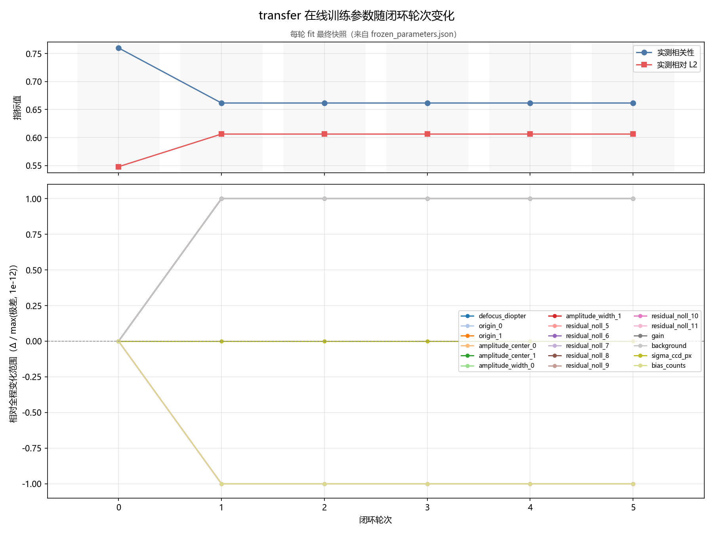
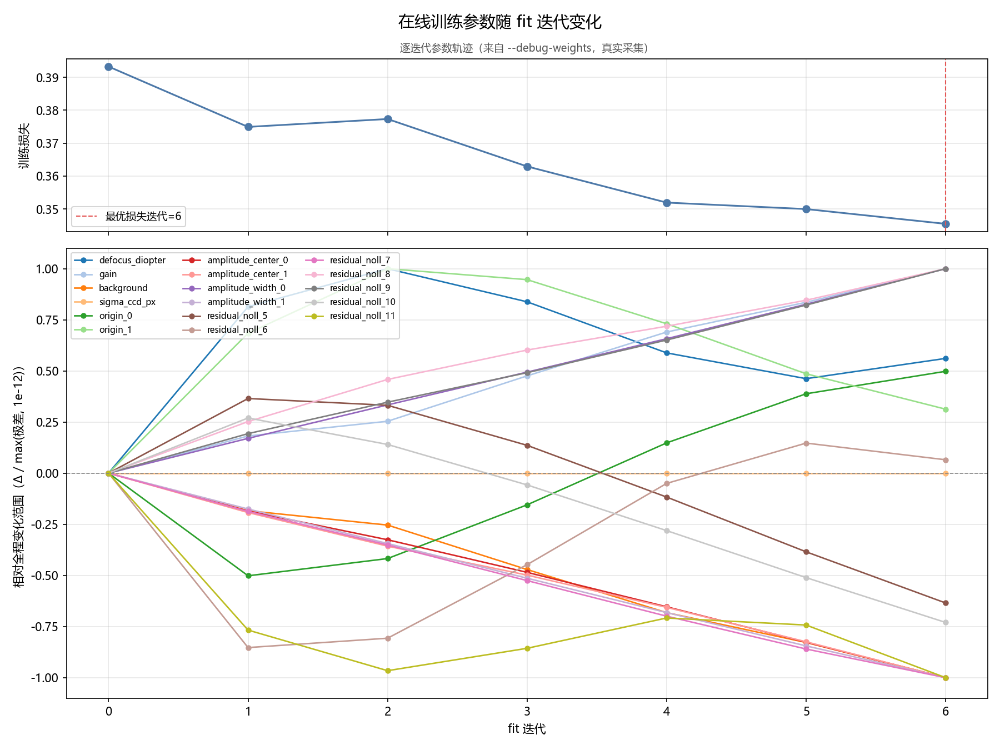

# transfer 模型在线训练参数变化可视化（2026-11-21）

<!-- provenance:start -->
> **生成脚本**: [`scripts/slm/visualize_transfer_online_params.py`](../../../scripts/slm/visualize_transfer_online_params.py)
> **复现命令**: `.venv\Scripts\python.exe scripts\slm\visualize_transfer_online_params.py --session data/debug/slm_transfer/20261105_173655 --trace data/debug/slm_transfer/debug_weights_real_force_20261121/fit/debug_weights/weights_history.jsonl --out report/shape_trials/transfer_online_params`
> **数据/关联脚本**: [`src/ao_shaping/tools/slm/transfer/fit.py`](../../../src/ao_shaping/tools/slm/transfer/fit.py)
> **数据/关联脚本**: [`src/ao_shaping/tools/slm/transfer/workflow.py`](../../../src/ao_shaping/tools/slm/transfer/workflow.py)
> **运行环境**: 离线
> **说明**: transfer 在线训练参数变化可视化：闭环轮次图从 rounds.json 读指标、从各轮 frozen_parameters.json 补出参数（6 轮，参数只在 0→1 轮跳变后持平，全部未验收）；逐迭代图从 debug_weights_real_force_20261121 的 weights_history.jsonl 读真实采集下的 7 次迭代 × 18 参数，训练损失 0.39325→0.34548。两图的参数线各自按全程极差归一化。纯离线重绘既有存档，未操作设备。
<!-- provenance:end -->

## 摘要

本报告把 transfer 在线训练/自适应的参数变化做成两张离线图。数据来源均为已落盘的真实存档：

1. **跨闭环轮次**：`data/debug/slm_transfer/20261105_173655/rounds.json` 记录 6 轮指标；各轮参数由同一存档的 `fit/frozen_parameters.json`、`fit.round1/...`、`fit.round5/...` 补齐（`rounds.json` 本身不记录参数）。
2. **fit 内逐迭代**：`data/debug/slm_transfer/debug_weights_real_force_20261121/fit/debug_weights/weights_history.jsonl`，由 `fit.py --debug-weights` 在真实采集数据上生成，7 行 × 18 个参数。

生成方式：`scripts/slm/visualize_transfer_online_params.py`，纯离线；本轮未操作 SLM、CCD、激光。

## 图





## 事实与口径

- **闭环轮次图**：纵轴为该参数从首轮值起的变化量除以它在 6 轮中的极差，因此 `0` 是首轮值、`1`/`-1` 是该参数最大/最小端；每条线独立归一化，只比较同一条线的趋势，不跨线比较幅度。验收指标显示相关性从 `0.7599` 降到 `0.6617`，相对 L2 从 `0.5481` 升到 `0.6063`，6 轮全部 `accepted=false`。参数在第 0→1 轮发生一次跳变，之后 1–5 轮完全持平（与 `rounds.json` 指标完全不变一致）。
- **逐迭代图**：曲线为 18 个可训练物理参数随 optimizer step 的变化（同样按各自全程极差归一化）。训练损失从 0.39325 降到 0.34548，最小损失在 iteration 6。这里显示的是 **fit 内部的在线训练迭代**，不是闭环轮次；该存档只有单轮（没有 `rounds.json`），不能据此说成跨闭环轮次。
- 可训练/展示参数：`defocus_diopter`、`origin[2]`、`amplitude_center[2]`、`amplitude_width[2]`、`residual_noll_radians Noll 5–11`、`gain`、`background`、`sigma_ccd_px`；跨轮快照还包括 `bias_counts`。`ramp_matrix`/`grid_size` 等是配置/辅助量，不参与训练，未画。
- 没有硬件采集，未做实时性或帧率声明；图仅描述既有存档中的参数变化过程。

## 复现

```bash
.venv\\Scripts\\python.exe scripts\\slm\\visualize_transfer_online_params.py \
  --session data/debug/slm_transfer/20261105_173655 \
  --trace data/debug/slm_transfer/debug_weights_real_force_20261121/fit/debug_weights/weights_history.jsonl \
  --out report/shape_trials/transfer_online_params
```

`artifacts/transfer_online_params_summary.json` 记录脚本取到的轮次、指标、来源快照路径、迭代号与损失，供核对。
