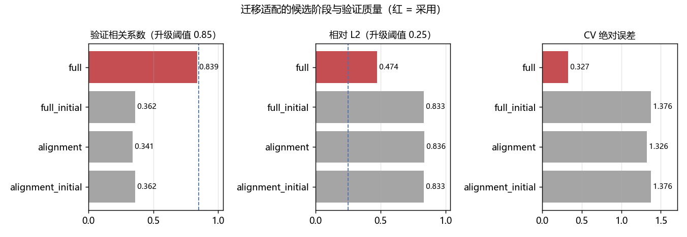
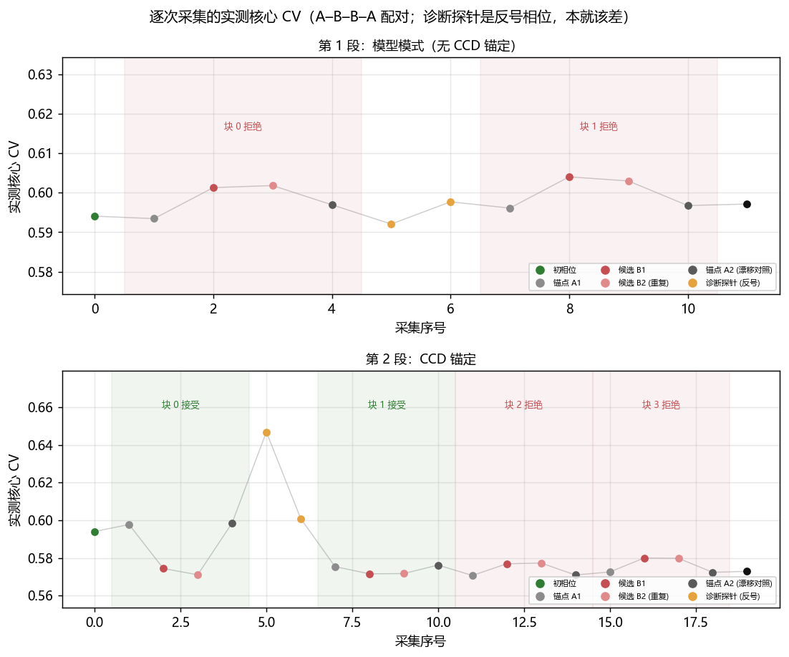
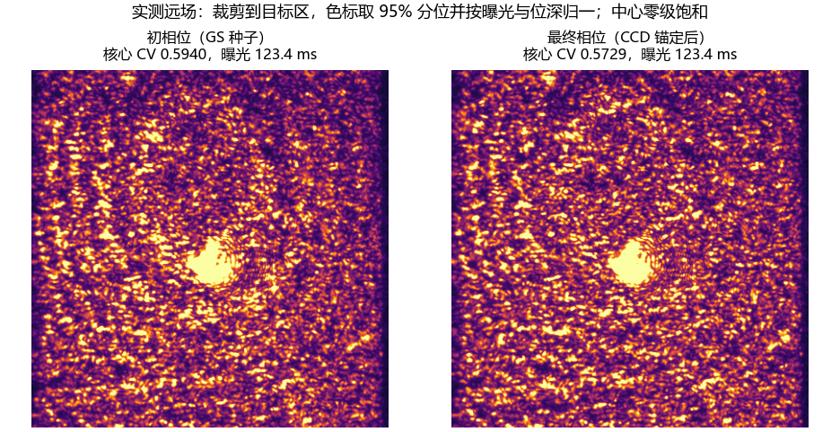
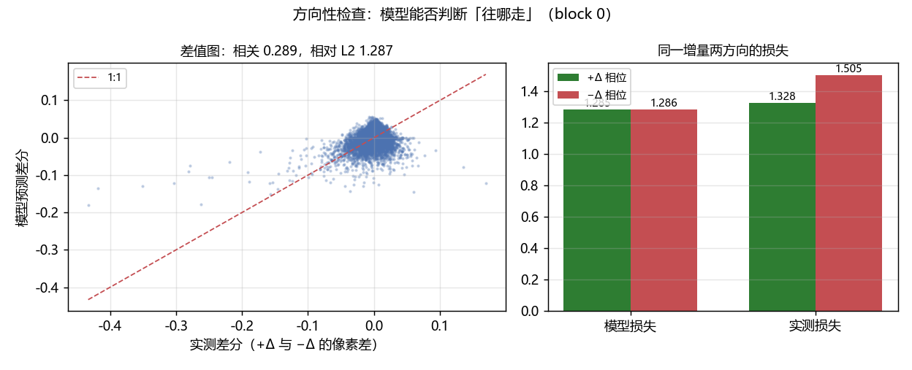
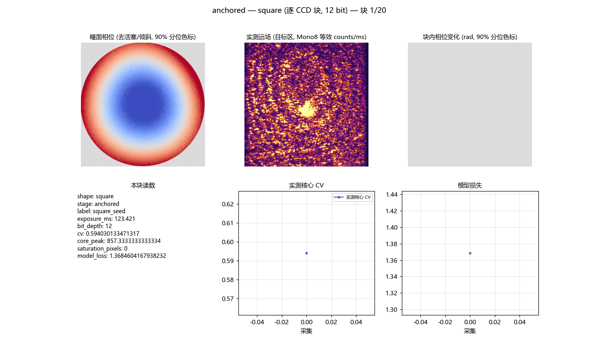

# 1200 像元方形：迁移学习适配预训练物理预测模型（手动干扰后，2026-10-27）

<!-- provenance:start -->
> **生成脚本**: [`scripts/slm/generate_transfer_square1200_report.py`](../../../scripts/slm/generate_transfer_square1200_report.py)
> **复现命令**: `python scripts/slm/generate_transfer_square1200_report.py`
> **数据/关联脚本**: [`src/ao_shaping/tools/slm/transfer/workflow.py`](../../../src/ao_shaping/tools/slm/transfer/workflow.py)
> **数据/关联脚本**: [`src/ao_shaping/tools/slm/transfer/fit.py`](../../../src/ao_shaping/tools/slm/transfer/fit.py)
> **数据/关联脚本**: [`src/ao_shaping/tools/slm/transfer/adaptation.py`](../../../src/ao_shaping/tools/slm/transfer/adaptation.py)
> **数据/关联脚本**: [`src/ao_shaping/tools/slm/transfer/validate.py`](../../../src/ao_shaping/tools/slm/transfer/validate.py)
> **数据/关联脚本**: [`src/ao_shaping/tools/slm/transfer/paired.py`](../../../src/ao_shaping/tools/slm/transfer/paired.py)
> **数据/关联脚本**: [`src/ao_shaping/tools/slm/transfer/recording.py`](../../../src/ao_shaping/tools/slm/transfer/recording.py)
> **数据/关联脚本**: [`src/ao_shaping/tools/slm/transfer/capture.py`](../../../src/ao_shaping/tools/slm/transfer/capture.py)
> **数据/关联脚本**: [`src/ao_shaping/tools/slm/transfer/radiometry.py`](../../../src/ao_shaping/tools/slm/transfer/radiometry.py)
> **运行环境**: 实验（Santec #1 与 Daheng，1064 nm，1200 CCD 像元）
> **说明**: 手动干扰后用迁移适配的物理预测模型整形 1200 像元方形：alignment→full 的验证选择、模型模式与 CCD 锚定两段的 A–B–B–A 实测判决、方向性检查、Recorder 过程记录与动画；含「几何被继承导致适配永久卡死」这一机制的修复记录。
<!-- provenance:end -->

会话目录：`data/debug/slm_transfer/transfer_square1200_20261027_r2`。设备：Santec SLM #1 + Daheng MER2-507-23GM NIR，1064 nm；目标边长 1200 CCD 原生像元。

## 1 本轮做了什么

**结论**：干扰后适配（alignment 相关 0.34 → full 0.84）把模型重新对上当前光路；但纯模型提议的两块被实测否决，只有 CCD 锚定的块带来改善（核心 CV 0.594 → 0.573，接受 2/4 块）。模型方向性仍弱（差值图相关 0.29），因此每一块都必须由实测判决。

光路被**手动干扰**后，用 2026-10-27 从零训练得到的物理预测检查点做**迁移适配**，再以「模型预测 → SLM 相位更新 → CCD 实测判决」的迭代把 1200 px 方形匀化。全过程由 `Recorder` 逐次采集记录，导出 CSV + HDF5 + 过程动画。

1. **复用探针采集**：干扰后的 12 个相位探针（含正负光栅与首尾参考）已在本轮之前的同一光路采完，直接复用，不再重复占用设备。
2. **迁移适配**：以历史检查点为起点，`--adaptation auto` 先只放开照明位置与光轴原点（alignment），验证不足时再放开全部光学参数（full）。
3. **模型 + SLM 相位迭代**：第 1 段纯模型提议（无 CCD 锚定），第 2 段每块先用 CCD 实测锚定当前场，再用模型梯度更新相位，逐块以同曝光 A–B–B–A 配对判据验收。
4. **记录**：每次采集写入 `Recorder`（相位 / 实测远场 / 相位变化 / 指标 / 判决），设备关闭后导出表格与过程动画。

### 1.1 测量口径

| 项 | 本轮取值 | 说明 |
|---|---|---|
| 目标 | 边长 1200 CCD 原生像元 | 正方形，外接边与采样窗对齐 |
| 载波周期 | 128 面板像元 | 标定档之一 |
| 采样窗 | 半跨 820 px，步长 4 px | 大目标必须显式打开，默认 220 px 会直接拒绝 |
| 零级排除 | 半径 60 CCD px | 只从评价里排除，没有物理消除零级 |
| 核心 | 目标再腐蚀 8 CCD px | 边缘不参与 CV |
| 位深 / 曝光 | 12 bit / 段内固定 | 各块曝光按目标测光，跨块原始 counts 不可直接比较 |
| 判据 | A–B–B–A 配对（实测核心 CV） | 漂移由 A1/A2 对照吸收 |
| 控制分辨率 | 640 网格 / FFT 2048 | 拟合分辨率导出，只改采样不改光学参数 |

### 1.2 干扰的实测证据

本轮实测零级 **(1297.8, 948.9)**，历史检查点记录的是 (1221.7, 961.8)，相差 **(76.1, -12.9) px**。这就是必须重新适配而不是直接沿用检查点的原因。

## 2 迁移适配：对齐 → 全参数

验证相位（6 条，与训练相位不重叠）上的候选阶段质量：

| 候选阶段 | 验证相关系数 | 相对 L2 | CV 绝对误差 | 选择分数 (1−corr+relL2) |
|---|---:|---:|---:|---:|
| `alignment_initial` | 0.362 | 0.833 | 1.376 | 1.471 |
| `alignment` | 0.341 | 0.836 | 1.326 | 1.495 |
| `full_initial` | 0.362 | 0.833 | 1.376 | 1.471 |
| `full` **← 采用** | 0.839 | 0.474 | 0.327 | 0.634 |

选择结果：**full**（升级触发：True）。alignment 只放开照明位置与光轴原点，共享增益与加性背景（杂散光）项由训练帧 NNLS 求解；它把相关只做到 0.34 左右，远低于 0.85 的升级阈值，因此自动进入 full。full 放开离焦、照明宽度与 Noll 残差后，验证相关升到 0.84。



### 2.1 适配前后的参数

| 参数 | 历史检查点 | 本轮适配后 |
|---|---:|---:|
| 光轴原点 (CCD px) | [1221.7, 961.8] | [1281.4, 955.2] |
| 照明中心 (面板 px) | [977.8, 721.9] | [960.0, 826.1] |
| 照明宽度 (面板 px) | [335.5, 267.7] | [431.4, 334.7] |
| 离焦 (屈光度) | -0.00309 | -0.39185 |
| 增益 (counts/ms) | 75.48 | 89.45 |
| 加性背景 (counts/ms) | 0.580 | 0.360 |

照明中心在面板上移动了约 106 面板像元——干扰不只是相机侧的平移，面板照明本身也动了，这正是 alignment 阶段（只放开位置）不足以解释、必须升级到 full 的原因。

### 2.2 一个会让适配永久卡死的机制（本轮修掉）

第一次尝试在本阶段直接失败：`ValueError: nonfinite validation quality`。根因不是数值噪声，而是**几何被继承**：`load_dataset` 把相机窗口对齐到本次实测零级，而模型仍用历史检查点的光轴原点，预测场因此整体平移了上面那个量级。NNLS 辐射度在训练帧上求出的增益被非负约束**截断为 0**，预测退化成常数，损失与相位完全无关，所有梯度随之消失——alignment 既不会改善也不会报错，只是原地不动，直到后面的质量检查报出 NaN 相关。

修法：拟合前用**本次实测零点**重锚模型原点（几何实测，不继承），并在增益为 0 时立刻给出指名道姓的错误，而不是留到下游变成「非有限验证质量」。离线用同一份采集复演验证：修前增益 0、相关 NaN；修后 alignment 0.34、full 0.84。

## 3 逐块结果

两段都是 A–B–B–A 配对（同曝光、同掩膜、同核心），判据是实测核心 CV。判决规则是 `候选均值 < 锚点均值 − 漂移`，漂移 = |A2 − A1|，即候选必须**超过**这一块的漂移才算改善：

| 段 | 块 | 锚点均值 (A1/A2) | 候选均值 (B1/B2) | 漂移 | 判决 |
|---|---:|---:|---:|---:|---|
| 第 1 段：模型模式（无 CCD 锚定） | 0 | 0.5952 | 0.6016 | 0.0035 | 拒绝 |
| 第 1 段：模型模式（无 CCD 锚定） | 1 | 0.5964 | 0.6035 | 0.0006 | 拒绝 |
| 第 2 段：CCD 锚定 | 0 | 0.5981 | 0.5727 | 0.0007 | 接受 |
| 第 2 段：CCD 锚定 | 1 | 0.5758 | 0.5716 | 0.0008 | 接受 |
| 第 2 段：CCD 锚定 | 2 | 0.5708 | 0.5771 | 0.0003 | 拒绝 |
| 第 2 段：CCD 锚定 | 3 | 0.5724 | 0.5799 | 0.0002 | 拒绝 |

**模型模式的两块全部被拒**：候选把实测核心 CV 从 0.5952 推到 0.6016。纯模型梯度（没有 CCD 锚定）在干扰后的光路上方向是错的——这与既有结论一致：模型的绝对量不可信，只能当提议器。

**CCD 锚定段接受 2/4 块**：前两块把核心 CV 从 0.5981 降到 0.5716；后两块候选被拒（0.5708→0.5771、0.5724→0.5799），说明单块 20 次更新在强干扰后的相位空间里已经走到平台，继续按同一步长提议只会变差。拒绝即回退到上一块的接受相位，所以最终相位仍是最好的一块。

最终相位实测核心 CV **0.5729**（初相位 0.5940，相对改善 3.6%）。





## 4 方向性检查：模型能预测「哪里亮」，预测不了「往哪走」

block 0 额外采了同一增量的反号相位（`−Δ = 2·A1 − B`），用来把「模型雅可比错」与「自动微分错」分开：

| 量 | +Δ | −Δ | 差（+ − −） |
|---|---:|---:|---:|
| 模型损失 | 1.2851 | 1.2861 | -0.0010 |
| 实测损失 | 1.3284 | 1.5054 | -0.1770 |

模型认为两个方向几乎一样（差 -0.0010），实测却差 -0.1770。差值图的相关只有 **0.289**，相对 L2 **1.287**——适配后的模型能拟合当前场的亮度分布（验证相关 0.84），但**增量方向**仍不可靠。所以每一块都必须由实测判决，不能按模型损失继续推进。



## 5 Recorder 记录与过程动画

每次采集写一条记录（`Recorder` 持有），设备关闭后导出：

| 路径 | 内容 |
|---|---|
| `anchored/recording/process.csv` | 标量列：核心 CV、核心峰值、模型损失、标签、段、形状、曝光、位深、饱和像素数 |
| `anchored/recording/process.h5` | 同上 + `_phase`（下发的控制网格相位）、`_img`（裁剪到目标区的实测远场）、`_grad`（相对上一次采集的相位变化） |
| `anchored/recording/process_sidecars/` | 数组列的逐条 `.npy` |
| `anchored/recording/process.gif` | 过程动画：瞳面相位 / 实测远场 / 块内相位变化 / 本块读数 / 实测 CV 轨迹 / 模型损失轨迹 |

本轮共记录 20 次采集（模型段另有 12 次）。动画里的 A–B–B–A 顺序、块判决与诊断探针（反号相位，标题会标注）都能逐帧对上表格。



### 5.1 渲染器修复（本轮）

过程动画此前不稳定，两处根因都在渲染器本身：

1. **按首行判列类型**：候选 CV 在第一次候选出现前是 `None`，首行判类型会把它归到文本，于是轨迹退化成 `_epoch` 这种无意义曲线。现在按多行判类型，并在轨迹候选里排除记账列。
2. **异常被 `finish()` 掩盖**：`PillowWriter` 的上下文管理器在 `finally` 里调 `finish()`，循环里一报错就先抛 `IndexError: list index out of range`，真正的错误看不到。现在手动驱动 setup/finish，原始异常原样抛出。

此外渲染口径也统一了：远场按 `counts / (曝光 × 2^(位深−8))` 归一（否则 8 bit 段与 12 bit 段、不同曝光的块无法同图比较），相位去活塞/倾斜后用 90% 分位色标，裁剪到目标区，色标取 95% 分位（零级饱和不再把整幅压暗）。

## 6 局限

- **单段 4 块，20 次更新/块**：核心 CV 只从 0.594 到 0.573，远小于多段链（含稠密采样与宽带载波）在同尺寸上达到的 0.39–0.41。这**不能**当作「迁移学习可以替代多段链」的证据；它只证明「干扰后适配 + CCD 锚定仍能把模型当提议器用起来」。
- **模型方向性弱**：差值图相关 0.29，说明适配后的模型适合解释当前场，不适合预测增量；任何按模型损失推进的做法都会像第 1 段那样被实测否决。
- **适配质量受探针集限制**：12 个探针（6 训练 / 6 验证），验证相关的噪声地板不低；把 0.84 当「模型已校准」会过度解读。

## 7 复现命令

```bash
# 1) 干扰后的探针采集（本轮复用上一份，故本次运行没有重新采集）
python -m ao_shaping.tools.slm.transfer run --out <session> --checkpoint <pretrained> \
    --adaptation auto --amplitude-center-lr 4.0 --shapes square --side 1200 --period 128 \
    --window-span 820 --window-step 4 --zero-radius 60 --core-margin 8 \
    --capture-grid 384 --control-grid 640 --fft-size 2048 --bit-depth 12 \
    --count 12 --iterations 40 --blocks 4 --updates 20 --accept-metric cv --abba \
    --device cuda --execute

# 2) 复用已采探针（本轮实际执行的命令：省掉一次设备占用）
python -m ao_shaping.tools.slm.transfer run --out <session>_r2 --dataset <session>/capture \
    --checkpoint <pretrained> --adaptation auto --amplitude-center-lr 4.0 \
    --shapes square --side 1200 --period 128 --window-span 820 --window-step 4 \
    --zero-radius 60 --core-margin 8 --capture-grid 384 --control-grid 640 \
    --fft-size 2048 --bit-depth 12 --count 12 --iterations 40 --blocks 4 --updates 20 \
    --accept-metric cv --abba --device cuda --execute

# 3) 本报告（离线，只读会话目录）
python scripts/slm/generate_transfer_square1200_report.py
```

## 8 审计

- 采集数 20，原始帧 60，最大峰值 2410（满量程 4095，未饱和）
- 块数 4，接受 2，审计状态 `passed`
- 时间戳口径：host calls, not sensor exposure triggers
