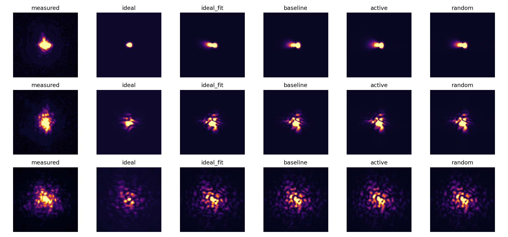
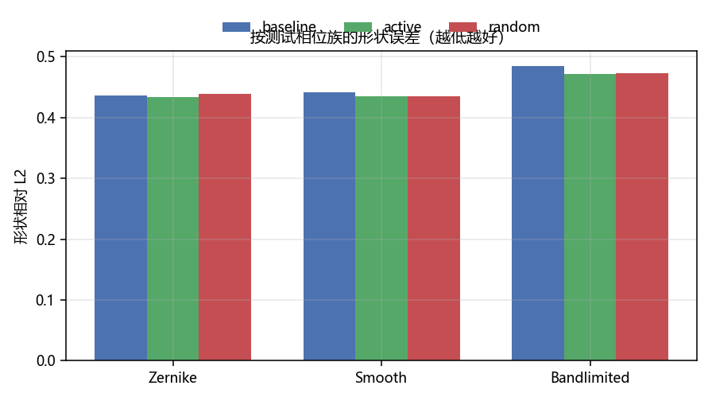
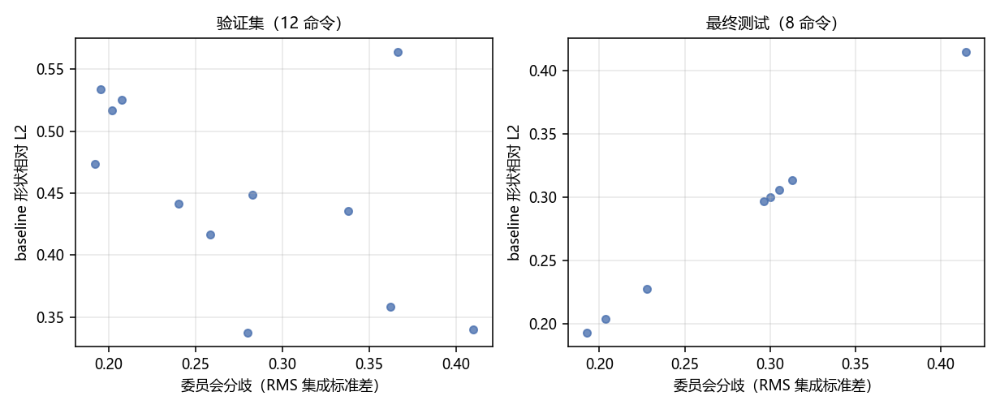
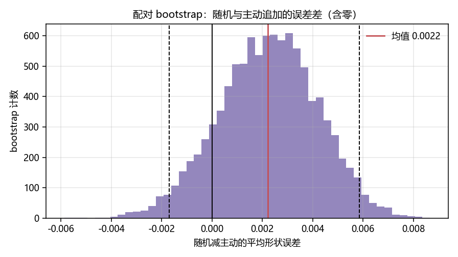
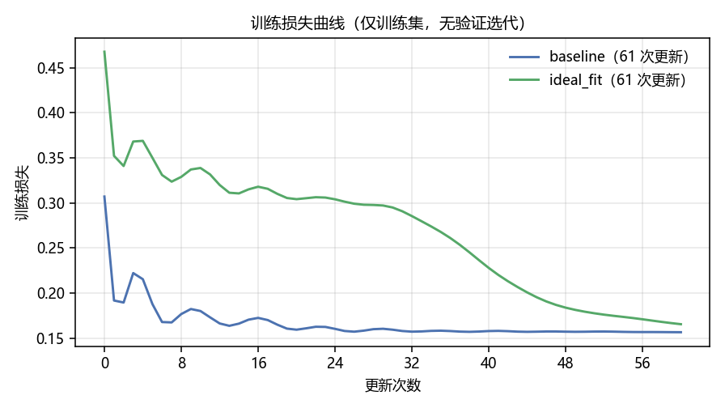
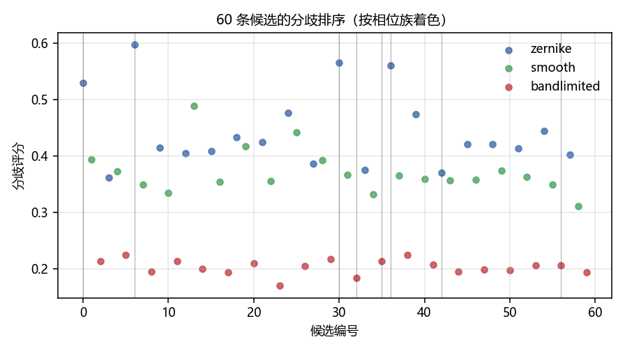

# slm-transfer-shapes 不确定性选样与少样本迁移实验（2026-11-04）

<!-- provenance:start -->
> **生成脚本**: [`scripts/slm/transfer_uncertainty_experiment.py`](../../../scripts/slm/transfer_uncertainty_experiment.py)
> **复现命令**: `python scripts/slm/transfer_uncertainty_experiment.py --root data/debug/transfer_uncertainty_20261104 --render-only`
> **运行环境**: 硬件：1064 nm Santec SLM + Daheng CCD；拟合使用 CUDA
> **说明**: 先使用生产 capture --grid 128 --count 24 --frames 3 --seed 110421 --save-dataset 采集 capture/，再以 --execute 完成选样采集；离线渲染用 --render-only，不触碰设备。
<!-- provenance:end -->

## 实测结论

**少样本物理参数迁移改善了独立命令预测；当前委员会分歧未通过置信度验证，
不能据此认定主动采样优于随机采样。** 理想 2f 起点用 12 条实测训练命令拟合后，
8 条独立测试的形状相对 L2 从 0.67259
降至 0.45920（下降 31.73%）。
历史参数热启动的 baseline 为 0.45039；
加 4 条主动采样降至 0.44361
（相对 baseline 下降 1.51%），加 4 条随机采样为
0.44582。主动与随机差异的配对区间跨零，
本轮不支持宣称主动选样有可靠优势。残留形状误差约 0.44，模型仍需改进。

## 对象与实验边界

本轮只使用 `slm-transfer-shapes` 的 `PhysicalForwardFit` / `FrozenDefocusForward`。
它是可微物理预测模型，拟合离焦、光轴、入射高斯振幅、Noll 5–11 像差与共享辐射参数，
不是带 Dropout 的深度网络。权重起点是今天 19:21 会话的
`data/debug/slm_transfer/20261104_192122/fit/frozen_parameters.json`。
原文件不改；当前零点与 signed-ramp 几何重测后用于所有模型。

模型键读法：

| 键 | 含义 |
|---|---|
| ideal | 理想 2f 基准模型：采用实测几何但把离焦与像差设为 0，高斯幅度为假设值，增益沿用起点 |
| ideal_fit | 理想 2f 基准模型经少样本 CCD 实测标定后的物理预测模型 |
| historical | 历史标定物理预测模型：沿用历史会话拟合参数并更新本轮几何，未用本轮光路数据重新拟合 |
| baseline | 当前光路用 12 条实测训练命令拟合后的热启动物理预测模型 |
| active / random | 从同一 baseline 追加 4 条实测命令标定后的物理预测模型（主动/随机选样） |

实验数据在 `data/debug/transfer_uncertainty_20261104/`。
`experiment.json` 保留实验执行时的脚本和输入权重 SHA256；
`analysis_execution.json` 单独记录后续离线分析脚本版本。两个 capture 目录保存 raw frames、
实际面板灰度、raw radians、曝光回读、逐帧时钟和 manifest。
SLM 为 1064 nm，1920×1200 面板；模型控制网格 128²、FFT 1024²、3×3 亚像元积分。
相机使用生产采集路径的 Mono8 计数，自动曝光只保护动态范围；评价单位为 counts/ms。
固定相机窗半宽 120 px、采样步长 2 px，任何测试图像都不单独重心对齐。

## 预定协议

1. 首轮 24 条探针按生产划分为 12 train、12 validation，另有平场首尾和 8 条 signed-ramp。
2. 原历史参数热启动，训练损失选出 baseline；理想 2f 起点另拟合 ideal_fit。
   ideal 与 ideal_fit 共享实测几何；ideal 的高斯幅度是假设值，增益沿用起点，
   因而理想支路的绝对强度误差不可解释成纯像差误差。
3. 4 个独立相位 bootstrap 重采样拟合构成委员会；结构与物理方程相同。
   每个成员 60 次更新，不从 validation 挑迭代，也不引入未训练的 Dropout。
4. 60 条新候选只预测不采集，以均值归一化强度的集成标准差 RMS 排序，
   选择 4 条最高分歧且非重复命令。随机变体从余下候选无放回抽 4 条。
   两个变体交错实测，每条记录 3 帧。
5. 两个变体分别用同样 12+4 条训练命令从相同历史起点拟合，更新预算相同。
   另 8 条全新命令仅最终评价使用，未进入训练、委员会、选样或停止条件。
   这些测试命令属于相同三类探针分布，未验证任意目标整形相位的外推。

主动候选编号 `[6, 30, 36, 0]`；随机候选编号
`[32, 42, 56, 35]`。4 条主动候选全部属于 Zernike 族。
两次采集起点零点漂移 `[-0.3962869967322149, 0.31885341996405714]` px。

## 独立 CCD 预测结果

形状相对 L2 为逐图均值归一化后的预测误差；绝对相对 L2 不做逐图亮度拟合。
NCC 越高越好，两种 L2 越低越好。所有数值为 8 条独立命令的算术均值。

| 模型 | NCC | 形状相对 L2 | 绝对相对 L2 |
|---|---:|---:|---:|
| ideal | 0.71263 | 0.67259 | 0.67383 |
| ideal_fit | 0.88103 | 0.45920 | 0.45840 |
| historical | 0.77388 | 0.60481 | 0.60977 |
| baseline | 0.88162 | 0.45039 | 0.45049 |
| active | 0.88611 | 0.44361 | 0.44305 |
| random | 0.88571 | 0.44582 | 0.44536 |

| 测试相位族 | baseline 形状 L2 | +4 主动 | +4 随机 |
|---|---:|---:|---:|
| zernike | 0.43601 | 0.43334 | 0.43888 |
| smooth | 0.44191 | 0.43521 | 0.43451 |
| bandlimited | 0.48468 | 0.47159 | 0.47320 |

随机减主动的形状误差均值为 `0.002217`，逐命令配对 bootstrap
95% 区间 `[-0.0017035407544981518, 0.005860520589349643]`。
该区间只有 8 条命令、一个光路会话，不能代表跨日稳定收益。
原始逐命令结果见 [JSON](artifacts/summary_20261104.json)。

## 置信度是否可信

验证集分歧与 baseline 形状误差的 Spearman 相关为
`-0.4336`；最终测试相关为
`-0.3333`。
分歧只是排序分数，没有校准成“预测正确概率”，也没有统计覆盖率保证。
同样物理结构的成员可能共同漏掉振幅结构、SLM 响应、散射或高阶像差，
所以低分歧不能证明预测准确。均值归一化虽能排除整体增益分歧，仍对尖锐光斑更敏感，
导致候选全部集中到 Zernike 族。是否有效必须与分族残差、随机对照一起判断。

三帧中的第一帧与第二帧相对 L2（未经均值归一化）为
`[0.09464669538681994, 0.13278764394657463, 0.06934596757943257, 0.12728711453592564, 0.15597230640411405, 0.06189973107928127, 0.11609444443538579, 0.14415808536468164]`。
这只是同命令短时间重复性诊断，包含量化、散粒、读出和微小漂移；
不是模型的认知不确定性，也不能与形状误差直接相减。

## 诊断图

## 可复用的方法与条件

| 方法 | 适用场景和条件 | 必须保留的检查 |
|---|---|---|
| 当前几何重测 + 共享物理参数迁移 | 当前系统接近 2f，面板口径/波长一致，参数模型有表达能力 | signed-ramp 正负两轴；有效平场零点；独立测试误差 |
| 相位 bootstrap 集成 | 已有多类相位和重复帧，拟合成本可承受 | 分歧对残差的验证；共同模型偏差；成员稳定收敛 |
| 分歧 + 多样性约束选样 | 分歧已证明与误差/学习收益相关，候选能覆盖整形工作域 | 相位族配额、wrapped 命令去重、随机探索和等预算随机变体 |
| 固定窗口 counts/ms 评价 | 相机响应近似线性、每次曝光可回读、所有帧未饱和 | 曝光计数偏置；禁止每幅测试单独拟合增益或位置 |
| 独立测试与版本化保存 | 小样本拟合也必须防止过拟合 | 测试不参与选迭代/选模型；原权重不覆盖；保存命令和原始图像 |

不要把分类 Softmax 温度缩放套到连续强度回归，不能从峰值概率制造置信度。
若使用 MC Dropout，应先在相同结构和 dropout 机制下训练；当前模型没有该结构。
Dirichlet 分类证据公式也不能直接给二维强度预测提供有效误差区间。
后续更适合在分族残差上做回归误差校准，并保留最低探索预算；校准失败时回退
分层覆盖采样，不能仅按委员会分歧驱动自动闭环。

本轮验证的是预测，不等价于环形/方形整形成功。实际整形仍需相同单位的
CCD 锚定目标、有限相位步长、方向导数检查与独立重放验收。
采集结束由生产 finally 恢复平场并关闭 SLM/CCD；未覆盖生产默认检查点。
