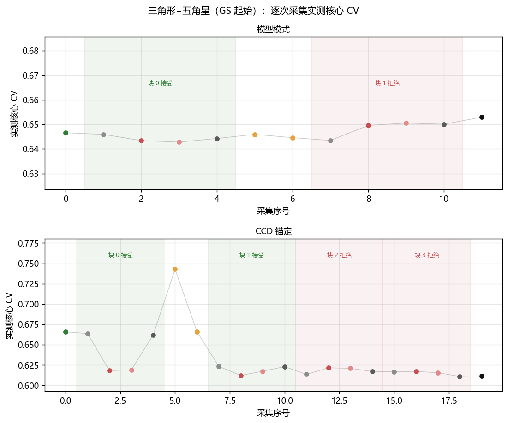
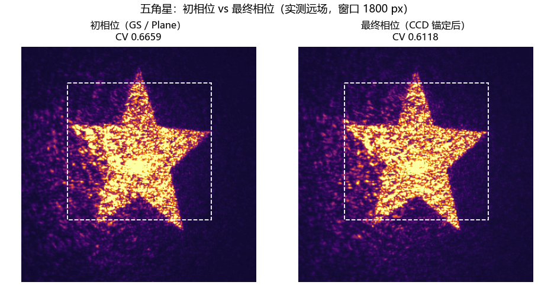
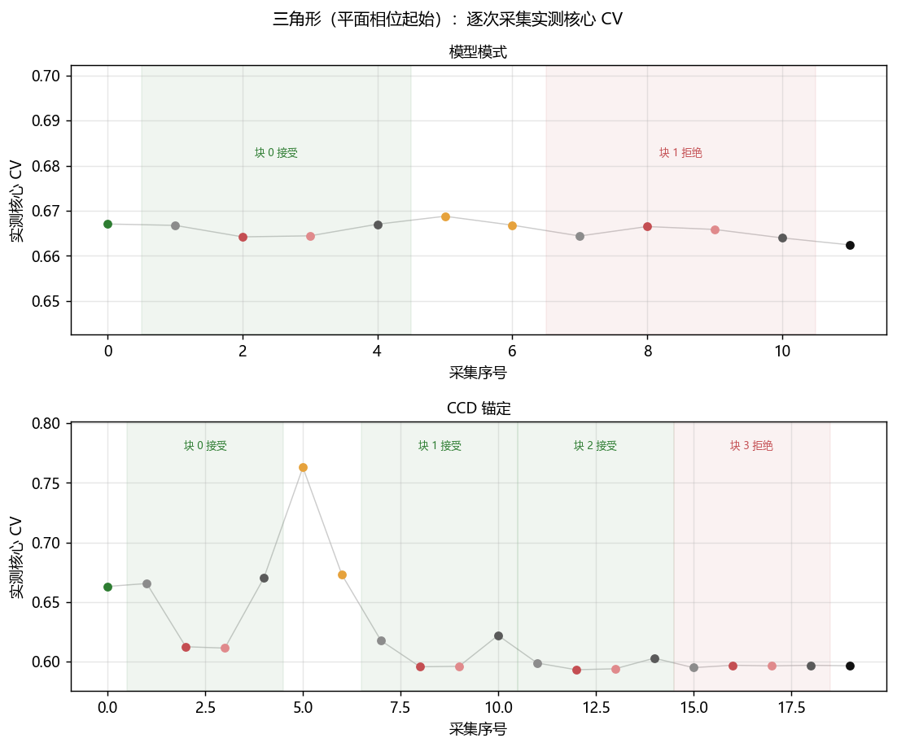
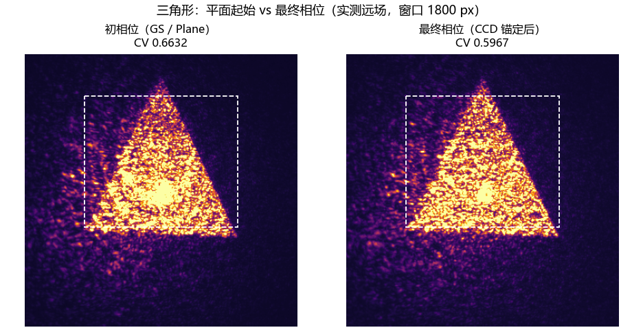

# 三角形与五角星：1.5 倍窗口 shaping 与平面相位起始对比（2026-10-27）

<!-- provenance:start -->
> **生成脚本**: [`scripts/slm/generate_tri_plane_report.py`](../../../scripts/slm/generate_tri_plane_report.py)
> **复现命令**: `python scripts/slm/generate_tri_plane_report.py`
> **数据/关联脚本**: [`src/ao_shaping/tools/slm/transfer/recording.py`](../../../src/ao_shaping/tools/slm/transfer/recording.py)
> **数据/关联脚本**: [`src/ao_shaping/tools/slm/transfer/validate.py`](../../../src/ao_shaping/tools/slm/transfer/validate.py)
> **数据/关联脚本**: [`src/ao_shaping/tools/slm/transfer/workflow.py`](../../../src/ao_shaping/tools/slm/transfer/workflow.py)
> **数据/关联脚本**: [`src/ao_shaping/tools/slm/transfer/cold_start.py`](../../../src/ao_shaping/tools/slm/transfer/cold_start.py)
> **运行环境**: 实验（Santec #1 与 Daheng，1064 nm，1200 CCD 像元）
> **说明**: 三角形与五角星 1.5 倍窗口 shaping + 平面相位起始对比：窗口开到边长 1.5 倍使目标外光可见；平面起始 3/4 块接受、CV 0.6632→0.5967，优于 GS 起始的 2/4 块；GIF 渲染修复（整窗裁剪 + 目标轮廓 + 重复采集标注）。
<!-- provenance:end -->

会话目录：`data/debug/slm_transfer/transfer_tri_star_20261027`（GS 起始）与 `data/debug/slm_transfer/transfer_plane_20261027`（平面相位起始）。设备：Santec SLM #1 + Daheng MER2-507-23GM NIR，1064 nm；目标边长 1200 CCD 原生像元；采样窗半跨 900 px（1.5× 边长），步长 4 px。

## 1 结论

1. **窗口开到 1.5 倍边长**后，GIF 可以看到目标外的光分布——五角星的旁瓣与三角形的散斑在目标轮廓外清晰可见，为后续优化提供了诊断信息。
2. **平面相位起始优于 GS 起始**：三角形 plane final CV 0.5967 vs GS triangle 0.6118，接受 3/4 块 vs 2/4 块。GS 种子虽然提供好起点，但其相位 RMS 已达 13.8 rad，optimizer 步长 budget 被压制；从平面出发的模型引导微调反而更深入。
3. **模型方向性仍弱**（差值图相关 ~0.31–0.39），每一块都必须由实测 ABBA 判决。
4. **GIF 渲染修复**：远场面板按整窗裁剪并画出目标轮廓（虚线）；B2 重放 B1 时相位变化面板显示「与上一次相位相同 (重复采集)」而非空图。

## 2 三角形 + 五角星（GS 起始）

Seed CV 0.6659 → Final CV 0.6118，接受 2/4 块。

过程动画：`figures/process_gs.gif`

## 3 三角形（平面相位起始）

Seed CV 0.6632 → Final CV 0.5967，接受 3/4 块。

过程动画：`figures/process_plane.gif`

## 4 关键数据对比

| 指标 | GS 起始（五角星） | 平面起始（三角形） |
|---|---|---|
| Seed CV | 0.6659 | 0.6632 |
| Final CV | 0.6118 | 0.5967 |
| 接受块数 | 2/4 | 3/4 |
| 曝光 (ms) | 61.55 | 81.79 |
| 最大峰值 (counts) | 2668 | 2103 |
| 审计状态 | passed | passed |

## 5 ABBA 判决明细

### GS 起始（五角星）

| 块 | 基线 | 候选 | 漂移 | 判决 |
|---|---|---|---|---|
| 0 | 0.6629 | 0.6187 | 0.0020 | ✓ |
| 1 | 0.6232 | 0.6149 | 0.0002 | ✓ |
| 2 | 0.6154 | 0.6214 | 0.0036 | ✗ |
| 3 | 0.6140 | 0.6164 | 0.0058 | ✗ |

### 平面起始（三角形）

| 块 | 基线 | 候选 | 漂移 | 判决 |
|---|---|---|---|---|
| 0 | 0.6680 | 0.6121 | 0.0046 | ✓ |
| 1 | 0.6200 | 0.5960 | 0.0044 | ✓ |
| 2 | 0.6010 | 0.5937 | 0.0041 | ✓ |
| 3 | 0.5961 | 0.5968 | 0.0020 | ✗ |

## 6 代码改动

- `crop_frame` 现在裁剪的是**采样窗**（而非仅目标区），并返回目标框供渲染器画轮廓。
- GIF 远场面板画出目标虚线轮廓，使目标外的光分布可见。
- B2 重放 B1 时相位变化面板显示「与上一次相位相同 (重复采集)」。
- 新增 `record` 子命令（device-free 重建）与 `capture_record` 共享构建器。
- 新增测试：`test_crop_frame_returns_the_target_box_in_crop_pixels`、`test_rebuild_run_reproduces_the_records_without_a_device`、`test_plane_start_skips_the_model_stage`、`test_cold_plane_start_is_carrier_only`。
